# ChaosRealmsAI GPT Image2 — source archive 15

**All items individually reviewed.** Current publication and held outcomes are recorded per item below; [complete review ledger](data/chaos-editorial-review-progress-2026-11-06.json). Full source prompts, model evidence, native dimensions, reference requirements and unchanged author-published2400px renditions are retained. These are GPT Image2, not2.6. Raw generation PNGs are absent from this source tree.

MIT · copyright2026 GPT Image2 Hub / ChaosRealmsAI. [Full source license](sources/chaos-gpt-image-2/LICENSE). Original external rights retained.

## Look Switch Three · salon-color-makeover-campaign/series-identity-switchboard/04-look-switch-three

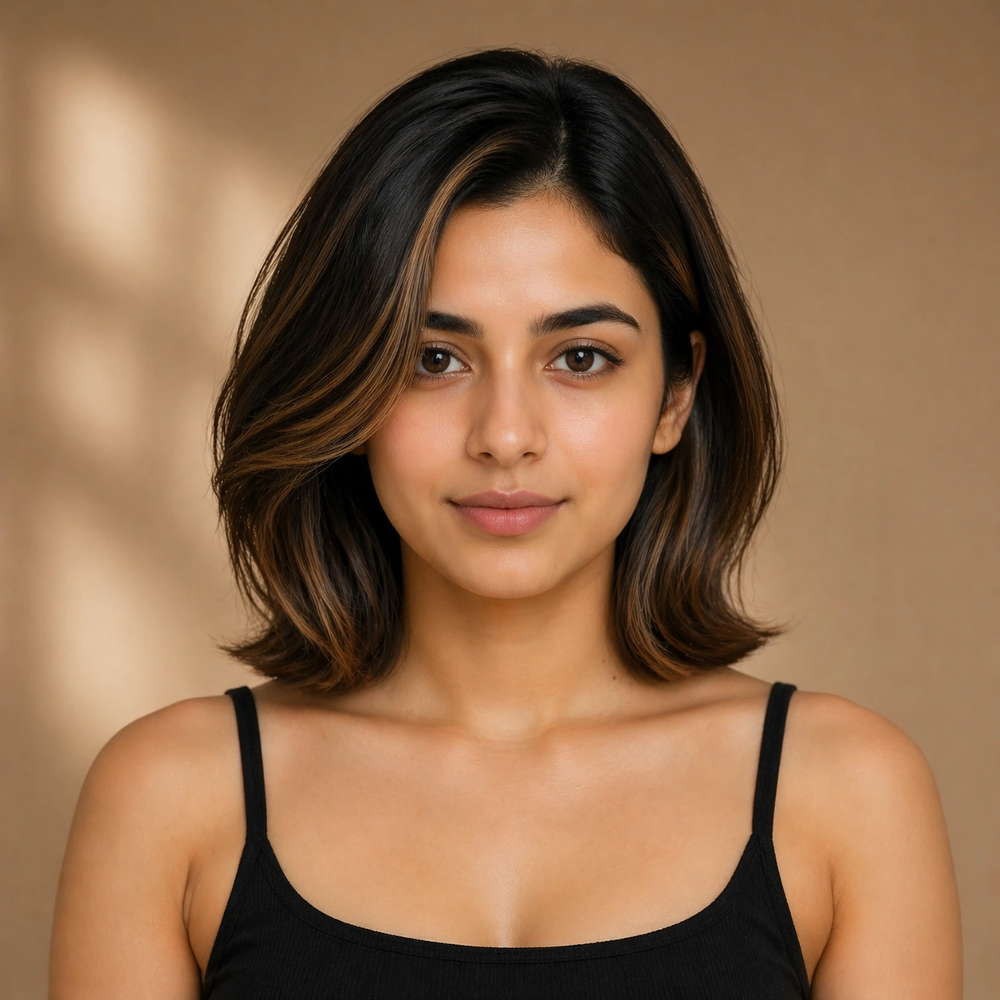

```text
Scene:
Create a square 1:1 portrait image for Salon Color Makeover Campaign. Use a slightly bolder campaign-like frame with disciplined crop and clean light falloff. The frame should feel like a finished professional deliverable rather than a casual snapshot, with clear lens discipline, believable light falloff, and a palette that directly supports Design salon-ready hair-color makeover campaigns that highlight believable before-after change, hair texture, and beauty-advertising polish.. Keep enough surrounding space and compositional control for gallery, research, campaign, or approval-board reuse while staying photoreal and human-scaled.

Subject:
Center one salon model with neutral beige skin, collarbone-length dark hair, a clean oval face, and a precise hairline built for controlled color changes. Apply a third styling direction while holding the same reference identity with no drift in age, ethnicity, or face structure. Use the example direction from the brief as grounding context: Design salon-ready hair-color makeover campaigns that highlight believable before-after change, hair texture, and beauty-advertising polish.. Wardrobe, lighting, environment, and pose may shift to serve this variation, but the viewer must immediately understand that the same reference identity is still in front of the camera.

Important details:
This backlog line is difficult because Design salon-ready hair-color makeover campaigns that highlight believable before-after change, hair texture, and beauty-advertising polish.. Preserve skin tone family, bone structure, eye spacing, nose shape, mouth shape, hairline logic, shoulder width, and overall body read across the entire series. preserve exact face / hair base / body proportions from the reference model. The image should prove range under control rather than spectacle for spectacle alone. Avoid the common failure described in the brief: ordinary image models often lose likeness once styling, lighting, or layout changes enter the frame. Success should feel like the result should feel professionally usable, coherent, and clearly built around one stable human identity.

Use case:
Salon Color Makeover Campaign series study 4/9, the third controlled transformation.

Constraints:
No readable text, no watermark, no logos, preserve exact 1:1 aspect ratio, preserve exact face / hair base / body proportions from the reference model, no gimmick costume, no false lashes that change eye shape, no surreal hair physics, no second person.
```

[Pinned source](https://github.com/ChaosRealmsAI/gpt-image-2-gallery/blob/5296db8c996e38776c83a0bc8c64f848dcd512b3/works/topics/salon-color-makeover-campaign/packages/series-identity-switchboard/images/04-look-switch-three/meta.json) · GPT Image2 · 1254×1254 · Reference images required. · ProjectD:[published and publicly accepted](https://aitoolsradar.com/en/prompts/ee70331adfe946)

## Look Switch Four · salon-color-makeover-campaign/series-identity-switchboard/05-look-switch-four

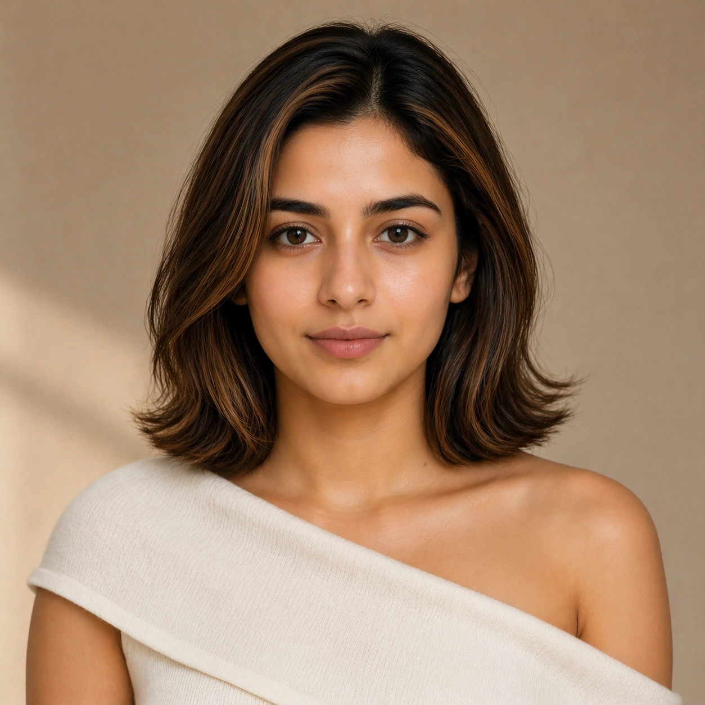

```text
Scene:
Create a square 1:1 portrait image for Salon Color Makeover Campaign. Use a close or mid-shot portrait that privileges detail and approval clarity over background storytelling. The frame should feel like a finished professional deliverable rather than a casual snapshot, with clear lens discipline, believable light falloff, and a palette that directly supports Design salon-ready hair-color makeover campaigns that highlight believable before-after change, hair texture, and beauty-advertising polish.. Keep enough surrounding space and compositional control for gallery, research, campaign, or approval-board reuse while staying photoreal and human-scaled.

Subject:
Center one salon model with neutral beige skin, collarbone-length dark hair, a clean oval face, and a precise hairline built for controlled color changes. Keep the same exact subject while introducing another visible shift in style language, finish, or mood tied directly to the topic brief. Use the example direction from the brief as grounding context: Design salon-ready hair-color makeover campaigns that highlight believable before-after change, hair texture, and beauty-advertising polish.. Wardrobe, lighting, environment, and pose may shift to serve this variation, but the viewer must immediately understand that the same reference identity is still in front of the camera.

Important details:
This backlog line is difficult because Design salon-ready hair-color makeover campaigns that highlight believable before-after change, hair texture, and beauty-advertising polish.. Preserve skin tone family, bone structure, eye spacing, nose shape, mouth shape, hairline logic, shoulder width, and overall body read across the entire series. preserve exact face / hair base / body proportions from the reference model. Micro-details may change, but likeness, skin tone family, and body read cannot. Avoid the common failure described in the brief: ordinary image models often lose likeness once styling, lighting, or layout changes enter the frame. Success should feel like the result should feel professionally usable, coherent, and clearly built around one stable human identity.

Use case:
Salon Color Makeover Campaign series study 5/9, the fourth controlled transformation.

Constraints:
No readable text, no watermark, no logos, preserve exact 1:1 aspect ratio, preserve exact face / hair base / body proportions from the reference model, no retouch blur, no facial asymmetry drift, no extra accessories noise, no unreadable product text.
```

[Pinned source](https://github.com/ChaosRealmsAI/gpt-image-2-gallery/blob/5296db8c996e38776c83a0bc8c64f848dcd512b3/works/topics/salon-color-makeover-campaign/packages/series-identity-switchboard/images/05-look-switch-four/meta.json) · GPT Image2 · 1254×1254 · Reference images required. · ProjectD:[published and publicly accepted](https://aitoolsradar.com/en/prompts/ea4109eb5933e5)

## Look Switch Five · salon-color-makeover-campaign/series-identity-switchboard/06-look-switch-five

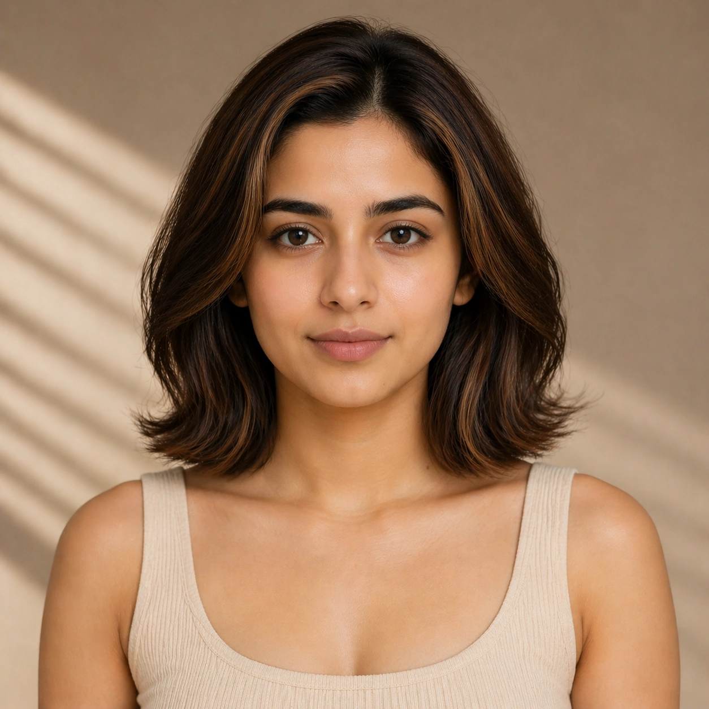

```text
Scene:
Create a square 1:1 portrait image for Salon Color Makeover Campaign. Use a square portrait with polished commercial finish and enough room to see styling structure clearly. The frame should feel like a finished professional deliverable rather than a casual snapshot, with clear lens discipline, believable light falloff, and a palette that directly supports Design salon-ready hair-color makeover campaigns that highlight believable before-after change, hair texture, and beauty-advertising polish.. Keep enough surrounding space and compositional control for gallery, research, campaign, or approval-board reuse while staying photoreal and human-scaled.

Subject:
Center one salon model with neutral beige skin, collarbone-length dark hair, a clean oval face, and a precise hairline built for controlled color changes. Push to a fifth variation while preserving exact face / hair base / body proportions from the reference model. This should still feel like one person being art-directed, not re-generated from scratch. Use the example direction from the brief as grounding context: Design salon-ready hair-color makeover campaigns that highlight believable before-after change, hair texture, and beauty-advertising polish.. Wardrobe, lighting, environment, and pose may shift to serve this variation, but the viewer must immediately understand that the same reference identity is still in front of the camera.

Important details:
This backlog line is difficult because Design salon-ready hair-color makeover campaigns that highlight believable before-after change, hair texture, and beauty-advertising polish.. Preserve skin tone family, bone structure, eye spacing, nose shape, mouth shape, hairline logic, shoulder width, and overall body read across the entire series. preserve exact face / hair base / body proportions from the reference model. Keep continuity stronger than novelty. Avoid the common failure described in the brief: ordinary image models often lose likeness once styling, lighting, or layout changes enter the frame. Success should feel like the result should feel professionally usable, coherent, and clearly built around one stable human identity.

Use case:
Salon Color Makeover Campaign series study 6/9, the fifth controlled transformation.

Constraints:
No readable text, no watermark, no logos, preserve exact 1:1 aspect ratio, preserve exact face / hair base / body proportions from the reference model, no gender drift unless explicitly relevant, no unrelated props, no costume confusion, no body-scale jump.
```

[Pinned source](https://github.com/ChaosRealmsAI/gpt-image-2-gallery/blob/5296db8c996e38776c83a0bc8c64f848dcd512b3/works/topics/salon-color-makeover-campaign/packages/series-identity-switchboard/images/06-look-switch-five/meta.json) · GPT Image2 · 1254×1254 · Reference images required. · ProjectD:[published and publicly accepted](https://aitoolsradar.com/en/prompts/08d16affb8dbc1)

## Look Switch Six · salon-color-makeover-campaign/series-identity-switchboard/07-look-switch-six

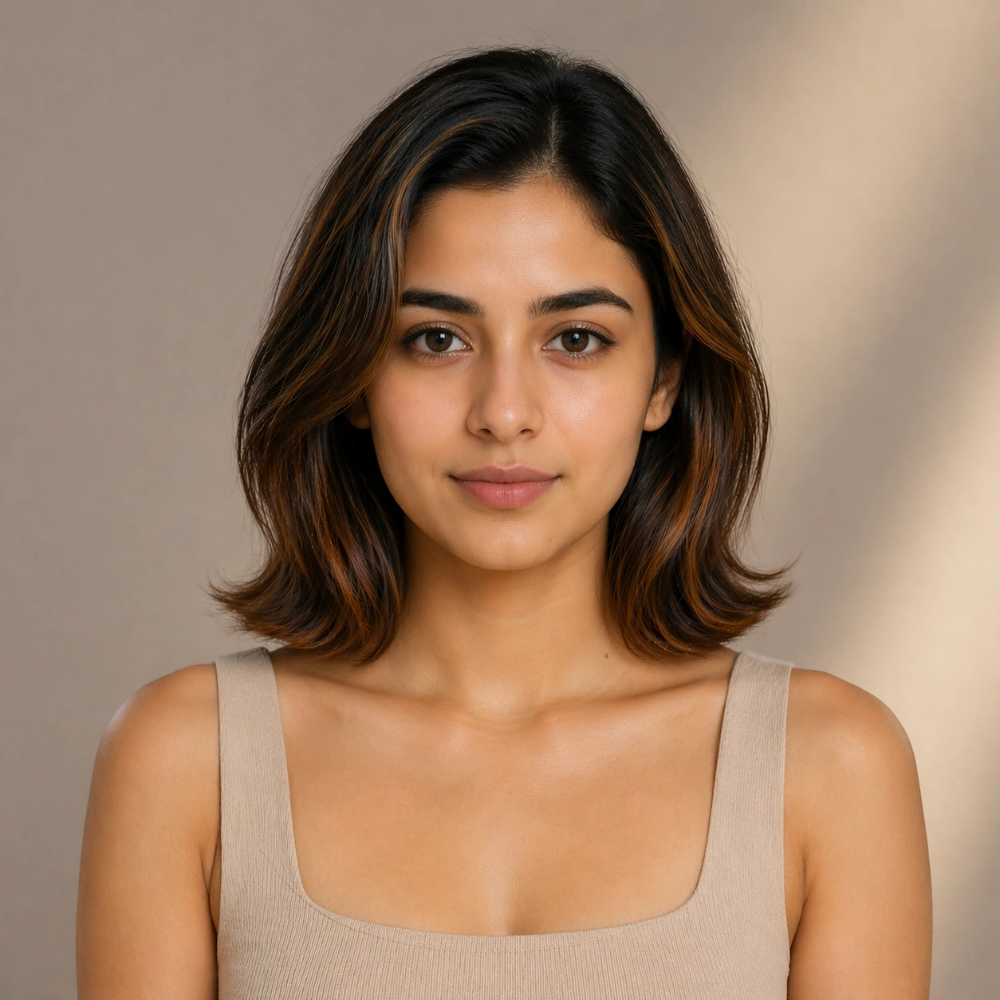

```text
Scene:
Create a square 1:1 portrait image for Salon Color Makeover Campaign. Use a final single-look variation with confident but restrained campaign polish. The frame should feel like a finished professional deliverable rather than a casual snapshot, with clear lens discipline, believable light falloff, and a palette that directly supports Design salon-ready hair-color makeover campaigns that highlight believable before-after change, hair texture, and beauty-advertising polish.. Keep enough surrounding space and compositional control for gallery, research, campaign, or approval-board reuse while staying photoreal and human-scaled.

Subject:
Center one salon model with neutral beige skin, collarbone-length dark hair, a clean oval face, and a precise hairline built for controlled color changes. Use the same person again in a sixth styling state, making sure recognition is instant before the viewer notices what changed. Use the example direction from the brief as grounding context: Design salon-ready hair-color makeover campaigns that highlight believable before-after change, hair texture, and beauty-advertising polish.. Wardrobe, lighting, environment, and pose may shift to serve this variation, but the viewer must immediately understand that the same reference identity is still in front of the camera.

Important details:
This backlog line is difficult because Design salon-ready hair-color makeover campaigns that highlight believable before-after change, hair texture, and beauty-advertising polish.. Preserve skin tone family, bone structure, eye spacing, nose shape, mouth shape, hairline logic, shoulder width, and overall body read across the entire series. preserve exact face / hair base / body proportions from the reference model. The transformation should feel deliberate, premium, and usable in a real salon, beauty, fashion, or casting workflow. Avoid the common failure described in the brief: ordinary image models often lose likeness once styling, lighting, or layout changes enter the frame. Success should feel like the result should feel professionally usable, coherent, and clearly built around one stable human identity.

Use case:
Salon Color Makeover Campaign series study 7/9, the sixth controlled transformation.

Constraints:
No readable text, no watermark, no logos, preserve exact 1:1 aspect ratio, preserve exact face / hair base / body proportions from the reference model, no hidden face, no perspective warp, no dramatic environment change, no AI-gloss artifacts.
```

[Pinned source](https://github.com/ChaosRealmsAI/gpt-image-2-gallery/blob/5296db8c996e38776c83a0bc8c64f848dcd512b3/works/topics/salon-color-makeover-campaign/packages/series-identity-switchboard/images/07-look-switch-six/meta.json) · GPT Image2 · 1254×1254 · Reference images required. · ProjectD:[published and publicly accepted](https://aitoolsradar.com/en/prompts/627f09a0ff8c5f)

## Detail Proof Board · salon-color-makeover-campaign/series-identity-switchboard/08-detail-proof-board

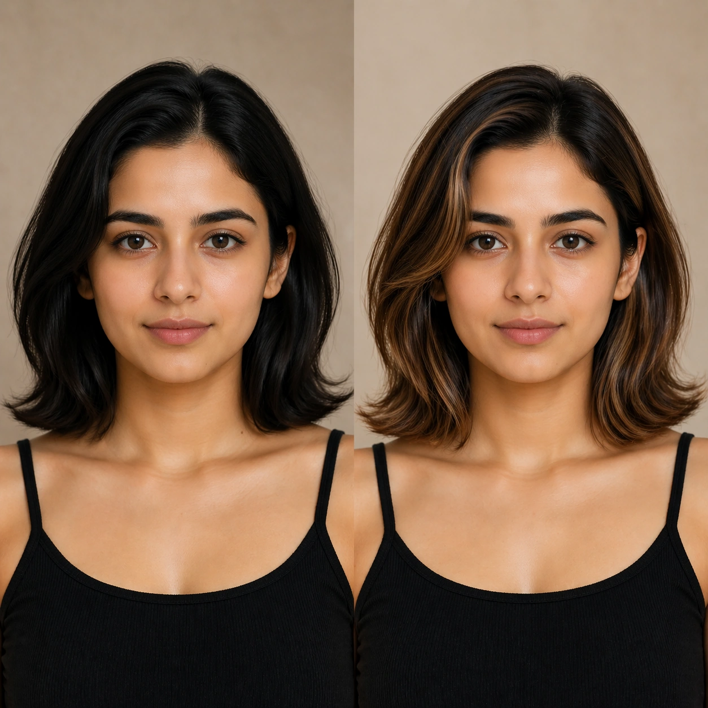

```text
Scene:
Create a square 1:1 portrait image for Salon Color Makeover Campaign. Use a square composition that can include multiple tight crops or one richer close-up, but still reads as one coherent portrait asset. The frame should feel like a finished professional deliverable rather than a casual snapshot, with clear lens discipline, believable light falloff, and a palette that directly supports Design salon-ready hair-color makeover campaigns that highlight believable before-after change, hair texture, and beauty-advertising polish.. Keep enough surrounding space and compositional control for gallery, research, campaign, or approval-board reuse while staying photoreal and human-scaled.

Subject:
Center one salon model with neutral beige skin, collarbone-length dark hair, a clean oval face, and a precise hairline built for controlled color changes. Stay locked to the same identity while emphasizing the evidence of the switch: hair texture, makeup finish, beard line, garment detail, or aging cues depending on the topic. Use the example direction from the brief as grounding context: Design salon-ready hair-color makeover campaigns that highlight believable before-after change, hair texture, and beauty-advertising polish.. Wardrobe, lighting, environment, and pose may shift to serve this variation, but the viewer must immediately understand that the same reference identity is still in front of the camera.

Important details:
This backlog line is difficult because Design salon-ready hair-color makeover campaigns that highlight believable before-after change, hair texture, and beauty-advertising polish.. Preserve skin tone family, bone structure, eye spacing, nose shape, mouth shape, hairline logic, shoulder width, and overall body read across the entire series. preserve exact face / hair base / body proportions from the reference model. This frame should support professional review and decision making without readable text. Avoid the common failure described in the brief: ordinary image models often lose likeness once styling, lighting, or layout changes enter the frame. Success should feel like the result should feel professionally usable, coherent, and clearly built around one stable human identity.

Use case:
Salon Color Makeover Campaign series study 8/9, a detail-proof or comparison board.

Constraints:
No readable text, no watermark, no logos, preserve exact 1:1 aspect ratio, preserve exact face / hair base / body proportions from the reference model, no readable labels, no broken panel alignment, no detached close-up fragments, no face drift.
```

[Pinned source](https://github.com/ChaosRealmsAI/gpt-image-2-gallery/blob/5296db8c996e38776c83a0bc8c64f848dcd512b3/works/topics/salon-color-makeover-campaign/packages/series-identity-switchboard/images/08-detail-proof-board/meta.json) · GPT Image2 · 1254×1254 · Reference images required. · ProjectD:[published and publicly accepted](https://aitoolsradar.com/en/prompts/f6e0a292137cd8)

## Campaign Finale · salon-color-makeover-campaign/series-identity-switchboard/09-campaign-finale

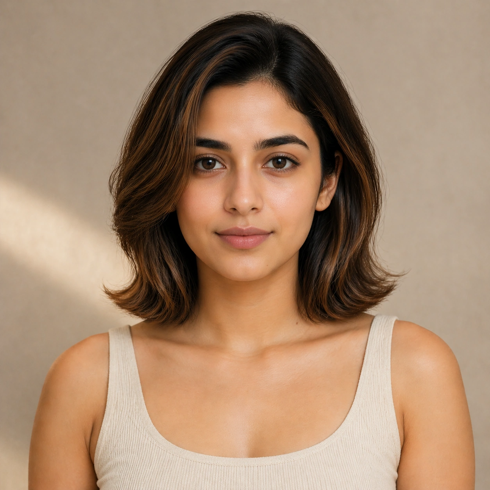

```text
Scene:
Create a square 1:1 portrait image for Salon Color Makeover Campaign. Use a square commercial finish with strong portrait presence, premium negative space, and final-asset confidence. The frame should feel like a finished professional deliverable rather than a casual snapshot, with clear lens discipline, believable light falloff, and a palette that directly supports Design salon-ready hair-color makeover campaigns that highlight believable before-after change, hair texture, and beauty-advertising polish.. Keep enough surrounding space and compositional control for gallery, research, campaign, or approval-board reuse while staying photoreal and human-scaled.

Subject:
Center one salon model with neutral beige skin, collarbone-length dark hair, a clean oval face, and a precise hairline built for controlled color changes. Resolve the same identity into a final hero image that proves the transformation line can ship as a real campaign, promo board, or salon approval visual. Use the example direction from the brief as grounding context: Design salon-ready hair-color makeover campaigns that highlight believable before-after change, hair texture, and beauty-advertising polish.. Wardrobe, lighting, environment, and pose may shift to serve this variation, but the viewer must immediately understand that the same reference identity is still in front of the camera.

Important details:
This backlog line is difficult because Design salon-ready hair-color makeover campaigns that highlight believable before-after change, hair texture, and beauty-advertising polish.. Preserve skin tone family, bone structure, eye spacing, nose shape, mouth shape, hairline logic, shoulder width, and overall body read across the entire series. preserve exact face / hair base / body proportions from the reference model. The final degree of polish cannot erase the exact same-person read established in image 01. Avoid the common failure described in the brief: ordinary image models often lose likeness once styling, lighting, or layout changes enter the frame. Success should feel like the result should feel professionally usable, coherent, and clearly built around one stable human identity.

Use case:
Salon Color Makeover Campaign series study 9/9, a polished campaign finale.

Constraints:
No readable text, no watermark, no logos, preserve exact 1:1 aspect ratio, preserve exact face / hair base / body proportions from the reference model, no readable copy, no logos, no poster clutter, no identity reset.
```

[Pinned source](https://github.com/ChaosRealmsAI/gpt-image-2-gallery/blob/5296db8c996e38776c83a0bc8c64f848dcd512b3/works/topics/salon-color-makeover-campaign/packages/series-identity-switchboard/images/09-campaign-finale/meta.json) · GPT Image2 · 1254×1254 · Reference images required. · ProjectD:[published and publicly accepted](https://aitoolsradar.com/en/prompts/2afec20002b3e2)

## Anchor Portrait · salon-color-makeover-promo/series-identity-lock/01-anchor-portrait

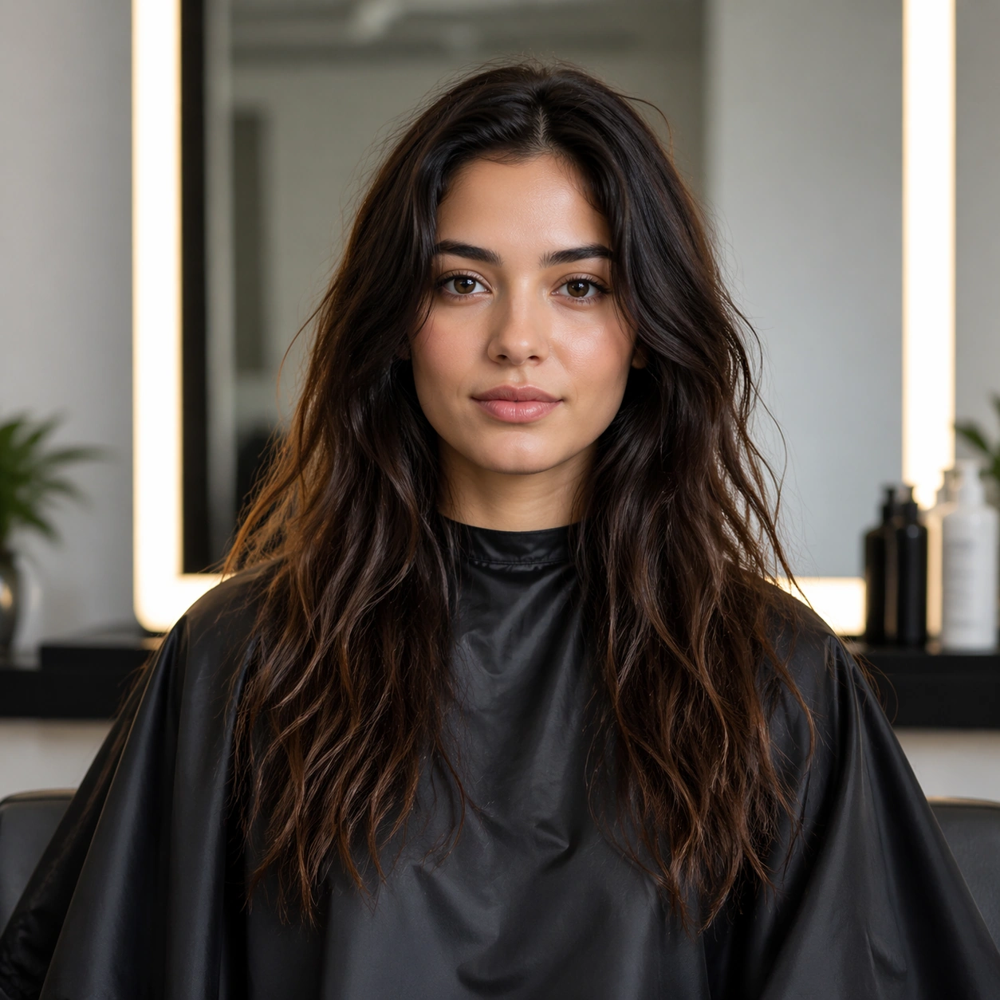

```text
Scene:
A square commercial beauty-or-fashion image designed like a polished campaign proof for Salon Color Makeover Promo. Keep the camera discipline clear and believable: portrait-oriented within the square, premium studio light, controlled tonal contrast, and enough surrounding negative space to feel like an ad layout without relying on readable typography. The image should look production-ready, with realistic skin, hair, fabric, and makeup rendering that supports identity locking instead of distracting from it.

Subject:
Build the frame around one clearly recognizable person. Anchor Portrait should feel like a specific transformation step that defines the exact face, camera angle, skin texture, and model identity that later images must preserve. The face structure, age, body proportions, and general camera position must stay consistent with the same-person premise of Create salon-grade makeover campaigns built around one person moving through before, during, and after hair color transformations with ad-ready polish.. Styling, wardrobe, grooming, makeup, hair, or pose can evolve, but the viewer must believe it is unquestionably the same subject across the whole theme. Use a premium editorial-commercial tone rather than a casual portrait session.

Important details:
The visual test is identity consistency under change. Preserve stable bone structure, eye spacing, nose shape, lip volume, skin tone family, and believable texture response. Let the transformation be visible through styling choices instead of facial drift. This theme studies editing-workflow, photorealism, commercial-mockup, structured-layout through a production-ready visual system. Make the composition clean enough for client review, with professional grooming fidelity and enough detail for salon, beauty, or fashion decision-making. Aim for clear hierarchy, polished craft, and immediately usable campaign logic.

Use case:
Salon Color Makeover Promo series study 1/4.

Constraints:
No readable text, no watermark, no logos, preserve exact 1:1 aspect ratio, no face drift, no inconsistent age shift, no extra limbs, no duplicate person, no asymmetric eye placement, no beauty-editorial chaos.
```

[Pinned source](https://github.com/ChaosRealmsAI/gpt-image-2-gallery/blob/5296db8c996e38776c83a0bc8c64f848dcd512b3/works/topics/salon-color-makeover-promo/packages/series-identity-lock/images/01-anchor-portrait/meta.json) · GPT Image2 · 1254×1254 · No source-declared image dependencies. · ProjectD:[published and publicly accepted](https://aitoolsradar.com/en/prompts/30102d877ed8ed)

## First Switch · salon-color-makeover-promo/series-identity-lock/02-first-switch

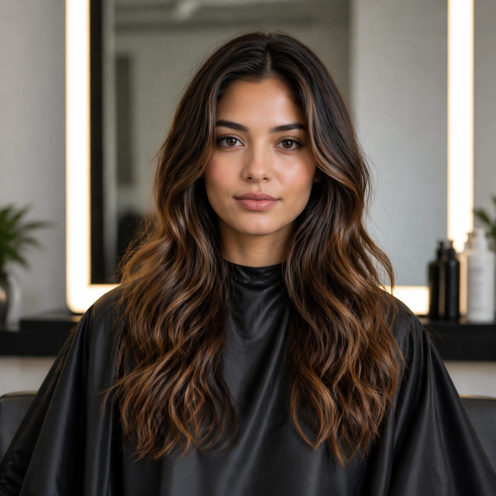

```text
Scene:
A square commercial beauty-or-fashion image designed like a polished campaign proof for Salon Color Makeover Promo. Keep the camera discipline clear and believable: portrait-oriented within the square, premium studio light, controlled tonal contrast, and enough surrounding negative space to feel like an ad layout without relying on readable typography. The image should look production-ready, with realistic skin, hair, fabric, and makeup rendering that supports identity locking instead of distracting from it.

Subject:
Build the frame around one clearly recognizable person. First Switch should feel like a specific transformation step that keeps the same identity but changes the styling direction in a clear and controlled way. The face structure, age, body proportions, and general camera position must stay consistent with the same-person premise of Create salon-grade makeover campaigns built around one person moving through before, during, and after hair color transformations with ad-ready polish.. Styling, wardrobe, grooming, makeup, hair, or pose can evolve, but the viewer must believe it is unquestionably the same subject across the whole theme. Use a premium editorial-commercial tone rather than a casual portrait session.

Important details:
The visual test is identity consistency under change. Preserve stable bone structure, eye spacing, nose shape, lip volume, skin tone family, and believable texture response. Let the transformation be visible through styling choices instead of facial drift. This theme studies editing-workflow, photorealism, commercial-mockup, structured-layout through a production-ready visual system. Make the composition clean enough for client review, with professional grooming fidelity and enough detail for salon, beauty, or fashion decision-making. Aim for clear hierarchy, polished craft, and immediately usable campaign logic.

Use case:
Salon Color Makeover Promo series study 2/4.

Constraints:
No readable text, no watermark, no logos, preserve exact 1:1 aspect ratio, no face drift, no inconsistent age shift, no extra limbs, no duplicate person, no asymmetric eye placement, no beauty-editorial chaos.
```

[Pinned source](https://github.com/ChaosRealmsAI/gpt-image-2-gallery/blob/5296db8c996e38776c83a0bc8c64f848dcd512b3/works/topics/salon-color-makeover-promo/packages/series-identity-lock/images/02-first-switch/meta.json) · GPT Image2 · 1254×1254 · Reference images required. · ProjectD:[published and publicly accepted](https://aitoolsradar.com/en/prompts/387b01c2401307)

## Second Switch · salon-color-makeover-promo/series-identity-lock/03-second-switch

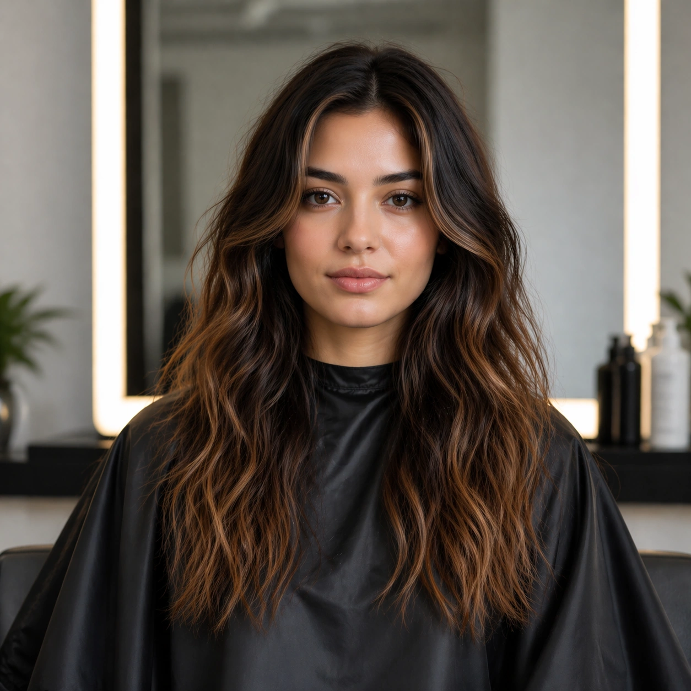

```text
Scene:
A square commercial beauty-or-fashion image designed like a polished campaign proof for Salon Color Makeover Promo. Keep the camera discipline clear and believable: portrait-oriented within the square, premium studio light, controlled tonal contrast, and enough surrounding negative space to feel like an ad layout without relying on readable typography. The image should look production-ready, with realistic skin, hair, fabric, and makeup rendering that supports identity locking instead of distracting from it.

Subject:
Build the frame around one clearly recognizable person. Second Switch should feel like a specific transformation step that pushes the same identity into a more dramatic transformation without face drift. The face structure, age, body proportions, and general camera position must stay consistent with the same-person premise of Create salon-grade makeover campaigns built around one person moving through before, during, and after hair color transformations with ad-ready polish.. Styling, wardrobe, grooming, makeup, hair, or pose can evolve, but the viewer must believe it is unquestionably the same subject across the whole theme. Use a premium editorial-commercial tone rather than a casual portrait session.

Important details:
The visual test is identity consistency under change. Preserve stable bone structure, eye spacing, nose shape, lip volume, skin tone family, and believable texture response. Let the transformation be visible through styling choices instead of facial drift. This theme studies editing-workflow, photorealism, commercial-mockup, structured-layout through a production-ready visual system. Make the composition clean enough for client review, with professional grooming fidelity and enough detail for salon, beauty, or fashion decision-making. Aim for clear hierarchy, polished craft, and immediately usable campaign logic.

Use case:
Salon Color Makeover Promo series study 3/4.

Constraints:
No readable text, no watermark, no logos, preserve exact 1:1 aspect ratio, no face drift, no inconsistent age shift, no extra limbs, no duplicate person, no asymmetric eye placement, no beauty-editorial chaos.
```

[Pinned source](https://github.com/ChaosRealmsAI/gpt-image-2-gallery/blob/5296db8c996e38776c83a0bc8c64f848dcd512b3/works/topics/salon-color-makeover-promo/packages/series-identity-lock/images/03-second-switch/meta.json) · GPT Image2 · 1254×1254 · Reference images required. · ProjectD:[published and publicly accepted](https://aitoolsradar.com/en/prompts/7f702c9ea99f73)

## Campaign Finish · salon-color-makeover-promo/series-identity-lock/04-campaign-finish

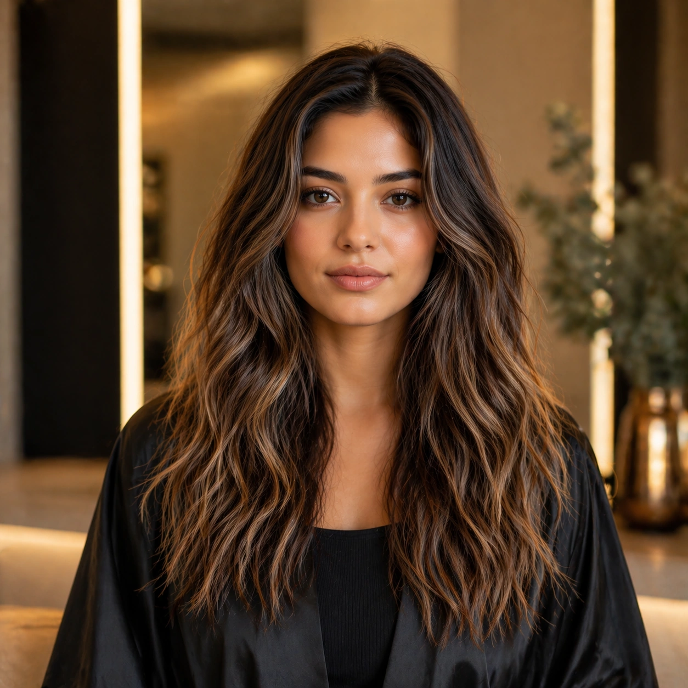

```text
Scene:
A square commercial beauty-or-fashion image designed like a polished campaign proof for Salon Color Makeover Promo. Keep the camera discipline clear and believable: portrait-oriented within the square, premium studio light, controlled tonal contrast, and enough surrounding negative space to feel like an ad layout without relying on readable typography. The image should look production-ready, with realistic skin, hair, fabric, and makeup rendering that supports identity locking instead of distracting from it.

Subject:
Build the frame around one clearly recognizable person. Campaign Finish should feel like a specific transformation step that turns the locked identity into a polished campaign-ready hero frame. The face structure, age, body proportions, and general camera position must stay consistent with the same-person premise of Create salon-grade makeover campaigns built around one person moving through before, during, and after hair color transformations with ad-ready polish.. Styling, wardrobe, grooming, makeup, hair, or pose can evolve, but the viewer must believe it is unquestionably the same subject across the whole theme. Use a premium editorial-commercial tone rather than a casual portrait session.

Important details:
The visual test is identity consistency under change. Preserve stable bone structure, eye spacing, nose shape, lip volume, skin tone family, and believable texture response. Let the transformation be visible through styling choices instead of facial drift. This theme studies editing-workflow, photorealism, commercial-mockup, structured-layout through a production-ready visual system. Make the composition clean enough for client review, with professional grooming fidelity and enough detail for salon, beauty, or fashion decision-making. Aim for clear hierarchy, polished craft, and immediately usable campaign logic.

Use case:
Salon Color Makeover Promo series study 4/4.

Constraints:
No readable text, no watermark, no logos, preserve exact 1:1 aspect ratio, no face drift, no inconsistent age shift, no extra limbs, no duplicate person, no asymmetric eye placement, no beauty-editorial chaos.
```

[Pinned source](https://github.com/ChaosRealmsAI/gpt-image-2-gallery/blob/5296db8c996e38776c83a0bc8c64f848dcd512b3/works/topics/salon-color-makeover-promo/packages/series-identity-lock/images/04-campaign-finish/meta.json) · GPT Image2 · 1254×1254 · Reference images required. · ProjectD:[published and publicly accepted](https://aitoolsradar.com/en/prompts/f504d9b3d947c1)

## Before After Board · salon-color-makeover-promo/single-editorial-support/before-after-board

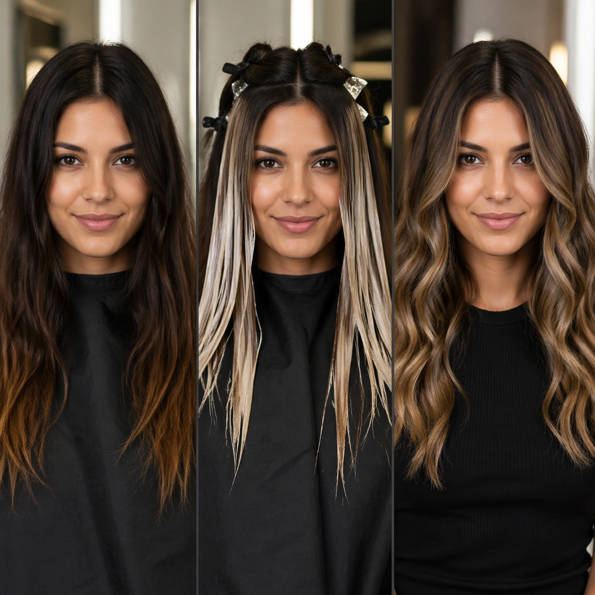

```text
Scene:
A square commercial beauty-or-fashion image designed like a polished campaign proof for Salon Color Makeover Promo. Keep the camera discipline clear and believable: portrait-oriented within the square, premium studio light, controlled tonal contrast, and enough surrounding negative space to feel like an ad layout without relying on readable typography. The image should look production-ready, with realistic skin, hair, fabric, and makeup rendering that supports identity locking instead of distracting from it.

Subject:
Build the frame around one clearly recognizable person. Before After Board should feel like a specific transformation step that a disciplined comparison layout making transformation logic instantly legible. The face structure, age, body proportions, and general camera position must stay consistent with the same-person premise of Create salon-grade makeover campaigns built around one person moving through before, during, and after hair color transformations with ad-ready polish.. Styling, wardrobe, grooming, makeup, hair, or pose can evolve, but the viewer must believe it is unquestionably the same subject across the whole theme. Use a premium editorial-commercial tone rather than a casual portrait session.

Important details:
The visual test is identity consistency under change. Preserve stable bone structure, eye spacing, nose shape, lip volume, skin tone family, and believable texture response. Let the transformation be visible through styling choices instead of facial drift. This theme studies editing-workflow, photorealism, commercial-mockup, structured-layout through a production-ready visual system. Make the composition clean enough for client review, with professional grooming fidelity and enough detail for salon, beauty, or fashion decision-making. Aim for clear hierarchy, polished craft, and immediately usable campaign logic.

Use case:
Salon Color Makeover Promo single study 1/5.

Constraints:
No readable text, no watermark, no logos, preserve exact 1:1 aspect ratio, no face drift, no inconsistent age shift, no extra limbs, no duplicate person, no asymmetric eye placement, no beauty-editorial chaos.
```

[Pinned source](https://github.com/ChaosRealmsAI/gpt-image-2-gallery/blob/5296db8c996e38776c83a0bc8c64f848dcd512b3/works/topics/salon-color-makeover-promo/packages/single-editorial-support/images/before-after-board/meta.json) · GPT Image2 · 1254×1254 · No source-declared image dependencies. · ProjectD:[published and publicly accepted](https://aitoolsradar.com/en/prompts/2a063af8e64a7b)

## Lookbook Sheet · salon-color-makeover-promo/single-editorial-support/lookbook-sheet

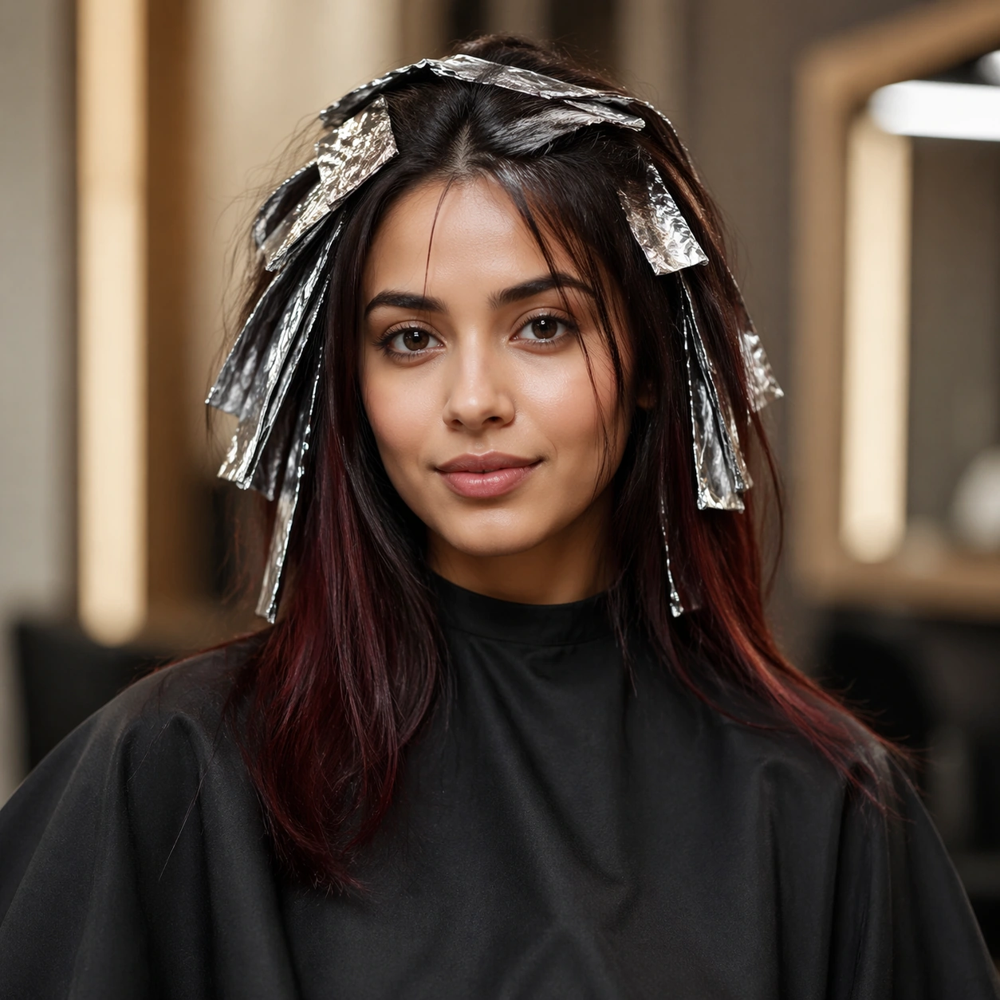

```text
Scene:
A square commercial beauty-or-fashion image designed like a polished campaign proof for Salon Color Makeover Promo. Keep the camera discipline clear and believable: portrait-oriented within the square, premium studio light, controlled tonal contrast, and enough surrounding negative space to feel like an ad layout without relying on readable typography. The image should look production-ready, with realistic skin, hair, fabric, and makeup rendering that supports identity locking instead of distracting from it.

Subject:
Build the frame around one clearly recognizable person. Lookbook Sheet should feel like a specific transformation step that a fashion or salon lookbook page using one consistent identity across multiple panels. The face structure, age, body proportions, and general camera position must stay consistent with the same-person premise of Create salon-grade makeover campaigns built around one person moving through before, during, and after hair color transformations with ad-ready polish.. Styling, wardrobe, grooming, makeup, hair, or pose can evolve, but the viewer must believe it is unquestionably the same subject across the whole theme. Use a premium editorial-commercial tone rather than a casual portrait session.

Important details:
The visual test is identity consistency under change. Preserve stable bone structure, eye spacing, nose shape, lip volume, skin tone family, and believable texture response. Let the transformation be visible through styling choices instead of facial drift. This theme studies editing-workflow, photorealism, commercial-mockup, structured-layout through a production-ready visual system. Make the composition clean enough for client review, with professional grooming fidelity and enough detail for salon, beauty, or fashion decision-making. Aim for clear hierarchy, polished craft, and immediately usable campaign logic.

Use case:
Salon Color Makeover Promo single study 2/5.

Constraints:
No readable text, no watermark, no logos, preserve exact 1:1 aspect ratio, no face drift, no inconsistent age shift, no extra limbs, no duplicate person, no asymmetric eye placement, no beauty-editorial chaos.
```

[Pinned source](https://github.com/ChaosRealmsAI/gpt-image-2-gallery/blob/5296db8c996e38776c83a0bc8c64f848dcd512b3/works/topics/salon-color-makeover-promo/packages/single-editorial-support/images/lookbook-sheet/meta.json) · GPT Image2 · 1254×1254 · No source-declared image dependencies. · ProjectD:**Held:** Full prompt requests a multi-panel lookbook using one identity, but published native output is one portrait with foils rather than a lookbook sheet. Archive complete pair and hold the core layout mismatch.

## Detail Close-up · salon-color-makeover-promo/single-editorial-support/detail-closeup

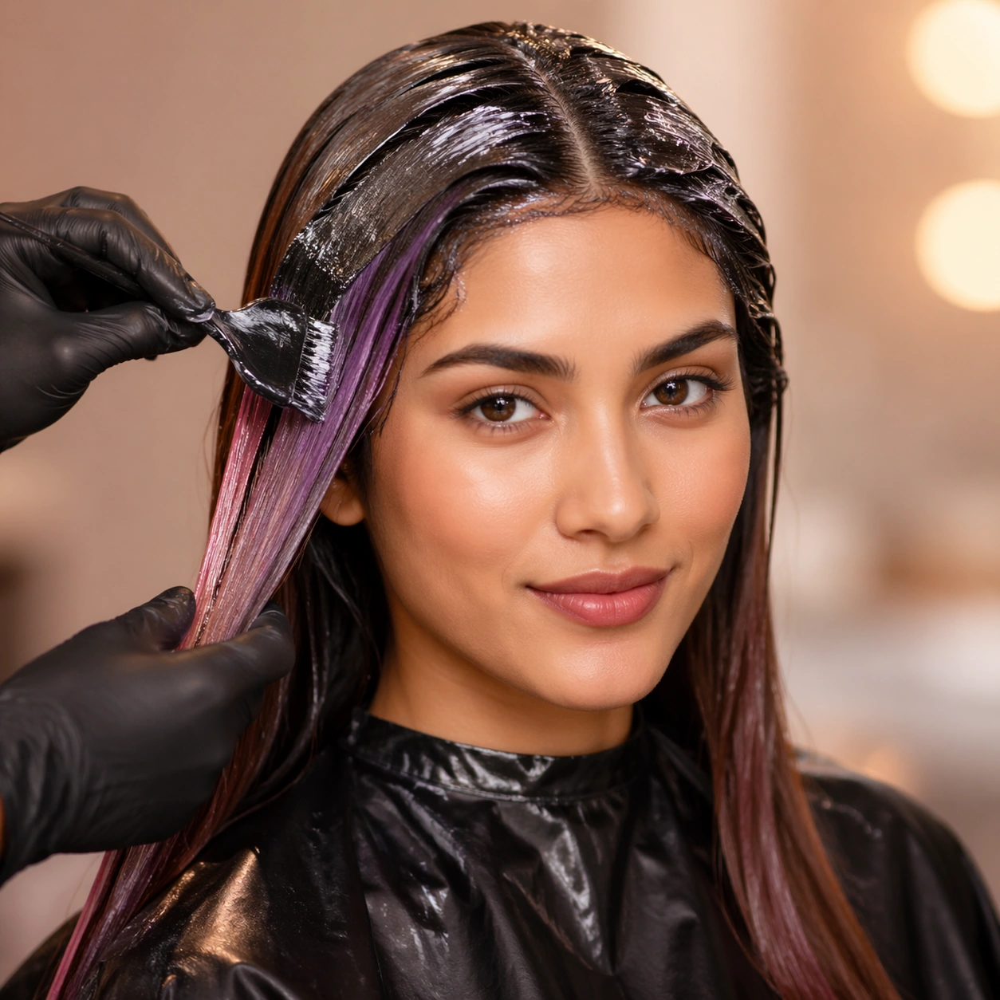

```text
Scene:
A square commercial beauty-or-fashion image designed like a polished campaign proof for Salon Color Makeover Promo. Keep the camera discipline clear and believable: portrait-oriented within the square, premium studio light, controlled tonal contrast, and enough surrounding negative space to feel like an ad layout without relying on readable typography. The image should look production-ready, with realistic skin, hair, fabric, and makeup rendering that supports identity locking instead of distracting from it.

Subject:
Build the frame around one clearly recognizable person. Detail Close-up should feel like a specific transformation step that a close-up study focusing on texture, finish, and precise beauty or garment details. The face structure, age, body proportions, and general camera position must stay consistent with the same-person premise of Create salon-grade makeover campaigns built around one person moving through before, during, and after hair color transformations with ad-ready polish.. Styling, wardrobe, grooming, makeup, hair, or pose can evolve, but the viewer must believe it is unquestionably the same subject across the whole theme. Use a premium editorial-commercial tone rather than a casual portrait session.

Important details:
The visual test is identity consistency under change. Preserve stable bone structure, eye spacing, nose shape, lip volume, skin tone family, and believable texture response. Let the transformation be visible through styling choices instead of facial drift. This theme studies editing-workflow, photorealism, commercial-mockup, structured-layout through a production-ready visual system. Make the composition clean enough for client review, with professional grooming fidelity and enough detail for salon, beauty, or fashion decision-making. Aim for clear hierarchy, polished craft, and immediately usable campaign logic.

Use case:
Salon Color Makeover Promo single study 3/5.

Constraints:
No readable text, no watermark, no logos, preserve exact 1:1 aspect ratio, no face drift, no inconsistent age shift, no extra limbs, no duplicate person, no asymmetric eye placement, no beauty-editorial chaos.
```

[Pinned source](https://github.com/ChaosRealmsAI/gpt-image-2-gallery/blob/5296db8c996e38776c83a0bc8c64f848dcd512b3/works/topics/salon-color-makeover-promo/packages/single-editorial-support/images/detail-closeup/meta.json) · GPT Image2 · 1254×1254 · No source-declared image dependencies. · ProjectD:[published and publicly accepted](https://aitoolsradar.com/en/prompts/76df18ec2f52a4)

## Promo Poster · salon-color-makeover-promo/single-editorial-support/promo-poster

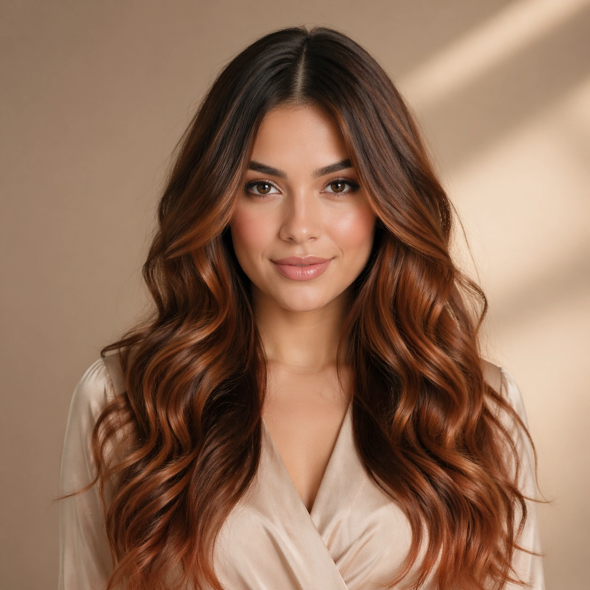

```text
Scene:
A square commercial beauty-or-fashion image designed like a polished campaign proof for Salon Color Makeover Promo. Keep the camera discipline clear and believable: portrait-oriented within the square, premium studio light, controlled tonal contrast, and enough surrounding negative space to feel like an ad layout without relying on readable typography. The image should look production-ready, with realistic skin, hair, fabric, and makeup rendering that supports identity locking instead of distracting from it.

Subject:
Build the frame around one clearly recognizable person. Promo Poster should feel like a specific transformation step that a polished advertisement frame turning the same identity into a finished commercial visual. The face structure, age, body proportions, and general camera position must stay consistent with the same-person premise of Create salon-grade makeover campaigns built around one person moving through before, during, and after hair color transformations with ad-ready polish.. Styling, wardrobe, grooming, makeup, hair, or pose can evolve, but the viewer must believe it is unquestionably the same subject across the whole theme. Use a premium editorial-commercial tone rather than a casual portrait session.

Important details:
The visual test is identity consistency under change. Preserve stable bone structure, eye spacing, nose shape, lip volume, skin tone family, and believable texture response. Let the transformation be visible through styling choices instead of facial drift. This theme studies editing-workflow, photorealism, commercial-mockup, structured-layout through a production-ready visual system. Make the composition clean enough for client review, with professional grooming fidelity and enough detail for salon, beauty, or fashion decision-making. Aim for clear hierarchy, polished craft, and immediately usable campaign logic.

Use case:
Salon Color Makeover Promo single study 4/5.

Constraints:
No readable text, no watermark, no logos, preserve exact 1:1 aspect ratio, no face drift, no inconsistent age shift, no extra limbs, no duplicate person, no asymmetric eye placement, no beauty-editorial chaos.
```

[Pinned source](https://github.com/ChaosRealmsAI/gpt-image-2-gallery/blob/5296db8c996e38776c83a0bc8c64f848dcd512b3/works/topics/salon-color-makeover-promo/packages/single-editorial-support/images/promo-poster/meta.json) · GPT Image2 · 1254×1254 · No source-declared image dependencies. · ProjectD:[published and publicly accepted](https://aitoolsradar.com/en/prompts/e2d6624125cfb0)

## Campaign Grid · salon-color-makeover-promo/single-editorial-support/campaign-grid

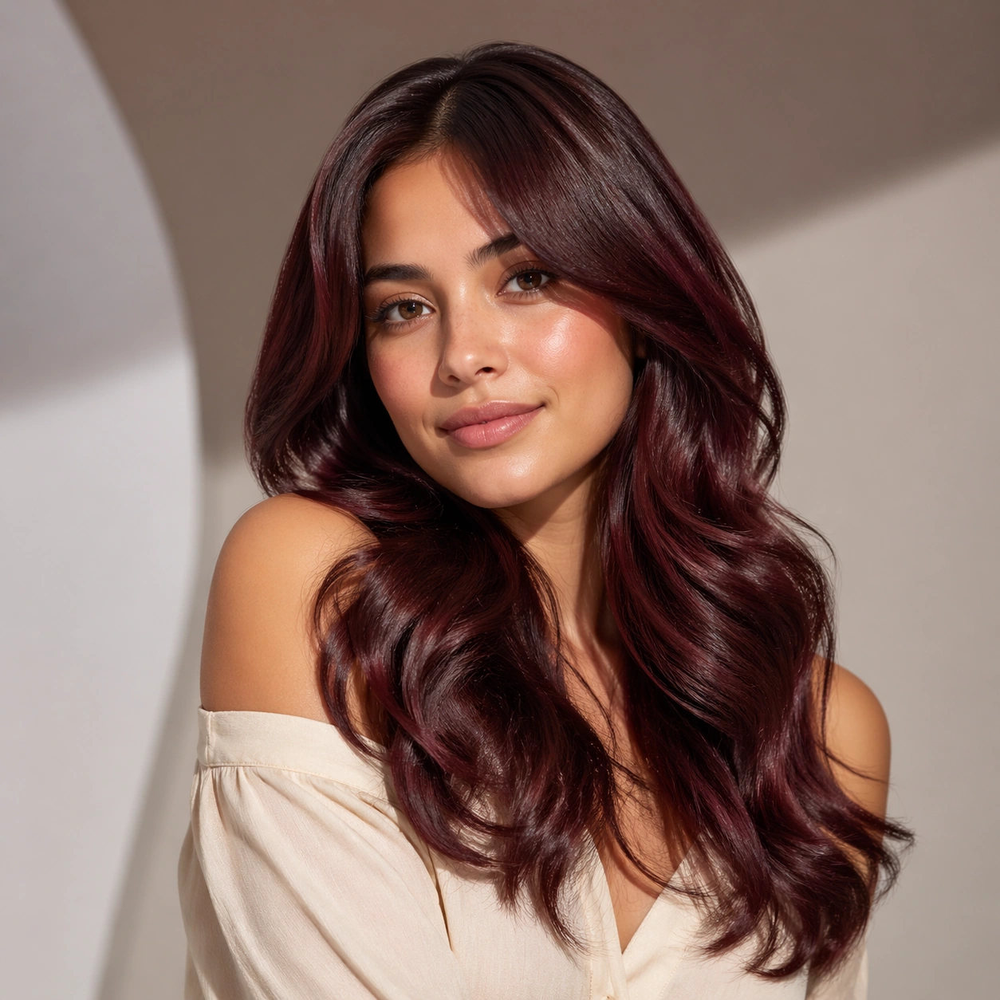

```text
Scene:
A square commercial beauty-or-fashion image designed like a polished campaign proof for Salon Color Makeover Promo. Keep the camera discipline clear and believable: portrait-oriented within the square, premium studio light, controlled tonal contrast, and enough surrounding negative space to feel like an ad layout without relying on readable typography. The image should look production-ready, with realistic skin, hair, fabric, and makeup rendering that supports identity locking instead of distracting from it.

Subject:
Build the frame around one clearly recognizable person. Campaign Grid should feel like a specific transformation step that a multi-panel rollout board proving catalog depth and consistent recognition. The face structure, age, body proportions, and general camera position must stay consistent with the same-person premise of Create salon-grade makeover campaigns built around one person moving through before, during, and after hair color transformations with ad-ready polish.. Styling, wardrobe, grooming, makeup, hair, or pose can evolve, but the viewer must believe it is unquestionably the same subject across the whole theme. Use a premium editorial-commercial tone rather than a casual portrait session.

Important details:
The visual test is identity consistency under change. Preserve stable bone structure, eye spacing, nose shape, lip volume, skin tone family, and believable texture response. Let the transformation be visible through styling choices instead of facial drift. This theme studies editing-workflow, photorealism, commercial-mockup, structured-layout through a production-ready visual system. Make the composition clean enough for client review, with professional grooming fidelity and enough detail for salon, beauty, or fashion decision-making. Aim for clear hierarchy, polished craft, and immediately usable campaign logic.

Use case:
Salon Color Makeover Promo single study 5/5.

Constraints:
No readable text, no watermark, no logos, preserve exact 1:1 aspect ratio, no face drift, no inconsistent age shift, no extra limbs, no duplicate person, no asymmetric eye placement, no beauty-editorial chaos.
```

[Pinned source](https://github.com/ChaosRealmsAI/gpt-image-2-gallery/blob/5296db8c996e38776c83a0bc8c64f848dcd512b3/works/topics/salon-color-makeover-promo/packages/single-editorial-support/images/campaign-grid/meta.json) · GPT Image2 · 1254×1254 · No source-declared image dependencies. · ProjectD:**Held:** Full prompt explicitly requests a multi-panel rollout grid, but native output is one portrait. Archive complete pair and hold from ProjectD rather than claim a campaign grid.

## Main Panorama · salt-flat-mirror-bolivia/single-landscape-studies/01-main-panorama


```text
Scene:
Create a square, photoreal landscape study of bolivian salt flat mirror. Compose it as the clearest monument-scale establishing view, using a wide, level camera position with deep atmospheric recession and a calm, authoritative horizon. Let broad, sculpting natural light describe the major masses before it picks out the smaller details Keep the frame cinematic but disciplined, with a clear foreground, middle distance, and far mass so the viewer can measure real depth. The image should feel like a field photograph made with patience, precision, and sublime restraint rather than a fantasy matte painting.

Subject:
Show a flooded Bolivian salt flat at sunset with a near-perfect mirror surface reflecting cloud towers, a vanishing horizon, and a single jeep sending one subtle ripple across the water film. This variation should emphasize hero panorama. The main landform must dominate the composition, but secondary elements should quietly explain how the place works: water paths, sediment lines, snow bands, surf, ash, wind streaks, stars, or human traces where appropriate. Everything in the image should support the same idea of scale and climate, so the scene reads as one coherent environment rather than a stack of spectacular details.

Important details:
Preserve horizon loss, razor-thin water over salt, exact mirror behavior, soft sunset color mirrored above and below, and a clean sense of infinite horizontal space. Keep one dominant landform, one secondary supporting rhythm, and a restrained scale witness so the scene reads immediately. Keep geology, weather, and atmosphere physically believable. Use subtle micro-texture, tonal separation, and air perspective to reinforce distance. If a human, vehicle, tent, caravan, bird, or boat appears, it must remain tiny and subordinate to the landscape, functioning only as a scale witness. The composition should feel original, severe, and elegant, with no decorative filler and no imitation of any copyrighted visual property.

Use case:
Bolivian Salt Flat Mirror single study 1/9, exploring the hero panorama variation.

Constraints:
No readable text, no watermark, no logos, preserve exact 1:1 aspect ratio, no extra vehicles, no crowd of tourists, no giant props, no surreal floating islands, no split-screen layout, no collage fragments, no exaggerated fisheye distortion, no kitsch color grading, no artificial border, no split-panel treatment.
```

[Pinned source](https://github.com/ChaosRealmsAI/gpt-image-2-gallery/blob/5296db8c996e38776c83a0bc8c64f848dcd512b3/works/topics/salt-flat-mirror-bolivia/packages/single-landscape-studies/images/01-main-panorama/meta.json) · GPT Image2 · 1024×1024 · No source-declared image dependencies. · ProjectD:[published and publicly accepted](https://aitoolsradar.com/en/prompts/57ed209d2c94f1)

## Foreground Path · salt-flat-mirror-bolivia/single-landscape-studies/02-foreground-path


```text
Scene:
Create a square, photoreal landscape study of bolivian salt flat mirror. Compose it as a ground-level entry path that pulls the viewer into the terrain, using a lower vantage with a strong foreground element such as a ridge line, shoreline, stream, boot track, or wet surface leading inward. Let the foreground remain tactile and detailed while the distance opens gradually Keep the frame cinematic but disciplined, with a clear foreground, middle distance, and far mass so the viewer can measure real depth. The image should feel like a field photograph made with patience, precision, and sublime restraint rather than a fantasy matte painting.

Subject:
Show a flooded Bolivian salt flat at sunset with a near-perfect mirror surface reflecting cloud towers, a vanishing horizon, and a single jeep sending one subtle ripple across the water film. This variation should emphasize foreground-led composition. The main landform must dominate the composition, but secondary elements should quietly explain how the place works: water paths, sediment lines, snow bands, surf, ash, wind streaks, stars, or human traces where appropriate. Everything in the image should support the same idea of scale and climate, so the scene reads as one coherent environment rather than a stack of spectacular details.

Important details:
Preserve horizon loss, razor-thin water over salt, exact mirror behavior, soft sunset color mirrored above and below, and a clean sense of infinite horizontal space. The image should reward close looking through layered depth cues rather than pure spectacle alone. Keep geology, weather, and atmosphere physically believable. Use subtle micro-texture, tonal separation, and air perspective to reinforce distance. If a human, vehicle, tent, caravan, bird, or boat appears, it must remain tiny and subordinate to the landscape, functioning only as a scale witness. The composition should feel original, severe, and elegant, with no decorative filler and no imitation of any copyrighted visual property.

Use case:
Bolivian Salt Flat Mirror single study 2/9, exploring the foreground-led composition variation.

Constraints:
No readable text, no watermark, no logos, preserve exact 1:1 aspect ratio, no extra vehicles, no crowd of tourists, no giant props, no surreal floating islands, no blocked foreground, no random props, no awkward dead zone in the lower third, no kitsch color grading, no artificial border, no split-panel treatment.
```

[Pinned source](https://github.com/ChaosRealmsAI/gpt-image-2-gallery/blob/5296db8c996e38776c83a0bc8c64f848dcd512b3/works/topics/salt-flat-mirror-bolivia/packages/single-landscape-studies/images/02-foreground-path/meta.json) · GPT Image2 · 1254×1254 · No source-declared image dependencies. · ProjectD:individually reviewed; awaiting publication acceptance.

## Aerial Geometry · salt-flat-mirror-bolivia/single-landscape-studies/03-aerial-geometry


```text
Scene:
Create a square, photoreal landscape study of bolivian salt flat mirror. Compose it as the planform geometry and overall shape logic of the landscape, using an elevated oblique aerial view that still preserves believable scale and natural topography. Let light reveal contour, fracture, and pattern instead of flattening the terrain Keep the frame cinematic but disciplined, with a clear foreground, middle distance, and far mass so the viewer can measure real depth. The image should feel like a field photograph made with patience, precision, and sublime restraint rather than a fantasy matte painting.

Subject:
Show a flooded Bolivian salt flat at sunset with a near-perfect mirror surface reflecting cloud towers, a vanishing horizon, and a single jeep sending one subtle ripple across the water film. This variation should emphasize aerial scale read. The main landform must dominate the composition, but secondary elements should quietly explain how the place works: water paths, sediment lines, snow bands, surf, ash, wind streaks, stars, or human traces where appropriate. Everything in the image should support the same idea of scale and climate, so the scene reads as one coherent environment rather than a stack of spectacular details.

Important details:
Preserve horizon loss, razor-thin water over salt, exact mirror behavior, soft sunset color mirrored above and below, and a clean sense of infinite horizontal space. Emphasize rhythm, repetition, and large-form geometry without losing physical realism. Keep geology, weather, and atmosphere physically believable. Use subtle micro-texture, tonal separation, and air perspective to reinforce distance. If a human, vehicle, tent, caravan, bird, or boat appears, it must remain tiny and subordinate to the landscape, functioning only as a scale witness. The composition should feel original, severe, and elegant, with no decorative filler and no imitation of any copyrighted visual property.

Use case:
Bolivian Salt Flat Mirror single study 3/9, exploring the aerial scale read variation.

Constraints:
No readable text, no watermark, no logos, preserve exact 1:1 aspect ratio, no extra vehicles, no crowd of tourists, no giant props, no surreal floating islands, no map labels, no diagram arrows, no satellite-interface graphics, no kitsch color grading, no artificial border, no split-panel treatment.
```

[Pinned source](https://github.com/ChaosRealmsAI/gpt-image-2-gallery/blob/5296db8c996e38776c83a0bc8c64f848dcd512b3/works/topics/salt-flat-mirror-bolivia/packages/single-landscape-studies/images/03-aerial-geometry/meta.json) · GPT Image2 · 1024×1024 · No source-declared image dependencies. · ProjectD:individually reviewed; awaiting publication acceptance.

## Atmosphere Event · salt-flat-mirror-bolivia/single-landscape-studies/04-atmosphere-event


```text
Scene:
Create a square, photoreal landscape study of bolivian salt flat mirror. Compose it as the moment when weather, particles, or moving air become the main dramatic agent, using a stable documentary framing that lets the environmental event stay legible. Let the air itself carry visible density through haze, spray, ash, dust, snow, or storm structure Keep the frame cinematic but disciplined, with a clear foreground, middle distance, and far mass so the viewer can measure real depth. The image should feel like a field photograph made with patience, precision, and sublime restraint rather than a fantasy matte painting.

Subject:
Show a flooded Bolivian salt flat at sunset with a near-perfect mirror surface reflecting cloud towers, a vanishing horizon, and a single jeep sending one subtle ripple across the water film. This variation should emphasize weather-driven study. The main landform must dominate the composition, but secondary elements should quietly explain how the place works: water paths, sediment lines, snow bands, surf, ash, wind streaks, stars, or human traces where appropriate. Everything in the image should support the same idea of scale and climate, so the scene reads as one coherent environment rather than a stack of spectacular details.

Important details:
Preserve horizon loss, razor-thin water over salt, exact mirror behavior, soft sunset color mirrored above and below, and a clean sense of infinite horizontal space. The atmosphere must feel physically plausible and tied to terrain, wind direction, temperature, and moisture. Keep geology, weather, and atmosphere physically believable. Use subtle micro-texture, tonal separation, and air perspective to reinforce distance. If a human, vehicle, tent, caravan, bird, or boat appears, it must remain tiny and subordinate to the landscape, functioning only as a scale witness. The composition should feel original, severe, and elegant, with no decorative filler and no imitation of any copyrighted visual property.

Use case:
Bolivian Salt Flat Mirror single study 4/9, exploring the weather-driven study variation.

Constraints:
No readable text, no watermark, no logos, preserve exact 1:1 aspect ratio, no extra vehicles, no crowd of tourists, no giant props, no surreal floating islands, no disaster-movie excess, no impossible lightning clutter, no synthetic smoke plumes, no kitsch color grading, no artificial border, no split-panel treatment.
```

[Pinned source](https://github.com/ChaosRealmsAI/gpt-image-2-gallery/blob/5296db8c996e38776c83a0bc8c64f848dcd512b3/works/topics/salt-flat-mirror-bolivia/packages/single-landscape-studies/images/04-atmosphere-event/meta.json) · GPT Image2 · 1254×1254 · No source-declared image dependencies. · ProjectD:individually reviewed; awaiting publication acceptance.

## Light Contrast · salt-flat-mirror-bolivia/single-landscape-studies/05-light-contrast


```text
Scene:
Create a square, photoreal landscape study of bolivian salt flat mirror. Compose it as directional light carving sharp separation between illuminated and shadowed forms, using a composition built around light falloff, shadow shape, and reflective control rather than camera gimmicks. Let one strong light source create crisp hierarchy and believable color temperature shifts Keep the frame cinematic but disciplined, with a clear foreground, middle distance, and far mass so the viewer can measure real depth. The image should feel like a field photograph made with patience, precision, and sublime restraint rather than a fantasy matte painting.

Subject:
Show a flooded Bolivian salt flat at sunset with a near-perfect mirror surface reflecting cloud towers, a vanishing horizon, and a single jeep sending one subtle ripple across the water film. This variation should emphasize light-structure study. The main landform must dominate the composition, but secondary elements should quietly explain how the place works: water paths, sediment lines, snow bands, surf, ash, wind streaks, stars, or human traces where appropriate. Everything in the image should support the same idea of scale and climate, so the scene reads as one coherent environment rather than a stack of spectacular details.

Important details:
Preserve horizon loss, razor-thin water over salt, exact mirror behavior, soft sunset color mirrored above and below, and a clean sense of infinite horizontal space. Surface brightness, shadow depth, and reflected light should all agree with the material and weather conditions. Keep geology, weather, and atmosphere physically believable. Use subtle micro-texture, tonal separation, and air perspective to reinforce distance. If a human, vehicle, tent, caravan, bird, or boat appears, it must remain tiny and subordinate to the landscape, functioning only as a scale witness. The composition should feel original, severe, and elegant, with no decorative filler and no imitation of any copyrighted visual property.

Use case:
Bolivian Salt Flat Mirror single study 5/9, exploring the light-structure study variation.

Constraints:
No readable text, no watermark, no logos, preserve exact 1:1 aspect ratio, no extra vehicles, no crowd of tourists, no giant props, no surreal floating islands, no blown highlights, no muddy blacks, no theatrical stage lighting, no kitsch color grading, no artificial border, no split-panel treatment.
```

[Pinned source](https://github.com/ChaosRealmsAI/gpt-image-2-gallery/blob/5296db8c996e38776c83a0bc8c64f848dcd512b3/works/topics/salt-flat-mirror-bolivia/packages/single-landscape-studies/images/05-light-contrast/meta.json) · GPT Image2 · 1254×1254 · No source-declared image dependencies. · ProjectD:individually reviewed; awaiting publication acceptance.

## Material Close · salt-flat-mirror-bolivia/single-landscape-studies/06-material-close


```text
Scene:
Create a square, photoreal landscape study of bolivian salt flat mirror. Compose it as surface texture and material transitions while still keeping the full environment recognizable, using a tighter medium-wide crop that gives more area to texture, fracture, grain, water, ice, lava, salt, or stone. Let texture remain readable without making the scene feel like a macro shot Keep the frame cinematic but disciplined, with a clear foreground, middle distance, and far mass so the viewer can measure real depth. The image should feel like a field photograph made with patience, precision, and sublime restraint rather than a fantasy matte painting.

Subject:
Show a flooded Bolivian salt flat at sunset with a near-perfect mirror surface reflecting cloud towers, a vanishing horizon, and a single jeep sending one subtle ripple across the water film. This variation should emphasize material realism check. The main landform must dominate the composition, but secondary elements should quietly explain how the place works: water paths, sediment lines, snow bands, surf, ash, wind streaks, stars, or human traces where appropriate. Everything in the image should support the same idea of scale and climate, so the scene reads as one coherent environment rather than a stack of spectacular details.

Important details:
Preserve horizon loss, razor-thin water over salt, exact mirror behavior, soft sunset color mirrored above and below, and a clean sense of infinite horizontal space. Micro-texture, edge wear, wetness, frost, dust, foam, or sediment should deepen realism rather than distract from scale. Keep geology, weather, and atmosphere physically believable. Use subtle micro-texture, tonal separation, and air perspective to reinforce distance. If a human, vehicle, tent, caravan, bird, or boat appears, it must remain tiny and subordinate to the landscape, functioning only as a scale witness. The composition should feel original, severe, and elegant, with no decorative filler and no imitation of any copyrighted visual property.

Use case:
Bolivian Salt Flat Mirror single study 6/9, exploring the material realism check variation.

Constraints:
No readable text, no watermark, no logos, preserve exact 1:1 aspect ratio, no extra vehicles, no crowd of tourists, no giant props, no surreal floating islands, no extreme macro abstraction, no plastic-looking surfaces, no shallow depth-of-field blur, no kitsch color grading, no artificial border, no split-panel treatment.
```

[Pinned source](https://github.com/ChaosRealmsAI/gpt-image-2-gallery/blob/5296db8c996e38776c83a0bc8c64f848dcd512b3/works/topics/salt-flat-mirror-bolivia/packages/single-landscape-studies/images/06-material-close/meta.json) · GPT Image2 · 1254×1254 · No source-declared image dependencies. · ProjectD:individually reviewed; awaiting publication acceptance.

## Scale Witness · salt-flat-mirror-bolivia/single-landscape-studies/07-scale-witness


```text
Scene:
Create a square, photoreal landscape study of bolivian salt flat mirror. Compose it as a tiny human, animal, tent, vehicle, or craft that reveals the vastness of the environment, using a balanced frame where the witness remains small but unmistakable. Let the scale marker stay visible without becoming the true subject Keep the frame cinematic but disciplined, with a clear foreground, middle distance, and far mass so the viewer can measure real depth. The image should feel like a field photograph made with patience, precision, and sublime restraint rather than a fantasy matte painting.

Subject:
Show a flooded Bolivian salt flat at sunset with a near-perfect mirror surface reflecting cloud towers, a vanishing horizon, and a single jeep sending one subtle ripple across the water film. This variation should emphasize scale comparison. The main landform must dominate the composition, but secondary elements should quietly explain how the place works: water paths, sediment lines, snow bands, surf, ash, wind streaks, stars, or human traces where appropriate. Everything in the image should support the same idea of scale and climate, so the scene reads as one coherent environment rather than a stack of spectacular details.

Important details:
Preserve horizon loss, razor-thin water over salt, exact mirror behavior, soft sunset color mirrored above and below, and a clean sense of infinite horizontal space. The viewer should understand the environment first and the witness second, with clean spatial separation between them. Keep geology, weather, and atmosphere physically believable. Use subtle micro-texture, tonal separation, and air perspective to reinforce distance. If a human, vehicle, tent, caravan, bird, or boat appears, it must remain tiny and subordinate to the landscape, functioning only as a scale witness. The composition should feel original, severe, and elegant, with no decorative filler and no imitation of any copyrighted visual property.

Use case:
Bolivian Salt Flat Mirror single study 7/9, exploring the scale comparison variation.

Constraints:
No readable text, no watermark, no logos, preserve exact 1:1 aspect ratio, no extra vehicles, no crowd of tourists, no giant props, no surreal floating islands, no crowd scenes, no heroic close-up character framing, no busy gear pile, no kitsch color grading, no artificial border, no split-panel treatment.
```

[Pinned source](https://github.com/ChaosRealmsAI/gpt-image-2-gallery/blob/5296db8c996e38776c83a0bc8c64f848dcd512b3/works/topics/salt-flat-mirror-bolivia/packages/single-landscape-studies/images/07-scale-witness/meta.json) · GPT Image2 · 1254×1254 · No source-declared image dependencies. · ProjectD:individually reviewed; awaiting publication acceptance.

## Abstract Rhythm · salt-flat-mirror-bolivia/single-landscape-studies/08-abstract-rhythm


```text
Scene:
Create a square, photoreal landscape study of bolivian salt flat mirror. Compose it as the near-abstract rhythm of repeated natural forms, lines, and tonal bands, using a disciplined crop that approaches abstraction while remaining unmistakably a real place. Let shape and tonal cadence dominate before small narrative details Keep the frame cinematic but disciplined, with a clear foreground, middle distance, and far mass so the viewer can measure real depth. The image should feel like a field photograph made with patience, precision, and sublime restraint rather than a fantasy matte painting.

Subject:
Show a flooded Bolivian salt flat at sunset with a near-perfect mirror surface reflecting cloud towers, a vanishing horizon, and a single jeep sending one subtle ripple across the water film. This variation should emphasize formal composition study. The main landform must dominate the composition, but secondary elements should quietly explain how the place works: water paths, sediment lines, snow bands, surf, ash, wind streaks, stars, or human traces where appropriate. Everything in the image should support the same idea of scale and climate, so the scene reads as one coherent environment rather than a stack of spectacular details.

Important details:
Preserve horizon loss, razor-thin water over salt, exact mirror behavior, soft sunset color mirrored above and below, and a clean sense of infinite horizontal space. Pattern, repetition, and negative space should feel discovered in nature, not graphically imposed. Keep geology, weather, and atmosphere physically believable. Use subtle micro-texture, tonal separation, and air perspective to reinforce distance. If a human, vehicle, tent, caravan, bird, or boat appears, it must remain tiny and subordinate to the landscape, functioning only as a scale witness. The composition should feel original, severe, and elegant, with no decorative filler and no imitation of any copyrighted visual property.

Use case:
Bolivian Salt Flat Mirror single study 8/9, exploring the formal composition study variation.

Constraints:
No readable text, no watermark, no logos, preserve exact 1:1 aspect ratio, no extra vehicles, no crowd of tourists, no giant props, no surreal floating islands, no graphic overlays, no surreal floating elements, no ornamental symmetry cheats, no kitsch color grading, no artificial border, no split-panel treatment.
```

[Pinned source](https://github.com/ChaosRealmsAI/gpt-image-2-gallery/blob/5296db8c996e38776c83a0bc8c64f848dcd512b3/works/topics/salt-flat-mirror-bolivia/packages/single-landscape-studies/images/08-abstract-rhythm/meta.json) · GPT Image2 · 1254×1254 · No source-declared image dependencies. · ProjectD:individually reviewed; awaiting publication acceptance.

## Final Iconic · salt-flat-mirror-bolivia/single-landscape-studies/09-final-iconic


```text
Scene:
Create a square, photoreal landscape study of bolivian salt flat mirror. Compose it as the cleanest, most iconic summary of the whole landscape idea, using a distilled composition with one unforgettable silhouette or mass relationship and generous breathing room. Let the scene resolve into a memorable final image with strong legibility at thumbnail size Keep the frame cinematic but disciplined, with a clear foreground, middle distance, and far mass so the viewer can measure real depth. The image should feel like a field photograph made with patience, precision, and sublime restraint rather than a fantasy matte painting.

Subject:
Show a flooded Bolivian salt flat at sunset with a near-perfect mirror surface reflecting cloud towers, a vanishing horizon, and a single jeep sending one subtle ripple across the water film. This variation should emphasize iconic final plate. The main landform must dominate the composition, but secondary elements should quietly explain how the place works: water paths, sediment lines, snow bands, surf, ash, wind streaks, stars, or human traces where appropriate. Everything in the image should support the same idea of scale and climate, so the scene reads as one coherent environment rather than a stack of spectacular details.

Important details:
Preserve horizon loss, razor-thin water over salt, exact mirror behavior, soft sunset color mirrored above and below, and a clean sense of infinite horizontal space. Keep the frame spare, confident, and monumental, with every element earning its place. Keep geology, weather, and atmosphere physically believable. Use subtle micro-texture, tonal separation, and air perspective to reinforce distance. If a human, vehicle, tent, caravan, bird, or boat appears, it must remain tiny and subordinate to the landscape, functioning only as a scale witness. The composition should feel original, severe, and elegant, with no decorative filler and no imitation of any copyrighted visual property.

Use case:
Bolivian Salt Flat Mirror single study 9/9, exploring the iconic final plate variation.

Constraints:
No readable text, no watermark, no logos, preserve exact 1:1 aspect ratio, no extra vehicles, no crowd of tourists, no giant props, no surreal floating islands, no cluttered edges, no competing focal points, no visual noise in empty space, no kitsch color grading, no artificial border, no split-panel treatment.
```

[Pinned source](https://github.com/ChaosRealmsAI/gpt-image-2-gallery/blob/5296db8c996e38776c83a0bc8c64f848dcd512b3/works/topics/salt-flat-mirror-bolivia/packages/single-landscape-studies/images/09-final-iconic/meta.json) · GPT Image2 · 1254×1254 · No source-declared image dependencies. · ProjectD:individually reviewed; awaiting publication acceptance.

## Reference Natural Base · same-face-makeup-era-matrix/series-identity-switchboard/01-reference-natural-base

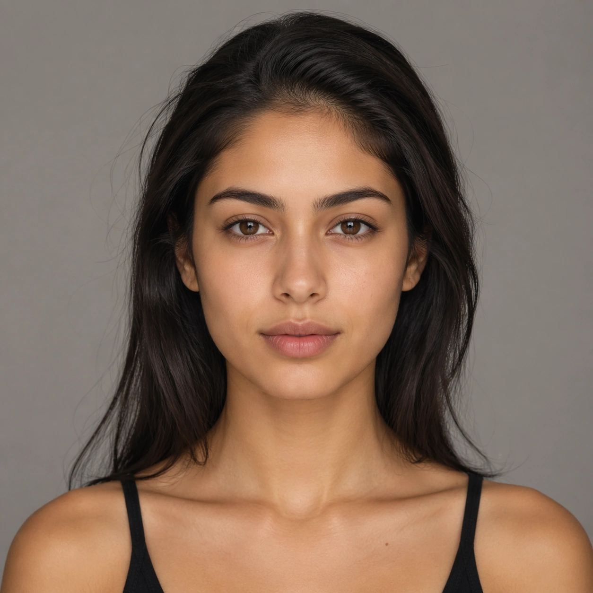

```text
Scene:
Create a square 1:1 portrait image for Same-Face Makeup Era Matrix. Use a clean approval-style studio portrait with neutral light, simple wardrobe, and enough facial visibility to lock identity perfectly. The frame should feel like a finished professional deliverable rather than a casual snapshot, with clear lens discipline, believable light falloff, and a palette that directly supports Transform one face across beauty eras and makeup directions while holding bone structure, age read, and natural identity stable.. Keep enough surrounding space and compositional control for gallery, research, campaign, or approval-board reuse while staying photoreal and human-scaled.

Subject:
Center one beauty model with golden olive skin, dark almond eyes, softly arched brows, and stable face proportions suited to multiple makeup eras. Establish the exact same face, hair base, skin tone family, and body proportions that every transformation image must preserve. Use the example direction from the brief as grounding context: Transform one face across beauty eras and makeup directions while holding bone structure, age read, and natural identity stable.. Wardrobe, lighting, environment, and pose may shift to serve this variation, but the viewer must immediately understand that the same reference identity is still in front of the camera.

Important details:
This backlog line is difficult because Transform one face across beauty eras and makeup directions while holding bone structure, age read, and natural identity stable.. Preserve skin tone family, bone structure, eye spacing, nose shape, mouth shape, hairline logic, shoulder width, and overall body read across the entire series. preserve exact face / hair base / body proportions from the reference model. This baseline must read like the trustworthy approval frame before switching anything. Avoid the common failure described in the brief: ordinary image models often lose likeness once styling, lighting, or layout changes enter the frame. Success should feel like the result should feel professionally usable, coherent, and clearly built around one stable human identity.

Use case:
Same-Face Makeup Era Matrix series study 1/9, the natural baseline look.

Constraints:
No readable text, no watermark, no logos, preserve exact 1:1 aspect ratio, preserve exact face / hair base / body proportions from the reference model, no heavy styling, no logo wardrobe, no beauty filter, no extra subjects.
```

[Pinned source](https://github.com/ChaosRealmsAI/gpt-image-2-gallery/blob/5296db8c996e38776c83a0bc8c64f848dcd512b3/works/topics/same-face-makeup-era-matrix/packages/series-identity-switchboard/images/01-reference-natural-base/meta.json) · GPT Image2 · 1254×1254 · No source-declared image dependencies. · ProjectD:individually reviewed; awaiting publication acceptance.

## Look Switch One · same-face-makeup-era-matrix/series-identity-switchboard/02-look-switch-one

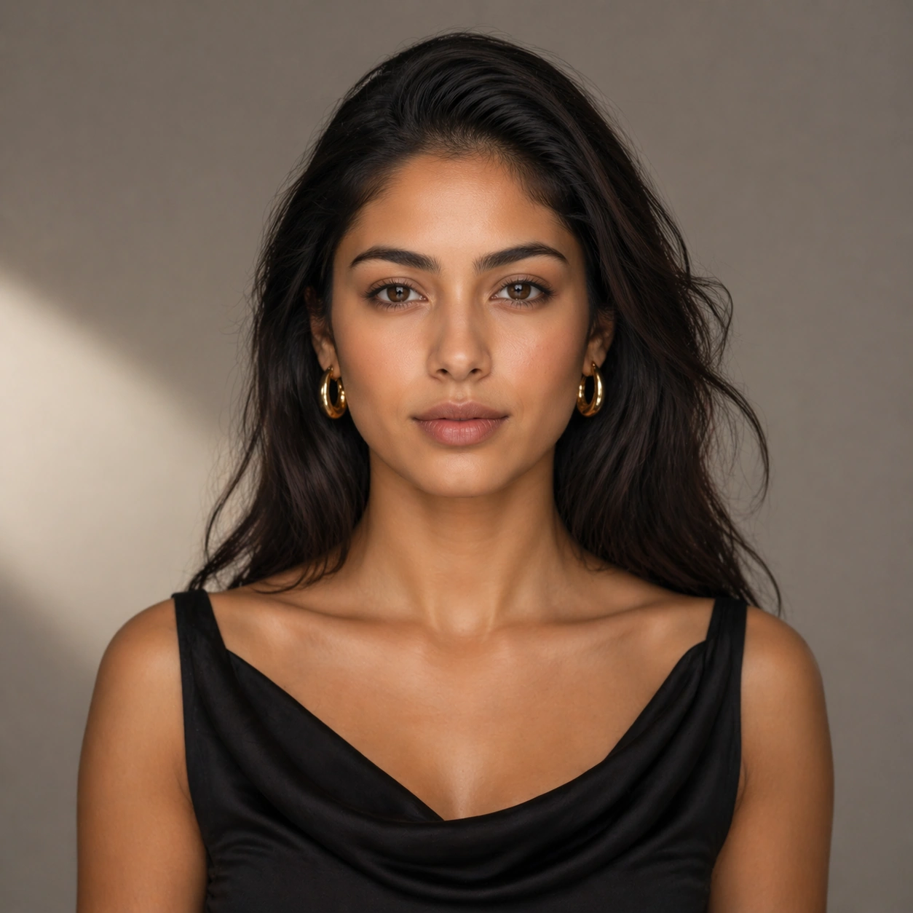

```text
Scene:
Create a square 1:1 portrait image for Same-Face Makeup Era Matrix. Use a premium portrait frame with one clear change direction and enough negative space to judge styling cleanly. The frame should feel like a finished professional deliverable rather than a casual snapshot, with clear lens discipline, believable light falloff, and a palette that directly supports Transform one face across beauty eras and makeup directions while holding bone structure, age read, and natural identity stable.. Keep enough surrounding space and compositional control for gallery, research, campaign, or approval-board reuse while staying photoreal and human-scaled.

Subject:
Center one beauty model with golden olive skin, dark almond eyes, softly arched brows, and stable face proportions suited to multiple makeup eras. Keep the exact same person from the reference while executing the first major change requested by the topic, whether hair, makeup, wardrobe, grooming, or professional read. Use the example direction from the brief as grounding context: Transform one face across beauty eras and makeup directions while holding bone structure, age read, and natural identity stable.. Wardrobe, lighting, environment, and pose may shift to serve this variation, but the viewer must immediately understand that the same reference identity is still in front of the camera.

Important details:
This backlog line is difficult because Transform one face across beauty eras and makeup directions while holding bone structure, age read, and natural identity stable.. Preserve skin tone family, bone structure, eye spacing, nose shape, mouth shape, hairline logic, shoulder width, and overall body read across the entire series. preserve exact face / hair base / body proportions from the reference model. The switch must be obvious, but the identity must remain stronger than the styling change. Avoid the common failure described in the brief: ordinary image models often lose likeness once styling, lighting, or layout changes enter the frame. Success should feel like the result should feel professionally usable, coherent, and clearly built around one stable human identity.

Use case:
Same-Face Makeup Era Matrix series study 2/9, the first controlled transformation.

Constraints:
No readable text, no watermark, no logos, preserve exact 1:1 aspect ratio, preserve exact face / hair base / body proportions from the reference model, no face redraw, no changed age unless explicitly asked, no costume-party exaggeration, no new body shape.
```

[Pinned source](https://github.com/ChaosRealmsAI/gpt-image-2-gallery/blob/5296db8c996e38776c83a0bc8c64f848dcd512b3/works/topics/same-face-makeup-era-matrix/packages/series-identity-switchboard/images/02-look-switch-one/meta.json) · GPT Image2 · 1254×1254 · Reference images required. · ProjectD:individually reviewed; awaiting publication acceptance.

## Look Switch Two · same-face-makeup-era-matrix/series-identity-switchboard/03-look-switch-two

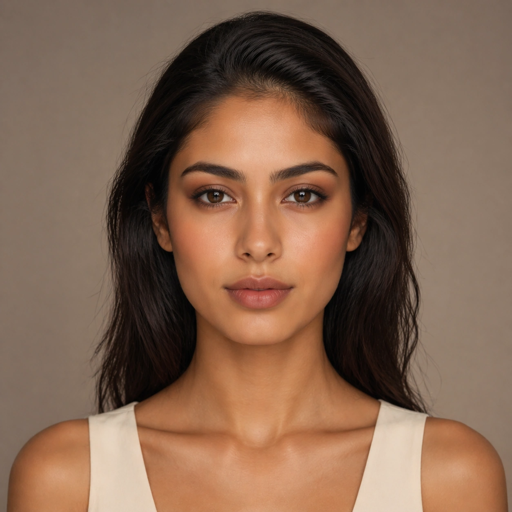

```text
Scene:
Create a square 1:1 portrait image for Same-Face Makeup Era Matrix. Use a square commercial portrait proof with similar camera logic and controlled light. The frame should feel like a finished professional deliverable rather than a casual snapshot, with clear lens discipline, believable light falloff, and a palette that directly supports Transform one face across beauty eras and makeup directions while holding bone structure, age read, and natural identity stable.. Keep enough surrounding space and compositional control for gallery, research, campaign, or approval-board reuse while staying photoreal and human-scaled.

Subject:
Center one beauty model with golden olive skin, dark almond eyes, softly arched brows, and stable face proportions suited to multiple makeup eras. Preserve the same face and body while moving to a second transformation state that still feels plausible for the same person. Use the example direction from the brief as grounding context: Transform one face across beauty eras and makeup directions while holding bone structure, age read, and natural identity stable.. Wardrobe, lighting, environment, and pose may shift to serve this variation, but the viewer must immediately understand that the same reference identity is still in front of the camera.

Important details:
This backlog line is difficult because Transform one face across beauty eras and makeup directions while holding bone structure, age read, and natural identity stable.. Preserve skin tone family, bone structure, eye spacing, nose shape, mouth shape, hairline logic, shoulder width, and overall body read across the entire series. preserve exact face / hair base / body proportions from the reference model. Hairline logic, eye spacing, lip shape, and shoulder width must remain exact. Avoid the common failure described in the brief: ordinary image models often lose likeness once styling, lighting, or layout changes enter the frame. Success should feel like the result should feel professionally usable, coherent, and clearly built around one stable human identity.

Use case:
Same-Face Makeup Era Matrix series study 3/9, the second controlled transformation.

Constraints:
No readable text, no watermark, no logos, preserve exact 1:1 aspect ratio, preserve exact face / hair base / body proportions from the reference model, no hairstyle that changes skull shape, no enlarged eyes, no body morphing, no logo props.
```

[Pinned source](https://github.com/ChaosRealmsAI/gpt-image-2-gallery/blob/5296db8c996e38776c83a0bc8c64f848dcd512b3/works/topics/same-face-makeup-era-matrix/packages/series-identity-switchboard/images/03-look-switch-two/meta.json) · GPT Image2 · 1254×1254 · Reference images required. · ProjectD:individually reviewed; awaiting publication acceptance.

## Look Switch Three · same-face-makeup-era-matrix/series-identity-switchboard/04-look-switch-three

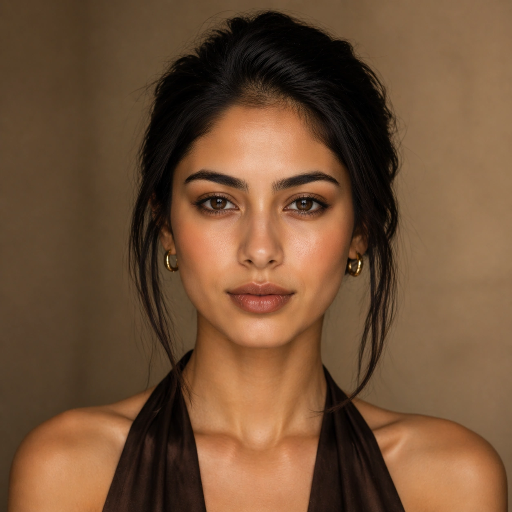

```text
Scene:
Create a square 1:1 portrait image for Same-Face Makeup Era Matrix. Use a slightly bolder campaign-like frame with disciplined crop and clean light falloff. The frame should feel like a finished professional deliverable rather than a casual snapshot, with clear lens discipline, believable light falloff, and a palette that directly supports Transform one face across beauty eras and makeup directions while holding bone structure, age read, and natural identity stable.. Keep enough surrounding space and compositional control for gallery, research, campaign, or approval-board reuse while staying photoreal and human-scaled.

Subject:
Center one beauty model with golden olive skin, dark almond eyes, softly arched brows, and stable face proportions suited to multiple makeup eras. Apply a third styling direction while holding the same reference identity with no drift in age, ethnicity, or face structure. Use the example direction from the brief as grounding context: Transform one face across beauty eras and makeup directions while holding bone structure, age read, and natural identity stable.. Wardrobe, lighting, environment, and pose may shift to serve this variation, but the viewer must immediately understand that the same reference identity is still in front of the camera.

Important details:
This backlog line is difficult because Transform one face across beauty eras and makeup directions while holding bone structure, age read, and natural identity stable.. Preserve skin tone family, bone structure, eye spacing, nose shape, mouth shape, hairline logic, shoulder width, and overall body read across the entire series. preserve exact face / hair base / body proportions from the reference model. The image should prove range under control rather than spectacle for spectacle alone. Avoid the common failure described in the brief: ordinary image models often lose likeness once styling, lighting, or layout changes enter the frame. Success should feel like the result should feel professionally usable, coherent, and clearly built around one stable human identity.

Use case:
Same-Face Makeup Era Matrix series study 4/9, the third controlled transformation.

Constraints:
No readable text, no watermark, no logos, preserve exact 1:1 aspect ratio, preserve exact face / hair base / body proportions from the reference model, no gimmick costume, no false lashes that change eye shape, no surreal hair physics, no second person.
```

[Pinned source](https://github.com/ChaosRealmsAI/gpt-image-2-gallery/blob/5296db8c996e38776c83a0bc8c64f848dcd512b3/works/topics/same-face-makeup-era-matrix/packages/series-identity-switchboard/images/04-look-switch-three/meta.json) · GPT Image2 · 1254×1254 · Reference images required. · ProjectD:individually reviewed; awaiting publication acceptance.

## Look Switch Four · same-face-makeup-era-matrix/series-identity-switchboard/05-look-switch-four

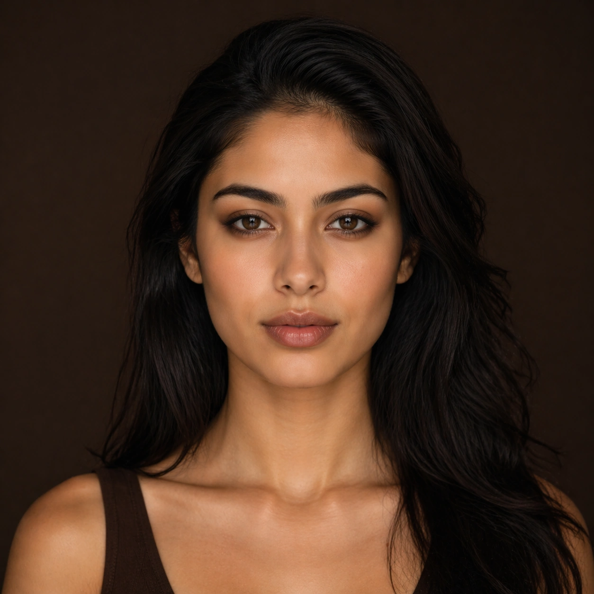

```text
Scene:
Create a square 1:1 portrait image for Same-Face Makeup Era Matrix. Use a close or mid-shot portrait that privileges detail and approval clarity over background storytelling. The frame should feel like a finished professional deliverable rather than a casual snapshot, with clear lens discipline, believable light falloff, and a palette that directly supports Transform one face across beauty eras and makeup directions while holding bone structure, age read, and natural identity stable.. Keep enough surrounding space and compositional control for gallery, research, campaign, or approval-board reuse while staying photoreal and human-scaled.

Subject:
Center one beauty model with golden olive skin, dark almond eyes, softly arched brows, and stable face proportions suited to multiple makeup eras. Keep the same exact subject while introducing another visible shift in style language, finish, or mood tied directly to the topic brief. Use the example direction from the brief as grounding context: Transform one face across beauty eras and makeup directions while holding bone structure, age read, and natural identity stable.. Wardrobe, lighting, environment, and pose may shift to serve this variation, but the viewer must immediately understand that the same reference identity is still in front of the camera.

Important details:
This backlog line is difficult because Transform one face across beauty eras and makeup directions while holding bone structure, age read, and natural identity stable.. Preserve skin tone family, bone structure, eye spacing, nose shape, mouth shape, hairline logic, shoulder width, and overall body read across the entire series. preserve exact face / hair base / body proportions from the reference model. Micro-details may change, but likeness, skin tone family, and body read cannot. Avoid the common failure described in the brief: ordinary image models often lose likeness once styling, lighting, or layout changes enter the frame. Success should feel like the result should feel professionally usable, coherent, and clearly built around one stable human identity.

Use case:
Same-Face Makeup Era Matrix series study 5/9, the fourth controlled transformation.

Constraints:
No readable text, no watermark, no logos, preserve exact 1:1 aspect ratio, preserve exact face / hair base / body proportions from the reference model, no retouch blur, no facial asymmetry drift, no extra accessories noise, no unreadable product text.
```

[Pinned source](https://github.com/ChaosRealmsAI/gpt-image-2-gallery/blob/5296db8c996e38776c83a0bc8c64f848dcd512b3/works/topics/same-face-makeup-era-matrix/packages/series-identity-switchboard/images/05-look-switch-four/meta.json) · GPT Image2 · 1254×1254 · Reference images required. · ProjectD:individually reviewed; awaiting publication acceptance.

## Look Switch Five · same-face-makeup-era-matrix/series-identity-switchboard/06-look-switch-five

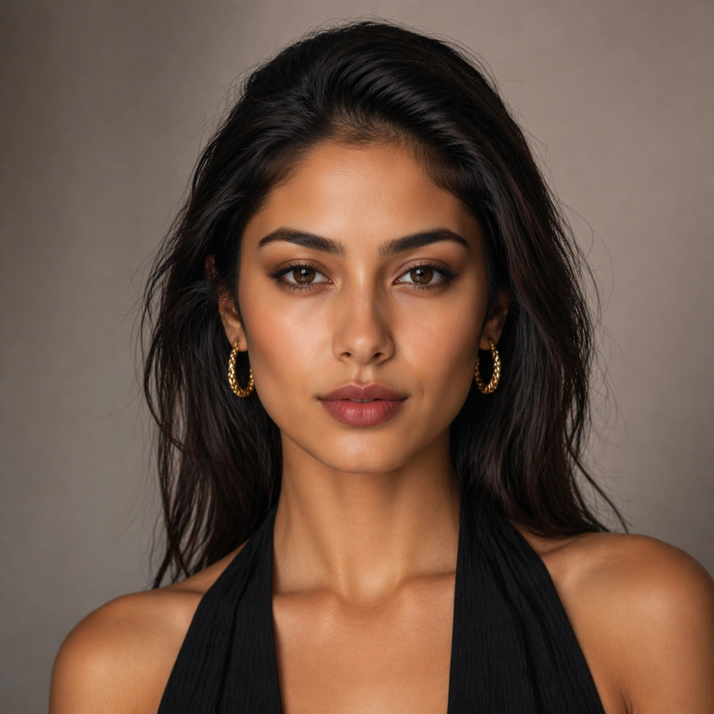

```text
Scene:
Create a square 1:1 portrait image for Same-Face Makeup Era Matrix. Use a square portrait with polished commercial finish and enough room to see styling structure clearly. The frame should feel like a finished professional deliverable rather than a casual snapshot, with clear lens discipline, believable light falloff, and a palette that directly supports Transform one face across beauty eras and makeup directions while holding bone structure, age read, and natural identity stable.. Keep enough surrounding space and compositional control for gallery, research, campaign, or approval-board reuse while staying photoreal and human-scaled.

Subject:
Center one beauty model with golden olive skin, dark almond eyes, softly arched brows, and stable face proportions suited to multiple makeup eras. Push to a fifth variation while preserving exact face / hair base / body proportions from the reference model. This should still feel like one person being art-directed, not re-generated from scratch. Use the example direction from the brief as grounding context: Transform one face across beauty eras and makeup directions while holding bone structure, age read, and natural identity stable.. Wardrobe, lighting, environment, and pose may shift to serve this variation, but the viewer must immediately understand that the same reference identity is still in front of the camera.

Important details:
This backlog line is difficult because Transform one face across beauty eras and makeup directions while holding bone structure, age read, and natural identity stable.. Preserve skin tone family, bone structure, eye spacing, nose shape, mouth shape, hairline logic, shoulder width, and overall body read across the entire series. preserve exact face / hair base / body proportions from the reference model. Keep continuity stronger than novelty. Avoid the common failure described in the brief: ordinary image models often lose likeness once styling, lighting, or layout changes enter the frame. Success should feel like the result should feel professionally usable, coherent, and clearly built around one stable human identity.

Use case:
Same-Face Makeup Era Matrix series study 6/9, the fifth controlled transformation.

Constraints:
No readable text, no watermark, no logos, preserve exact 1:1 aspect ratio, preserve exact face / hair base / body proportions from the reference model, no gender drift unless explicitly relevant, no unrelated props, no costume confusion, no body-scale jump.
```

[Pinned source](https://github.com/ChaosRealmsAI/gpt-image-2-gallery/blob/5296db8c996e38776c83a0bc8c64f848dcd512b3/works/topics/same-face-makeup-era-matrix/packages/series-identity-switchboard/images/06-look-switch-five/meta.json) · GPT Image2 · 1254×1254 · Reference images required. · ProjectD:individually reviewed; awaiting publication acceptance.

## Look Switch Six · same-face-makeup-era-matrix/series-identity-switchboard/07-look-switch-six

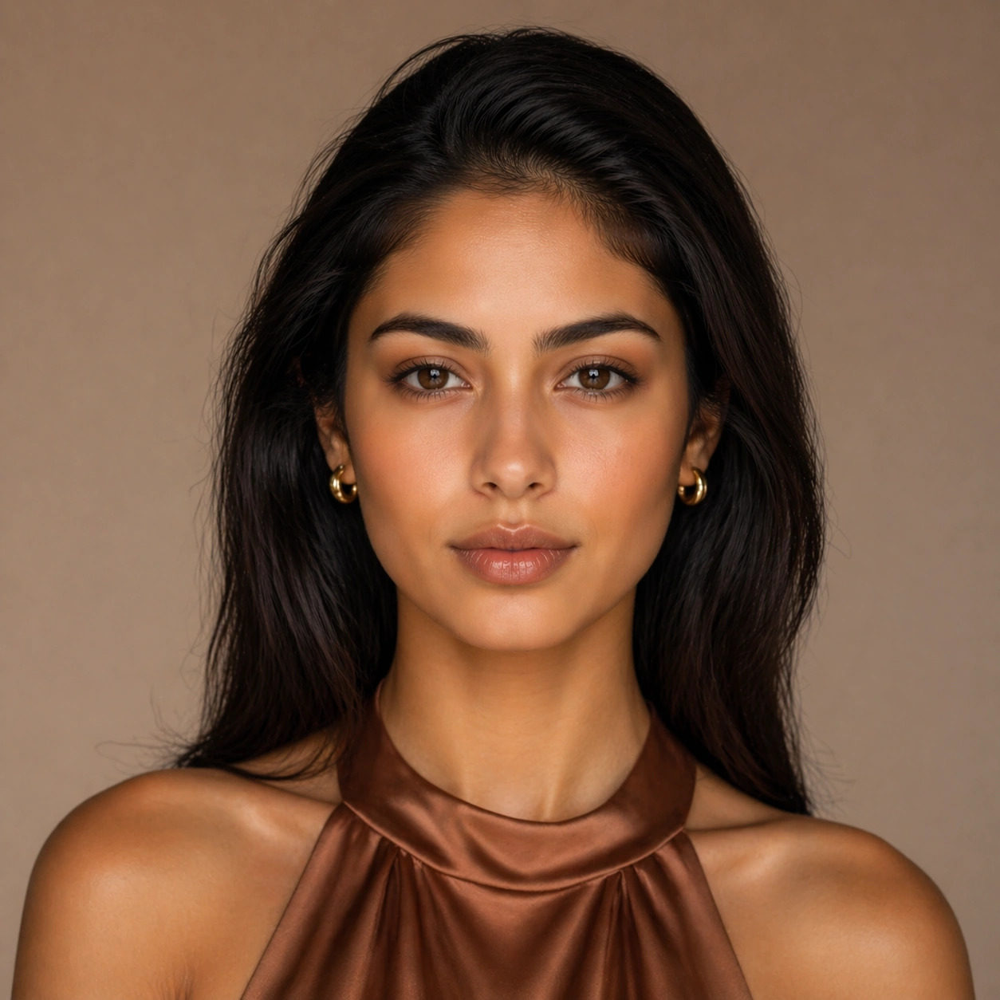

```text
Scene:
Create a square 1:1 portrait image for Same-Face Makeup Era Matrix. Use a final single-look variation with confident but restrained campaign polish. The frame should feel like a finished professional deliverable rather than a casual snapshot, with clear lens discipline, believable light falloff, and a palette that directly supports Transform one face across beauty eras and makeup directions while holding bone structure, age read, and natural identity stable.. Keep enough surrounding space and compositional control for gallery, research, campaign, or approval-board reuse while staying photoreal and human-scaled.

Subject:
Center one beauty model with golden olive skin, dark almond eyes, softly arched brows, and stable face proportions suited to multiple makeup eras. Use the same person again in a sixth styling state, making sure recognition is instant before the viewer notices what changed. Use the example direction from the brief as grounding context: Transform one face across beauty eras and makeup directions while holding bone structure, age read, and natural identity stable.. Wardrobe, lighting, environment, and pose may shift to serve this variation, but the viewer must immediately understand that the same reference identity is still in front of the camera.

Important details:
This backlog line is difficult because Transform one face across beauty eras and makeup directions while holding bone structure, age read, and natural identity stable.. Preserve skin tone family, bone structure, eye spacing, nose shape, mouth shape, hairline logic, shoulder width, and overall body read across the entire series. preserve exact face / hair base / body proportions from the reference model. The transformation should feel deliberate, premium, and usable in a real salon, beauty, fashion, or casting workflow. Avoid the common failure described in the brief: ordinary image models often lose likeness once styling, lighting, or layout changes enter the frame. Success should feel like the result should feel professionally usable, coherent, and clearly built around one stable human identity.

Use case:
Same-Face Makeup Era Matrix series study 7/9, the sixth controlled transformation.

Constraints:
No readable text, no watermark, no logos, preserve exact 1:1 aspect ratio, preserve exact face / hair base / body proportions from the reference model, no hidden face, no perspective warp, no dramatic environment change, no AI-gloss artifacts.
```

[Pinned source](https://github.com/ChaosRealmsAI/gpt-image-2-gallery/blob/5296db8c996e38776c83a0bc8c64f848dcd512b3/works/topics/same-face-makeup-era-matrix/packages/series-identity-switchboard/images/07-look-switch-six/meta.json) · GPT Image2 · 1254×1254 · Reference images required. · ProjectD:individually reviewed; awaiting publication acceptance.

## Detail Proof Board · same-face-makeup-era-matrix/series-identity-switchboard/08-detail-proof-board

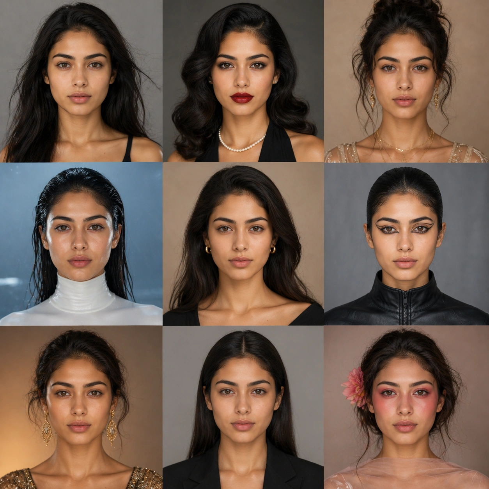

```text
Scene:
Create a square 1:1 portrait image for Same-Face Makeup Era Matrix. Use a square composition that can include multiple tight crops or one richer close-up, but still reads as one coherent portrait asset. The frame should feel like a finished professional deliverable rather than a casual snapshot, with clear lens discipline, believable light falloff, and a palette that directly supports Transform one face across beauty eras and makeup directions while holding bone structure, age read, and natural identity stable.. Keep enough surrounding space and compositional control for gallery, research, campaign, or approval-board reuse while staying photoreal and human-scaled.

Subject:
Center one beauty model with golden olive skin, dark almond eyes, softly arched brows, and stable face proportions suited to multiple makeup eras. Stay locked to the same identity while emphasizing the evidence of the switch: hair texture, makeup finish, beard line, garment detail, or aging cues depending on the topic. Use the example direction from the brief as grounding context: Transform one face across beauty eras and makeup directions while holding bone structure, age read, and natural identity stable.. Wardrobe, lighting, environment, and pose may shift to serve this variation, but the viewer must immediately understand that the same reference identity is still in front of the camera.

Important details:
This backlog line is difficult because Transform one face across beauty eras and makeup directions while holding bone structure, age read, and natural identity stable.. Preserve skin tone family, bone structure, eye spacing, nose shape, mouth shape, hairline logic, shoulder width, and overall body read across the entire series. preserve exact face / hair base / body proportions from the reference model. This frame should support professional review and decision making without readable text. Avoid the common failure described in the brief: ordinary image models often lose likeness once styling, lighting, or layout changes enter the frame. Success should feel like the result should feel professionally usable, coherent, and clearly built around one stable human identity.

Use case:
Same-Face Makeup Era Matrix series study 8/9, a detail-proof or comparison board.

Constraints:
No readable text, no watermark, no logos, preserve exact 1:1 aspect ratio, preserve exact face / hair base / body proportions from the reference model, no readable labels, no broken panel alignment, no detached close-up fragments, no face drift.
```

[Pinned source](https://github.com/ChaosRealmsAI/gpt-image-2-gallery/blob/5296db8c996e38776c83a0bc8c64f848dcd512b3/works/topics/same-face-makeup-era-matrix/packages/series-identity-switchboard/images/08-detail-proof-board/meta.json) · GPT Image2 · 1254×1254 · Reference images required. · ProjectD:individually reviewed; awaiting publication acceptance.

## Campaign Finale · same-face-makeup-era-matrix/series-identity-switchboard/09-campaign-finale

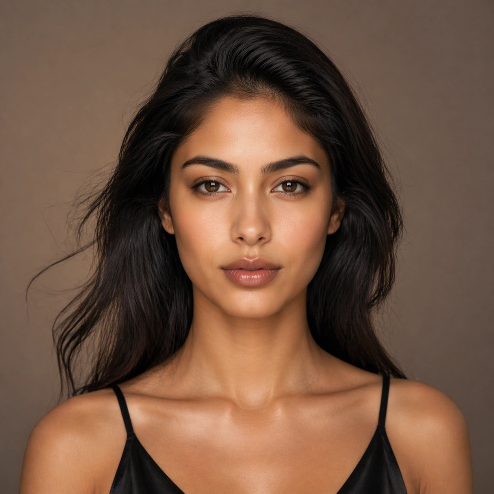

```text
Scene:
Create a square 1:1 portrait image for Same-Face Makeup Era Matrix. Use a square commercial finish with strong portrait presence, premium negative space, and final-asset confidence. The frame should feel like a finished professional deliverable rather than a casual snapshot, with clear lens discipline, believable light falloff, and a palette that directly supports Transform one face across beauty eras and makeup directions while holding bone structure, age read, and natural identity stable.. Keep enough surrounding space and compositional control for gallery, research, campaign, or approval-board reuse while staying photoreal and human-scaled.

Subject:
Center one beauty model with golden olive skin, dark almond eyes, softly arched brows, and stable face proportions suited to multiple makeup eras. Resolve the same identity into a final hero image that proves the transformation line can ship as a real campaign, promo board, or salon approval visual. Use the example direction from the brief as grounding context: Transform one face across beauty eras and makeup directions while holding bone structure, age read, and natural identity stable.. Wardrobe, lighting, environment, and pose may shift to serve this variation, but the viewer must immediately understand that the same reference identity is still in front of the camera.

Important details:
This backlog line is difficult because Transform one face across beauty eras and makeup directions while holding bone structure, age read, and natural identity stable.. Preserve skin tone family, bone structure, eye spacing, nose shape, mouth shape, hairline logic, shoulder width, and overall body read across the entire series. preserve exact face / hair base / body proportions from the reference model. The final degree of polish cannot erase the exact same-person read established in image 01. Avoid the common failure described in the brief: ordinary image models often lose likeness once styling, lighting, or layout changes enter the frame. Success should feel like the result should feel professionally usable, coherent, and clearly built around one stable human identity.

Use case:
Same-Face Makeup Era Matrix series study 9/9, a polished campaign finale.

Constraints:
No readable text, no watermark, no logos, preserve exact 1:1 aspect ratio, preserve exact face / hair base / body proportions from the reference model, no readable copy, no logos, no poster clutter, no identity reset.
```

[Pinned source](https://github.com/ChaosRealmsAI/gpt-image-2-gallery/blob/5296db8c996e38776c83a0bc8c64f848dcd512b3/works/topics/same-face-makeup-era-matrix/packages/series-identity-switchboard/images/09-campaign-finale/meta.json) · GPT Image2 · 1254×1254 · Reference images required. · ProjectD:individually reviewed; awaiting publication acceptance.

## Anchor Portrait · same-model-fashion-tryon-campaign/series-identity-lock/01-anchor-portrait

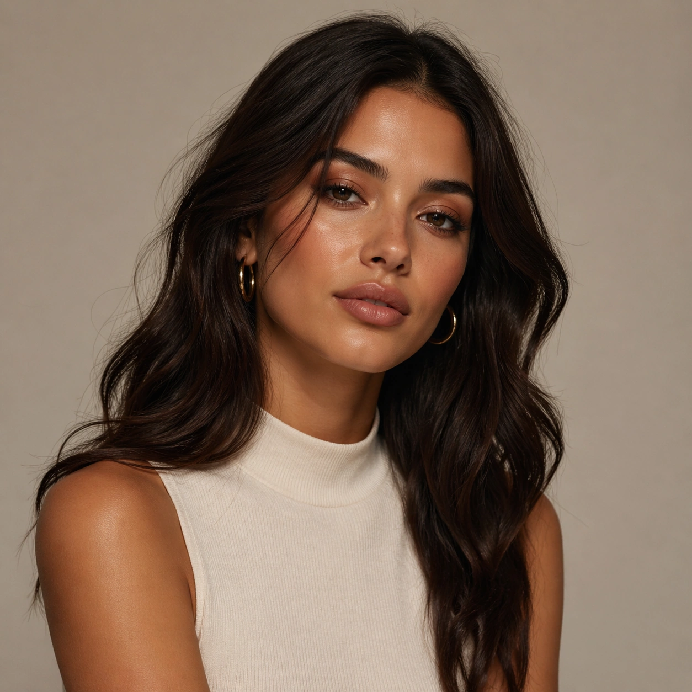

```text
Scene:
A square commercial beauty-or-fashion image designed like a polished campaign proof for Same-Model Fashion Try-On Campaign. Keep the camera discipline clear and believable: portrait-oriented within the square, premium studio light, controlled tonal contrast, and enough surrounding negative space to feel like an ad layout without relying on readable typography. The image should look production-ready, with realistic skin, hair, fabric, and makeup rendering that supports identity locking instead of distracting from it.

Subject:
Build the frame around one clearly recognizable person. Anchor Portrait should feel like a specific transformation step that defines the exact face, camera angle, skin texture, and model identity that later images must preserve. The face structure, age, body proportions, and general camera position must stay consistent with the same-person premise of Lock one model's identity while rotating wardrobe, styling direction, and seasonal looks for fashion commerce, editorial, and campaign usage.. Styling, wardrobe, grooming, makeup, hair, or pose can evolve, but the viewer must believe it is unquestionably the same subject across the whole theme. Use a premium editorial-commercial tone rather than a casual portrait session.

Important details:
The visual test is identity consistency under change. Preserve stable bone structure, eye spacing, nose shape, lip volume, skin tone family, and believable texture response. Let the transformation be visible through styling choices instead of facial drift. This theme studies multi-image-reference, editing-workflow, commercial-mockup, photorealism through a production-ready visual system. Make the composition clean enough for client review, with professional grooming fidelity and enough detail for salon, beauty, or fashion decision-making. Aim for clear hierarchy, polished craft, and immediately usable campaign logic.

Use case:
Same-Model Fashion Try-On Campaign series study 1/4.

Constraints:
No readable text, no watermark, no logos, preserve exact 1:1 aspect ratio, no face drift, no inconsistent age shift, no extra limbs, no duplicate person, no asymmetric eye placement, no beauty-editorial chaos.
```

[Pinned source](https://github.com/ChaosRealmsAI/gpt-image-2-gallery/blob/5296db8c996e38776c83a0bc8c64f848dcd512b3/works/topics/same-model-fashion-tryon-campaign/packages/series-identity-lock/images/01-anchor-portrait/meta.json) · GPT Image2 · 1254×1254 · No source-declared image dependencies. · ProjectD:individually reviewed; awaiting publication acceptance.

## First Switch · same-model-fashion-tryon-campaign/series-identity-lock/02-first-switch

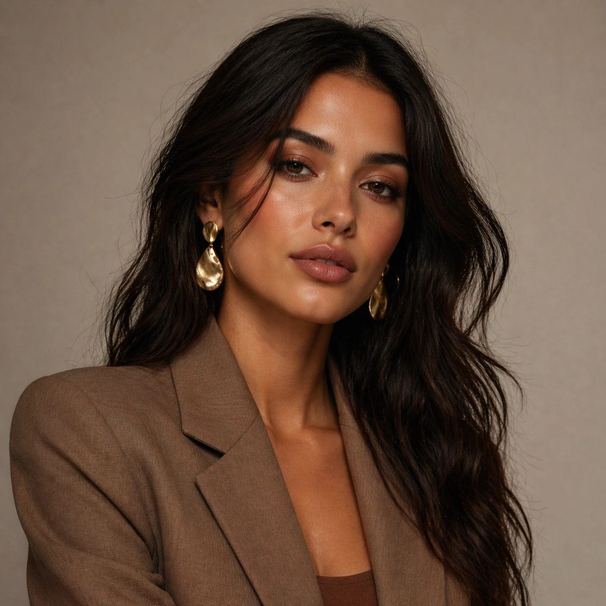

```text
Scene:
A square commercial beauty-or-fashion image designed like a polished campaign proof for Same-Model Fashion Try-On Campaign. Keep the camera discipline clear and believable: portrait-oriented within the square, premium studio light, controlled tonal contrast, and enough surrounding negative space to feel like an ad layout without relying on readable typography. The image should look production-ready, with realistic skin, hair, fabric, and makeup rendering that supports identity locking instead of distracting from it.

Subject:
Build the frame around one clearly recognizable person. First Switch should feel like a specific transformation step that keeps the same identity but changes the styling direction in a clear and controlled way. The face structure, age, body proportions, and general camera position must stay consistent with the same-person premise of Lock one model's identity while rotating wardrobe, styling direction, and seasonal looks for fashion commerce, editorial, and campaign usage.. Styling, wardrobe, grooming, makeup, hair, or pose can evolve, but the viewer must believe it is unquestionably the same subject across the whole theme. Use a premium editorial-commercial tone rather than a casual portrait session.

Important details:
The visual test is identity consistency under change. Preserve stable bone structure, eye spacing, nose shape, lip volume, skin tone family, and believable texture response. Let the transformation be visible through styling choices instead of facial drift. This theme studies multi-image-reference, editing-workflow, commercial-mockup, photorealism through a production-ready visual system. Make the composition clean enough for client review, with professional grooming fidelity and enough detail for salon, beauty, or fashion decision-making. Aim for clear hierarchy, polished craft, and immediately usable campaign logic.

Use case:
Same-Model Fashion Try-On Campaign series study 2/4.

Constraints:
No readable text, no watermark, no logos, preserve exact 1:1 aspect ratio, no face drift, no inconsistent age shift, no extra limbs, no duplicate person, no asymmetric eye placement, no beauty-editorial chaos.
```

[Pinned source](https://github.com/ChaosRealmsAI/gpt-image-2-gallery/blob/5296db8c996e38776c83a0bc8c64f848dcd512b3/works/topics/same-model-fashion-tryon-campaign/packages/series-identity-lock/images/02-first-switch/meta.json) · GPT Image2 · 1254×1254 · Reference images required. · ProjectD:individually reviewed; awaiting publication acceptance.

## Second Switch · same-model-fashion-tryon-campaign/series-identity-lock/03-second-switch

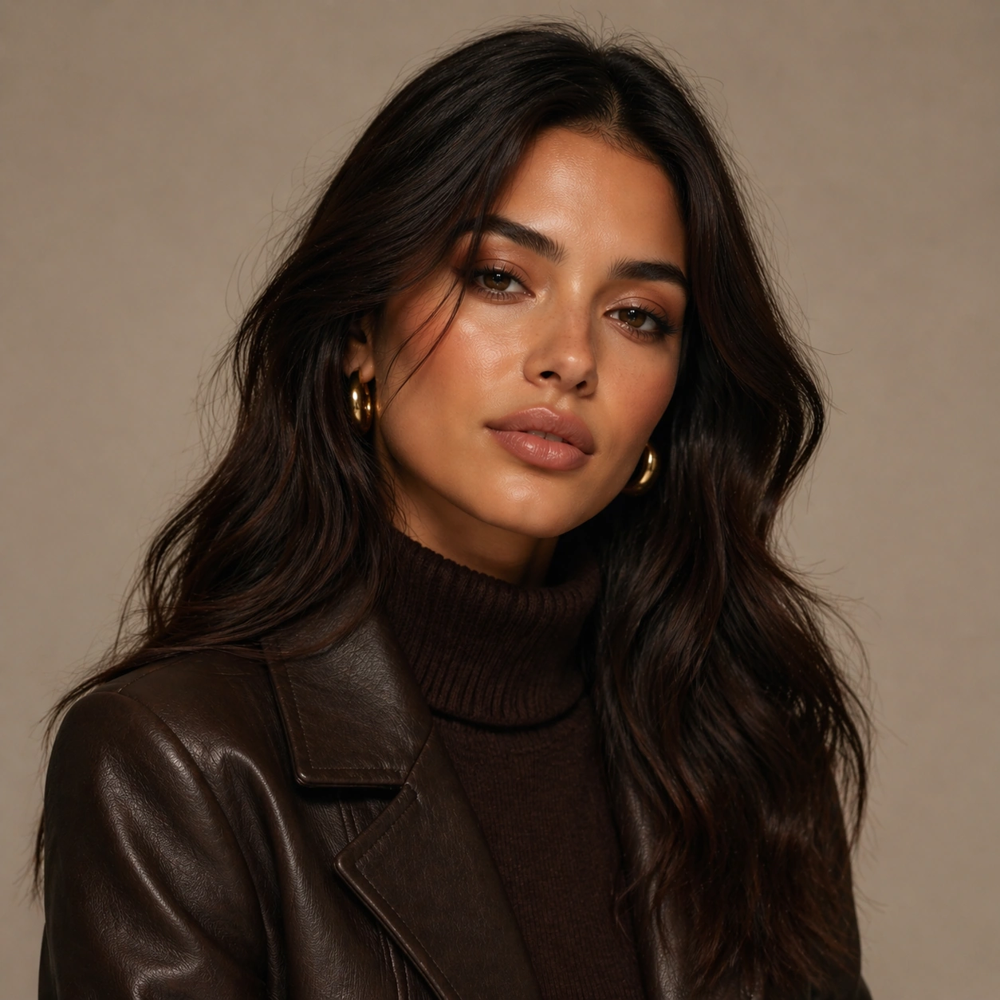

```text
Scene:
A square commercial beauty-or-fashion image designed like a polished campaign proof for Same-Model Fashion Try-On Campaign. Keep the camera discipline clear and believable: portrait-oriented within the square, premium studio light, controlled tonal contrast, and enough surrounding negative space to feel like an ad layout without relying on readable typography. The image should look production-ready, with realistic skin, hair, fabric, and makeup rendering that supports identity locking instead of distracting from it.

Subject:
Build the frame around one clearly recognizable person. Second Switch should feel like a specific transformation step that pushes the same identity into a more dramatic transformation without face drift. The face structure, age, body proportions, and general camera position must stay consistent with the same-person premise of Lock one model's identity while rotating wardrobe, styling direction, and seasonal looks for fashion commerce, editorial, and campaign usage.. Styling, wardrobe, grooming, makeup, hair, or pose can evolve, but the viewer must believe it is unquestionably the same subject across the whole theme. Use a premium editorial-commercial tone rather than a casual portrait session.

Important details:
The visual test is identity consistency under change. Preserve stable bone structure, eye spacing, nose shape, lip volume, skin tone family, and believable texture response. Let the transformation be visible through styling choices instead of facial drift. This theme studies multi-image-reference, editing-workflow, commercial-mockup, photorealism through a production-ready visual system. Make the composition clean enough for client review, with professional grooming fidelity and enough detail for salon, beauty, or fashion decision-making. Aim for clear hierarchy, polished craft, and immediately usable campaign logic.

Use case:
Same-Model Fashion Try-On Campaign series study 3/4.

Constraints:
No readable text, no watermark, no logos, preserve exact 1:1 aspect ratio, no face drift, no inconsistent age shift, no extra limbs, no duplicate person, no asymmetric eye placement, no beauty-editorial chaos.
```

[Pinned source](https://github.com/ChaosRealmsAI/gpt-image-2-gallery/blob/5296db8c996e38776c83a0bc8c64f848dcd512b3/works/topics/same-model-fashion-tryon-campaign/packages/series-identity-lock/images/03-second-switch/meta.json) · GPT Image2 · 1254×1254 · Reference images required. · ProjectD:individually reviewed; awaiting publication acceptance.

## Campaign Finish · same-model-fashion-tryon-campaign/series-identity-lock/04-campaign-finish

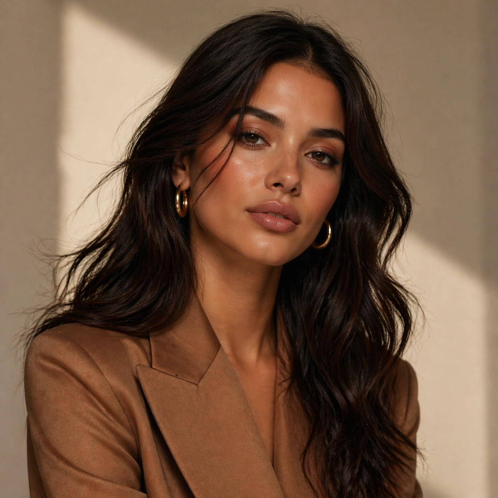

```text
Scene:
A square commercial beauty-or-fashion image designed like a polished campaign proof for Same-Model Fashion Try-On Campaign. Keep the camera discipline clear and believable: portrait-oriented within the square, premium studio light, controlled tonal contrast, and enough surrounding negative space to feel like an ad layout without relying on readable typography. The image should look production-ready, with realistic skin, hair, fabric, and makeup rendering that supports identity locking instead of distracting from it.

Subject:
Build the frame around one clearly recognizable person. Campaign Finish should feel like a specific transformation step that turns the locked identity into a polished campaign-ready hero frame. The face structure, age, body proportions, and general camera position must stay consistent with the same-person premise of Lock one model's identity while rotating wardrobe, styling direction, and seasonal looks for fashion commerce, editorial, and campaign usage.. Styling, wardrobe, grooming, makeup, hair, or pose can evolve, but the viewer must believe it is unquestionably the same subject across the whole theme. Use a premium editorial-commercial tone rather than a casual portrait session.

Important details:
The visual test is identity consistency under change. Preserve stable bone structure, eye spacing, nose shape, lip volume, skin tone family, and believable texture response. Let the transformation be visible through styling choices instead of facial drift. This theme studies multi-image-reference, editing-workflow, commercial-mockup, photorealism through a production-ready visual system. Make the composition clean enough for client review, with professional grooming fidelity and enough detail for salon, beauty, or fashion decision-making. Aim for clear hierarchy, polished craft, and immediately usable campaign logic.

Use case:
Same-Model Fashion Try-On Campaign series study 4/4.

Constraints:
No readable text, no watermark, no logos, preserve exact 1:1 aspect ratio, no face drift, no inconsistent age shift, no extra limbs, no duplicate person, no asymmetric eye placement, no beauty-editorial chaos.
```

[Pinned source](https://github.com/ChaosRealmsAI/gpt-image-2-gallery/blob/5296db8c996e38776c83a0bc8c64f848dcd512b3/works/topics/same-model-fashion-tryon-campaign/packages/series-identity-lock/images/04-campaign-finish/meta.json) · GPT Image2 · 1254×1254 · Reference images required. · ProjectD:individually reviewed; awaiting publication acceptance.

## Before After Board · same-model-fashion-tryon-campaign/single-editorial-support/before-after-board

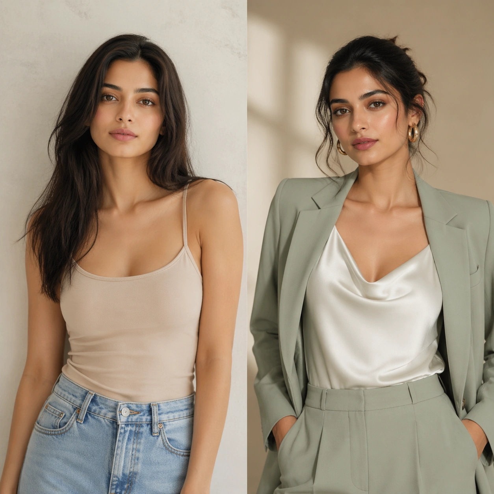

```text
Scene:
A square commercial beauty-or-fashion image designed like a polished campaign proof for Same-Model Fashion Try-On Campaign. Keep the camera discipline clear and believable: portrait-oriented within the square, premium studio light, controlled tonal contrast, and enough surrounding negative space to feel like an ad layout without relying on readable typography. The image should look production-ready, with realistic skin, hair, fabric, and makeup rendering that supports identity locking instead of distracting from it.

Subject:
Build the frame around one clearly recognizable person. Before After Board should feel like a specific transformation step that a disciplined comparison layout making transformation logic instantly legible. The face structure, age, body proportions, and general camera position must stay consistent with the same-person premise of Lock one model's identity while rotating wardrobe, styling direction, and seasonal looks for fashion commerce, editorial, and campaign usage.. Styling, wardrobe, grooming, makeup, hair, or pose can evolve, but the viewer must believe it is unquestionably the same subject across the whole theme. Use a premium editorial-commercial tone rather than a casual portrait session.

Important details:
The visual test is identity consistency under change. Preserve stable bone structure, eye spacing, nose shape, lip volume, skin tone family, and believable texture response. Let the transformation be visible through styling choices instead of facial drift. This theme studies multi-image-reference, editing-workflow, commercial-mockup, photorealism through a production-ready visual system. Make the composition clean enough for client review, with professional grooming fidelity and enough detail for salon, beauty, or fashion decision-making. Aim for clear hierarchy, polished craft, and immediately usable campaign logic.

Use case:
Same-Model Fashion Try-On Campaign single study 1/5.

Constraints:
No readable text, no watermark, no logos, preserve exact 1:1 aspect ratio, no face drift, no inconsistent age shift, no extra limbs, no duplicate person, no asymmetric eye placement, no beauty-editorial chaos.
```

[Pinned source](https://github.com/ChaosRealmsAI/gpt-image-2-gallery/blob/5296db8c996e38776c83a0bc8c64f848dcd512b3/works/topics/same-model-fashion-tryon-campaign/packages/single-editorial-support/images/before-after-board/meta.json) · GPT Image2 · 1254×1254 · No source-declared image dependencies. · ProjectD:individually reviewed; awaiting publication acceptance.

## Lookbook Sheet · same-model-fashion-tryon-campaign/single-editorial-support/lookbook-sheet

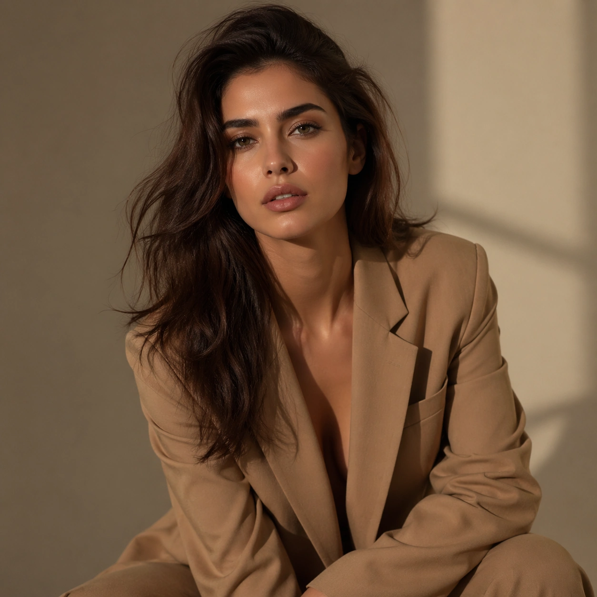

```text
Scene:
A square commercial beauty-or-fashion image designed like a polished campaign proof for Same-Model Fashion Try-On Campaign. Keep the camera discipline clear and believable: portrait-oriented within the square, premium studio light, controlled tonal contrast, and enough surrounding negative space to feel like an ad layout without relying on readable typography. The image should look production-ready, with realistic skin, hair, fabric, and makeup rendering that supports identity locking instead of distracting from it.

Subject:
Build the frame around one clearly recognizable person. Lookbook Sheet should feel like a specific transformation step that a fashion or salon lookbook page using one consistent identity across multiple panels. The face structure, age, body proportions, and general camera position must stay consistent with the same-person premise of Lock one model's identity while rotating wardrobe, styling direction, and seasonal looks for fashion commerce, editorial, and campaign usage.. Styling, wardrobe, grooming, makeup, hair, or pose can evolve, but the viewer must believe it is unquestionably the same subject across the whole theme. Use a premium editorial-commercial tone rather than a casual portrait session.

Important details:
The visual test is identity consistency under change. Preserve stable bone structure, eye spacing, nose shape, lip volume, skin tone family, and believable texture response. Let the transformation be visible through styling choices instead of facial drift. This theme studies multi-image-reference, editing-workflow, commercial-mockup, photorealism through a production-ready visual system. Make the composition clean enough for client review, with professional grooming fidelity and enough detail for salon, beauty, or fashion decision-making. Aim for clear hierarchy, polished craft, and immediately usable campaign logic.

Use case:
Same-Model Fashion Try-On Campaign single study 2/5.

Constraints:
No readable text, no watermark, no logos, preserve exact 1:1 aspect ratio, no face drift, no inconsistent age shift, no extra limbs, no duplicate person, no asymmetric eye placement, no beauty-editorial chaos.
```

[Pinned source](https://github.com/ChaosRealmsAI/gpt-image-2-gallery/blob/5296db8c996e38776c83a0bc8c64f848dcd512b3/works/topics/same-model-fashion-tryon-campaign/packages/single-editorial-support/images/lookbook-sheet/meta.json) · GPT Image2 · 1254×1254 · No source-declared image dependencies. · ProjectD:**Held:** Complete brief requests a multi-panel lookbook sheet, but native output is a single seated portrait. Archive pair and hold the core layout mismatch.

## Detail Close-up · same-model-fashion-tryon-campaign/single-editorial-support/detail-closeup

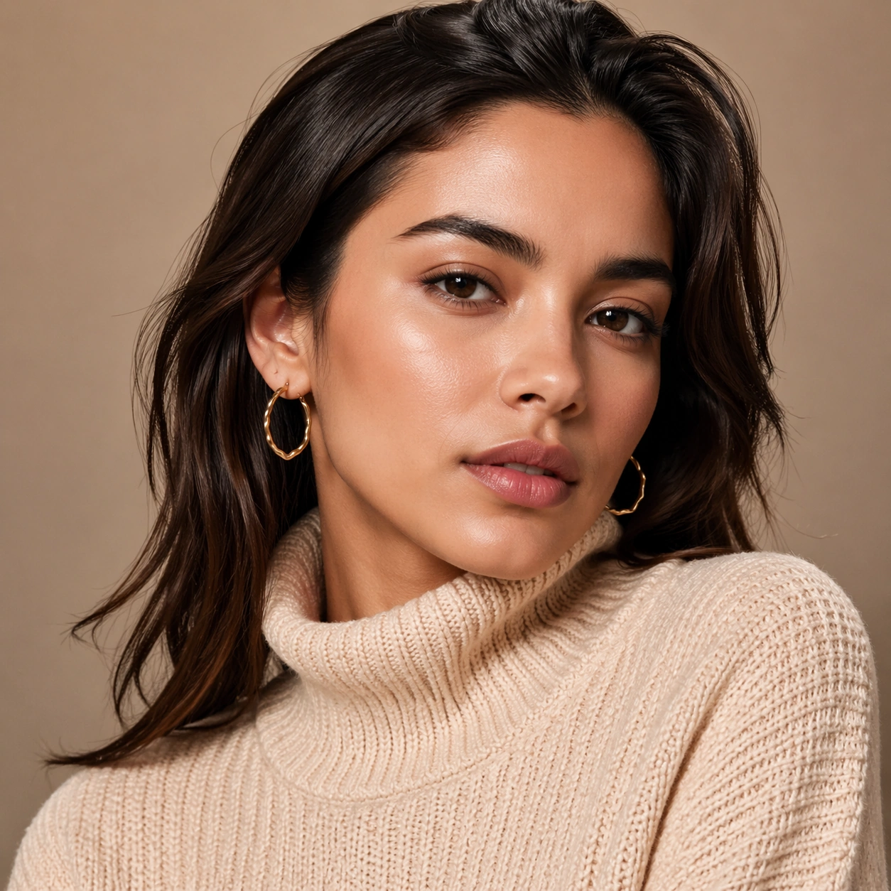

```text
Scene:
A square commercial beauty-or-fashion image designed like a polished campaign proof for Same-Model Fashion Try-On Campaign. Keep the camera discipline clear and believable: portrait-oriented within the square, premium studio light, controlled tonal contrast, and enough surrounding negative space to feel like an ad layout without relying on readable typography. The image should look production-ready, with realistic skin, hair, fabric, and makeup rendering that supports identity locking instead of distracting from it.

Subject:
Build the frame around one clearly recognizable person. Detail Close-up should feel like a specific transformation step that a close-up study focusing on texture, finish, and precise beauty or garment details. The face structure, age, body proportions, and general camera position must stay consistent with the same-person premise of Lock one model's identity while rotating wardrobe, styling direction, and seasonal looks for fashion commerce, editorial, and campaign usage.. Styling, wardrobe, grooming, makeup, hair, or pose can evolve, but the viewer must believe it is unquestionably the same subject across the whole theme. Use a premium editorial-commercial tone rather than a casual portrait session.

Important details:
The visual test is identity consistency under change. Preserve stable bone structure, eye spacing, nose shape, lip volume, skin tone family, and believable texture response. Let the transformation be visible through styling choices instead of facial drift. This theme studies multi-image-reference, editing-workflow, commercial-mockup, photorealism through a production-ready visual system. Make the composition clean enough for client review, with professional grooming fidelity and enough detail for salon, beauty, or fashion decision-making. Aim for clear hierarchy, polished craft, and immediately usable campaign logic.

Use case:
Same-Model Fashion Try-On Campaign single study 3/5.

Constraints:
No readable text, no watermark, no logos, preserve exact 1:1 aspect ratio, no face drift, no inconsistent age shift, no extra limbs, no duplicate person, no asymmetric eye placement, no beauty-editorial chaos.
```

[Pinned source](https://github.com/ChaosRealmsAI/gpt-image-2-gallery/blob/5296db8c996e38776c83a0bc8c64f848dcd512b3/works/topics/same-model-fashion-tryon-campaign/packages/single-editorial-support/images/detail-closeup/meta.json) · GPT Image2 · 1254×1254 · No source-declared image dependencies. · ProjectD:individually reviewed; awaiting publication acceptance.

## Promo Poster · same-model-fashion-tryon-campaign/single-editorial-support/promo-poster

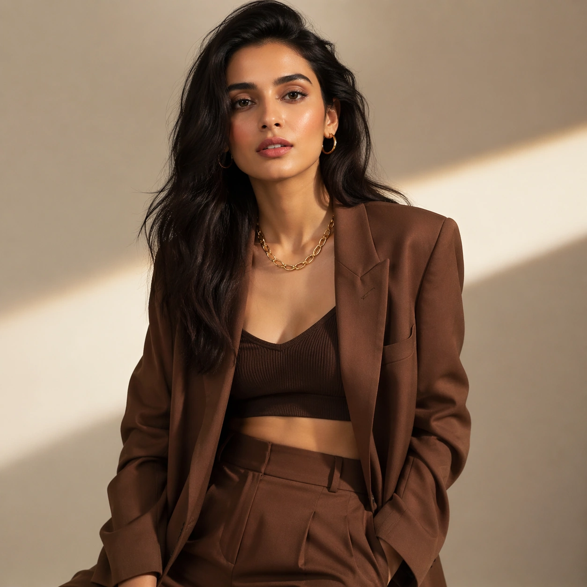

```text
Scene:
A square commercial beauty-or-fashion image designed like a polished campaign proof for Same-Model Fashion Try-On Campaign. Keep the camera discipline clear and believable: portrait-oriented within the square, premium studio light, controlled tonal contrast, and enough surrounding negative space to feel like an ad layout without relying on readable typography. The image should look production-ready, with realistic skin, hair, fabric, and makeup rendering that supports identity locking instead of distracting from it.

Subject:
Build the frame around one clearly recognizable person. Promo Poster should feel like a specific transformation step that a polished advertisement frame turning the same identity into a finished commercial visual. The face structure, age, body proportions, and general camera position must stay consistent with the same-person premise of Lock one model's identity while rotating wardrobe, styling direction, and seasonal looks for fashion commerce, editorial, and campaign usage.. Styling, wardrobe, grooming, makeup, hair, or pose can evolve, but the viewer must believe it is unquestionably the same subject across the whole theme. Use a premium editorial-commercial tone rather than a casual portrait session.

Important details:
The visual test is identity consistency under change. Preserve stable bone structure, eye spacing, nose shape, lip volume, skin tone family, and believable texture response. Let the transformation be visible through styling choices instead of facial drift. This theme studies multi-image-reference, editing-workflow, commercial-mockup, photorealism through a production-ready visual system. Make the composition clean enough for client review, with professional grooming fidelity and enough detail for salon, beauty, or fashion decision-making. Aim for clear hierarchy, polished craft, and immediately usable campaign logic.

Use case:
Same-Model Fashion Try-On Campaign single study 4/5.

Constraints:
No readable text, no watermark, no logos, preserve exact 1:1 aspect ratio, no face drift, no inconsistent age shift, no extra limbs, no duplicate person, no asymmetric eye placement, no beauty-editorial chaos.
```

[Pinned source](https://github.com/ChaosRealmsAI/gpt-image-2-gallery/blob/5296db8c996e38776c83a0bc8c64f848dcd512b3/works/topics/same-model-fashion-tryon-campaign/packages/single-editorial-support/images/promo-poster/meta.json) · GPT Image2 · 1254×1254 · No source-declared image dependencies. · ProjectD:individually reviewed; awaiting publication acceptance.

## Campaign Grid · same-model-fashion-tryon-campaign/single-editorial-support/campaign-grid

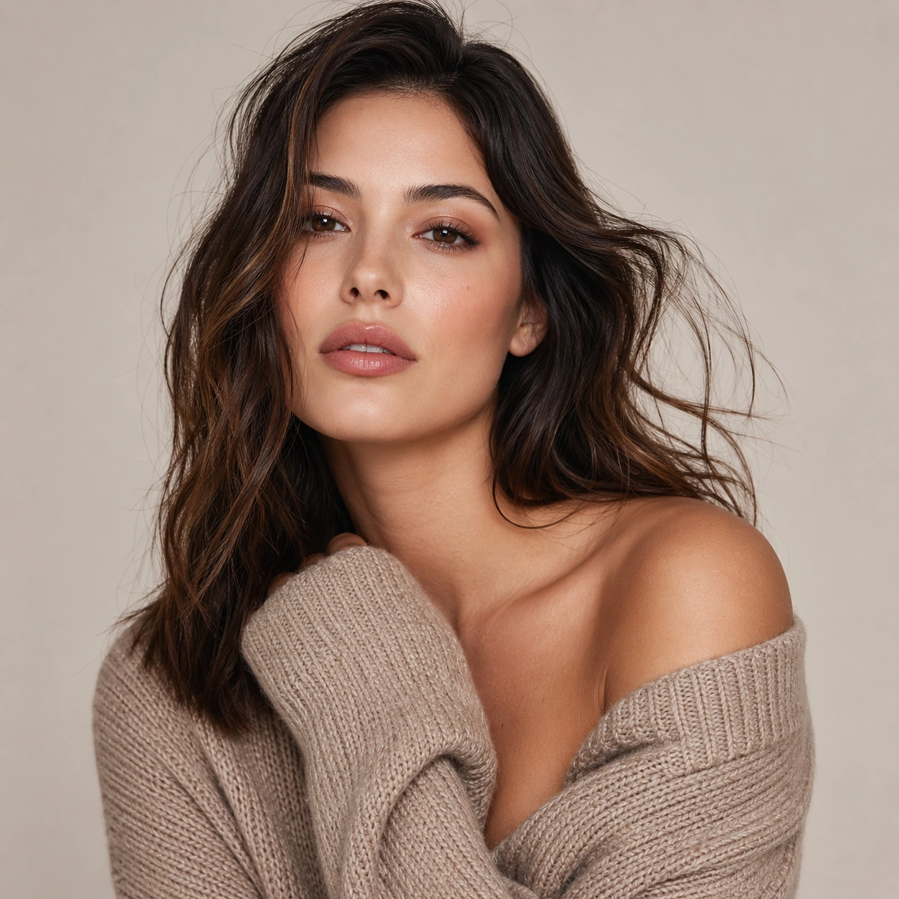

```text
Scene:
A square commercial beauty-or-fashion image designed like a polished campaign proof for Same-Model Fashion Try-On Campaign. Keep the camera discipline clear and believable: portrait-oriented within the square, premium studio light, controlled tonal contrast, and enough surrounding negative space to feel like an ad layout without relying on readable typography. The image should look production-ready, with realistic skin, hair, fabric, and makeup rendering that supports identity locking instead of distracting from it.

Subject:
Build the frame around one clearly recognizable person. Campaign Grid should feel like a specific transformation step that a multi-panel rollout board proving catalog depth and consistent recognition. The face structure, age, body proportions, and general camera position must stay consistent with the same-person premise of Lock one model's identity while rotating wardrobe, styling direction, and seasonal looks for fashion commerce, editorial, and campaign usage.. Styling, wardrobe, grooming, makeup, hair, or pose can evolve, but the viewer must believe it is unquestionably the same subject across the whole theme. Use a premium editorial-commercial tone rather than a casual portrait session.

Important details:
The visual test is identity consistency under change. Preserve stable bone structure, eye spacing, nose shape, lip volume, skin tone family, and believable texture response. Let the transformation be visible through styling choices instead of facial drift. This theme studies multi-image-reference, editing-workflow, commercial-mockup, photorealism through a production-ready visual system. Make the composition clean enough for client review, with professional grooming fidelity and enough detail for salon, beauty, or fashion decision-making. Aim for clear hierarchy, polished craft, and immediately usable campaign logic.

Use case:
Same-Model Fashion Try-On Campaign single study 5/5.

Constraints:
No readable text, no watermark, no logos, preserve exact 1:1 aspect ratio, no face drift, no inconsistent age shift, no extra limbs, no duplicate person, no asymmetric eye placement, no beauty-editorial chaos.
```

[Pinned source](https://github.com/ChaosRealmsAI/gpt-image-2-gallery/blob/5296db8c996e38776c83a0bc8c64f848dcd512b3/works/topics/same-model-fashion-tryon-campaign/packages/single-editorial-support/images/campaign-grid/meta.json) · GPT Image2 · 1254×1254 · No source-declared image dependencies. · ProjectD:**Held:** Complete brief requests a multi-panel campaign rollout grid, but native output is a single portrait. Archive pair and hold from ProjectD.

## Reference Natural Base · same-model-wardrobe-tryon-campaign/series-identity-switchboard/01-reference-natural-base

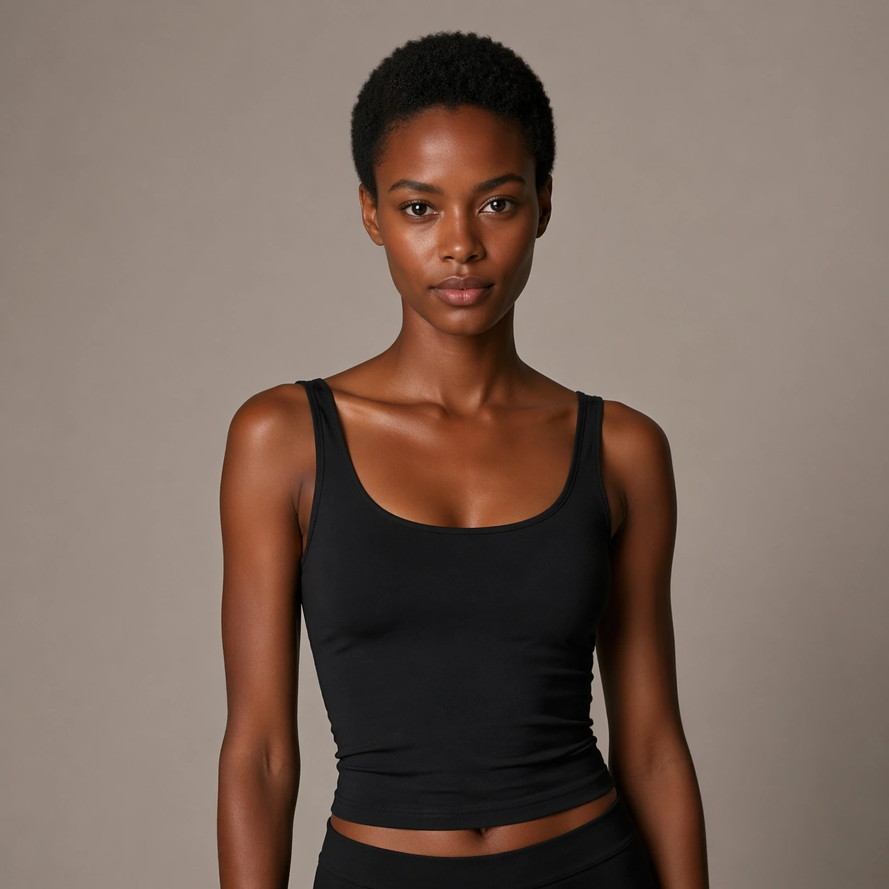

```text
Scene:
Create a square 1:1 portrait image for Same-Model Wardrobe Try-On Campaign. Use a clean approval-style studio portrait with neutral light, simple wardrobe, and enough facial visibility to lock identity perfectly. The frame should feel like a finished professional deliverable rather than a casual snapshot, with clear lens discipline, believable light falloff, and a palette that directly supports Keep the same model stable while swapping through campaign-ready wardrobe directions that feel like a real fashion fitting or virtual try-on studio.. Keep enough surrounding space and compositional control for gallery, research, campaign, or approval-board reuse while staying photoreal and human-scaled.

Subject:
Center one campaign model with deep brown skin, short natural hair, balanced tall proportions, and a calm direct gaze. Establish the exact same face, hair base, skin tone family, and body proportions that every transformation image must preserve. Use the example direction from the brief as grounding context: Keep the same model stable while swapping through campaign-ready wardrobe directions that feel like a real fashion fitting or virtual try-on studio.. Wardrobe, lighting, environment, and pose may shift to serve this variation, but the viewer must immediately understand that the same reference identity is still in front of the camera.

Important details:
This backlog line is difficult because Keep the same model stable while swapping through campaign-ready wardrobe directions that feel like a real fashion fitting or virtual try-on studio.. Preserve skin tone family, bone structure, eye spacing, nose shape, mouth shape, hairline logic, shoulder width, and overall body read across the entire series. preserve exact face / hair base / body proportions from the reference model. This baseline must read like the trustworthy approval frame before switching anything. Avoid the common failure described in the brief: ordinary image models often lose likeness once styling, lighting, or layout changes enter the frame. Success should feel like the result should feel professionally usable, coherent, and clearly built around one stable human identity.

Use case:
Same-Model Wardrobe Try-On Campaign series study 1/9, the natural baseline look.

Constraints:
No readable text, no watermark, no logos, preserve exact 1:1 aspect ratio, preserve exact face / hair base / body proportions from the reference model, no heavy styling, no logo wardrobe, no beauty filter, no extra subjects.
```

[Pinned source](https://github.com/ChaosRealmsAI/gpt-image-2-gallery/blob/5296db8c996e38776c83a0bc8c64f848dcd512b3/works/topics/same-model-wardrobe-tryon-campaign/packages/series-identity-switchboard/images/01-reference-natural-base/meta.json) · GPT Image2 · 1254×1254 · No source-declared image dependencies. · ProjectD:individually reviewed; awaiting publication acceptance.

## Look Switch One · same-model-wardrobe-tryon-campaign/series-identity-switchboard/02-look-switch-one

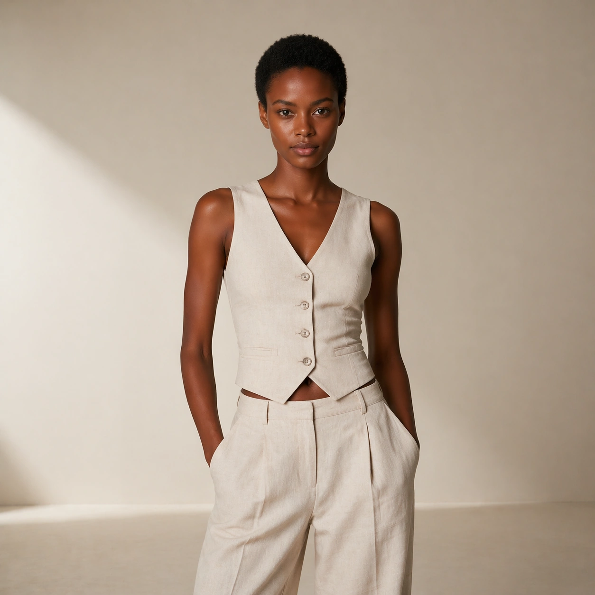

```text
Scene:
Create a square 1:1 portrait image for Same-Model Wardrobe Try-On Campaign. Use a premium portrait frame with one clear change direction and enough negative space to judge styling cleanly. The frame should feel like a finished professional deliverable rather than a casual snapshot, with clear lens discipline, believable light falloff, and a palette that directly supports Keep the same model stable while swapping through campaign-ready wardrobe directions that feel like a real fashion fitting or virtual try-on studio.. Keep enough surrounding space and compositional control for gallery, research, campaign, or approval-board reuse while staying photoreal and human-scaled.

Subject:
Center one campaign model with deep brown skin, short natural hair, balanced tall proportions, and a calm direct gaze. Keep the exact same person from the reference while executing the first major change requested by the topic, whether hair, makeup, wardrobe, grooming, or professional read. Use the example direction from the brief as grounding context: Keep the same model stable while swapping through campaign-ready wardrobe directions that feel like a real fashion fitting or virtual try-on studio.. Wardrobe, lighting, environment, and pose may shift to serve this variation, but the viewer must immediately understand that the same reference identity is still in front of the camera.

Important details:
This backlog line is difficult because Keep the same model stable while swapping through campaign-ready wardrobe directions that feel like a real fashion fitting or virtual try-on studio.. Preserve skin tone family, bone structure, eye spacing, nose shape, mouth shape, hairline logic, shoulder width, and overall body read across the entire series. preserve exact face / hair base / body proportions from the reference model. The switch must be obvious, but the identity must remain stronger than the styling change. Avoid the common failure described in the brief: ordinary image models often lose likeness once styling, lighting, or layout changes enter the frame. Success should feel like the result should feel professionally usable, coherent, and clearly built around one stable human identity.

Use case:
Same-Model Wardrobe Try-On Campaign series study 2/9, the first controlled transformation.

Constraints:
No readable text, no watermark, no logos, preserve exact 1:1 aspect ratio, preserve exact face / hair base / body proportions from the reference model, no face redraw, no changed age unless explicitly asked, no costume-party exaggeration, no new body shape.
```

[Pinned source](https://github.com/ChaosRealmsAI/gpt-image-2-gallery/blob/5296db8c996e38776c83a0bc8c64f848dcd512b3/works/topics/same-model-wardrobe-tryon-campaign/packages/series-identity-switchboard/images/02-look-switch-one/meta.json) · GPT Image2 · 1254×1254 · Reference images required. · ProjectD:individually reviewed; awaiting publication acceptance.

## Look Switch Two · same-model-wardrobe-tryon-campaign/series-identity-switchboard/03-look-switch-two

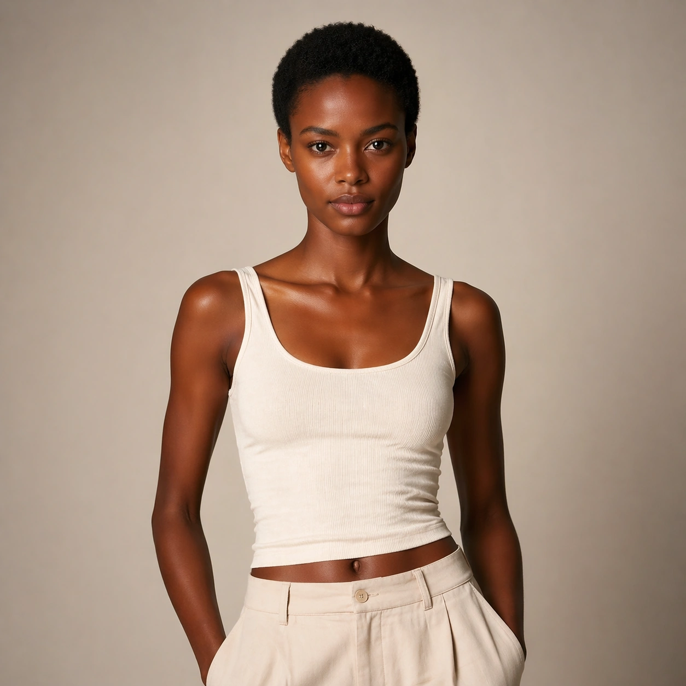

```text
Scene:
Create a square 1:1 portrait image for Same-Model Wardrobe Try-On Campaign. Use a square commercial portrait proof with similar camera logic and controlled light. The frame should feel like a finished professional deliverable rather than a casual snapshot, with clear lens discipline, believable light falloff, and a palette that directly supports Keep the same model stable while swapping through campaign-ready wardrobe directions that feel like a real fashion fitting or virtual try-on studio.. Keep enough surrounding space and compositional control for gallery, research, campaign, or approval-board reuse while staying photoreal and human-scaled.

Subject:
Center one campaign model with deep brown skin, short natural hair, balanced tall proportions, and a calm direct gaze. Preserve the same face and body while moving to a second transformation state that still feels plausible for the same person. Use the example direction from the brief as grounding context: Keep the same model stable while swapping through campaign-ready wardrobe directions that feel like a real fashion fitting or virtual try-on studio.. Wardrobe, lighting, environment, and pose may shift to serve this variation, but the viewer must immediately understand that the same reference identity is still in front of the camera.

Important details:
This backlog line is difficult because Keep the same model stable while swapping through campaign-ready wardrobe directions that feel like a real fashion fitting or virtual try-on studio.. Preserve skin tone family, bone structure, eye spacing, nose shape, mouth shape, hairline logic, shoulder width, and overall body read across the entire series. preserve exact face / hair base / body proportions from the reference model. Hairline logic, eye spacing, lip shape, and shoulder width must remain exact. Avoid the common failure described in the brief: ordinary image models often lose likeness once styling, lighting, or layout changes enter the frame. Success should feel like the result should feel professionally usable, coherent, and clearly built around one stable human identity.

Use case:
Same-Model Wardrobe Try-On Campaign series study 3/9, the second controlled transformation.

Constraints:
No readable text, no watermark, no logos, preserve exact 1:1 aspect ratio, preserve exact face / hair base / body proportions from the reference model, no hairstyle that changes skull shape, no enlarged eyes, no body morphing, no logo props.
```

[Pinned source](https://github.com/ChaosRealmsAI/gpt-image-2-gallery/blob/5296db8c996e38776c83a0bc8c64f848dcd512b3/works/topics/same-model-wardrobe-tryon-campaign/packages/series-identity-switchboard/images/03-look-switch-two/meta.json) · GPT Image2 · 1254×1254 · Reference images required. · ProjectD:individually reviewed; awaiting publication acceptance.

## Look Switch Three · same-model-wardrobe-tryon-campaign/series-identity-switchboard/04-look-switch-three

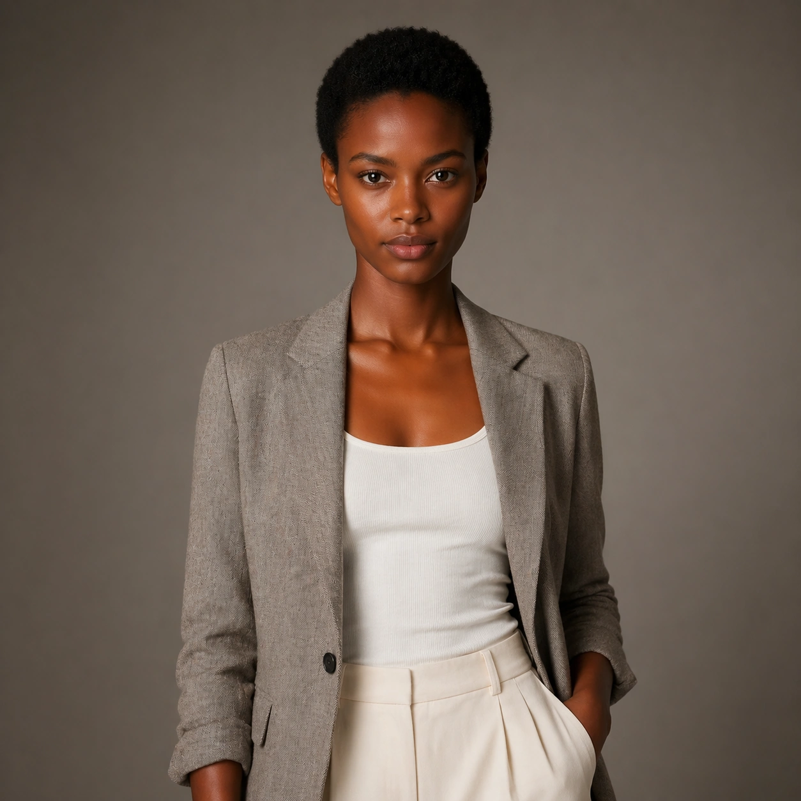

```text
Scene:
Create a square 1:1 portrait image for Same-Model Wardrobe Try-On Campaign. Use a slightly bolder campaign-like frame with disciplined crop and clean light falloff. The frame should feel like a finished professional deliverable rather than a casual snapshot, with clear lens discipline, believable light falloff, and a palette that directly supports Keep the same model stable while swapping through campaign-ready wardrobe directions that feel like a real fashion fitting or virtual try-on studio.. Keep enough surrounding space and compositional control for gallery, research, campaign, or approval-board reuse while staying photoreal and human-scaled.

Subject:
Center one campaign model with deep brown skin, short natural hair, balanced tall proportions, and a calm direct gaze. Apply a third styling direction while holding the same reference identity with no drift in age, ethnicity, or face structure. Use the example direction from the brief as grounding context: Keep the same model stable while swapping through campaign-ready wardrobe directions that feel like a real fashion fitting or virtual try-on studio.. Wardrobe, lighting, environment, and pose may shift to serve this variation, but the viewer must immediately understand that the same reference identity is still in front of the camera.

Important details:
This backlog line is difficult because Keep the same model stable while swapping through campaign-ready wardrobe directions that feel like a real fashion fitting or virtual try-on studio.. Preserve skin tone family, bone structure, eye spacing, nose shape, mouth shape, hairline logic, shoulder width, and overall body read across the entire series. preserve exact face / hair base / body proportions from the reference model. The image should prove range under control rather than spectacle for spectacle alone. Avoid the common failure described in the brief: ordinary image models often lose likeness once styling, lighting, or layout changes enter the frame. Success should feel like the result should feel professionally usable, coherent, and clearly built around one stable human identity.

Use case:
Same-Model Wardrobe Try-On Campaign series study 4/9, the third controlled transformation.

Constraints:
No readable text, no watermark, no logos, preserve exact 1:1 aspect ratio, preserve exact face / hair base / body proportions from the reference model, no gimmick costume, no false lashes that change eye shape, no surreal hair physics, no second person.
```

[Pinned source](https://github.com/ChaosRealmsAI/gpt-image-2-gallery/blob/5296db8c996e38776c83a0bc8c64f848dcd512b3/works/topics/same-model-wardrobe-tryon-campaign/packages/series-identity-switchboard/images/04-look-switch-three/meta.json) · GPT Image2 · 1254×1254 · Reference images required. · ProjectD:individually reviewed; awaiting publication acceptance.

## Look Switch Four · same-model-wardrobe-tryon-campaign/series-identity-switchboard/05-look-switch-four

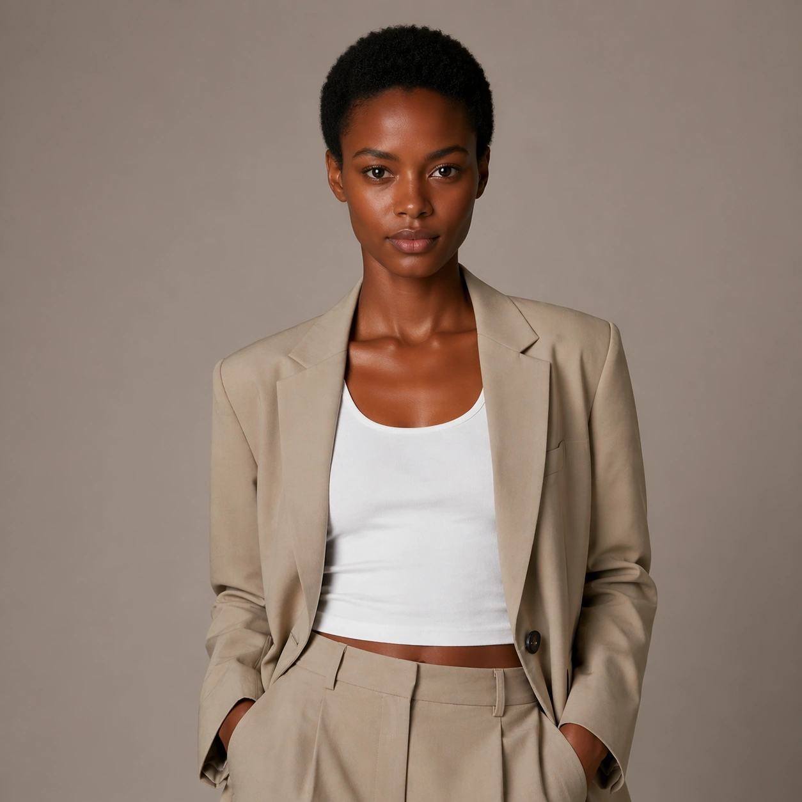

```text
Scene:
Create a square 1:1 portrait image for Same-Model Wardrobe Try-On Campaign. Use a close or mid-shot portrait that privileges detail and approval clarity over background storytelling. The frame should feel like a finished professional deliverable rather than a casual snapshot, with clear lens discipline, believable light falloff, and a palette that directly supports Keep the same model stable while swapping through campaign-ready wardrobe directions that feel like a real fashion fitting or virtual try-on studio.. Keep enough surrounding space and compositional control for gallery, research, campaign, or approval-board reuse while staying photoreal and human-scaled.

Subject:
Center one campaign model with deep brown skin, short natural hair, balanced tall proportions, and a calm direct gaze. Keep the same exact subject while introducing another visible shift in style language, finish, or mood tied directly to the topic brief. Use the example direction from the brief as grounding context: Keep the same model stable while swapping through campaign-ready wardrobe directions that feel like a real fashion fitting or virtual try-on studio.. Wardrobe, lighting, environment, and pose may shift to serve this variation, but the viewer must immediately understand that the same reference identity is still in front of the camera.

Important details:
This backlog line is difficult because Keep the same model stable while swapping through campaign-ready wardrobe directions that feel like a real fashion fitting or virtual try-on studio.. Preserve skin tone family, bone structure, eye spacing, nose shape, mouth shape, hairline logic, shoulder width, and overall body read across the entire series. preserve exact face / hair base / body proportions from the reference model. Micro-details may change, but likeness, skin tone family, and body read cannot. Avoid the common failure described in the brief: ordinary image models often lose likeness once styling, lighting, or layout changes enter the frame. Success should feel like the result should feel professionally usable, coherent, and clearly built around one stable human identity.

Use case:
Same-Model Wardrobe Try-On Campaign series study 5/9, the fourth controlled transformation.

Constraints:
No readable text, no watermark, no logos, preserve exact 1:1 aspect ratio, preserve exact face / hair base / body proportions from the reference model, no retouch blur, no facial asymmetry drift, no extra accessories noise, no unreadable product text.
```

[Pinned source](https://github.com/ChaosRealmsAI/gpt-image-2-gallery/blob/5296db8c996e38776c83a0bc8c64f848dcd512b3/works/topics/same-model-wardrobe-tryon-campaign/packages/series-identity-switchboard/images/05-look-switch-four/meta.json) · GPT Image2 · 1254×1254 · Reference images required. · ProjectD:individually reviewed; awaiting publication acceptance.

## Look Switch Five · same-model-wardrobe-tryon-campaign/series-identity-switchboard/06-look-switch-five

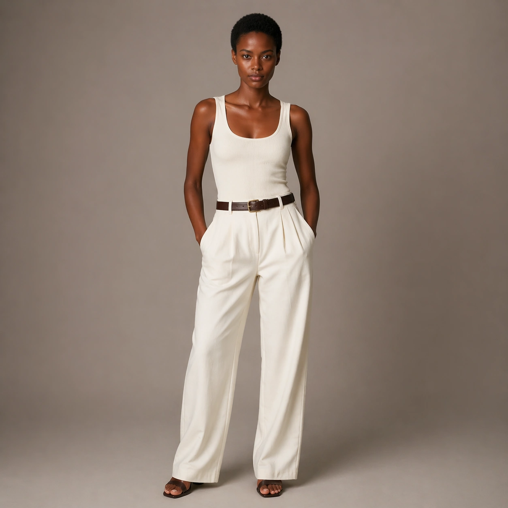

```text
Scene:
Create a square 1:1 portrait image for Same-Model Wardrobe Try-On Campaign. Use a square portrait with polished commercial finish and enough room to see styling structure clearly. The frame should feel like a finished professional deliverable rather than a casual snapshot, with clear lens discipline, believable light falloff, and a palette that directly supports Keep the same model stable while swapping through campaign-ready wardrobe directions that feel like a real fashion fitting or virtual try-on studio.. Keep enough surrounding space and compositional control for gallery, research, campaign, or approval-board reuse while staying photoreal and human-scaled.

Subject:
Center one campaign model with deep brown skin, short natural hair, balanced tall proportions, and a calm direct gaze. Push to a fifth variation while preserving exact face / hair base / body proportions from the reference model. This should still feel like one person being art-directed, not re-generated from scratch. Use the example direction from the brief as grounding context: Keep the same model stable while swapping through campaign-ready wardrobe directions that feel like a real fashion fitting or virtual try-on studio.. Wardrobe, lighting, environment, and pose may shift to serve this variation, but the viewer must immediately understand that the same reference identity is still in front of the camera.

Important details:
This backlog line is difficult because Keep the same model stable while swapping through campaign-ready wardrobe directions that feel like a real fashion fitting or virtual try-on studio.. Preserve skin tone family, bone structure, eye spacing, nose shape, mouth shape, hairline logic, shoulder width, and overall body read across the entire series. preserve exact face / hair base / body proportions from the reference model. Keep continuity stronger than novelty. Avoid the common failure described in the brief: ordinary image models often lose likeness once styling, lighting, or layout changes enter the frame. Success should feel like the result should feel professionally usable, coherent, and clearly built around one stable human identity.

Use case:
Same-Model Wardrobe Try-On Campaign series study 6/9, the fifth controlled transformation.

Constraints:
No readable text, no watermark, no logos, preserve exact 1:1 aspect ratio, preserve exact face / hair base / body proportions from the reference model, no gender drift unless explicitly relevant, no unrelated props, no costume confusion, no body-scale jump.
```

[Pinned source](https://github.com/ChaosRealmsAI/gpt-image-2-gallery/blob/5296db8c996e38776c83a0bc8c64f848dcd512b3/works/topics/same-model-wardrobe-tryon-campaign/packages/series-identity-switchboard/images/06-look-switch-five/meta.json) · GPT Image2 · 1254×1254 · Reference images required. · ProjectD:individually reviewed; awaiting publication acceptance.

## Look Switch Six · same-model-wardrobe-tryon-campaign/series-identity-switchboard/07-look-switch-six

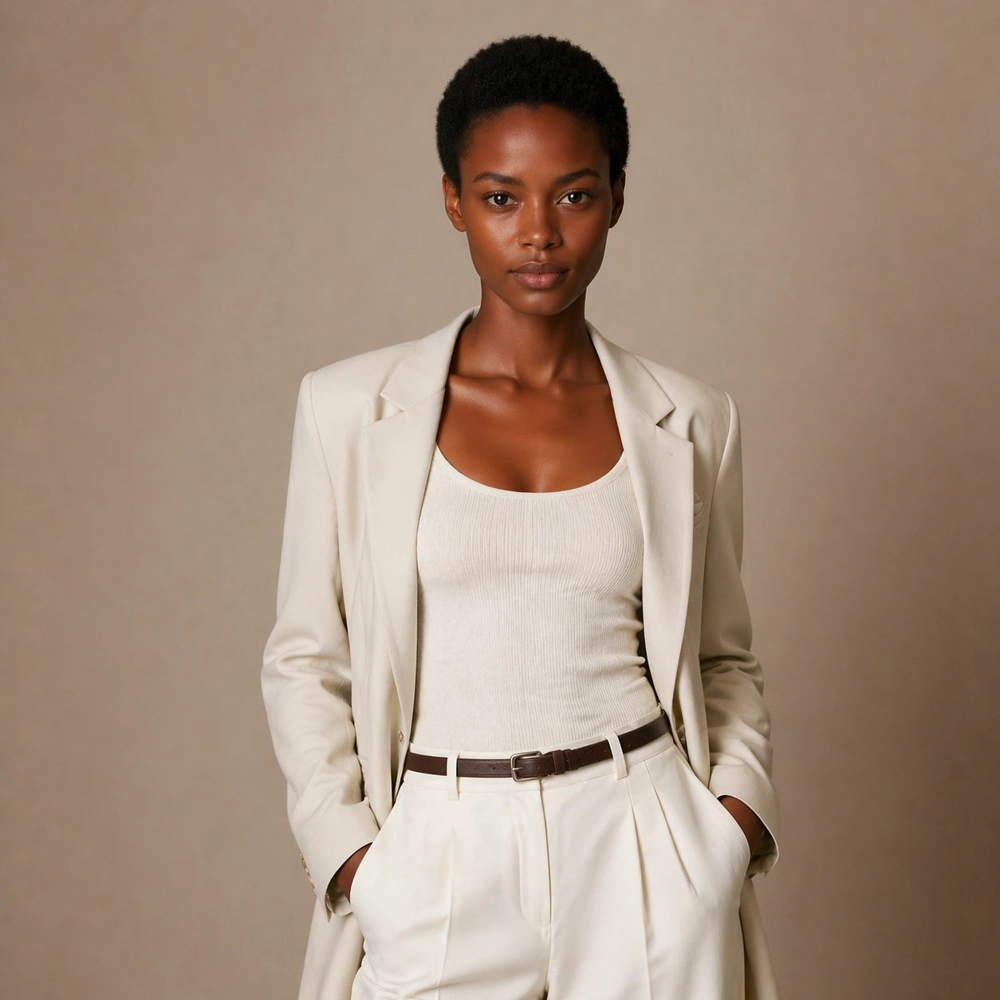

```text
Scene:
Create a square 1:1 portrait image for Same-Model Wardrobe Try-On Campaign. Use a final single-look variation with confident but restrained campaign polish. The frame should feel like a finished professional deliverable rather than a casual snapshot, with clear lens discipline, believable light falloff, and a palette that directly supports Keep the same model stable while swapping through campaign-ready wardrobe directions that feel like a real fashion fitting or virtual try-on studio.. Keep enough surrounding space and compositional control for gallery, research, campaign, or approval-board reuse while staying photoreal and human-scaled.

Subject:
Center one campaign model with deep brown skin, short natural hair, balanced tall proportions, and a calm direct gaze. Use the same person again in a sixth styling state, making sure recognition is instant before the viewer notices what changed. Use the example direction from the brief as grounding context: Keep the same model stable while swapping through campaign-ready wardrobe directions that feel like a real fashion fitting or virtual try-on studio.. Wardrobe, lighting, environment, and pose may shift to serve this variation, but the viewer must immediately understand that the same reference identity is still in front of the camera.

Important details:
This backlog line is difficult because Keep the same model stable while swapping through campaign-ready wardrobe directions that feel like a real fashion fitting or virtual try-on studio.. Preserve skin tone family, bone structure, eye spacing, nose shape, mouth shape, hairline logic, shoulder width, and overall body read across the entire series. preserve exact face / hair base / body proportions from the reference model. The transformation should feel deliberate, premium, and usable in a real salon, beauty, fashion, or casting workflow. Avoid the common failure described in the brief: ordinary image models often lose likeness once styling, lighting, or layout changes enter the frame. Success should feel like the result should feel professionally usable, coherent, and clearly built around one stable human identity.

Use case:
Same-Model Wardrobe Try-On Campaign series study 7/9, the sixth controlled transformation.

Constraints:
No readable text, no watermark, no logos, preserve exact 1:1 aspect ratio, preserve exact face / hair base / body proportions from the reference model, no hidden face, no perspective warp, no dramatic environment change, no AI-gloss artifacts.
```

[Pinned source](https://github.com/ChaosRealmsAI/gpt-image-2-gallery/blob/5296db8c996e38776c83a0bc8c64f848dcd512b3/works/topics/same-model-wardrobe-tryon-campaign/packages/series-identity-switchboard/images/07-look-switch-six/meta.json) · GPT Image2 · 1254×1254 · Reference images required. · ProjectD:individually reviewed; awaiting publication acceptance.

## Detail Proof Board · same-model-wardrobe-tryon-campaign/series-identity-switchboard/08-detail-proof-board

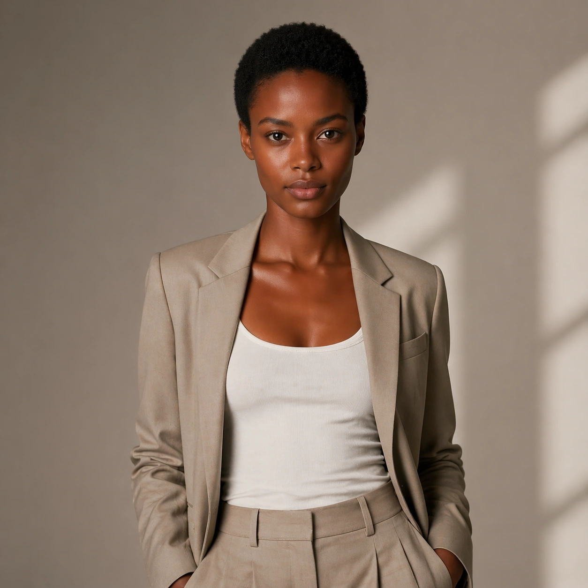

```text
Scene:
Create a square 1:1 portrait image for Same-Model Wardrobe Try-On Campaign. Use a square composition that can include multiple tight crops or one richer close-up, but still reads as one coherent portrait asset. The frame should feel like a finished professional deliverable rather than a casual snapshot, with clear lens discipline, believable light falloff, and a palette that directly supports Keep the same model stable while swapping through campaign-ready wardrobe directions that feel like a real fashion fitting or virtual try-on studio.. Keep enough surrounding space and compositional control for gallery, research, campaign, or approval-board reuse while staying photoreal and human-scaled.

Subject:
Center one campaign model with deep brown skin, short natural hair, balanced tall proportions, and a calm direct gaze. Stay locked to the same identity while emphasizing the evidence of the switch: hair texture, makeup finish, beard line, garment detail, or aging cues depending on the topic. Use the example direction from the brief as grounding context: Keep the same model stable while swapping through campaign-ready wardrobe directions that feel like a real fashion fitting or virtual try-on studio.. Wardrobe, lighting, environment, and pose may shift to serve this variation, but the viewer must immediately understand that the same reference identity is still in front of the camera.

Important details:
This backlog line is difficult because Keep the same model stable while swapping through campaign-ready wardrobe directions that feel like a real fashion fitting or virtual try-on studio.. Preserve skin tone family, bone structure, eye spacing, nose shape, mouth shape, hairline logic, shoulder width, and overall body read across the entire series. preserve exact face / hair base / body proportions from the reference model. This frame should support professional review and decision making without readable text. Avoid the common failure described in the brief: ordinary image models often lose likeness once styling, lighting, or layout changes enter the frame. Success should feel like the result should feel professionally usable, coherent, and clearly built around one stable human identity.

Use case:
Same-Model Wardrobe Try-On Campaign series study 8/9, a detail-proof or comparison board.

Constraints:
No readable text, no watermark, no logos, preserve exact 1:1 aspect ratio, preserve exact face / hair base / body proportions from the reference model, no readable labels, no broken panel alignment, no detached close-up fragments, no face drift.
```

[Pinned source](https://github.com/ChaosRealmsAI/gpt-image-2-gallery/blob/5296db8c996e38776c83a0bc8c64f848dcd512b3/works/topics/same-model-wardrobe-tryon-campaign/packages/series-identity-switchboard/images/08-detail-proof-board/meta.json) · GPT Image2 · 1254×1254 · Reference images required. · ProjectD:individually reviewed; awaiting publication acceptance.

## Campaign Finale · same-model-wardrobe-tryon-campaign/series-identity-switchboard/09-campaign-finale

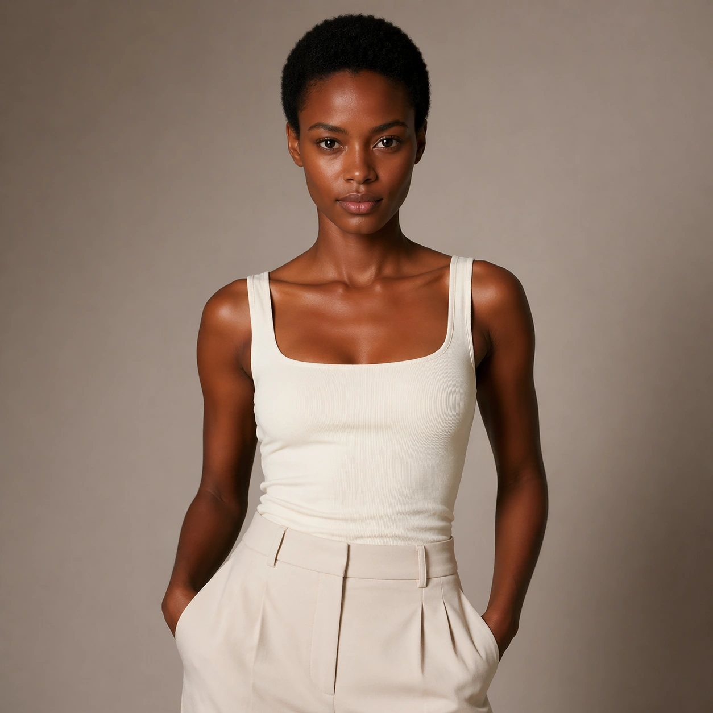

```text
Scene:
Create a square 1:1 portrait image for Same-Model Wardrobe Try-On Campaign. Use a square commercial finish with strong portrait presence, premium negative space, and final-asset confidence. The frame should feel like a finished professional deliverable rather than a casual snapshot, with clear lens discipline, believable light falloff, and a palette that directly supports Keep the same model stable while swapping through campaign-ready wardrobe directions that feel like a real fashion fitting or virtual try-on studio.. Keep enough surrounding space and compositional control for gallery, research, campaign, or approval-board reuse while staying photoreal and human-scaled.

Subject:
Center one campaign model with deep brown skin, short natural hair, balanced tall proportions, and a calm direct gaze. Resolve the same identity into a final hero image that proves the transformation line can ship as a real campaign, promo board, or salon approval visual. Use the example direction from the brief as grounding context: Keep the same model stable while swapping through campaign-ready wardrobe directions that feel like a real fashion fitting or virtual try-on studio.. Wardrobe, lighting, environment, and pose may shift to serve this variation, but the viewer must immediately understand that the same reference identity is still in front of the camera.

Important details:
This backlog line is difficult because Keep the same model stable while swapping through campaign-ready wardrobe directions that feel like a real fashion fitting or virtual try-on studio.. Preserve skin tone family, bone structure, eye spacing, nose shape, mouth shape, hairline logic, shoulder width, and overall body read across the entire series. preserve exact face / hair base / body proportions from the reference model. The final degree of polish cannot erase the exact same-person read established in image 01. Avoid the common failure described in the brief: ordinary image models often lose likeness once styling, lighting, or layout changes enter the frame. Success should feel like the result should feel professionally usable, coherent, and clearly built around one stable human identity.

Use case:
Same-Model Wardrobe Try-On Campaign series study 9/9, a polished campaign finale.

Constraints:
No readable text, no watermark, no logos, preserve exact 1:1 aspect ratio, preserve exact face / hair base / body proportions from the reference model, no readable copy, no logos, no poster clutter, no identity reset.
```

[Pinned source](https://github.com/ChaosRealmsAI/gpt-image-2-gallery/blob/5296db8c996e38776c83a0bc8c64f848dcd512b3/works/topics/same-model-wardrobe-tryon-campaign/packages/series-identity-switchboard/images/09-campaign-finale/meta.json) · GPT Image2 · 1254×1254 · Reference images required. · ProjectD:individually reviewed; awaiting publication acceptance.

## Reference Anchor · sandstorm-apocalypse-sun/series-core-system/01-reference-anchor

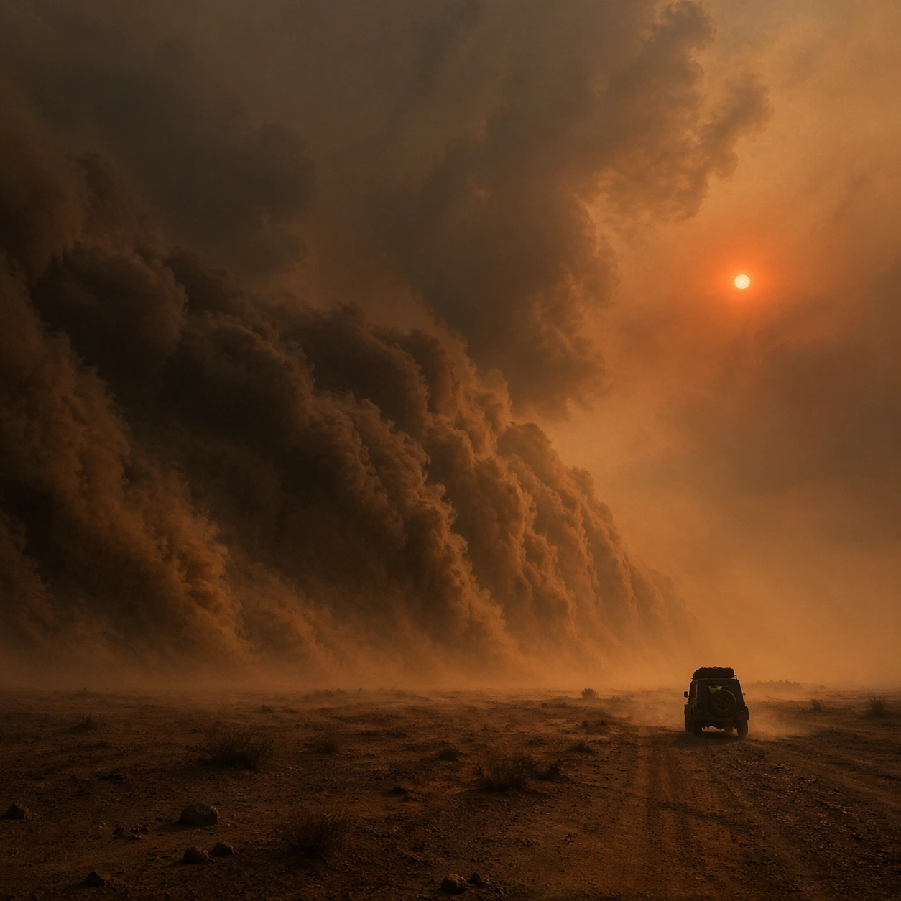

```text
Scene:
Create a square cinematic still for Sandstorm Apocalypse Sun. Use production-grade photoreal lighting, disciplined lens behavior, and a composition that feels like a finished key frame from an original film rather than a casual snapshot. A colossal wall of sand advances across an open plain under a dim blood-red sun, with the air turning ochre and gray, horizon contrast collapsing, and the ground scoured by wind-driven dust. Keep the camera in a disciplined anchor position so the full lighting event and the main spatial structure are immediately legible from edge to edge.

Subject:
Build a coherent original scene whose emotional center comes from atmosphere, light physics, and spatial clarity. Avoid relying on celebrity likeness, franchise iconography, or stylized illustration shortcuts. One jeep or utility vehicle in silhouette should provide a simple scale cue, while the real subject remains the storm front, the compressed sky, and the sense of irreversible movement across the land. This frame should lock the canonical arrangement, scale relationship, and emotional tone that the later dependent images inherit.

Important details:
Preserve a believable physical world with strong depth layering, careful color separation, and premium image discipline. Make the airborne dust granular and directional, with partial visibility, layered turbulence, and a sun disc that feels filtered by dense particulate atmosphere rather than pasted in as a graphic symbol. Use this image to establish the authoritative direction of light, atmospheric density, and structural silhouette for the package.

Use case:
Sandstorm Sun series study 1/9.

Constraints:
No readable text, no watermark, no logos, preserve exact 1:1 aspect ratio, no city ruins, no readable license plates, no zombies, no science-fiction armor, no clean air clarity.
```

[Pinned source](https://github.com/ChaosRealmsAI/gpt-image-2-gallery/blob/5296db8c996e38776c83a0bc8c64f848dcd512b3/works/topics/sandstorm-apocalypse-sun/packages/series-core-system/images/01-reference-anchor/meta.json) · GPT Image2 · 1254×1254 · No source-declared image dependencies. · ProjectD:individually reviewed; awaiting publication acceptance.

## Closer Frame · sandstorm-apocalypse-sun/series-core-system/02-closer-frame

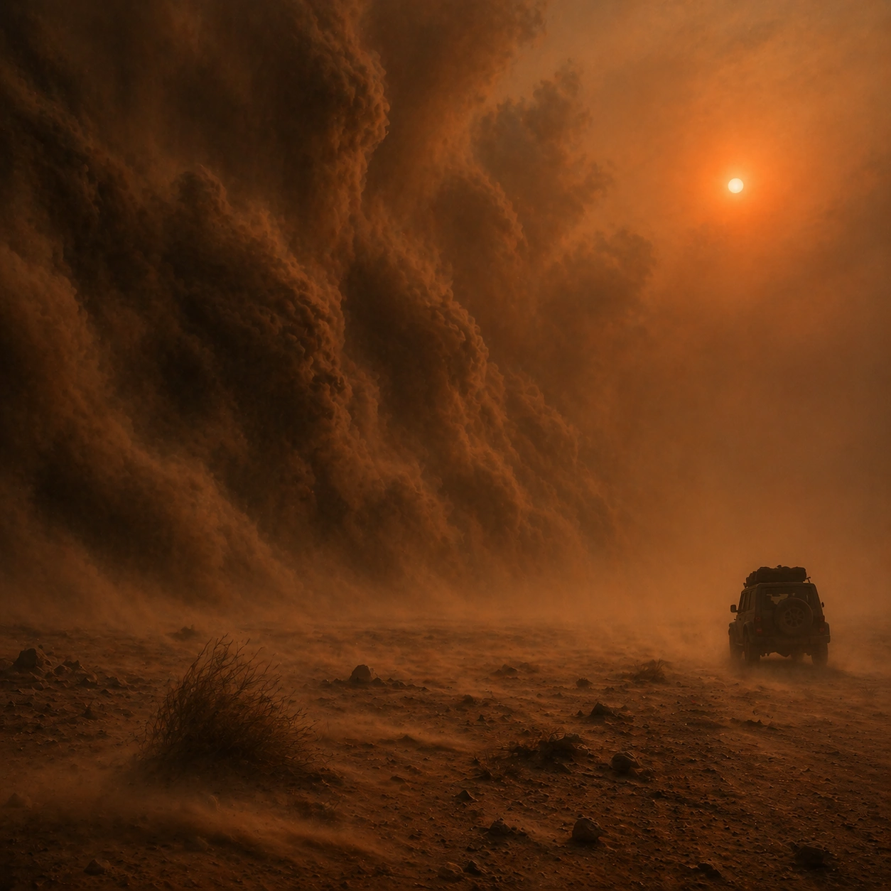

```text
Scene:
Create a square cinematic still for Sandstorm Apocalypse Sun. Use production-grade photoreal lighting, disciplined lens behavior, and a composition that feels like a finished key frame from an original film rather than a casual snapshot. A colossal wall of sand advances across an open plain under a dim blood-red sun, with the air turning ochre and gray, horizon contrast collapsing, and the ground scoured by wind-driven dust. Move the camera closer or lower so the viewer feels more embedded inside the atmosphere while the same light direction and environment remain intact.

Subject:
Build a coherent original scene whose emotional center comes from atmosphere, light physics, and spatial clarity. Avoid relying on celebrity likeness, franchise iconography, or stylized illustration shortcuts. One jeep or utility vehicle in silhouette should provide a simple scale cue, while the real subject remains the storm front, the compressed sky, and the sense of irreversible movement across the land. Preserve the same world logic from the reference and let one human-scale or material-scale element become more prominent without stealing focus from the atmosphere.

Important details:
Preserve a believable physical world with strong depth layering, careful color separation, and premium image discipline. Make the airborne dust granular and directional, with partial visibility, layered turbulence, and a sun disc that feels filtered by dense particulate atmosphere rather than pasted in as a graphic symbol. Keep the palette family, structural read, and light behavior from image 01 while increasing immediacy and tactile presence.

Use case:
Sandstorm Sun series study 2/9.

Constraints:
No readable text, no watermark, no logos, preserve exact 1:1 aspect ratio, no city ruins, no readable license plates, no zombies, no science-fiction armor, no clean air clarity.
```

[Pinned source](https://github.com/ChaosRealmsAI/gpt-image-2-gallery/blob/5296db8c996e38776c83a0bc8c64f848dcd512b3/works/topics/sandstorm-apocalypse-sun/packages/series-core-system/images/02-closer-frame/meta.json) · GPT Image2 · 1254×1254 · Reference images required. · ProjectD:individually reviewed; awaiting publication acceptance.

## Spatial Counterpoint · sandstorm-apocalypse-sun/series-core-system/03-spatial-counterpoint

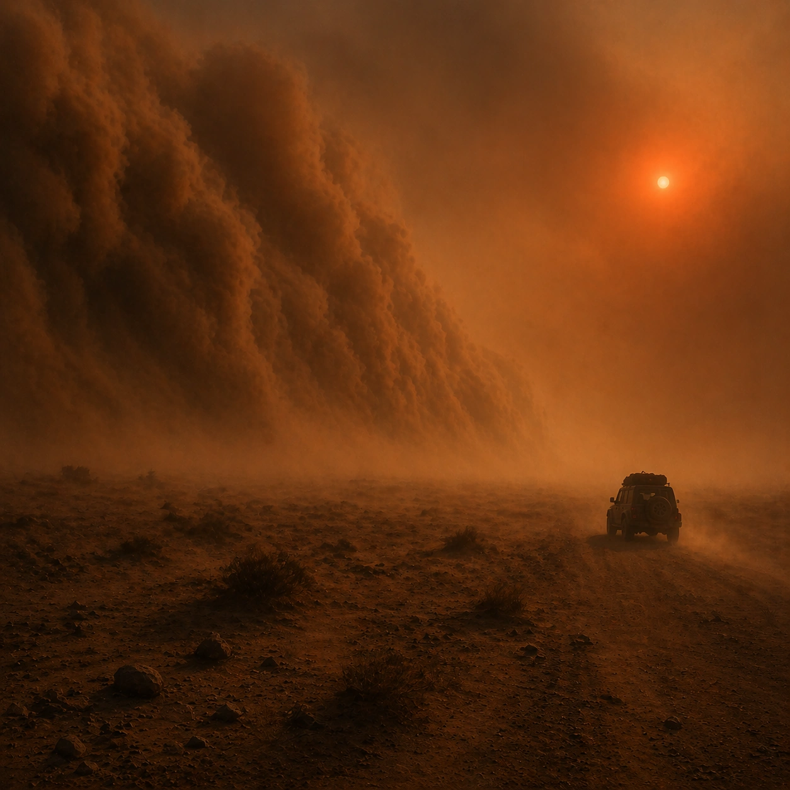

```text
Scene:
Create a square cinematic still for Sandstorm Apocalypse Sun. Use production-grade photoreal lighting, disciplined lens behavior, and a composition that feels like a finished key frame from an original film rather than a casual snapshot. A colossal wall of sand advances across an open plain under a dim blood-red sun, with the air turning ochre and gray, horizon contrast collapsing, and the ground scoured by wind-driven dust. Shift to an oblique or lateral point of view that reveals different depth layers while staying inside the same place and the same atmospheric event.

Subject:
Build a coherent original scene whose emotional center comes from atmosphere, light physics, and spatial clarity. Avoid relying on celebrity likeness, franchise iconography, or stylized illustration shortcuts. One jeep or utility vehicle in silhouette should provide a simple scale cue, while the real subject remains the storm front, the compressed sky, and the sense of irreversible movement across the land. Hold the reference structure, but use the new angle to show secondary planes, foreground interruption, or a changed distance relationship.

Important details:
Preserve a believable physical world with strong depth layering, careful color separation, and premium image discipline. Make the airborne dust granular and directional, with partial visibility, layered turbulence, and a sun disc that feels filtered by dense particulate atmosphere rather than pasted in as a graphic symbol. The success condition is continuity with the reference plus a richer sense of depth, not a new location or a new lighting system.

Use case:
Sandstorm Sun series study 3/9.

Constraints:
No readable text, no watermark, no logos, preserve exact 1:1 aspect ratio, no city ruins, no readable license plates, no zombies, no science-fiction armor, no clean air clarity.
```

[Pinned source](https://github.com/ChaosRealmsAI/gpt-image-2-gallery/blob/5296db8c996e38776c83a0bc8c64f848dcd512b3/works/topics/sandstorm-apocalypse-sun/packages/series-core-system/images/03-spatial-counterpoint/meta.json) · GPT Image2 · 1254×1254 · Reference images required. · ProjectD:individually reviewed; awaiting publication acceptance.

## Climax Frame · sandstorm-apocalypse-sun/series-core-system/04-climax-frame

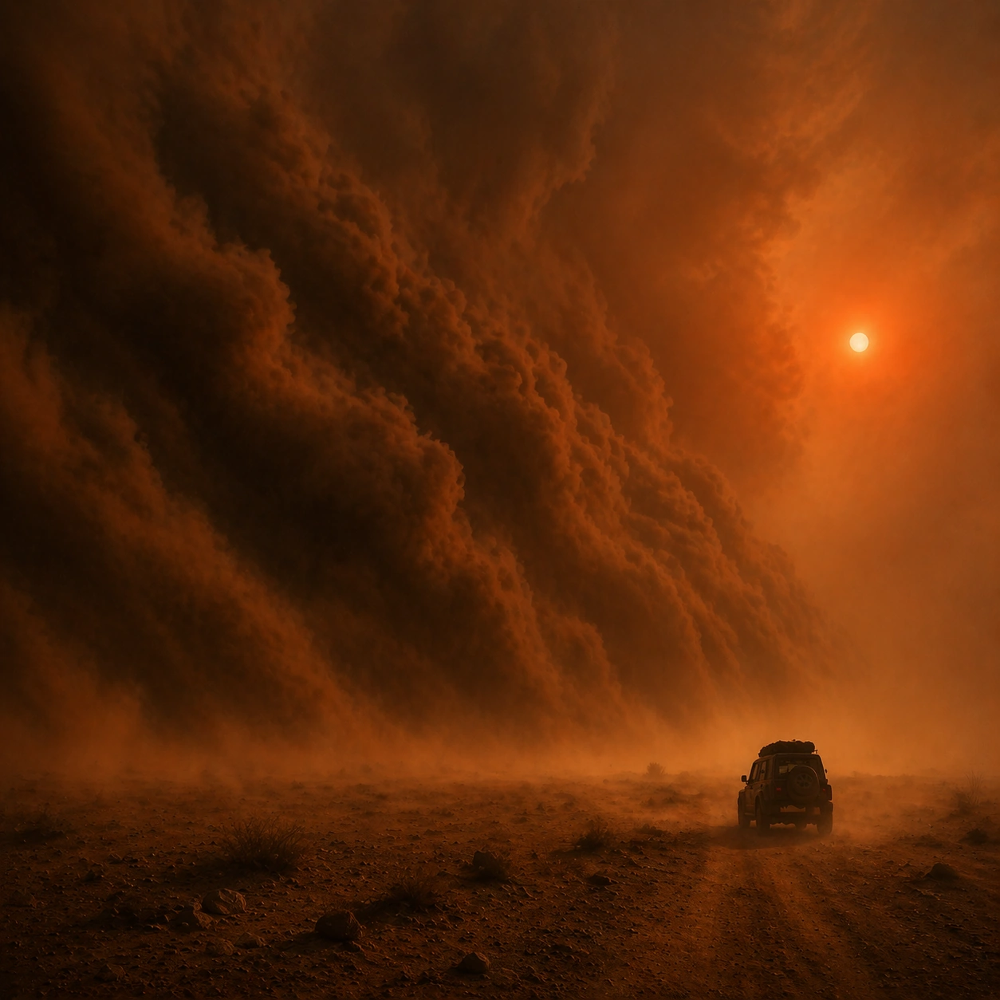

```text
Scene:
Create a square cinematic still for Sandstorm Apocalypse Sun. Use production-grade photoreal lighting, disciplined lens behavior, and a composition that feels like a finished key frame from an original film rather than a casual snapshot. A colossal wall of sand advances across an open plain under a dim blood-red sun, with the air turning ochre and gray, horizon contrast collapsing, and the ground scoured by wind-driven dust. Push the composition toward the emotional peak of the same setup, with the most dramatic balance of brightness, shadow, or atmospheric density inside the established world.

Subject:
Build a coherent original scene whose emotional center comes from atmosphere, light physics, and spatial clarity. Avoid relying on celebrity likeness, franchise iconography, or stylized illustration shortcuts. One jeep or utility vehicle in silhouette should provide a simple scale cue, while the real subject remains the storm front, the compressed sky, and the sense of irreversible movement across the land. Everything should still read as the same location and same event, but framed for maximum narrative force and visual closure.

Important details:
Preserve a believable physical world with strong depth layering, careful color separation, and premium image discipline. Make the airborne dust granular and directional, with partial visibility, layered turbulence, and a sun disc that feels filtered by dense particulate atmosphere rather than pasted in as a graphic symbol. Make it feel like the strongest hero frame of the sequence without breaking continuity or introducing a new design language.

Use case:
Sandstorm Sun series study 4/9.

Constraints:
No readable text, no watermark, no logos, preserve exact 1:1 aspect ratio, no city ruins, no readable license plates, no zombies, no science-fiction armor, no clean air clarity.
```

[Pinned source](https://github.com/ChaosRealmsAI/gpt-image-2-gallery/blob/5296db8c996e38776c83a0bc8c64f848dcd512b3/works/topics/sandstorm-apocalypse-sun/packages/series-core-system/images/04-climax-frame/meta.json) · GPT Image2 · 1254×1254 · Reference images required. · ProjectD:individually reviewed; awaiting publication acceptance.

## Surface Study · sandstorm-apocalypse-sun/single-support-studies/surface-study

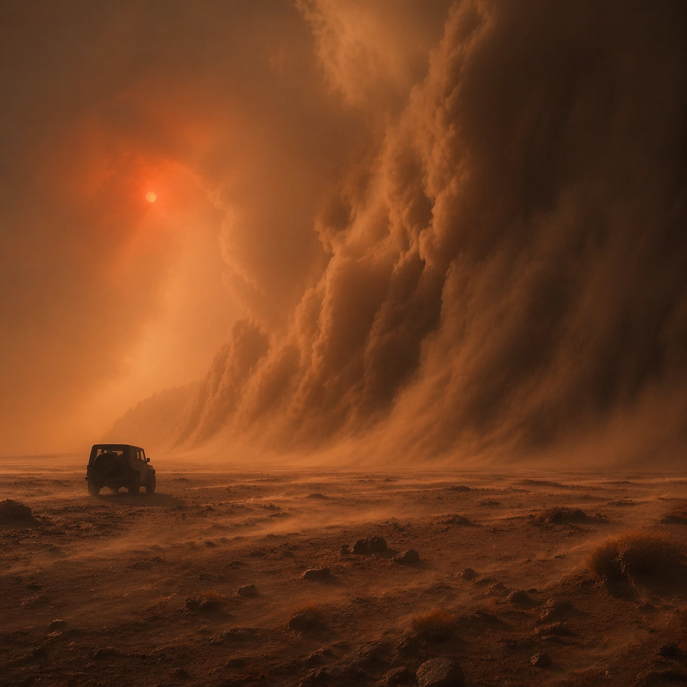

```text
Scene:
Create a square cinematic still for Sandstorm Apocalypse Sun. Use production-grade photoreal lighting, disciplined lens behavior, and a composition that feels like a finished key frame from an original film rather than a casual snapshot. A colossal wall of sand advances across an open plain under a dim blood-red sun, with the air turning ochre and gray, horizon contrast collapsing, and the ground scoured by wind-driven dust. Build an independent square study around the way atmosphere interacts with surfaces, keeping enough environmental context for the image to feel finished rather than cropped at random.

Subject:
Build a coherent original scene whose emotional center comes from atmosphere, light physics, and spatial clarity. Avoid relying on celebrity likeness, franchise iconography, or stylized illustration shortcuts. One jeep or utility vehicle in silhouette should provide a simple scale cue, while the real subject remains the storm front, the compressed sky, and the sense of irreversible movement across the land. Let textures, reflections, residue, moisture, dust, or particulate response become primary, while the broader setting remains clearly implied.

Important details:
Preserve a believable physical world with strong depth layering, careful color separation, and premium image discipline. Make the airborne dust granular and directional, with partial visibility, layered turbulence, and a sun disc that feels filtered by dense particulate atmosphere rather than pasted in as a graphic symbol. The key is material credibility under dramatic light, with micro-contrast and controlled mood supporting the theme.

Use case:
Sandstorm Sun single study 5/9.

Constraints:
No readable text, no watermark, no logos, preserve exact 1:1 aspect ratio, no city ruins, no readable license plates, no zombies, no science-fiction armor, no clean air clarity.
```

[Pinned source](https://github.com/ChaosRealmsAI/gpt-image-2-gallery/blob/5296db8c996e38776c83a0bc8c64f848dcd512b3/works/topics/sandstorm-apocalypse-sun/packages/single-support-studies/images/surface-study/meta.json) · GPT Image2 · 1254×1254 · No source-declared image dependencies. · ProjectD:individually reviewed; awaiting publication acceptance.

## Silhouette Study · sandstorm-apocalypse-sun/single-support-studies/silhouette-study

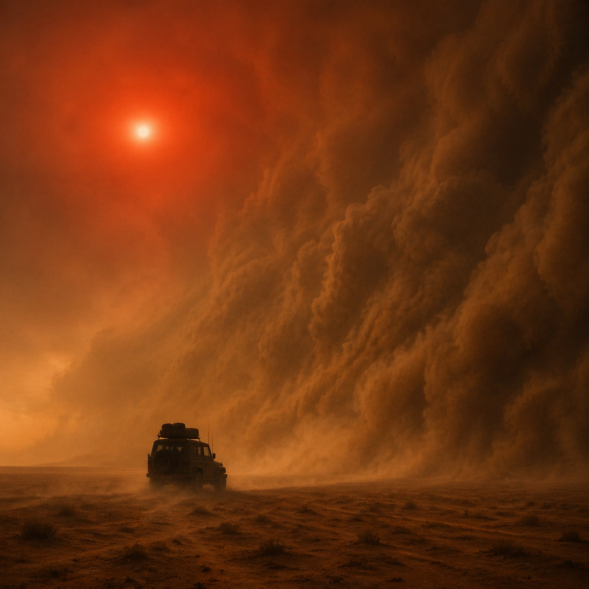

```text
Scene:
Create a square cinematic still for Sandstorm Apocalypse Sun. Use production-grade photoreal lighting, disciplined lens behavior, and a composition that feels like a finished key frame from an original film rather than a casual snapshot. A colossal wall of sand advances across an open plain under a dim blood-red sun, with the air turning ochre and gray, horizon contrast collapsing, and the ground scoured by wind-driven dust. Compose an independent frame where one human, animal, or object silhouette negotiates with the atmospheric light event in a clean, readable way.

Subject:
Build a coherent original scene whose emotional center comes from atmosphere, light physics, and spatial clarity. Avoid relying on celebrity likeness, franchise iconography, or stylized illustration shortcuts. One jeep or utility vehicle in silhouette should provide a simple scale cue, while the real subject remains the storm front, the compressed sky, and the sense of irreversible movement across the land. The silhouette should supply scale and emotional orientation, but the environment still needs to carry most of the storytelling weight.

Important details:
Preserve a believable physical world with strong depth layering, careful color separation, and premium image discipline. Make the airborne dust granular and directional, with partial visibility, layered turbulence, and a sun disc that feels filtered by dense particulate atmosphere rather than pasted in as a graphic symbol. Keep the silhouette simple and believable, avoiding poster-like graphic flattening while preserving strong contrast.

Use case:
Sandstorm Sun single study 6/9.

Constraints:
No readable text, no watermark, no logos, preserve exact 1:1 aspect ratio, no city ruins, no readable license plates, no zombies, no science-fiction armor, no clean air clarity.
```

[Pinned source](https://github.com/ChaosRealmsAI/gpt-image-2-gallery/blob/5296db8c996e38776c83a0bc8c64f848dcd512b3/works/topics/sandstorm-apocalypse-sun/packages/single-support-studies/images/silhouette-study/meta.json) · GPT Image2 · 1254×1254 · No source-declared image dependencies. · ProjectD:individually reviewed; awaiting publication acceptance.

## Transition Study · sandstorm-apocalypse-sun/single-support-studies/transition-study

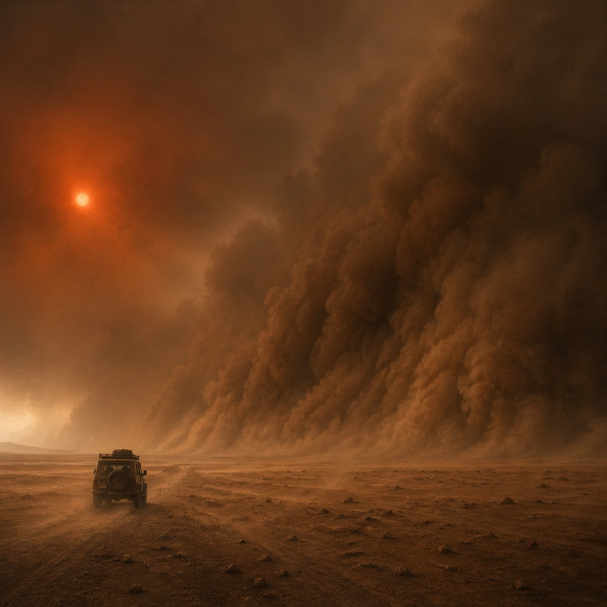

```text
Scene:
Create a square cinematic still for Sandstorm Apocalypse Sun. Use production-grade photoreal lighting, disciplined lens behavior, and a composition that feels like a finished key frame from an original film rather than a casual snapshot. A colossal wall of sand advances across an open plain under a dim blood-red sun, with the air turning ochre and gray, horizon contrast collapsing, and the ground scoured by wind-driven dust. Treat this as an adjacent moment before or after the main event, preserving the same topic language while letting the atmosphere shift slightly in intensity or position.

Subject:
Build a coherent original scene whose emotional center comes from atmosphere, light physics, and spatial clarity. Avoid relying on celebrity likeness, franchise iconography, or stylized illustration shortcuts. One jeep or utility vehicle in silhouette should provide a simple scale cue, while the real subject remains the storm front, the compressed sky, and the sense of irreversible movement across the land. Show the environment in transition, with clear evidence of recent motion, changing weather, or fading light, but without turning it into action spectacle.

Important details:
Preserve a believable physical world with strong depth layering, careful color separation, and premium image discipline. Make the airborne dust granular and directional, with partial visibility, layered turbulence, and a sun disc that feels filtered by dense particulate atmosphere rather than pasted in as a graphic symbol. Subtle temporal storytelling matters here more than maximal drama, so let traces, gradients, and environmental residue do the work.

Use case:
Sandstorm Sun single study 7/9.

Constraints:
No readable text, no watermark, no logos, preserve exact 1:1 aspect ratio, no city ruins, no readable license plates, no zombies, no science-fiction armor, no clean air clarity.
```

[Pinned source](https://github.com/ChaosRealmsAI/gpt-image-2-gallery/blob/5296db8c996e38776c83a0bc8c64f848dcd512b3/works/topics/sandstorm-apocalypse-sun/packages/single-support-studies/images/transition-study/meta.json) · GPT Image2 · 1254×1254 · No source-declared image dependencies. · ProjectD:individually reviewed; awaiting publication acceptance.

## Wide Study · sandstorm-apocalypse-sun/single-support-studies/wide-study

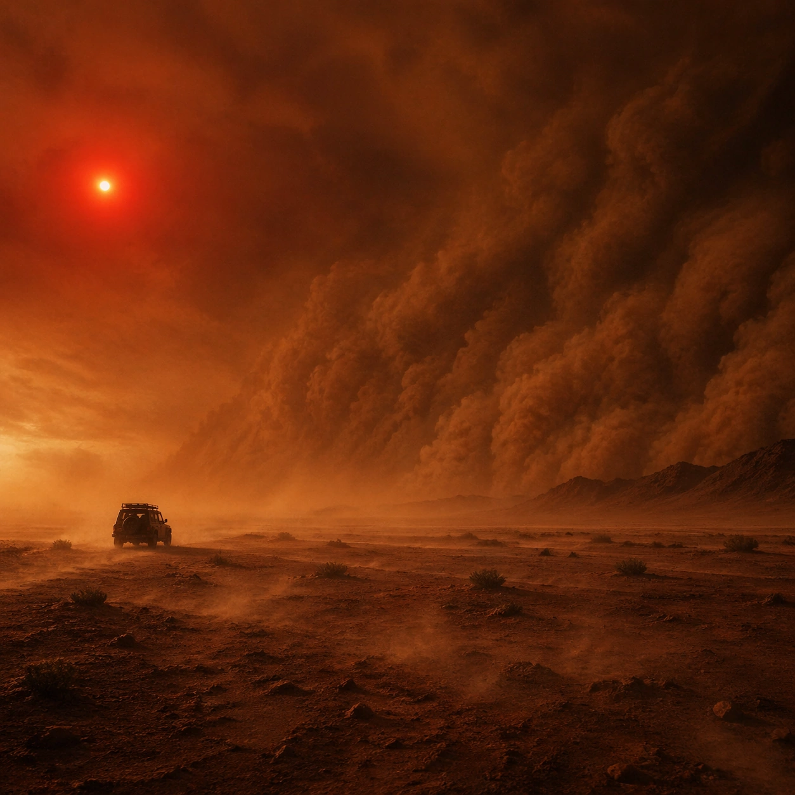

```text
Scene:
Create a square cinematic still for Sandstorm Apocalypse Sun. Use production-grade photoreal lighting, disciplined lens behavior, and a composition that feels like a finished key frame from an original film rather than a casual snapshot. A colossal wall of sand advances across an open plain under a dim blood-red sun, with the air turning ochre and gray, horizon contrast collapsing, and the ground scoured by wind-driven dust. Pull back enough to explain the broader geography or architectural envelope while keeping the square crop intentional and balanced.

Subject:
Build a coherent original scene whose emotional center comes from atmosphere, light physics, and spatial clarity. Avoid relying on celebrity likeness, franchise iconography, or stylized illustration shortcuts. One jeep or utility vehicle in silhouette should provide a simple scale cue, while the real subject remains the storm front, the compressed sky, and the sense of irreversible movement across the land. The wider frame should reveal how the main light or weather phenomenon organizes the surrounding world and not just the immediate subject.

Important details:
Preserve a believable physical world with strong depth layering, careful color separation, and premium image discipline. Make the airborne dust granular and directional, with partial visibility, layered turbulence, and a sun disc that feels filtered by dense particulate atmosphere rather than pasted in as a graphic symbol. Make scale legible through spacing, horizon control, and foreground-to-background separation rather than through extra props.

Use case:
Sandstorm Sun single study 8/9.

Constraints:
No readable text, no watermark, no logos, preserve exact 1:1 aspect ratio, no city ruins, no readable license plates, no zombies, no science-fiction armor, no clean air clarity.
```

[Pinned source](https://github.com/ChaosRealmsAI/gpt-image-2-gallery/blob/5296db8c996e38776c83a0bc8c64f848dcd512b3/works/topics/sandstorm-apocalypse-sun/packages/single-support-studies/images/wide-study/meta.json) · GPT Image2 · 1254×1254 · No source-declared image dependencies. · ProjectD:individually reviewed; awaiting publication acceptance.

## Afterglow Study · sandstorm-apocalypse-sun/single-support-studies/afterglow-study


```text
Scene:
Create a square cinematic still for Sandstorm Apocalypse Sun. Use production-grade photoreal lighting, disciplined lens behavior, and a composition that feels like a finished key frame from an original film rather than a casual snapshot. A colossal wall of sand advances across an open plain under a dim blood-red sun, with the air turning ochre and gray, horizon contrast collapsing, and the ground scoured by wind-driven dust. End on a quieter independent image that holds the residue of the topic atmosphere after its loudest moment has passed, while still feeling complete and exhibition-ready.

Subject:
Build a coherent original scene whose emotional center comes from atmosphere, light physics, and spatial clarity. Avoid relying on celebrity likeness, franchise iconography, or stylized illustration shortcuts. One jeep or utility vehicle in silhouette should provide a simple scale cue, while the real subject remains the storm front, the compressed sky, and the sense of irreversible movement across the land. The frame should suggest memory, aftermath, or lingering presence through environment first and only secondarily through any figure or object.

Important details:
Preserve a believable physical world with strong depth layering, careful color separation, and premium image discipline. Make the airborne dust granular and directional, with partial visibility, layered turbulence, and a sun disc that feels filtered by dense particulate atmosphere rather than pasted in as a graphic symbol. Favor restraint, believable light decay, and subtle narrative closure over spectacle or decorative excess.

Use case:
Sandstorm Sun single study 9/9.

Constraints:
No readable text, no watermark, no logos, preserve exact 1:1 aspect ratio, no city ruins, no readable license plates, no zombies, no science-fiction armor, no clean air clarity.
```

[Pinned source](https://github.com/ChaosRealmsAI/gpt-image-2-gallery/blob/5296db8c996e38776c83a0bc8c64f848dcd512b3/works/topics/sandstorm-apocalypse-sun/packages/single-support-studies/images/afterglow-study/meta.json) · GPT Image2 · 1024×1024 · No source-declared image dependencies. · ProjectD:individually reviewed; awaiting publication acceptance.

## Canonical One-Sheet · saul-bass-minimalist-cut/single-poster-studies/01-canonical-one-sheet


```text
Scene:
A square straight-on studio view of a pristine poster mounted on a matte wall with even museum lighting, crisp corners, and enough breathing room around the sheet for the full composition to read as an intentional object. The poster should express mid-century minimalist paper-cut poster language driven by torn shapes, narrative negative space, and three-color restraint, using matte black, rust orange, cream, and a very limited dark teal accent and a tactile surface appropriate to the medium.

Subject:
Build the flagship poster statement for this style, with the strongest hierarchy, the clearest subject silhouette, and the most disciplined balance between image field, pseudo-typography, and empty space. Use single silhouettes, staircases, hands, knives, eyes, circles, doorways, and dramatic shadows as the main visual ingredients, and organize them with simple cut-paper title bars and glyph fragments kept abstract and unreadable. For the contemporary-subject axis, thread in ride-share lanes, phone glare, and elevator doors converted into severe paper-cut suspense. The poster must feel like an original design object rather than a reproduction of any known work.

Important details:
Treat this as the cleanest thesis image in the set: the paper should look fresh, the inks or paint should feel deliberate, and every formal rule of the style should be easy to study at a glance. Preserve deliberate imbalance, clean cut contours, visible paper fibers, and story told through absence as much as presence. Keep every letterform abstract and non-readable, as if it were a typographic texture rather than language. Make the style unmistakable through composition, palette, surface behavior, and symbolic compression. no glossy gradients, no tiny fiddly detail, no photoreal rendering, no ornamental clutter.

Use case:
Paper-Cut Film single study 1/9, establishing the cleanest museum-grade poster reading.

Constraints:
No readable text, no watermark, no logos, preserve exact 1:1 aspect ratio, no copyrighted characters, no real brand marks, no QR codes, no interface chrome, no accidental gibberish lettering.
```

[Pinned source](https://github.com/ChaosRealmsAI/gpt-image-2-gallery/blob/5296db8c996e38776c83a0bc8c64f848dcd512b3/works/topics/saul-bass-minimalist-cut/packages/single-poster-studies/images/01-canonical-one-sheet/meta.json) · GPT Image2 · 1024×1024 · No source-declared image dependencies. · ProjectD:individually reviewed; awaiting publication acceptance.

## Print Proof Flatlay · saul-bass-minimalist-cut/single-poster-studies/02-print-proof-flatlay


```text
Scene:
A square overhead tabletop photograph of a fresh poster proof on neutral worktable paper, lit by cool daylight, with crop marks, tape tabs, and slight paper bow visible around the sheet. The poster should express mid-century minimalist paper-cut poster language driven by torn shapes, narrative negative space, and three-color restraint, using matte black, rust orange, cream, and a very limited dark teal accent and a tactile surface appropriate to the medium.

Subject:
Design the poster as a print-shop proof, preserving the same poster language while allowing production clues such as edge trims, registration targets, and process marks to frame the composition. Use single silhouettes, staircases, hands, knives, eyes, circles, doorways, and dramatic shadows as the main visual ingredients, and organize them with simple cut-paper title bars and glyph fragments kept abstract and unreadable. For the contemporary-subject axis, thread in ride-share lanes, phone glare, and elevator doors converted into severe paper-cut suspense. The poster must feel like an original design object rather than a reproduction of any known work.

Important details:
The image must still read as a finished poster concept, but it should carry believable print-process evidence and material tactility instead of gallery-wall perfection. Preserve deliberate imbalance, clean cut contours, visible paper fibers, and story told through absence as much as presence. Keep every letterform abstract and non-readable, as if it were a typographic texture rather than language. Make the style unmistakable through composition, palette, surface behavior, and symbolic compression. no glossy gradients, no tiny fiddly detail, no photoreal rendering, no ornamental clutter.

Use case:
Paper-Cut Film single study 2/9, testing production realism and process evidence.

Constraints:
No readable text, no watermark, no logos, preserve exact 1:1 aspect ratio, no copyrighted characters, no real brand marks, no QR codes, no interface chrome, no accidental gibberish lettering.
```

[Pinned source](https://github.com/ChaosRealmsAI/gpt-image-2-gallery/blob/5296db8c996e38776c83a0bc8c64f848dcd512b3/works/topics/saul-bass-minimalist-cut/packages/single-poster-studies/images/02-print-proof-flatlay/meta.json) · GPT Image2 · 1254×1254 · No source-declared image dependencies. · ProjectD:individually reviewed; awaiting publication acceptance.

## Transit Lightbox · saul-bass-minimalist-cut/single-poster-studies/03-transit-lightbox


```text
Scene:
A square dusk street photograph of a backlit transit poster glowing inside glass, with faint rain reflections, soft city blur in the distance, and the poster remaining fully legible as a composition. The poster should express mid-century minimalist paper-cut poster language driven by torn shapes, narrative negative space, and three-color restraint, using matte black, rust orange, cream, and a very limited dark teal accent and a tactile surface appropriate to the medium.

Subject:
Adapt the poster into a public-facing lightbox version that still honors the original style grammar while feeling bold enough to stop a passerby from several meters away. Use single silhouettes, staircases, hands, knives, eyes, circles, doorways, and dramatic shadows as the main visual ingredients, and organize them with simple cut-paper title bars and glyph fragments kept abstract and unreadable. For the contemporary-subject axis, thread in ride-share lanes, phone glare, and elevator doors converted into severe paper-cut suspense. The poster must feel like an original design object rather than a reproduction of any known work.

Important details:
Let the style survive the illumination test: color blocking, silhouette contrast, and abstract lettering should stay controlled under bright internal light and reflective glass. Preserve deliberate imbalance, clean cut contours, visible paper fibers, and story told through absence as much as presence. Keep every letterform abstract and non-readable, as if it were a typographic texture rather than language. Make the style unmistakable through composition, palette, surface behavior, and symbolic compression. no glossy gradients, no tiny fiddly detail, no photoreal rendering, no ornamental clutter.

Use case:
Paper-Cut Film single study 3/9, testing distance readability in public display.

Constraints:
No readable text, no watermark, no logos, preserve exact 1:1 aspect ratio, no copyrighted characters, no real brand marks, no QR codes, no interface chrome, no accidental gibberish lettering.
```

[Pinned source](https://github.com/ChaosRealmsAI/gpt-image-2-gallery/blob/5296db8c996e38776c83a0bc8c64f848dcd512b3/works/topics/saul-bass-minimalist-cut/packages/single-poster-studies/images/03-transit-lightbox/meta.json) · GPT Image2 · 1024×1024 · No source-declared image dependencies. · ProjectD:individually reviewed; awaiting publication acceptance.

## Wheatpaste Wall Layer · saul-bass-minimalist-cut/single-poster-studies/04-wheatpaste-wall


```text
Scene:
A square urban wall study with the poster pasted onto rough plaster among torn edges and older paper remnants, photographed in soft overcast light so texture, glue bubbles, and surface scars stay visible. The poster should express mid-century minimalist paper-cut poster language driven by torn shapes, narrative negative space, and three-color restraint, using matte black, rust orange, cream, and a very limited dark teal accent and a tactile surface appropriate to the medium.

Subject:
Create a version that feels made for the street, with the poster carrying enough formal force to survive abrasion, layering, and imperfect placement without losing its visual identity. Use single silhouettes, staircases, hands, knives, eyes, circles, doorways, and dramatic shadows as the main visual ingredients, and organize them with simple cut-paper title bars and glyph fragments kept abstract and unreadable. For the contemporary-subject axis, thread in ride-share lanes, phone glare, and elevator doors converted into severe paper-cut suspense. The poster must feel like an original design object rather than a reproduction of any known work.

Important details:
Keep the main design intact but let the environment add grit: lifted corners, tiny tears, wrinkled paper, and older color fragments around the perimeter should amplify the style rather than dilute it. Preserve deliberate imbalance, clean cut contours, visible paper fibers, and story told through absence as much as presence. Keep every letterform abstract and non-readable, as if it were a typographic texture rather than language. Make the style unmistakable through composition, palette, surface behavior, and symbolic compression. no glossy gradients, no tiny fiddly detail, no photoreal rendering, no ornamental clutter.

Use case:
Paper-Cut Film single study 4/9, testing street-life durability and layered context.

Constraints:
No readable text, no watermark, no logos, preserve exact 1:1 aspect ratio, no copyrighted characters, no real brand marks, no QR codes, no interface chrome, no accidental gibberish lettering.
```

[Pinned source](https://github.com/ChaosRealmsAI/gpt-image-2-gallery/blob/5296db8c996e38776c83a0bc8c64f848dcd512b3/works/topics/saul-bass-minimalist-cut/packages/single-poster-studies/images/04-wheatpaste-wall/meta.json) · GPT Image2 · 1024×1024 · No source-declared image dependencies. · ProjectD:individually reviewed; awaiting publication acceptance.

## Folded Archive Copy · saul-bass-minimalist-cut/single-poster-studies/05-folded-archive-copy


```text
Scene:
A square conservation-table view of a vintage poster laid on gray felt under raking light, with visible fold lines, softened corners, and subtle aging that still preserves the integrity of the image. The poster should express mid-century minimalist paper-cut poster language driven by torn shapes, narrative negative space, and three-color restraint, using matte black, rust orange, cream, and a very limited dark teal accent and a tactile surface appropriate to the medium.

Subject:
Present the poster as an archive copy that has been stored, unfolded, and carefully documented, letting age and handling reveal how the design holds up across time. Use single silhouettes, staircases, hands, knives, eyes, circles, doorways, and dramatic shadows as the main visual ingredients, and organize them with simple cut-paper title bars and glyph fragments kept abstract and unreadable. For the contemporary-subject axis, thread in ride-share lanes, phone glare, and elevator doors converted into severe paper-cut suspense. The poster must feel like an original design object rather than a reproduction of any known work.

Important details:
Aging must stay believable rather than theatrical: slight yellowing, fold memory, edge wear, and pigment variation should support the historical or crafted feeling of the style. Preserve deliberate imbalance, clean cut contours, visible paper fibers, and story told through absence as much as presence. Keep every letterform abstract and non-readable, as if it were a typographic texture rather than language. Make the style unmistakable through composition, palette, surface behavior, and symbolic compression. no glossy gradients, no tiny fiddly detail, no photoreal rendering, no ornamental clutter.

Use case:
Paper-Cut Film single study 5/9, testing archival endurance and age character.

Constraints:
No readable text, no watermark, no logos, preserve exact 1:1 aspect ratio, no copyrighted characters, no real brand marks, no QR codes, no interface chrome, no accidental gibberish lettering.
```

[Pinned source](https://github.com/ChaosRealmsAI/gpt-image-2-gallery/blob/5296db8c996e38776c83a0bc8c64f848dcd512b3/works/topics/saul-bass-minimalist-cut/packages/single-poster-studies/images/05-folded-archive-copy/meta.json) · GPT Image2 · 1024×1024 · No source-declared image dependencies. · ProjectD:individually reviewed; awaiting publication acceptance.

## Twin Poster Diptych · saul-bass-minimalist-cut/single-poster-studies/06-twin-poster-diptych


```text
Scene:
A square white-wall installation showing two companion posters hung side by side with equal spacing, photographed frontally so the pair reads as a designed conversation rather than two unrelated sheets. The poster should express mid-century minimalist paper-cut poster language driven by torn shapes, narrative negative space, and three-color restraint, using matte black, rust orange, cream, and a very limited dark teal accent and a tactile surface appropriate to the medium.

Subject:
Compose a matched diptych: two posters sharing one style system while splitting the narrative across paired motifs, mirrored masses, or complementary color emphasis. Use single silhouettes, staircases, hands, knives, eyes, circles, doorways, and dramatic shadows as the main visual ingredients, and organize them with simple cut-paper title bars and glyph fragments kept abstract and unreadable. For the contemporary-subject axis, thread in ride-share lanes, phone glare, and elevator doors converted into severe paper-cut suspense. The poster must feel like an original design object rather than a reproduction of any known work.

Important details:
Both halves should feel distinct yet inseparable. Preserve one coherent visual language, but let each sheet carry its own focal symbol and rhythm without readable wording. Preserve deliberate imbalance, clean cut contours, visible paper fibers, and story told through absence as much as presence. Keep every letterform abstract and non-readable, as if it were a typographic texture rather than language. Make the style unmistakable through composition, palette, surface behavior, and symbolic compression. no glossy gradients, no tiny fiddly detail, no photoreal rendering, no ornamental clutter.

Use case:
Paper-Cut Film single study 6/9, testing system flexibility across a paired set.

Constraints:
No readable text, no watermark, no logos, preserve exact 1:1 aspect ratio, no copyrighted characters, no real brand marks, no QR codes, no interface chrome, no accidental gibberish lettering.
```

[Pinned source](https://github.com/ChaosRealmsAI/gpt-image-2-gallery/blob/5296db8c996e38776c83a0bc8c64f848dcd512b3/works/topics/saul-bass-minimalist-cut/packages/single-poster-studies/images/06-twin-poster-diptych/meta.json) · GPT Image2 · 1254×1254 · No source-declared image dependencies. · ProjectD:individually reviewed; awaiting publication acceptance.

## Stacked Print Bundle · saul-bass-minimalist-cut/single-poster-studies/07-stacked-print-bundle


```text
Scene:
A square tabletop shot of several poster prints stacked and slightly fanned, with curled corners, offset edges, and soft directional light revealing paper thickness and ink behavior. The poster should express mid-century minimalist paper-cut poster language driven by torn shapes, narrative negative space, and three-color restraint, using matte black, rust orange, cream, and a very limited dark teal accent and a tactile surface appropriate to the medium.

Subject:
Design the top poster to dominate while nearby duplicate sheets echo the same composition, creating a tactile print-run scene rather than a single isolated sheet. Use single silhouettes, staircases, hands, knives, eyes, circles, doorways, and dramatic shadows as the main visual ingredients, and organize them with simple cut-paper title bars and glyph fragments kept abstract and unreadable. For the contemporary-subject axis, thread in ride-share lanes, phone glare, and elevator doors converted into severe paper-cut suspense. The poster must feel like an original design object rather than a reproduction of any known work.

Important details:
Use the stack to emphasize production character: edge shadows, repeated motifs peeking from beneath, and subtle misalignment should enrich the material reading without changing the core design. Preserve deliberate imbalance, clean cut contours, visible paper fibers, and story told through absence as much as presence. Keep every letterform abstract and non-readable, as if it were a typographic texture rather than language. Make the style unmistakable through composition, palette, surface behavior, and symbolic compression. no glossy gradients, no tiny fiddly detail, no photoreal rendering, no ornamental clutter.

Use case:
Paper-Cut Film single study 7/9, testing print-run tactility and repeat presence.

Constraints:
No readable text, no watermark, no logos, preserve exact 1:1 aspect ratio, no copyrighted characters, no real brand marks, no QR codes, no interface chrome, no accidental gibberish lettering.
```

[Pinned source](https://github.com/ChaosRealmsAI/gpt-image-2-gallery/blob/5296db8c996e38776c83a0bc8c64f848dcd512b3/works/topics/saul-bass-minimalist-cut/packages/single-poster-studies/images/07-stacked-print-bundle/meta.json) · GPT Image2 · 1254×1254 · No source-declared image dependencies. · ProjectD:individually reviewed; awaiting publication acceptance.

## Kiosk Night Glow · saul-bass-minimalist-cut/single-poster-studies/08-kiosk-night-glow


```text
Scene:
A square nighttime city view with the poster wrapping part of a cylindrical kiosk, wet pavement reflecting nearby light, and the composition holding together under moody urban illumination. The poster should express mid-century minimalist paper-cut poster language driven by torn shapes, narrative negative space, and three-color restraint, using matte black, rust orange, cream, and a very limited dark teal accent and a tactile surface appropriate to the medium.

Subject:
Reframe the design for a dramatic street-placement context, where the poster has to project style and mood through reflection, curvature, and surrounding darkness. Use single silhouettes, staircases, hands, knives, eyes, circles, doorways, and dramatic shadows as the main visual ingredients, and organize them with simple cut-paper title bars and glyph fragments kept abstract and unreadable. For the contemporary-subject axis, thread in ride-share lanes, phone glare, and elevator doors converted into severe paper-cut suspense. The poster must feel like an original design object rather than a reproduction of any known work.

Important details:
The design should remain instantly recognizable despite the cylindrical wrap. Preserve major blocks, symbolic shapes, and abstract title forms so the style still feels authoritative at night. Preserve deliberate imbalance, clean cut contours, visible paper fibers, and story told through absence as much as presence. Keep every letterform abstract and non-readable, as if it were a typographic texture rather than language. Make the style unmistakable through composition, palette, surface behavior, and symbolic compression. no glossy gradients, no tiny fiddly detail, no photoreal rendering, no ornamental clutter.

Use case:
Paper-Cut Film single study 8/9, testing atmospheric display under rain and glow.

Constraints:
No readable text, no watermark, no logos, preserve exact 1:1 aspect ratio, no copyrighted characters, no real brand marks, no QR codes, no interface chrome, no accidental gibberish lettering.
```

[Pinned source](https://github.com/ChaosRealmsAI/gpt-image-2-gallery/blob/5296db8c996e38776c83a0bc8c64f848dcd512b3/works/topics/saul-bass-minimalist-cut/packages/single-poster-studies/images/08-kiosk-night-glow/meta.json) · GPT Image2 · 1254×1254 · No source-declared image dependencies. · ProjectD:individually reviewed; awaiting publication acceptance.

## Contemporary Remix · saul-bass-minimalist-cut/single-poster-studies/09-contemporary-remix


```text
Scene:
A square front-facing poster presentation on a clean neutral wall, lit like a premium print test, with crisp edges and a polished but still tactile finish appropriate to the style. The poster should express mid-century minimalist paper-cut poster language driven by torn shapes, narrative negative space, and three-color restraint, using matte black, rust orange, cream, and a very limited dark teal accent and a tactile surface appropriate to the medium.

Subject:
Apply the historical poster language to a contemporary urban subject so the old visual grammar proves it can carry present-day themes without losing authenticity or formal discipline. Use single silhouettes, staircases, hands, knives, eyes, circles, doorways, and dramatic shadows as the main visual ingredients, and organize them with simple cut-paper title bars and glyph fragments kept abstract and unreadable. For the contemporary-subject axis, thread in ride-share lanes, phone glare, and elevator doors converted into severe paper-cut suspense. The poster must feel like an original design object rather than a reproduction of any known work.

Important details:
This is not parody. The contemporary subject should feel genuinely absorbed into the style through palette, composition, symbolic compression, and non-readable lettering treatment. Preserve deliberate imbalance, clean cut contours, visible paper fibers, and story told through absence as much as presence. Keep every letterform abstract and non-readable, as if it were a typographic texture rather than language. Make the style unmistakable through composition, palette, surface behavior, and symbolic compression. no glossy gradients, no tiny fiddly detail, no photoreal rendering, no ornamental clutter.

Use case:
Paper-Cut Film single study 9/9, testing historical grammar on a present-day subject.

Constraints:
No readable text, no watermark, no logos, preserve exact 1:1 aspect ratio, no copyrighted characters, no real brand marks, no QR codes, no interface chrome, no accidental gibberish lettering.
```

[Pinned source](https://github.com/ChaosRealmsAI/gpt-image-2-gallery/blob/5296db8c996e38776c83a0bc8c64f848dcd512b3/works/topics/saul-bass-minimalist-cut/packages/single-poster-studies/images/09-contemporary-remix/meta.json) · GPT Image2 · 1254×1254 · No source-declared image dependencies. · ProjectD:individually reviewed; awaiting publication acceptance.

## Reference Open Day Poster · school-open-day-and-enrollment-kit/series-core-system/01-reference-open-day-poster


```text
Scene:
Create a square straight-on poster mockup displayed on a clean campus notice board, with soft daylight and believable print texture. The poster should combine welcoming campus photography, blank headline bands, and modular information zones in a way that feels immediately usable for a real preschool or primary-school open day campaign. Keep the square frame balanced, calm, and production-ready so the asset can serve gallery review, research comparison, and real educational delivery at the same time.

Subject:
Feature a warm campus scene with children and caregivers arriving, greenery, bright classrooms visible through windows, and a clear admissions-oriented hierarchy built from panels, icons, and photo blocks. The overall impression should be inclusive, aspirational, and operationally credible. The subject matter should feel intentionally selected for a coherent curriculum family rather than like a random decorative assortment.

Important details:
The asset must balance polished marketing appeal with genuine school trust. Use restrained color coding, obvious whitespace for future copy, and realistic institutional photography rather than generic lifestyle gloss. Preserve the same campus color system, photography tone, panel hierarchy, family-friendly admissions mood, and blank information-band rhythm from the reference asset. Use variation only in the teaching content, supporting props, and scene-specific mood while preserving the core visual system exactly.

Use case:
School Open Day and Enrollment Kit series study 1/4, reference open day poster.

Constraints:
No readable text, no watermark, no logos, preserve exact 1:1 aspect ratio, no readable school names, no logos, no celebrity faces, no unrealistic campus luxury, no crowded chaos, no distorted architecture.
```

[Pinned source](https://github.com/ChaosRealmsAI/gpt-image-2-gallery/blob/5296db8c996e38776c83a0bc8c64f848dcd512b3/works/topics/school-open-day-and-enrollment-kit/packages/series-core-system/images/01-reference-open-day-poster/meta.json) · GPT Image2 · 1024×1024 · No source-declared image dependencies. · ProjectD:individually reviewed; awaiting publication acceptance.

## Prospectus Cover · school-open-day-and-enrollment-kit/series-core-system/02-prospectus-cover


```text
Scene:
Keep the same square brand presentation, campus photography tone, and print realism established by the reference poster, but shift the asset into a prospectus-cover mockup resting on a reception desk. The composition should feel like the next approved deliverable in one admissions toolkit. Keep the square frame balanced, calm, and production-ready so the asset can serve gallery review, research comparison, and real educational delivery at the same time.

Subject:
Show a neatly printed brochure cover with one strong campus image, blank title bars, simple icon clusters, and edge details that feel premium but practical. The school environment and warm welcome cues should remain central, even though the asset is now a handheld printed piece. The subject matter should feel intentionally selected for a coherent curriculum family rather than like a random decorative assortment.

Important details:
Preserve the reference system exactly: the same color family, admissions mood, photo treatment, and modular panel rhythm. Variation should come from scale and deliverable format, not from a new visual language. Preserve the same campus color system, photography tone, panel hierarchy, family-friendly admissions mood, and blank information-band rhythm from the reference asset. Use variation only in the teaching content, supporting props, and scene-specific mood while preserving the core visual system exactly.

Use case:
School Open Day and Enrollment Kit series study 2/4, prospectus cover.

Constraints:
No readable text, no watermark, no logos, preserve exact 1:1 aspect ratio, no readable school names, no logos, no celebrity faces, no unrealistic campus luxury, no crowded chaos, no distorted architecture.
```

[Pinned source](https://github.com/ChaosRealmsAI/gpt-image-2-gallery/blob/5296db8c996e38776c83a0bc8c64f848dcd512b3/works/topics/school-open-day-and-enrollment-kit/packages/series-core-system/images/02-prospectus-cover/meta.json) · GPT Image2 · 1024×1024 · Reference images required. · ProjectD:individually reviewed; awaiting publication acceptance.

## Campus Wayfinding Board · school-open-day-and-enrollment-kit/series-core-system/03-campus-wayfinding-board


```text
Scene:
Render the same square branded presentation in a campus courtyard with one freestanding directional board photographed straight-on in soft daylight. The image should look like a real event-day guidance asset designed to help visiting families navigate the school smoothly. Keep the square frame balanced, calm, and production-ready so the asset can serve gallery review, research comparison, and real educational delivery at the same time.

Subject:
Use campus map shapes, directional arrows, icon markers, and blank information strips to suggest open-classroom tours, registration points, and family waiting areas without any readable names. The signage should feel friendly, legible, and institutionally credible. The subject matter should feel intentionally selected for a coherent curriculum family rather than like a random decorative assortment.

Important details:
Maintain the reference system in photography tone, color palette, and panel logic. The board should prove the enrollment identity can extend beyond posters into real operational surfaces for an open day. Preserve the same campus color system, photography tone, panel hierarchy, family-friendly admissions mood, and blank information-band rhythm from the reference asset. Use variation only in the teaching content, supporting props, and scene-specific mood while preserving the core visual system exactly.

Use case:
School Open Day and Enrollment Kit series study 3/4, campus wayfinding board.

Constraints:
No readable text, no watermark, no logos, preserve exact 1:1 aspect ratio, no readable school names, no logos, no celebrity faces, no unrealistic campus luxury, no crowded chaos, no distorted architecture.
```

[Pinned source](https://github.com/ChaosRealmsAI/gpt-image-2-gallery/blob/5296db8c996e38776c83a0bc8c64f848dcd512b3/works/topics/school-open-day-and-enrollment-kit/packages/series-core-system/images/03-campus-wayfinding-board/meta.json) · GPT Image2 · 1024×1024 · Reference images required. · ProjectD:individually reviewed; awaiting publication acceptance.

## Admissions Booth Hero · school-open-day-and-enrollment-kit/series-core-system/04-admissions-booth-hero


```text
Scene:
Return to the same square campaign style and campus-brand atmosphere, now centered on an admissions booth or welcome desk photographed from a slightly frontal angle under natural daylight. The scene should feel live enough for a real event and clean enough for use in a school marketing deck. Keep the square frame balanced, calm, and production-ready so the asset can serve gallery review, research comparison, and real educational delivery at the same time.

Subject:
Show a tidy welcome station with brochures, tote bags, blank badges, floral accents, and one or two photorealistic campus-brand panels behind it. The environment should suggest organized hospitality, family trust, and educational warmth rather than commercial hard-selling. The subject matter should feel intentionally selected for a coherent curriculum family rather than like a random decorative assortment.

Important details:
Preserve the same admissions identity system from the reference poster, especially the color family, photo treatment, and blank information panels. The result should feel like a complete enrollment-kit world, not four unrelated marketing assets. Preserve the same campus color system, photography tone, panel hierarchy, family-friendly admissions mood, and blank information-band rhythm from the reference asset. Use variation only in the teaching content, supporting props, and scene-specific mood while preserving the core visual system exactly.

Use case:
School Open Day and Enrollment Kit series study 4/4, admissions booth hero.

Constraints:
No readable text, no watermark, no logos, preserve exact 1:1 aspect ratio, no readable school names, no logos, no celebrity faces, no unrealistic campus luxury, no crowded chaos, no distorted architecture.
```

[Pinned source](https://github.com/ChaosRealmsAI/gpt-image-2-gallery/blob/5296db8c996e38776c83a0bc8c64f848dcd512b3/works/topics/school-open-day-and-enrollment-kit/packages/series-core-system/images/04-admissions-booth-hero/meta.json) · GPT Image2 · 1024×1024 · Reference images required. · ProjectD:individually reviewed; awaiting publication acceptance.

## Campus Hero Photo · school-open-day-and-enrollment-kit/single-support-studies/01-campus-hero-photo


```text
Scene:
Create a square photoreal campus hero shot during soft morning light, with neat grounds, inviting architecture, and believable family-scale activity. The image should feel premium but grounded, like a real school photography commission rather than a stock lifestyle cliche. Keep the square frame balanced, calm, and production-ready so the asset can serve gallery review, research comparison, and real educational delivery at the same time.

Subject:
Feature a welcoming exterior with children and caregivers moving through the space naturally, clear sightlines to classrooms and greenery, and subtle institutional details that support trust. The moment should feel bright, safe, and full of educational possibility. The subject arrangement should feel complete and self-contained, able to stand alone as a real supporting deliverable inside the same education business line.

Important details:
Favor real architectural texture and humane scale. The scene should read as a credible school environment first and a marketing asset second, proving admissions photography can feel both aspirational and honest. Keep the visual hierarchy modular, commercially believable, and clearly tied to a real educational use case rather than a generic mood board.

Use case:
School Open Day and Enrollment Kit single study 1/5, campus hero photo.

Constraints:
No readable text, no watermark, no logos, preserve exact 1:1 aspect ratio, no readable school names, no logos, no luxury-hotel exaggeration, no chaotic crowds, no celebrity faces, no fake brand signage.
```

[Pinned source](https://github.com/ChaosRealmsAI/gpt-image-2-gallery/blob/5296db8c996e38776c83a0bc8c64f848dcd512b3/works/topics/school-open-day-and-enrollment-kit/packages/single-support-studies/images/01-campus-hero-photo/meta.json) · GPT Image2 · 1024×1024 · No source-declared image dependencies. · ProjectD:individually reviewed; awaiting publication acceptance.

## Brochure Spread · school-open-day-and-enrollment-kit/single-support-studies/02-brochure-spread


```text
Scene:
Show a square top-down mockup of an open admissions brochure on a reception desk, lit cleanly with subtle shadows and believable coated-paper texture. The spread should feel publication-ready and suitable for a real school communications team. Keep the square frame balanced, calm, and production-ready so the asset can serve gallery review, research comparison, and real educational delivery at the same time.

Subject:
Use campus photos, icon-led info blocks, blank pull-quote bands, and carefully paced panels that communicate program breadth, safety, and community without readable copy. The brochure should feel spacious, modern, and parent-trust oriented. The subject arrangement should feel complete and self-contained, able to stand alone as a real supporting deliverable inside the same education business line.

Important details:
Keep the layout modular and restrained, avoiding generic corporate brochure stiffness. The balance between imagery and empty copy zones should signal serious admissions intent and design maturity. Keep the visual hierarchy modular, commercially believable, and clearly tied to a real educational use case rather than a generic mood board.

Use case:
School Open Day and Enrollment Kit single study 2/5, brochure spread.

Constraints:
No readable text, no watermark, no logos, preserve exact 1:1 aspect ratio, no readable school names, no logos, no luxury-hotel exaggeration, no chaotic crowds, no celebrity faces, no fake brand signage.
```

[Pinned source](https://github.com/ChaosRealmsAI/gpt-image-2-gallery/blob/5296db8c996e38776c83a0bc8c64f848dcd512b3/works/topics/school-open-day-and-enrollment-kit/packages/single-support-studies/images/02-brochure-spread/meta.json) · GPT Image2 · 1024×1024 · No source-declared image dependencies. · ProjectD:individually reviewed; awaiting publication acceptance.

## Family Tour Check-In · school-open-day-and-enrollment-kit/single-support-studies/03-family-tour-checkin


```text
Scene:
Render a square front-desk scene at a school open day, with bright natural light, clear circulation, and a tidy welcome atmosphere. The image should feel documentary-photoreal yet art-directed enough for marketing use. Keep the square frame balanced, calm, and production-ready so the asset can serve gallery review, research comparison, and real educational delivery at the same time.

Subject:
Show a reception desk with blank badges, brochures, small floral details, and staff-like figures greeting families in a warm but orderly way. The visual story should emphasize calm organization and emotional reassurance. The subject arrangement should feel complete and self-contained, able to stand alone as a real supporting deliverable inside the same education business line.

Important details:
Avoid event-chaos energy. The admissions moment should feel human, specific, and trustworthy, proving that enrollment marketing can be centered on experience rather than abstract claims. Keep the visual hierarchy modular, commercially believable, and clearly tied to a real educational use case rather than a generic mood board.

Use case:
School Open Day and Enrollment Kit single study 3/5, family tour check-in.

Constraints:
No readable text, no watermark, no logos, preserve exact 1:1 aspect ratio, no readable school names, no logos, no luxury-hotel exaggeration, no chaotic crowds, no celebrity faces, no fake brand signage.
```

[Pinned source](https://github.com/ChaosRealmsAI/gpt-image-2-gallery/blob/5296db8c996e38776c83a0bc8c64f848dcd512b3/works/topics/school-open-day-and-enrollment-kit/packages/single-support-studies/images/03-family-tour-checkin/meta.json) · GPT Image2 · 1024×1024 · No source-declared image dependencies. · ProjectD:individually reviewed; awaiting publication acceptance.

## Bus Stop Banner · school-open-day-and-enrollment-kit/single-support-studies/04-bus-stop-banner


```text
Scene:
Create a square environmental mockup of a bus-stop lightbox featuring a school campaign visual, photographed at eye level in clean daytime conditions. The surroundings should remain minimal so the media surface and campus image stay dominant. Keep the square frame balanced, calm, and production-ready so the asset can serve gallery review, research comparison, and real educational delivery at the same time.

Subject:
Use one strong campus photo, blank headline space, a simple icon row, and a calm admissions hierarchy adapted for quick public viewing. The banner must feel professional, civic, and realistic for a school located in a neighborhood. The subject arrangement should feel complete and self-contained, able to stand alone as a real supporting deliverable inside the same education business line.

Important details:
Keep the composition concise and credible. The outdoor placement should expand the enrollment system into public communication without turning into a loud consumer-ad cliche. Keep the visual hierarchy modular, commercially believable, and clearly tied to a real educational use case rather than a generic mood board.

Use case:
School Open Day and Enrollment Kit single study 4/5, bus stop banner.

Constraints:
No readable text, no watermark, no logos, preserve exact 1:1 aspect ratio, no readable school names, no logos, no luxury-hotel exaggeration, no chaotic crowds, no celebrity faces, no fake brand signage.
```

[Pinned source](https://github.com/ChaosRealmsAI/gpt-image-2-gallery/blob/5296db8c996e38776c83a0bc8c64f848dcd512b3/works/topics/school-open-day-and-enrollment-kit/packages/single-support-studies/images/04-bus-stop-banner/meta.json) · GPT Image2 · 1024×1024 · No source-declared image dependencies. · ProjectD:individually reviewed; awaiting publication acceptance.

## Enrollment Folder Flatlay · school-open-day-and-enrollment-kit/single-support-studies/05-enrollment-folder-flatlay


```text
Scene:
Show a square top-down admissions packet flatlay on a clean desk with folders, forms, prospectus pieces, and a welcome card arranged with exacting order. Use cool-neutral daylight and a restrained prop set so the image feels administrative but still warm. Keep the square frame balanced, calm, and production-ready so the asset can serve gallery review, research comparison, and real educational delivery at the same time.

Subject:
Feature blank form fields, clipboards, brochures, campus photos, and a few tactile items like a pencil and folder tab, all styled into one coherent packet. The materials should suggest preparedness and professionalism without becoming bureaucratic or cold. The subject arrangement should feel complete and self-contained, able to stand alone as a real supporting deliverable inside the same education business line.

Important details:
The flatlay should communicate process clarity and family readiness. It should feel like a real school deliverable that parents would receive, not a generic office-stationery arrangement. Keep the visual hierarchy modular, commercially believable, and clearly tied to a real educational use case rather than a generic mood board.

Use case:
School Open Day and Enrollment Kit single study 5/5, enrollment folder flatlay.

Constraints:
No readable text, no watermark, no logos, preserve exact 1:1 aspect ratio, no readable school names, no logos, no luxury-hotel exaggeration, no chaotic crowds, no celebrity faces, no fake brand signage.
```

[Pinned source](https://github.com/ChaosRealmsAI/gpt-image-2-gallery/blob/5296db8c996e38776c83a0bc8c64f848dcd512b3/works/topics/school-open-day-and-enrollment-kit/packages/single-support-studies/images/05-enrollment-folder-flatlay/meta.json) · GPT Image2 · 1024×1024 · No source-declared image dependencies. · ProjectD:individually reviewed; awaiting publication acceptance.

## Reference Experiment Poster · science-kids-experiment-poster-system/series-core-system/01-reference-experiment-poster


```text
Scene:
Create a square straight-on poster mockup pinned on a classroom science wall, lit with bright but soft daylight. The poster should feel like a real educational deliverable, with crisp print texture, clean margins, and enough context from nearby shelves and jars to suggest a science corner without competing for attention. Keep the square frame balanced, calm, and production-ready so the asset can serve gallery review, research comparison, and real educational delivery at the same time.

Subject:
Design the poster around one simple classroom experiment shown through picture-led setup, step panels, safety icons, material trays, and outcome illustrations. Use a clear visual progression with generous blank title and note areas so the poster feels genuinely teachable and easy to localize later. The subject matter should feel intentionally selected for a coherent curriculum family rather than like a random decorative assortment.

Important details:
The system should feel safe, lively, and methodical at once: rounded modules, playful but not silly color coding, obvious sequence logic, and illustration cues that children can follow with minimal adult translation. It must read as a scalable poster template for many experiments. Preserve the same poster grid, step-panel proportions, icon weight, blank instruction bars, and safety-callout rhythm from the reference poster. Use variation only in the teaching content, supporting props, and scene-specific mood while preserving the core visual system exactly.

Use case:
Science Kids Experiment Poster System series study 1/4, reference experiment poster.

Constraints:
No readable text, no watermark, no logos, preserve exact 1:1 aspect ratio, no readable copy, no chemical formulas, no logos, no dangerous realism, no lab-brand signage, no chaotic clutter.
```

[Pinned source](https://github.com/ChaosRealmsAI/gpt-image-2-gallery/blob/5296db8c996e38776c83a0bc8c64f848dcd512b3/works/topics/science-kids-experiment-poster-system/packages/series-core-system/images/01-reference-experiment-poster/meta.json) · GPT Image2 · 1024×1024 · No source-declared image dependencies. · ProjectD:individually reviewed; awaiting publication acceptance.

## Magnet Exploration Board · science-kids-experiment-poster-system/series-core-system/03-magnet-exploration-board


```text
Scene:
Render the same square straight-on poster on the classroom wall, with the same soft daylight, print realism, and supporting science-corner props held in the background. The image should read as another approved poster in the same school-ready series. Keep the square frame balanced, calm, and production-ready so the asset can serve gallery review, research comparison, and real educational delivery at the same time.

Subject:
Build the experiment around horseshoe magnets, metal and non-metal test objects, sorting trays, and attraction paths shown through friendly diagrams and step panels. Make the poster instantly understandable through imagery and sequence rather than text, while staying visually rich enough to feel like a real published classroom asset. The subject matter should feel intentionally selected for a coherent curriculum family rather than like a random decorative assortment.

Important details:
Every structural rule from the reference poster must remain intact, especially the module grid, safety cue placement, blank headline zones, and pictogram weight. Variation should come from object behavior and discovery energy, not from a new graphic system. Preserve the same poster grid, step-panel proportions, icon weight, blank instruction bars, and safety-callout rhythm from the reference poster. Use variation only in the teaching content, supporting props, and scene-specific mood while preserving the core visual system exactly.

Use case:
Science Kids Experiment Poster System series study 3/4, magnet exploration board.

Constraints:
No readable text, no watermark, no logos, preserve exact 1:1 aspect ratio, no readable copy, no chemical formulas, no logos, no dangerous realism, no lab-brand signage, no chaotic clutter.
```

[Pinned source](https://github.com/ChaosRealmsAI/gpt-image-2-gallery/blob/5296db8c996e38776c83a0bc8c64f848dcd512b3/works/topics/science-kids-experiment-poster-system/packages/series-core-system/images/03-magnet-exploration-board/meta.json) · GPT Image2 · 1024×1024 · Reference images required. · ProjectD:individually reviewed; awaiting publication acceptance.

## Seed Growth Board · science-kids-experiment-poster-system/series-core-system/04-seed-growth-board


```text
Scene:
Return to the exact same square poster mockup composition and classroom wall context established by the reference poster. It should feel like a calm observational companion piece in the same STEM poster line, ready for both classroom display and curriculum packaging. Keep the square frame balanced, calm, and production-ready so the asset can serve gallery review, research comparison, and real educational delivery at the same time.

Subject:
Focus on a seed-in-jar or cotton-pad growth experiment with materials, daily observation steps, root and sprout stages, and comparison icons organized into the familiar poster grid. Use blank note panels and timeline-like visual slots without any actual writing. The subject matter should feel intentionally selected for a coherent curriculum family rather than like a random decorative assortment.

Important details:
Keep the poster architecture locked to the reference image while shifting the experiment mood toward slow observation and care. The result should prove that the template can handle high-energy reaction experiments and gentle life-science studies equally well. Preserve the same poster grid, step-panel proportions, icon weight, blank instruction bars, and safety-callout rhythm from the reference poster. Use variation only in the teaching content, supporting props, and scene-specific mood while preserving the core visual system exactly.

Use case:
Science Kids Experiment Poster System series study 4/4, seed growth board.

Constraints:
No readable text, no watermark, no logos, preserve exact 1:1 aspect ratio, no readable copy, no chemical formulas, no logos, no dangerous realism, no lab-brand signage, no chaotic clutter.
```

[Pinned source](https://github.com/ChaosRealmsAI/gpt-image-2-gallery/blob/5296db8c996e38776c83a0bc8c64f848dcd512b3/works/topics/science-kids-experiment-poster-system/packages/series-core-system/images/04-seed-growth-board/meta.json) · GPT Image2 · 1024×1024 · Reference images required. · ProjectD:individually reviewed; awaiting publication acceptance.

## Science Corner Wall · science-kids-experiment-poster-system/single-support-studies/01-science-corner-wall


```text
Scene:
Show a square classroom science corner photographed straight-on with bright natural light, tidy shelving, and a central display wall. The scene should feel realistic for a primary classroom but still polished enough for a prospectus or teaching-resource catalog. Keep the square frame balanced, calm, and production-ready so the asset can serve gallery review, research comparison, and real educational delivery at the same time.

Subject:
Combine one or two experiment posters with jars, magnifiers, trays, and natural specimens arranged in a coherent educational vignette. The wall should communicate curiosity and order through image-led labels, blank tabs, and strong visual grouping rather than through written content. The subject arrangement should feel complete and self-contained, able to stand alone as a real supporting deliverable inside the same education business line.

Important details:
Emphasize classroom credibility and accessibility. The display should feel achievable, safe, and scalable, proving that the poster language can extend into an entire science-learning environment. Keep the visual hierarchy modular, commercially believable, and clearly tied to a real educational use case rather than a generic mood board.

Use case:
Science Kids Experiment Poster System single study 1/5, science corner wall.

Constraints:
No readable text, no watermark, no logos, preserve exact 1:1 aspect ratio, no readable text, no brand logos, no unsafe flames, no dangerous chemicals, no crowded lab realism, no cluttered props.
```

[Pinned source](https://github.com/ChaosRealmsAI/gpt-image-2-gallery/blob/5296db8c996e38776c83a0bc8c64f848dcd512b3/works/topics/science-kids-experiment-poster-system/packages/single-support-studies/images/01-science-corner-wall/meta.json) · GPT Image2 · 1024×1024 · No source-declared image dependencies. · ProjectD:individually reviewed; awaiting publication acceptance.

## Safety Supply Flatlay · science-kids-experiment-poster-system/single-support-studies/02-safety-supply-flatlay


```text
Scene:
Create a square overhead flatlay on a neutral lab-classroom surface with trays, goggles, droppers, jars, spoons, towels, and colorful experiment tools carefully spaced under clean studio light. The image should feel like a trustworthy school-supply bundle, not a messy science-table snapshot. Keep the square frame balanced, calm, and production-ready so the asset can serve gallery review, research comparison, and real educational delivery at the same time.

Subject:
Make each tool child-safe and easy to understand visually, with grouped components suggesting different experiment types and blank color-coded markers standing in for labels. The arrangement should imply readiness, organization, and repeat classroom use. The subject arrangement should feel complete and self-contained, able to stand alone as a real supporting deliverable inside the same education business line.

Important details:
Keep the hierarchy clear and catalog-ready. Surfaces should be clean, materials tactile, and the entire kit should feel more like an education product than a generic craft assortment. Keep the visual hierarchy modular, commercially believable, and clearly tied to a real educational use case rather than a generic mood board.

Use case:
Science Kids Experiment Poster System single study 2/5, safety supply flatlay.

Constraints:
No readable text, no watermark, no logos, preserve exact 1:1 aspect ratio, no readable text, no brand logos, no unsafe flames, no dangerous chemicals, no crowded lab realism, no cluttered props.
```

[Pinned source](https://github.com/ChaosRealmsAI/gpt-image-2-gallery/blob/5296db8c996e38776c83a0bc8c64f848dcd512b3/works/topics/science-kids-experiment-poster-system/packages/single-support-studies/images/02-safety-supply-flatlay/meta.json) · GPT Image2 · 1024×1024 · No source-declared image dependencies. · ProjectD:individually reviewed; awaiting publication acceptance.

## Step Card Standees · science-kids-experiment-poster-system/single-support-studies/03-step-card-standees


```text
Scene:
Render a square tabletop scene with several upright step cards on a science table, shallow depth of field, and crisp side lighting that highlights coated card stock. The setup should feel like a product launch image for a classroom experiment accessory line. Keep the square frame balanced, calm, and production-ready so the asset can serve gallery review, research comparison, and real educational delivery at the same time.

Subject:
Each standee uses pictorial step cues, material icons, safety reminders, and blank heading bars, arranged so children could follow an experiment sequence visually from left to right. Add a few beakers and trays in the background, but keep the standees dominant. The subject arrangement should feel complete and self-contained, able to stand alone as a real supporting deliverable inside the same education business line.

Important details:
The cards should look durable, teacher-friendly, and easy to localize later. Their proportions, icon style, and color coding should suggest a broader poster system, even though this is an independent support asset. Keep the visual hierarchy modular, commercially believable, and clearly tied to a real educational use case rather than a generic mood board.

Use case:
Science Kids Experiment Poster System single study 3/5, step card standees.

Constraints:
No readable text, no watermark, no logos, preserve exact 1:1 aspect ratio, no readable text, no brand logos, no unsafe flames, no dangerous chemicals, no crowded lab realism, no cluttered props.
```

[Pinned source](https://github.com/ChaosRealmsAI/gpt-image-2-gallery/blob/5296db8c996e38776c83a0bc8c64f848dcd512b3/works/topics/science-kids-experiment-poster-system/packages/single-support-studies/images/03-step-card-standees/meta.json) · GPT Image2 · 1024×1024 · No source-declared image dependencies. · ProjectD:individually reviewed; awaiting publication acceptance.

## Tabletop Demo Setup · science-kids-experiment-poster-system/single-support-studies/04-tabletop-demo-setup


```text
Scene:
Show a square classroom demo table from a slightly elevated angle, with trays, jars, pipettes, and one small experiment setup arranged under bright educational lighting. The image should feel like a practical hero visual for a school science program campaign. Keep the square frame balanced, calm, and production-ready so the asset can serve gallery review, research comparison, and real educational delivery at the same time.

Subject:
Use a single clear experiment station with orderly materials, picture cues, and a blank checklist card, making the setup feel both exciting and well-managed. The table should look ready for children to gather around, but still safe and intentional. The subject arrangement should feel complete and self-contained, able to stand alone as a real supporting deliverable inside the same education business line.

Important details:
Avoid theatrical laboratory drama. The asset should center on clarity, trust, and child-scale discovery, proving that everyday science can be marketed visually without slipping into generic stock imagery. Keep the visual hierarchy modular, commercially believable, and clearly tied to a real educational use case rather than a generic mood board.

Use case:
Science Kids Experiment Poster System single study 4/5, tabletop demo setup.

Constraints:
No readable text, no watermark, no logos, preserve exact 1:1 aspect ratio, no readable text, no brand logos, no unsafe flames, no dangerous chemicals, no crowded lab realism, no cluttered props.
```

[Pinned source](https://github.com/ChaosRealmsAI/gpt-image-2-gallery/blob/5296db8c996e38776c83a0bc8c64f848dcd512b3/works/topics/science-kids-experiment-poster-system/packages/single-support-studies/images/04-tabletop-demo-setup/meta.json) · GPT Image2 · 1024×1024 · No source-declared image dependencies. · ProjectD:individually reviewed; awaiting publication acceptance.

## Family Take-Home Sheet · science-kids-experiment-poster-system/single-support-studies/05-family-take-home-sheet


```text
Scene:
Create a square editorial mockup of a family take-home sheet clipped to a board with a few experiment supplies and a pencil nearby. The composition should look like a polished parent-resource cover image from a school or after-school science program. Keep the square frame balanced, calm, and production-ready so the asset can serve gallery review, research comparison, and real educational delivery at the same time.

Subject:
The sheet should show a home-safe experiment sequence through pictures, material clusters, and simple progress blocks, with large blank regions where instructions could later be typeset. Everything should feel friendly enough for families and structured enough for formal programs. The subject arrangement should feel complete and self-contained, able to stand alone as a real supporting deliverable inside the same education business line.

Important details:
Use calm colors, clear modular spacing, and obvious visual hierarchy. The image should prove that the science poster system can stretch beyond classroom walls into home-learning communication. Keep the visual hierarchy modular, commercially believable, and clearly tied to a real educational use case rather than a generic mood board.

Use case:
Science Kids Experiment Poster System single study 5/5, family take-home sheet.

Constraints:
No readable text, no watermark, no logos, preserve exact 1:1 aspect ratio, no readable text, no brand logos, no unsafe flames, no dangerous chemicals, no crowded lab realism, no cluttered props.
```

[Pinned source](https://github.com/ChaosRealmsAI/gpt-image-2-gallery/blob/5296db8c996e38776c83a0bc8c64f848dcd512b3/works/topics/science-kids-experiment-poster-system/packages/single-support-studies/images/05-family-take-home-sheet/meta.json) · GPT Image2 · 1024×1024 · No source-declared image dependencies. · ProjectD:individually reviewed; awaiting publication acceptance.

## Cutaway Panel · scientific-paper-figure/single-scientific-paper-figure-studies/cutaway-panel


```text
Scene:
A square plate or board viewed straight-on, with crisp organization, disciplined spacing, and premium print clarity. Build the frame around a cutaway or sectional treatment that reveals interior logic without sacrificing readability. Keep the lighting, camera distance, and spatial organization tuned for a high-signal research image rather than a casual snapshot. The image belongs to the Scientific Paper Figure theme and should feel immediately legible as a prompt atlas theme for scientific paper figure, testing physics-materials, commercial-mockup with gpt image 2..

Subject:
Center the study on a cutaway or sectional treatment that reveals interior logic without sacrificing readability. Translate the theme into a concrete visual statement instead of an abstract mood board: the viewer should understand what kind of image this is, what is being tested, and why the composition is difficult. Use the slug idea of scientific paper figure as a literal guide for subject matter, materials, and staging. If helpful, borrow the broad visual cues suggested by Nature, Science, but keep the result original and specific to this study.

Important details:
The image should communicate logic through grouping, hierarchy, callouts, insets, and believable professional layout discipline rather than decorative noise. Preserve a disciplined square composition, clear focal hierarchy, and enough secondary information to make the image feel complete rather than underspecified. The image should look polished, novel, and exhibition-ready, with topic-specific credibility coming from the way surfaces, structure, and visual language reinforce Scientific Paper Figure. Avoid generic filler elements that do not serve the main concept.

Use case:
Scientific Paper Figure single study 2/8, testing physics-materials, commercial-mockup through the cutaway panel variation.

Constraints:
No readable text, no watermark, no logos, preserve exact 1:1 aspect ratio, no readable labels, no messy arrows, no random infographic decoration, no fake UI chrome unless the topic calls for it, no broken alignment, no meaningless clutter.
```

[Pinned source](https://github.com/ChaosRealmsAI/gpt-image-2-gallery/blob/5296db8c996e38776c83a0bc8c64f848dcd512b3/works/topics/scientific-paper-figure/packages/single-scientific-paper-figure-studies/images/cutaway-panel/meta.json) · GPT Image2 · 1254×1254 · No source-declared image dependencies. · ProjectD:individually reviewed; awaiting publication acceptance.

## Process Sequence · scientific-paper-figure/single-scientific-paper-figure-studies/process-sequence


```text
Scene:
A square plate or board viewed straight-on, with crisp organization, disciplined spacing, and premium print clarity. Build the frame around a sequence of stages or states arranged in a disciplined progression. Keep the lighting, camera distance, and spatial organization tuned for a high-signal research image rather than a casual snapshot. The image belongs to the Scientific Paper Figure theme and should feel immediately legible as a prompt atlas theme for scientific paper figure, testing physics-materials, commercial-mockup with gpt image 2..

Subject:
Center the study on a sequence of stages or states arranged in a disciplined progression. Translate the theme into a concrete visual statement instead of an abstract mood board: the viewer should understand what kind of image this is, what is being tested, and why the composition is difficult. Use the slug idea of scientific paper figure as a literal guide for subject matter, materials, and staging. If helpful, borrow the broad visual cues suggested by Nature, Science, but keep the result original and specific to this study.

Important details:
The image should communicate logic through grouping, hierarchy, callouts, insets, and believable professional layout discipline rather than decorative noise. Preserve a disciplined square composition, clear focal hierarchy, and enough secondary information to make the image feel complete rather than underspecified. The image should look polished, novel, and exhibition-ready, with topic-specific credibility coming from the way surfaces, structure, and visual language reinforce Scientific Paper Figure. Avoid generic filler elements that do not serve the main concept.

Use case:
Scientific Paper Figure single study 3/8, testing physics-materials, commercial-mockup through the process sequence variation.

Constraints:
No readable text, no watermark, no logos, preserve exact 1:1 aspect ratio, no readable labels, no messy arrows, no random infographic decoration, no fake UI chrome unless the topic calls for it, no broken alignment, no meaningless clutter.
```

[Pinned source](https://github.com/ChaosRealmsAI/gpt-image-2-gallery/blob/5296db8c996e38776c83a0bc8c64f848dcd512b3/works/topics/scientific-paper-figure/packages/single-scientific-paper-figure-studies/images/process-sequence/meta.json) · GPT Image2 · 1254×1254 · No source-declared image dependencies. · ProjectD:individually reviewed; awaiting publication acceptance.

## Annotation Cluster · scientific-paper-figure/single-scientific-paper-figure-studies/annotation-cluster


```text
Scene:
A square plate or board viewed straight-on, with crisp organization, disciplined spacing, and premium print clarity. Build the frame around dense callouts and side insets that feel scholarly while staying unreadable. Keep the lighting, camera distance, and spatial organization tuned for a high-signal research image rather than a casual snapshot. The image belongs to the Scientific Paper Figure theme and should feel immediately legible as a prompt atlas theme for scientific paper figure, testing physics-materials, commercial-mockup with gpt image 2..

Subject:
Center the study on dense callouts and side insets that feel scholarly while staying unreadable. Translate the theme into a concrete visual statement instead of an abstract mood board: the viewer should understand what kind of image this is, what is being tested, and why the composition is difficult. Use the slug idea of scientific paper figure as a literal guide for subject matter, materials, and staging. If helpful, borrow the broad visual cues suggested by Nature, Science, but keep the result original and specific to this study.

Important details:
The image should communicate logic through grouping, hierarchy, callouts, insets, and believable professional layout discipline rather than decorative noise. Preserve a disciplined square composition, clear focal hierarchy, and enough secondary information to make the image feel complete rather than underspecified. The image should look polished, novel, and exhibition-ready, with topic-specific credibility coming from the way surfaces, structure, and visual language reinforce Scientific Paper Figure. Avoid generic filler elements that do not serve the main concept.

Use case:
Scientific Paper Figure single study 4/8, testing physics-materials, commercial-mockup through the annotation cluster variation.

Constraints:
No readable text, no watermark, no logos, preserve exact 1:1 aspect ratio, no readable labels, no messy arrows, no random infographic decoration, no fake UI chrome unless the topic calls for it, no broken alignment, no meaningless clutter.
```

[Pinned source](https://github.com/ChaosRealmsAI/gpt-image-2-gallery/blob/5296db8c996e38776c83a0bc8c64f848dcd512b3/works/topics/scientific-paper-figure/packages/single-scientific-paper-figure-studies/images/annotation-cluster/meta.json) · GPT Image2 · 1254×1254 · No source-declared image dependencies. · ProjectD:individually reviewed; awaiting publication acceptance.

## Comparison Board · scientific-paper-figure/single-scientific-paper-figure-studies/comparison-board


```text
Scene:
A square plate or board viewed straight-on, with crisp organization, disciplined spacing, and premium print clarity. Build the frame around a side-by-side comparison structure with strong contrast and equal visual weight. Keep the lighting, camera distance, and spatial organization tuned for a high-signal research image rather than a casual snapshot. The image belongs to the Scientific Paper Figure theme and should feel immediately legible as a prompt atlas theme for scientific paper figure, testing physics-materials, commercial-mockup with gpt image 2..

Subject:
Center the study on a side-by-side comparison structure with strong contrast and equal visual weight. Translate the theme into a concrete visual statement instead of an abstract mood board: the viewer should understand what kind of image this is, what is being tested, and why the composition is difficult. Use the slug idea of scientific paper figure as a literal guide for subject matter, materials, and staging. If helpful, borrow the broad visual cues suggested by Nature, Science, but keep the result original and specific to this study.

Important details:
The image should communicate logic through grouping, hierarchy, callouts, insets, and believable professional layout discipline rather than decorative noise. Preserve a disciplined square composition, clear focal hierarchy, and enough secondary information to make the image feel complete rather than underspecified. The image should look polished, novel, and exhibition-ready, with topic-specific credibility coming from the way surfaces, structure, and visual language reinforce Scientific Paper Figure. Avoid generic filler elements that do not serve the main concept.

Use case:
Scientific Paper Figure single study 5/8, testing physics-materials, commercial-mockup through the comparison board variation.

Constraints:
No readable text, no watermark, no logos, preserve exact 1:1 aspect ratio, no readable labels, no messy arrows, no random infographic decoration, no fake UI chrome unless the topic calls for it, no broken alignment, no meaningless clutter.
```

[Pinned source](https://github.com/ChaosRealmsAI/gpt-image-2-gallery/blob/5296db8c996e38776c83a0bc8c64f848dcd512b3/works/topics/scientific-paper-figure/packages/single-scientific-paper-figure-studies/images/comparison-board/meta.json) · GPT Image2 · 1254×1254 · No source-declared image dependencies. · ProjectD:individually reviewed; awaiting publication acceptance.

## 材质标注 · scientific-paper-figure/single-scientific-paper-figure-studies/material-callout


```text
Scene:
A square plate or board viewed straight-on, with crisp organization, disciplined spacing, and premium print clarity. Build the frame around specific texture or material evidence presented with controlled explanatory framing. Keep the lighting, camera distance, and spatial organization tuned for a high-signal research image rather than a casual snapshot. The image belongs to the Scientific Paper Figure theme and should feel immediately legible as a prompt atlas theme for scientific paper figure, testing physics-materials, commercial-mockup with gpt image 2..

Subject:
Center the study on specific texture or material evidence presented with controlled explanatory framing. Translate the theme into a concrete visual statement instead of an abstract mood board: the viewer should understand what kind of image this is, what is being tested, and why the composition is difficult. Use the slug idea of scientific paper figure as a literal guide for subject matter, materials, and staging. If helpful, borrow the broad visual cues suggested by Nature, Science, but keep the result original and specific to this study.

Important details:
The image should communicate logic through grouping, hierarchy, callouts, insets, and believable professional layout discipline rather than decorative noise. Preserve a disciplined square composition, clear focal hierarchy, and enough secondary information to make the image feel complete rather than underspecified. The image should look polished, novel, and exhibition-ready, with topic-specific credibility coming from the way surfaces, structure, and visual language reinforce Scientific Paper Figure. Avoid generic filler elements that do not serve the main concept.

Use case:
Scientific Paper Figure single study 6/8, testing physics-materials, commercial-mockup through the 材质标注 variation.

Constraints:
No readable text, no watermark, no logos, preserve exact 1:1 aspect ratio, no readable labels, no messy arrows, no random infographic decoration, no fake UI chrome unless the topic calls for it, no broken alignment, no meaningless clutter.
```

[Pinned source](https://github.com/ChaosRealmsAI/gpt-image-2-gallery/blob/5296db8c996e38776c83a0bc8c64f848dcd512b3/works/topics/scientific-paper-figure/packages/single-scientific-paper-figure-studies/images/material-callout/meta.json) · GPT Image2 · 1254×1254 · No source-declared image dependencies. · ProjectD:individually reviewed; awaiting publication acceptance.

## Exploded System · scientific-paper-figure/single-scientific-paper-figure-studies/exploded-system


```text
Scene:
A square plate or board viewed straight-on, with crisp organization, disciplined spacing, and premium print clarity. Build the frame around components separated clearly enough to reveal construction and dependency. Keep the lighting, camera distance, and spatial organization tuned for a high-signal research image rather than a casual snapshot. The image belongs to the Scientific Paper Figure theme and should feel immediately legible as a prompt atlas theme for scientific paper figure, testing physics-materials, commercial-mockup with gpt image 2..

Subject:
Center the study on components separated clearly enough to reveal construction and dependency. Translate the theme into a concrete visual statement instead of an abstract mood board: the viewer should understand what kind of image this is, what is being tested, and why the composition is difficult. Use the slug idea of scientific paper figure as a literal guide for subject matter, materials, and staging. If helpful, borrow the broad visual cues suggested by Nature, Science, but keep the result original and specific to this study.

Important details:
The image should communicate logic through grouping, hierarchy, callouts, insets, and believable professional layout discipline rather than decorative noise. Preserve a disciplined square composition, clear focal hierarchy, and enough secondary information to make the image feel complete rather than underspecified. The image should look polished, novel, and exhibition-ready, with topic-specific credibility coming from the way surfaces, structure, and visual language reinforce Scientific Paper Figure. Avoid generic filler elements that do not serve the main concept.

Use case:
Scientific Paper Figure single study 7/8, testing physics-materials, commercial-mockup through the exploded system variation.

Constraints:
No readable text, no watermark, no logos, preserve exact 1:1 aspect ratio, no readable labels, no messy arrows, no random infographic decoration, no fake UI chrome unless the topic calls for it, no broken alignment, no meaningless clutter.
```

[Pinned source](https://github.com/ChaosRealmsAI/gpt-image-2-gallery/blob/5296db8c996e38776c83a0bc8c64f848dcd512b3/works/topics/scientific-paper-figure/packages/single-scientific-paper-figure-studies/images/exploded-system/meta.json) · GPT Image2 · 1254×1254 · No source-declared image dependencies. · ProjectD:individually reviewed; awaiting publication acceptance.

## Final Plate · scientific-paper-figure/single-scientific-paper-figure-studies/final-plate


```text
Scene:
A square plate or board viewed straight-on, with crisp organization, disciplined spacing, and premium print clarity. Build the frame around a polished final technical plate that feels ready for a research deck or exhibition wall. Keep the lighting, camera distance, and spatial organization tuned for a high-signal research image rather than a casual snapshot. The image belongs to the Scientific Paper Figure theme and should feel immediately legible as a prompt atlas theme for scientific paper figure, testing physics-materials, commercial-mockup with gpt image 2..

Subject:
Center the study on a polished final technical plate that feels ready for a research deck or exhibition wall. Translate the theme into a concrete visual statement instead of an abstract mood board: the viewer should understand what kind of image this is, what is being tested, and why the composition is difficult. Use the slug idea of scientific paper figure as a literal guide for subject matter, materials, and staging. If helpful, borrow the broad visual cues suggested by Nature, Science, but keep the result original and specific to this study.

Important details:
The image should communicate logic through grouping, hierarchy, callouts, insets, and believable professional layout discipline rather than decorative noise. Preserve a disciplined square composition, clear focal hierarchy, and enough secondary information to make the image feel complete rather than underspecified. The image should look polished, novel, and exhibition-ready, with topic-specific credibility coming from the way surfaces, structure, and visual language reinforce Scientific Paper Figure. Avoid generic filler elements that do not serve the main concept.

Use case:
Scientific Paper Figure single study 8/8, testing physics-materials, commercial-mockup through the final plate variation.

Constraints:
No readable text, no watermark, no logos, preserve exact 1:1 aspect ratio, no readable labels, no messy arrows, no random infographic decoration, no fake UI chrome unless the topic calls for it, no broken alignment, no meaningless clutter.
```

[Pinned source](https://github.com/ChaosRealmsAI/gpt-image-2-gallery/blob/5296db8c996e38776c83a0bc8c64f848dcd512b3/works/topics/scientific-paper-figure/packages/single-scientific-paper-figure-studies/images/final-plate/meta.json) · GPT Image2 · 1254×1254 · No source-declared image dependencies. · ProjectD:individually reviewed; awaiting publication acceptance.

## Reference Season Hero KV · season-kv-battle-pass-kit/series-season-kv-core/01-reference-season-hero-kv


```text
Scene:
A square premium key-art frame built for a reference-dependent production series. Stage a flagship season key visual centered on one featured hero and a strong event theme with controlled lighting, clear silhouette separation, and a camera setup that feels deliberate enough for campaign reuse. The composition should carry strong focal hierarchy, believable depth, and polished surface behavior while still staying stable enough to support downstream dependent variations.

Subject:
Center the image on a flagship season key visual centered on one featured hero and a strong event theme. The result should feel like a concrete, shippable asset for Season KV Battle Pass Kit, not a generic fantasy render. Build the subject with layered materials, stable anatomy or engineering logic, and enough specificity that later images can inherit the same underlying identity. This image is the root reference that defines continuity for the rest of the series. The viewer should immediately understand what is being preserved across the sequence and what is changing in this particular beat.

Important details:
establish the seasonal palette, prop motifs, background atmosphere, and hero silhouette that all follow-up assets must inherit. Make continuity explicit through repeatable shape language, proportion control, and a coherent palette system. Changes in pose, angle, mood, rarity, weather, or layout should still feel downstream of one stable source. Avoid clutter that would confuse reference use. Any interface-like blocks or graphic surfaces must remain abstract and unreadable. Keep the image polished, original, and suitable for both gallery display and production review.

Use case:
Season KV Battle Pass Kit series study 1/4, focused on reference season hero kv.

Constraints:
No readable text, no watermark, no logos, preserve exact 1:1 aspect ratio, no title text, no brand logos, no broken continuity, no off-model redesign, no accidental franchise resemblance.
```

[Pinned source](https://github.com/ChaosRealmsAI/gpt-image-2-gallery/blob/5296db8c996e38776c83a0bc8c64f848dcd512b3/works/topics/season-kv-battle-pass-kit/packages/series-season-kv-core/images/01-reference-season-hero-kv/meta.json) · GPT Image2 · 1254×1254 · No source-declared image dependencies. · ProjectD:individually reviewed; awaiting publication acceptance.

## Battle Pass Cover · season-kv-battle-pass-kit/series-season-kv-core/02-battle-pass-cover


```text
Scene:
A square premium key-art frame built for a reference-dependent production series. Stage the same season translated into a battle pass cover with disciplined product hierarchy with controlled lighting, clear silhouette separation, and a camera setup that feels deliberate enough for campaign reuse. The composition should carry strong focal hierarchy, believable depth, and polished surface behavior while still staying stable enough to support downstream dependent variations.

Subject:
Center the image on the same season translated into a battle pass cover with disciplined product hierarchy. The result should feel like a concrete, shippable asset for Season KV Battle Pass Kit, not a generic fantasy render. Build the subject with layered materials, stable anatomy or engineering logic, and enough specificity that later images can inherit the same underlying identity. Preserve the same season theme, hero identity, color script, and event icon language from the reference key visual from the reference image while changing only what this variation needs. The viewer should immediately understand what is being preserved across the sequence and what is changing in this particular beat.

Important details:
preserve the same hero and event language while tightening the composition for a cover surface. Make continuity explicit through repeatable shape language, proportion control, and a coherent palette system. Changes in pose, angle, mood, rarity, weather, or layout should still feel downstream of one stable source. Avoid clutter that would confuse reference use. Any interface-like blocks or graphic surfaces must remain abstract and unreadable. Keep the image polished, original, and suitable for both gallery display and production review.

Use case:
Season KV Battle Pass Kit series study 2/4, focused on battle pass cover.

Constraints:
No readable text, no watermark, no logos, preserve exact 1:1 aspect ratio, no readable tier text, no currency numbers, no broken continuity, no off-model redesign, no accidental franchise resemblance.
```

[Pinned source](https://github.com/ChaosRealmsAI/gpt-image-2-gallery/blob/5296db8c996e38776c83a0bc8c64f848dcd512b3/works/topics/season-kv-battle-pass-kit/packages/series-season-kv-core/images/02-battle-pass-cover/meta.json) · GPT Image2 · 1254×1254 · Reference images required. · ProjectD:individually reviewed; awaiting publication acceptance.

## Reward Track Header · season-kv-battle-pass-kit/series-season-kv-core/03-reward-track-header


```text
Scene:
A square premium key-art frame built for a reference-dependent production series. Stage the same season visual system adapted into a reward-track header with wider horizontal logic inside a square crop with controlled lighting, clear silhouette separation, and a camera setup that feels deliberate enough for campaign reuse. The composition should carry strong focal hierarchy, believable depth, and polished surface behavior while still staying stable enough to support downstream dependent variations.

Subject:
Center the image on the same season visual system adapted into a reward-track header with wider horizontal logic inside a square crop. The result should feel like a concrete, shippable asset for Season KV Battle Pass Kit, not a generic fantasy render. Build the subject with layered materials, stable anatomy or engineering logic, and enough specificity that later images can inherit the same underlying identity. Preserve the same season theme, hero identity, color script, and event icon language from the reference key visual from the reference image while changing only what this variation needs. The viewer should immediately understand what is being preserved across the sequence and what is changing in this particular beat.

Important details:
keep the graphic family consistent while emphasizing progression and premium rewards. Make continuity explicit through repeatable shape language, proportion control, and a coherent palette system. Changes in pose, angle, mood, rarity, weather, or layout should still feel downstream of one stable source. Avoid clutter that would confuse reference use. Any interface-like blocks or graphic surfaces must remain abstract and unreadable. Keep the image polished, original, and suitable for both gallery display and production review.

Use case:
Season KV Battle Pass Kit series study 3/4, focused on reward track header.

Constraints:
No readable text, no watermark, no logos, preserve exact 1:1 aspect ratio, no labels, no arrows, no broken continuity, no off-model redesign, no accidental franchise resemblance.
```

[Pinned source](https://github.com/ChaosRealmsAI/gpt-image-2-gallery/blob/5296db8c996e38776c83a0bc8c64f848dcd512b3/works/topics/season-kv-battle-pass-kit/packages/series-season-kv-core/images/03-reward-track-header/meta.json) · GPT Image2 · 1254×1254 · Reference images required. · ProjectD:individually reviewed; awaiting publication acceptance.

## Store Takeover Crop · season-kv-battle-pass-kit/series-season-kv-core/04-store-takeover-crop


```text
Scene:
A square premium key-art frame built for a reference-dependent production series. Stage the same season repackaged as a high-impact store takeover crop for live-ops placement with controlled lighting, clear silhouette separation, and a camera setup that feels deliberate enough for campaign reuse. The composition should carry strong focal hierarchy, believable depth, and polished surface behavior while still staying stable enough to support downstream dependent variations.

Subject:
Center the image on the same season repackaged as a high-impact store takeover crop for live-ops placement. The result should feel like a concrete, shippable asset for Season KV Battle Pass Kit, not a generic fantasy render. Build the subject with layered materials, stable anatomy or engineering logic, and enough specificity that later images can inherit the same underlying identity. Preserve the same season theme, hero identity, color script, and event icon language from the reference key visual from the reference image while changing only what this variation needs. The viewer should immediately understand what is being preserved across the sequence and what is changing in this particular beat.

Important details:
conversion energy should rise while the same seasonal identity remains obvious. Make continuity explicit through repeatable shape language, proportion control, and a coherent palette system. Changes in pose, angle, mood, rarity, weather, or layout should still feel downstream of one stable source. Avoid clutter that would confuse reference use. Any interface-like blocks or graphic surfaces must remain abstract and unreadable. Keep the image polished, original, and suitable for both gallery display and production review.

Use case:
Season KV Battle Pass Kit series study 4/4, focused on store takeover crop.

Constraints:
No readable text, no watermark, no logos, preserve exact 1:1 aspect ratio, no sale text, no logos, no broken continuity, no off-model redesign, no accidental franchise resemblance.
```

[Pinned source](https://github.com/ChaosRealmsAI/gpt-image-2-gallery/blob/5296db8c996e38776c83a0bc8c64f848dcd512b3/works/topics/season-kv-battle-pass-kit/packages/series-season-kv-core/images/04-store-takeover-crop/meta.json) · GPT Image2 · 1254×1254 · Reference images required. · ProjectD:individually reviewed; awaiting publication acceptance.

## Season Launch Poster · season-kv-battle-pass-kit/single-season-support-assets/season-launch-poster


```text
Scene:
A square production-ready image designed for a game-art review wall and a commercial gallery at the same time. Frame a launch-poster composition that sells the season as a must-enter event with disciplined lighting, clean edge separation, and enough surrounding context to prove how the asset would behave in a real product surface. The camera, crop, and tonal balance should feel intentional rather than generic, with high readability at first glance and convincing material response under closer inspection.

Subject:
Center the study on a launch-poster composition that sells the season as a must-enter event. Translate the topic into a concrete, shippable visual statement instead of a loose mood board. Build layered object relationships, believable surface finish, and strong silhouette grouping so the image reads immediately as part of Season KV Battle Pass Kit. The subject should feel made for a live game pipeline: useful in store, UI, campaign, or art-review contexts, with visual hierarchy strong enough to survive aggressive cropping.

Important details:
the same thematic system should feel cinematic and campaign-worthy without relying on copy. Keep every supporting element subordinate to the main read, and make category separation obvious through form, color zoning, depth, and material logic rather than words. Where panels, cards, badges, or interface blocks appear, they must look professionally structured but remain unreadable. The visual language should feel premium, original, and coherent across this package, with no filler clutter and no accidental resemblance to a specific shipped game IP.

Use case:
Season KV Battle Pass Kit single study 1/5, focused on season launch poster.

Constraints:
No readable text, no watermark, no logos, preserve exact 1:1 aspect ratio, no slogans, no logos, no broken hierarchy, no generic stock-photo staging, no accidental UI gibberish.
```

[Pinned source](https://github.com/ChaosRealmsAI/gpt-image-2-gallery/blob/5296db8c996e38776c83a0bc8c64f848dcd512b3/works/topics/season-kv-battle-pass-kit/packages/single-season-support-assets/images/season-launch-poster/meta.json) · GPT Image2 · 1254×1254 · No source-declared image dependencies. · ProjectD:individually reviewed; awaiting publication acceptance.

## Premium Reward Card · season-kv-battle-pass-kit/single-season-support-assets/premium-reward-card


```text
Scene:
A square production-ready image designed for a game-art review wall and a commercial gallery at the same time. Frame a premium reward card surface built from the season’s hero and motif language with disciplined lighting, clean edge separation, and enough surrounding context to prove how the asset would behave in a real product surface. The camera, crop, and tonal balance should feel intentional rather than generic, with high readability at first glance and convincing material response under closer inspection.

Subject:
Center the study on a premium reward card surface built from the season’s hero and motif language. Translate the topic into a concrete, shippable visual statement instead of a loose mood board. Build layered object relationships, believable surface finish, and strong silhouette grouping so the image reads immediately as part of Season KV Battle Pass Kit. The subject should feel made for a live game pipeline: useful in store, UI, campaign, or art-review contexts, with visual hierarchy strong enough to survive aggressive cropping.

Important details:
the reward should feel aspirational and perfectly on-brand for the season. Keep every supporting element subordinate to the main read, and make category separation obvious through form, color zoning, depth, and material logic rather than words. Where panels, cards, badges, or interface blocks appear, they must look professionally structured but remain unreadable. The visual language should feel premium, original, and coherent across this package, with no filler clutter and no accidental resemblance to a specific shipped game IP.

Use case:
Season KV Battle Pass Kit single study 2/5, focused on premium reward card.

Constraints:
No readable text, no watermark, no logos, preserve exact 1:1 aspect ratio, no tier numbers, no text labels, no broken hierarchy, no generic stock-photo staging, no accidental UI gibberish.
```

[Pinned source](https://github.com/ChaosRealmsAI/gpt-image-2-gallery/blob/5296db8c996e38776c83a0bc8c64f848dcd512b3/works/topics/season-kv-battle-pass-kit/packages/single-season-support-assets/images/premium-reward-card/meta.json) · GPT Image2 · 1254×1254 · No source-declared image dependencies. · ProjectD:individually reviewed; awaiting publication acceptance.

## Seasonal Store Tile · season-kv-battle-pass-kit/single-season-support-assets/seasonal-store-tile


```text
Scene:
A square production-ready image designed for a game-art review wall and a commercial gallery at the same time. Frame a conversion-focused store tile for a featured seasonal bundle or offer with disciplined lighting, clean edge separation, and enough surrounding context to prove how the asset would behave in a real product surface. The camera, crop, and tonal balance should feel intentional rather than generic, with high readability at first glance and convincing material response under closer inspection.

Subject:
Center the study on a conversion-focused store tile for a featured seasonal bundle or offer. Translate the topic into a concrete, shippable visual statement instead of a loose mood board. Build layered object relationships, believable surface finish, and strong silhouette grouping so the image reads immediately as part of Season KV Battle Pass Kit. The subject should feel made for a live game pipeline: useful in store, UI, campaign, or art-review contexts, with visual hierarchy strong enough to survive aggressive cropping.

Important details:
make it feel expensive and coherent with the same seasonal art direction. Keep every supporting element subordinate to the main read, and make category separation obvious through form, color zoning, depth, and material logic rather than words. Where panels, cards, badges, or interface blocks appear, they must look professionally structured but remain unreadable. The visual language should feel premium, original, and coherent across this package, with no filler clutter and no accidental resemblance to a specific shipped game IP.

Use case:
Season KV Battle Pass Kit single study 3/5, focused on seasonal store tile.

Constraints:
No readable text, no watermark, no logos, preserve exact 1:1 aspect ratio, no prices, no coupons, no broken hierarchy, no generic stock-photo staging, no accidental UI gibberish.
```

[Pinned source](https://github.com/ChaosRealmsAI/gpt-image-2-gallery/blob/5296db8c996e38776c83a0bc8c64f848dcd512b3/works/topics/season-kv-battle-pass-kit/packages/single-season-support-assets/images/seasonal-store-tile/meta.json) · GPT Image2 · 1254×1254 · No source-declared image dependencies. · ProjectD:individually reviewed; awaiting publication acceptance.

## Social Announcement Crop · season-kv-battle-pass-kit/single-season-support-assets/social-announcement-crop


```text
Scene:
A square production-ready image designed for a game-art review wall and a commercial gallery at the same time. Frame a social-ready square crop announcing the season through key art fragments and atmosphere with disciplined lighting, clean edge separation, and enough surrounding context to prove how the asset would behave in a real product surface. The camera, crop, and tonal balance should feel intentional rather than generic, with high readability at first glance and convincing material response under closer inspection.

Subject:
Center the study on a social-ready square crop announcing the season through key art fragments and atmosphere. Translate the topic into a concrete, shippable visual statement instead of a loose mood board. Build layered object relationships, believable surface finish, and strong silhouette grouping so the image reads immediately as part of Season KV Battle Pass Kit. The subject should feel made for a live game pipeline: useful in store, UI, campaign, or art-review contexts, with visual hierarchy strong enough to survive aggressive cropping.

Important details:
the crop should stay instantly legible even after mobile compression. Keep every supporting element subordinate to the main read, and make category separation obvious through form, color zoning, depth, and material logic rather than words. Where panels, cards, badges, or interface blocks appear, they must look professionally structured but remain unreadable. The visual language should feel premium, original, and coherent across this package, with no filler clutter and no accidental resemblance to a specific shipped game IP.

Use case:
Season KV Battle Pass Kit single study 4/5, focused on social announcement crop.

Constraints:
No readable text, no watermark, no logos, preserve exact 1:1 aspect ratio, no hashtags, no text, no broken hierarchy, no generic stock-photo staging, no accidental UI gibberish.
```

[Pinned source](https://github.com/ChaosRealmsAI/gpt-image-2-gallery/blob/5296db8c996e38776c83a0bc8c64f848dcd512b3/works/topics/season-kv-battle-pass-kit/packages/single-season-support-assets/images/social-announcement-crop/meta.json) · GPT Image2 · 1254×1254 · No source-declared image dependencies. · ProjectD:individually reviewed; awaiting publication acceptance.

## Season Roadmap Board · season-kv-battle-pass-kit/single-season-support-assets/season-roadmap-board


```text
Scene:
A square production-ready image designed for a game-art review wall and a commercial gallery at the same time. Frame a roadmap-like board composed from the season’s shapes, rewards, and chapter rhythm with disciplined lighting, clean edge separation, and enough surrounding context to prove how the asset would behave in a real product surface. The camera, crop, and tonal balance should feel intentional rather than generic, with high readability at first glance and convincing material response under closer inspection.

Subject:
Center the study on a roadmap-like board composed from the season’s shapes, rewards, and chapter rhythm. Translate the topic into a concrete, shippable visual statement instead of a loose mood board. Build layered object relationships, believable surface finish, and strong silhouette grouping so the image reads immediately as part of Season KV Battle Pass Kit. The subject should feel made for a live game pipeline: useful in store, UI, campaign, or art-review contexts, with visual hierarchy strong enough to survive aggressive cropping.

Important details:
it should imply ongoing beats and value without any readable roadmap copy. Keep every supporting element subordinate to the main read, and make category separation obvious through form, color zoning, depth, and material logic rather than words. Where panels, cards, badges, or interface blocks appear, they must look professionally structured but remain unreadable. The visual language should feel premium, original, and coherent across this package, with no filler clutter and no accidental resemblance to a specific shipped game IP.

Use case:
Season KV Battle Pass Kit single study 5/5, focused on season roadmap board.

Constraints:
No readable text, no watermark, no logos, preserve exact 1:1 aspect ratio, no calendar text, no labels, no broken hierarchy, no generic stock-photo staging, no accidental UI gibberish.
```

[Pinned source](https://github.com/ChaosRealmsAI/gpt-image-2-gallery/blob/5296db8c996e38776c83a0bc8c64f848dcd512b3/works/topics/season-kv-battle-pass-kit/packages/single-season-support-assets/images/season-roadmap-board/meta.json) · GPT Image2 · 1254×1254 · No source-declared image dependencies. · ProjectD:individually reviewed; awaiting publication acceptance.

## Launch Anchor · seasonal-drink-launch-poster-set/series-core-system/01-launch-anchor


```text
Scene:
Compose a square seasonal drink campaign image that can function as a poster, counter card, or launch visual. The frame should combine a hero beverage with strong art direction, abstract text-safe zones, and seasonal cues expressed through ingredients, color shifts, atmosphere, and material accents rather than readable copy. Use a polished studio campaign setup with one hero cup centered against a color field and atmospheric gradient, leaving clear negative space for abstract layout zones.

Subject:
The beverage must remain physically believable and delicious, with clear cup or bottle silhouette, realistic liquid behavior, and ingredients that support a limited-time seasonal story. Feature a premium seasonal beverage with realistic ice, foam, garnish, or swirl, supported by floating or arranged ingredients that define the seasonal story.

Important details:
This theme lives at the intersection of product photography and campaign layout. Preserve strong focal hierarchy, poster-safe negative space, and refined color systems that suggest seasonality without relying on legible words. Abstract lettering forms or blocks are allowed only as unreadable design elements. The drink must still look like something a real brand could launch tomorrow. This image establishes the reference system for the series, including camera height, tabletop discipline, prop family, and color control that later images must inherit. This anchor image must lock the poster system for the series: disciplined central hero, ingredient choreography, abstract unreadable type zones, and commercial clarity.

Use case:
Seasonal Drinks series study 1/9, built for Prompt Atlas coverage of a food and beverage commercial visual system.

Constraints:
No readable text, no watermark, no logos, preserve exact 1:1 aspect ratio, no readable text, no logos, no fake holiday slogans, no amusement-park color overload, no unreadable clutter, no cheap stock-poster look, no readable launch copy, no holiday mascot, no generic fireworks.
```

[Pinned source](https://github.com/ChaosRealmsAI/gpt-image-2-gallery/blob/5296db8c996e38776c83a0bc8c64f848dcd512b3/works/topics/seasonal-drink-launch-poster-set/packages/series-core-system/images/01-launch-anchor/meta.json) · GPT Image2 · 1024×1024 · No source-declared image dependencies. · ProjectD:individually reviewed; awaiting publication acceptance.

## Citrus Splash Poster · seasonal-drink-launch-poster-set/series-core-system/02-citrus-splash-poster


```text
Scene:
Compose a square seasonal drink campaign image that can function as a poster, counter card, or launch visual. The frame should combine a hero beverage with strong art direction, abstract text-safe zones, and seasonal cues expressed through ingredients, color shifts, atmosphere, and material accents rather than readable copy. Preserve the same poster framing and negative-space structure, but brighten the palette with citrus tones, crisp highlights, and restrained liquid motion.

Subject:
The beverage must remain physically believable and delicious, with clear cup or bottle silhouette, realistic liquid behavior, and ingredients that support a limited-time seasonal story. Show a citrus-forward beverage with fruit slices, peel texture, and a controlled splash or pour that feels premium rather than chaotic.

Important details:
This theme lives at the intersection of product photography and campaign layout. Preserve strong focal hierarchy, poster-safe negative space, and refined color systems that suggest seasonality without relying on legible words. Abstract lettering forms or blocks are allowed only as unreadable design elements. The drink must still look like something a real brand could launch tomorrow. Preserve the exact camera height, lens feel, prop family, tabletop scale, palette discipline, and brand logic established by 01-launch-anchor. The reference system must remain visible through vessel scale, abstract layout blocks, and overall campaign discipline while the flavor story changes.

Use case:
Seasonal Drinks series study 2/9, built for Prompt Atlas coverage of a food and beverage commercial visual system.

Constraints:
No readable text, no watermark, no logos, preserve exact 1:1 aspect ratio, no readable text, no logos, no fake holiday slogans, no amusement-park color overload, no unreadable clutter, no cheap stock-poster look, no juice-ad cliché overload, no readable flavor names, no beach vacation backdrop.
```

[Pinned source](https://github.com/ChaosRealmsAI/gpt-image-2-gallery/blob/5296db8c996e38776c83a0bc8c64f848dcd512b3/works/topics/seasonal-drink-launch-poster-set/packages/series-core-system/images/02-citrus-splash-poster/meta.json) · GPT Image2 · 1024×1024 · Reference images required. · ProjectD:individually reviewed; awaiting publication acceptance.

## Spice Cream Poster · seasonal-drink-launch-poster-set/series-core-system/03-spice-cream-poster


```text
Scene:
Compose a square seasonal drink campaign image that can function as a poster, counter card, or launch visual. The frame should combine a hero beverage with strong art direction, abstract text-safe zones, and seasonal cues expressed through ingredients, color shifts, atmosphere, and material accents rather than readable copy. Keep the same square poster structure, but shift the palette toward warm cream, cinnamon, amber, or toasted spice tones with soft seasonal atmosphere.

Subject:
The beverage must remain physically believable and delicious, with clear cup or bottle silhouette, realistic liquid behavior, and ingredients that support a limited-time seasonal story. Present a creamy seasonal beverage with foam, spice dusting, and one or two ingredient elements that communicate warmth and indulgence.

Important details:
This theme lives at the intersection of product photography and campaign layout. Preserve strong focal hierarchy, poster-safe negative space, and refined color systems that suggest seasonality without relying on legible words. Abstract lettering forms or blocks are allowed only as unreadable design elements. The drink must still look like something a real brand could launch tomorrow. Preserve the exact camera height, lens feel, prop family, tabletop scale, palette discipline, and brand logic established by 01-launch-anchor. Preserve the anchor layout grammar and commercial polish while making spice granules, foam structure, and cup material feel physically convincing.

Use case:
Seasonal Drinks series study 3/9, built for Prompt Atlas coverage of a food and beverage commercial visual system.

Constraints:
No readable text, no watermark, no logos, preserve exact 1:1 aspect ratio, no readable text, no logos, no fake holiday slogans, no amusement-park color overload, no unreadable clutter, no cheap stock-poster look, no holiday ornaments, no readable winter slogans, no cartoon marshmallow overload.
```

[Pinned source](https://github.com/ChaosRealmsAI/gpt-image-2-gallery/blob/5296db8c996e38776c83a0bc8c64f848dcd512b3/works/topics/seasonal-drink-launch-poster-set/packages/series-core-system/images/03-spice-cream-poster/meta.json) · GPT Image2 · 1024×1024 · Reference images required. · ProjectD:individually reviewed; awaiting publication acceptance.

## Iced Berry Dusk Poster · seasonal-drink-launch-poster-set/series-core-system/04-iced-berry-dusk-poster


```text
Scene:
Compose a square seasonal drink campaign image that can function as a poster, counter card, or launch visual. The frame should combine a hero beverage with strong art direction, abstract text-safe zones, and seasonal cues expressed through ingredients, color shifts, atmosphere, and material accents rather than readable copy. Retain the exact campaign composition and layout-safe space, but move into berry tones, dusk gradients, and reflective chilled surfaces.

Subject:
The beverage must remain physically believable and delicious, with clear cup or bottle silhouette, realistic liquid behavior, and ingredients that support a limited-time seasonal story. Show an iced berry beverage with glass clarity, fruit accent, and a mood that feels like a seasonal evening launch moment.

Important details:
This theme lives at the intersection of product photography and campaign layout. Preserve strong focal hierarchy, poster-safe negative space, and refined color systems that suggest seasonality without relying on legible words. Abstract lettering forms or blocks are allowed only as unreadable design elements. The drink must still look like something a real brand could launch tomorrow. Preserve the exact camera height, lens feel, prop family, tabletop scale, palette discipline, and brand logic established by 01-launch-anchor. The poster should still read as part of the same campaign family through vessel scale, ingredient orbit logic, and abstract layout blocks even as the palette cools.

Use case:
Seasonal Drinks series study 4/9, built for Prompt Atlas coverage of a food and beverage commercial visual system.

Constraints:
No readable text, no watermark, no logos, preserve exact 1:1 aspect ratio, no readable text, no logos, no fake holiday slogans, no amusement-park color overload, no unreadable clutter, no cheap stock-poster look, no neon nightclub vibe, no readable berry callouts, no candy-shop styling.
```

[Pinned source](https://github.com/ChaosRealmsAI/gpt-image-2-gallery/blob/5296db8c996e38776c83a0bc8c64f848dcd512b3/works/topics/seasonal-drink-launch-poster-set/packages/series-core-system/images/04-iced-berry-dusk-poster/meta.json) · GPT Image2 · 1024×1024 · Reference images required. · ProjectD:individually reviewed; awaiting publication acceptance.

## Ingredient Orbit Board · seasonal-drink-launch-poster-set/single-support-studies/ingredient-orbit-board


```text
Scene:
Compose a square seasonal drink campaign image that can function as a poster, counter card, or launch visual. The frame should combine a hero beverage with strong art direction, abstract text-safe zones, and seasonal cues expressed through ingredients, color shifts, atmosphere, and material accents rather than readable copy. Compose a square board-like layout on a clean color field with one drink and several ingredient elements arranged in a balanced orbit.

Subject:
The beverage must remain physically believable and delicious, with clear cup or bottle silhouette, realistic liquid behavior, and ingredients that support a limited-time seasonal story. Keep the beverage central while ingredients provide visual storytelling and poster-safe structure.

Important details:
This theme lives at the intersection of product photography and campaign layout. Preserve strong focal hierarchy, poster-safe negative space, and refined color systems that suggest seasonality without relying on legible words. Abstract lettering forms or blocks are allowed only as unreadable design elements. The drink must still look like something a real brand could launch tomorrow. This image should feel fully self-contained while still belonging to the same broader topic and commercial world. Spacing, shadow softness, and ingredient realism should feel carefully art directed, with enough room for abstract text-like shapes that remain unreadable.

Use case:
Seasonal Drinks single study 5/9, built for Prompt Atlas coverage of a food and beverage commercial visual system.

Constraints:
No readable text, no watermark, no logos, preserve exact 1:1 aspect ratio, no readable text, no logos, no fake holiday slogans, no amusement-park color overload, no unreadable clutter, no cheap stock-poster look, no recipe diagram copy, no scientific labels, no chaotic floating objects.
```

[Pinned source](https://github.com/ChaosRealmsAI/gpt-image-2-gallery/blob/5296db8c996e38776c83a0bc8c64f848dcd512b3/works/topics/seasonal-drink-launch-poster-set/packages/single-support-studies/images/ingredient-orbit-board/meta.json) · GPT Image2 · 1024×1024 · No source-declared image dependencies. · ProjectD:individually reviewed; awaiting publication acceptance.

## Cup Sleeve Counter Card · seasonal-drink-launch-poster-set/single-support-studies/cup-sleeve-counter-card


```text
Scene:
Compose a square seasonal drink campaign image that can function as a poster, counter card, or launch visual. The frame should combine a hero beverage with strong art direction, abstract text-safe zones, and seasonal cues expressed through ingredients, color shifts, atmosphere, and material accents rather than readable copy. Use a square counter setup with one drink, one sleeve or wrap, and one small standing card under soft retail light.

Subject:
The beverage must remain physically believable and delicious, with clear cup or bottle silhouette, realistic liquid behavior, and ingredients that support a limited-time seasonal story. Show how the seasonal campaign translates from hero beverage into tactile point-of-sale materials without readable words.

Important details:
This theme lives at the intersection of product photography and campaign layout. Preserve strong focal hierarchy, poster-safe negative space, and refined color systems that suggest seasonality without relying on legible words. Abstract lettering forms or blocks are allowed only as unreadable design elements. The drink must still look like something a real brand could launch tomorrow. This image should feel fully self-contained while still belonging to the same broader topic and commercial world. Paper stock, cup texture, and material alignment need to feel intentional and commercially credible. The drink should remain the clear focal point.

Use case:
Seasonal Drinks single study 6/9, built for Prompt Atlas coverage of a food and beverage commercial visual system.

Constraints:
No readable text, no watermark, no logos, preserve exact 1:1 aspect ratio, no readable text, no logos, no fake holiday slogans, no amusement-park color overload, no unreadable clutter, no cheap stock-poster look, no readable POS copy, no barcode sticker, no cashier hardware.
```

[Pinned source](https://github.com/ChaosRealmsAI/gpt-image-2-gallery/blob/5296db8c996e38776c83a0bc8c64f848dcd512b3/works/topics/seasonal-drink-launch-poster-set/packages/single-support-studies/images/cup-sleeve-counter-card/meta.json) · GPT Image2 · 1024×1024 · No source-declared image dependencies. · ProjectD:individually reviewed; awaiting publication acceptance.

## Window Cling Mockup · seasonal-drink-launch-poster-set/single-support-studies/window-cling-mockup


```text
Scene:
Compose a square seasonal drink campaign image that can function as a poster, counter card, or launch visual. The frame should combine a hero beverage with strong art direction, abstract text-safe zones, and seasonal cues expressed through ingredients, color shifts, atmosphere, and material accents rather than readable copy. Frame a square crop of a shop window with one beverage visual, abstract shape overlays, and interior blur behind the glass.

Subject:
The beverage must remain physically believable and delicious, with clear cup or bottle silhouette, realistic liquid behavior, and ingredients that support a limited-time seasonal story. The beverage should appear as a large storefront hero supported by non-legible campaign graphics and seasonal ingredient cues.

Important details:
This theme lives at the intersection of product photography and campaign layout. Preserve strong focal hierarchy, poster-safe negative space, and refined color systems that suggest seasonality without relying on legible words. Abstract lettering forms or blocks are allowed only as unreadable design elements. The drink must still look like something a real brand could launch tomorrow. This image should feel fully self-contained while still belonging to the same broader topic and commercial world. Glass reflection, opacity layers, and storefront depth should feel real, with the applied graphic still reading cleanly and commercially.

Use case:
Seasonal Drinks single study 7/9, built for Prompt Atlas coverage of a food and beverage commercial visual system.

Constraints:
No readable text, no watermark, no logos, preserve exact 1:1 aspect ratio, no readable text, no logos, no fake holiday slogans, no amusement-park color overload, no unreadable clutter, no cheap stock-poster look, no readable store hours, no street brand names, no busy pedestrian crowd.
```

[Pinned source](https://github.com/ChaosRealmsAI/gpt-image-2-gallery/blob/5296db8c996e38776c83a0bc8c64f848dcd512b3/works/topics/seasonal-drink-launch-poster-set/packages/single-support-studies/images/window-cling-mockup/meta.json) · GPT Image2 · 1024×1024 · No source-declared image dependencies. · ProjectD:individually reviewed; awaiting publication acceptance.

## Chilled Bottle Burst · seasonal-drink-launch-poster-set/single-support-studies/chilled-bottle-burst


```text
Scene:
Compose a square seasonal drink campaign image that can function as a poster, counter card, or launch visual. The frame should combine a hero beverage with strong art direction, abstract text-safe zones, and seasonal cues expressed through ingredients, color shifts, atmosphere, and material accents rather than readable copy. Use a square studio setup with one chilled bottle or can emerging from a cold atmosphere, supported by seasonal ingredient fragments.

Subject:
The beverage must remain physically believable and delicious, with clear cup or bottle silhouette, realistic liquid behavior, and ingredients that support a limited-time seasonal story. Let the container and liquid state do the storytelling through frost, droplets, and believable package geometry without readable labeling.

Important details:
This theme lives at the intersection of product photography and campaign layout. Preserve strong focal hierarchy, poster-safe negative space, and refined color systems that suggest seasonality without relying on legible words. Abstract lettering forms or blocks are allowed only as unreadable design elements. The drink must still look like something a real brand could launch tomorrow. This image should feel fully self-contained while still belonging to the same broader topic and commercial world. Condensation, packaging material, and ingredient placement must look premium and crisp enough for launch advertising.

Use case:
Seasonal Drinks single study 8/9, built for Prompt Atlas coverage of a food and beverage commercial visual system.

Constraints:
No readable text, no watermark, no logos, preserve exact 1:1 aspect ratio, no readable text, no logos, no fake holiday slogans, no amusement-park color overload, no unreadable clutter, no cheap stock-poster look, no readable label copy, no exploding glass danger, no sports-drink cliché.
```

[Pinned source](https://github.com/ChaosRealmsAI/gpt-image-2-gallery/blob/5296db8c996e38776c83a0bc8c64f848dcd512b3/works/topics/seasonal-drink-launch-poster-set/packages/single-support-studies/images/chilled-bottle-burst/meta.json) · GPT Image2 · 1024×1024 · No source-declared image dependencies. · ProjectD:individually reviewed; awaiting publication acceptance.

## Carousel Crop Tiles · seasonal-drink-launch-poster-set/single-support-studies/carousel-crop-tiles


```text
Scene:
Compose a square seasonal drink campaign image that can function as a poster, counter card, or launch visual. The frame should combine a hero beverage with strong art direction, abstract text-safe zones, and seasonal cues expressed through ingredients, color shifts, atmosphere, and material accents rather than readable copy. Arrange several square or near-square crop modules on one board-like composition, each showing a different framing of the same seasonal drink world.

Subject:
The beverage must remain physically believable and delicious, with clear cup or bottle silhouette, realistic liquid behavior, and ingredients that support a limited-time seasonal story. Use one campaign beverage identity expressed through close crop, ingredient detail, and abstract layout blocks across multiple social-friendly panels.

Important details:
This theme lives at the intersection of product photography and campaign layout. Preserve strong focal hierarchy, poster-safe negative space, and refined color systems that suggest seasonality without relying on legible words. Abstract lettering forms or blocks are allowed only as unreadable design elements. The drink must still look like something a real brand could launch tomorrow. This image should feel fully self-contained while still belonging to the same broader topic and commercial world. System consistency is the goal: repeated palette, controlled spacing, and clear crop logic should make the board feel production-ready.

Use case:
Seasonal Drinks single study 9/9, built for Prompt Atlas coverage of a food and beverage commercial visual system.

Constraints:
No readable text, no watermark, no logos, preserve exact 1:1 aspect ratio, no readable text, no logos, no fake holiday slogans, no amusement-park color overload, no unreadable clutter, no cheap stock-poster look, no readable hashtags, no phone UI frame, no random sticker clutter.
```

[Pinned source](https://github.com/ChaosRealmsAI/gpt-image-2-gallery/blob/5296db8c996e38776c83a0bc8c64f848dcd512b3/works/topics/seasonal-drink-launch-poster-set/packages/single-support-studies/images/carousel-crop-tiles/meta.json) · GPT Image2 · 1024×1024 · No source-declared image dependencies. · ProjectD:individually reviewed; awaiting publication acceptance.

## Pollen Grain Field · sem-microscopy/single-sem-specimen-plates/pollen-grain-field


```text
Scene:
A square false-color SEM microscopy plate with muted amber and teal tinting over an otherwise electron-microscope tonal base. The sample field is viewed from a slightly elevated angle, with a shallow topographic shadow and a clean black bottom information strip. A lower-left scale bar area and small calibration blocks are present as visual structures only, with no readable characters.

Subject:
A dense field of pollen grains resting on a rough carbon tape surface. The grains vary in shape: round spiny spheres, oval grooved capsules, and a few collapsed shells. Each pollen grain has species-like microarchitecture, including pores, spikes, ridges, perforations, and powdery residue. Some grains overlap or sit in tiny depressions, casting delicate SEM-like shadows.

Important details:
Make the image scientific and plausible, not decorative. False color should be restrained post-processing: warm grains, cool shadows, neutral substrate, and preserved grayscale relief. Keep the instrument layout structured with a bottom strip, scale bar geometry, and micro UI marks that remain unreadable. Surface detail must be crisp at multiple scales: grain silhouette, pore pattern, spines, dust, and substrate granularity. Avoid turning pollen into fruit, beads, or planets.

Use case:
SEM Microscopy single study 2/8, testing false-color pollen surface rendering with structured scientific plate layout.

Constraints:
No readable text, no watermark, no logos, preserve exact 1:1 aspect ratio, no bright candy colors, no macro photo bokeh, no plant petals, no floating grains, no cartoon spikes, no labels, no decorative border, no biological gore.
```

[Pinned source](https://github.com/ChaosRealmsAI/gpt-image-2-gallery/blob/5296db8c996e38776c83a0bc8c64f848dcd512b3/works/topics/sem-microscopy/packages/single-sem-specimen-plates/images/pollen-grain-field/meta.json) · GPT Image2 · 1254×1254 · No source-declared image dependencies. · ProjectD:individually reviewed; awaiting publication acceptance.

## Mosquito Mouthparts · sem-microscopy/single-sem-specimen-plates/mosquito-mouthparts


```text
Scene:
A square grayscale SEM plate with dramatic but scientifically restrained topographic contrast. The specimen is centered diagonally across the frame, magnified enough to show segmented anatomy and fine bristles. A thin bottom instrument strip includes a lower-left scale bar, tiny tick marks, and unreadable machine-interface marks, all integrated into the plate without becoming graphic design decoration.

Subject:
Mosquito mouthparts seen under scanning electron microscopy: a bundled proboscis with needle-like stylets, segmented sheath structure, small palps, hooked micro bristles, textured cuticle, and tiny sensory hairs along the surface. The mouthparts should feel dry, metallic-gray, and insect-scale, with sharp ridges and natural asymmetry. The surrounding background is dark, grainy sample mount material.

Important details:
This must read as real SEM scientific imaging, not a horror illustration. Keep anatomy plausible: segmented insect cuticle, tapering proboscis, bristles attached to surfaces, shallow shadowing, and brittle microtexture. The field should avoid blood, skin, or bite context. Maintain the structured layout: main specimen area, subtle border discipline, bottom information strip, and scale bar geometry with no readable labels. Use grayscale only, with fine noise and high local contrast.

Use case:
SEM Microscopy single study 3/8, testing insect mouthpart realism and controlled scientific composition.

Constraints:
No readable text, no watermark, no logos, preserve exact 1:1 aspect ratio, no gore, no human skin, no monster design, no bright colors, no cartoon fangs, no oversized eyes, no annotations, no exaggerated horror lighting.
```

[Pinned source](https://github.com/ChaosRealmsAI/gpt-image-2-gallery/blob/5296db8c996e38776c83a0bc8c64f848dcd512b3/works/topics/sem-microscopy/packages/single-sem-specimen-plates/images/mosquito-mouthparts/meta.json) · GPT Image2 · 1254×1254 · No source-declared image dependencies. · ProjectD:individually reviewed; awaiting publication acceptance.

## Snowflake Hex Crystal · sem-microscopy/single-sem-specimen-plates/snowflake-hex-crystal


```text
Scene:
A square SEM-style microscopy plate of a frozen crystalline specimen, rendered in crisp grayscale with a faint cool blue false-color wash only in the deepest shadows. The image is composed like a scientific journal figure: central specimen, dark vacuum-like background, lower-left scale bar form, and a bottom instrument-information strip made of small unreadable marks and calibration blocks.

Subject:
A single snowflake-like hexagonal ice crystal fragment under high magnification. The structure shows six-fold symmetry, terraced plates, branching dendrites, stepped fracture lines, tiny pits, sublimation scars, and sharp crystalline edges. Some branches are broken, revealing layered thickness and granular frost residue. The crystal sits on a dark sample mount with sparse ice debris.

Important details:
The specimen must look physically crystalline, not like a decorative paper snowflake. Preserve hexagonal geometry while adding SEM realism: edge shadows, etched terraces, brittle fractures, rough sublimated surfaces, and nonuniform thickness. Keep the palette almost monochrome, with scientific false-color restraint. The layout should communicate instrument capture through the scale bar and bottom strip without legible text. Avoid magical glow or macro camera reflections.

Use case:
SEM Microscopy single study 4/8, testing snow crystal geometry and SEM-style structured scientific layout.

Constraints:
No readable text, no watermark, no logos, preserve exact 1:1 aspect ratio, no fantasy glow, no holiday ornament style, no glass jewelry look, no liquid droplets, no readable labels, no colorful background, no symmetrical clip-art perfection.
```

[Pinned source](https://github.com/ChaosRealmsAI/gpt-image-2-gallery/blob/5296db8c996e38776c83a0bc8c64f848dcd512b3/works/topics/sem-microscopy/packages/single-sem-specimen-plates/images/snowflake-hex-crystal/meta.json) · GPT Image2 · 1254×1254 · No source-declared image dependencies. · ProjectD:individually reviewed; awaiting publication acceptance.

## Red Blood Cell Terrain · sem-microscopy/single-sem-specimen-plates/red-blood-cell-terrain


```text
Scene:
A square false-color SEM microscopy plate with dark charcoal shadows and muted red-brown post-colorization. The view is low and oblique, like a terrain of cells across a sample surface. A disciplined bottom instrument strip anchors the image, including a small lower-left scale bar shape and compact non-readable machine marks.

Subject:
A field of red blood cells rendered as biconcave discs under scanning electron microscopy. Some cells are stacked, some tilt on edge, some show slight crenation, and others press into shallow clusters. The cell surfaces have subtle membrane texture and soft rounded rims, with dark gaps between discs. The scene feels anatomical and scientific but visually abstract, like a cellular landscape.

Important details:
The cells must be plausible RBC forms, not coins, candies, or abstract bubbles. Use SEM-like shading and restrained false color: iron-red cell surfaces, dark creases, neutral substrate, and high microcontrast. Preserve structured scientific layout with clear specimen field, scale bar geometry, and an instrument-information strip without readable text. Avoid medical gore or liquid blood. Show depth and density through occlusion, shadows, and cell rim thickness.

Use case:
SEM Microscopy single study 5/8, testing false-color red blood cell realism and plate layout clarity.

Constraints:
No readable text, no watermark, no logos, preserve exact 1:1 aspect ratio, no gore, no wet blood, no cartoon cells, no bright candy colors, no microscope eyepiece circle, no labels, no hospital UI, no fantasy organisms.
```

[Pinned source](https://github.com/ChaosRealmsAI/gpt-image-2-gallery/blob/5296db8c996e38776c83a0bc8c64f848dcd512b3/works/topics/sem-microscopy/packages/single-sem-specimen-plates/images/red-blood-cell-terrain/meta.json) · GPT Image2 · 1254×1254 · No source-declared image dependencies. · ProjectD:individually reviewed; awaiting publication acceptance.

## Diatom Glass Lattice · sem-microscopy/single-sem-specimen-plates/diatom-glass-lattice


```text
Scene:
A square SEM microscopy plate with luminous grayscale relief and a very subtle cyan-gray false-color tint applied to highlights. The specimen is centered, rotated slightly off-axis, and surrounded by dark sample-mount negative space. A lower-left scale bar shape and a bottom instrument strip with tiny unreadable interface marks provide scientific structure.

Subject:
A diatom frustule, like a microscopic glass shell, showing an intricate porous lattice. The oval shell has radial ribs, honeycomb perforations, raised rim, fractured window edges, and layered silica thickness. One side is partly broken to reveal inner chambers and secondary perforation patterns. Fine dust specks and small shell fragments rest nearby, emphasizing scale.

Important details:
The image must balance beauty with SEM credibility. The diatom should not become jewelry, architecture, or a mandala; it should remain a biological silica shell with natural asymmetry, brittle edges, and uneven pores. Preserve detailed microtexture across the lattice: rim ridges, tiny holes, broken panels, granular substrate, and topographic shadows. The bottom information strip should support the plate layout but contain no readable text or numbers.

Use case:
SEM Microscopy single study 6/8, testing porous biological lattice rendering with scientific realism.

Constraints:
No readable text, no watermark, no logos, preserve exact 1:1 aspect ratio, no decorative mandala, no stained glass colors, no perfect vector geometry, no underwater scene, no labels, no glowing fantasy shell, no smooth plastic surface.
```

[Pinned source](https://github.com/ChaosRealmsAI/gpt-image-2-gallery/blob/5296db8c996e38776c83a0bc8c64f848dcd512b3/works/topics/sem-microscopy/packages/single-sem-specimen-plates/images/diatom-glass-lattice/meta.json) · GPT Image2 · 1254×1254 · No source-declared image dependencies. · ProjectD:individually reviewed; awaiting publication acceptance.

## Gecko Toe Setae · sem-microscopy/single-sem-specimen-plates/gecko-toe-setae


```text
Scene:
A square grayscale SEM-style scientific plate, high magnification, with the specimen sweeping diagonally from upper left to lower right. The image uses crisp relief shadows, granular substrate texture, and a bottom instrument strip containing a lower-left scale bar form plus compact unreadable calibration marks. The composition should feel like a real laboratory capture selected for a museum science display.

Subject:
The underside of a gecko toe pad at microscopic scale. Dense rows of setae split into many finer spatula-like tips, forming a forest of dry adhesive hairs. Some bundles bend together, some separate into branching tips, and the base ridges of the toe pad are visible as layered folds. Dust specks and tiny broken hairs provide scale and natural imperfection.

Important details:
The main challenge is microstructure hierarchy: toe pad ridge, seta bundle, branching hair, flattened spatula tip. Preserve this nested structure clearly. Use SEM grayscale contrast, not macro fur photography. The hairs should be dry, sharp, and slightly translucent-gray in electron-imaging style, with realistic occlusion and depth. The scale bar and bottom instrument strip must be present as non-readable visual layout elements, never as legible typography.

Use case:
SEM Microscopy single study 7/8, testing hierarchical microtexture and scientific SEM realism for gecko adhesion structures.

Constraints:
No readable text, no watermark, no logos, preserve exact 1:1 aspect ratio, no cute animal context, no visible whole gecko, no soft fur look, no colored illustration, no oversized labels, no wet slime, no fantasy tendrils, no random hair clumps.
```

[Pinned source](https://github.com/ChaosRealmsAI/gpt-image-2-gallery/blob/5296db8c996e38776c83a0bc8c64f848dcd512b3/works/topics/sem-microscopy/packages/single-sem-specimen-plates/images/gecko-toe-setae/meta.json) · GPT Image2 · 1254×1254 · No source-declared image dependencies. · ProjectD:individually reviewed; awaiting publication acceptance.

## Microchip Fracture · sem-microscopy/single-sem-specimen-plates/microchip-fracture


```text
Scene:
A square scanning electron microscope plate of a fractured microchip cross-section, rendered in sharp monochrome with a slight graphite-blue tint in the shadows. The specimen occupies the main field like a miniature canyon of engineered layers. A lower-left scale bar shape and a bottom instrument-information strip with small unreadable marks make the layout feel like an SEM capture screen.

Subject:
A broken silicon microchip edge at high magnification. Visible features include stacked metal interconnect layers, etched trenches, dielectric strata, jagged fracture planes, tiny vias, rectangular circuit terraces, and granular debris on the cleaved surface. Some layers are smooth and engineered; others are rough and torn, showing contrast between manufactured precision and brittle breakage.

Important details:
Keep the image scientifically plausible and technical. Do not show a normal circuit board or macro electronics; this is a microscopic cross-section. Emphasize SEM relief: crisp edges, grainy fracture texture, deep shadowed trenches, and thin layer boundaries. The structured layout should have a clean main field, scale bar geometry, and bottom strip without readable typography. The image should feel suitable for a failure-analysis report while remaining visually striking.

Use case:
SEM Microscopy single study 8/8, testing technical material SEM realism and structured plate composition.

Constraints:
No readable text, no watermark, no logos, preserve exact 1:1 aspect ratio, no brand marks, no normal macro circuit board, no glowing neon traces, no floating labels, no colorful cyberpunk style, no schematic overlay, no perfect 3D render look.
```

[Pinned source](https://github.com/ChaosRealmsAI/gpt-image-2-gallery/blob/5296db8c996e38776c83a0bc8c64f848dcd512b3/works/topics/sem-microscopy/packages/single-sem-specimen-plates/images/microchip-fracture/meta.json) · GPT Image2 · 1254×1254 · No source-declared image dependencies. · ProjectD:individually reviewed; awaiting publication acceptance.

## Reference Host · short-video-cover-pack/series-creator-channel-system/01-reference-host


```text
Scene:
A square short-video thumbnail master template for a tech-business creator channel. The composition should be loud enough to read at phone size but still clean and system-driven: a close face crop on the left two-thirds, a bold rectangular hook zone on the right, and a narrow top category strip. Background uses a dark navy gradient with lime and white accent blocks, like a modern YouTube Shorts or Bilibili cover system.

Subject:
A confident East Asian female host in her early thirties with a sharp bob haircut, charcoal blazer, and small in-ear mic leans slightly toward camera with one raised eyebrow and a half-smile. She should feel like a recognizable recurring creator rather than a generic stock portrait. Behind her are abstract shapes suggesting dashboards, charts, and studio light reflections, but kept blurred and secondary. The cover must establish one host identity, one lighting setup, and one template structure that later series images can preserve.

Important details:
Design for thumbnail legibility first: oversized face, simple background, one bright accent color, and a clean empty block where hook text would normally sit, but rendered as non-readable bars and geometric placeholders only. Keep the host's face, hair, blazer, and lighting highly stable because follow-up covers will depend on this image as the identity reference. The whole frame should feel like a premium recurring channel pack, not a random poster.

Use case:
Short Video Cover Pack series study 1/9, establishing the recurring host identity and reusable cover template for a creator channel.

Constraints:
No readable text, no watermark, no logos, preserve exact 1:1 aspect ratio, no cluttered background, no extra people, no tiny unreadable details everywhere, no poster-like empty dead space.
```

[Pinned source](https://github.com/ChaosRealmsAI/gpt-image-2-gallery/blob/5296db8c996e38776c83a0bc8c64f848dcd512b3/works/topics/short-video-cover-pack/packages/series-creator-channel-system/images/01-reference-host/meta.json) · GPT Image2 · 1254×1254 · No source-declared image dependencies. · ProjectD:individually reviewed; awaiting publication acceptance.

## AI Breakthrough Alert · short-video-cover-pack/series-creator-channel-system/02-ai-breakthrough-alert


```text
Scene:
Using the referenced host identity and the same thumbnail template, create a square short-video cover for an urgent AI breakthrough story. Preserve the close face crop on the left, the empty hook block on the right, and the narrow category strip at the top. Background should remain dark navy and white, but introduce a bright electric-cyan neural diagram glow behind the host to signal AI without making the frame messy.

Subject:
The same recurring female host from the reference image appears with matching haircut, blazer, skin tone, lighting direction, and camera angle. Her expression shifts to alert concentration, with one hand slightly raised near the chin as if reacting to breaking news. On the right side, abstract non-readable headline bars sit above a simple chip icon and a glowing circuit motif. The design must look like a second episode in the same channel system, not a different brand.

Important details:
Identity consistency is mandatory: same host face, same overall crop, same channel styling, same clean geometry. The only major changes should be the cyan accent, the AI iconography, and a stronger sense of urgency in the expression. Keep the design optimized for mobile-size scanning with clear contrast and minimal clutter. All text areas must remain unreadable placeholder shapes, never actual words.

Use case:
Short Video Cover Pack series study 2/9, using the reference host to test AI-news category variation within one stable thumbnail system.

Constraints:
No readable text, no watermark, no logos, preserve exact 1:1 aspect ratio, no different host identity, no extra panel collage, no overcomplicated tech background, no soft low-contrast thumbnail.
```

[Pinned source](https://github.com/ChaosRealmsAI/gpt-image-2-gallery/blob/5296db8c996e38776c83a0bc8c64f848dcd512b3/works/topics/short-video-cover-pack/packages/series-creator-channel-system/images/02-ai-breakthrough-alert/meta.json) · GPT Image2 · 1254×1254 · Reference images required. · ProjectD:individually reviewed; awaiting publication acceptance.

## Market Shock Explainer · short-video-cover-pack/series-creator-channel-system/03-market-shock-explainer


```text
Scene:
Using the referenced host identity and the same square thumbnail layout, create a market-volatility explainer cover. Keep the host face crop on the left, the blank hook zone on the right, and the thin top strip, but shift the accent palette to warning orange and crisp white against the same dark navy base. Add a single falling-chart diagonal and one coin or candlestick symbol as simplified background cues.

Subject:
The same recurring female host from the reference image must remain clearly identical in face, hairstyle, wardrobe, and framing. Her expression is sharper and more analytical, with lips slightly parted as if saying something surprising. The right-side hook zone uses stacked non-readable bars and a downward arrow motif. The overall thumbnail should feel like another episode from the same account, tuned for financial urgency and high click-through recognition.

Important details:
Preserve identity consistency and channel-system discipline above all else. The host cannot drift into a different person or a different lighting setup. Keep background elements large and simple enough to read when reduced to a tiny thumbnail. Use orange sparingly so the face remains dominant. The empty text zone must look intentional and bold even without any readable lettering.

Use case:
Short Video Cover Pack series study 3/9, testing a finance-news variation while preserving the same creator-channel visual system.

Constraints:
No readable text, no watermark, no logos, preserve exact 1:1 aspect ratio, no extra hosts, no dense stock-market clutter, no low-energy expression, no deviation from the reference face and crop.
```

[Pinned source](https://github.com/ChaosRealmsAI/gpt-image-2-gallery/blob/5296db8c996e38776c83a0bc8c64f848dcd512b3/works/topics/short-video-cover-pack/packages/series-creator-channel-system/images/03-market-shock-explainer/meta.json) · GPT Image2 · 1254×1254 · Reference images required. · ProjectD:individually reviewed; awaiting publication acceptance.

## Founder Debate Spotlight · short-video-cover-pack/series-creator-channel-system/04-founder-debate-spotlight


```text
Scene:
Using the referenced host identity and the same thumbnail system, create a founder-debate spotlight cover. Preserve the left-heavy host crop, the right-side hook block, and the narrow top category strip. Keep the dark navy base, but switch the accent to vivid magenta and white with one split-circle or versus shape faintly behind the placeholder headline zone.

Subject:
The same recurring female host from the reference image appears unchanged in identity, hair, face, blazer, and lighting. She now points slightly toward the right-side hook area with a more skeptical expression, as if framing a debate between two public figures. The background should include only simplified silhouette medallions or abstract profile shapes, not full extra faces. The cover must read immediately as part of the same creator channel while signaling a debate or opinion segment.

Important details:
Identity preservation and template consistency are the main tasks. Keep the same overall camera distance and layout rhythm so all four covers look like one system when viewed side by side. The magenta accent should be decisive but limited. Use bold unreadable line blocks for the hook zone and clean graphic separators for a premium short-video feel. Do not let the supporting graphics compete with the host's face.

Use case:
Short Video Cover Pack series study 4/9, testing opinion-segment variation while maintaining one host-led cover system.

Constraints:
No readable text, no watermark, no logos, preserve exact 1:1 aspect ratio, no extra realistic portrait collage, no different host styling, no overcrowded debate graphics, no muddy low-contrast layout.
```

[Pinned source](https://github.com/ChaosRealmsAI/gpt-image-2-gallery/blob/5296db8c996e38776c83a0bc8c64f848dcd512b3/works/topics/short-video-cover-pack/packages/series-creator-channel-system/images/04-founder-debate-spotlight/meta.json) · GPT Image2 · 1254×1254 · Reference images required. · ProjectD:individually reviewed; awaiting publication acceptance.

## True Crime Nightcase · short-video-cover-pack/single-thumbnail-system-studies/01-true-crime-nightcase


```text
Scene:
A square short-video thumbnail for a true-crime channel, designed for maximum mobile-size readability. The composition uses a dark blue-black background, one flashlight beam, one close human face on the left, and a stark empty hook zone on the right. A narrow red top strip signals the category. The overall layout should feel clean, urgent, and highly clickable without becoming a messy poster.

Subject:
An investigative female host in a dark coat leans into frame holding a flashlight upward, her expression tense but controlled. Behind her, a crime-scene wall and evidence board appear only as large abstract shapes, not detailed clutter. The right side contains bold non-readable headline bars and one simple caution-tape diagonal. The frame must read instantly at thumbnail scale.

Important details:
Keep the face large, the lighting dramatic, and the design extremely simple. Use red only as a category accent so the face remains the focal point. The hook zone should feel intentional and strong even with no real words. This is a channel cover system, not a cinematic key art poster.

Use case:
Short Video Cover Pack single study 5/9, focused on true-crime thumbnail clarity and bold hook-zone placement.

Constraints:
No readable text, no watermark, no logos, preserve exact 1:1 aspect ratio, no cluttered evidence collage, no multiple faces competing, no muddy darkness, no tiny props everywhere.
```

[Pinned source](https://github.com/ChaosRealmsAI/gpt-image-2-gallery/blob/5296db8c996e38776c83a0bc8c64f848dcd512b3/works/topics/short-video-cover-pack/packages/single-thumbnail-system-studies/images/01-true-crime-nightcase/meta.json) · GPT Image2 · 1254×1254 · No source-declared image dependencies. · ProjectD:individually reviewed; awaiting publication acceptance.

## Space Facts Burst · short-video-cover-pack/single-thumbnail-system-studies/02-space-facts-burst


```text
Scene:
A square science-facts thumbnail built for instant small-size recognition. The composition uses a bright astronaut helmet or presenter face on the left, a large glowing planet behind, and a clean hook zone on the right made of thick non-readable bars. Background is deep space purple-black with cyan highlights, but the overall layout stays simple and graphic.

Subject:
A youthful science presenter in a silver space jacket points upward with excitement while a stylized Saturn-like planet and orbit ring fill the upper background. A simple star map grid and one rocket icon appear as large clean forms only. The presenter expression should be energetic and friendly. The thumbnail must feel like a repeatable educational channel cover, not a movie poster.

Important details:
Prioritize silhouette, contrast, and category signal. Keep the face or helmet large, the planet unmistakable, and the text area bold yet unreadable. Use a strong color split between the presenter and background so the image survives heavy downscaling. Avoid too many stars or tiny science props.

Use case:
Short Video Cover Pack single study 6/9, focused on science-channel readability and bright category coding.

Constraints:
No readable text, no watermark, no logos, preserve exact 1:1 aspect ratio, no cluttered galaxy wallpaper, no multiple competing planets, no tiny labels, no low-contrast composition.
```

[Pinned source](https://github.com/ChaosRealmsAI/gpt-image-2-gallery/blob/5296db8c996e38776c83a0bc8c64f848dcd512b3/works/topics/short-video-cover-pack/packages/single-thumbnail-system-studies/images/02-space-facts-burst/meta.json) · GPT Image2 · 1254×1254 · No source-declared image dependencies. · ProjectD:individually reviewed; awaiting publication acceptance.

## Kitchen Hack Sizzle · short-video-cover-pack/single-thumbnail-system-studies/03-kitchen-hack-sizzle


```text
Scene:
A square cooking-hack thumbnail for mobile feeds, using a split composition: sizzling pan close-up on the right and expressive chef face on the left. The background is warm cream with orange and green accents, plus a clear top category bar and a bold empty hook block overlapping the pan edge. The overall look should be bright, simple, and instantly edible.

Subject:
A charismatic home-cook creator in an apron reacts with delight while lifting chopsticks above a pan where steam and one dramatic cheese or sauce pull creates a single irresistible food cue. The ingredients should stay large and recognizable: one pan, one bright garnish, one utensil. The right-side hook area uses non-readable blocks and one badge-like circle to imply the platform template.

Important details:
Thumbnail logic comes first. Keep the cook's face large and expressive, keep the food cue singular and obvious, and avoid restaurant-menu clutter. Use strong warm contrast so the frame survives downscaling. This should look like a repeatable short-video cover system for kitchen hacks rather than a plated-food advertisement.

Use case:
Short Video Cover Pack single study 7/9, focused on split-screen cooking-cover logic with face-plus-food clarity.

Constraints:
No readable text, no watermark, no logos, preserve exact 1:1 aspect ratio, no crowded ingredient spread, no multiple dishes, no greasy mess, no fine-print labels or recipe cards.
```

[Pinned source](https://github.com/ChaosRealmsAI/gpt-image-2-gallery/blob/5296db8c996e38776c83a0bc8c64f848dcd512b3/works/topics/short-video-cover-pack/packages/single-thumbnail-system-studies/images/03-kitchen-hack-sizzle/meta.json) · GPT Image2 · 1254×1254 · No source-declared image dependencies. · ProjectD:individually reviewed; awaiting publication acceptance.

## Book Summary Minimal · short-video-cover-pack/single-thumbnail-system-studies/04-book-summary-minimal


```text
Scene:
A square minimalist book-summary thumbnail built around calm editorial order. The composition uses a presenter portrait on the left, a single oversized book object in the center-right, and a pale neutral background with one colored spine stripe for category coding. A strong empty hook block sits in the upper right, and the whole design should feel clean, smart, and highly reusable.

Subject:
A thoughtful male presenter in a simple knit sweater holds a closed book near the chest while looking directly at camera with a clear, calm expression. Behind him, one oversized floating book shape and a few paper tabs create the category signal. The image should feel more disciplined and intellectual than the other thumbnails, with clean edges and restrained color.

Important details:
This cover tests whether a low-energy, knowledge-first thumbnail can still click. Keep the face large, the book cue unmistakable, and the layout extremely simple. Use beige, dark teal, and one accent mustard stripe. The hook zone must remain bold but unreadable. Avoid cluttered library backgrounds or stacks of many books.

Use case:
Short Video Cover Pack single study 8/9, focused on minimalist knowledge-channel cover logic and calm intellectual branding.

Constraints:
No readable text, no watermark, no logos, preserve exact 1:1 aspect ratio, no crowded bookshelf, no multiple presenters, no noisy sticky notes everywhere, no weak low-contrast face crop.
```

[Pinned source](https://github.com/ChaosRealmsAI/gpt-image-2-gallery/blob/5296db8c996e38776c83a0bc8c64f848dcd512b3/works/topics/short-video-cover-pack/packages/single-thumbnail-system-studies/images/04-book-summary-minimal/meta.json) · GPT Image2 · 1254×1254 · No source-declared image dependencies. · ProjectD:individually reviewed; awaiting publication acceptance.

## Match Recap Flash · short-video-cover-pack/single-thumbnail-system-studies/05-match-recap-flash


```text
Scene:
A square sports-recap thumbnail optimized for instant feed impact. The composition uses a dynamic athlete cutout on the right, a presenter or commentator face on the left, and a bold central slash separating the two. Background is deep stadium blue with one hot yellow accent and a wide top strip for category coding. The empty hook zone should sit across the upper center as thick non-readable bars.

Subject:
A commentator host reacts with open-mouth excitement while a football or basketball player in motion occupies the opposite side, frozen at the decisive highlight moment. Use only one athlete and one host so the frame remains clean. Add one scoreboard-like block and one heat-trail graphic as simple visual cues. The thumbnail should feel like a repeatable sports recap system for a short-video account.

Important details:
Clarity beats realism. Keep expressions big, silhouettes bold, and the central slash graphic simple. Make sure the athlete and host stay readable at tiny scale. Use color contrast aggressively but avoid cluttered stadium detail. The empty hook block must feel loud and clickable without any actual words.

Use case:
Short Video Cover Pack single study 9/9, focused on sports-recap thumbnail energy and two-subject layout discipline.

Constraints:
No readable text, no watermark, no logos, preserve exact 1:1 aspect ratio, no full team crowd, no messy scoreboard clutter, no multiple athletes, no muddy motion blur covering faces.
```

[Pinned source](https://github.com/ChaosRealmsAI/gpt-image-2-gallery/blob/5296db8c996e38776c83a0bc8c64f848dcd512b3/works/topics/short-video-cover-pack/packages/single-thumbnail-system-studies/images/05-match-recap-flash/meta.json) · GPT Image2 · 1254×1254 · No source-declared image dependencies. · ProjectD:individually reviewed; awaiting publication acceptance.

## Doorway Threshold · silhouette-universe/single-silhouette-studies/doorway-threshold


```text
Scene:
A square gallery poster on a clean white canvas, using generous negative space around one centered arched doorway silhouette. The lighting is even and graphic, with the white exterior field kept plain so the door reads as a strong symbolic object. The composition should be calm at the edges and richly layered only inside the doorway.

Subject:
A pure black silhouette of an arched wooden door and frame, but the doorway interior is not solid. Inside the arched contour is a compressed otherworldly landscape: dark forest trunks at the base, glowing moss, a path leading inward, distant mountains, birds crossing the upper opening, a star field, and a visible galaxy band folding into the arch. The door shape must remain unmistakable as a black threshold.

Important details:
The door acts as a container for a universe, not as a literal open doorway in a room. All forest, stars, mountains, birds, and galaxy details must be pressed inside the arched outline and must not escape onto the white canvas. Keep the outer silhouette edge crisp, heavy, and black. The interior may use deep greens, indigo, silver stars, and subtle luminous depth while the exterior remains blank white.

Use case:
Silhouette Universe independent study 2/3, demonstrating the door outline within a tower, door, and skull silhouette-narrative matrix.

Constraints:
No readable text, no watermark, no logos, preserve exact 1:1 aspect ratio, no broken silhouette edges, no white halo, no extra people outside the outline.
```

[Pinned source](https://github.com/ChaosRealmsAI/gpt-image-2-gallery/blob/5296db8c996e38776c83a0bc8c64f848dcd512b3/works/topics/silhouette-universe/packages/single-silhouette-studies/images/doorway-threshold/meta.json) · GPT Image2 · 1254×1254 · No source-declared image dependencies. · ProjectD:individually reviewed; awaiting publication acceptance.

## Skull Memento · silhouette-universe/single-silhouette-studies/skull-memento


```text
Scene:
A square memento mori poster on aged beige parchment with subtly worn corners, faint paper grain, and restrained sepia atmosphere. A side-profile skull silhouette sits centered and large, clear enough to read from across a room. The outside field stays sparse, antique, and quiet, letting the skull shape carry the composition.

Subject:
A pure black profile silhouette of a human skull, but the skull is not a solid filled icon. Inside the head contour is a full Victorian funeral scene: a dark casket on a small road, a line of mourners in period clothing, bare trees, crows, a distant cemetery with tilted headstones, a low fog layer, and a pale evening sky visible through tiny interior openings. The eye socket and jaw area should help organize the narrative layers while preserving the skull profile.

Important details:
The skull is a container for the final chapter of life. All funeral elements must remain inside the skull outline, with no casket, crow, mourner, branch, or grave crossing the silhouette edge. The contour must stay sharp, continuous, and black against the parchment. Interior detail should read as a miniature staged narrative, using charcoal, sepia, and muted gray values for a solemn Victorian mood.

Use case:
Silhouette Universe independent study 3/3, completing the tower, door, and skull trio with the skull outline as a narrative container.

Constraints:
No readable text, no watermark, no logos, preserve exact 1:1 aspect ratio, no broken silhouette edges, no white halo, no extra people outside the outline.
```

[Pinned source](https://github.com/ChaosRealmsAI/gpt-image-2-gallery/blob/5296db8c996e38776c83a0bc8c64f848dcd512b3/works/topics/silhouette-universe/packages/single-silhouette-studies/images/skull-memento/meta.json) · GPT Image2 · 1254×1254 · No source-declared image dependencies. · ProjectD:individually reviewed; awaiting publication acceptance.

## Sealed Hallway · single-point-perspective-clinical-corridor/single-single-point-perspective-clinical-corridor/01-sealed-hallway


```text
Scene:
A square frame organized around a ruthless one-point perspective, with the vanishing point pinned dead center and every wall seam, ceiling light, floor tile, and doorway converging toward it. The palette should lean cold white, muted red, steel gray, and hospital green, with a monumental sense of emptiness and institutional order. Build a sealed research corridor with identical doors, recessed ceiling strips, and a waxed floor that reflects the central light path like a ruler.

Subject:
Place one small human figure or one important object along the central axis so the architecture dominates the scale relationship. The corridor or interior must feel long, controlled, and mildly oppressive, as if the camera is witnessing a space designed by precision rather than comfort. A lone technician in a pale gown stands at the vanishing point carrying a metal case, dwarfed by the long passage behind and in front of them.

Important details:
The essential grammar is exact perspective discipline, polished surfaces, measured repetition, and low emotional temperature. Preserve straight lines, clean threshold spacing, and a believable practical-lighting logic. The image should feel clinical, deliberate, and spatially hypnotic rather than decorative or chaotic. Use tiny red safety accents at door handles and floor markers, but keep the overall sensation controlled and austere.

Use case:
Single-Point Perspective Clinical Corridor single study 1/9.

Constraints:
No readable text, no watermark, no logos, preserve exact 1:1 aspect ratio, no fisheye distortion, no crooked horizon, no cluttered props, no graffiti, no colorful signage, no broken anatomy, no low-detail background, no accidental text fragments.
```

[Pinned source](https://github.com/ChaosRealmsAI/gpt-image-2-gallery/blob/5296db8c996e38776c83a0bc8c64f848dcd512b3/works/topics/single-point-perspective-clinical-corridor/packages/single-single-point-perspective-clinical-corridor/images/01-sealed-hallway/meta.json) · GPT Image2 · 1254×1254 · No source-declared image dependencies. · ProjectD:individually reviewed; awaiting publication acceptance.

## Red Restroom Threshold · single-point-perspective-clinical-corridor/single-single-point-perspective-clinical-corridor/02-red-restroom-threshold


```text
Scene:
A square frame organized around a ruthless one-point perspective, with the vanishing point pinned dead center and every wall seam, ceiling light, floor tile, and doorway converging toward it. The palette should lean cold white, muted red, steel gray, and hospital green, with a monumental sense of emptiness and institutional order. Use a glossy red restroom antechamber with repeating stall doors, fluorescent strips, and pale floor tiles driving the eye into a central sink mirror.

Subject:
Place one small human figure or one important object along the central axis so the architecture dominates the scale relationship. The corridor or interior must feel long, controlled, and mildly oppressive, as if the camera is witnessing a space designed by precision rather than comfort. A janitor cart is parked exactly in the middle of the room, turning an ordinary service space into a formal perspective exercise.

Important details:
The essential grammar is exact perspective discipline, polished surfaces, measured repetition, and low emotional temperature. Preserve straight lines, clean threshold spacing, and a believable practical-lighting logic. The image should feel clinical, deliberate, and spatially hypnotic rather than decorative or chaotic. Let the red surfaces feel lacquered and severe, with no text labels and no casual mess breaking the geometry.

Use case:
Single-Point Perspective Clinical Corridor single study 2/9.

Constraints:
No readable text, no watermark, no logos, preserve exact 1:1 aspect ratio, no fisheye distortion, no crooked horizon, no cluttered props, no graffiti, no colorful signage, no broken anatomy, no low-detail background, no accidental text fragments.
```

[Pinned source](https://github.com/ChaosRealmsAI/gpt-image-2-gallery/blob/5296db8c996e38776c83a0bc8c64f848dcd512b3/works/topics/single-point-perspective-clinical-corridor/packages/single-single-point-perspective-clinical-corridor/images/02-red-restroom-threshold/meta.json) · GPT Image2 · 1254×1254 · No source-declared image dependencies. · ProjectD:individually reviewed; awaiting publication acceptance.

## Archive Tunnel · single-point-perspective-clinical-corridor/single-single-point-perspective-clinical-corridor/03-archive-tunnel


```text
Scene:
A square frame organized around a ruthless one-point perspective, with the vanishing point pinned dead center and every wall seam, ceiling light, floor tile, and doorway converging toward it. The palette should lean cold white, muted red, steel gray, and hospital green, with a monumental sense of emptiness and institutional order. Construct an archive tunnel lined with equal metal shelves and rolling ladders, each repeating into the distance under cool white strip lighting.

Subject:
Place one small human figure or one important object along the central axis so the architecture dominates the scale relationship. The corridor or interior must feel long, controlled, and mildly oppressive, as if the camera is witnessing a space designed by precision rather than comfort. A single empty chair faces the vanishing point at the center, implying recent human presence without filling the space with action.

Important details:
The essential grammar is exact perspective discipline, polished surfaces, measured repetition, and low emotional temperature. Preserve straight lines, clean threshold spacing, and a believable practical-lighting logic. The image should feel clinical, deliberate, and spatially hypnotic rather than decorative or chaotic. The room should feel heavy with order and storage logic, with labels omitted so only the geometry and serial repetition remain.

Use case:
Single-Point Perspective Clinical Corridor single study 3/9.

Constraints:
No readable text, no watermark, no logos, preserve exact 1:1 aspect ratio, no fisheye distortion, no crooked horizon, no cluttered props, no graffiti, no colorful signage, no broken anatomy, no low-detail background, no accidental text fragments.
```

[Pinned source](https://github.com/ChaosRealmsAI/gpt-image-2-gallery/blob/5296db8c996e38776c83a0bc8c64f848dcd512b3/works/topics/single-point-perspective-clinical-corridor/packages/single-single-point-perspective-clinical-corridor/images/03-archive-tunnel/meta.json) · GPT Image2 · 1254×1254 · No source-declared image dependencies. · ProjectD:individually reviewed; awaiting publication acceptance.

## Observation Wing · single-point-perspective-clinical-corridor/single-single-point-perspective-clinical-corridor/04-observation-wing


```text
Scene:
A square frame organized around a ruthless one-point perspective, with the vanishing point pinned dead center and every wall seam, ceiling light, floor tile, and doorway converging toward it. The palette should lean cold white, muted red, steel gray, and hospital green, with a monumental sense of emptiness and institutional order. Show a hospital observation wing with glass partitions, evenly spaced monitoring bays, and a polished floor carrying a bright linear reflection to the center.

Subject:
Place one small human figure or one important object along the central axis so the architecture dominates the scale relationship. The corridor or interior must feel long, controlled, and mildly oppressive, as if the camera is witnessing a space designed by precision rather than comfort. A patient wheelchair sits unattended at the exact midpoint, framed by sterile doorways and ceiling panels.

Important details:
The essential grammar is exact perspective discipline, polished surfaces, measured repetition, and low emotional temperature. Preserve straight lines, clean threshold spacing, and a believable practical-lighting logic. The image should feel clinical, deliberate, and spatially hypnotic rather than decorative or chaotic. Keep the glass faintly reflective and the room unnervingly quiet, emphasizing depth, repetition, and the absence of disorder.

Use case:
Single-Point Perspective Clinical Corridor single study 4/9.

Constraints:
No readable text, no watermark, no logos, preserve exact 1:1 aspect ratio, no fisheye distortion, no crooked horizon, no cluttered props, no graffiti, no colorful signage, no broken anatomy, no low-detail background, no accidental text fragments.
```

[Pinned source](https://github.com/ChaosRealmsAI/gpt-image-2-gallery/blob/5296db8c996e38776c83a0bc8c64f848dcd512b3/works/topics/single-point-perspective-clinical-corridor/packages/single-single-point-perspective-clinical-corridor/images/04-observation-wing/meta.json) · GPT Image2 · 1254×1254 · No source-declared image dependencies. · ProjectD:individually reviewed; awaiting publication acceptance.

## Dormitory Aisle · single-point-perspective-clinical-corridor/single-single-point-perspective-clinical-corridor/05-dormitory-aisle


```text
Scene:
A square frame organized around a ruthless one-point perspective, with the vanishing point pinned dead center and every wall seam, ceiling light, floor tile, and doorway converging toward it. The palette should lean cold white, muted red, steel gray, and hospital green, with a monumental sense of emptiness and institutional order. Design a long boarding-house dormitory aisle with identical bed alcoves, overhead pipes, and alternating red blanket folds repeating toward the center.

Subject:
Place one small human figure or one important object along the central axis so the architecture dominates the scale relationship. The corridor or interior must feel long, controlled, and mildly oppressive, as if the camera is witnessing a space designed by precision rather than comfort. A child in slippers stands far away at the vanishing point holding a toy ball, making the scale feel uncanny and formal.

Important details:
The essential grammar is exact perspective discipline, polished surfaces, measured repetition, and low emotional temperature. Preserve straight lines, clean threshold spacing, and a believable practical-lighting logic. The image should feel clinical, deliberate, and spatially hypnotic rather than decorative or chaotic. The bedding, lockers, and floor pattern must obey the perspective grid with absolute obedience, avoiding sentimental clutter.

Use case:
Single-Point Perspective Clinical Corridor single study 5/9.

Constraints:
No readable text, no watermark, no logos, preserve exact 1:1 aspect ratio, no fisheye distortion, no crooked horizon, no cluttered props, no graffiti, no colorful signage, no broken anatomy, no low-detail background, no accidental text fragments.
```

[Pinned source](https://github.com/ChaosRealmsAI/gpt-image-2-gallery/blob/5296db8c996e38776c83a0bc8c64f848dcd512b3/works/topics/single-point-perspective-clinical-corridor/packages/single-single-point-perspective-clinical-corridor/images/05-dormitory-aisle/meta.json) · GPT Image2 · 1254×1254 · No source-declared image dependencies. · ProjectD:individually reviewed; awaiting publication acceptance.

## Conference Passage · single-point-perspective-clinical-corridor/single-single-point-perspective-clinical-corridor/06-conference-passage


```text
Scene:
A square frame organized around a ruthless one-point perspective, with the vanishing point pinned dead center and every wall seam, ceiling light, floor tile, and doorway converging toward it. The palette should lean cold white, muted red, steel gray, and hospital green, with a monumental sense of emptiness and institutional order. Build a carpeted corporate passage linking meeting rooms, with linear wall sconces, wood veneer panels, and narrow red carpeting aimed directly at the center.

Subject:
Place one small human figure or one important object along the central axis so the architecture dominates the scale relationship. The corridor or interior must feel long, controlled, and mildly oppressive, as if the camera is witnessing a space designed by precision rather than comfort. A single rolling briefcase stands on the axis under a ceiling vent, as if its owner just vanished beyond the frame.

Important details:
The essential grammar is exact perspective discipline, polished surfaces, measured repetition, and low emotional temperature. Preserve straight lines, clean threshold spacing, and a believable practical-lighting logic. The image should feel clinical, deliberate, and spatially hypnotic rather than decorative or chaotic. Hold the palette to beige, smoke gray, and disciplined oxblood so the corridor feels expensive but emotionally sterile.

Use case:
Single-Point Perspective Clinical Corridor single study 6/9.

Constraints:
No readable text, no watermark, no logos, preserve exact 1:1 aspect ratio, no fisheye distortion, no crooked horizon, no cluttered props, no graffiti, no colorful signage, no broken anatomy, no low-detail background, no accidental text fragments.
```

[Pinned source](https://github.com/ChaosRealmsAI/gpt-image-2-gallery/blob/5296db8c996e38776c83a0bc8c64f848dcd512b3/works/topics/single-point-perspective-clinical-corridor/packages/single-single-point-perspective-clinical-corridor/images/06-conference-passage/meta.json) · GPT Image2 · 1254×1254 · No source-declared image dependencies. · ProjectD:individually reviewed; awaiting publication acceptance.

## Service Kitchen Run · single-point-perspective-clinical-corridor/single-single-point-perspective-clinical-corridor/07-service-kitchen-run


```text
Scene:
A square frame organized around a ruthless one-point perspective, with the vanishing point pinned dead center and every wall seam, ceiling light, floor tile, and doorway converging toward it. The palette should lean cold white, muted red, steel gray, and hospital green, with a monumental sense of emptiness and institutional order. Set the image in a back-of-house kitchen run with stainless counters mirrored left and right, white tile joints, and bright ceiling panels pulling to a central prep station.

Subject:
Place one small human figure or one important object along the central axis so the architecture dominates the scale relationship. The corridor or interior must feel long, controlled, and mildly oppressive, as if the camera is witnessing a space designed by precision rather than comfort. A single covered cloche waits at the vanishing point, introducing ritual and suspense into an otherwise practical service corridor.

Important details:
The essential grammar is exact perspective discipline, polished surfaces, measured repetition, and low emotional temperature. Preserve straight lines, clean threshold spacing, and a believable practical-lighting logic. The image should feel clinical, deliberate, and spatially hypnotic rather than decorative or chaotic. Everything should feel spotless, metallic, and acoustically hard, with geometry overpowering culinary warmth.

Use case:
Single-Point Perspective Clinical Corridor single study 7/9.

Constraints:
No readable text, no watermark, no logos, preserve exact 1:1 aspect ratio, no fisheye distortion, no crooked horizon, no cluttered props, no graffiti, no colorful signage, no broken anatomy, no low-detail background, no accidental text fragments.
```

[Pinned source](https://github.com/ChaosRealmsAI/gpt-image-2-gallery/blob/5296db8c996e38776c83a0bc8c64f848dcd512b3/works/topics/single-point-perspective-clinical-corridor/packages/single-single-point-perspective-clinical-corridor/images/07-service-kitchen-run/meta.json) · GPT Image2 · 1254×1254 · No source-declared image dependencies. · ProjectD:individually reviewed; awaiting publication acceptance.

## Ice Blue Lab · single-point-perspective-clinical-corridor/single-single-point-perspective-clinical-corridor/08-ice-blue-lab


```text
Scene:
A square frame organized around a ruthless one-point perspective, with the vanishing point pinned dead center and every wall seam, ceiling light, floor tile, and doorway converging toward it. The palette should lean cold white, muted red, steel gray, and hospital green, with a monumental sense of emptiness and institutional order. Create an ice-blue laboratory chamber with floor drains, cable trays, and illuminated wall niches all converging toward a central sealed hatch.

Subject:
Place one small human figure or one important object along the central axis so the architecture dominates the scale relationship. The corridor or interior must feel long, controlled, and mildly oppressive, as if the camera is witnessing a space designed by precision rather than comfort. A scientist in a simple protective suit stands in front of the hatch with hands behind their back, reduced to a small silhouette by the architecture.

Important details:
The essential grammar is exact perspective discipline, polished surfaces, measured repetition, and low emotional temperature. Preserve straight lines, clean threshold spacing, and a believable practical-lighting logic. The image should feel clinical, deliberate, and spatially hypnotic rather than decorative or chaotic. Favor frozen color temperature, crisp edges, and a sense of monitored stillness rather than futuristic spectacle.

Use case:
Single-Point Perspective Clinical Corridor single study 8/9.

Constraints:
No readable text, no watermark, no logos, preserve exact 1:1 aspect ratio, no fisheye distortion, no crooked horizon, no cluttered props, no graffiti, no colorful signage, no broken anatomy, no low-detail background, no accidental text fragments.
```

[Pinned source](https://github.com/ChaosRealmsAI/gpt-image-2-gallery/blob/5296db8c996e38776c83a0bc8c64f848dcd512b3/works/topics/single-point-perspective-clinical-corridor/packages/single-single-point-perspective-clinical-corridor/images/08-ice-blue-lab/meta.json) · GPT Image2 · 1254×1254 · No source-declared image dependencies. · ProjectD:individually reviewed; awaiting publication acceptance.

## Gold Door Threshold · single-point-perspective-clinical-corridor/single-single-point-perspective-clinical-corridor/09-gold-door-threshold


```text
Scene:
A square frame organized around a ruthless one-point perspective, with the vanishing point pinned dead center and every wall seam, ceiling light, floor tile, and doorway converging toward it. The palette should lean cold white, muted red, steel gray, and hospital green, with a monumental sense of emptiness and institutional order. Finish in a grand interior threshold where matte cream walls, geometric floor stone, and a distant gold door align perfectly with the center point.

Subject:
Place one small human figure or one important object along the central axis so the architecture dominates the scale relationship. The corridor or interior must feel long, controlled, and mildly oppressive, as if the camera is witnessing a space designed by precision rather than comfort. A room attendant stands before the door holding two keys on a tray, making the ritual of access feel larger than life.

Important details:
The essential grammar is exact perspective discipline, polished surfaces, measured repetition, and low emotional temperature. Preserve straight lines, clean threshold spacing, and a believable practical-lighting logic. The image should feel clinical, deliberate, and spatially hypnotic rather than decorative or chaotic. Use restraint so the gold reads ceremonial rather than gaudy, and keep the perspective lines strict enough to generate visual pressure.

Use case:
Single-Point Perspective Clinical Corridor single study 9/9.

Constraints:
No readable text, no watermark, no logos, preserve exact 1:1 aspect ratio, no fisheye distortion, no crooked horizon, no cluttered props, no graffiti, no colorful signage, no broken anatomy, no low-detail background, no accidental text fragments.
```

[Pinned source](https://github.com/ChaosRealmsAI/gpt-image-2-gallery/blob/5296db8c996e38776c83a0bc8c64f848dcd512b3/works/topics/single-point-perspective-clinical-corridor/packages/single-single-point-perspective-clinical-corridor/images/09-gold-door-threshold/meta.json) · GPT Image2 · 1254×1254 · No source-declared image dependencies. · ProjectD:individually reviewed; awaiting publication acceptance.

## Anchor Portrait · single-talent-styling-journey/series-identity-lock/01-anchor-portrait


```text
Scene:
A square commercial beauty-or-fashion image designed like a polished campaign proof for Single-Talent Styling Journey. Keep the camera discipline clear and believable: portrait-oriented within the square, premium studio light, controlled tonal contrast, and enough surrounding negative space to feel like an ad layout without relying on readable typography. The image should look production-ready, with realistic skin, hair, fabric, and makeup rendering that supports identity locking instead of distracting from it.

Subject:
Build the frame around one clearly recognizable person. Anchor Portrait should feel like a specific transformation step that defines the exact face, camera angle, skin texture, and model identity that later images must preserve. The face structure, age, body proportions, and general camera position must stay consistent with the same-person premise of Follow one talent through multiple styling directions such as airport look, red carpet, comeback concept, streetwear, and beauty close-up without losing identity.. Styling, wardrobe, grooming, makeup, hair, or pose can evolve, but the viewer must believe it is unquestionably the same subject across the whole theme. Use a premium editorial-commercial tone rather than a casual portrait session.

Important details:
The visual test is identity consistency under change. Preserve stable bone structure, eye spacing, nose shape, lip volume, skin tone family, and believable texture response. Let the transformation be visible through styling choices instead of facial drift. This theme studies multi-image-reference, editing-workflow, commercial-mockup, photorealism through a production-ready visual system. Make the composition clean enough for client review, with professional grooming fidelity and enough detail for salon, beauty, or fashion decision-making. Aim for clear hierarchy, polished craft, and immediately usable campaign logic.

Use case:
Single-Talent Styling Journey series study 1/4.

Constraints:
No readable text, no watermark, no logos, preserve exact 1:1 aspect ratio, no face drift, no inconsistent age shift, no extra limbs, no duplicate person, no asymmetric eye placement, no beauty-editorial chaos.
```

[Pinned source](https://github.com/ChaosRealmsAI/gpt-image-2-gallery/blob/5296db8c996e38776c83a0bc8c64f848dcd512b3/works/topics/single-talent-styling-journey/packages/series-identity-lock/images/01-anchor-portrait/meta.json) · GPT Image2 · 1254×1254 · No source-declared image dependencies. · ProjectD:individually reviewed; awaiting publication acceptance.

## First Switch · single-talent-styling-journey/series-identity-lock/02-first-switch


```text
Scene:
A square commercial beauty-or-fashion image designed like a polished campaign proof for Single-Talent Styling Journey. Keep the camera discipline clear and believable: portrait-oriented within the square, premium studio light, controlled tonal contrast, and enough surrounding negative space to feel like an ad layout without relying on readable typography. The image should look production-ready, with realistic skin, hair, fabric, and makeup rendering that supports identity locking instead of distracting from it.

Subject:
Build the frame around one clearly recognizable person. First Switch should feel like a specific transformation step that keeps the same identity but changes the styling direction in a clear and controlled way. The face structure, age, body proportions, and general camera position must stay consistent with the same-person premise of Follow one talent through multiple styling directions such as airport look, red carpet, comeback concept, streetwear, and beauty close-up without losing identity.. Styling, wardrobe, grooming, makeup, hair, or pose can evolve, but the viewer must believe it is unquestionably the same subject across the whole theme. Use a premium editorial-commercial tone rather than a casual portrait session.

Important details:
The visual test is identity consistency under change. Preserve stable bone structure, eye spacing, nose shape, lip volume, skin tone family, and believable texture response. Let the transformation be visible through styling choices instead of facial drift. This theme studies multi-image-reference, editing-workflow, commercial-mockup, photorealism through a production-ready visual system. Make the composition clean enough for client review, with professional grooming fidelity and enough detail for salon, beauty, or fashion decision-making. Aim for clear hierarchy, polished craft, and immediately usable campaign logic.

Use case:
Single-Talent Styling Journey series study 2/4.

Constraints:
No readable text, no watermark, no logos, preserve exact 1:1 aspect ratio, no face drift, no inconsistent age shift, no extra limbs, no duplicate person, no asymmetric eye placement, no beauty-editorial chaos.
```

[Pinned source](https://github.com/ChaosRealmsAI/gpt-image-2-gallery/blob/5296db8c996e38776c83a0bc8c64f848dcd512b3/works/topics/single-talent-styling-journey/packages/series-identity-lock/images/02-first-switch/meta.json) · GPT Image2 · 1254×1254 · Reference images required. · ProjectD:individually reviewed; awaiting publication acceptance.

## Second Switch · single-talent-styling-journey/series-identity-lock/03-second-switch


```text
Scene:
A square commercial beauty-or-fashion image designed like a polished campaign proof for Single-Talent Styling Journey. Keep the camera discipline clear and believable: portrait-oriented within the square, premium studio light, controlled tonal contrast, and enough surrounding negative space to feel like an ad layout without relying on readable typography. The image should look production-ready, with realistic skin, hair, fabric, and makeup rendering that supports identity locking instead of distracting from it.

Subject:
Build the frame around one clearly recognizable person. Second Switch should feel like a specific transformation step that pushes the same identity into a more dramatic transformation without face drift. The face structure, age, body proportions, and general camera position must stay consistent with the same-person premise of Follow one talent through multiple styling directions such as airport look, red carpet, comeback concept, streetwear, and beauty close-up without losing identity.. Styling, wardrobe, grooming, makeup, hair, or pose can evolve, but the viewer must believe it is unquestionably the same subject across the whole theme. Use a premium editorial-commercial tone rather than a casual portrait session.

Important details:
The visual test is identity consistency under change. Preserve stable bone structure, eye spacing, nose shape, lip volume, skin tone family, and believable texture response. Let the transformation be visible through styling choices instead of facial drift. This theme studies multi-image-reference, editing-workflow, commercial-mockup, photorealism through a production-ready visual system. Make the composition clean enough for client review, with professional grooming fidelity and enough detail for salon, beauty, or fashion decision-making. Aim for clear hierarchy, polished craft, and immediately usable campaign logic.

Use case:
Single-Talent Styling Journey series study 3/4.

Constraints:
No readable text, no watermark, no logos, preserve exact 1:1 aspect ratio, no face drift, no inconsistent age shift, no extra limbs, no duplicate person, no asymmetric eye placement, no beauty-editorial chaos.
```

[Pinned source](https://github.com/ChaosRealmsAI/gpt-image-2-gallery/blob/5296db8c996e38776c83a0bc8c64f848dcd512b3/works/topics/single-talent-styling-journey/packages/series-identity-lock/images/03-second-switch/meta.json) · GPT Image2 · 1254×1254 · Reference images required. · ProjectD:individually reviewed; awaiting publication acceptance.

## Campaign Finish · single-talent-styling-journey/series-identity-lock/04-campaign-finish


```text
Scene:
A square commercial beauty-or-fashion image designed like a polished campaign proof for Single-Talent Styling Journey. Keep the camera discipline clear and believable: portrait-oriented within the square, premium studio light, controlled tonal contrast, and enough surrounding negative space to feel like an ad layout without relying on readable typography. The image should look production-ready, with realistic skin, hair, fabric, and makeup rendering that supports identity locking instead of distracting from it.

Subject:
Build the frame around one clearly recognizable person. Campaign Finish should feel like a specific transformation step that turns the locked identity into a polished campaign-ready hero frame. The face structure, age, body proportions, and general camera position must stay consistent with the same-person premise of Follow one talent through multiple styling directions such as airport look, red carpet, comeback concept, streetwear, and beauty close-up without losing identity.. Styling, wardrobe, grooming, makeup, hair, or pose can evolve, but the viewer must believe it is unquestionably the same subject across the whole theme. Use a premium editorial-commercial tone rather than a casual portrait session.

Important details:
The visual test is identity consistency under change. Preserve stable bone structure, eye spacing, nose shape, lip volume, skin tone family, and believable texture response. Let the transformation be visible through styling choices instead of facial drift. This theme studies multi-image-reference, editing-workflow, commercial-mockup, photorealism through a production-ready visual system. Make the composition clean enough for client review, with professional grooming fidelity and enough detail for salon, beauty, or fashion decision-making. Aim for clear hierarchy, polished craft, and immediately usable campaign logic.

Use case:
Single-Talent Styling Journey series study 4/4.

Constraints:
No readable text, no watermark, no logos, preserve exact 1:1 aspect ratio, no face drift, no inconsistent age shift, no extra limbs, no duplicate person, no asymmetric eye placement, no beauty-editorial chaos.
```

[Pinned source](https://github.com/ChaosRealmsAI/gpt-image-2-gallery/blob/5296db8c996e38776c83a0bc8c64f848dcd512b3/works/topics/single-talent-styling-journey/packages/series-identity-lock/images/04-campaign-finish/meta.json) · GPT Image2 · 1254×1254 · Reference images required. · ProjectD:individually reviewed; awaiting publication acceptance.

## Before After Board · single-talent-styling-journey/single-editorial-support/before-after-board


```text
Scene:
A square commercial beauty-or-fashion image designed like a polished campaign proof for Single-Talent Styling Journey. Keep the camera discipline clear and believable: portrait-oriented within the square, premium studio light, controlled tonal contrast, and enough surrounding negative space to feel like an ad layout without relying on readable typography. The image should look production-ready, with realistic skin, hair, fabric, and makeup rendering that supports identity locking instead of distracting from it.

Subject:
Build the frame around one clearly recognizable person. Before After Board should feel like a specific transformation step that a disciplined comparison layout making transformation logic instantly legible. The face structure, age, body proportions, and general camera position must stay consistent with the same-person premise of Follow one talent through multiple styling directions such as airport look, red carpet, comeback concept, streetwear, and beauty close-up without losing identity.. Styling, wardrobe, grooming, makeup, hair, or pose can evolve, but the viewer must believe it is unquestionably the same subject across the whole theme. Use a premium editorial-commercial tone rather than a casual portrait session.

Important details:
The visual test is identity consistency under change. Preserve stable bone structure, eye spacing, nose shape, lip volume, skin tone family, and believable texture response. Let the transformation be visible through styling choices instead of facial drift. This theme studies multi-image-reference, editing-workflow, commercial-mockup, photorealism through a production-ready visual system. Make the composition clean enough for client review, with professional grooming fidelity and enough detail for salon, beauty, or fashion decision-making. Aim for clear hierarchy, polished craft, and immediately usable campaign logic.

Use case:
Single-Talent Styling Journey single study 1/5.

Constraints:
No readable text, no watermark, no logos, preserve exact 1:1 aspect ratio, no face drift, no inconsistent age shift, no extra limbs, no duplicate person, no asymmetric eye placement, no beauty-editorial chaos.
```

[Pinned source](https://github.com/ChaosRealmsAI/gpt-image-2-gallery/blob/5296db8c996e38776c83a0bc8c64f848dcd512b3/works/topics/single-talent-styling-journey/packages/single-editorial-support/images/before-after-board/meta.json) · GPT Image2 · 1254×1254 · No source-declared image dependencies. · ProjectD:individually reviewed; awaiting publication acceptance.

## Lookbook Sheet · single-talent-styling-journey/single-editorial-support/lookbook-sheet


```text
Scene:
A square commercial beauty-or-fashion image designed like a polished campaign proof for Single-Talent Styling Journey. Keep the camera discipline clear and believable: portrait-oriented within the square, premium studio light, controlled tonal contrast, and enough surrounding negative space to feel like an ad layout without relying on readable typography. The image should look production-ready, with realistic skin, hair, fabric, and makeup rendering that supports identity locking instead of distracting from it.

Subject:
Build the frame around one clearly recognizable person. Lookbook Sheet should feel like a specific transformation step that a fashion or salon lookbook page using one consistent identity across multiple panels. The face structure, age, body proportions, and general camera position must stay consistent with the same-person premise of Follow one talent through multiple styling directions such as airport look, red carpet, comeback concept, streetwear, and beauty close-up without losing identity.. Styling, wardrobe, grooming, makeup, hair, or pose can evolve, but the viewer must believe it is unquestionably the same subject across the whole theme. Use a premium editorial-commercial tone rather than a casual portrait session.

Important details:
The visual test is identity consistency under change. Preserve stable bone structure, eye spacing, nose shape, lip volume, skin tone family, and believable texture response. Let the transformation be visible through styling choices instead of facial drift. This theme studies multi-image-reference, editing-workflow, commercial-mockup, photorealism through a production-ready visual system. Make the composition clean enough for client review, with professional grooming fidelity and enough detail for salon, beauty, or fashion decision-making. Aim for clear hierarchy, polished craft, and immediately usable campaign logic.

Use case:
Single-Talent Styling Journey single study 2/5.

Constraints:
No readable text, no watermark, no logos, preserve exact 1:1 aspect ratio, no face drift, no inconsistent age shift, no extra limbs, no duplicate person, no asymmetric eye placement, no beauty-editorial chaos.
```

[Pinned source](https://github.com/ChaosRealmsAI/gpt-image-2-gallery/blob/5296db8c996e38776c83a0bc8c64f848dcd512b3/works/topics/single-talent-styling-journey/packages/single-editorial-support/images/lookbook-sheet/meta.json) · GPT Image2 · 1254×1254 · No source-declared image dependencies. · ProjectD:individually reviewed; awaiting publication acceptance.

## Detail Close-up · single-talent-styling-journey/single-editorial-support/detail-closeup


```text
Scene:
A square commercial beauty-or-fashion image designed like a polished campaign proof for Single-Talent Styling Journey. Keep the camera discipline clear and believable: portrait-oriented within the square, premium studio light, controlled tonal contrast, and enough surrounding negative space to feel like an ad layout without relying on readable typography. The image should look production-ready, with realistic skin, hair, fabric, and makeup rendering that supports identity locking instead of distracting from it.

Subject:
Build the frame around one clearly recognizable person. Detail Close-up should feel like a specific transformation step that a close-up study focusing on texture, finish, and precise beauty or garment details. The face structure, age, body proportions, and general camera position must stay consistent with the same-person premise of Follow one talent through multiple styling directions such as airport look, red carpet, comeback concept, streetwear, and beauty close-up without losing identity.. Styling, wardrobe, grooming, makeup, hair, or pose can evolve, but the viewer must believe it is unquestionably the same subject across the whole theme. Use a premium editorial-commercial tone rather than a casual portrait session.

Important details:
The visual test is identity consistency under change. Preserve stable bone structure, eye spacing, nose shape, lip volume, skin tone family, and believable texture response. Let the transformation be visible through styling choices instead of facial drift. This theme studies multi-image-reference, editing-workflow, commercial-mockup, photorealism through a production-ready visual system. Make the composition clean enough for client review, with professional grooming fidelity and enough detail for salon, beauty, or fashion decision-making. Aim for clear hierarchy, polished craft, and immediately usable campaign logic.

Use case:
Single-Talent Styling Journey single study 3/5.

Constraints:
No readable text, no watermark, no logos, preserve exact 1:1 aspect ratio, no face drift, no inconsistent age shift, no extra limbs, no duplicate person, no asymmetric eye placement, no beauty-editorial chaos.
```

[Pinned source](https://github.com/ChaosRealmsAI/gpt-image-2-gallery/blob/5296db8c996e38776c83a0bc8c64f848dcd512b3/works/topics/single-talent-styling-journey/packages/single-editorial-support/images/detail-closeup/meta.json) · GPT Image2 · 1254×1254 · No source-declared image dependencies. · ProjectD:individually reviewed; awaiting publication acceptance.

## Promo Poster · single-talent-styling-journey/single-editorial-support/promo-poster


```text
Scene:
A square commercial beauty-or-fashion image designed like a polished campaign proof for Single-Talent Styling Journey. Keep the camera discipline clear and believable: portrait-oriented within the square, premium studio light, controlled tonal contrast, and enough surrounding negative space to feel like an ad layout without relying on readable typography. The image should look production-ready, with realistic skin, hair, fabric, and makeup rendering that supports identity locking instead of distracting from it.

Subject:
Build the frame around one clearly recognizable person. Promo Poster should feel like a specific transformation step that a polished advertisement frame turning the same identity into a finished commercial visual. The face structure, age, body proportions, and general camera position must stay consistent with the same-person premise of Follow one talent through multiple styling directions such as airport look, red carpet, comeback concept, streetwear, and beauty close-up without losing identity.. Styling, wardrobe, grooming, makeup, hair, or pose can evolve, but the viewer must believe it is unquestionably the same subject across the whole theme. Use a premium editorial-commercial tone rather than a casual portrait session.

Important details:
The visual test is identity consistency under change. Preserve stable bone structure, eye spacing, nose shape, lip volume, skin tone family, and believable texture response. Let the transformation be visible through styling choices instead of facial drift. This theme studies multi-image-reference, editing-workflow, commercial-mockup, photorealism through a production-ready visual system. Make the composition clean enough for client review, with professional grooming fidelity and enough detail for salon, beauty, or fashion decision-making. Aim for clear hierarchy, polished craft, and immediately usable campaign logic.

Use case:
Single-Talent Styling Journey single study 4/5.

Constraints:
No readable text, no watermark, no logos, preserve exact 1:1 aspect ratio, no face drift, no inconsistent age shift, no extra limbs, no duplicate person, no asymmetric eye placement, no beauty-editorial chaos.
```

[Pinned source](https://github.com/ChaosRealmsAI/gpt-image-2-gallery/blob/5296db8c996e38776c83a0bc8c64f848dcd512b3/works/topics/single-talent-styling-journey/packages/single-editorial-support/images/promo-poster/meta.json) · GPT Image2 · 1254×1254 · No source-declared image dependencies. · ProjectD:individually reviewed; awaiting publication acceptance.

## Campaign Grid · single-talent-styling-journey/single-editorial-support/campaign-grid


```text
Scene:
A square commercial beauty-or-fashion image designed like a polished campaign proof for Single-Talent Styling Journey. Keep the camera discipline clear and believable: portrait-oriented within the square, premium studio light, controlled tonal contrast, and enough surrounding negative space to feel like an ad layout without relying on readable typography. The image should look production-ready, with realistic skin, hair, fabric, and makeup rendering that supports identity locking instead of distracting from it.

Subject:
Build the frame around one clearly recognizable person. Campaign Grid should feel like a specific transformation step that a multi-panel rollout board proving catalog depth and consistent recognition. The face structure, age, body proportions, and general camera position must stay consistent with the same-person premise of Follow one talent through multiple styling directions such as airport look, red carpet, comeback concept, streetwear, and beauty close-up without losing identity.. Styling, wardrobe, grooming, makeup, hair, or pose can evolve, but the viewer must believe it is unquestionably the same subject across the whole theme. Use a premium editorial-commercial tone rather than a casual portrait session.

Important details:
The visual test is identity consistency under change. Preserve stable bone structure, eye spacing, nose shape, lip volume, skin tone family, and believable texture response. Let the transformation be visible through styling choices instead of facial drift. This theme studies multi-image-reference, editing-workflow, commercial-mockup, photorealism through a production-ready visual system. Make the composition clean enough for client review, with professional grooming fidelity and enough detail for salon, beauty, or fashion decision-making. Aim for clear hierarchy, polished craft, and immediately usable campaign logic.

Use case:
Single-Talent Styling Journey single study 5/5.

Constraints:
No readable text, no watermark, no logos, preserve exact 1:1 aspect ratio, no face drift, no inconsistent age shift, no extra limbs, no duplicate person, no asymmetric eye placement, no beauty-editorial chaos.
```

[Pinned source](https://github.com/ChaosRealmsAI/gpt-image-2-gallery/blob/5296db8c996e38776c83a0bc8c64f848dcd512b3/works/topics/single-talent-styling-journey/packages/single-editorial-support/images/campaign-grid/meta.json) · GPT Image2 · 1254×1254 · No source-declared image dependencies. · ProjectD:individually reviewed; awaiting publication acceptance.

## Sixteen Source Board · sixteen-reference-fusion/series-reference-fusion-atlas/01-sixteen-source-board


```text
Scene:
A square synthetic reference board laid out as a precise 4 by 4 grid of sixteen image tiles on warm museum paper. Each tile is a distinct visual source cue, separated by thin cream gutters, photographed straight-on with even catalog lighting. The board feels like a curated mood atlas rather than a collage mess.

Subject:
Sixteen source tiles: one portrait face with round glasses, one teal wool coat, one canal alley at dusk, one old brick bridge, one hand-painted sky background, one paper lantern cluster, one ceramic cat figurine, one brass compass, one blue bicycle, one ink wash cloud, one mossy stone stair, one embroidered scarf, one tiny food stall, one wooden window frame, one soft watercolor texture, and one warm film-grain color swatch. No tile contains readable text.

Important details:
Every tile should be visually distinct and memorable, with consistent square tile size and clean gutters. The reference board must make the sixteen cues easy to reuse: identity, outfit, place, props, materials, palette, and illustration style. Use tasteful analog texture, gentle color harmony, and high visual clarity.

Use case:
Root reference board for a sixteen-reference fusion series. Later images should use this board as --ref and synthesize its cues into coherent scenes rather than copying the grid layout.

Constraints:
Exactly sixteen tiles in a 4 by 4 grid, no readable text, no logos, no watermark, no real brands, no random extra tiles, no overlapping collage scraps, preserve exact 1:1 aspect ratio.
```

[Pinned source](https://github.com/ChaosRealmsAI/gpt-image-2-gallery/blob/5296db8c996e38776c83a0bc8c64f848dcd512b3/works/topics/sixteen-reference-fusion/packages/series-reference-fusion-atlas/images/01-sixteen-source-board/meta.json) · GPT Image2 · 1254×1254 · No source-declared image dependencies. · ProjectD:individually reviewed; awaiting publication acceptance.

## Canal Wanderer Fusion · sixteen-reference-fusion/series-reference-fusion-atlas/02-canal-wanderer-fusion


```text
Scene:
Use the reference board as the source atlas, but do not repeat the grid. Create one coherent square illustration of a quiet canal alley at dusk, seen at walking height, with warm lantern light and soft hand-painted atmosphere.

Subject:
Fuse the reference cues into one character scene: the round-glasses protagonist wears the teal wool coat and embroidered scarf, walks beside an old brick canal bridge, pushes the blue bicycle, and carries the brass compass. A ceramic cat sits near the wooden window frame; a small food stall glows under paper lanterns. The image should feel like all sixteen cues became one believable world.

Important details:
Preserve identity, palette, props, and illustrated texture from the reference board. Use the watercolor texture, ink wash clouds, mossy stair, warm film grain, and hand-painted sky as environmental details. The fusion should be seamless, not a collage; the viewer should sense many references were combined into one place.

Use case:
Second image in a reference-dependent sixteen-reference fusion series, testing whether many source cues can become a coherent walking scene.

Constraints:
Use the reference image as source material, but no visible 4 by 4 grid. No readable text, no logos, no watermark, no duplicated protagonist, no random extra props, no photorealism, preserve exact 1:1 aspect ratio.
```

[Pinned source](https://github.com/ChaosRealmsAI/gpt-image-2-gallery/blob/5296db8c996e38776c83a0bc8c64f848dcd512b3/works/topics/sixteen-reference-fusion/packages/series-reference-fusion-atlas/images/02-canal-wanderer-fusion/meta.json) · GPT Image2 · 1254×1254 · Reference images required. · ProjectD:individually reviewed; awaiting publication acceptance.

## Studio Creature Fusion · sixteen-reference-fusion/series-reference-fusion-atlas/03-studio-creature-fusion


```text
Scene:
Use the reference board as the source atlas, but compose a single coherent square studio still life, not a grid. The setting is a small artist workshop with warm desk light, watercolor paper, and quiet analog texture.

Subject:
Fuse the source cues into a whimsical studio creature: the ceramic cat figurine becomes a small living guide wearing the teal coat texture as a cape, round glasses as tiny spectacles, and an embroidered scarf. Around it are the brass compass, blue bicycle wheel, paper lantern glow, mossy stone stair miniature, wooden window frame, and canal bridge model, all arranged as if the creature is building a memory map.

Important details:
Preserve the color palette, film grain, watercolor texture, and individual prop identities from the reference board. The fusion must be elegant and coherent: many references are integrated into one designed object-world, with no copied grid. Use shallow studio depth, tactile materials, and clear focal hierarchy.

Use case:
Third image in a reference-dependent sixteen-reference fusion series, testing object, material, and character-like cue fusion.

Constraints:
Use the reference image as source material, but no visible 4 by 4 grid. No readable text, no logos, no watermark, no extra unrelated props, no horror creature, no photorealism, preserve exact 1:1 aspect ratio.
```

[Pinned source](https://github.com/ChaosRealmsAI/gpt-image-2-gallery/blob/5296db8c996e38776c83a0bc8c64f848dcd512b3/works/topics/sixteen-reference-fusion/packages/series-reference-fusion-atlas/images/03-studio-creature-fusion/meta.json) · GPT Image2 · 1254×1254 · Reference images required. · ProjectD:individually reviewed; awaiting publication acceptance.

## Room Memory Fusion · sixteen-reference-fusion/series-reference-fusion-atlas/04-room-memory-fusion


```text
Scene:
Use the reference board as the source atlas, but create one coherent square interior scene. The setting is a compact memory room at dusk, with a canal window, paper lantern light, wooden frames, and soft illustrated texture.

Subject:
Fuse the sixteen cues into an inhabited room: the round-glasses protagonist's coat hangs by the window, the embroidered scarf drapes over a chair, the brass compass sits on a table beside a ceramic cat, the blue bicycle rests outside near a mossy stair, and the canal bridge appears through the window. The room should feel like a life assembled from many visual references.

Important details:
Keep the reference palette, warm film grain, watercolor softness, ink wash clouds, brick, wood, stone, lantern glow, and object identities. The fusion should be subtle and emotionally coherent rather than a checklist. Use layered foreground, middle ground, and window background while preserving visual clarity.

Use case:
Fourth image in a reference-dependent sixteen-reference fusion series, testing environmental fusion and memory-like continuity from a source atlas.

Constraints:
Use the reference image as source material, but no visible 4 by 4 grid. No readable text, no logos, no watermark, no unrelated props, no duplicate rooms, no photorealism, preserve exact 1:1 aspect ratio.
```

[Pinned source](https://github.com/ChaosRealmsAI/gpt-image-2-gallery/blob/5296db8c996e38776c83a0bc8c64f848dcd512b3/works/topics/sixteen-reference-fusion/packages/series-reference-fusion-atlas/images/04-room-memory-fusion/meta.json) · GPT Image2 · 1254×1254 · Reference images required. · ProjectD:individually reviewed; awaiting publication acceptance.

## Sixteen Swatch Portrait · sixteen-reference-fusion/single-fusion-studies/sixteen-swatch-portrait


```text
Scene:
A square illustrated portrait composition surrounded by sixteen small swatch-like source cues arranged as subtle border tiles, not a rigid reference grid. Warm paper texture, soft studio light, and refined editorial illustration quality.

Subject:
A single coherent portrait of an imagined traveler built from sixteen visual cues: round glasses, teal coat, embroidered scarf, canal-blue shadows, brick bridge texture, lantern warmth, compass motif, bicycle handlebar curve, cat-shaped pin, moss-green stair color, wooden window geometry, watercolor sky, ink cloud edge, food-stall red accent, film grain, and cream paper tone. The border swatches hint at the inputs while the central portrait is the fused result.

Important details:
The central character must feel unified, not like a patchwork costume. The sixteen cues should be discoverable through color, material, shape, and accessories. Use clean hierarchy, gentle texture, and clear silhouette. No readable labels are needed.

Use case:
Independent sixteen-reference fusion single image, showing many source cues merging into one character identity without external refs.

Constraints:
No readable text, no logos, no watermark, no real person likeness, no cluttered collage, no extra faces, no photorealism, preserve exact 1:1 aspect ratio.
```

[Pinned source](https://github.com/ChaosRealmsAI/gpt-image-2-gallery/blob/5296db8c996e38776c83a0bc8c64f848dcd512b3/works/topics/sixteen-reference-fusion/packages/single-fusion-studies/images/sixteen-swatch-portrait/meta.json) · GPT Image2 · 1254×1254 · No source-declared image dependencies. · ProjectD:individually reviewed; awaiting publication acceptance.

## Archive Object Hybrid · sixteen-reference-fusion/single-fusion-studies/archive-object-hybrid


```text
Scene:
A square museum archive table photographed straight-on in an illustrated catalog style. Cream background, soft shadows, thin annotation lines without readable words, and a carefully balanced arrangement of objects.

Subject:
One hybrid archive object sits in the center: part compass, part lantern, part ceramic animal, part bicycle bell, part wooden window latch, part embroidered fabric charm. Around it are sixteen tiny unlabeled source fragments that visually explain the fusion: metal, glass, fabric, ceramic, wood, moss, brick, paper, ink, watercolor, rope, brass, enamel, stone, film grain, and warm light.

Important details:
The central object should feel designed and functional, not random. The sixteen input fragments should be small but legible as source cues. Use refined material rendering in an illustrated style, clear silhouette, and strong catalog composition.

Use case:
Independent sixteen-reference fusion single image, testing object-level synthesis from many material and prop references.

Constraints:
No readable text, no labels, no logos, no watermark, no scattered junk, no real brand artifacts, no photorealistic product mockup, preserve exact 1:1 aspect ratio.
```

[Pinned source](https://github.com/ChaosRealmsAI/gpt-image-2-gallery/blob/5296db8c996e38776c83a0bc8c64f848dcd512b3/works/topics/sixteen-reference-fusion/packages/single-fusion-studies/images/archive-object-hybrid/meta.json) · GPT Image2 · 1254×1254 · No source-declared image dependencies. · ProjectD:individually reviewed; awaiting publication acceptance.

## Travel Poster Fusion · sixteen-reference-fusion/single-fusion-studies/travel-poster-fusion


```text
Scene:
A square illustrated travel poster with a clean central composition and sixteen small source motifs woven into the border. The style is warm hand-painted poster art with watercolor grain, soft ink outlines, and cinematic dusk light.

Subject:
The poster depicts a fictional canal town made from sixteen fused cues: canal bridge, old alley, wooden window, paper lanterns, blue bicycle, food stall, moss stairs, ink clouds, warm film grain, embroidered scarf pattern, teal coat color, brass compass rose, ceramic cat statue, watercolor sky, brick texture, and cream paper border. The cues must become one believable destination scene.

Important details:
Clear poster hierarchy, one strong scenic focal point, harmonious palette, border motifs that hint at the sources, and no readable typography. The fusion should be coherent and atmospheric, with many discoverable details but no clutter.

Use case:
Independent sixteen-reference fusion single image, testing place-level synthesis from many source motifs.

Constraints:
No readable text, no real place names, no logos, no watermark, no random collage scraps, no photorealism, no overstuffed border, preserve exact 1:1 aspect ratio.
```

[Pinned source](https://github.com/ChaosRealmsAI/gpt-image-2-gallery/blob/5296db8c996e38776c83a0bc8c64f848dcd512b3/works/topics/sixteen-reference-fusion/packages/single-fusion-studies/images/travel-poster-fusion/meta.json) · GPT Image2 · 1254×1254 · No source-declared image dependencies. · ProjectD:individually reviewed; awaiting publication acceptance.

## Pencil Facade Reference · sketch-to-photoreal-render/series-facade-preservation/01-pencil-facade-reference


```text
Scene:
A square, straight-on architectural presentation image of a pencil facade sketch on clean white tracing paper. The crop is centered and evenly lit like a scan on a design studio desk, with soft graphite marks, faint construction lines, a visible horizon guide, and no perspective drama. The image should feel like the precise source drawing for a later photoreal render.

Subject:
A compact four-story corner apartment building sketched in graphite: ground-floor recessed entry at lower left, two shopfront bays at street level, three upper residential floors, a shallow roof terrace, and a narrow side return visible on the right. The facade has a regular window grid, slender balconies on the second and third floors, a vertical stairwell slot, and simple masonry panel divisions.

Important details:
Preserve strict architectural logic: stable horizon line, consistent floor heights, aligned window centers, believable balcony depth, clear street curb, and proportional columns. Use hand-drawn line weight variation without readable notes or labels. The drawing must be detailed enough to guide later rendering, but still unmistakably pencil, with no color fills, no collage materials, and no invented surrounding buildings.

Use case:
Sketch to Photoreal Render series study 1/8, serving as the structural reference for layout-faithful photoreal fanout renders.

Constraints:
No readable text, no watermark, no logos, preserve exact 1:1 aspect ratio, no blueprints, no ruler marks with numbers, no decorative frame, no extra floors, no exaggerated fantasy architecture, no people blocking the facade.
```

[Pinned source](https://github.com/ChaosRealmsAI/gpt-image-2-gallery/blob/5296db8c996e38776c83a0bc8c64f848dcd512b3/works/topics/sketch-to-photoreal-render/packages/series-facade-preservation/images/01-pencil-facade-reference/meta.json) · GPT Image2 · 1254×1254 · No source-declared image dependencies. · ProjectD:individually reviewed; awaiting publication acceptance.

## Daylight Street Render · sketch-to-photoreal-render/series-facade-preservation/02-daylight-street-render


```text
Scene:
A square photoreal architectural render from street level in bright overcast daylight, using the provided pencil facade sketch as the primary layout reference. The camera is nearly straight-on with a slight corner angle, matching the sketch horizon and proportions. The mood is calm, contemporary, and plausible, with soft shadows, neutral color grading, and realistic lens behavior.

Subject:
Render the same compact four-story corner apartment building from the reference: recessed entry at lower left, two shopfront bays at street level, three upper residential floors, shallow roof terrace, narrow side return on the right, regular window grid, slender balconies, vertical stairwell slot, and masonry panel divisions. Materials should become real: light warm-gray brick, matte metal balcony rails, clear glass, concrete curb, subtle shopfront glazing, and a restrained planted roof edge.

Important details:
Layout fidelity is the core test. Keep floor count, roofline, horizon height, window rhythm, balcony positions, entry placement, and side return aligned with the reference sketch. Do not redesign the building into a different style. Add only ordinary real-world context: a sidewalk, curb, a few small planters, and distant street surface. Photorealism should come from material response, natural light, scale cues, and believable construction details rather than decorative additions.

Use case:
Sketch to Photoreal Render series study 2/8, converting the reference sketch into a daylight photoreal street render while preserving layout.

Constraints:
No readable text, no watermark, no logos, preserve exact 1:1 aspect ratio, no extra floors, no moved windows, no added towers, no dramatic signage, no crowds, no cars blocking the facade, no fantasy materials.
```

[Pinned source](https://github.com/ChaosRealmsAI/gpt-image-2-gallery/blob/5296db8c996e38776c83a0bc8c64f848dcd512b3/works/topics/sketch-to-photoreal-render/packages/series-facade-preservation/images/02-daylight-street-render/meta.json) · GPT Image2 · 1254×1254 · Reference images required. · ProjectD:individually reviewed; awaiting publication acceptance.

## Rain Night Render · sketch-to-photoreal-render/series-facade-preservation/03-rain-night-render


```text
Scene:
A square photoreal architectural render at rainy blue-hour night, generated from the provided pencil facade sketch as the primary reference. The camera remains near the original street-level horizon, with a controlled corner view and no wide-angle distortion. Wet pavement reflects window light and shopfront glow, but the composition stays clear enough to inspect the facade.

Subject:
The same compact four-story corner apartment building from the reference appears after rain. Keep the recessed lower-left entry, two ground-floor shopfront bays, three upper residential floors, shallow roof terrace, right-side return, regular window grid, slender balconies, vertical stairwell slot, and masonry panel rhythm. Render believable night materials: damp warm-gray brick, dark metal railings, softly lit interiors behind glass, subtle water streaks on sill edges, and shallow puddle reflections on the sidewalk.

Important details:
The hard part is preserving the sketch while changing lighting. Window centers, balcony edges, floor slab heights, roofline, stairwell slot, and shopfront bay widths must remain in the same relative positions as the reference. Night effects must not hide structural fidelity. Add only realistic context: rain sheen, muted streetlight spill, a curb, and sparse planters. Avoid cinematic overdecoration; the building should read like a real architectural visualization for review.

Use case:
Sketch to Photoreal Render series study 3/8, testing whether a reference sketch can become a rainy photoreal night render without layout drift.

Constraints:
No readable text, no watermark, no logos, preserve exact 1:1 aspect ratio, no neon signs, no extra windows, no changed floor count, no vehicles covering the facade, no crowds, no gothic or futuristic redesign.
```

[Pinned source](https://github.com/ChaosRealmsAI/gpt-image-2-gallery/blob/5296db8c996e38776c83a0bc8c64f848dcd512b3/works/topics/sketch-to-photoreal-render/packages/series-facade-preservation/images/03-rain-night-render/meta.json) · GPT Image2 · 1254×1254 · Reference images required. · ProjectD:individually reviewed; awaiting publication acceptance.

## Interior Courtyard Render · sketch-to-photoreal-render/series-facade-preservation/04-interior-courtyard-render


```text
Scene:
A square photoreal architectural render looking from a small interior courtyard toward the rear face of the same building, using the provided pencil facade sketch as the primary reference for proportions and opening rhythm. The camera is at human eye level, with soft afternoon light entering from above, quiet shadows, and realistic depth without dramatic distortion.

Subject:
Translate the sketched four-story facade into its courtyard-facing counterpart while preserving the core layout: four levels, consistent floor heights, aligned windows, slender balconies, vertical circulation slot, shallow roof terrace, and masonry panel divisions. The courtyard is modest and urban, with pale brick walls, concrete paving, slim planters, rainwater drain lines, and clear glass doors at ground level. It should feel like the same architectural project viewed from the private side, not a new building.

Important details:
This image tests structural reasoning from a sketch reference. Keep the building's proportions, window grid, balcony stacking, and roofline faithful to the reference, adapting only what is necessary for a courtyard side. No added wings, no extra stair towers, no random decorative facade changes. Photorealism should include believable material scale, weathered brick variation, glass reflections, soft interior shadows, and proper construction joints.

Use case:
Sketch to Photoreal Render series study 4/8, extending the referenced sketch into a photoreal courtyard view while maintaining architectural identity.

Constraints:
No readable text, no watermark, no logos, preserve exact 1:1 aspect ratio, no extra floors, no luxury resort redesign, no impossible cantilevers, no people in foreground, no signage, no plants covering key windows.
```

[Pinned source](https://github.com/ChaosRealmsAI/gpt-image-2-gallery/blob/5296db8c996e38776c83a0bc8c64f848dcd512b3/works/topics/sketch-to-photoreal-render/packages/series-facade-preservation/images/04-interior-courtyard-render/meta.json) · GPT Image2 · 1254×1254 · Reference images required. · ProjectD:individually reviewed; awaiting publication acceptance.

## Museum Stair Atrium · sketch-to-photoreal-render/single-render-studies/museum-stair-atrium


```text
Scene:
A square photoreal museum interior render derived from a visible architectural pencil sketch. The lower-left corner retains faint graphite guide lines and stair outlines, while the rest of the scene resolves into a realistic atrium. The camera looks diagonally across the ground floor toward a central stair, with high clerestory light, neutral museum tones, and clear spatial depth.

Subject:
A small contemporary museum atrium from a concept sketch: a broad switchback stair, a floating landing, a tall north-facing light slot, two gallery doorways on the back wall, a reception desk tucked under the stair, and a grid of acoustic ceiling panels. The photoreal version keeps the same stair geometry, landing height, doorway positions, wall openings, and ceiling grid. Materials include honed limestone floor, pale plaster walls, brushed metal handrails, oak stair treads, and diffuse daylight.

Important details:
The key challenge is geometric coherence. Stair risers must align, guardrails must connect properly, the landing must be structurally plausible, and the sketch's doorway positions must not drift. Use realistic museum scale, accessibility clearance, clean construction joints, and natural light behavior. Do not add large artwork with readable text, dramatic sculptures, or extra stairs. The final scene should look like a faithful one-step render from a design sketch, not a new interior concept.

Use case:
Sketch to Photoreal Render single study 7/8, testing whether an interior circulation sketch can become a photoreal museum atrium while preserving stair logic.

Constraints:
No readable text, no watermark, no logos, preserve exact 1:1 aspect ratio, no impossible stair connections, no floating railings, no extra gallery doors, no decorative text panels, no crowds, no fisheye distortion.
```

[Pinned source](https://github.com/ChaosRealmsAI/gpt-image-2-gallery/blob/5296db8c996e38776c83a0bc8c64f848dcd512b3/works/topics/sketch-to-photoreal-render/packages/single-render-studies/images/museum-stair-atrium/meta.json) · GPT Image2 · 1254×1254 · No source-declared image dependencies. · ProjectD:individually reviewed; awaiting publication acceptance.

## Alley Cafe Facade · sketch-to-photoreal-render/single-render-studies/alley-cafe-facade


```text
Scene:
A square street-level photoreal render of a narrow alley cafe facade, visibly transformed from a simple pencil storefront sketch. Faint graphite guidelines remain along the left margin and pavement perspective lines, while the main facade is fully realistic. The lighting is soft late morning in a dense urban side street, with gentle reflections and clear facade inspection.

Subject:
A tiny cafe inserted into an old masonry alley building. The sketch defines a narrow frontage, centered glass door, two flanking windows, a shallow awning, a service hatch, upper residential windows, downspout, curb step, and compact outdoor ledge seating. The photoreal render keeps all these positions and proportions, translating them into aged brick, painted timber frames, translucent fabric awning without text, brass door hardware, stone threshold, rain pipe, and small planters that do not cover openings.

Important details:
Maintain strict storefront fidelity: door centered where drawn, window widths unchanged, awning height fixed, upper window alignment preserved, curb and alley perspective consistent. Use real-world urban details such as uneven brick, practical drainage, safety glass, threshold height, and modest weathering. Do not expand the cafe, add readable signs, invent a second storefront, or turn the alley into a tourist plaza. The image should prove that a modest hand sketch can become a production-quality photoreal facade without layout drift.

Use case:
Sketch to Photoreal Render single study 8/8, testing small-scale storefront rendering with exact sketch-to-photo placement.

Constraints:
No readable text, no watermark, no logos, preserve exact 1:1 aspect ratio, no added signage, no extra doors, no moved windows, no crowded pedestrians, no fantasy lighting, no oversized plants blocking the facade.
```

[Pinned source](https://github.com/ChaosRealmsAI/gpt-image-2-gallery/blob/5296db8c996e38776c83a0bc8c64f848dcd512b3/works/topics/sketch-to-photoreal-render/packages/single-render-studies/images/alley-cafe-facade/meta.json) · GPT Image2 · 1254×1254 · No source-declared image dependencies. · ProjectD:individually reviewed; awaiting publication acceptance.

## Branch Detail Board · skill-tree-progression-sheet/single-skill-tree-studies/branch-detail-board


```text
Scene:
A square production-ready image designed for a game-art review wall and a commercial gallery at the same time. Frame a branch-detail board zooming into one specialization path and its internal progression with disciplined lighting, clean edge separation, and enough surrounding context to prove how the asset would behave in a real product surface. The camera, crop, and tonal balance should feel intentional rather than generic, with high readability at first glance and convincing material response under closer inspection.

Subject:
Center the study on a branch-detail board zooming into one specialization path and its internal progression. Translate the topic into a concrete, shippable visual statement instead of a loose mood board. Build layered object relationships, believable surface finish, and strong silhouette grouping so the image reads immediately as part of Skill Tree Progression Sheet. The subject should feel made for a live game pipeline: useful in store, UI, campaign, or art-review contexts, with visual hierarchy strong enough to survive aggressive cropping.

Important details:
show local dependency logic and gameplay fantasy clearly through node design. Keep every supporting element subordinate to the main read, and make category separation obvious through form, color zoning, depth, and material logic rather than words. Where panels, cards, badges, or interface blocks appear, they must look professionally structured but remain unreadable. The visual language should feel premium, original, and coherent across this package, with no filler clutter and no accidental resemblance to a specific shipped game IP.

Use case:
Skill Tree Progression Sheet single study 2/9, focused on branch detail board.

Constraints:
No readable text, no watermark, no logos, preserve exact 1:1 aspect ratio, no labels, no small text, no broken hierarchy, no generic stock-photo staging, no accidental UI gibberish.
```

[Pinned source](https://github.com/ChaosRealmsAI/gpt-image-2-gallery/blob/5296db8c996e38776c83a0bc8c64f848dcd512b3/works/topics/skill-tree-progression-sheet/packages/single-skill-tree-studies/images/branch-detail-board/meta.json) · GPT Image2 · 1254×1254 · No source-declared image dependencies. · ProjectD:individually reviewed; awaiting publication acceptance.

## Ultimate Unlock Panel · skill-tree-progression-sheet/single-skill-tree-studies/ultimate-unlock-panel


```text
Scene:
A square production-ready image designed for a game-art review wall and a commercial gallery at the same time. Frame a dramatic unlock panel for a top-tier ultimate skill presented as a key progression milestone with disciplined lighting, clean edge separation, and enough surrounding context to prove how the asset would behave in a real product surface. The camera, crop, and tonal balance should feel intentional rather than generic, with high readability at first glance and convincing material response under closer inspection.

Subject:
Center the study on a dramatic unlock panel for a top-tier ultimate skill presented as a key progression milestone. Translate the topic into a concrete, shippable visual statement instead of a loose mood board. Build layered object relationships, believable surface finish, and strong silhouette grouping so the image reads immediately as part of Skill Tree Progression Sheet. The subject should feel made for a live game pipeline: useful in store, UI, campaign, or art-review contexts, with visual hierarchy strong enough to survive aggressive cropping.

Important details:
the ultimate should feel aspirational yet integrated into the same tree system. Keep every supporting element subordinate to the main read, and make category separation obvious through form, color zoning, depth, and material logic rather than words. Where panels, cards, badges, or interface blocks appear, they must look professionally structured but remain unreadable. The visual language should feel premium, original, and coherent across this package, with no filler clutter and no accidental resemblance to a specific shipped game IP.

Use case:
Skill Tree Progression Sheet single study 3/9, focused on ultimate unlock panel.

Constraints:
No readable text, no watermark, no logos, preserve exact 1:1 aspect ratio, no readable skill names, no numerals, no broken hierarchy, no generic stock-photo staging, no accidental UI gibberish.
```

[Pinned source](https://github.com/ChaosRealmsAI/gpt-image-2-gallery/blob/5296db8c996e38776c83a0bc8c64f848dcd512b3/works/topics/skill-tree-progression-sheet/packages/single-skill-tree-studies/images/ultimate-unlock-panel/meta.json) · GPT Image2 · 1254×1254 · No source-declared image dependencies. · ProjectD:individually reviewed; awaiting publication acceptance.

## Leveling Summary Card · skill-tree-progression-sheet/single-skill-tree-studies/leveling-summary-card


```text
Scene:
A square production-ready image designed for a game-art review wall and a commercial gallery at the same time. Frame a summary card that compresses recent level gains and branch choices into one compact visual with disciplined lighting, clean edge separation, and enough surrounding context to prove how the asset would behave in a real product surface. The camera, crop, and tonal balance should feel intentional rather than generic, with high readability at first glance and convincing material response under closer inspection.

Subject:
Center the study on a summary card that compresses recent level gains and branch choices into one compact visual. Translate the topic into a concrete, shippable visual statement instead of a loose mood board. Build layered object relationships, believable surface finish, and strong silhouette grouping so the image reads immediately as part of Skill Tree Progression Sheet. The subject should feel made for a live game pipeline: useful in store, UI, campaign, or art-review contexts, with visual hierarchy strong enough to survive aggressive cropping.

Important details:
the structure should feel instantly legible and shareable without actual text. Keep every supporting element subordinate to the main read, and make category separation obvious through form, color zoning, depth, and material logic rather than words. Where panels, cards, badges, or interface blocks appear, they must look professionally structured but remain unreadable. The visual language should feel premium, original, and coherent across this package, with no filler clutter and no accidental resemblance to a specific shipped game IP.

Use case:
Skill Tree Progression Sheet single study 4/9, focused on leveling summary card.

Constraints:
No readable text, no watermark, no logos, preserve exact 1:1 aspect ratio, no numbers, no charts with labels, no broken hierarchy, no generic stock-photo staging, no accidental UI gibberish.
```

[Pinned source](https://github.com/ChaosRealmsAI/gpt-image-2-gallery/blob/5296db8c996e38776c83a0bc8c64f848dcd512b3/works/topics/skill-tree-progression-sheet/packages/single-skill-tree-studies/images/leveling-summary-card/meta.json) · GPT Image2 · 1024×1024 · No source-declared image dependencies. · ProjectD:individually reviewed; awaiting publication acceptance.

## Icon Family Study · skill-tree-progression-sheet/single-skill-tree-studies/icon-family-study


```text
Scene:
A square production-ready image designed for a game-art review wall and a commercial gallery at the same time. Frame an icon family board for the skills inside one progression tree with disciplined lighting, clean edge separation, and enough surrounding context to prove how the asset would behave in a real product surface. The camera, crop, and tonal balance should feel intentional rather than generic, with high readability at first glance and convincing material response under closer inspection.

Subject:
Center the study on an icon family board for the skills inside one progression tree. Translate the topic into a concrete, shippable visual statement instead of a loose mood board. Build layered object relationships, believable surface finish, and strong silhouette grouping so the image reads immediately as part of Skill Tree Progression Sheet. The subject should feel made for a live game pipeline: useful in store, UI, campaign, or art-review contexts, with visual hierarchy strong enough to survive aggressive cropping.

Important details:
icons should feel coherent, role-specific, and readable at both large and small scales. Keep every supporting element subordinate to the main read, and make category separation obvious through form, color zoning, depth, and material logic rather than words. Where panels, cards, badges, or interface blocks appear, they must look professionally structured but remain unreadable. The visual language should feel premium, original, and coherent across this package, with no filler clutter and no accidental resemblance to a specific shipped game IP.

Use case:
Skill Tree Progression Sheet single study 5/9, focused on icon family study.

Constraints:
No readable text, no watermark, no logos, preserve exact 1:1 aspect ratio, no labels, no duplicated glyphs, no broken hierarchy, no generic stock-photo staging, no accidental UI gibberish.
```

[Pinned source](https://github.com/ChaosRealmsAI/gpt-image-2-gallery/blob/5296db8c996e38776c83a0bc8c64f848dcd512b3/works/topics/skill-tree-progression-sheet/packages/single-skill-tree-studies/images/icon-family-study/meta.json) · GPT Image2 · 1254×1254 · No source-declared image dependencies. · ProjectD:individually reviewed; awaiting publication acceptance.

## Pathing Comparison Board · skill-tree-progression-sheet/single-skill-tree-studies/pathing-comparison-board


```text
Scene:
A square production-ready image designed for a game-art review wall and a commercial gallery at the same time. Frame a comparison board showing two or three alternative build paths through the same skill tree with disciplined lighting, clean edge separation, and enough surrounding context to prove how the asset would behave in a real product surface. The camera, crop, and tonal balance should feel intentional rather than generic, with high readability at first glance and convincing material response under closer inspection.

Subject:
Center the study on a comparison board showing two or three alternative build paths through the same skill tree. Translate the topic into a concrete, shippable visual statement instead of a loose mood board. Build layered object relationships, believable surface finish, and strong silhouette grouping so the image reads immediately as part of Skill Tree Progression Sheet. The subject should feel made for a live game pipeline: useful in store, UI, campaign, or art-review contexts, with visual hierarchy strong enough to survive aggressive cropping.

Important details:
differences in style and payoff should read through visual structure alone. Keep every supporting element subordinate to the main read, and make category separation obvious through form, color zoning, depth, and material logic rather than words. Where panels, cards, badges, or interface blocks appear, they must look professionally structured but remain unreadable. The visual language should feel premium, original, and coherent across this package, with no filler clutter and no accidental resemblance to a specific shipped game IP.

Use case:
Skill Tree Progression Sheet single study 6/9, focused on pathing comparison board.

Constraints:
No readable text, no watermark, no logos, preserve exact 1:1 aspect ratio, no readable labels, no percentages, no broken hierarchy, no generic stock-photo staging, no accidental UI gibberish.
```

[Pinned source](https://github.com/ChaosRealmsAI/gpt-image-2-gallery/blob/5296db8c996e38776c83a0bc8c64f848dcd512b3/works/topics/skill-tree-progression-sheet/packages/single-skill-tree-studies/images/pathing-comparison-board/meta.json) · GPT Image2 · 1254×1254 · No source-declared image dependencies. · ProjectD:individually reviewed; awaiting publication acceptance.

## Locked Node Closeup · skill-tree-progression-sheet/single-skill-tree-studies/locked-node-closeup


```text
Scene:
A square production-ready image designed for a game-art review wall and a commercial gallery at the same time. Frame a close-up study of locked nodes, chain links, fog, or energy barriers inside the tree with disciplined lighting, clean edge separation, and enough surrounding context to prove how the asset would behave in a real product surface. The camera, crop, and tonal balance should feel intentional rather than generic, with high readability at first glance and convincing material response under closer inspection.

Subject:
Center the study on a close-up study of locked nodes, chain links, fog, or energy barriers inside the tree. Translate the topic into a concrete, shippable visual statement instead of a loose mood board. Build layered object relationships, believable surface finish, and strong silhouette grouping so the image reads immediately as part of Skill Tree Progression Sheet. The subject should feel made for a live game pipeline: useful in store, UI, campaign, or art-review contexts, with visual hierarchy strong enough to survive aggressive cropping.

Important details:
micro detail should reinforce progression desire and gate readability. Keep every supporting element subordinate to the main read, and make category separation obvious through form, color zoning, depth, and material logic rather than words. Where panels, cards, badges, or interface blocks appear, they must look professionally structured but remain unreadable. The visual language should feel premium, original, and coherent across this package, with no filler clutter and no accidental resemblance to a specific shipped game IP.

Use case:
Skill Tree Progression Sheet single study 7/9, focused on locked node closeup.

Constraints:
No readable text, no watermark, no logos, preserve exact 1:1 aspect ratio, no lock text, no tiny labels, no broken hierarchy, no generic stock-photo staging, no accidental UI gibberish.
```

[Pinned source](https://github.com/ChaosRealmsAI/gpt-image-2-gallery/blob/5296db8c996e38776c83a0bc8c64f848dcd512b3/works/topics/skill-tree-progression-sheet/packages/single-skill-tree-studies/images/locked-node-closeup/meta.json) · GPT Image2 · 1254×1254 · No source-declared image dependencies. · ProjectD:individually reviewed; awaiting publication acceptance.

## Mentor Guild Wall · skill-tree-progression-sheet/single-skill-tree-studies/mentor-guild-wall


```text
Scene:
A square production-ready image designed for a game-art review wall and a commercial gallery at the same time. Frame an environmentalized presentation where the skill tree feels embedded into a guild wall, codex, or holographic shrine with disciplined lighting, clean edge separation, and enough surrounding context to prove how the asset would behave in a real product surface. The camera, crop, and tonal balance should feel intentional rather than generic, with high readability at first glance and convincing material response under closer inspection.

Subject:
Center the study on an environmentalized presentation where the skill tree feels embedded into a guild wall, codex, or holographic shrine. Translate the topic into a concrete, shippable visual statement instead of a loose mood board. Build layered object relationships, believable surface finish, and strong silhouette grouping so the image reads immediately as part of Skill Tree Progression Sheet. The subject should feel made for a live game pipeline: useful in store, UI, campaign, or art-review contexts, with visual hierarchy strong enough to survive aggressive cropping.

Important details:
keep navigation clarity even inside a more atmospheric presentation. Keep every supporting element subordinate to the main read, and make category separation obvious through form, color zoning, depth, and material logic rather than words. Where panels, cards, badges, or interface blocks appear, they must look professionally structured but remain unreadable. The visual language should feel premium, original, and coherent across this package, with no filler clutter and no accidental resemblance to a specific shipped game IP.

Use case:
Skill Tree Progression Sheet single study 8/9, focused on mentor guild wall.

Constraints:
No readable text, no watermark, no logos, preserve exact 1:1 aspect ratio, no readable inscriptions, no banner text, no broken hierarchy, no generic stock-photo staging, no accidental UI gibberish.
```

[Pinned source](https://github.com/ChaosRealmsAI/gpt-image-2-gallery/blob/5296db8c996e38776c83a0bc8c64f848dcd512b3/works/topics/skill-tree-progression-sheet/packages/single-skill-tree-studies/images/mentor-guild-wall/meta.json) · GPT Image2 · 1254×1254 · No source-declared image dependencies. · ProjectD:individually reviewed; awaiting publication acceptance.

## Build Share Poster · skill-tree-progression-sheet/single-skill-tree-studies/build-share-poster


```text
Scene:
A square production-ready image designed for a game-art review wall and a commercial gallery at the same time. Frame a poster-like asset that packages one completed build path into a shareable progression story with disciplined lighting, clean edge separation, and enough surrounding context to prove how the asset would behave in a real product surface. The camera, crop, and tonal balance should feel intentional rather than generic, with high readability at first glance and convincing material response under closer inspection.

Subject:
Center the study on a poster-like asset that packages one completed build path into a shareable progression story. Translate the topic into a concrete, shippable visual statement instead of a loose mood board. Build layered object relationships, believable surface finish, and strong silhouette grouping so the image reads immediately as part of Skill Tree Progression Sheet. The subject should feel made for a live game pipeline: useful in store, UI, campaign, or art-review contexts, with visual hierarchy strong enough to survive aggressive cropping.

Important details:
make it feel social and aspirational while preserving clear build logic. Keep every supporting element subordinate to the main read, and make category separation obvious through form, color zoning, depth, and material logic rather than words. Where panels, cards, badges, or interface blocks appear, they must look professionally structured but remain unreadable. The visual language should feel premium, original, and coherent across this package, with no filler clutter and no accidental resemblance to a specific shipped game IP.

Use case:
Skill Tree Progression Sheet single study 9/9, focused on build share poster.

Constraints:
No readable text, no watermark, no logos, preserve exact 1:1 aspect ratio, no readable build names, no hashtags, no broken hierarchy, no generic stock-photo staging, no accidental UI gibberish.
```

[Pinned source](https://github.com/ChaosRealmsAI/gpt-image-2-gallery/blob/5296db8c996e38776c83a0bc8c64f848dcd512b3/works/topics/skill-tree-progression-sheet/packages/single-skill-tree-studies/images/build-share-poster/meta.json) · GPT Image2 · 1254×1254 · No source-declared image dependencies. · ProjectD:individually reviewed; awaiting publication acceptance.

## Base Hero Skin · skinline-rarity-variant-suite/single-skinline-system-studies/base-hero-skin


```text
Scene:
Use a character-poster frame with centered full-body readability, soft studio fog, restrained cyan-and-charcoal palette, and premium storefront polish. Build a polished game-art presentation for one original playable hero skinline, with premium lighting, clean silhouette read, and merchandising clarity. Keep the image square, polished, and intentionally staged like a production-ready game asset review or campaign module. The camera, lighting, and tonal range should help the subject stay readable at both thumbnail and full resolution, with clear hierarchy and no dependence on readable on-screen copy.

Subject:
Present the base rarity version with practical armor panels, matte fabric, compact energy blades at rest, and a calm ready stance that sells identity before spectacle. The recurring hero is a swift storm duelist with warm brown skin, a sharp oval face, close-cropped dark hair with one longer braided strand, teal eyes, and a lean athletic build. The subject should feel original, specific, and part of one coherent product system rather than a generic fantasy or sci-fi mashup. Preserve stable design anchors, clean shape language, and believable scale relationships across every visible object, character, card, or environment layer.

Important details:
Keep the face, haircut, proportions, and duelist silhouette unmistakable. Materials should feel entry-tier but still desirable, with limited glow accents and disciplined trim placement. The design language should show a believable rarity ladder instead of random costume swaps, keeping the same role fantasy while materials, trim density, glow treatment, and ceremonial value scale upward. Favor disciplined composition, premium material rendering, and obvious internal logic so the result feels useful for art direction, live-ops rollout, or product review. Abstract interface blocks, symbolic markers, or decorative framing are fine, but they must remain non-readable and subordinate to the main visual message.

Use case:
Skinline Suite single study 1/9, the baseline store-facing key visual.

Constraints:
No readable text, no watermark, no logos, preserve exact 1:1 aspect ratio, no weapon copied from known franchises, no floating price text, no random extra characters, no unreadable clutter, no excessive particle burst, no giant cape, no exaggerated rarity effects.
```

[Pinned source](https://github.com/ChaosRealmsAI/gpt-image-2-gallery/blob/5296db8c996e38776c83a0bc8c64f848dcd512b3/works/topics/skinline-rarity-variant-suite/packages/single-skinline-system-studies/images/base-hero-skin/meta.json) · GPT Image2 · 1254×1254 · No source-declared image dependencies. · ProjectD:individually reviewed; awaiting publication acceptance.

## Epic Ember Upgrade · skinline-rarity-variant-suite/single-skinline-system-studies/epic-ember-upgrade


```text
Scene:
Use a three-quarter hero angle with richer rim light, ember reflections, and controlled motion in the cloak tails while preserving a commerce-ready read. Build a polished game-art presentation for one original playable hero skinline, with premium lighting, clean silhouette read, and merchandising clarity. Keep the image square, polished, and intentionally staged like a production-ready game asset review or campaign module. The camera, lighting, and tonal range should help the subject stay readable at both thumbnail and full resolution, with clear hierarchy and no dependence on readable on-screen copy.

Subject:
Reinterpret the same duelist as an epic-tier ember variant: lacquered armor edges, deeper crimson secondary palette, brighter blade cores, and a more assertive stance. The recurring hero is a swift storm duelist with warm brown skin, a sharp oval face, close-cropped dark hair with one longer braided strand, teal eyes, and a lean athletic build. The subject should feel original, specific, and part of one coherent product system rather than a generic fantasy or sci-fi mashup. Preserve stable design anchors, clean shape language, and believable scale relationships across every visible object, character, card, or environment layer.

Important details:
The upgrade should feel earned through layered materials, carved trim, and stronger VFX intensity rather than anatomy drift. The same person must still read instantly. The design language should show a believable rarity ladder instead of random costume swaps, keeping the same role fantasy while materials, trim density, glow treatment, and ceremonial value scale upward. Favor disciplined composition, premium material rendering, and obvious internal logic so the result feels useful for art direction, live-ops rollout, or product review. Abstract interface blocks, symbolic markers, or decorative framing are fine, but they must remain non-readable and subordinate to the main visual message.

Use case:
Skinline Suite single study 2/9, a mid-tier rarity escalation study.

Constraints:
No readable text, no watermark, no logos, preserve exact 1:1 aspect ratio, no weapon copied from known franchises, no floating price text, no random extra characters, no unreadable clutter, no face change, no oversized fantasy armor, no background crowd.
```

[Pinned source](https://github.com/ChaosRealmsAI/gpt-image-2-gallery/blob/5296db8c996e38776c83a0bc8c64f848dcd512b3/works/topics/skinline-rarity-variant-suite/packages/single-skinline-system-studies/images/epic-ember-upgrade/meta.json) · GPT Image2 · 1254×1254 · No source-declared image dependencies. · ProjectD:individually reviewed; awaiting publication acceptance.

## Legendary Celestial Finish · skinline-rarity-variant-suite/single-skinline-system-studies/legendary-celestial-finish


```text
Scene:
Create a dramatic full-body key art with radiant backlight, floating dust, and richer value contrast, but keep the composition readable like a launch poster. Build a polished game-art presentation for one original playable hero skinline, with premium lighting, clean silhouette read, and merchandising clarity. Keep the image square, polished, and intentionally staged like a production-ready game asset review or campaign module. The camera, lighting, and tonal range should help the subject stay readable at both thumbnail and full resolution, with clear hierarchy and no dependence on readable on-screen copy.

Subject:
Show the same duelist in a celestial high-rarity variant with luminous filigree, layered robe armor, crystalline energy rings, and a commanding yet elegant pose. The recurring hero is a swift storm duelist with warm brown skin, a sharp oval face, close-cropped dark hair with one longer braided strand, teal eyes, and a lean athletic build. The subject should feel original, specific, and part of one coherent product system rather than a generic fantasy or sci-fi mashup. Preserve stable design anchors, clean shape language, and believable scale relationships across every visible object, character, card, or environment layer.

Important details:
Luxury should come from refined hierarchy: brighter focal glow, rarer materials, and ceremonial detailing around shoulders, belt, and blade housing while core identity stays stable. The design language should show a believable rarity ladder instead of random costume swaps, keeping the same role fantasy while materials, trim density, glow treatment, and ceremonial value scale upward. Favor disciplined composition, premium material rendering, and obvious internal logic so the result feels useful for art direction, live-ops rollout, or product review. Abstract interface blocks, symbolic markers, or decorative framing are fine, but they must remain non-readable and subordinate to the main visual message.

Use case:
Skinline Suite single study 3/9, the aspirational top-rarity hero art.

Constraints:
No readable text, no watermark, no logos, preserve exact 1:1 aspect ratio, no weapon copied from known franchises, no floating price text, no random extra characters, no unreadable clutter, no wings, no floating text panels, no new hairstyle.
```

[Pinned source](https://github.com/ChaosRealmsAI/gpt-image-2-gallery/blob/5296db8c996e38776c83a0bc8c64f848dcd512b3/works/topics/skinline-rarity-variant-suite/packages/single-skinline-system-studies/images/legendary-celestial-finish/meta.json) · GPT Image2 · 1254×1254 · No source-declared image dependencies. · ProjectD:individually reviewed; awaiting publication acceptance.

## Festival Night Variant · skinline-rarity-variant-suite/single-skinline-system-studies/festival-night-variant


```text
Scene:
Set the hero against lantern-toned night atmosphere with crisp silhouette edges, controlled confetti-like particles, and a celebratory but premium campaign mood. Build a polished game-art presentation for one original playable hero skinline, with premium lighting, clean silhouette read, and merchandising clarity. Keep the image square, polished, and intentionally staged like a production-ready game asset review or campaign module. The camera, lighting, and tonal range should help the subject stay readable at both thumbnail and full resolution, with clear hierarchy and no dependence on readable on-screen copy.

Subject:
Translate the same duelist into a festive event variant with jewel-tone fabrics, lacquer red trims, warm gold glow, and subtle ceremonial accessories. The recurring hero is a swift storm duelist with warm brown skin, a sharp oval face, close-cropped dark hair with one longer braided strand, teal eyes, and a lean athletic build. The subject should feel original, specific, and part of one coherent product system rather than a generic fantasy or sci-fi mashup. Preserve stable design anchors, clean shape language, and believable scale relationships across every visible object, character, card, or environment layer.

Important details:
This should feel like an event branch built from the same base production kit. Preserve face, body read, and role fantasy while shifting mood, palette, and accessory story. The design language should show a believable rarity ladder instead of random costume swaps, keeping the same role fantasy while materials, trim density, glow treatment, and ceremonial value scale upward. Favor disciplined composition, premium material rendering, and obvious internal logic so the result feels useful for art direction, live-ops rollout, or product review. Abstract interface blocks, symbolic markers, or decorative framing are fine, but they must remain non-readable and subordinate to the main visual message.

Use case:
Skinline Suite single study 4/9, an event-timed cosmetic branch study.

Constraints:
No readable text, no watermark, no logos, preserve exact 1:1 aspect ratio, no weapon copied from known franchises, no floating price text, no random extra characters, no unreadable clutter, no costume comedy, no mascot companions, no carnival overload.
```

[Pinned source](https://github.com/ChaosRealmsAI/gpt-image-2-gallery/blob/5296db8c996e38776c83a0bc8c64f848dcd512b3/works/topics/skinline-rarity-variant-suite/packages/single-skinline-system-studies/images/festival-night-variant/meta.json) · GPT Image2 · 1254×1254 · No source-declared image dependencies. · ProjectD:individually reviewed; awaiting publication acceptance.

## Poster Lineup Sheet · skinline-rarity-variant-suite/single-skinline-system-studies/poster-lineup-sheet


```text
Scene:
Arrange a square lineup sheet with one dominant full-body figure and supporting tier crops around it, using abstract UI blocks with no readable copy. Build a polished game-art presentation for one original playable hero skinline, with premium lighting, clean silhouette read, and merchandising clarity. Keep the image square, polished, and intentionally staged like a production-ready game asset review or campaign module. The camera, lighting, and tonal range should help the subject stay readable at both thumbnail and full resolution, with clear hierarchy and no dependence on readable on-screen copy.

Subject:
Show the base, epic, legendary, and event variants as one family of the same hero, aligned by pose rhythm and color progression. The recurring hero is a swift storm duelist with warm brown skin, a sharp oval face, close-cropped dark hair with one longer braided strand, teal eyes, and a lean athletic build. The subject should feel original, specific, and part of one coherent product system rather than a generic fantasy or sci-fi mashup. Preserve stable design anchors, clean shape language, and believable scale relationships across every visible object, character, card, or environment layer.

Important details:
The board should communicate upgrade logic, value separation, and campaign consistency. Keep spacing deliberate so it feels like a real review deck or internal pitch board. The design language should show a believable rarity ladder instead of random costume swaps, keeping the same role fantasy while materials, trim density, glow treatment, and ceremonial value scale upward. Favor disciplined composition, premium material rendering, and obvious internal logic so the result feels useful for art direction, live-ops rollout, or product review. Abstract interface blocks, symbolic markers, or decorative framing are fine, but they must remain non-readable and subordinate to the main visual message.

Use case:
Skinline Suite single study 5/9, a system overview board for rarity communication.

Constraints:
No readable text, no watermark, no logos, preserve exact 1:1 aspect ratio, no weapon copied from known franchises, no floating price text, no random extra characters, no unreadable clutter, no readable labels, no distorted miniatures, no mismatched lighting families.
```

[Pinned source](https://github.com/ChaosRealmsAI/gpt-image-2-gallery/blob/5296db8c996e38776c83a0bc8c64f848dcd512b3/works/topics/skinline-rarity-variant-suite/packages/single-skinline-system-studies/images/poster-lineup-sheet/meta.json) · GPT Image2 · 1254×1254 · No source-declared image dependencies. · ProjectD:individually reviewed; awaiting publication acceptance.

## Shop Feature Tile · skinline-rarity-variant-suite/single-skinline-system-studies/shop-feature-tile


```text
Scene:
Use a dense but clear square shop tile layout with one hero crop, secondary reward props, abstract tier markers, and high contrast focal placement. Build a polished game-art presentation for one original playable hero skinline, with premium lighting, clean silhouette read, and merchandising clarity. Keep the image square, polished, and intentionally staged like a production-ready game asset review or campaign module. The camera, lighting, and tonal range should help the subject stay readable at both thumbnail and full resolution, with clear hierarchy and no dependence on readable on-screen copy.

Subject:
Feature the same hero at near-bust scale with one premium rarity crop and supporting silhouettes of alternate tiers behind or beside the main figure. The recurring hero is a swift storm duelist with warm brown skin, a sharp oval face, close-cropped dark hair with one longer braided strand, teal eyes, and a lean athletic build. The subject should feel original, specific, and part of one coherent product system rather than a generic fantasy or sci-fi mashup. Preserve stable design anchors, clean shape language, and believable scale relationships across every visible object, character, card, or environment layer.

Important details:
This frame should prioritize conversion clarity at small size: strong hierarchy, bright focal accents, and immediately legible cosmetic desirability without literal pricing text. The design language should show a believable rarity ladder instead of random costume swaps, keeping the same role fantasy while materials, trim density, glow treatment, and ceremonial value scale upward. Favor disciplined composition, premium material rendering, and obvious internal logic so the result feels useful for art direction, live-ops rollout, or product review. Abstract interface blocks, symbolic markers, or decorative framing are fine, but they must remain non-readable and subordinate to the main visual message.

Use case:
Skinline Suite single study 6/9, the shop-grid conversion tile.

Constraints:
No readable text, no watermark, no logos, preserve exact 1:1 aspect ratio, no weapon copied from known franchises, no floating price text, no random extra characters, no unreadable clutter, no tiny unreadable symbols, no cluttered loot pile, no logo plates.
```

[Pinned source](https://github.com/ChaosRealmsAI/gpt-image-2-gallery/blob/5296db8c996e38776c83a0bc8c64f848dcd512b3/works/topics/skinline-rarity-variant-suite/packages/single-skinline-system-studies/images/shop-feature-tile/meta.json) · GPT Image2 · 1254×1254 · No source-declared image dependencies. · ProjectD:individually reviewed; awaiting publication acceptance.

## Icon Frame Board · skinline-rarity-variant-suite/single-skinline-system-studies/icon-frame-board


```text
Scene:
Compose a neat approval-board layout with circular or shield-like portrait crops, frame variations, and token-sized reward objects arranged on a clean dark field. Build a polished game-art presentation for one original playable hero skinline, with premium lighting, clean silhouette read, and merchandising clarity. Keep the image square, polished, and intentionally staged like a production-ready game asset review or campaign module. The camera, lighting, and tonal range should help the subject stay readable at both thumbnail and full resolution, with clear hierarchy and no dependence on readable on-screen copy.

Subject:
Use close portrait crops of the same hero plus a family of rarity frame treatments, small badge motifs, and cosmetic token art that all derive from the main skinline. The recurring hero is a swift storm duelist with warm brown skin, a sharp oval face, close-cropped dark hair with one longer braided strand, teal eyes, and a lean athletic build. The subject should feel original, specific, and part of one coherent product system rather than a generic fantasy or sci-fi mashup. Preserve stable design anchors, clean shape language, and believable scale relationships across every visible object, character, card, or environment layer.

Important details:
The image should bridge hero art and UI utility. Frame silhouettes, gem colors, and material accents must echo the costume system rather than feeling unrelated. The design language should show a believable rarity ladder instead of random costume swaps, keeping the same role fantasy while materials, trim density, glow treatment, and ceremonial value scale upward. Favor disciplined composition, premium material rendering, and obvious internal logic so the result feels useful for art direction, live-ops rollout, or product review. Abstract interface blocks, symbolic markers, or decorative framing are fine, but they must remain non-readable and subordinate to the main visual message.

Use case:
Skinline Suite single study 7/9, a portrait-frame and reward-support study.

Constraints:
No readable text, no watermark, no logos, preserve exact 1:1 aspect ratio, no weapon copied from known franchises, no floating price text, no random extra characters, no unreadable clutter, no readable badge numbers, no different face per crop, no generic mobile-game clutter.
```

[Pinned source](https://github.com/ChaosRealmsAI/gpt-image-2-gallery/blob/5296db8c996e38776c83a0bc8c64f848dcd512b3/works/topics/skinline-rarity-variant-suite/packages/single-skinline-system-studies/images/icon-frame-board/meta.json) · GPT Image2 · 1254×1254 · No source-declared image dependencies. · ProjectD:individually reviewed; awaiting publication acceptance.

## Material Turntable Close-up · skinline-rarity-variant-suite/single-skinline-system-studies/material-turntable-closeup


```text
Scene:
Use a clean review-board composition with enlarged shoulder, belt, fabric, and blade-housing crops surrounding one small full-body reference. Build a polished game-art presentation for one original playable hero skinline, with premium lighting, clean silhouette read, and merchandising clarity. Keep the image square, polished, and intentionally staged like a production-ready game asset review or campaign module. The camera, lighting, and tonal range should help the subject stay readable at both thumbnail and full resolution, with clear hierarchy and no dependence on readable on-screen copy.

Subject:
Focus on the same hero materials across tiers: matte base fabric, polished metal trim, translucent energy cores, stitched underlayers, and ceremonial embroidery upgrades. The recurring hero is a swift storm duelist with warm brown skin, a sharp oval face, close-cropped dark hair with one longer braided strand, teal eyes, and a lean athletic build. The subject should feel original, specific, and part of one coherent product system rather than a generic fantasy or sci-fi mashup. Preserve stable design anchors, clean shape language, and believable scale relationships across every visible object, character, card, or environment layer.

Important details:
The close-ups should feel premium and tactile, showing why the rarity ladder is believable in production terms and not only through broader color changes. The design language should show a believable rarity ladder instead of random costume swaps, keeping the same role fantasy while materials, trim density, glow treatment, and ceremonial value scale upward. Favor disciplined composition, premium material rendering, and obvious internal logic so the result feels useful for art direction, live-ops rollout, or product review. Abstract interface blocks, symbolic markers, or decorative framing are fine, but they must remain non-readable and subordinate to the main visual message.

Use case:
Skinline Suite single study 8/9, a material and craft validation board.

Constraints:
No readable text, no watermark, no logos, preserve exact 1:1 aspect ratio, no weapon copied from known franchises, no floating price text, no random extra characters, no unreadable clutter, no microscopic text annotations, no unrelated props, no photobash chaos.
```

[Pinned source](https://github.com/ChaosRealmsAI/gpt-image-2-gallery/blob/5296db8c996e38776c83a0bc8c64f848dcd512b3/works/topics/skinline-rarity-variant-suite/packages/single-skinline-system-studies/images/material-turntable-closeup/meta.json) · GPT Image2 · 1254×1254 · No source-declared image dependencies. · ProjectD:individually reviewed; awaiting publication acceptance.

## Event Page Hero · skinline-rarity-variant-suite/single-skinline-system-studies/event-page-hero


```text
Scene:
Build a square crop from a wider campaign composition, with strong foreground figure placement, decorative environment motifs, and clean negative space for imaginary copy zones. Build a polished game-art presentation for one original playable hero skinline, with premium lighting, clean silhouette read, and merchandising clarity. Keep the image square, polished, and intentionally staged like a production-ready game asset review or campaign module. The camera, lighting, and tonal range should help the subject stay readable at both thumbnail and full resolution, with clear hierarchy and no dependence on readable on-screen copy.

Subject:
Lead with the same hero in the event branch while hinting at the wider skinline through background silhouettes, reward props, and a premium seasonal atmosphere. The recurring hero is a swift storm duelist with warm brown skin, a sharp oval face, close-cropped dark hair with one longer braided strand, teal eyes, and a lean athletic build. The subject should feel original, specific, and part of one coherent product system rather than a generic fantasy or sci-fi mashup. Preserve stable design anchors, clean shape language, and believable scale relationships across every visible object, character, card, or environment layer.

Important details:
The result should feel campaign-ready, not just another poster. Keep the hero dominant, maintain continuity, and leave orderly compositional zones where product teams could place messaging later. The design language should show a believable rarity ladder instead of random costume swaps, keeping the same role fantasy while materials, trim density, glow treatment, and ceremonial value scale upward. Favor disciplined composition, premium material rendering, and obvious internal logic so the result feels useful for art direction, live-ops rollout, or product review. Abstract interface blocks, symbolic markers, or decorative framing are fine, but they must remain non-readable and subordinate to the main visual message.

Use case:
Skinline Suite single study 9/9, the landing-page hero expansion image.

Constraints:
No readable text, no watermark, no logos, preserve exact 1:1 aspect ratio, no weapon copied from known franchises, no floating price text, no random extra characters, no unreadable clutter, no readable title text, no busy collage overload, no unrelated secondary protagonist.
```

[Pinned source](https://github.com/ChaosRealmsAI/gpt-image-2-gallery/blob/5296db8c996e38776c83a0bc8c64f848dcd512b3/works/topics/skinline-rarity-variant-suite/packages/single-skinline-system-studies/images/event-page-hero/meta.json) · GPT Image2 · 1254×1254 · No source-declared image dependencies. · ProjectD:individually reviewed; awaiting publication acceptance.

## Reference Key Art · social-teaser-promo-carousel/series-key-art-pivot/01-reference-key-art


```text
Scene:
A square entertainment marketing key visual for Social Teaser Promo Carousel, designed like a polished campaign asset ready for posters, covers, feeds, or street placement. The composition should have immediate impact from a distance while still carrying layered detail up close. Keep the lighting dramatic, the hierarchy bold, and the framing tight enough to feel like real promotional art instead of a casual illustration.

Subject:
Center the piece on Reference Key Art, a frame that locks the cast hierarchy, focal rhythm, and signature sales composition for the series. Translate Design teaser carousels and social promo grids that work as standalone posts but also lock together into a larger release narrative. into a concrete campaign image with clear protagonist hierarchy, supporting world-building cues, and unmistakable promotional intent. The viewer should understand the genre, the ensemble relationships, and the commercial purpose at a glance without relying on readable text or existing brand marks.

Important details:
The challenge is disciplined hype. Preserve focal hierarchy, readable silhouette separation, strong foreground-background layering, and a convincing balance between character energy and structured layout. This theme studies structured-layout, editing-workflow, commercial-mockup, text-rendering through a production-ready visual system. Even if typography is unreadable, space for title blocks, badges, or platform framing should feel intentionally designed. Aim for clear hierarchy, polished craft, and immediately usable campaign logic.

Use case:
Social Teaser Promo Carousel series study 1/4.

Constraints:
No readable text, no watermark, no logos, preserve exact 1:1 aspect ratio, no broken anatomy, no unreadable hierarchy collapse, no muddy montage, no accidental real movie logos, no random filler characters, no off-topic props.
```

[Pinned source](https://github.com/ChaosRealmsAI/gpt-image-2-gallery/blob/5296db8c996e38776c83a0bc8c64f848dcd512b3/works/topics/social-teaser-promo-carousel/packages/series-key-art-pivot/images/01-reference-key-art/meta.json) · GPT Image2 · 1254×1254 · No source-declared image dependencies. · ProjectD:individually reviewed; awaiting publication acceptance.

## Character Surge · social-teaser-promo-carousel/series-key-art-pivot/02-character-surge


```text
Scene:
A square entertainment marketing key visual for Social Teaser Promo Carousel, designed like a polished campaign asset ready for posters, covers, feeds, or street placement. The composition should have immediate impact from a distance while still carrying layered detail up close. Keep the lighting dramatic, the hierarchy bold, and the framing tight enough to feel like real promotional art instead of a casual illustration.

Subject:
Center the piece on Character Surge, a frame that pushes the same poster language toward a more aggressive character-first emphasis. Translate Design teaser carousels and social promo grids that work as standalone posts but also lock together into a larger release narrative. into a concrete campaign image with clear protagonist hierarchy, supporting world-building cues, and unmistakable promotional intent. The viewer should understand the genre, the ensemble relationships, and the commercial purpose at a glance without relying on readable text or existing brand marks.

Important details:
The challenge is disciplined hype. Preserve focal hierarchy, readable silhouette separation, strong foreground-background layering, and a convincing balance between character energy and structured layout. This theme studies structured-layout, editing-workflow, commercial-mockup, text-rendering through a production-ready visual system. Even if typography is unreadable, space for title blocks, badges, or platform framing should feel intentionally designed. Aim for clear hierarchy, polished craft, and immediately usable campaign logic.

Use case:
Social Teaser Promo Carousel series study 2/4.

Constraints:
No readable text, no watermark, no logos, preserve exact 1:1 aspect ratio, no broken anatomy, no unreadable hierarchy collapse, no muddy montage, no accidental real movie logos, no random filler characters, no off-topic props.
```

[Pinned source](https://github.com/ChaosRealmsAI/gpt-image-2-gallery/blob/5296db8c996e38776c83a0bc8c64f848dcd512b3/works/topics/social-teaser-promo-carousel/packages/series-key-art-pivot/images/02-character-surge/meta.json) · GPT Image2 · 1254×1254 · Reference images required. · ProjectD:individually reviewed; awaiting publication acceptance.

## Genre Pivot · social-teaser-promo-carousel/series-key-art-pivot/03-genre-pivot


```text
Scene:
A square entertainment marketing key visual for Social Teaser Promo Carousel, designed like a polished campaign asset ready for posters, covers, feeds, or street placement. The composition should have immediate impact from a distance while still carrying layered detail up close. Keep the lighting dramatic, the hierarchy bold, and the framing tight enough to feel like real promotional art instead of a casual illustration.

Subject:
Center the piece on Genre Pivot, a frame that keeps the hierarchy but bends color, props, and supporting scenes toward a different subgenre. Translate Design teaser carousels and social promo grids that work as standalone posts but also lock together into a larger release narrative. into a concrete campaign image with clear protagonist hierarchy, supporting world-building cues, and unmistakable promotional intent. The viewer should understand the genre, the ensemble relationships, and the commercial purpose at a glance without relying on readable text or existing brand marks.

Important details:
The challenge is disciplined hype. Preserve focal hierarchy, readable silhouette separation, strong foreground-background layering, and a convincing balance between character energy and structured layout. This theme studies structured-layout, editing-workflow, commercial-mockup, text-rendering through a production-ready visual system. Even if typography is unreadable, space for title blocks, badges, or platform framing should feel intentionally designed. Aim for clear hierarchy, polished craft, and immediately usable campaign logic.

Use case:
Social Teaser Promo Carousel series study 3/4.

Constraints:
No readable text, no watermark, no logos, preserve exact 1:1 aspect ratio, no broken anatomy, no unreadable hierarchy collapse, no muddy montage, no accidental real movie logos, no random filler characters, no off-topic props.
```

[Pinned source](https://github.com/ChaosRealmsAI/gpt-image-2-gallery/blob/5296db8c996e38776c83a0bc8c64f848dcd512b3/works/topics/social-teaser-promo-carousel/packages/series-key-art-pivot/images/03-genre-pivot/meta.json) · GPT Image2 · 1254×1254 · Reference images required. · ProjectD:individually reviewed; awaiting publication acceptance.

## Teaser Card · social-teaser-promo-carousel/single-rollout-assets/teaser-card


```text
Scene:
A square entertainment marketing key visual for Social Teaser Promo Carousel, designed like a polished campaign asset ready for posters, covers, feeds, or street placement. The composition should have immediate impact from a distance while still carrying layered detail up close. Keep the lighting dramatic, the hierarchy bold, and the framing tight enough to feel like real promotional art instead of a casual illustration.

Subject:
Center the piece on Teaser Card, a frame that a compact mystery-first promo asset built for anticipation and visual tension. Translate Design teaser carousels and social promo grids that work as standalone posts but also lock together into a larger release narrative. into a concrete campaign image with clear protagonist hierarchy, supporting world-building cues, and unmistakable promotional intent. The viewer should understand the genre, the ensemble relationships, and the commercial purpose at a glance without relying on readable text or existing brand marks.

Important details:
The challenge is disciplined hype. Preserve focal hierarchy, readable silhouette separation, strong foreground-background layering, and a convincing balance between character energy and structured layout. This theme studies structured-layout, editing-workflow, commercial-mockup, text-rendering through a production-ready visual system. Even if typography is unreadable, space for title blocks, badges, or platform framing should feel intentionally designed. Aim for clear hierarchy, polished craft, and immediately usable campaign logic.

Use case:
Social Teaser Promo Carousel single study 1/5.

Constraints:
No readable text, no watermark, no logos, preserve exact 1:1 aspect ratio, no broken anatomy, no unreadable hierarchy collapse, no muddy montage, no accidental real movie logos, no random filler characters, no off-topic props.
```

[Pinned source](https://github.com/ChaosRealmsAI/gpt-image-2-gallery/blob/5296db8c996e38776c83a0bc8c64f848dcd512b3/works/topics/social-teaser-promo-carousel/packages/single-rollout-assets/images/teaser-card/meta.json) · GPT Image2 · 1254×1254 · No source-declared image dependencies. · ProjectD:individually reviewed; awaiting publication acceptance.

## Countdown Poster · social-teaser-promo-carousel/single-rollout-assets/countdown-poster


```text
Scene:
A square entertainment marketing key visual for Social Teaser Promo Carousel, designed like a polished campaign asset ready for posters, covers, feeds, or street placement. The composition should have immediate impact from a distance while still carrying layered detail up close. Keep the lighting dramatic, the hierarchy bold, and the framing tight enough to feel like real promotional art instead of a casual illustration.

Subject:
Center the piece on Countdown Poster, a frame that a countdown-ready campaign poster with bold hierarchy and tight emotional framing. Translate Design teaser carousels and social promo grids that work as standalone posts but also lock together into a larger release narrative. into a concrete campaign image with clear protagonist hierarchy, supporting world-building cues, and unmistakable promotional intent. The viewer should understand the genre, the ensemble relationships, and the commercial purpose at a glance without relying on readable text or existing brand marks.

Important details:
The challenge is disciplined hype. Preserve focal hierarchy, readable silhouette separation, strong foreground-background layering, and a convincing balance between character energy and structured layout. This theme studies structured-layout, editing-workflow, commercial-mockup, text-rendering through a production-ready visual system. Even if typography is unreadable, space for title blocks, badges, or platform framing should feel intentionally designed. Aim for clear hierarchy, polished craft, and immediately usable campaign logic.

Use case:
Social Teaser Promo Carousel single study 2/5.

Constraints:
No readable text, no watermark, no logos, preserve exact 1:1 aspect ratio, no broken anatomy, no unreadable hierarchy collapse, no muddy montage, no accidental real movie logos, no random filler characters, no off-topic props.
```

[Pinned source](https://github.com/ChaosRealmsAI/gpt-image-2-gallery/blob/5296db8c996e38776c83a0bc8c64f848dcd512b3/works/topics/social-teaser-promo-carousel/packages/single-rollout-assets/images/countdown-poster/meta.json) · GPT Image2 · 1254×1254 · No source-declared image dependencies. · ProjectD:individually reviewed; awaiting publication acceptance.

## Platform Crop Board · social-teaser-promo-carousel/single-rollout-assets/platform-crop-board


```text
Scene:
A square entertainment marketing key visual for Social Teaser Promo Carousel, designed like a polished campaign asset ready for posters, covers, feeds, or street placement. The composition should have immediate impact from a distance while still carrying layered detail up close. Keep the lighting dramatic, the hierarchy bold, and the framing tight enough to feel like real promotional art instead of a casual illustration.

Subject:
Center the piece on Platform Crop Board, a frame that a preview board showing how one campaign reads across multiple crop logics. Translate Design teaser carousels and social promo grids that work as standalone posts but also lock together into a larger release narrative. into a concrete campaign image with clear protagonist hierarchy, supporting world-building cues, and unmistakable promotional intent. The viewer should understand the genre, the ensemble relationships, and the commercial purpose at a glance without relying on readable text or existing brand marks.

Important details:
The challenge is disciplined hype. Preserve focal hierarchy, readable silhouette separation, strong foreground-background layering, and a convincing balance between character energy and structured layout. This theme studies structured-layout, editing-workflow, commercial-mockup, text-rendering through a production-ready visual system. Even if typography is unreadable, space for title blocks, badges, or platform framing should feel intentionally designed. Aim for clear hierarchy, polished craft, and immediately usable campaign logic.

Use case:
Social Teaser Promo Carousel single study 3/5.

Constraints:
No readable text, no watermark, no logos, preserve exact 1:1 aspect ratio, no broken anatomy, no unreadable hierarchy collapse, no muddy montage, no accidental real movie logos, no random filler characters, no off-topic props.
```

[Pinned source](https://github.com/ChaosRealmsAI/gpt-image-2-gallery/blob/5296db8c996e38776c83a0bc8c64f848dcd512b3/works/topics/social-teaser-promo-carousel/packages/single-rollout-assets/images/platform-crop-board/meta.json) · GPT Image2 · 1254×1254 · No source-declared image dependencies. · ProjectD:individually reviewed; awaiting publication acceptance.

## Street Proof · social-teaser-promo-carousel/single-rollout-assets/street-proof


```text
Scene:
A square entertainment marketing key visual for Social Teaser Promo Carousel, designed like a polished campaign asset ready for posters, covers, feeds, or street placement. The composition should have immediate impact from a distance while still carrying layered detail up close. Keep the lighting dramatic, the hierarchy bold, and the framing tight enough to feel like real promotional art instead of a casual illustration.

Subject:
Center the piece on Street Proof, a frame that a public-facing proof image showing the campaign translated into a convincing real-world display. Translate Design teaser carousels and social promo grids that work as standalone posts but also lock together into a larger release narrative. into a concrete campaign image with clear protagonist hierarchy, supporting world-building cues, and unmistakable promotional intent. The viewer should understand the genre, the ensemble relationships, and the commercial purpose at a glance without relying on readable text or existing brand marks.

Important details:
The challenge is disciplined hype. Preserve focal hierarchy, readable silhouette separation, strong foreground-background layering, and a convincing balance between character energy and structured layout. This theme studies structured-layout, editing-workflow, commercial-mockup, text-rendering through a production-ready visual system. Even if typography is unreadable, space for title blocks, badges, or platform framing should feel intentionally designed. Aim for clear hierarchy, polished craft, and immediately usable campaign logic.

Use case:
Social Teaser Promo Carousel single study 4/5.

Constraints:
No readable text, no watermark, no logos, preserve exact 1:1 aspect ratio, no broken anatomy, no unreadable hierarchy collapse, no muddy montage, no accidental real movie logos, no random filler characters, no off-topic props.
```

[Pinned source](https://github.com/ChaosRealmsAI/gpt-image-2-gallery/blob/5296db8c996e38776c83a0bc8c64f848dcd512b3/works/topics/social-teaser-promo-carousel/packages/single-rollout-assets/images/street-proof/meta.json) · GPT Image2 · 1254×1254 · No source-declared image dependencies. · ProjectD:individually reviewed; awaiting publication acceptance.

## Merch Sell Sheet · social-teaser-promo-carousel/single-rollout-assets/merch-sell-sheet


```text
Scene:
A square entertainment marketing key visual for Social Teaser Promo Carousel, designed like a polished campaign asset ready for posters, covers, feeds, or street placement. The composition should have immediate impact from a distance while still carrying layered detail up close. Keep the lighting dramatic, the hierarchy bold, and the framing tight enough to feel like real promotional art instead of a casual illustration.

Subject:
Center the piece on Merch Sell Sheet, a frame that a supporting sell-sheet style visual connecting the campaign to collectible or retail energy. Translate Design teaser carousels and social promo grids that work as standalone posts but also lock together into a larger release narrative. into a concrete campaign image with clear protagonist hierarchy, supporting world-building cues, and unmistakable promotional intent. The viewer should understand the genre, the ensemble relationships, and the commercial purpose at a glance without relying on readable text or existing brand marks.

Important details:
The challenge is disciplined hype. Preserve focal hierarchy, readable silhouette separation, strong foreground-background layering, and a convincing balance between character energy and structured layout. This theme studies structured-layout, editing-workflow, commercial-mockup, text-rendering through a production-ready visual system. Even if typography is unreadable, space for title blocks, badges, or platform framing should feel intentionally designed. Aim for clear hierarchy, polished craft, and immediately usable campaign logic.

Use case:
Social Teaser Promo Carousel single study 5/5.

Constraints:
No readable text, no watermark, no logos, preserve exact 1:1 aspect ratio, no broken anatomy, no unreadable hierarchy collapse, no muddy montage, no accidental real movie logos, no random filler characters, no off-topic props.
```

[Pinned source](https://github.com/ChaosRealmsAI/gpt-image-2-gallery/blob/5296db8c996e38776c83a0bc8c64f848dcd512b3/works/topics/social-teaser-promo-carousel/packages/single-rollout-assets/images/merch-sell-sheet/meta.json) · GPT Image2 · 1254×1254 · No source-declared image dependencies. · ProjectD:individually reviewed; awaiting publication acceptance.

## Su Shi Nine-Grid · song-dynasty-social-feed/single-social-feed-studies/sushi-nine-grid


```text
Scene:
A polished fictional mobile social-feed screen, portrait 4:5, presented as a direct screenshot-like composition with a clean modern interface. The design should feel inspired by contemporary social apps without copying any real brand, logo, or exact interface.

Subject:
A Song dynasty literati post by the historical poet Su Shi, shown as a profile row, a short classical-style post, a nine-grid image layout, likes, comments, and a timestamp. The nine images show inkstone, river moon, tea cup, bamboo courtyard, travel sandals, winter robe, handwritten draft as unreadable texture, food table, and friends at a pavilion. Comments are from fictional scholar profiles and should read as short, tidy interface text.

Important details:
Accurate mobile UI hierarchy, consistent spacing, clear nine-grid layout, refined Song dynasty visual details, restrained ivory paper background, ink black, cinnabar accent, jade green highlights, readable but compact interface elements, high-density structure without clutter. The historical atmosphere should be clear through clothing, objects, architecture, and painting fragments.

Use case:
Independent Prompt Atlas image for testing structured layout, in-image interface composition, historical world knowledge, and controlled readable text density.

Constraints:
No real app logo, no real brand marks, no watermark, no broken grid, no random modern photography, no celebrity likeness, no excessive tiny text, preserve exact 4:5 portrait aspect ratio.
```

[Pinned source](https://github.com/ChaosRealmsAI/gpt-image-2-gallery/blob/5296db8c996e38776c83a0bc8c64f848dcd512b3/works/topics/song-dynasty-social-feed/packages/single-social-feed-studies/images/sushi-nine-grid/meta.json) · GPT Image2 · 1122×1402 · No source-declared image dependencies. · ProjectD:**Held:** Dense fictional historical social-interface composition archived in full. Compact Chinese/English post, comments and labels have not all been verified for readable/coherent output or historical accuracy, which is central to this example; hold from ProjectD pending detailed native-text review.

## Market Lantern Thread · song-dynasty-social-feed/single-social-feed-studies/market-lantern-thread


```text
Scene:
A portrait 4:5 fictional mobile social-feed screen showing a long comment thread over a Song dynasty night-market post. The interface is modern, clean, and screenshot-like, but uses no real app branding.

Subject:
A night market post from a fictional Song dynasty merchant account: lantern stalls, steam from food baskets, painted umbrellas, ceramic bowls, silk bolts, river bridge reflections, and customers in period clothing. Below the image, a neatly stacked comment thread includes scholar, vendor, and traveler profiles with compact readable UI text and small reaction icons.

Important details:
Strong structured layout, realistic feed spacing, legible hierarchy, warm lantern palette, period-accurate market objects, clear distinction between image area and comments, interface shadows and dividers kept subtle, no cluttered overlap, readable top-level UI controls, dense comments that still align cleanly.

Use case:
Independent Prompt Atlas image for testing mobile UI layout, world-knowledge reconstruction, and high-density comment composition.

Constraints:
No real app logo, no real brand marks, no watermark, no broken alignment, no random Latin filler text, no modern storefront signage, no photorealistic phone frame, preserve exact 4:5 portrait aspect ratio.
```

[Pinned source](https://github.com/ChaosRealmsAI/gpt-image-2-gallery/blob/5296db8c996e38776c83a0bc8c64f848dcd512b3/works/topics/song-dynasty-social-feed/packages/single-social-feed-studies/images/market-lantern-thread/meta.json) · GPT Image2 · 1122×1402 · No source-declared image dependencies. · ProjectD:**Held:** Dense fictional historical social-interface composition archived in full. Compact Chinese/English post, comments and labels have not all been verified for readable/coherent output or historical accuracy, which is central to this example; hold from ProjectD pending detailed native-text review.

## Scholar Travel Stories · song-dynasty-social-feed/single-social-feed-studies/scholar-travel-stories


```text
Scene:
A portrait 4:5 fictional mobile stories overview for Song dynasty scholars traveling between river towns. The composition combines a modern story carousel, map-like feed cards, and saved highlights inside one clean screen.

Subject:
Multiple rounded story tiles show scholar travelers in period robes crossing bridges, boarding small boats, buying tea, visiting a printing shop, writing beside a river, and arriving at a city gate. The UI includes profile chips, story progress bars, tiny reaction controls, and a lower saved-highlights strip. The whole screen should feel like a believable product screenshot from an alternate-history social app.

Important details:
Precise structured layout, consistent tile geometry, historically plausible Song dynasty architecture and clothing, soft mineral pigment colors, clean icons, compact readable interface labels, stable margins, no overlapping UI, each story thumbnail distinct but part of one visual system.

Use case:
Independent Prompt Atlas image for testing multi-card layout, historical visual knowledge, and contemporary UI composition in one generated image.

Constraints:
No real app logo, no real brand marks, no watermark, no broken rounded tiles, no unreadable visual mush, no modern cars or electric signs, no copied app chrome, preserve exact 4:5 portrait aspect ratio.
```

[Pinned source](https://github.com/ChaosRealmsAI/gpt-image-2-gallery/blob/5296db8c996e38776c83a0bc8c64f848dcd512b3/works/topics/song-dynasty-social-feed/packages/single-social-feed-studies/images/scholar-travel-stories/meta.json) · GPT Image2 · 1122×1402 · No source-declared image dependencies. · ProjectD:**Held:** Dense fictional historical social-interface composition archived in full. Compact Chinese/English post, comments and labels have not all been verified for readable/coherent output or historical accuracy, which is central to this example; hold from ProjectD pending detailed native-text review.

## Canonical One-Sheet · soviet-propaganda-monumental/single-poster-studies/01-canonical-one-sheet


```text
Scene:
A square straight-on studio view of a pristine poster mounted on a matte wall with even museum lighting, crisp corners, and enough breathing room around the sheet for the full composition to read as an intentional object. The poster should express heroic monumental realism with low-angle figures, sunrise shafts, sculptural drapery, and industrial optimism, using red, ochre, cream, steel blue, and warm industrial smoke gray and a tactile surface appropriate to the medium.

Subject:
Build the flagship poster statement for this style, with the strongest hierarchy, the clearest subject silhouette, and the most disciplined balance between image field, pseudo-typography, and empty space. Use workers, engineers, turbines, wheat, chimneys, steel beams, and raised-arm silhouettes as the main visual ingredients, and organize them with bold banner-like glyph panels used as abstract propaganda blocks without readable wording. For the contemporary-subject axis, thread in renewable-energy towers, metro construction, and logistics workers recast through monumental heroic framing. The poster must feel like an original design object rather than a reproduction of any known work.

Important details:
Treat this as the cleanest thesis image in the set: the paper should look fresh, the inks or paint should feel deliberate, and every formal rule of the style should be easy to study at a glance. Preserve upward gaze, idealized anatomy, broad light geometry, and poster clarity at large scale. Keep every letterform abstract and non-readable, as if it were a typographic texture rather than language. Make the style unmistakable through composition, palette, surface behavior, and symbolic compression. no specific leaders, no state emblems, no satire, no gritty collapse imagery.

Use case:
Soviet Monumental single study 1/9, establishing the cleanest museum-grade poster reading.

Constraints:
No readable text, no watermark, no logos, preserve exact 1:1 aspect ratio, no copyrighted characters, no real brand marks, no QR codes, no interface chrome, no accidental gibberish lettering.
```

[Pinned source](https://github.com/ChaosRealmsAI/gpt-image-2-gallery/blob/5296db8c996e38776c83a0bc8c64f848dcd512b3/works/topics/soviet-propaganda-monumental/packages/single-poster-studies/images/01-canonical-one-sheet/meta.json) · GPT Image2 · 1254×1254 · No source-declared image dependencies. · ProjectD:individually reviewed; awaiting publication acceptance.

## Print Proof Flatlay · soviet-propaganda-monumental/single-poster-studies/02-print-proof-flatlay


```text
Scene:
A square overhead tabletop photograph of a fresh poster proof on neutral worktable paper, lit by cool daylight, with crop marks, tape tabs, and slight paper bow visible around the sheet. The poster should express heroic monumental realism with low-angle figures, sunrise shafts, sculptural drapery, and industrial optimism, using red, ochre, cream, steel blue, and warm industrial smoke gray and a tactile surface appropriate to the medium.

Subject:
Design the poster as a print-shop proof, preserving the same poster language while allowing production clues such as edge trims, registration targets, and process marks to frame the composition. Use workers, engineers, turbines, wheat, chimneys, steel beams, and raised-arm silhouettes as the main visual ingredients, and organize them with bold banner-like glyph panels used as abstract propaganda blocks without readable wording. For the contemporary-subject axis, thread in renewable-energy towers, metro construction, and logistics workers recast through monumental heroic framing. The poster must feel like an original design object rather than a reproduction of any known work.

Important details:
The image must still read as a finished poster concept, but it should carry believable print-process evidence and material tactility instead of gallery-wall perfection. Preserve upward gaze, idealized anatomy, broad light geometry, and poster clarity at large scale. Keep every letterform abstract and non-readable, as if it were a typographic texture rather than language. Make the style unmistakable through composition, palette, surface behavior, and symbolic compression. no specific leaders, no state emblems, no satire, no gritty collapse imagery.

Use case:
Soviet Monumental single study 2/9, testing production realism and process evidence.

Constraints:
No readable text, no watermark, no logos, preserve exact 1:1 aspect ratio, no copyrighted characters, no real brand marks, no QR codes, no interface chrome, no accidental gibberish lettering.
```

[Pinned source](https://github.com/ChaosRealmsAI/gpt-image-2-gallery/blob/5296db8c996e38776c83a0bc8c64f848dcd512b3/works/topics/soviet-propaganda-monumental/packages/single-poster-studies/images/02-print-proof-flatlay/meta.json) · GPT Image2 · 1254×1254 · No source-declared image dependencies. · ProjectD:individually reviewed; awaiting publication acceptance.

## Transit Lightbox · soviet-propaganda-monumental/single-poster-studies/03-transit-lightbox


```text
Scene:
A square dusk street photograph of a backlit transit poster glowing inside glass, with faint rain reflections, soft city blur in the distance, and the poster remaining fully legible as a composition. The poster should express heroic monumental realism with low-angle figures, sunrise shafts, sculptural drapery, and industrial optimism, using red, ochre, cream, steel blue, and warm industrial smoke gray and a tactile surface appropriate to the medium.

Subject:
Adapt the poster into a public-facing lightbox version that still honors the original style grammar while feeling bold enough to stop a passerby from several meters away. Use workers, engineers, turbines, wheat, chimneys, steel beams, and raised-arm silhouettes as the main visual ingredients, and organize them with bold banner-like glyph panels used as abstract propaganda blocks without readable wording. For the contemporary-subject axis, thread in renewable-energy towers, metro construction, and logistics workers recast through monumental heroic framing. The poster must feel like an original design object rather than a reproduction of any known work.

Important details:
Let the style survive the illumination test: color blocking, silhouette contrast, and abstract lettering should stay controlled under bright internal light and reflective glass. Preserve upward gaze, idealized anatomy, broad light geometry, and poster clarity at large scale. Keep every letterform abstract and non-readable, as if it were a typographic texture rather than language. Make the style unmistakable through composition, palette, surface behavior, and symbolic compression. no specific leaders, no state emblems, no satire, no gritty collapse imagery.

Use case:
Soviet Monumental single study 3/9, testing distance readability in public display.

Constraints:
No readable text, no watermark, no logos, preserve exact 1:1 aspect ratio, no copyrighted characters, no real brand marks, no QR codes, no interface chrome, no accidental gibberish lettering.
```

[Pinned source](https://github.com/ChaosRealmsAI/gpt-image-2-gallery/blob/5296db8c996e38776c83a0bc8c64f848dcd512b3/works/topics/soviet-propaganda-monumental/packages/single-poster-studies/images/03-transit-lightbox/meta.json) · GPT Image2 · 1254×1254 · No source-declared image dependencies. · ProjectD:individually reviewed; awaiting publication acceptance.

## Wheatpaste Wall Layer · soviet-propaganda-monumental/single-poster-studies/04-wheatpaste-wall


```text
Scene:
A square urban wall study with the poster pasted onto rough plaster among torn edges and older paper remnants, photographed in soft overcast light so texture, glue bubbles, and surface scars stay visible. The poster should express heroic monumental realism with low-angle figures, sunrise shafts, sculptural drapery, and industrial optimism, using red, ochre, cream, steel blue, and warm industrial smoke gray and a tactile surface appropriate to the medium.

Subject:
Create a version that feels made for the street, with the poster carrying enough formal force to survive abrasion, layering, and imperfect placement without losing its visual identity. Use workers, engineers, turbines, wheat, chimneys, steel beams, and raised-arm silhouettes as the main visual ingredients, and organize them with bold banner-like glyph panels used as abstract propaganda blocks without readable wording. For the contemporary-subject axis, thread in renewable-energy towers, metro construction, and logistics workers recast through monumental heroic framing. The poster must feel like an original design object rather than a reproduction of any known work.

Important details:
Keep the main design intact but let the environment add grit: lifted corners, tiny tears, wrinkled paper, and older color fragments around the perimeter should amplify the style rather than dilute it. Preserve upward gaze, idealized anatomy, broad light geometry, and poster clarity at large scale. Keep every letterform abstract and non-readable, as if it were a typographic texture rather than language. Make the style unmistakable through composition, palette, surface behavior, and symbolic compression. no specific leaders, no state emblems, no satire, no gritty collapse imagery.

Use case:
Soviet Monumental single study 4/9, testing street-life durability and layered context.

Constraints:
No readable text, no watermark, no logos, preserve exact 1:1 aspect ratio, no copyrighted characters, no real brand marks, no QR codes, no interface chrome, no accidental gibberish lettering.
```

[Pinned source](https://github.com/ChaosRealmsAI/gpt-image-2-gallery/blob/5296db8c996e38776c83a0bc8c64f848dcd512b3/works/topics/soviet-propaganda-monumental/packages/single-poster-studies/images/04-wheatpaste-wall/meta.json) · GPT Image2 · 1254×1254 · No source-declared image dependencies. · ProjectD:individually reviewed; awaiting publication acceptance.

## Folded Archive Copy · soviet-propaganda-monumental/single-poster-studies/05-folded-archive-copy


```text
Scene:
A square conservation-table view of a vintage poster laid on gray felt under raking light, with visible fold lines, softened corners, and subtle aging that still preserves the integrity of the image. The poster should express heroic monumental realism with low-angle figures, sunrise shafts, sculptural drapery, and industrial optimism, using red, ochre, cream, steel blue, and warm industrial smoke gray and a tactile surface appropriate to the medium.

Subject:
Present the poster as an archive copy that has been stored, unfolded, and carefully documented, letting age and handling reveal how the design holds up across time. Use workers, engineers, turbines, wheat, chimneys, steel beams, and raised-arm silhouettes as the main visual ingredients, and organize them with bold banner-like glyph panels used as abstract propaganda blocks without readable wording. For the contemporary-subject axis, thread in renewable-energy towers, metro construction, and logistics workers recast through monumental heroic framing. The poster must feel like an original design object rather than a reproduction of any known work.

Important details:
Aging must stay believable rather than theatrical: slight yellowing, fold memory, edge wear, and pigment variation should support the historical or crafted feeling of the style. Preserve upward gaze, idealized anatomy, broad light geometry, and poster clarity at large scale. Keep every letterform abstract and non-readable, as if it were a typographic texture rather than language. Make the style unmistakable through composition, palette, surface behavior, and symbolic compression. no specific leaders, no state emblems, no satire, no gritty collapse imagery.

Use case:
Soviet Monumental single study 5/9, testing archival endurance and age character.

Constraints:
No readable text, no watermark, no logos, preserve exact 1:1 aspect ratio, no copyrighted characters, no real brand marks, no QR codes, no interface chrome, no accidental gibberish lettering.
```

[Pinned source](https://github.com/ChaosRealmsAI/gpt-image-2-gallery/blob/5296db8c996e38776c83a0bc8c64f848dcd512b3/works/topics/soviet-propaganda-monumental/packages/single-poster-studies/images/05-folded-archive-copy/meta.json) · GPT Image2 · 1254×1254 · No source-declared image dependencies. · ProjectD:individually reviewed; awaiting publication acceptance.

## Twin Poster Diptych · soviet-propaganda-monumental/single-poster-studies/06-twin-poster-diptych


```text
Scene:
A square white-wall installation showing two companion posters hung side by side with equal spacing, photographed frontally so the pair reads as a designed conversation rather than two unrelated sheets. The poster should express heroic monumental realism with low-angle figures, sunrise shafts, sculptural drapery, and industrial optimism, using red, ochre, cream, steel blue, and warm industrial smoke gray and a tactile surface appropriate to the medium.

Subject:
Compose a matched diptych: two posters sharing one style system while splitting the narrative across paired motifs, mirrored masses, or complementary color emphasis. Use workers, engineers, turbines, wheat, chimneys, steel beams, and raised-arm silhouettes as the main visual ingredients, and organize them with bold banner-like glyph panels used as abstract propaganda blocks without readable wording. For the contemporary-subject axis, thread in renewable-energy towers, metro construction, and logistics workers recast through monumental heroic framing. The poster must feel like an original design object rather than a reproduction of any known work.

Important details:
Both halves should feel distinct yet inseparable. Preserve one coherent visual language, but let each sheet carry its own focal symbol and rhythm without readable wording. Preserve upward gaze, idealized anatomy, broad light geometry, and poster clarity at large scale. Keep every letterform abstract and non-readable, as if it were a typographic texture rather than language. Make the style unmistakable through composition, palette, surface behavior, and symbolic compression. no specific leaders, no state emblems, no satire, no gritty collapse imagery.

Use case:
Soviet Monumental single study 6/9, testing system flexibility across a paired set.

Constraints:
No readable text, no watermark, no logos, preserve exact 1:1 aspect ratio, no copyrighted characters, no real brand marks, no QR codes, no interface chrome, no accidental gibberish lettering.
```

[Pinned source](https://github.com/ChaosRealmsAI/gpt-image-2-gallery/blob/5296db8c996e38776c83a0bc8c64f848dcd512b3/works/topics/soviet-propaganda-monumental/packages/single-poster-studies/images/06-twin-poster-diptych/meta.json) · GPT Image2 · 1254×1254 · No source-declared image dependencies. · ProjectD:individually reviewed; awaiting publication acceptance.

## Stacked Print Bundle · soviet-propaganda-monumental/single-poster-studies/07-stacked-print-bundle


```text
Scene:
A square tabletop shot of several poster prints stacked and slightly fanned, with curled corners, offset edges, and soft directional light revealing paper thickness and ink behavior. The poster should express heroic monumental realism with low-angle figures, sunrise shafts, sculptural drapery, and industrial optimism, using red, ochre, cream, steel blue, and warm industrial smoke gray and a tactile surface appropriate to the medium.

Subject:
Design the top poster to dominate while nearby duplicate sheets echo the same composition, creating a tactile print-run scene rather than a single isolated sheet. Use workers, engineers, turbines, wheat, chimneys, steel beams, and raised-arm silhouettes as the main visual ingredients, and organize them with bold banner-like glyph panels used as abstract propaganda blocks without readable wording. For the contemporary-subject axis, thread in renewable-energy towers, metro construction, and logistics workers recast through monumental heroic framing. The poster must feel like an original design object rather than a reproduction of any known work.

Important details:
Use the stack to emphasize production character: edge shadows, repeated motifs peeking from beneath, and subtle misalignment should enrich the material reading without changing the core design. Preserve upward gaze, idealized anatomy, broad light geometry, and poster clarity at large scale. Keep every letterform abstract and non-readable, as if it were a typographic texture rather than language. Make the style unmistakable through composition, palette, surface behavior, and symbolic compression. no specific leaders, no state emblems, no satire, no gritty collapse imagery.

Use case:
Soviet Monumental single study 7/9, testing print-run tactility and repeat presence.

Constraints:
No readable text, no watermark, no logos, preserve exact 1:1 aspect ratio, no copyrighted characters, no real brand marks, no QR codes, no interface chrome, no accidental gibberish lettering.
```

[Pinned source](https://github.com/ChaosRealmsAI/gpt-image-2-gallery/blob/5296db8c996e38776c83a0bc8c64f848dcd512b3/works/topics/soviet-propaganda-monumental/packages/single-poster-studies/images/07-stacked-print-bundle/meta.json) · GPT Image2 · 1254×1254 · No source-declared image dependencies. · ProjectD:individually reviewed; awaiting publication acceptance.

## Kiosk Night Glow · soviet-propaganda-monumental/single-poster-studies/08-kiosk-night-glow


```text
Scene:
A square nighttime city view with the poster wrapping part of a cylindrical kiosk, wet pavement reflecting nearby light, and the composition holding together under moody urban illumination. The poster should express heroic monumental realism with low-angle figures, sunrise shafts, sculptural drapery, and industrial optimism, using red, ochre, cream, steel blue, and warm industrial smoke gray and a tactile surface appropriate to the medium.

Subject:
Reframe the design for a dramatic street-placement context, where the poster has to project style and mood through reflection, curvature, and surrounding darkness. Use workers, engineers, turbines, wheat, chimneys, steel beams, and raised-arm silhouettes as the main visual ingredients, and organize them with bold banner-like glyph panels used as abstract propaganda blocks without readable wording. For the contemporary-subject axis, thread in renewable-energy towers, metro construction, and logistics workers recast through monumental heroic framing. The poster must feel like an original design object rather than a reproduction of any known work.

Important details:
The design should remain instantly recognizable despite the cylindrical wrap. Preserve major blocks, symbolic shapes, and abstract title forms so the style still feels authoritative at night. Preserve upward gaze, idealized anatomy, broad light geometry, and poster clarity at large scale. Keep every letterform abstract and non-readable, as if it were a typographic texture rather than language. Make the style unmistakable through composition, palette, surface behavior, and symbolic compression. no specific leaders, no state emblems, no satire, no gritty collapse imagery.

Use case:
Soviet Monumental single study 8/9, testing atmospheric display under rain and glow.

Constraints:
No readable text, no watermark, no logos, preserve exact 1:1 aspect ratio, no copyrighted characters, no real brand marks, no QR codes, no interface chrome, no accidental gibberish lettering.
```

[Pinned source](https://github.com/ChaosRealmsAI/gpt-image-2-gallery/blob/5296db8c996e38776c83a0bc8c64f848dcd512b3/works/topics/soviet-propaganda-monumental/packages/single-poster-studies/images/08-kiosk-night-glow/meta.json) · GPT Image2 · 1254×1254 · No source-declared image dependencies. · ProjectD:individually reviewed; awaiting publication acceptance.

## Contemporary Remix · soviet-propaganda-monumental/single-poster-studies/09-contemporary-remix


```text
Scene:
A square front-facing poster presentation on a clean neutral wall, lit like a premium print test, with crisp edges and a polished but still tactile finish appropriate to the style. The poster should express heroic monumental realism with low-angle figures, sunrise shafts, sculptural drapery, and industrial optimism, using red, ochre, cream, steel blue, and warm industrial smoke gray and a tactile surface appropriate to the medium.

Subject:
Apply the historical poster language to a contemporary urban subject so the old visual grammar proves it can carry present-day themes without losing authenticity or formal discipline. Use workers, engineers, turbines, wheat, chimneys, steel beams, and raised-arm silhouettes as the main visual ingredients, and organize them with bold banner-like glyph panels used as abstract propaganda blocks without readable wording. For the contemporary-subject axis, thread in renewable-energy towers, metro construction, and logistics workers recast through monumental heroic framing. The poster must feel like an original design object rather than a reproduction of any known work.

Important details:
This is not parody. The contemporary subject should feel genuinely absorbed into the style through palette, composition, symbolic compression, and non-readable lettering treatment. Preserve upward gaze, idealized anatomy, broad light geometry, and poster clarity at large scale. Keep every letterform abstract and non-readable, as if it were a typographic texture rather than language. Make the style unmistakable through composition, palette, surface behavior, and symbolic compression. no specific leaders, no state emblems, no satire, no gritty collapse imagery.

Use case:
Soviet Monumental single study 9/9, testing historical grammar on a present-day subject.

Constraints:
No readable text, no watermark, no logos, preserve exact 1:1 aspect ratio, no copyrighted characters, no real brand marks, no QR codes, no interface chrome, no accidental gibberish lettering.
```

[Pinned source](https://github.com/ChaosRealmsAI/gpt-image-2-gallery/blob/5296db8c996e38776c83a0bc8c64f848dcd512b3/works/topics/soviet-propaganda-monumental/packages/single-poster-studies/images/09-contemporary-remix/meta.json) · GPT Image2 · 1254×1254 · No source-declared image dependencies. · ProjectD:individually reviewed; awaiting publication acceptance.

## Reference Anchor · spatial-ui-and-immersive-control-panels/series-core-system/01-reference-anchor


```text
Scene:
Create a square reference image for Spatial UI and Immersive Control Panels. Build a reference anchor establishing the core system with a premium, production-ready finish. Use a polished modular board or campaign surface with clean spacing, premium game-UI finish, and clear focal hierarchy. The composition should feel intentional, clean, and reusable for gallery, research, campaign, or internal handoff contexts. Lighting must support readability first, with the main forms clearly separated from the background and enough breathing room for the system to stay legible at both hero scale and thumbnail scale.

Subject:
Center a coherent original game-art system built for premium production and marketing surfaces. For this image, focus on reference anchor. Keep the same system logic stable across screenshots, cards, banners, and overview boards. This image is the canonical anchor that later series images must follow. The viewer should immediately understand what role this surface plays inside a cohesive game-production asset pack.

Important details:
Lock framing, icon grammar, palette blocking, and surface hierarchy so the kit feels production-ready and consistent. Preserve the core silhouette, framing language, and material logic from the reference image while each variation changes function. Keep materials believable, edge hierarchy disciplined, and the visual language consistent with Spatial UI. Use abstract interface blocks or diagram accents when helpful, but avoid any readable language. The final result should feel like a deliberate production asset rather than a random illustration.

Use case:
Spatial UI and Immersive Control Panels series study 1/9, designed as reference anchor within a cohesive asset pack.

Constraints:
No readable text, no watermark, no logos, preserve exact 1:1 aspect ratio, no unrelated objects, no broken visual hierarchy, no malformed anatomy or broken perspective, no random decorative clutter.
```

[Pinned source](https://github.com/ChaosRealmsAI/gpt-image-2-gallery/blob/5296db8c996e38776c83a0bc8c64f848dcd512b3/works/topics/spatial-ui-and-immersive-control-panels/packages/series-core-system/images/01-reference-anchor/meta.json) · GPT Image2 · 1254×1254 · No source-declared image dependencies. · ProjectD:individually reviewed; awaiting publication acceptance.

## Variant One · spatial-ui-and-immersive-control-panels/series-core-system/02-variant-one


```text
Scene:
Create a square dependent image for Spatial UI and Immersive Control Panels. Build a first controlled variation in the same system with a premium, production-ready finish. Use a polished modular board or campaign surface with clean spacing, premium game-UI finish, and clear focal hierarchy. The composition should feel intentional, clean, and reusable for gallery, research, campaign, or internal handoff contexts. Lighting must support readability first, with the main forms clearly separated from the background and enough breathing room for the system to stay legible at both hero scale and thumbnail scale.

Subject:
Center a coherent original game-art system built for premium production and marketing surfaces. For this image, focus on the intended support surface. Keep the same system logic stable across screenshots, cards, banners, and overview boards. Preserve exact identity or system logic from the reference image while changing only the intended variation axis. The viewer should immediately understand what role this surface plays inside a cohesive game-production asset pack.

Important details:
Lock framing, icon grammar, palette blocking, and surface hierarchy so the kit feels production-ready and consistent. Preserve the core silhouette, framing language, and material logic from the reference image while each variation changes function. Keep materials believable, edge hierarchy disciplined, and the visual language consistent with Spatial UI. Use abstract interface blocks or diagram accents when helpful, but avoid any readable language. The final result should feel like a deliberate production asset rather than a random illustration.

Use case:
Spatial UI and Immersive Control Panels series study 2/9, designed as variant one within a cohesive asset pack.

Constraints:
No readable text, no watermark, no logos, preserve exact 1:1 aspect ratio, no unrelated objects, no broken visual hierarchy, no malformed anatomy or broken perspective, no random decorative clutter.
```

[Pinned source](https://github.com/ChaosRealmsAI/gpt-image-2-gallery/blob/5296db8c996e38776c83a0bc8c64f848dcd512b3/works/topics/spatial-ui-and-immersive-control-panels/packages/series-core-system/images/02-variant-one/meta.json) · GPT Image2 · 1254×1254 · Reference images required. · ProjectD:individually reviewed; awaiting publication acceptance.

## Variant Two · spatial-ui-and-immersive-control-panels/series-core-system/03-variant-two


```text
Scene:
Create a square dependent image for Spatial UI and Immersive Control Panels. Build a second controlled variation in the same system with a premium, production-ready finish. Use a polished modular board or campaign surface with clean spacing, premium game-UI finish, and clear focal hierarchy. The composition should feel intentional, clean, and reusable for gallery, research, campaign, or internal handoff contexts. Lighting must support readability first, with the main forms clearly separated from the background and enough breathing room for the system to stay legible at both hero scale and thumbnail scale.

Subject:
Center a coherent original game-art system built for premium production and marketing surfaces. For this image, focus on the intended support surface. Keep the same system logic stable across screenshots, cards, banners, and overview boards. Preserve exact identity or system logic from the reference image while changing only the intended variation axis. The viewer should immediately understand what role this surface plays inside a cohesive game-production asset pack.

Important details:
Lock framing, icon grammar, palette blocking, and surface hierarchy so the kit feels production-ready and consistent. Preserve the core silhouette, framing language, and material logic from the reference image while each variation changes function. Keep materials believable, edge hierarchy disciplined, and the visual language consistent with Spatial UI. Use abstract interface blocks or diagram accents when helpful, but avoid any readable language. The final result should feel like a deliberate production asset rather than a random illustration.

Use case:
Spatial UI and Immersive Control Panels series study 3/9, designed as variant two within a cohesive asset pack.

Constraints:
No readable text, no watermark, no logos, preserve exact 1:1 aspect ratio, no unrelated objects, no broken visual hierarchy, no malformed anatomy or broken perspective, no random decorative clutter.
```

[Pinned source](https://github.com/ChaosRealmsAI/gpt-image-2-gallery/blob/5296db8c996e38776c83a0bc8c64f848dcd512b3/works/topics/spatial-ui-and-immersive-control-panels/packages/series-core-system/images/03-variant-two/meta.json) · GPT Image2 · 1254×1254 · Reference images required. · ProjectD:individually reviewed; awaiting publication acceptance.
