# ChaosRealmsAI GPT Image2 — source archive 16

**Source-paired archive; all items here await individual ProjectD editorial review.** Full source prompts, model evidence, native dimensions, reference requirements and unchanged author-published2400px renditions are retained. These are GPT Image2, not2.6. Raw generation PNGs are absent from this source tree.

MIT · copyright2026 GPT Image2 Hub / ChaosRealmsAI. [Full source license](sources/chaos-gpt-image-2/LICENSE). Original external rights retained.

## Variant Three · spatial-ui-and-immersive-control-panels/series-core-system/04-variant-three

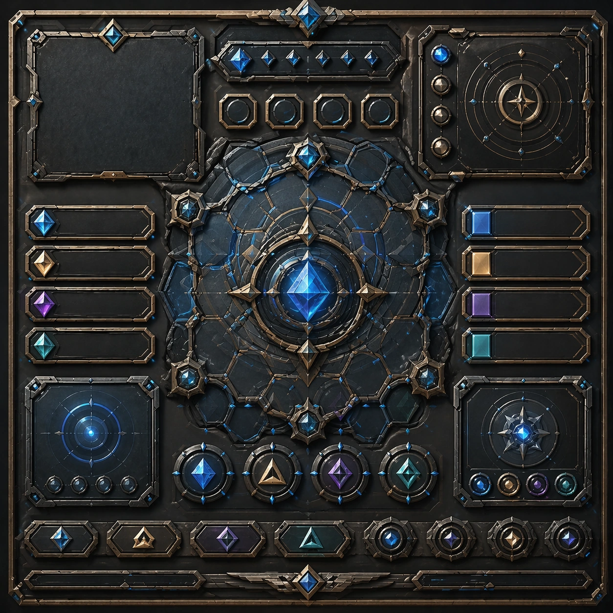

```text
Scene:
Create a square dependent image for Spatial UI and Immersive Control Panels. Build a third controlled variation in the same system with a premium, production-ready finish. Use a polished modular board or campaign surface with clean spacing, premium game-UI finish, and clear focal hierarchy. The composition should feel intentional, clean, and reusable for gallery, research, campaign, or internal handoff contexts. Lighting must support readability first, with the main forms clearly separated from the background and enough breathing room for the system to stay legible at both hero scale and thumbnail scale.

Subject:
Center a coherent original game-art system built for premium production and marketing surfaces. For this image, focus on the intended support surface. Keep the same system logic stable across screenshots, cards, banners, and overview boards. Preserve exact identity or system logic from the reference image while changing only the intended variation axis. The viewer should immediately understand what role this surface plays inside a cohesive game-production asset pack.

Important details:
Lock framing, icon grammar, palette blocking, and surface hierarchy so the kit feels production-ready and consistent. Preserve the core silhouette, framing language, and material logic from the reference image while each variation changes function. Keep materials believable, edge hierarchy disciplined, and the visual language consistent with Spatial UI. Use abstract interface blocks or diagram accents when helpful, but avoid any readable language. The final result should feel like a deliberate production asset rather than a random illustration.

Use case:
Spatial UI and Immersive Control Panels series study 4/9, designed as variant three within a cohesive asset pack.

Constraints:
No readable text, no watermark, no logos, preserve exact 1:1 aspect ratio, no unrelated objects, no broken visual hierarchy, no malformed anatomy or broken perspective, no random decorative clutter.
```

[Pinned source](https://github.com/ChaosRealmsAI/gpt-image-2-gallery/blob/5296db8c996e38776c83a0bc8c64f848dcd512b3/works/topics/spatial-ui-and-immersive-control-panels/packages/series-core-system/images/04-variant-three/meta.json) · GPT Image2 · 1254×1254 · Reference images required. · ProjectD:pending individual review.

## Support One · spatial-ui-and-immersive-control-panels/single-support-studies/support-one

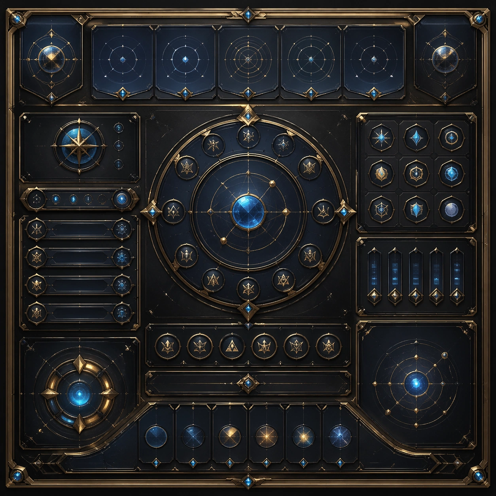

```text
Scene:
Create a square standalone support image for Spatial UI and Immersive Control Panels. Build a support-surface study with a clear focal hierarchy and a finished professional surface. Use a polished modular board or campaign surface with clean spacing, premium game-UI finish, and clear focal hierarchy. The frame should feel self-contained and polished, with enough structure to explain the system even without the reference series, yet still obviously belonging to the same theme and production world.

Subject:
Show a coherent original game-art system built for premium production and marketing surfaces in a way that emphasizes the intended support surface. Keep the same system logic stable across screenshots, cards, banners, and overview boards. Even though this image is independent, the viewer should still recognize the same universe, same commercial logic, and same production intent as the core package.

Important details:
Lock framing, icon grammar, palette blocking, and surface hierarchy so the kit feels production-ready and consistent. Preserve the broader theme language through color, framing, material choices, and modular composition. Use clean panel rhythm, premium asset presentation, and believable detail density. The image should work equally well as a gallery study, research reference, and mock production deliverable.

Use case:
Spatial UI and Immersive Control Panels single study 5/9, exploring support one as a support surface.

Constraints:
No readable text, no watermark, no logos, preserve exact 1:1 aspect ratio, no unrelated objects, no broken visual hierarchy, no visual noise that obscures the main surface, no accidental brand resemblance.
```

[Pinned source](https://github.com/ChaosRealmsAI/gpt-image-2-gallery/blob/5296db8c996e38776c83a0bc8c64f848dcd512b3/works/topics/spatial-ui-and-immersive-control-panels/packages/single-support-studies/images/support-one/meta.json) · GPT Image2 · 1254×1254 · No source-declared image dependencies. · ProjectD:pending individual review.

## Support Two · spatial-ui-and-immersive-control-panels/single-support-studies/support-two

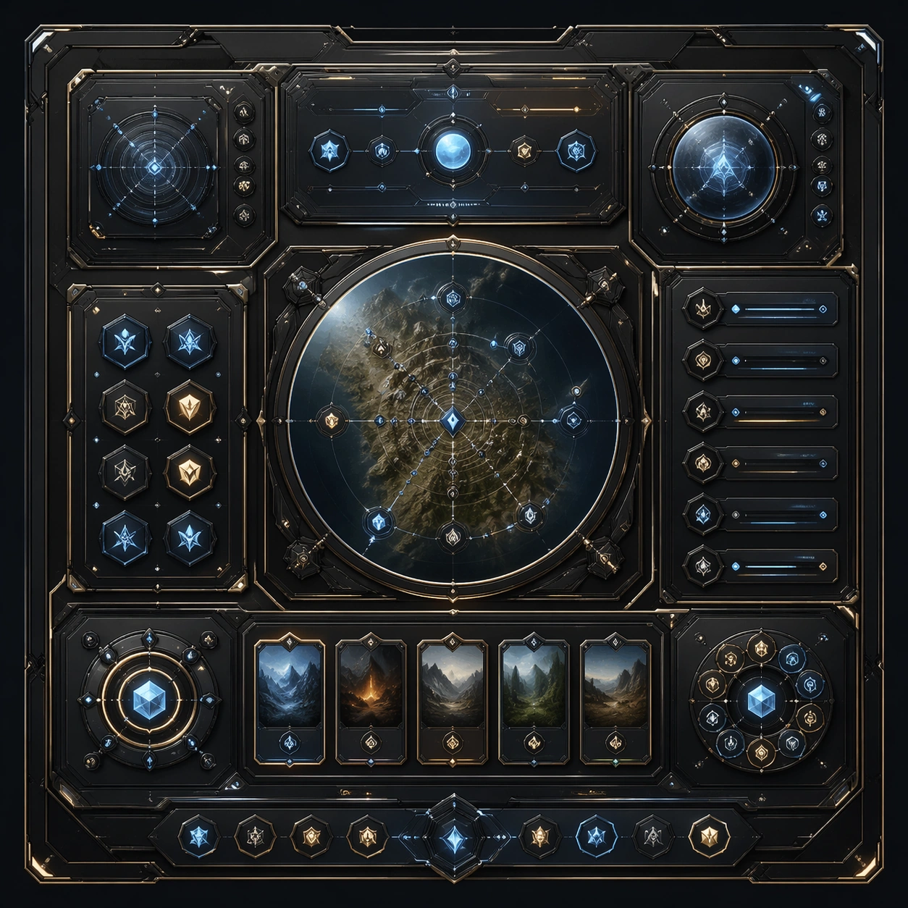

```text
Scene:
Create a square standalone support image for Spatial UI and Immersive Control Panels. Build a second support-surface study with a clear focal hierarchy and a finished professional surface. Use a polished modular board or campaign surface with clean spacing, premium game-UI finish, and clear focal hierarchy. The frame should feel self-contained and polished, with enough structure to explain the system even without the reference series, yet still obviously belonging to the same theme and production world.

Subject:
Show a coherent original game-art system built for premium production and marketing surfaces in a way that emphasizes the intended support surface. Keep the same system logic stable across screenshots, cards, banners, and overview boards. Even though this image is independent, the viewer should still recognize the same universe, same commercial logic, and same production intent as the core package.

Important details:
Lock framing, icon grammar, palette blocking, and surface hierarchy so the kit feels production-ready and consistent. Preserve the broader theme language through color, framing, material choices, and modular composition. Use clean panel rhythm, premium asset presentation, and believable detail density. The image should work equally well as a gallery study, research reference, and mock production deliverable.

Use case:
Spatial UI and Immersive Control Panels single study 6/9, exploring support two as a support surface.

Constraints:
No readable text, no watermark, no logos, preserve exact 1:1 aspect ratio, no unrelated objects, no broken visual hierarchy, no visual noise that obscures the main surface, no accidental brand resemblance.
```

[Pinned source](https://github.com/ChaosRealmsAI/gpt-image-2-gallery/blob/5296db8c996e38776c83a0bc8c64f848dcd512b3/works/topics/spatial-ui-and-immersive-control-panels/packages/single-support-studies/images/support-two/meta.json) · GPT Image2 · 1254×1254 · No source-declared image dependencies. · ProjectD:pending individual review.

## Support Three · spatial-ui-and-immersive-control-panels/single-support-studies/support-three

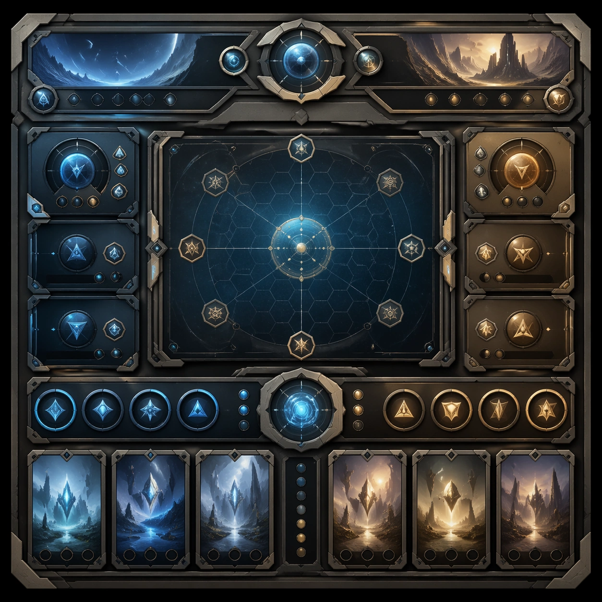

```text
Scene:
Create a square standalone support image for Spatial UI and Immersive Control Panels. Build a third support-surface study with a clear focal hierarchy and a finished professional surface. Use a polished modular board or campaign surface with clean spacing, premium game-UI finish, and clear focal hierarchy. The frame should feel self-contained and polished, with enough structure to explain the system even without the reference series, yet still obviously belonging to the same theme and production world.

Subject:
Show a coherent original game-art system built for premium production and marketing surfaces in a way that emphasizes the intended support surface. Keep the same system logic stable across screenshots, cards, banners, and overview boards. Even though this image is independent, the viewer should still recognize the same universe, same commercial logic, and same production intent as the core package.

Important details:
Lock framing, icon grammar, palette blocking, and surface hierarchy so the kit feels production-ready and consistent. Preserve the broader theme language through color, framing, material choices, and modular composition. Use clean panel rhythm, premium asset presentation, and believable detail density. The image should work equally well as a gallery study, research reference, and mock production deliverable.

Use case:
Spatial UI and Immersive Control Panels single study 7/9, exploring support three as a support surface.

Constraints:
No readable text, no watermark, no logos, preserve exact 1:1 aspect ratio, no unrelated objects, no broken visual hierarchy, no visual noise that obscures the main surface, no accidental brand resemblance.
```

[Pinned source](https://github.com/ChaosRealmsAI/gpt-image-2-gallery/blob/5296db8c996e38776c83a0bc8c64f848dcd512b3/works/topics/spatial-ui-and-immersive-control-panels/packages/single-support-studies/images/support-three/meta.json) · GPT Image2 · 1254×1254 · No source-declared image dependencies. · ProjectD:pending individual review.

## Support Four · spatial-ui-and-immersive-control-panels/single-support-studies/support-four

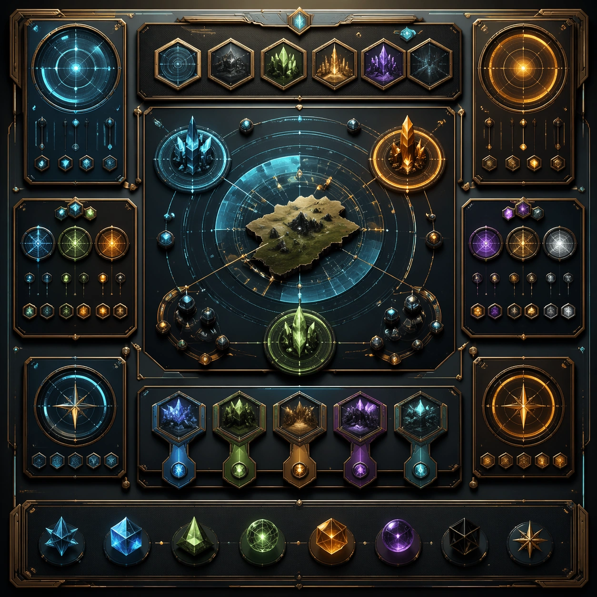

```text
Scene:
Create a square standalone support image for Spatial UI and Immersive Control Panels. Build a fourth support-surface study with a clear focal hierarchy and a finished professional surface. Use a polished modular board or campaign surface with clean spacing, premium game-UI finish, and clear focal hierarchy. The frame should feel self-contained and polished, with enough structure to explain the system even without the reference series, yet still obviously belonging to the same theme and production world.

Subject:
Show a coherent original game-art system built for premium production and marketing surfaces in a way that emphasizes the intended support surface. Keep the same system logic stable across screenshots, cards, banners, and overview boards. Even though this image is independent, the viewer should still recognize the same universe, same commercial logic, and same production intent as the core package.

Important details:
Lock framing, icon grammar, palette blocking, and surface hierarchy so the kit feels production-ready and consistent. Preserve the broader theme language through color, framing, material choices, and modular composition. Use clean panel rhythm, premium asset presentation, and believable detail density. The image should work equally well as a gallery study, research reference, and mock production deliverable.

Use case:
Spatial UI and Immersive Control Panels single study 8/9, exploring support four as a support surface.

Constraints:
No readable text, no watermark, no logos, preserve exact 1:1 aspect ratio, no unrelated objects, no broken visual hierarchy, no visual noise that obscures the main surface, no accidental brand resemblance.
```

[Pinned source](https://github.com/ChaosRealmsAI/gpt-image-2-gallery/blob/5296db8c996e38776c83a0bc8c64f848dcd512b3/works/topics/spatial-ui-and-immersive-control-panels/packages/single-support-studies/images/support-four/meta.json) · GPT Image2 · 1254×1254 · No source-declared image dependencies. · ProjectD:pending individual review.

## Support Five · spatial-ui-and-immersive-control-panels/single-support-studies/support-five

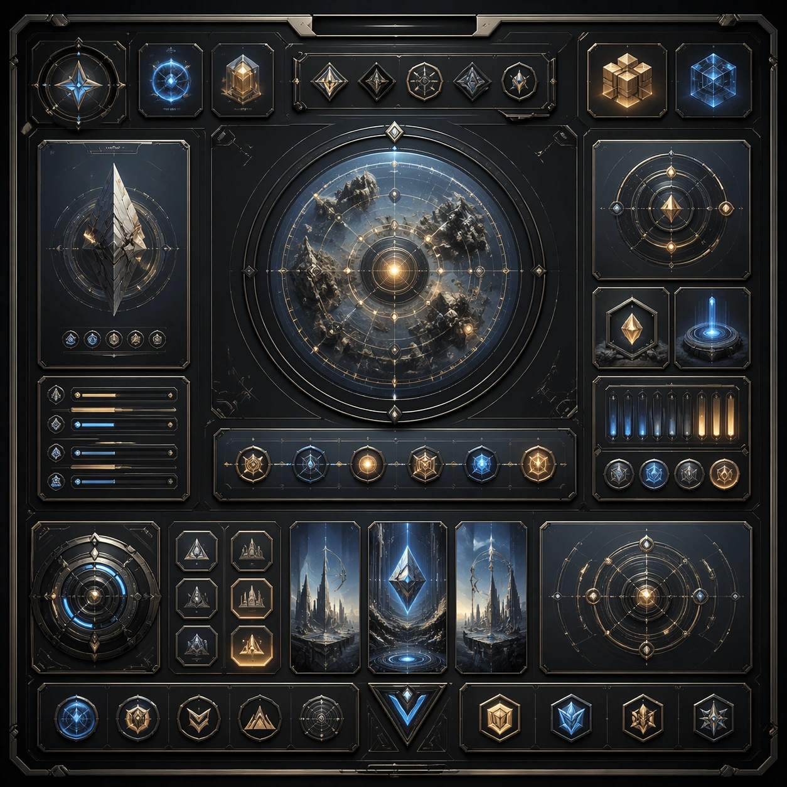

```text
Scene:
Create a square standalone support image for Spatial UI and Immersive Control Panels. Build a fifth support-surface study with a clear focal hierarchy and a finished professional surface. Use a polished modular board or campaign surface with clean spacing, premium game-UI finish, and clear focal hierarchy. The frame should feel self-contained and polished, with enough structure to explain the system even without the reference series, yet still obviously belonging to the same theme and production world.

Subject:
Show a coherent original game-art system built for premium production and marketing surfaces in a way that emphasizes the intended support surface. Keep the same system logic stable across screenshots, cards, banners, and overview boards. Even though this image is independent, the viewer should still recognize the same universe, same commercial logic, and same production intent as the core package.

Important details:
Lock framing, icon grammar, palette blocking, and surface hierarchy so the kit feels production-ready and consistent. Preserve the broader theme language through color, framing, material choices, and modular composition. Use clean panel rhythm, premium asset presentation, and believable detail density. The image should work equally well as a gallery study, research reference, and mock production deliverable.

Use case:
Spatial UI and Immersive Control Panels single study 9/9, exploring support five as a support surface.

Constraints:
No readable text, no watermark, no logos, preserve exact 1:1 aspect ratio, no unrelated objects, no broken visual hierarchy, no visual noise that obscures the main surface, no accidental brand resemblance.
```

[Pinned source](https://github.com/ChaosRealmsAI/gpt-image-2-gallery/blob/5296db8c996e38776c83a0bc8c64f848dcd512b3/works/topics/spatial-ui-and-immersive-control-panels/packages/single-support-studies/images/support-five/meta.json) · GPT Image2 · 1254×1254 · No source-declared image dependencies. · ProjectD:pending individual review.

## Reference Anchor · speaker-event-headliner-poster-kit/series-core-system/01-reference-anchor

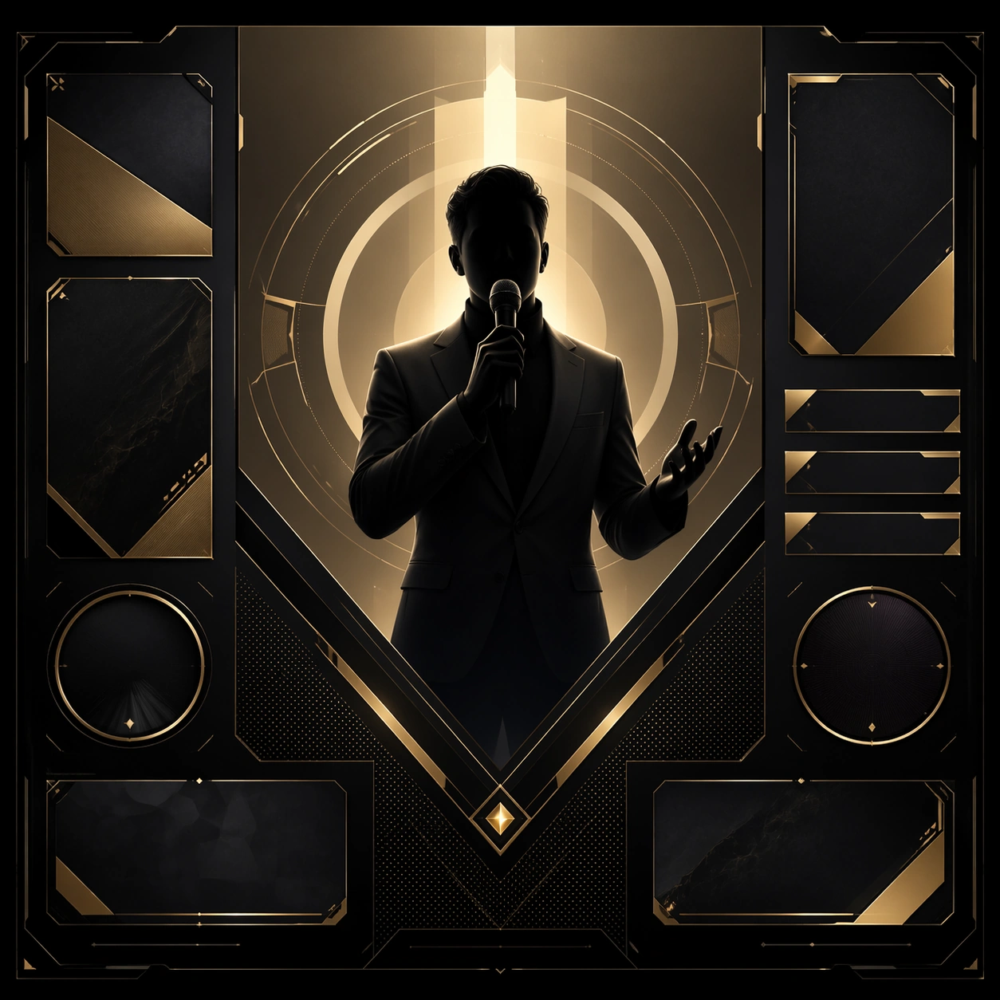

```text
Scene:
Create a square reference image for Speaker Event Headliner Poster Kit. Build a reference anchor establishing the core system with a premium, production-ready finish. Use a polished modular board or campaign surface with clean spacing, premium game-UI finish, and clear focal hierarchy. The composition should feel intentional, clean, and reusable for gallery, research, campaign, or internal handoff contexts. Lighting must support readability first, with the main forms clearly separated from the background and enough breathing room for the system to stay legible at both hero scale and thumbnail scale.

Subject:
Center a coherent original game-art system built for premium production and marketing surfaces. For this image, focus on reference anchor. Keep the same system logic stable across screenshots, cards, banners, and overview boards. This image is the canonical anchor that later series images must follow. The viewer should immediately understand what role this surface plays inside a cohesive game-production asset pack.

Important details:
Lock framing, icon grammar, palette blocking, and surface hierarchy so the kit feels production-ready and consistent. Preserve the core silhouette, framing language, and material logic from the reference image while each variation changes function. Keep materials believable, edge hierarchy disciplined, and the visual language consistent with Headliner Kit. Use abstract interface blocks or diagram accents when helpful, but avoid any readable language. The final result should feel like a deliberate production asset rather than a random illustration.

Use case:
Speaker Event Headliner Poster Kit series study 1/9, designed as reference anchor within a cohesive asset pack.

Constraints:
No readable text, no watermark, no logos, preserve exact 1:1 aspect ratio, no unrelated objects, no broken visual hierarchy, no malformed anatomy or broken perspective, no random decorative clutter.
```

[Pinned source](https://github.com/ChaosRealmsAI/gpt-image-2-gallery/blob/5296db8c996e38776c83a0bc8c64f848dcd512b3/works/topics/speaker-event-headliner-poster-kit/packages/series-core-system/images/01-reference-anchor/meta.json) · GPT Image2 · 1254×1254 · No source-declared image dependencies. · ProjectD:pending individual review.

## Variant One · speaker-event-headliner-poster-kit/series-core-system/02-variant-one

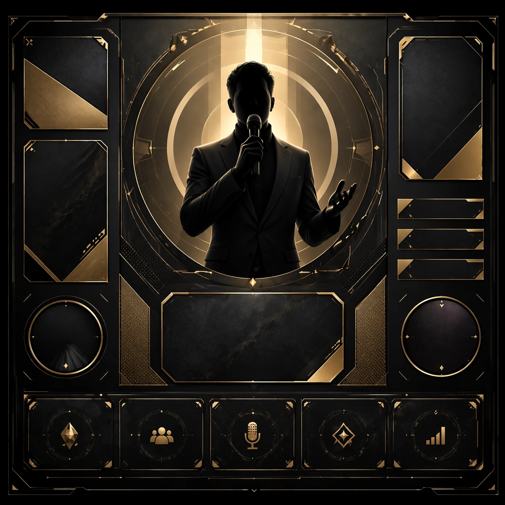

```text
Scene:
Create a square dependent image for Speaker Event Headliner Poster Kit. Build a first controlled variation in the same system with a premium, production-ready finish. Use a polished modular board or campaign surface with clean spacing, premium game-UI finish, and clear focal hierarchy. The composition should feel intentional, clean, and reusable for gallery, research, campaign, or internal handoff contexts. Lighting must support readability first, with the main forms clearly separated from the background and enough breathing room for the system to stay legible at both hero scale and thumbnail scale.

Subject:
Center a coherent original game-art system built for premium production and marketing surfaces. For this image, focus on the intended support surface. Keep the same system logic stable across screenshots, cards, banners, and overview boards. Preserve exact identity or system logic from the reference image while changing only the intended variation axis. The viewer should immediately understand what role this surface plays inside a cohesive game-production asset pack.

Important details:
Lock framing, icon grammar, palette blocking, and surface hierarchy so the kit feels production-ready and consistent. Preserve the core silhouette, framing language, and material logic from the reference image while each variation changes function. Keep materials believable, edge hierarchy disciplined, and the visual language consistent with Headliner Kit. Use abstract interface blocks or diagram accents when helpful, but avoid any readable language. The final result should feel like a deliberate production asset rather than a random illustration.

Use case:
Speaker Event Headliner Poster Kit series study 2/9, designed as variant one within a cohesive asset pack.

Constraints:
No readable text, no watermark, no logos, preserve exact 1:1 aspect ratio, no unrelated objects, no broken visual hierarchy, no malformed anatomy or broken perspective, no random decorative clutter.
```

[Pinned source](https://github.com/ChaosRealmsAI/gpt-image-2-gallery/blob/5296db8c996e38776c83a0bc8c64f848dcd512b3/works/topics/speaker-event-headliner-poster-kit/packages/series-core-system/images/02-variant-one/meta.json) · GPT Image2 · 1254×1254 · Reference images required. · ProjectD:pending individual review.

## Variant Two · speaker-event-headliner-poster-kit/series-core-system/03-variant-two

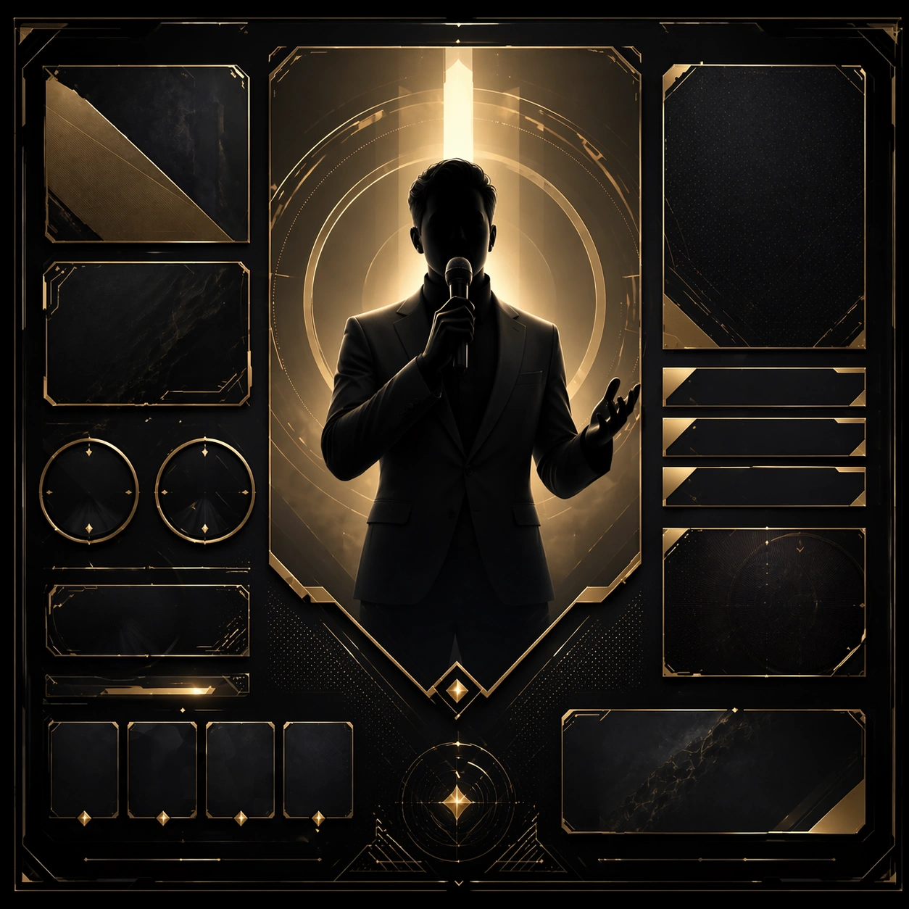

```text
Scene:
Create a square dependent image for Speaker Event Headliner Poster Kit. Build a second controlled variation in the same system with a premium, production-ready finish. Use a polished modular board or campaign surface with clean spacing, premium game-UI finish, and clear focal hierarchy. The composition should feel intentional, clean, and reusable for gallery, research, campaign, or internal handoff contexts. Lighting must support readability first, with the main forms clearly separated from the background and enough breathing room for the system to stay legible at both hero scale and thumbnail scale.

Subject:
Center a coherent original game-art system built for premium production and marketing surfaces. For this image, focus on the intended support surface. Keep the same system logic stable across screenshots, cards, banners, and overview boards. Preserve exact identity or system logic from the reference image while changing only the intended variation axis. The viewer should immediately understand what role this surface plays inside a cohesive game-production asset pack.

Important details:
Lock framing, icon grammar, palette blocking, and surface hierarchy so the kit feels production-ready and consistent. Preserve the core silhouette, framing language, and material logic from the reference image while each variation changes function. Keep materials believable, edge hierarchy disciplined, and the visual language consistent with Headliner Kit. Use abstract interface blocks or diagram accents when helpful, but avoid any readable language. The final result should feel like a deliberate production asset rather than a random illustration.

Use case:
Speaker Event Headliner Poster Kit series study 3/9, designed as variant two within a cohesive asset pack.

Constraints:
No readable text, no watermark, no logos, preserve exact 1:1 aspect ratio, no unrelated objects, no broken visual hierarchy, no malformed anatomy or broken perspective, no random decorative clutter.
```

[Pinned source](https://github.com/ChaosRealmsAI/gpt-image-2-gallery/blob/5296db8c996e38776c83a0bc8c64f848dcd512b3/works/topics/speaker-event-headliner-poster-kit/packages/series-core-system/images/03-variant-two/meta.json) · GPT Image2 · 1254×1254 · Reference images required. · ProjectD:pending individual review.

## Variant Three · speaker-event-headliner-poster-kit/series-core-system/04-variant-three

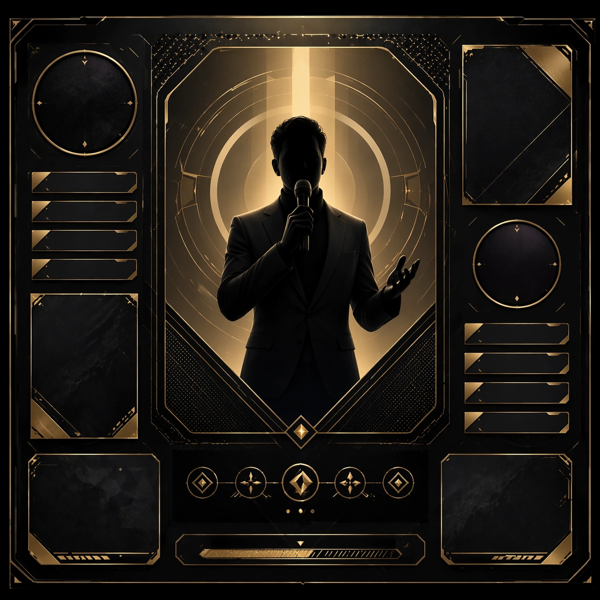

```text
Scene:
Create a square dependent image for Speaker Event Headliner Poster Kit. Build a third controlled variation in the same system with a premium, production-ready finish. Use a polished modular board or campaign surface with clean spacing, premium game-UI finish, and clear focal hierarchy. The composition should feel intentional, clean, and reusable for gallery, research, campaign, or internal handoff contexts. Lighting must support readability first, with the main forms clearly separated from the background and enough breathing room for the system to stay legible at both hero scale and thumbnail scale.

Subject:
Center a coherent original game-art system built for premium production and marketing surfaces. For this image, focus on the intended support surface. Keep the same system logic stable across screenshots, cards, banners, and overview boards. Preserve exact identity or system logic from the reference image while changing only the intended variation axis. The viewer should immediately understand what role this surface plays inside a cohesive game-production asset pack.

Important details:
Lock framing, icon grammar, palette blocking, and surface hierarchy so the kit feels production-ready and consistent. Preserve the core silhouette, framing language, and material logic from the reference image while each variation changes function. Keep materials believable, edge hierarchy disciplined, and the visual language consistent with Headliner Kit. Use abstract interface blocks or diagram accents when helpful, but avoid any readable language. The final result should feel like a deliberate production asset rather than a random illustration.

Use case:
Speaker Event Headliner Poster Kit series study 4/9, designed as variant three within a cohesive asset pack.

Constraints:
No readable text, no watermark, no logos, preserve exact 1:1 aspect ratio, no unrelated objects, no broken visual hierarchy, no malformed anatomy or broken perspective, no random decorative clutter.
```

[Pinned source](https://github.com/ChaosRealmsAI/gpt-image-2-gallery/blob/5296db8c996e38776c83a0bc8c64f848dcd512b3/works/topics/speaker-event-headliner-poster-kit/packages/series-core-system/images/04-variant-three/meta.json) · GPT Image2 · 1254×1254 · Reference images required. · ProjectD:pending individual review.

## Support One · speaker-event-headliner-poster-kit/single-support-studies/support-one

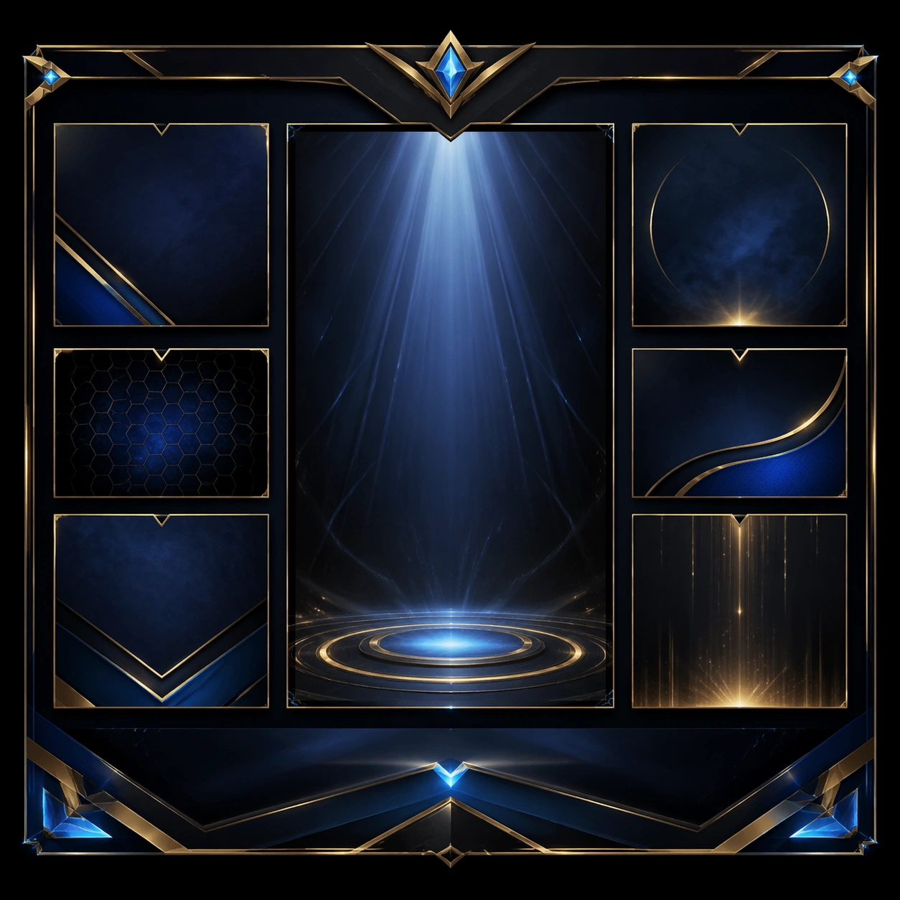

```text
Scene:
Create a square standalone support image for Speaker Event Headliner Poster Kit. Build a support-surface study with a clear focal hierarchy and a finished professional surface. Use a polished modular board or campaign surface with clean spacing, premium game-UI finish, and clear focal hierarchy. The frame should feel self-contained and polished, with enough structure to explain the system even without the reference series, yet still obviously belonging to the same theme and production world.

Subject:
Show a coherent original game-art system built for premium production and marketing surfaces in a way that emphasizes the intended support surface. Keep the same system logic stable across screenshots, cards, banners, and overview boards. Even though this image is independent, the viewer should still recognize the same universe, same commercial logic, and same production intent as the core package.

Important details:
Lock framing, icon grammar, palette blocking, and surface hierarchy so the kit feels production-ready and consistent. Preserve the broader theme language through color, framing, material choices, and modular composition. Use clean panel rhythm, premium asset presentation, and believable detail density. The image should work equally well as a gallery study, research reference, and mock production deliverable.

Use case:
Speaker Event Headliner Poster Kit single study 5/9, exploring support one as a support surface.

Constraints:
No readable text, no watermark, no logos, preserve exact 1:1 aspect ratio, no unrelated objects, no broken visual hierarchy, no visual noise that obscures the main surface, no accidental brand resemblance.
```

[Pinned source](https://github.com/ChaosRealmsAI/gpt-image-2-gallery/blob/5296db8c996e38776c83a0bc8c64f848dcd512b3/works/topics/speaker-event-headliner-poster-kit/packages/single-support-studies/images/support-one/meta.json) · GPT Image2 · 1254×1254 · No source-declared image dependencies. · ProjectD:pending individual review.

## Support Two · speaker-event-headliner-poster-kit/single-support-studies/support-two

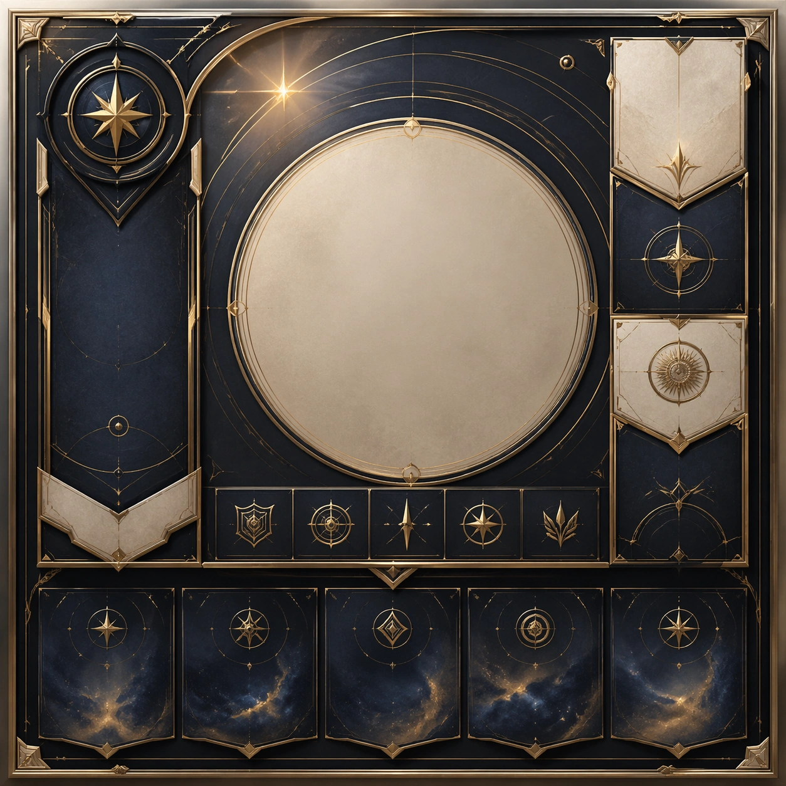

```text
Scene:
Create a square standalone support image for Speaker Event Headliner Poster Kit. Build a second support-surface study with a clear focal hierarchy and a finished professional surface. Use a polished modular board or campaign surface with clean spacing, premium game-UI finish, and clear focal hierarchy. The frame should feel self-contained and polished, with enough structure to explain the system even without the reference series, yet still obviously belonging to the same theme and production world.

Subject:
Show a coherent original game-art system built for premium production and marketing surfaces in a way that emphasizes the intended support surface. Keep the same system logic stable across screenshots, cards, banners, and overview boards. Even though this image is independent, the viewer should still recognize the same universe, same commercial logic, and same production intent as the core package.

Important details:
Lock framing, icon grammar, palette blocking, and surface hierarchy so the kit feels production-ready and consistent. Preserve the broader theme language through color, framing, material choices, and modular composition. Use clean panel rhythm, premium asset presentation, and believable detail density. The image should work equally well as a gallery study, research reference, and mock production deliverable.

Use case:
Speaker Event Headliner Poster Kit single study 6/9, exploring support two as a support surface.

Constraints:
No readable text, no watermark, no logos, preserve exact 1:1 aspect ratio, no unrelated objects, no broken visual hierarchy, no visual noise that obscures the main surface, no accidental brand resemblance.
```

[Pinned source](https://github.com/ChaosRealmsAI/gpt-image-2-gallery/blob/5296db8c996e38776c83a0bc8c64f848dcd512b3/works/topics/speaker-event-headliner-poster-kit/packages/single-support-studies/images/support-two/meta.json) · GPT Image2 · 1254×1254 · No source-declared image dependencies. · ProjectD:pending individual review.

## Support Three · speaker-event-headliner-poster-kit/single-support-studies/support-three

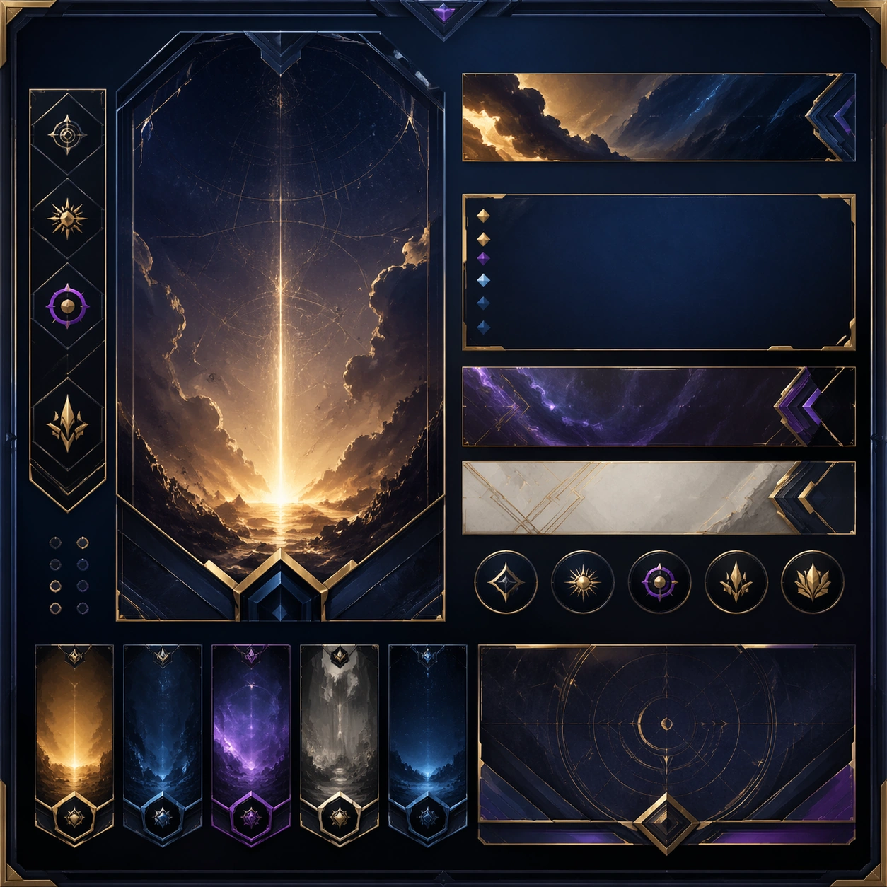

```text
Scene:
Create a square standalone support image for Speaker Event Headliner Poster Kit. Build a third support-surface study with a clear focal hierarchy and a finished professional surface. Use a polished modular board or campaign surface with clean spacing, premium game-UI finish, and clear focal hierarchy. The frame should feel self-contained and polished, with enough structure to explain the system even without the reference series, yet still obviously belonging to the same theme and production world.

Subject:
Show a coherent original game-art system built for premium production and marketing surfaces in a way that emphasizes the intended support surface. Keep the same system logic stable across screenshots, cards, banners, and overview boards. Even though this image is independent, the viewer should still recognize the same universe, same commercial logic, and same production intent as the core package.

Important details:
Lock framing, icon grammar, palette blocking, and surface hierarchy so the kit feels production-ready and consistent. Preserve the broader theme language through color, framing, material choices, and modular composition. Use clean panel rhythm, premium asset presentation, and believable detail density. The image should work equally well as a gallery study, research reference, and mock production deliverable.

Use case:
Speaker Event Headliner Poster Kit single study 7/9, exploring support three as a support surface.

Constraints:
No readable text, no watermark, no logos, preserve exact 1:1 aspect ratio, no unrelated objects, no broken visual hierarchy, no visual noise that obscures the main surface, no accidental brand resemblance.
```

[Pinned source](https://github.com/ChaosRealmsAI/gpt-image-2-gallery/blob/5296db8c996e38776c83a0bc8c64f848dcd512b3/works/topics/speaker-event-headliner-poster-kit/packages/single-support-studies/images/support-three/meta.json) · GPT Image2 · 1254×1254 · No source-declared image dependencies. · ProjectD:pending individual review.

## Support Four · speaker-event-headliner-poster-kit/single-support-studies/support-four

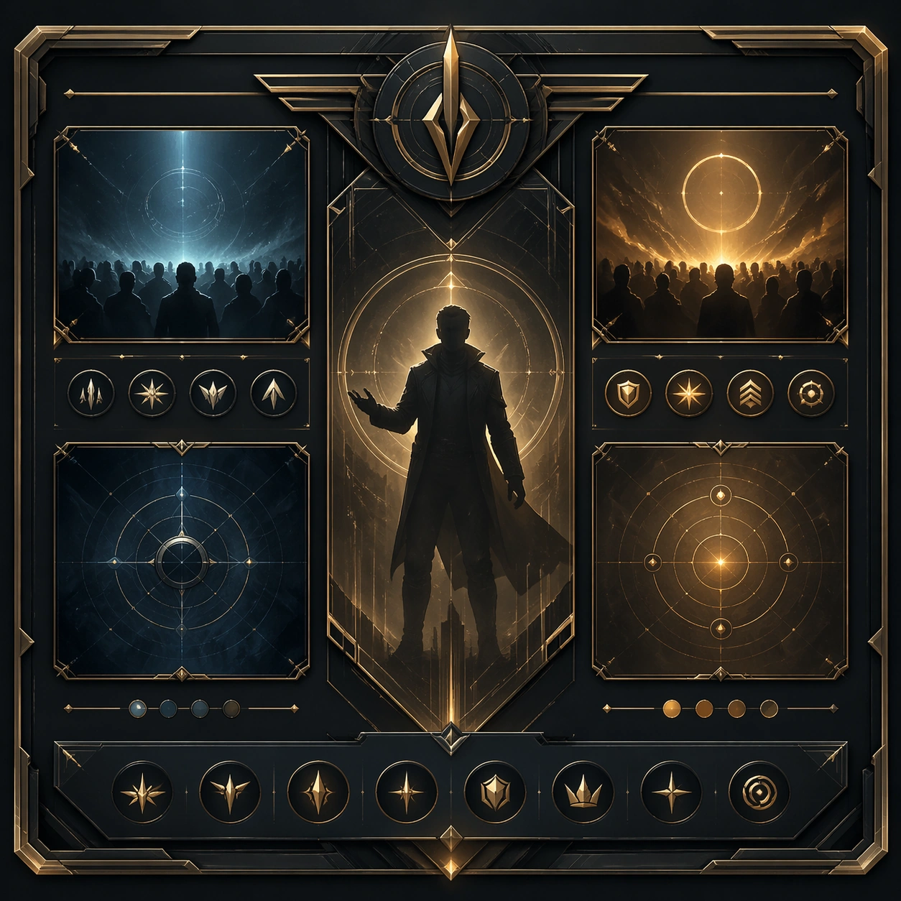

```text
Scene:
Create a square standalone support image for Speaker Event Headliner Poster Kit. Build a fourth support-surface study with a clear focal hierarchy and a finished professional surface. Use a polished modular board or campaign surface with clean spacing, premium game-UI finish, and clear focal hierarchy. The frame should feel self-contained and polished, with enough structure to explain the system even without the reference series, yet still obviously belonging to the same theme and production world.

Subject:
Show a coherent original game-art system built for premium production and marketing surfaces in a way that emphasizes the intended support surface. Keep the same system logic stable across screenshots, cards, banners, and overview boards. Even though this image is independent, the viewer should still recognize the same universe, same commercial logic, and same production intent as the core package.

Important details:
Lock framing, icon grammar, palette blocking, and surface hierarchy so the kit feels production-ready and consistent. Preserve the broader theme language through color, framing, material choices, and modular composition. Use clean panel rhythm, premium asset presentation, and believable detail density. The image should work equally well as a gallery study, research reference, and mock production deliverable.

Use case:
Speaker Event Headliner Poster Kit single study 8/9, exploring support four as a support surface.

Constraints:
No readable text, no watermark, no logos, preserve exact 1:1 aspect ratio, no unrelated objects, no broken visual hierarchy, no visual noise that obscures the main surface, no accidental brand resemblance.
```

[Pinned source](https://github.com/ChaosRealmsAI/gpt-image-2-gallery/blob/5296db8c996e38776c83a0bc8c64f848dcd512b3/works/topics/speaker-event-headliner-poster-kit/packages/single-support-studies/images/support-four/meta.json) · GPT Image2 · 1254×1254 · No source-declared image dependencies. · ProjectD:pending individual review.

## Support Five · speaker-event-headliner-poster-kit/single-support-studies/support-five

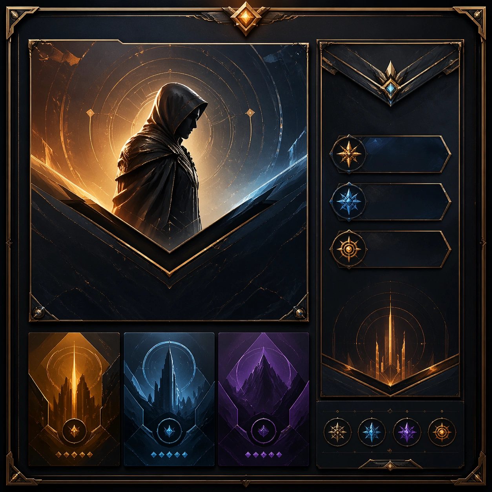

```text
Scene:
Create a square standalone support image for Speaker Event Headliner Poster Kit. Build a fifth support-surface study with a clear focal hierarchy and a finished professional surface. Use a polished modular board or campaign surface with clean spacing, premium game-UI finish, and clear focal hierarchy. The frame should feel self-contained and polished, with enough structure to explain the system even without the reference series, yet still obviously belonging to the same theme and production world.

Subject:
Show a coherent original game-art system built for premium production and marketing surfaces in a way that emphasizes the intended support surface. Keep the same system logic stable across screenshots, cards, banners, and overview boards. Even though this image is independent, the viewer should still recognize the same universe, same commercial logic, and same production intent as the core package.

Important details:
Lock framing, icon grammar, palette blocking, and surface hierarchy so the kit feels production-ready and consistent. Preserve the broader theme language through color, framing, material choices, and modular composition. Use clean panel rhythm, premium asset presentation, and believable detail density. The image should work equally well as a gallery study, research reference, and mock production deliverable.

Use case:
Speaker Event Headliner Poster Kit single study 9/9, exploring support five as a support surface.

Constraints:
No readable text, no watermark, no logos, preserve exact 1:1 aspect ratio, no unrelated objects, no broken visual hierarchy, no visual noise that obscures the main surface, no accidental brand resemblance.
```

[Pinned source](https://github.com/ChaosRealmsAI/gpt-image-2-gallery/blob/5296db8c996e38776c83a0bc8c64f848dcd512b3/works/topics/speaker-event-headliner-poster-kit/packages/single-support-studies/images/support-five/meta.json) · GPT Image2 · 1254×1254 · No source-declared image dependencies. · ProjectD:pending individual review.

## Catalogue Family Anchor · speculative-product-catalogue-family/series-core-system/01-catalogue-family-anchor

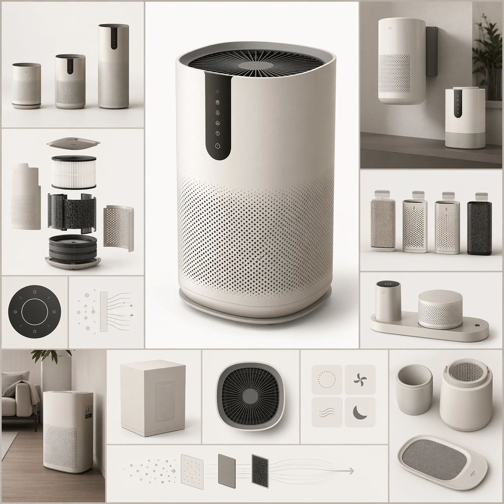

```text
Scene:
Create a square near-future catalogue board that feels like a premium consumer-product launch sheet without using readable copy. The composition should combine one hero product or family grouping with secondary modules, packaging-like shapes, and abstract information zones arranged in a clean commercial hierarchy. Lighting should be photographic, precise, and product-friendly. Present several near-future air-care devices on a clean catalogue grid with one hero unit centered, smaller companions nearby, and abstract information blocks balancing the frame.

Subject:
Center the image on a coherent consumer product family whose forms, finishes, interface surfaces, and accessory logic all belong together. The products can be speculative, but they must still feel market-positioned, manufacturable, and suited to a believable household or urban use case. Establish the reference family through matched finishes, vent geometry, touch surfaces, accessory docks, and calm household use cues.

Important details:
Think like a product marketer and industrial designer at once. Material choices, scale relationships, accessory combinations, and staged use cues should imply a clear category, audience, and feature set even though no readable text appears. The image should be strong enough for catalog, launch-page, or retail poster use. The anchor image should define how product hierarchy, family resemblance, and catalog balance work for later series variants. Resolve the anchor rules that later reference-dependent variants must inherit, especially the industrial design language, material palette, module family proportions, and catalog layout hierarchy.

Use case:
Spec Product Catalog series study 1/4, designed as a reusable core-system image for this topic.

Constraints:
No readable text, no watermark, no logos, preserve exact 1:1 aspect ratio, no real-world brand marks, no readable product copy, no random luxury nonsense props, no inconsistent industrial design, no smartphone-app screenshots with readable text.
```

[Pinned source](https://github.com/ChaosRealmsAI/gpt-image-2-gallery/blob/5296db8c996e38776c83a0bc8c64f848dcd512b3/works/topics/speculative-product-catalogue-family/packages/series-core-system/images/01-catalogue-family-anchor/meta.json) · GPT Image2 · 1024×1024 · No source-declared image dependencies. · ProjectD:pending individual review.

## Compact Apartment Variant · speculative-product-catalogue-family/series-core-system/02-compact-apartment-variant

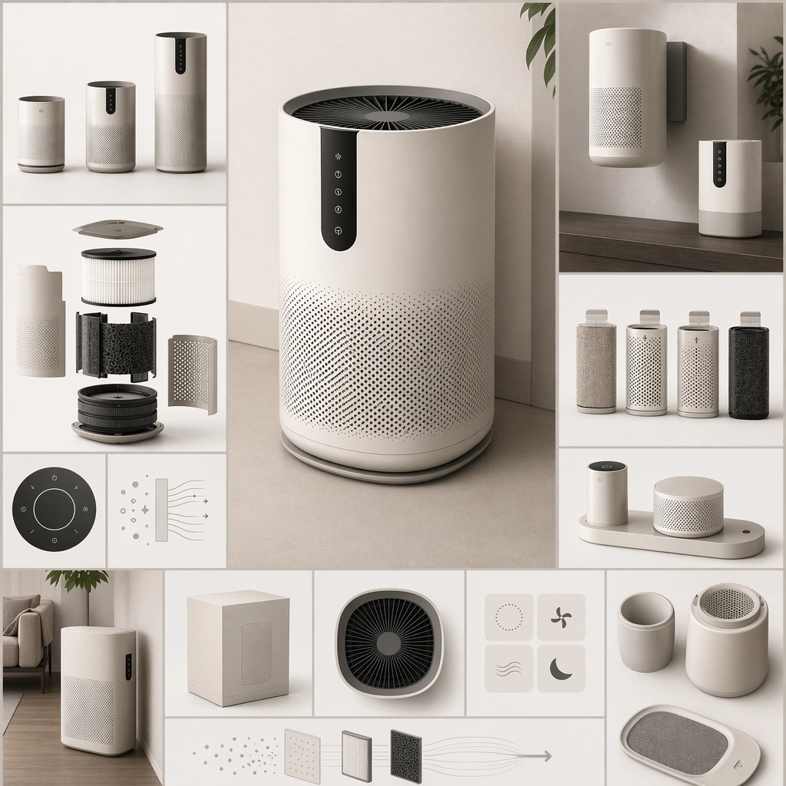

```text
Scene:
Create a square near-future catalogue board that feels like a premium consumer-product launch sheet without using readable copy. The composition should combine one hero product or family grouping with secondary modules, packaging-like shapes, and abstract information zones arranged in a clean commercial hierarchy. Lighting should be photographic, precise, and product-friendly. Keep the same industrial design language but stage the family around compact units, wall-adjacent footprints, and tight-space accessories in the same catalog format.

Subject:
Center the image on a coherent consumer product family whose forms, finishes, interface surfaces, and accessory logic all belong together. The products can be speculative, but they must still feel market-positioned, manufacturable, and suited to a believable household or urban use case. Preserve the reference forms, vent logic, and material palette while emphasizing urban apartment suitability and modular storage.

Important details:
Think like a product marketer and industrial designer at once. Material choices, scale relationships, accessory combinations, and staged use cues should imply a clear category, audience, and feature set even though no readable text appears. The image should be strong enough for catalog, launch-page, or retail poster use. The board should feel like a real line extension rather than a total redesign, with compactness expressed through packaging and scale decisions. Preserve the exact structural language established by the reference image, especially the industrial design language, material palette, module family proportions, and catalog layout hierarchy.

Use case:
Spec Product Catalog series study 2/4, designed as a reusable core-system image for this topic.

Constraints:
No readable text, no watermark, no logos, preserve exact 1:1 aspect ratio, no real-world brand marks, no readable product copy, no random luxury nonsense props, no inconsistent industrial design, no tiny gadget novelty feel.
```

[Pinned source](https://github.com/ChaosRealmsAI/gpt-image-2-gallery/blob/5296db8c996e38776c83a0bc8c64f848dcd512b3/works/topics/speculative-product-catalogue-family/packages/series-core-system/images/02-compact-apartment-variant/meta.json) · GPT Image2 · 1024×1024 · Reference images required. · ProjectD:pending individual review.

## Retail Shelf Campaign · speculative-product-catalogue-family/series-core-system/04-retail-shelf-campaign

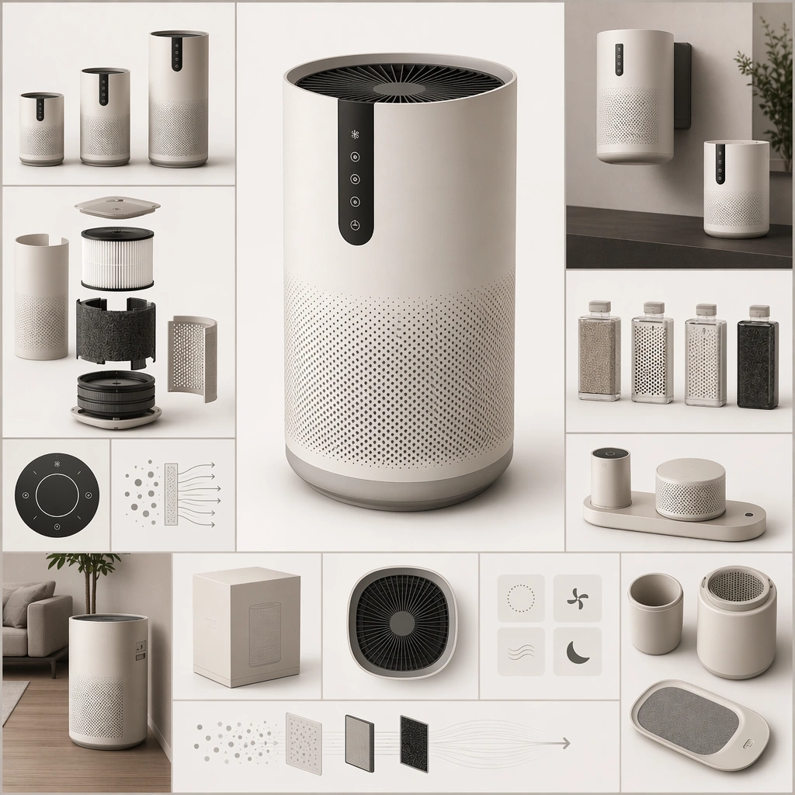

```text
Scene:
Create a square near-future catalogue board that feels like a premium consumer-product launch sheet without using readable copy. The composition should combine one hero product or family grouping with secondary modules, packaging-like shapes, and abstract information zones arranged in a clean commercial hierarchy. Lighting should be photographic, precise, and product-friendly. Retain the same product family but arrange the board to imply retail display modules, packaging silhouettes, and grouped merchandising without readable copy.

Subject:
Center the image on a coherent consumer product family whose forms, finishes, interface surfaces, and accessory logic all belong together. The products can be speculative, but they must still feel market-positioned, manufacturable, and suited to a believable household or urban use case. Preserve the anchor industrial design while making retail arrangement, bundle distinctions, and shopper-facing hierarchy more explicit.

Important details:
Think like a product marketer and industrial designer at once. Material choices, scale relationships, accessory combinations, and staged use cues should imply a clear category, audience, and feature set even though no readable text appears. The image should be strong enough for catalog, launch-page, or retail poster use. The image should feel useful for a launch deck or retail poster, not like a generic ecommerce tile mosaic. Preserve the exact structural language established by the reference image, especially the industrial design language, material palette, module family proportions, and catalog layout hierarchy.

Use case:
Spec Product Catalog series study 4/4, designed as a reusable core-system image for this topic.

Constraints:
No readable text, no watermark, no logos, preserve exact 1:1 aspect ratio, no real-world brand marks, no readable product copy, no random luxury nonsense props, no inconsistent industrial design, no supermarket sale chaos.
```

[Pinned source](https://github.com/ChaosRealmsAI/gpt-image-2-gallery/blob/5296db8c996e38776c83a0bc8c64f848dcd512b3/works/topics/speculative-product-catalogue-family/packages/series-core-system/images/04-retail-shelf-campaign/meta.json) · GPT Image2 · 1024×1024 · Reference images required. · ProjectD:pending individual review.

## Kitchen Fermentation Assistant · speculative-product-catalogue-family/single-support-studies/01-kitchen-fermentation-assistant

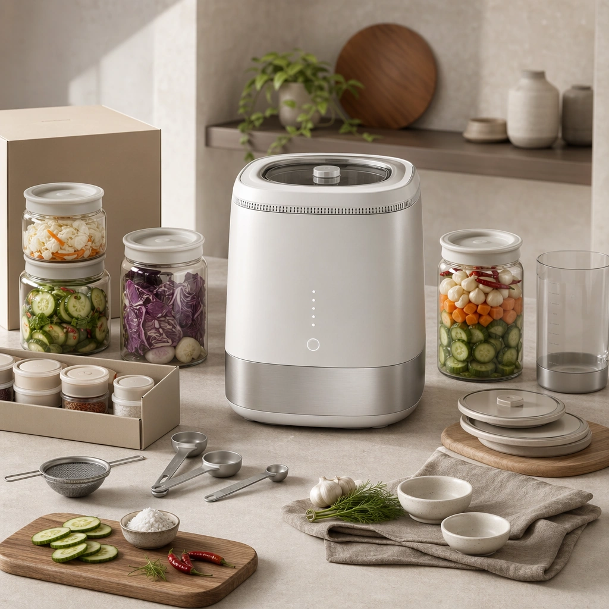

```text
Scene:
Design a square product-catalog image for one near-future consumer category, keeping industrial design clarity and marketing hierarchy equally strong. The board should feel commercial and ready to publish, not like a random object render. Compose a product board with one countertop fermenter, accessory jars, measuring tools, and soft kitchen-context props arranged in a premium catalog style.

Subject:
Show one coherent product or micro-family with believable consumer positioning, accessory logic, and lifestyle relevance. Hints of packaging, use context, or display systems can appear if they support the category read. The family should feel culinary and trustworthy, with interface logic and modular accessories clearly tied to food workflow.

Important details:
Use restrained props, clear product spacing, and material realism to sell a plausible near-future product direction. The concept should feel like something a real company could market within a few years. Keep the board clean and appetizing without turning it into a food photograph. Preserve category-specific marketing logic so the product, accessories, and staged context all support the same consumer story.

Use case:
Spec Product Catalog single study 1/5, designed as a self-contained support image for this topic.

Constraints:
No readable text, no watermark, no logos, preserve exact 1:1 aspect ratio, no price-tag text, no glossy ad cliché overload, no cartoon gadgets, no fake logos, no chef-brand cues.
```

[Pinned source](https://github.com/ChaosRealmsAI/gpt-image-2-gallery/blob/5296db8c996e38776c83a0bc8c64f848dcd512b3/works/topics/speculative-product-catalogue-family/packages/single-support-studies/images/01-kitchen-fermentation-assistant/meta.json) · GPT Image2 · 1024×1024 · No source-declared image dependencies. · ProjectD:pending individual review.

## Bedside Sleep Climate Orb · speculative-product-catalogue-family/single-support-studies/02-bedside-sleep-climate-orb

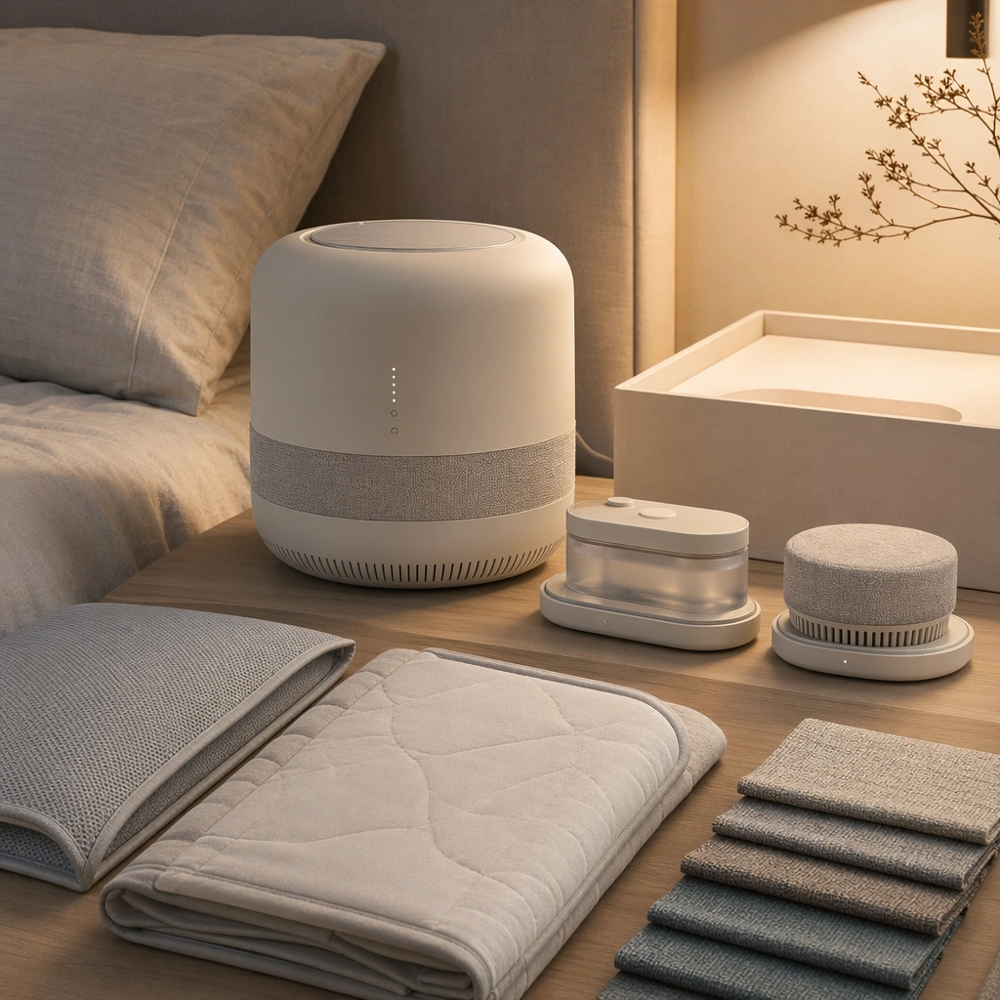

```text
Scene:
Design a square product-catalog image for one near-future consumer category, keeping industrial design clarity and marketing hierarchy equally strong. The board should feel commercial and ready to publish, not like a random object render. Show a rounded climate device with docks, fabric accessories, and calm bedroom-context staging under soft evening light.

Subject:
Show one coherent product or micro-family with believable consumer positioning, accessory logic, and lifestyle relevance. Hints of packaging, use context, or display systems can appear if they support the category read. The products should communicate rest, comfort, and subtle control through materials and form rather than through bright screens.

Important details:
Use restrained props, clear product spacing, and material realism to sell a plausible near-future product direction. The concept should feel like something a real company could market within a few years. Use commercial hierarchy to make the hero device and companion modules feel like one thoughtful family. Preserve category-specific marketing logic so the product, accessories, and staged context all support the same consumer story.

Use case:
Spec Product Catalog single study 2/5, designed as a self-contained support image for this topic.

Constraints:
No readable text, no watermark, no logos, preserve exact 1:1 aspect ratio, no price-tag text, no glossy ad cliché overload, no cartoon gadgets, no fake logos, no wellness-crystal mysticism.
```

[Pinned source](https://github.com/ChaosRealmsAI/gpt-image-2-gallery/blob/5296db8c996e38776c83a0bc8c64f848dcd512b3/works/topics/speculative-product-catalogue-family/packages/single-support-studies/images/02-bedside-sleep-climate-orb/meta.json) · GPT Image2 · 1024×1024 · No source-declared image dependencies. · ProjectD:pending individual review.

## Child Safe Cleaning Rover · speculative-product-catalogue-family/single-support-studies/03-child-safe-cleaning-rover

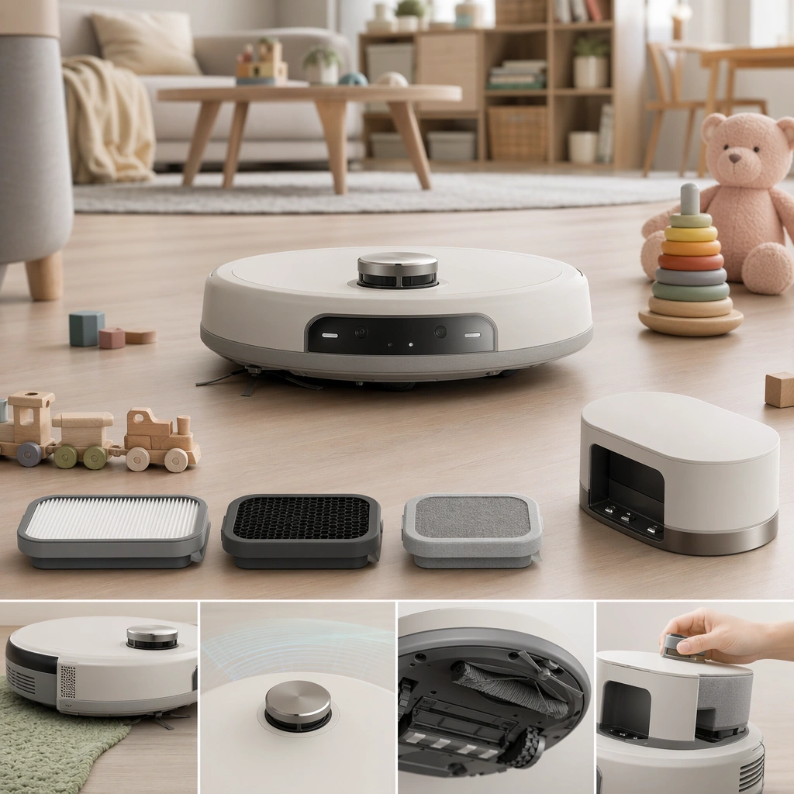

```text
Scene:
Design a square product-catalog image for one near-future consumer category, keeping industrial design clarity and marketing hierarchy equally strong. The board should feel commercial and ready to publish, not like a random object render. Design a catalog board with a compact rover, dock, filter modules, and toy-safe obstacle examples staged in a bright household environment.

Subject:
Show one coherent product or micro-family with believable consumer positioning, accessory logic, and lifestyle relevance. Hints of packaging, use context, or display systems can appear if they support the category read. The product family should feel trustworthy, durable, and clearly positioned for homes with children.

Important details:
Use restrained props, clear product spacing, and material realism to sell a plausible near-future product direction. The concept should feel like something a real company could market within a few years. Balance softness and engineering so the rover does not become toy-like or cartoonish. Preserve category-specific marketing logic so the product, accessories, and staged context all support the same consumer story.

Use case:
Spec Product Catalog single study 3/5, designed as a self-contained support image for this topic.

Constraints:
No readable text, no watermark, no logos, preserve exact 1:1 aspect ratio, no price-tag text, no glossy ad cliché overload, no cartoon gadgets, no fake logos, no cute mascot face design.
```

[Pinned source](https://github.com/ChaosRealmsAI/gpt-image-2-gallery/blob/5296db8c996e38776c83a0bc8c64f848dcd512b3/works/topics/speculative-product-catalogue-family/packages/single-support-studies/images/03-child-safe-cleaning-rover/meta.json) · GPT Image2 · 1024×1024 · No source-declared image dependencies. · ProjectD:pending individual review.

## Balcony Micro Farm Stack · speculative-product-catalogue-family/single-support-studies/04-balcony-micro-farm-stack

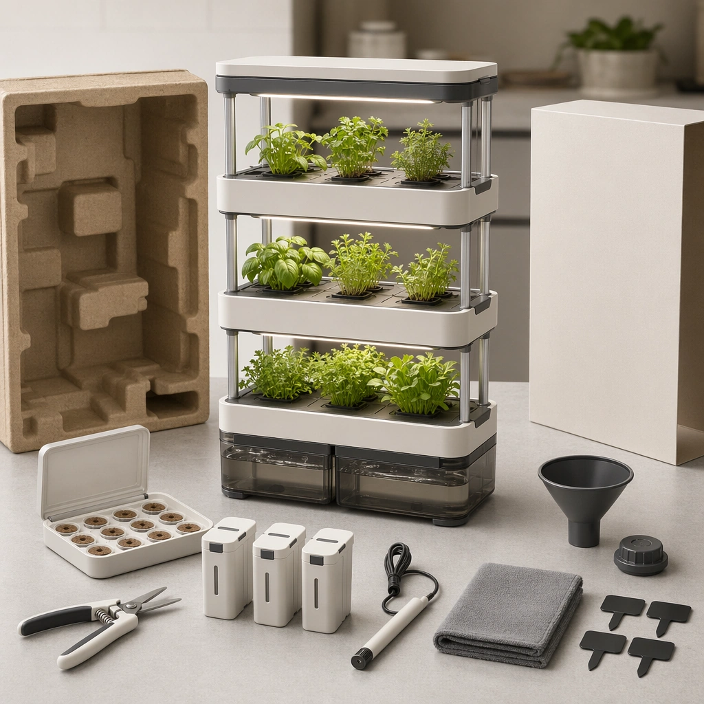

```text
Scene:
Design a square product-catalog image for one near-future consumer category, keeping industrial design clarity and marketing hierarchy equally strong. The board should feel commercial and ready to publish, not like a random object render. Compose a square board with stacked grow modules, water reservoirs, clip-on tools, and plant-care accessories arranged as a consumer kit.

Subject:
Show one coherent product or micro-family with believable consumer positioning, accessory logic, and lifestyle relevance. Hints of packaging, use context, or display systems can appear if they support the category read. The system should communicate ease, modularity, and urban practicality through its physical design and staged context.

Important details:
Use restrained props, clear product spacing, and material realism to sell a plausible near-future product direction. The concept should feel like something a real company could market within a few years. Let product logic and lifestyle relevance drive the image instead of romantic garden styling. Preserve category-specific marketing logic so the product, accessories, and staged context all support the same consumer story.

Use case:
Spec Product Catalog single study 4/5, designed as a self-contained support image for this topic.

Constraints:
No readable text, no watermark, no logos, preserve exact 1:1 aspect ratio, no price-tag text, no glossy ad cliché overload, no cartoon gadgets, no fake logos, no rustic farmhouse branding.
```

[Pinned source](https://github.com/ChaosRealmsAI/gpt-image-2-gallery/blob/5296db8c996e38776c83a0bc8c64f848dcd512b3/works/topics/speculative-product-catalogue-family/packages/single-support-studies/images/04-balcony-micro-farm-stack/meta.json) · GPT Image2 · 1024×1024 · No source-declared image dependencies. · ProjectD:pending individual review.

## Commuter Air Purifying Bottle Dock · speculative-product-catalogue-family/single-support-studies/05-commuter-air-purifying-bottle-dock

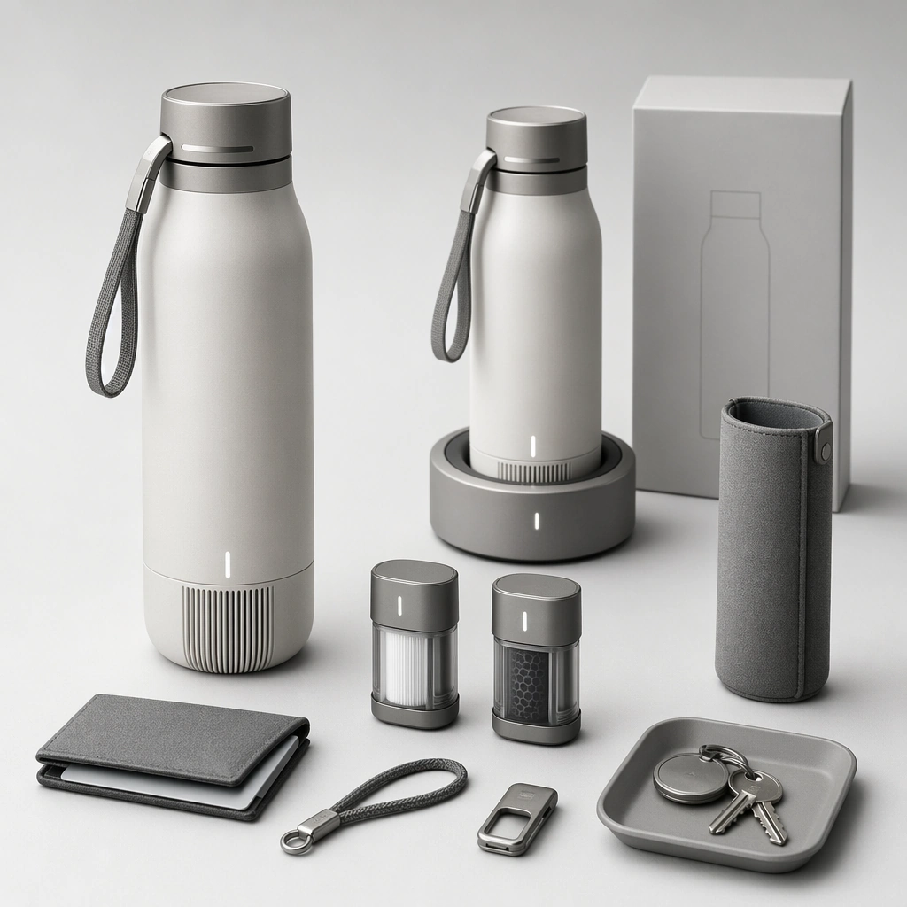

```text
Scene:
Design a square product-catalog image for one near-future consumer category, keeping industrial design clarity and marketing hierarchy equally strong. The board should feel commercial and ready to publish, not like a random object render. Present a sleek bottle-like device, docking base, cartridge modules, and carry accessories on a clean commuting-oriented catalog board.

Subject:
Show one coherent product or micro-family with believable consumer positioning, accessory logic, and lifestyle relevance. Hints of packaging, use context, or display systems can appear if they support the category read. The family should feel compact, modern, and plausible for daily carry, with strong continuity between portable and docked components.

Important details:
Use restrained props, clear product spacing, and material realism to sell a plausible near-future product direction. The concept should feel like something a real company could market within a few years. Use restrained urban props and crisp product spacing so the category reads immediately without copy. Preserve category-specific marketing logic so the product, accessories, and staged context all support the same consumer story.

Use case:
Spec Product Catalog single study 5/5, designed as a self-contained support image for this topic.

Constraints:
No readable text, no watermark, no logos, preserve exact 1:1 aspect ratio, no price-tag text, no glossy ad cliché overload, no cartoon gadgets, no fake logos, no fitness-brand styling.
```

[Pinned source](https://github.com/ChaosRealmsAI/gpt-image-2-gallery/blob/5296db8c996e38776c83a0bc8c64f848dcd512b3/works/topics/speculative-product-catalogue-family/packages/single-support-studies/images/05-commuter-air-purifying-bottle-dock/meta.json) · GPT Image2 · 1024×1024 · No source-declared image dependencies. · ProjectD:pending individual review.

## Jump Core Anchor · speculative-technology-cutaway-poster/series-core-system/01-jump-core-anchor

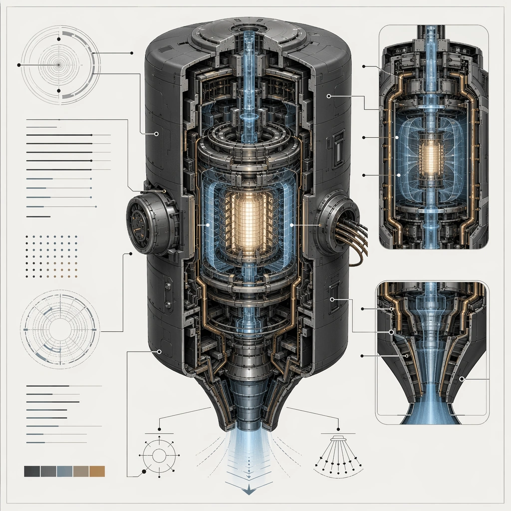

```text
Scene:
Create a square technical-poster composition for an impossible but convincing device, using cutaway views, section windows, and disciplined layout. The background should stay clean and poster-ready so internal chambers, conduits, shells, and field zones remain readable at a glance. Use lighting and color sparingly to clarify hierarchy rather than to decorate the page. Center a dense engine core on a clean poster field with one main shell cutaway, two supporting sectional windows, and cool industrial light.

Subject:
Center the image on one speculative machine whose internal logic feels thought through: shell, core, coolant path, field chamber, maintenance access, and energy routing should all relate coherently. The device can be fantastical, but it must read like it could be explained by an engineering team. Establish the reference device through a protected outer shell, concentric field chamber, coolant spine, maintenance ports, and emission throat arranged in clear sequence.

Important details:
Treat the poster as a visual explanation system without readable text. Use arrows, callout lines, index dots, section blocks, and sectional contrast only as abstract diagram grammar. The result should feel credible for a concept deck, patent-style board, or advanced product explanation poster. The anchor image should define how cutaway color, section depth, and callout geometry work for the rest of the series. Resolve the anchor rules that later reference-dependent variants must inherit, especially the outer shell silhouette, internal chamber sequencing, conduit routing, and diagram hierarchy.

Use case:
Spec Tech Cutaway series study 1/4, designed as a reusable core-system image for this topic.

Constraints:
No readable text, no watermark, no logos, preserve exact 1:1 aspect ratio, no readable labels, no exploded parts floating without logic, no cartoon simplification, no generic spaceship dashboard noise, no rainbow energy blast effects.
```

[Pinned source](https://github.com/ChaosRealmsAI/gpt-image-2-gallery/blob/5296db8c996e38776c83a0bc8c64f848dcd512b3/works/topics/speculative-technology-cutaway-poster/packages/series-core-system/images/01-jump-core-anchor/meta.json) · GPT Image2 · 1024×1024 · No source-declared image dependencies. · ProjectD:pending individual review.

## Field Expanded Mode · speculative-technology-cutaway-poster/series-core-system/02-field-expanded-mode

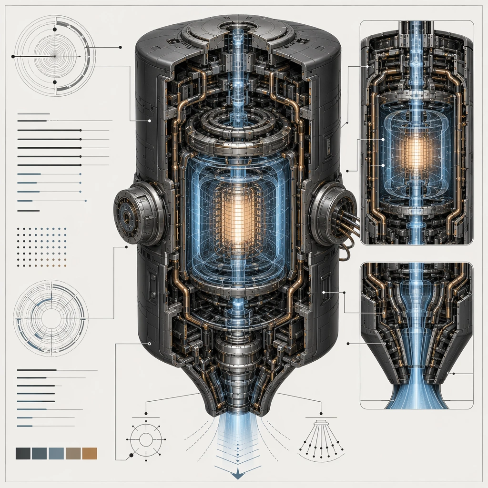

```text
Scene:
Create a square technical-poster composition for an impossible but convincing device, using cutaway views, section windows, and disciplined layout. The background should stay clean and poster-ready so internal chambers, conduits, shells, and field zones remain readable at a glance. Use lighting and color sparingly to clarify hierarchy rather than to decorate the page. Keep the same main shell silhouette but open several outer panels and show the field chamber in an expanded operational state on the same poster grid.

Subject:
Center the image on one speculative machine whose internal logic feels thought through: shell, core, coolant path, field chamber, maintenance access, and energy routing should all relate coherently. The device can be fantastical, but it must read like it could be explained by an engineering team. Preserve the anchor shell and chamber order while foregrounding stabilization rings, service ducts, and protected expansion joints.

Important details:
Treat the poster as a visual explanation system without readable text. Use arrows, callout lines, index dots, section blocks, and sectional contrast only as abstract diagram grammar. The result should feel credible for a concept deck, patent-style board, or advanced product explanation poster. Operational complexity should increase, but the device must still read as the same machine family at first glance. Preserve the exact structural language established by the reference image, especially the outer shell silhouette, internal chamber sequencing, conduit routing, and diagram hierarchy.

Use case:
Spec Tech Cutaway series study 2/4, designed as a reusable core-system image for this topic.

Constraints:
No readable text, no watermark, no logos, preserve exact 1:1 aspect ratio, no readable labels, no exploded parts floating without logic, no cartoon simplification, no generic spaceship dashboard noise, no magical portal vortex.
```

[Pinned source](https://github.com/ChaosRealmsAI/gpt-image-2-gallery/blob/5296db8c996e38776c83a0bc8c64f848dcd512b3/works/topics/speculative-technology-cutaway-poster/packages/series-core-system/images/02-field-expanded-mode/meta.json) · GPT Image2 · 1024×1024 · Reference images required. · ProjectD:pending individual review.

## Maintenance Open Mode · speculative-technology-cutaway-poster/series-core-system/03-maintenance-open-mode

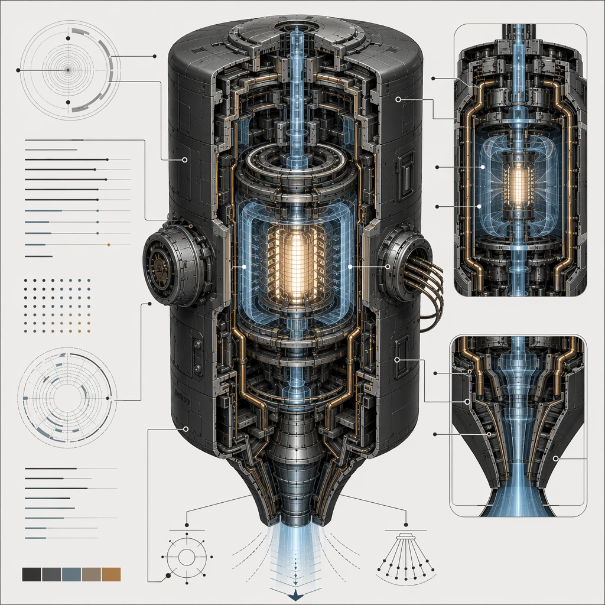

```text
Scene:
Create a square technical-poster composition for an impossible but convincing device, using cutaway views, section windows, and disciplined layout. The background should stay clean and poster-ready so internal chambers, conduits, shells, and field zones remain readable at a glance. Use lighting and color sparingly to clarify hierarchy rather than to decorate the page. Present the same device on a clean technical background with selected panels removed and maintenance tools or docks implied by abstract holders and brackets.

Subject:
Center the image on one speculative machine whose internal logic feels thought through: shell, core, coolant path, field chamber, maintenance access, and energy routing should all relate coherently. The device can be fantastical, but it must read like it could be explained by an engineering team. Keep the reference silhouette and chamber layout intact while emphasizing repair access, replaceable modules, and safe isolation zones.

Important details:
Treat the poster as a visual explanation system without readable text. Use arrows, callout lines, index dots, section blocks, and sectional contrast only as abstract diagram grammar. The result should feel credible for a concept deck, patent-style board, or advanced product explanation poster. The image should feel like a professional maintenance poster, not a chaotic exploded drawing. Preserve the exact structural language established by the reference image, especially the outer shell silhouette, internal chamber sequencing, conduit routing, and diagram hierarchy.

Use case:
Spec Tech Cutaway series study 3/4, designed as a reusable core-system image for this topic.

Constraints:
No readable text, no watermark, no logos, preserve exact 1:1 aspect ratio, no readable labels, no exploded parts floating without logic, no cartoon simplification, no generic spaceship dashboard noise, no floating puzzle pieces.
```

[Pinned source](https://github.com/ChaosRealmsAI/gpt-image-2-gallery/blob/5296db8c996e38776c83a0bc8c64f848dcd512b3/works/topics/speculative-technology-cutaway-poster/packages/series-core-system/images/03-maintenance-open-mode/meta.json) · GPT Image2 · 1024×1024 · Reference images required. · ProjectD:pending individual review.

## Industrial Scale Version · speculative-technology-cutaway-poster/series-core-system/04-industrial-scale-version

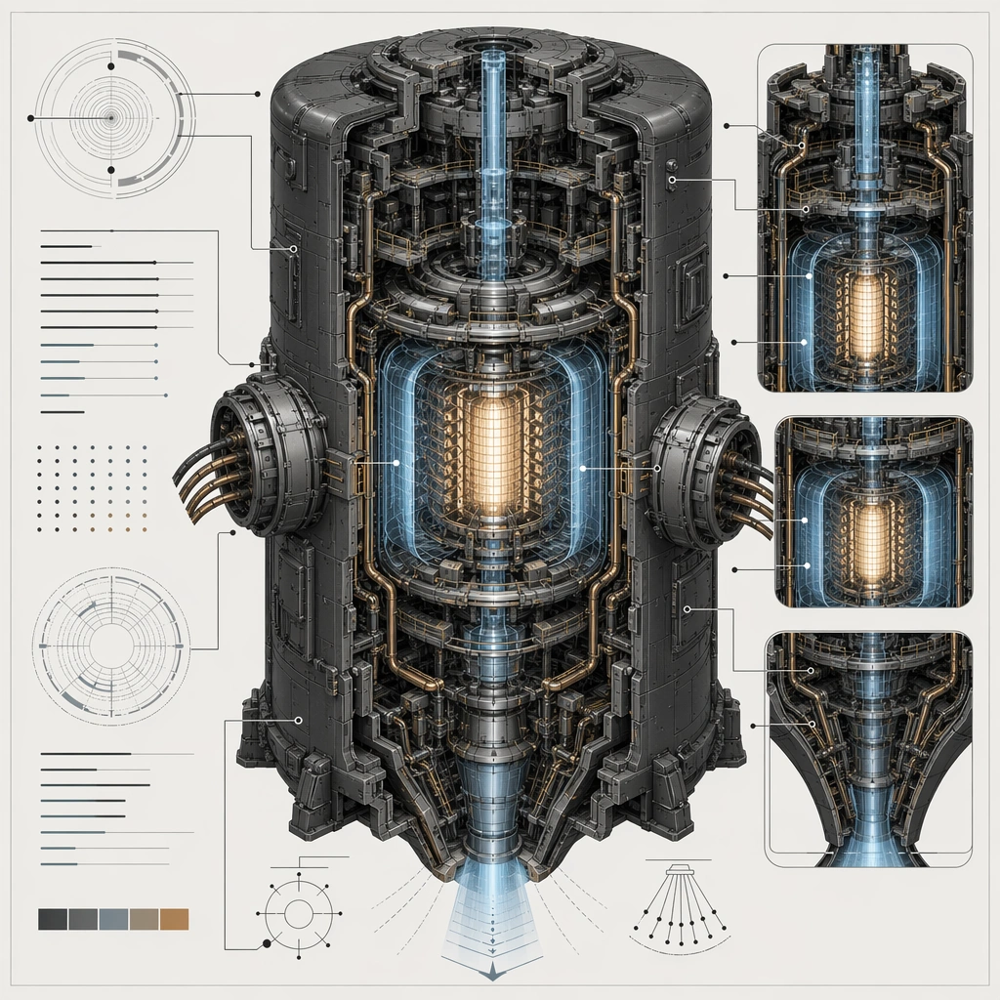

```text
Scene:
Create a square technical-poster composition for an impossible but convincing device, using cutaway views, section windows, and disciplined layout. The background should stay clean and poster-ready so internal chambers, conduits, shells, and field zones remain readable at a glance. Use lighting and color sparingly to clarify hierarchy rather than to decorate the page. Scale the familiar shell language up into a larger industrial module with the cutaway still occupying the square frame clearly and cleanly.

Subject:
Center the image on one speculative machine whose internal logic feels thought through: shell, core, coolant path, field chamber, maintenance access, and energy routing should all relate coherently. The device can be fantastical, but it must read like it could be explained by an engineering team. Preserve the reference chamber order and outer-shell identity while adding service walkways, larger coolant trunks, and more robust containment walls.

Important details:
Treat the poster as a visual explanation system without readable text. Use arrows, callout lines, index dots, section blocks, and sectional contrast only as abstract diagram grammar. The result should feel credible for a concept deck, patent-style board, or advanced product explanation poster. Scale must feel like a real engineering escalation rather than a total redesign into a different machine. Preserve the exact structural language established by the reference image, especially the outer shell silhouette, internal chamber sequencing, conduit routing, and diagram hierarchy.

Use case:
Spec Tech Cutaway series study 4/4, designed as a reusable core-system image for this topic.

Constraints:
No readable text, no watermark, no logos, preserve exact 1:1 aspect ratio, no readable labels, no exploded parts floating without logic, no cartoon simplification, no generic spaceship dashboard noise, no giant hangar scenery taking over the poster.
```

[Pinned source](https://github.com/ChaosRealmsAI/gpt-image-2-gallery/blob/5296db8c996e38776c83a0bc8c64f848dcd512b3/works/topics/speculative-technology-cutaway-poster/packages/series-core-system/images/04-industrial-scale-version/meta.json) · GPT Image2 · 1024×1024 · Reference images required. · ProjectD:pending individual review.

## Atmospheric Processor Cross Section · speculative-technology-cutaway-poster/single-support-studies/01-atmospheric-processor-cross-section

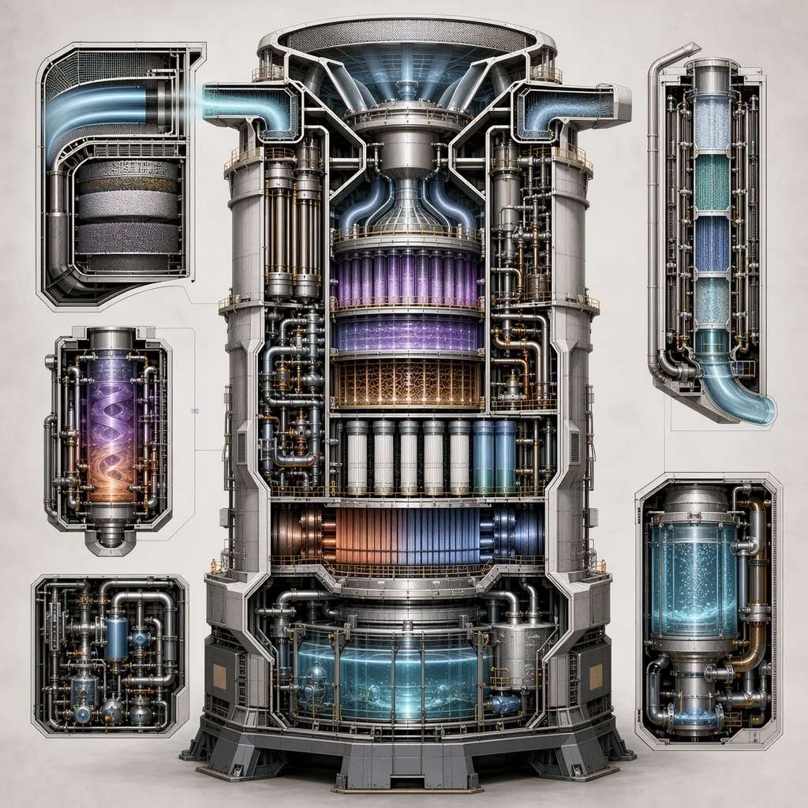

```text
Scene:
Design a square explanatory board for one speculative machine, making the image useful for a presentation, poster, or worldbuilding manual page. The composition should have one dominant cutaway read supported by controlled secondary views. Compose a vertical-feeling machine within the square frame, showing intake channels, reaction chambers, filter stacks, and output reservoirs in layered section.

Subject:
Show a complete device with clear internal zones and believable maintenance or operational structure. The machine should look impossible only in ambition, not in the clarity of its construction logic. The device should read as climate infrastructure, with clear progression from raw intake to cleaned outputs.

Important details:
Prioritize visual explanation, clean sectional hierarchy, and disciplined materials. Every chamber, conduit, shell break, and inset should help the viewer infer what the machine does. Use diagram rhythm and sectional contrast to explain processing steps without needing text. Preserve internal cause and effect so the viewer can follow how material, energy, pressure, heat, or flow moves through the device.

Use case:
Spec Tech Cutaway single study 1/5, designed as a self-contained support image for this topic.

Constraints:
No readable text, no watermark, no logos, preserve exact 1:1 aspect ratio, no text blocks, no comic-book speed effects, no pure abstract geometry without function, no brand logos, no smokestack pollution clichés.
```

[Pinned source](https://github.com/ChaosRealmsAI/gpt-image-2-gallery/blob/5296db8c996e38776c83a0bc8c64f848dcd512b3/works/topics/speculative-technology-cutaway-poster/packages/single-support-studies/images/01-atmospheric-processor-cross-section/meta.json) · GPT Image2 · 1024×1024 · No source-declared image dependencies. · ProjectD:pending individual review.

## Gravity Tram Hub Cutaway · speculative-technology-cutaway-poster/single-support-studies/02-gravity-tram-hub-cutaway

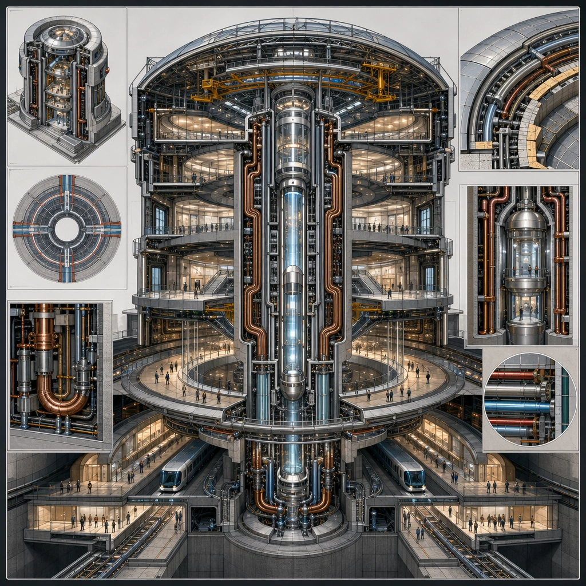

```text
Scene:
Design a square explanatory board for one speculative machine, making the image useful for a presentation, poster, or worldbuilding manual page. The composition should have one dominant cutaway read supported by controlled secondary views. Show a station-scale machine hub with passenger circulation implied at tiny scale and the main cutaway focused on routing coils, lift shafts, and safety chambers.

Subject:
Show a complete device with clear internal zones and believable maintenance or operational structure. The machine should look impossible only in ambition, not in the clarity of its construction logic. The machine should feel civic and infrastructural, not weaponized, with internal systems clearly devoted to public movement.

Important details:
Prioritize visual explanation, clean sectional hierarchy, and disciplined materials. Every chamber, conduit, shell break, and inset should help the viewer infer what the machine does. Balance architectural scale with diagram clarity so the device still feels like a poster subject rather than a building render. Preserve internal cause and effect so the viewer can follow how material, energy, pressure, heat, or flow moves through the device.

Use case:
Spec Tech Cutaway single study 2/5, designed as a self-contained support image for this topic.

Constraints:
No readable text, no watermark, no logos, preserve exact 1:1 aspect ratio, no text blocks, no comic-book speed effects, no pure abstract geometry without function, no brand logos, no sci-fi weapon cues.
```

[Pinned source](https://github.com/ChaosRealmsAI/gpt-image-2-gallery/blob/5296db8c996e38776c83a0bc8c64f848dcd512b3/works/topics/speculative-technology-cutaway-poster/packages/single-support-studies/images/02-gravity-tram-hub-cutaway/meta.json) · GPT Image2 · 1024×1024 · No source-declared image dependencies. · ProjectD:pending individual review.

## Cryogenic Archive Vessel · speculative-technology-cutaway-poster/single-support-studies/03-cryogenic-archive-vessel

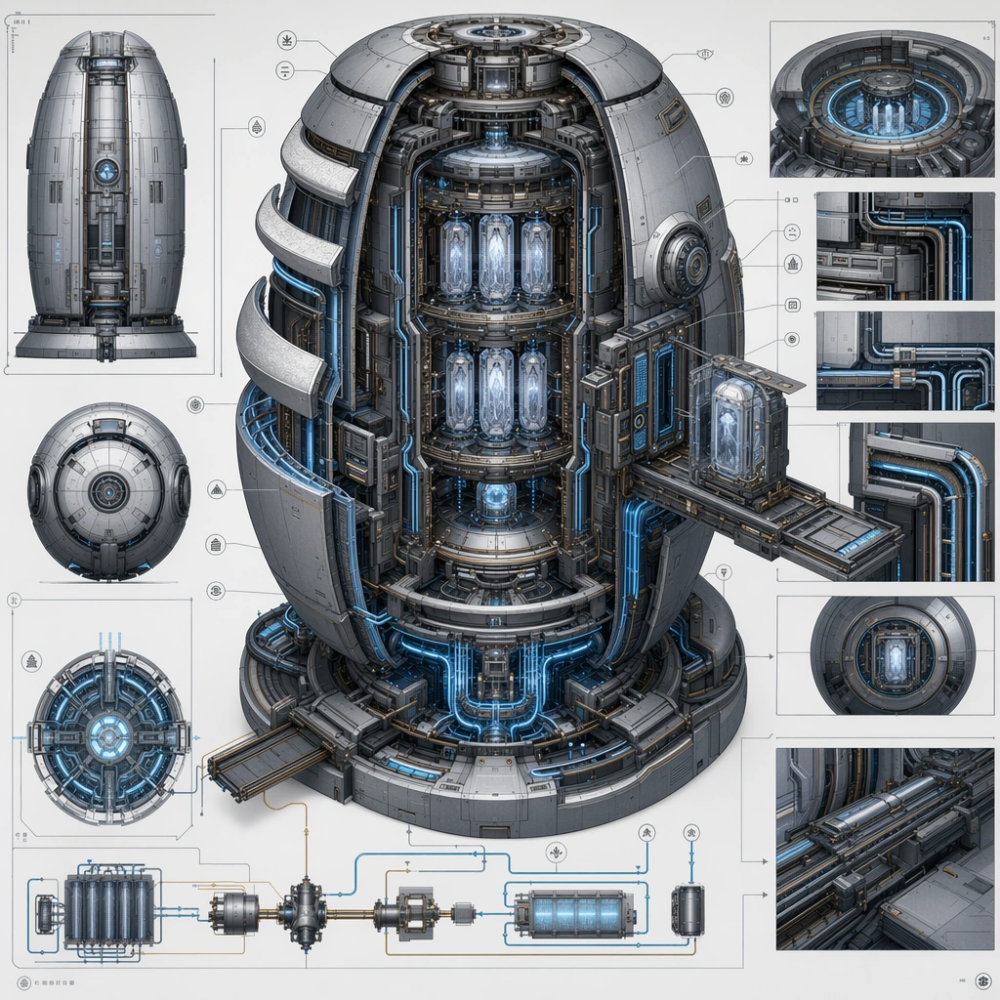

```text
Scene:
Design a square explanatory board for one speculative machine, making the image useful for a presentation, poster, or worldbuilding manual page. The composition should have one dominant cutaway read supported by controlled secondary views. Compose a cylindrical or ovoid archive vessel with shell layers, cooling veins, suspension chambers, and controlled access hatches visible in section.

Subject:
Show a complete device with clear internal zones and believable maintenance or operational structure. The machine should look impossible only in ambition, not in the clarity of its construction logic. The internal zones should explain preservation, inspection, and retrieval without requiring text or actors.

Important details:
Prioritize visual explanation, clean sectional hierarchy, and disciplined materials. Every chamber, conduit, shell break, and inset should help the viewer infer what the machine does. Use cold color discipline and precise shell breaks to keep the machine elegant and technical. Preserve internal cause and effect so the viewer can follow how material, energy, pressure, heat, or flow moves through the device.

Use case:
Spec Tech Cutaway single study 3/5, designed as a self-contained support image for this topic.

Constraints:
No readable text, no watermark, no logos, preserve exact 1:1 aspect ratio, no text blocks, no comic-book speed effects, no pure abstract geometry without function, no brand logos, no horror cryo-pod trope.
```

[Pinned source](https://github.com/ChaosRealmsAI/gpt-image-2-gallery/blob/5296db8c996e38776c83a0bc8c64f848dcd512b3/works/topics/speculative-technology-cutaway-poster/packages/single-support-studies/images/03-cryogenic-archive-vessel/meta.json) · GPT Image2 · 1024×1024 · No source-declared image dependencies. · ProjectD:pending individual review.

## Medical Regeneration Cradle · speculative-technology-cutaway-poster/single-support-studies/04-medical-regeneration-cradle

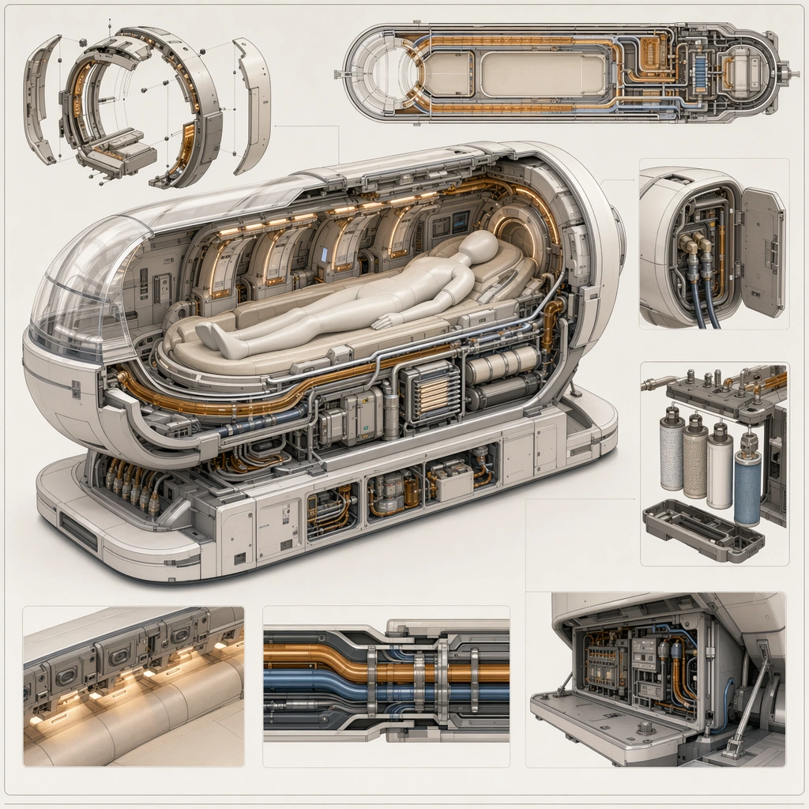

```text
Scene:
Design a square explanatory board for one speculative machine, making the image useful for a presentation, poster, or worldbuilding manual page. The composition should have one dominant cutaway read supported by controlled secondary views. Design a balanced poster showing a cradle-like enclosure with fluid routing, scanning arrays, and patient-support structures arranged clearly in section.

Subject:
Show a complete device with clear internal zones and believable maintenance or operational structure. The machine should look impossible only in ambition, not in the clarity of its construction logic. The machine should feel humane, professional, and believable, with care logic emphasized over spectacle.

Important details:
Prioritize visual explanation, clean sectional hierarchy, and disciplined materials. Every chamber, conduit, shell break, and inset should help the viewer infer what the machine does. Keep the poster calm and explanatory, using warm-neutral accents to soften the technical complexity. Preserve internal cause and effect so the viewer can follow how material, energy, pressure, heat, or flow moves through the device.

Use case:
Spec Tech Cutaway single study 4/5, designed as a self-contained support image for this topic.

Constraints:
No readable text, no watermark, no logos, preserve exact 1:1 aspect ratio, no text blocks, no comic-book speed effects, no pure abstract geometry without function, no brand logos, no body-horror medical imagery.
```

[Pinned source](https://github.com/ChaosRealmsAI/gpt-image-2-gallery/blob/5296db8c996e38776c83a0bc8c64f848dcd512b3/works/topics/speculative-technology-cutaway-poster/packages/single-support-studies/images/04-medical-regeneration-cradle/meta.json) · GPT Image2 · 1024×1024 · No source-declared image dependencies. · ProjectD:pending individual review.

## Orbital Debris Kiln · speculative-technology-cutaway-poster/single-support-studies/05-orbital-debris-kiln

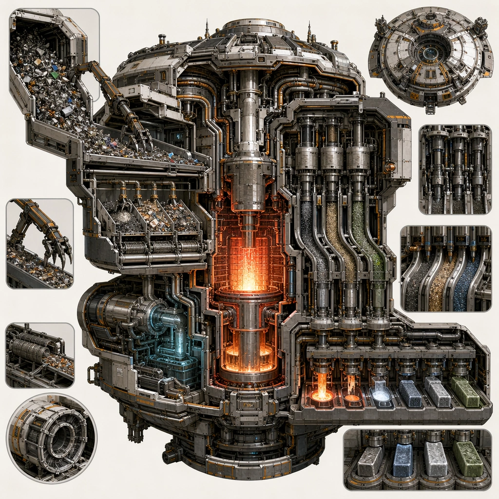

```text
Scene:
Design a square explanatory board for one speculative machine, making the image useful for a presentation, poster, or worldbuilding manual page. The composition should have one dominant cutaway read supported by controlled secondary views. Show a dense industrial module with capture inlets, sorting chambers, thermal conversion core, and output molds laid out in clear process order.

Subject:
Show a complete device with clear internal zones and believable maintenance or operational structure. The machine should look impossible only in ambition, not in the clarity of its construction logic. The machine should communicate recycling and orbital industry through internal sequencing rather than through background scenery.

Important details:
Prioritize visual explanation, clean sectional hierarchy, and disciplined materials. Every chamber, conduit, shell break, and inset should help the viewer infer what the machine does. Let thermal contrast, chamber geometry, and material flow provide the drama while keeping the overall poster analytical. Preserve internal cause and effect so the viewer can follow how material, energy, pressure, heat, or flow moves through the device.

Use case:
Spec Tech Cutaway single study 5/5, designed as a self-contained support image for this topic.

Constraints:
No readable text, no watermark, no logos, preserve exact 1:1 aspect ratio, no text blocks, no comic-book speed effects, no pure abstract geometry without function, no brand logos, no fantasy forge aesthetics.
```

[Pinned source](https://github.com/ChaosRealmsAI/gpt-image-2-gallery/blob/5296db8c996e38776c83a0bc8c64f848dcd512b3/works/topics/speculative-technology-cutaway-poster/packages/single-support-studies/images/05-orbital-debris-kiln/meta.json) · GPT Image2 · 1024×1024 · No source-declared image dependencies. · ProjectD:pending individual review.

## Reference Camp Hero · sports-camp-enrollment-promo-kit/series-enrollment-system/01-reference-camp-hero


```text
Scene:
Create a square camp enrollment hero for Camp Promo, using a trustworthy youth-sports camp world with bright clean facilities, family-friendly daylight, and polished enrollment layouts. The frame should feel commercial, polished, and immediately useful for a real client deliverable rather than a one-off art experiment. Keep the composition readable at thumbnail scale while still rewarding a closer look with layered depth, clean negative space, and strong directional light. Build the image so it clearly supports sports communication, with enough modular structure to imply information architecture without relying on literal words.

Subject:
Center the image on one original coach and a small group of original young athletes in supervised brandless training activity, arranged as coach guiding small athlete group. Treat the subject as original and brandless, with believable apparel construction, realistic body proportions, and strong emotional legibility. Surround the subject with supporting environmental cues that reinforce the category but never overpower the main figure. All secondary objects, props, and background elements should strengthen the same professional sports or fitness context.

Important details:
This first image must establish the full reference system for later derivatives: enrollment-ready card modules, non-readable schedule zones, and organized family-friendly campaign structure. The emotional tone should read as safe optimistic energy. Make the visual language reusable, disciplined, and commercially credible, with clean edges, coherent light behavior, and obvious hierarchy. Abstract panels, diagram bands, or stat-like modules are welcome, but they must remain non-readable and subordinate to the main visual message. The result should feel original, specific, and ready to anchor a larger package.

Use case:
Camp Promo series study 1/9, the reference image for the package.

Constraints:
No readable text, no watermark, no logos, preserve exact 1:1 aspect ratio, no brand marks, no copied famous team or product identity, no generic stock-photo stiffness, no cluttered background noise, no celebrity likenesses.
```

[Pinned source](https://github.com/ChaosRealmsAI/gpt-image-2-gallery/blob/5296db8c996e38776c83a0bc8c64f848dcd512b3/works/topics/sports-camp-enrollment-promo-kit/packages/series-enrollment-system/images/01-reference-camp-hero/meta.json) · GPT Image2 · 1024×1024 · No source-declared image dependencies. · ProjectD:pending individual review.

## Age-band Program Board · sports-camp-enrollment-promo-kit/series-enrollment-system/02-age-band-program-board


```text
Scene:
Build a square age-band program board derived from the reference image for Camp Promo. Preserve the exact world established by the reference image, including the same palette family, lighting direction, environmental logic, and surface finish. The new frame should feel like a deliberate extension of one campaign system, not a separate concept. Shift the hierarchy to suit this use case, but keep the overall composition commercial, polished, and ready for real rollout.

Subject:
Use the same original subject identity and anchor cues introduced by the reference image, now organized as same coach with grouped activity zones. Keep faces, hair logic, body proportions, apparel or product construction, and major supporting forms consistent with the reference. Allow only the layout emphasis, pose, crop, and contextual energy to change so the result clearly belongs to the same package.

Important details:
Continuity is the main challenge. Preserve the exact reference language for color, materials, framing rhythm, and overall brandless campaign grammar while steering the tone toward organized clarity. Keep any stat blocks, schedule modules, arrows, badges, or callout panels non-readable. The derivative should prove that the same art direction can handle a different communication task without losing identity or utility. Make it credible for production use, with clean edges, intentional spacing, and no random decorative elements.

Use case:
Camp Promo series study 2/9, a derivative surface linked to 01-reference-camp-hero.

Constraints:
No readable text, no watermark, no logos, preserve exact 1:1 aspect ratio, no new subject identity, no brand marks, no palette drift, no unrelated props, no collage chaos, no copied public-figure styling.
```

[Pinned source](https://github.com/ChaosRealmsAI/gpt-image-2-gallery/blob/5296db8c996e38776c83a0bc8c64f848dcd512b3/works/topics/sports-camp-enrollment-promo-kit/packages/series-enrollment-system/images/02-age-band-program-board/meta.json) · GPT Image2 · 1024×1024 · Reference images required. · ProjectD:pending individual review.

## Coach Credibility Card · sports-camp-enrollment-promo-kit/series-enrollment-system/03-coach-credibility-card


```text
Scene:
Build a square coach credibility card derived from the reference image for Camp Promo. Preserve the exact world established by the reference image, including the same palette family, lighting direction, environmental logic, and surface finish. The new frame should feel like a deliberate extension of one campaign system, not a separate concept. Shift the hierarchy to suit this use case, but keep the overall composition commercial, polished, and ready for real rollout.

Subject:
Use the same original subject identity and anchor cues introduced by the reference image, now organized as same coach closer to camera. Keep faces, hair logic, body proportions, apparel or product construction, and major supporting forms consistent with the reference. Allow only the layout emphasis, pose, crop, and contextual energy to change so the result clearly belongs to the same package.

Important details:
Continuity is the main challenge. Preserve the exact reference language for color, materials, framing rhythm, and overall brandless campaign grammar while steering the tone toward reassuring authority. Keep any stat blocks, schedule modules, arrows, badges, or callout panels non-readable. The derivative should prove that the same art direction can handle a different communication task without losing identity or utility. Make it credible for production use, with clean edges, intentional spacing, and no random decorative elements.

Use case:
Camp Promo series study 3/9, a derivative surface linked to 01-reference-camp-hero.

Constraints:
No readable text, no watermark, no logos, preserve exact 1:1 aspect ratio, no new subject identity, no brand marks, no palette drift, no unrelated props, no collage chaos, no copied public-figure styling.
```

[Pinned source](https://github.com/ChaosRealmsAI/gpt-image-2-gallery/blob/5296db8c996e38776c83a0bc8c64f848dcd512b3/works/topics/sports-camp-enrollment-promo-kit/packages/series-enrollment-system/images/03-coach-credibility-card/meta.json) · GPT Image2 · 1024×1024 · Reference images required. · ProjectD:pending individual review.

## Enrollment Deadline Variant · sports-camp-enrollment-promo-kit/series-enrollment-system/04-enrollment-deadline-variant


```text
Scene:
Build a square enrollment deadline variant derived from the reference image for Camp Promo. Preserve the exact world established by the reference image, including the same palette family, lighting direction, environmental logic, and surface finish. The new frame should feel like a deliberate extension of one campaign system, not a separate concept. Shift the hierarchy to suit this use case, but keep the overall composition commercial, polished, and ready for real rollout.

Subject:
Use the same original subject identity and anchor cues introduced by the reference image, now organized as same coach and familiar athletes with reminder blocks. Keep faces, hair logic, body proportions, apparel or product construction, and major supporting forms consistent with the reference. Allow only the layout emphasis, pose, crop, and contextual energy to change so the result clearly belongs to the same package.

Important details:
Continuity is the main challenge. Preserve the exact reference language for color, materials, framing rhythm, and overall brandless campaign grammar while steering the tone toward encouraging urgency. Keep any stat blocks, schedule modules, arrows, badges, or callout panels non-readable. The derivative should prove that the same art direction can handle a different communication task without losing identity or utility. Make it credible for production use, with clean edges, intentional spacing, and no random decorative elements.

Use case:
Camp Promo series study 4/9, a derivative surface linked to 01-reference-camp-hero.

Constraints:
No readable text, no watermark, no logos, preserve exact 1:1 aspect ratio, no new subject identity, no brand marks, no palette drift, no unrelated props, no collage chaos, no copied public-figure styling.
```

[Pinned source](https://github.com/ChaosRealmsAI/gpt-image-2-gallery/blob/5296db8c996e38776c83a0bc8c64f848dcd512b3/works/topics/sports-camp-enrollment-promo-kit/packages/series-enrollment-system/images/04-enrollment-deadline-variant/meta.json) · GPT Image2 · 1024×1024 · Reference images required. · ProjectD:pending individual review.

## Summer Clinic Poster · sports-camp-enrollment-promo-kit/single-support-studies/summer-clinic-poster


```text
Scene:
Create a square summer clinic poster for Camp Promo, using family-friendly sports enrollment marketing with trustworthy supervision, clean logistics framing, and bright athletic atmosphere. The composition should read as a practical, production-ready sports or fitness surface with a clear hierarchy, premium lighting, and obvious commercial intent. Keep the environment specific enough to feel real, but leave enough control in the layout for non-readable information modules, campaign blocks, or visualized metrics. Aim for a finish that works for a brand, club, app, academy, or event operator.

Subject:
Build the image around coach and youth athletes in simple drill. The subject should be original, believable, and free of any real-brand or celebrity cues. Use realistic apparel, safe body mechanics when movement is visible, and environmental props that support the category without clutter. The subject must stay visually dominant so the design still works as a communication asset rather than a pure scene study.

Important details:
The mood should read as bright welcoming motion. Treat layout, light, and supporting graphic structure as part of one polished delivery surface. Any schedule blocks, metric panels, quote zones, badges, or path diagrams must stay abstract and non-readable. Prioritize usefulness, clarity, and category truth over spectacle. The image should feel distinct from the series package while still belonging naturally to the same topic and business use case.

Use case:
Camp Promo single study 5/9, an independent rollout surface for the topic.

Constraints:
No readable text, no watermark, no logos, preserve exact 1:1 aspect ratio, no brand marks, no public-figure resemblance, no generic stock layout, no cluttered UI imitation, no accidental copyrighted insignia.
```

[Pinned source](https://github.com/ChaosRealmsAI/gpt-image-2-gallery/blob/5296db8c996e38776c83a0bc8c64f848dcd512b3/works/topics/sports-camp-enrollment-promo-kit/packages/single-support-studies/images/summer-clinic-poster/meta.json) · GPT Image2 · 1024×1024 · No source-declared image dependencies. · ProjectD:pending individual review.

## Goalkeeper Camp Tile · sports-camp-enrollment-promo-kit/single-support-studies/goalkeeper-camp-tile

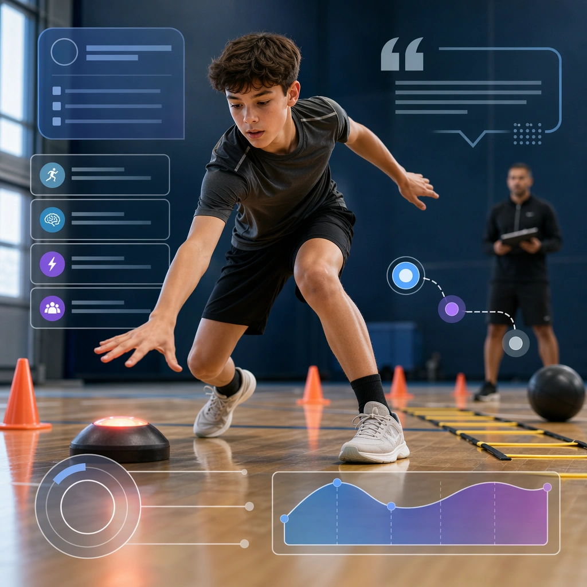

```text
Scene:
Create a square specialty camp tile for Camp Promo, using family-friendly sports enrollment marketing with trustworthy supervision, clean logistics framing, and bright athletic atmosphere. The composition should read as a practical, production-ready sports or fitness surface with a clear hierarchy, premium lighting, and obvious commercial intent. Keep the environment specific enough to feel real, but leave enough control in the layout for non-readable information modules, campaign blocks, or visualized metrics. Aim for a finish that works for a brand, club, app, academy, or event operator.

Subject:
Build the image around young athlete in reaction drill. The subject should be original, believable, and free of any real-brand or celebrity cues. Use realistic apparel, safe body mechanics when movement is visible, and environmental props that support the category without clutter. The subject must stay visually dominant so the design still works as a communication asset rather than a pure scene study.

Important details:
The mood should read as focused skill energy. Treat layout, light, and supporting graphic structure as part of one polished delivery surface. Any schedule blocks, metric panels, quote zones, badges, or path diagrams must stay abstract and non-readable. Prioritize usefulness, clarity, and category truth over spectacle. The image should feel distinct from the series package while still belonging naturally to the same topic and business use case.

Use case:
Camp Promo single study 6/9, an independent rollout surface for the topic.

Constraints:
No readable text, no watermark, no logos, preserve exact 1:1 aspect ratio, no brand marks, no public-figure resemblance, no generic stock layout, no cluttered UI imitation, no accidental copyrighted insignia.
```

[Pinned source](https://github.com/ChaosRealmsAI/gpt-image-2-gallery/blob/5296db8c996e38776c83a0bc8c64f848dcd512b3/works/topics/sports-camp-enrollment-promo-kit/packages/single-support-studies/images/goalkeeper-camp-tile/meta.json) · GPT Image2 · 1024×1024 · No source-declared image dependencies. · ProjectD:pending individual review.

## Teamwork Scrimmage Board · sports-camp-enrollment-promo-kit/single-support-studies/teamwork-scrimmage-board


```text
Scene:
Create a square teamwork scrimmage board for Camp Promo, using family-friendly sports enrollment marketing with trustworthy supervision, clean logistics framing, and bright athletic atmosphere. The composition should read as a practical, production-ready sports or fitness surface with a clear hierarchy, premium lighting, and obvious commercial intent. Keep the environment specific enough to feel real, but leave enough control in the layout for non-readable information modules, campaign blocks, or visualized metrics. Aim for a finish that works for a brand, club, app, academy, or event operator.

Subject:
Build the image around small scrimmage under coach view. The subject should be original, believable, and free of any real-brand or celebrity cues. Use realistic apparel, safe body mechanics when movement is visible, and environmental props that support the category without clutter. The subject must stay visually dominant so the design still works as a communication asset rather than a pure scene study.

Important details:
The mood should read as supervised group energy. Treat layout, light, and supporting graphic structure as part of one polished delivery surface. Any schedule blocks, metric panels, quote zones, badges, or path diagrams must stay abstract and non-readable. Prioritize usefulness, clarity, and category truth over spectacle. The image should feel distinct from the series package while still belonging naturally to the same topic and business use case.

Use case:
Camp Promo single study 7/9, an independent rollout surface for the topic.

Constraints:
No readable text, no watermark, no logos, preserve exact 1:1 aspect ratio, no brand marks, no public-figure resemblance, no generic stock layout, no cluttered UI imitation, no accidental copyrighted insignia.
```

[Pinned source](https://github.com/ChaosRealmsAI/gpt-image-2-gallery/blob/5296db8c996e38776c83a0bc8c64f848dcd512b3/works/topics/sports-camp-enrollment-promo-kit/packages/single-support-studies/images/teamwork-scrimmage-board/meta.json) · GPT Image2 · 1024×1024 · No source-declared image dependencies. · ProjectD:pending individual review.

## Parents Info Card · sports-camp-enrollment-promo-kit/single-support-studies/parents-info-card


```text
Scene:
Create a square parents info support card for Camp Promo, using family-friendly sports enrollment marketing with trustworthy supervision, clean logistics framing, and bright athletic atmosphere. The composition should read as a practical, production-ready sports or fitness surface with a clear hierarchy, premium lighting, and obvious commercial intent. Keep the environment specific enough to feel real, but leave enough control in the layout for non-readable information modules, campaign blocks, or visualized metrics. Aim for a finish that works for a brand, club, app, academy, or event operator.

Subject:
Build the image around coach greeting parent and child. The subject should be original, believable, and free of any real-brand or celebrity cues. Use realistic apparel, safe body mechanics when movement is visible, and environmental props that support the category without clutter. The subject must stay visually dominant so the design still works as a communication asset rather than a pure scene study.

Important details:
The mood should read as reassuring organization. Treat layout, light, and supporting graphic structure as part of one polished delivery surface. Any schedule blocks, metric panels, quote zones, badges, or path diagrams must stay abstract and non-readable. Prioritize usefulness, clarity, and category truth over spectacle. The image should feel distinct from the series package while still belonging naturally to the same topic and business use case.

Use case:
Camp Promo single study 8/9, an independent rollout surface for the topic.

Constraints:
No readable text, no watermark, no logos, preserve exact 1:1 aspect ratio, no brand marks, no public-figure resemblance, no generic stock layout, no cluttered UI imitation, no accidental copyrighted insignia.
```

[Pinned source](https://github.com/ChaosRealmsAI/gpt-image-2-gallery/blob/5296db8c996e38776c83a0bc8c64f848dcd512b3/works/topics/sports-camp-enrollment-promo-kit/packages/single-support-studies/images/parents-info-card/meta.json) · GPT Image2 · 1024×1024 · No source-declared image dependencies. · ProjectD:pending individual review.

## Dorm Life Photo Board · sports-camp-enrollment-promo-kit/single-support-studies/dorm-life-photo-board

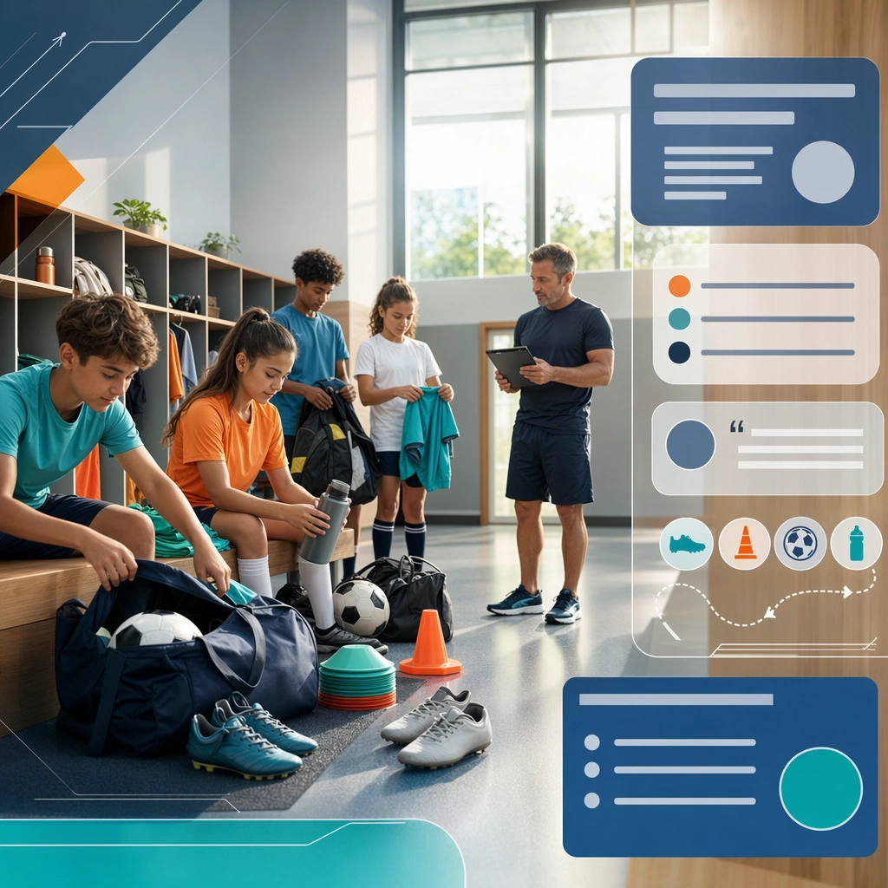

```text
Scene:
Create a square camp lifestyle board for Camp Promo, using family-friendly sports enrollment marketing with trustworthy supervision, clean logistics framing, and bright athletic atmosphere. The composition should read as a practical, production-ready sports or fitness surface with a clear hierarchy, premium lighting, and obvious commercial intent. Keep the environment specific enough to feel real, but leave enough control in the layout for non-readable information modules, campaign blocks, or visualized metrics. Aim for a finish that works for a brand, club, app, academy, or event operator.

Subject:
Build the image around youth athletes preparing gear in tidy shared space. The subject should be original, believable, and free of any real-brand or celebrity cues. Use realistic apparel, safe body mechanics when movement is visible, and environmental props that support the category without clutter. The subject must stay visually dominant so the design still works as a communication asset rather than a pure scene study.

Important details:
The mood should read as healthy community calm. Treat layout, light, and supporting graphic structure as part of one polished delivery surface. Any schedule blocks, metric panels, quote zones, badges, or path diagrams must stay abstract and non-readable. Prioritize usefulness, clarity, and category truth over spectacle. The image should feel distinct from the series package while still belonging naturally to the same topic and business use case.

Use case:
Camp Promo single study 9/9, an independent rollout surface for the topic.

Constraints:
No readable text, no watermark, no logos, preserve exact 1:1 aspect ratio, no brand marks, no public-figure resemblance, no generic stock layout, no cluttered UI imitation, no accidental copyrighted insignia.
```

[Pinned source](https://github.com/ChaosRealmsAI/gpt-image-2-gallery/blob/5296db8c996e38776c83a0bc8c64f848dcd512b3/works/topics/sports-camp-enrollment-promo-kit/packages/single-support-studies/images/dorm-life-photo-board/meta.json) · GPT Image2 · 1024×1024 · No source-declared image dependencies. · ProjectD:pending individual review.

## Reference Product Hero · sports-equipment-advertising-set/series-performance-ad-system/01-reference-product-hero

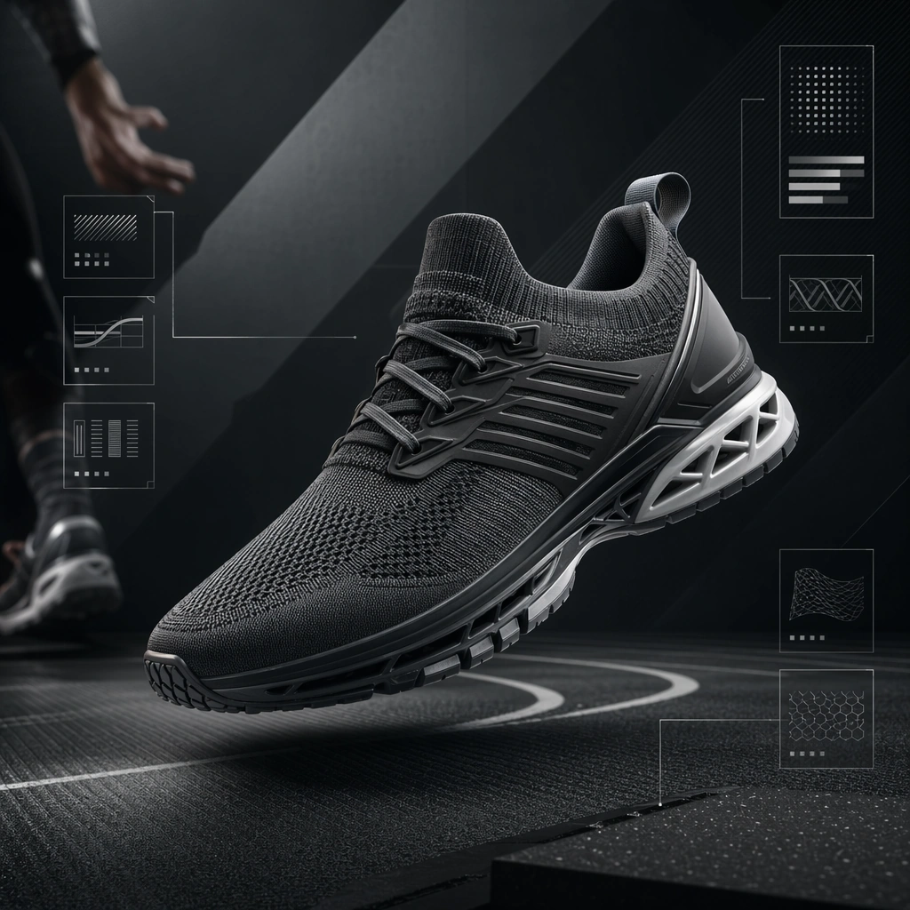

```text
Scene:
Create a square product hero advertisement for Equipment Ads, using a premium sports-product advertising world with graphite backdrops, controlled reflections, and high-end studio-action lighting. The frame should feel commercial, polished, and immediately useful for a real client deliverable rather than a one-off art experiment. Keep the composition readable at thumbnail scale while still rewarding a closer look with layered depth, clean negative space, and strong directional light. Build the image so it clearly supports sports communication, with enough modular structure to imply information architecture without relying on literal words.

Subject:
Center the image on one original performance product with believable seams, materials, and athletic function, supported by only minimal human context, arranged as single original performance product. Treat the subject as original and brandless, with believable apparel construction, realistic body proportions, and strong emotional legibility. Surround the subject with supporting environmental cues that reinforce the category but never overpower the main figure. All secondary objects, props, and background elements should strengthen the same professional sports or fitness context.

Important details:
This first image must establish the full reference system for later derivatives: clean ad framing, non-readable feature-callout panels, and product-first hierarchy. The emotional tone should read as premium object focus. Make the visual language reusable, disciplined, and commercially credible, with clean edges, coherent light behavior, and obvious hierarchy. Abstract panels, diagram bands, or stat-like modules are welcome, but they must remain non-readable and subordinate to the main visual message. The result should feel original, specific, and ready to anchor a larger package.

Use case:
Equipment Ads series study 1/9, the reference image for the package.

Constraints:
No readable text, no watermark, no logos, preserve exact 1:1 aspect ratio, no brand marks, no copied famous team or product identity, no generic stock-photo stiffness, no cluttered background noise, no celebrity likenesses.
```

[Pinned source](https://github.com/ChaosRealmsAI/gpt-image-2-gallery/blob/5296db8c996e38776c83a0bc8c64f848dcd512b3/works/topics/sports-equipment-advertising-set/packages/series-performance-ad-system/images/01-reference-product-hero/meta.json) · GPT Image2 · 1024×1024 · No source-declared image dependencies. · ProjectD:pending individual review.

## Motion Surge Ad · sports-equipment-advertising-set/series-performance-ad-system/02-motion-surge-ad

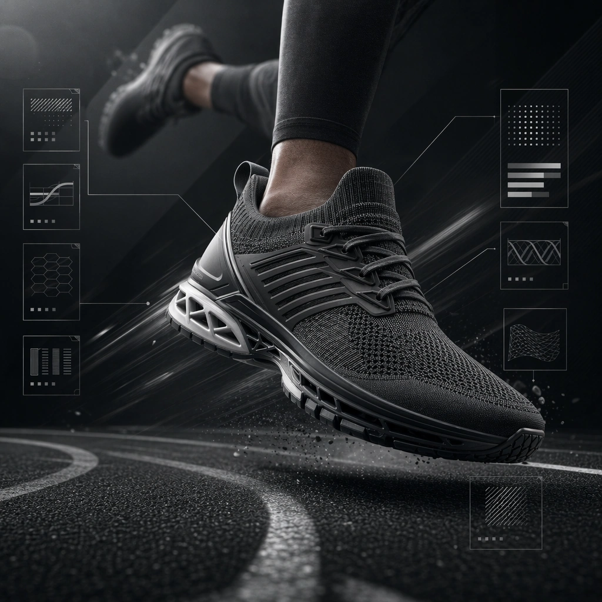

```text
Scene:
Build a square motion surge ad derived from the reference image for Equipment Ads. Preserve the exact world established by the reference image, including the same palette family, lighting direction, environmental logic, and surface finish. The new frame should feel like a deliberate extension of one campaign system, not a separate concept. Shift the hierarchy to suit this use case, but keep the overall composition commercial, polished, and ready for real rollout.

Subject:
Use the same original subject identity and anchor cues introduced by the reference image, now organized as same product in use or implied motion. Keep faces, hair logic, body proportions, apparel or product construction, and major supporting forms consistent with the reference. Allow only the layout emphasis, pose, crop, and contextual energy to change so the result clearly belongs to the same package.

Important details:
Continuity is the main challenge. Preserve the exact reference language for color, materials, framing rhythm, and overall brandless campaign grammar while steering the tone toward fast controlled energy. Keep any stat blocks, schedule modules, arrows, badges, or callout panels non-readable. The derivative should prove that the same art direction can handle a different communication task without losing identity or utility. Make it credible for production use, with clean edges, intentional spacing, and no random decorative elements.

Use case:
Equipment Ads series study 2/9, a derivative surface linked to 01-reference-product-hero.

Constraints:
No readable text, no watermark, no logos, preserve exact 1:1 aspect ratio, no new subject identity, no brand marks, no palette drift, no unrelated props, no collage chaos, no copied public-figure styling.
```

[Pinned source](https://github.com/ChaosRealmsAI/gpt-image-2-gallery/blob/5296db8c996e38776c83a0bc8c64f848dcd512b3/works/topics/sports-equipment-advertising-set/packages/series-performance-ad-system/images/02-motion-surge-ad/meta.json) · GPT Image2 · 1024×1024 · Reference images required. · ProjectD:pending individual review.

## Material Cutaway Board · sports-equipment-advertising-set/series-performance-ad-system/03-material-cutaway-board

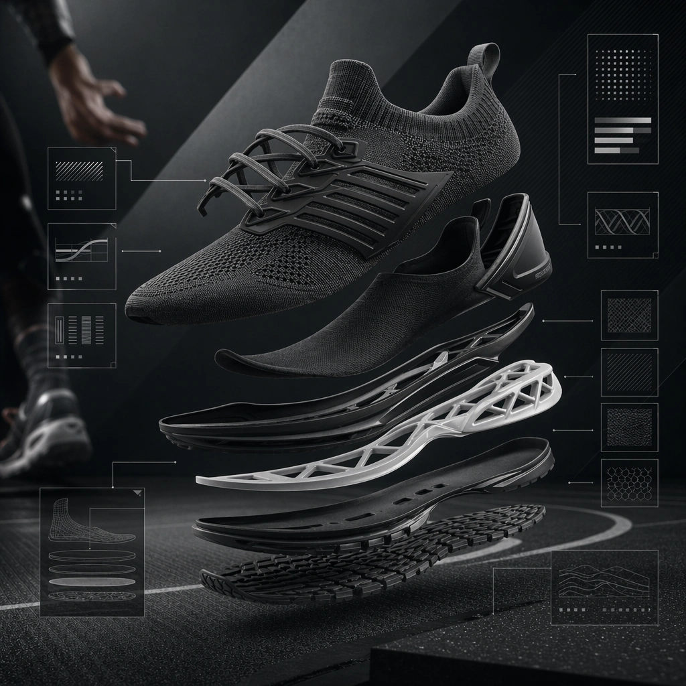

```text
Scene:
Build a square material cutaway board derived from the reference image for Equipment Ads. Preserve the exact world established by the reference image, including the same palette family, lighting direction, environmental logic, and surface finish. The new frame should feel like a deliberate extension of one campaign system, not a separate concept. Shift the hierarchy to suit this use case, but keep the overall composition commercial, polished, and ready for real rollout.

Subject:
Use the same original subject identity and anchor cues introduced by the reference image, now organized as same product exploded into layers. Keep faces, hair logic, body proportions, apparel or product construction, and major supporting forms consistent with the reference. Allow only the layout emphasis, pose, crop, and contextual energy to change so the result clearly belongs to the same package.

Important details:
Continuity is the main challenge. Preserve the exact reference language for color, materials, framing rhythm, and overall brandless campaign grammar while steering the tone toward analytical precision. Keep any stat blocks, schedule modules, arrows, badges, or callout panels non-readable. The derivative should prove that the same art direction can handle a different communication task without losing identity or utility. Make it credible for production use, with clean edges, intentional spacing, and no random decorative elements.

Use case:
Equipment Ads series study 3/9, a derivative surface linked to 01-reference-product-hero.

Constraints:
No readable text, no watermark, no logos, preserve exact 1:1 aspect ratio, no new subject identity, no brand marks, no palette drift, no unrelated props, no collage chaos, no copied public-figure styling.
```

[Pinned source](https://github.com/ChaosRealmsAI/gpt-image-2-gallery/blob/5296db8c996e38776c83a0bc8c64f848dcd512b3/works/topics/sports-equipment-advertising-set/packages/series-performance-ad-system/images/03-material-cutaway-board/meta.json) · GPT Image2 · 1024×1024 · Reference images required. · ProjectD:pending individual review.

## Athlete Pairing Variant · sports-equipment-advertising-set/series-performance-ad-system/04-athlete-pairing-variant

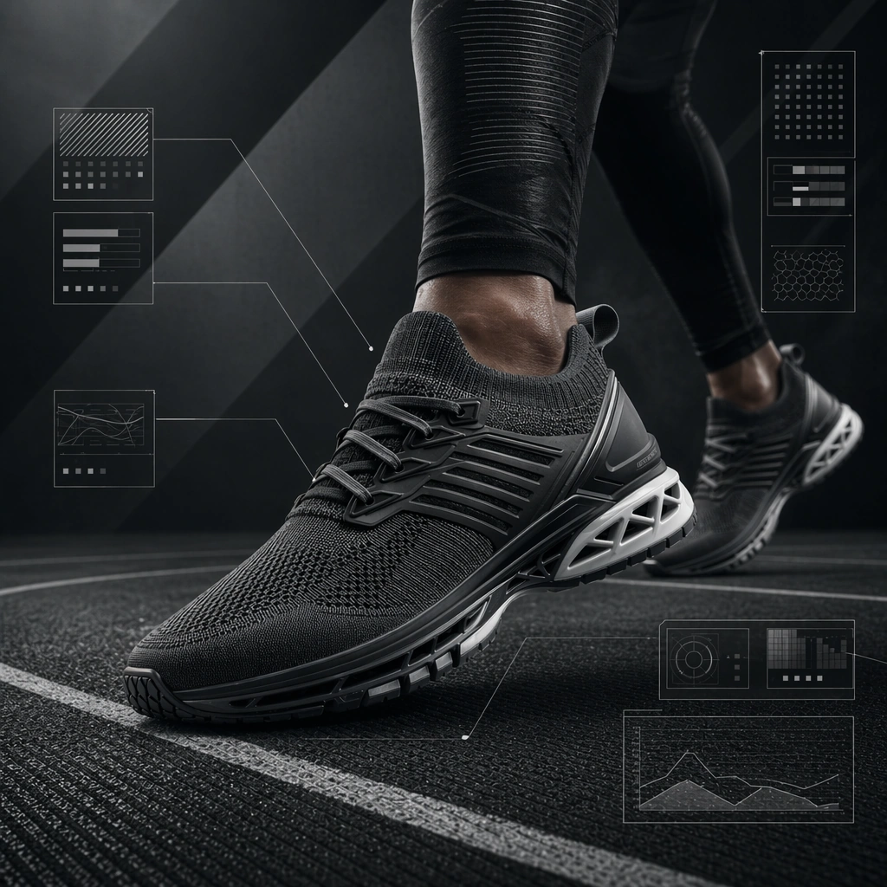

```text
Scene:
Build a square athlete-pairing ad derived from the reference image for Equipment Ads. Preserve the exact world established by the reference image, including the same palette family, lighting direction, environmental logic, and surface finish. The new frame should feel like a deliberate extension of one campaign system, not a separate concept. Shift the hierarchy to suit this use case, but keep the overall composition commercial, polished, and ready for real rollout.

Subject:
Use the same original subject identity and anchor cues introduced by the reference image, now organized as same product with one athlete. Keep faces, hair logic, body proportions, apparel or product construction, and major supporting forms consistent with the reference. Allow only the layout emphasis, pose, crop, and contextual energy to change so the result clearly belongs to the same package.

Important details:
Continuity is the main challenge. Preserve the exact reference language for color, materials, framing rhythm, and overall brandless campaign grammar while steering the tone toward humanized performance context. Keep any stat blocks, schedule modules, arrows, badges, or callout panels non-readable. The derivative should prove that the same art direction can handle a different communication task without losing identity or utility. Make it credible for production use, with clean edges, intentional spacing, and no random decorative elements.

Use case:
Equipment Ads series study 4/9, a derivative surface linked to 01-reference-product-hero.

Constraints:
No readable text, no watermark, no logos, preserve exact 1:1 aspect ratio, no new subject identity, no brand marks, no palette drift, no unrelated props, no collage chaos, no copied public-figure styling.
```

[Pinned source](https://github.com/ChaosRealmsAI/gpt-image-2-gallery/blob/5296db8c996e38776c83a0bc8c64f848dcd512b3/works/topics/sports-equipment-advertising-set/packages/series-performance-ad-system/images/04-athlete-pairing-variant/meta.json) · GPT Image2 · 1024×1024 · Reference images required. · ProjectD:pending individual review.

## Racket Launch Still · sports-equipment-advertising-set/single-support-studies/racket-launch-still

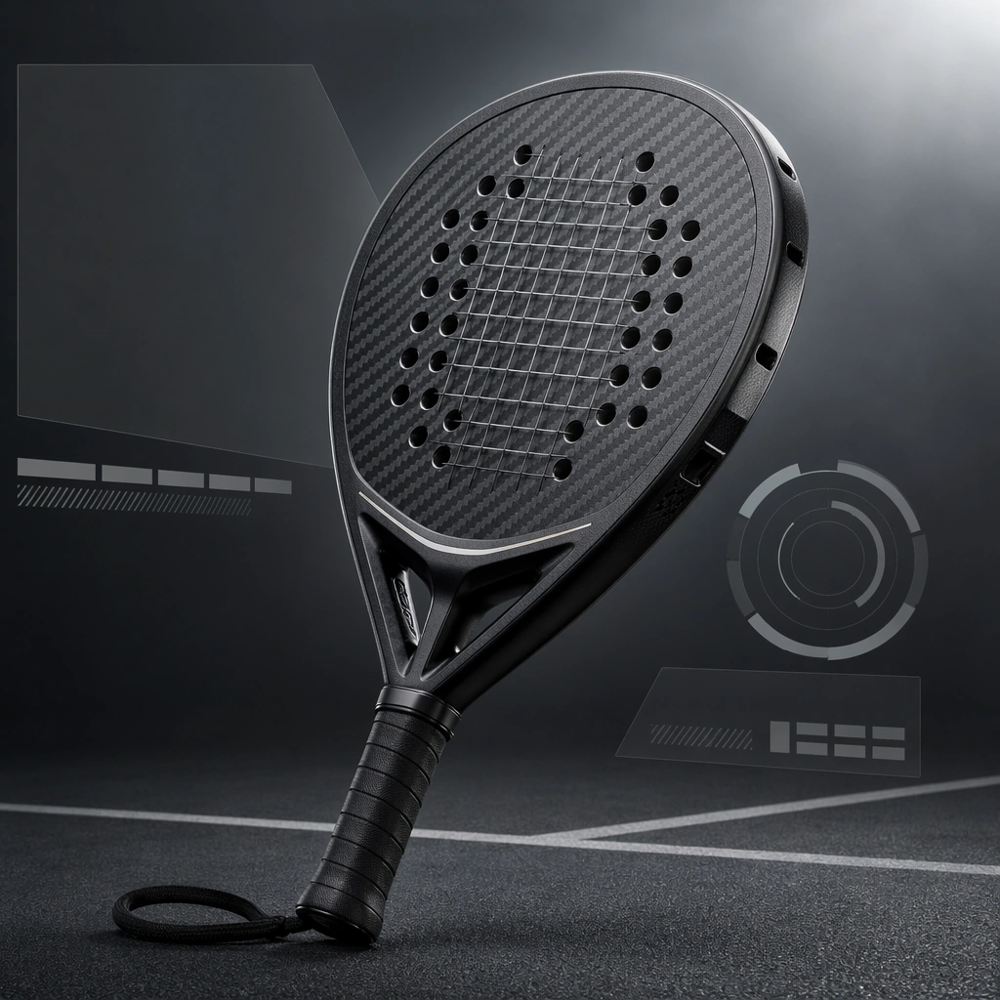

```text
Scene:
Create a square racket launch still for Equipment Ads, using sports-product advertising with strong material realism, clean hierarchy, and commerce-ready performance styling. The composition should read as a practical, production-ready sports or fitness surface with a clear hierarchy, premium lighting, and obvious commercial intent. Keep the environment specific enough to feel real, but leave enough control in the layout for non-readable information modules, campaign blocks, or visualized metrics. Aim for a finish that works for a brand, club, app, academy, or event operator.

Subject:
Build the image around single racket at three-quarter angle. The subject should be original, believable, and free of any real-brand or celebrity cues. Use realistic apparel, safe body mechanics when movement is visible, and environmental props that support the category without clutter. The subject must stay visually dominant so the design still works as a communication asset rather than a pure scene study.

Important details:
The mood should read as studio precision. Treat layout, light, and supporting graphic structure as part of one polished delivery surface. Any schedule blocks, metric panels, quote zones, badges, or path diagrams must stay abstract and non-readable. Prioritize usefulness, clarity, and category truth over spectacle. The image should feel distinct from the series package while still belonging naturally to the same topic and business use case.

Use case:
Equipment Ads single study 5/9, an independent rollout surface for the topic.

Constraints:
No readable text, no watermark, no logos, preserve exact 1:1 aspect ratio, no brand marks, no public-figure resemblance, no generic stock layout, no cluttered UI imitation, no accidental copyrighted insignia.
```

[Pinned source](https://github.com/ChaosRealmsAI/gpt-image-2-gallery/blob/5296db8c996e38776c83a0bc8c64f848dcd512b3/works/topics/sports-equipment-advertising-set/packages/single-support-studies/images/racket-launch-still/meta.json) · GPT Image2 · 1024×1024 · No source-declared image dependencies. · ProjectD:pending individual review.

## Cleat Exploded Detail · sports-equipment-advertising-set/single-support-studies/cleat-exploded-detail

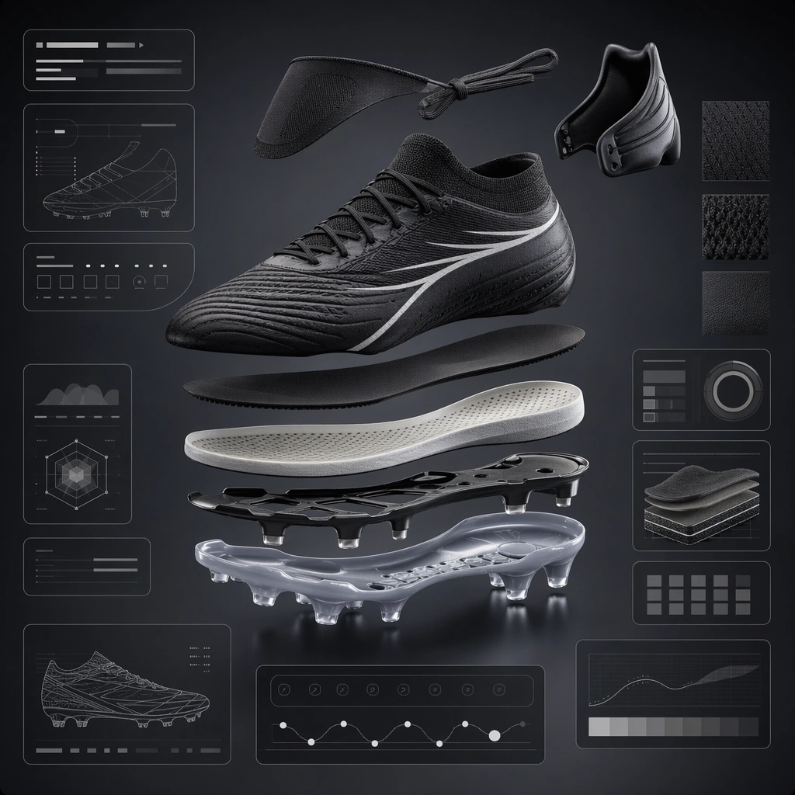

```text
Scene:
Create a square cleat exploded detail board for Equipment Ads, using sports-product advertising with strong material realism, clean hierarchy, and commerce-ready performance styling. The composition should read as a practical, production-ready sports or fitness surface with a clear hierarchy, premium lighting, and obvious commercial intent. Keep the environment specific enough to feel real, but leave enough control in the layout for non-readable information modules, campaign blocks, or visualized metrics. Aim for a finish that works for a brand, club, app, academy, or event operator.

Subject:
Build the image around original boot in separated layers. The subject should be original, believable, and free of any real-brand or celebrity cues. Use realistic apparel, safe body mechanics when movement is visible, and environmental props that support the category without clutter. The subject must stay visually dominant so the design still works as a communication asset rather than a pure scene study.

Important details:
The mood should read as engineering clarity. Treat layout, light, and supporting graphic structure as part of one polished delivery surface. Any schedule blocks, metric panels, quote zones, badges, or path diagrams must stay abstract and non-readable. Prioritize usefulness, clarity, and category truth over spectacle. The image should feel distinct from the series package while still belonging naturally to the same topic and business use case.

Use case:
Equipment Ads single study 6/9, an independent rollout surface for the topic.

Constraints:
No readable text, no watermark, no logos, preserve exact 1:1 aspect ratio, no brand marks, no public-figure resemblance, no generic stock layout, no cluttered UI imitation, no accidental copyrighted insignia.
```

[Pinned source](https://github.com/ChaosRealmsAI/gpt-image-2-gallery/blob/5296db8c996e38776c83a0bc8c64f848dcd512b3/works/topics/sports-equipment-advertising-set/packages/single-support-studies/images/cleat-exploded-detail/meta.json) · GPT Image2 · 1024×1024 · No source-declared image dependencies. · ProjectD:pending individual review.

## Protective Gear Duo · sports-equipment-advertising-set/single-support-studies/protective-gear-duo

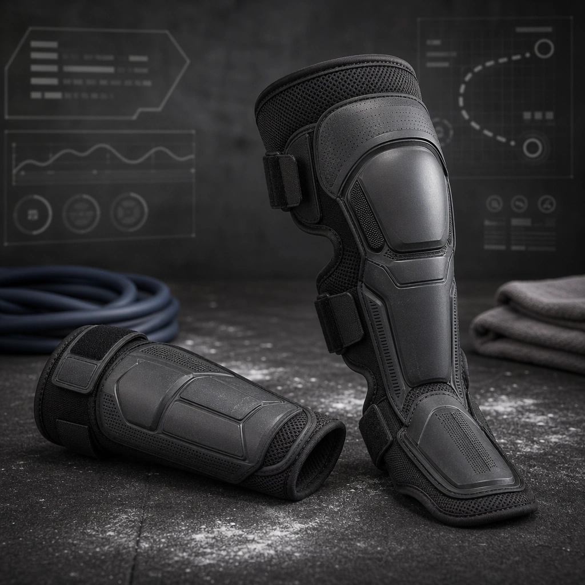

```text
Scene:
Create a square protective-gear duo ad for Equipment Ads, using sports-product advertising with strong material realism, clean hierarchy, and commerce-ready performance styling. The composition should read as a practical, production-ready sports or fitness surface with a clear hierarchy, premium lighting, and obvious commercial intent. Keep the environment specific enough to feel real, but leave enough control in the layout for non-readable information modules, campaign blocks, or visualized metrics. Aim for a finish that works for a brand, club, app, academy, or event operator.

Subject:
Build the image around two related gear pieces. The subject should be original, believable, and free of any real-brand or celebrity cues. Use realistic apparel, safe body mechanics when movement is visible, and environmental props that support the category without clutter. The subject must stay visually dominant so the design still works as a communication asset rather than a pure scene study.

Important details:
The mood should read as balanced utility. Treat layout, light, and supporting graphic structure as part of one polished delivery surface. Any schedule blocks, metric panels, quote zones, badges, or path diagrams must stay abstract and non-readable. Prioritize usefulness, clarity, and category truth over spectacle. The image should feel distinct from the series package while still belonging naturally to the same topic and business use case.

Use case:
Equipment Ads single study 7/9, an independent rollout surface for the topic.

Constraints:
No readable text, no watermark, no logos, preserve exact 1:1 aspect ratio, no brand marks, no public-figure resemblance, no generic stock layout, no cluttered UI imitation, no accidental copyrighted insignia.
```

[Pinned source](https://github.com/ChaosRealmsAI/gpt-image-2-gallery/blob/5296db8c996e38776c83a0bc8c64f848dcd512b3/works/topics/sports-equipment-advertising-set/packages/single-support-studies/images/protective-gear-duo/meta.json) · GPT Image2 · 1024×1024 · No source-declared image dependencies. · ProjectD:pending individual review.

## Indoor Bike Energy Poster · sports-equipment-advertising-set/single-support-studies/indoor-bike-energy-poster

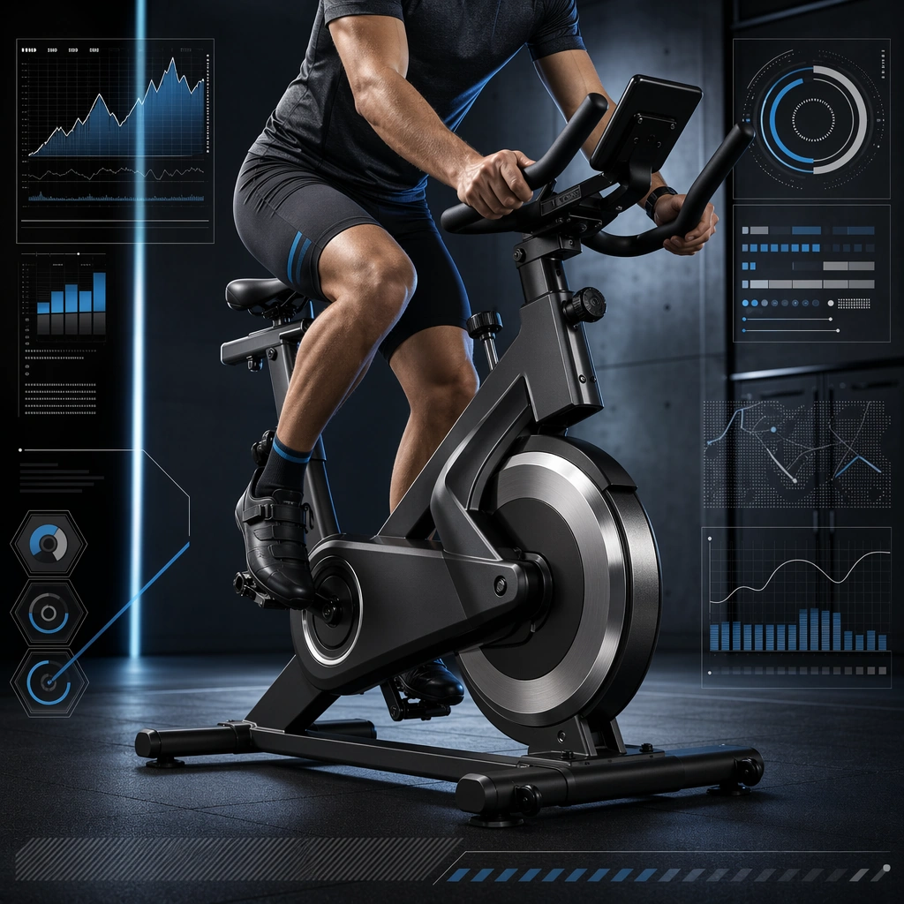

```text
Scene:
Create a square indoor bike energy poster for Equipment Ads, using sports-product advertising with strong material realism, clean hierarchy, and commerce-ready performance styling. The composition should read as a practical, production-ready sports or fitness surface with a clear hierarchy, premium lighting, and obvious commercial intent. Keep the environment specific enough to feel real, but leave enough control in the layout for non-readable information modules, campaign blocks, or visualized metrics. Aim for a finish that works for a brand, club, app, academy, or event operator.

Subject:
Build the image around cardio machine with partial athlete. The subject should be original, believable, and free of any real-brand or celebrity cues. Use realistic apparel, safe body mechanics when movement is visible, and environmental props that support the category without clutter. The subject must stay visually dominant so the design still works as a communication asset rather than a pure scene study.

Important details:
The mood should read as machined power. Treat layout, light, and supporting graphic structure as part of one polished delivery surface. Any schedule blocks, metric panels, quote zones, badges, or path diagrams must stay abstract and non-readable. Prioritize usefulness, clarity, and category truth over spectacle. The image should feel distinct from the series package while still belonging naturally to the same topic and business use case.

Use case:
Equipment Ads single study 8/9, an independent rollout surface for the topic.

Constraints:
No readable text, no watermark, no logos, preserve exact 1:1 aspect ratio, no brand marks, no public-figure resemblance, no generic stock layout, no cluttered UI imitation, no accidental copyrighted insignia.
```

[Pinned source](https://github.com/ChaosRealmsAI/gpt-image-2-gallery/blob/5296db8c996e38776c83a0bc8c64f848dcd512b3/works/topics/sports-equipment-advertising-set/packages/single-support-studies/images/indoor-bike-energy-poster/meta.json) · GPT Image2 · 1024×1024 · No source-declared image dependencies. · ProjectD:pending individual review.

## Training Watch Close-up · sports-equipment-advertising-set/single-support-studies/training-watch-closeup

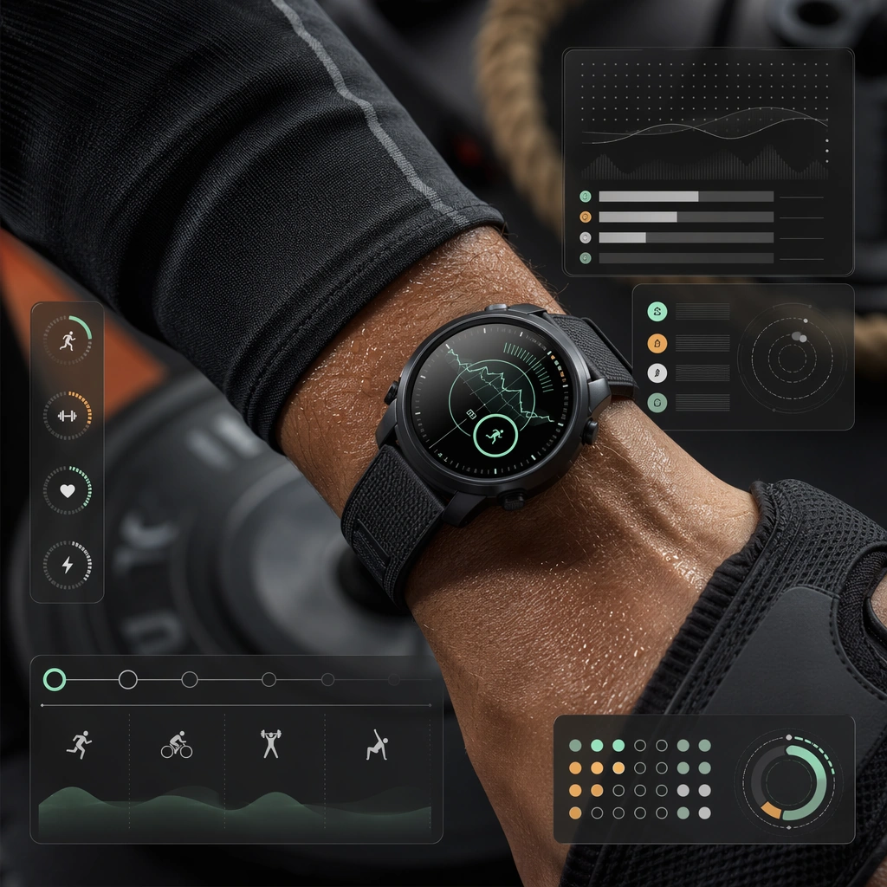

```text
Scene:
Create a square training-watch close-up ad for Equipment Ads, using sports-product advertising with strong material realism, clean hierarchy, and commerce-ready performance styling. The composition should read as a practical, production-ready sports or fitness surface with a clear hierarchy, premium lighting, and obvious commercial intent. Keep the environment specific enough to feel real, but leave enough control in the layout for non-readable information modules, campaign blocks, or visualized metrics. Aim for a finish that works for a brand, club, app, academy, or event operator.

Subject:
Build the image around wearable on athlete wrist. The subject should be original, believable, and free of any real-brand or celebrity cues. Use realistic apparel, safe body mechanics when movement is visible, and environmental props that support the category without clutter. The subject must stay visually dominant so the design still works as a communication asset rather than a pure scene study.

Important details:
The mood should read as macro sports-tech focus. Treat layout, light, and supporting graphic structure as part of one polished delivery surface. Any schedule blocks, metric panels, quote zones, badges, or path diagrams must stay abstract and non-readable. Prioritize usefulness, clarity, and category truth over spectacle. The image should feel distinct from the series package while still belonging naturally to the same topic and business use case.

Use case:
Equipment Ads single study 9/9, an independent rollout surface for the topic.

Constraints:
No readable text, no watermark, no logos, preserve exact 1:1 aspect ratio, no brand marks, no public-figure resemblance, no generic stock layout, no cluttered UI imitation, no accidental copyrighted insignia.
```

[Pinned source](https://github.com/ChaosRealmsAI/gpt-image-2-gallery/blob/5296db8c996e38776c83a0bc8c64f848dcd512b3/works/topics/sports-equipment-advertising-set/packages/single-support-studies/images/training-watch-closeup/meta.json) · GPT Image2 · 1024×1024 · No source-declared image dependencies. · ProjectD:pending individual review.

## Reference Obsidian Stage · stage-visual-moodboard-performance-world/series-performance-world/01-reference-obsidian-stage

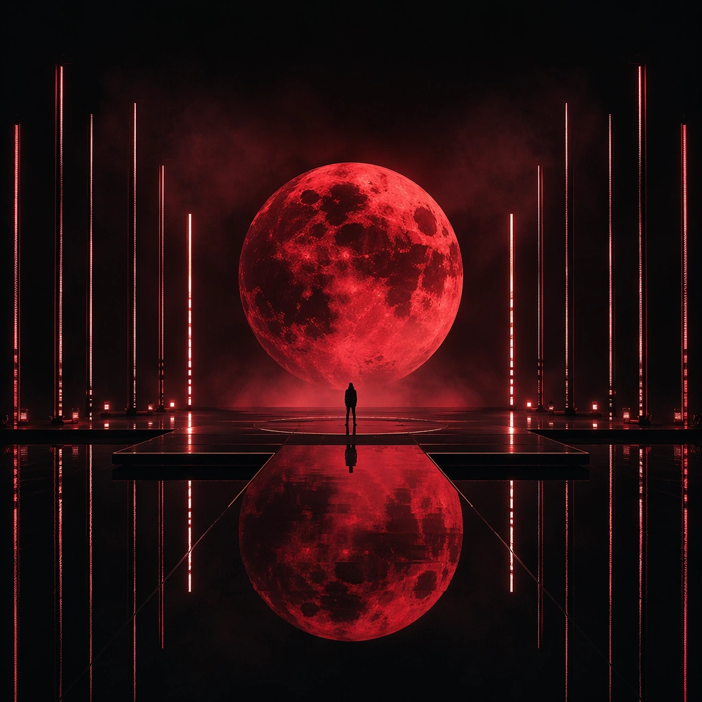

```text
Scene:
A square stage-world moodboard showing a large performance environment with an obsidian reflective floor, hanging haze, a giant red moon-like screen graphic, and narrow vertical light slits framing the space. The camera is front-facing and slightly elevated so the entire world reads like a creative-direction board for a tour stage rather than a documentary photo.

Subject:
A solitary performer silhouette stands at center stage, small relative to the environment, while the true subject is the world itself: reflective black floor, red lunar screen motif, vertical light architecture, and ceremonial empty space. This first image must lock the exact scenic language that later variants preserve: floor finish, screen symbol, scale relationship, and atmospheric density.

Important details:
Think like a stage creative deck image. Every element should feel intentional and translatable into screens, lighting, wardrobe, and promo materials. The stage world should be dramatic yet minimal, with a strong symbolic motif and enough clean geometry to support coherent expansion. Avoid readable show titles or brand marks; the ownership comes from environmental grammar.

Use case:
Stage Moodboard series study 1/9 for the Stage Visual Moodboard Performance World Prompt Atlas theme.

Constraints:
No readable text, no watermark, no logos, preserve exact 1:1 aspect ratio, no audience visible, no visible truss clutter, no sponsor logo, no fireworks, no random props, no realistic venue seating dominating the frame
```

[Pinned source](https://github.com/ChaosRealmsAI/gpt-image-2-gallery/blob/5296db8c996e38776c83a0bc8c64f848dcd512b3/works/topics/stage-visual-moodboard-performance-world/packages/series-performance-world/images/01-reference-obsidian-stage/meta.json) · GPT Image2 · 1024×1024 · No source-declared image dependencies. · ProjectD:pending individual review.

## Laser Tunnel Variant · stage-visual-moodboard-performance-world/series-performance-world/02-laser-tunnel-variant

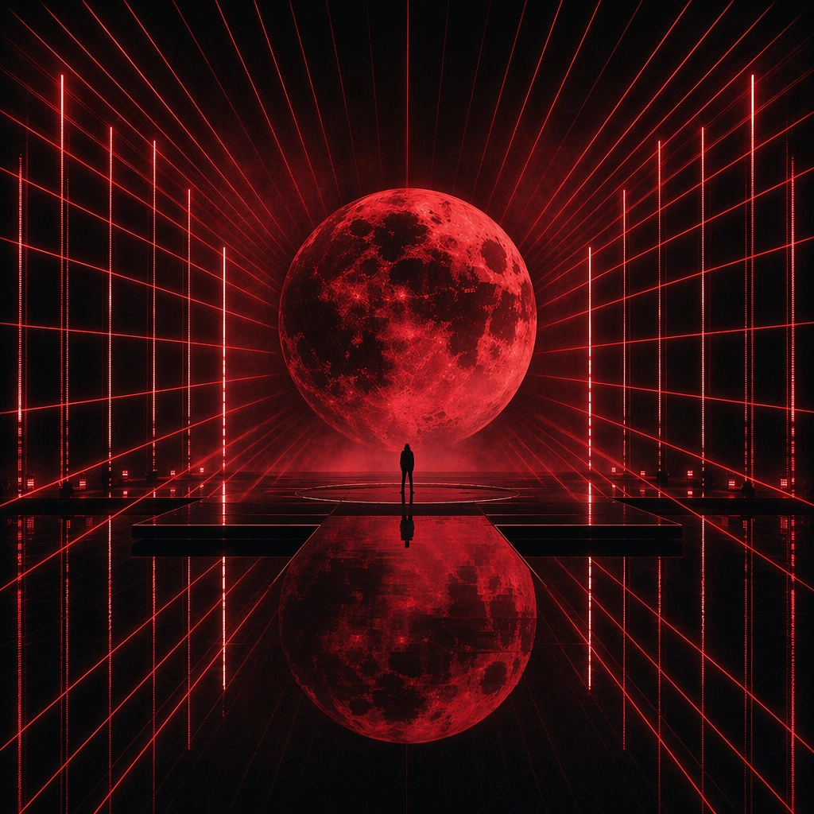

```text
Scene:
A square creative-direction image in the same stage universe, now emphasizing a laser tunnel depth effect built from parallel red beams and stronger perspective pull. The obsidian floor, haze density, and red moon motif must remain intact so the world still feels like the same production language.

Subject:
Preserve the same central performer silhouette scale, stage proportions, floor finish, and lunar screen symbol from the reference image. The performer remains minimal, while the laser tunnel becomes the active scenic extension, creating a more aggressive live-energy interpretation of the same world.

Important details:
The point is not to rebuild the stage but to stress one facet of it. Keep the same materials, same symbolic anchor, and same ceremonial emptiness while letting the beam geometry intensify. This should read like an alternate scenic rendering from the same show bible, not a different concert concept.

Use case:
Stage Moodboard series study 2/9 for the Stage Visual Moodboard Performance World Prompt Atlas theme.

Constraints:
No readable text, no watermark, no logos, preserve exact 1:1 aspect ratio, preserve the obsidian floor and red-moon motif from the reference; no audience, no extra dancers, no moving-head fixture clutter, no rainbow lasers, no brand logos
```

[Pinned source](https://github.com/ChaosRealmsAI/gpt-image-2-gallery/blob/5296db8c996e38776c83a0bc8c64f848dcd512b3/works/topics/stage-visual-moodboard-performance-world/packages/series-performance-world/images/02-laser-tunnel-variant/meta.json) · GPT Image2 · 1024×1024 · Reference images required. · ProjectD:pending individual review.

## Fog Curtain Variant · stage-visual-moodboard-performance-world/series-performance-world/03-fog-curtain-variant

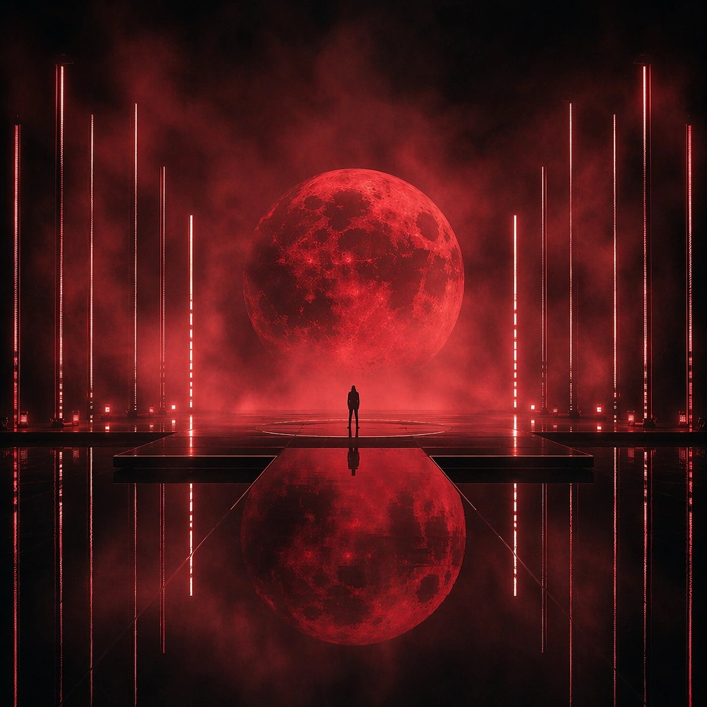

```text
Scene:
A square moodboard image from the same stage universe, now layered with drifting fog curtains and more diffused side light that partially veils the red lunar screen. The overall architecture must remain identical, but the atmosphere becomes softer and more dreamlike.

Subject:
Preserve the same central performer silhouette scale, obsidian floor reflections, red moon screen motif, and stage proportions from the reference image. The performer stays small and ceremonial, while the fog becomes a new scenic medium that turns the world into a softer, suspended environment.

Important details:
This variant should feel like the same performance world viewed through an alternate atmospheric treatment. Do not change the world language; enrich it through diffusion, layered haze, and softened reflections. The stage should still feel buildable, practical, and translatable into a real show creative direction deck.

Use case:
Stage Moodboard series study 3/9 for the Stage Visual Moodboard Performance World Prompt Atlas theme.

Constraints:
No readable text, no watermark, no logos, preserve exact 1:1 aspect ratio, preserve the obsidian floor and red-moon motif from the reference; no audience, no extra scenic objects, no heavy rain effect, no decorative starscape, no venue branding
```

[Pinned source](https://github.com/ChaosRealmsAI/gpt-image-2-gallery/blob/5296db8c996e38776c83a0bc8c64f848dcd512b3/works/topics/stage-visual-moodboard-performance-world/packages/series-performance-world/images/03-fog-curtain-variant/meta.json) · GPT Image2 · 1024×1024 · Reference images required. · ProjectD:pending individual review.

## Mirror Riser Variant · stage-visual-moodboard-performance-world/series-performance-world/04-mirror-riser-variant

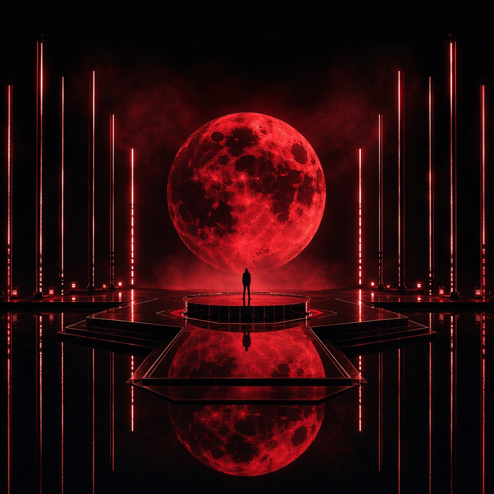

```text
Scene:
A square stage-world rendering in the same obsidian universe, now featuring a central mirrored riser and slightly more sculptural platform geometry beneath the performer. The red moon motif, haze, and vertical light slits remain the defining anchors of the composition.

Subject:
Preserve the same performer silhouette scale, red lunar screen, obsidian floor language, and ceremonial emptiness from the reference image. The only major shift is the introduction of a mirror-like riser that elevates the performer and gives the scene a stronger ritual center.

Important details:
The riser should feel like a logical scenic extension inside the same show package. Use reflection, material realism, and symmetry to create focus, but avoid making the stage ornate or overbuilt. This must still read as one coherent performance world that could support lighting plots, wardrobe choices, and promo imagery.

Use case:
Stage Moodboard series study 4/9 for the Stage Visual Moodboard Performance World Prompt Atlas theme.

Constraints:
No readable text, no watermark, no logos, preserve exact 1:1 aspect ratio, preserve the obsidian floor and red-moon motif from the reference; no audience, no pyrotechnics, no extra props, no architectural set pieces unrelated to the world, no brand marks
```

[Pinned source](https://github.com/ChaosRealmsAI/gpt-image-2-gallery/blob/5296db8c996e38776c83a0bc8c64f848dcd512b3/works/topics/stage-visual-moodboard-performance-world/packages/series-performance-world/images/04-mirror-riser-variant/meta.json) · GPT Image2 · 1024×1024 · Reference images required. · ProjectD:pending individual review.

## Wardrobe Rail Study · stage-visual-moodboard-performance-world/single-stage-language-studies/wardrobe-rail-study

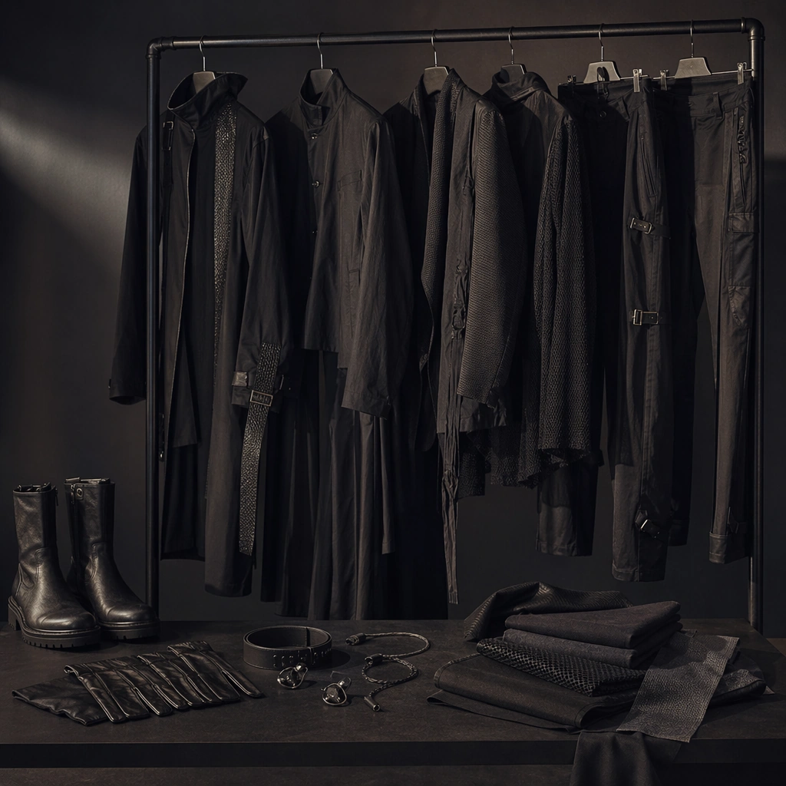

```text
Scene:
A square studio moodboard image showing a wardrobe rail with several dark garments, metallic trims, boots, gloves, and folded fabric swatches under dramatic side light. The shot should feel like a presentation slide for a tour costume direction rather than a retail fashion rack.

Subject:
The subject is the wardrobe language itself: long silhouettes, matte black textiles, brushed metal accents, and disciplined color control that could belong to a live performance world. No literal brand labels or readable tags should appear; the rail should communicate stage identity through material and silhouette.

Important details:
Keep the styling serious, modern, and show-ready. Use selective props such as a belt, earpiece, or glove only if they reinforce the live-performance world. The image should bridge fashion and staging without feeling like a store display or editorial shopping spread.

Use case:
Stage Moodboard single study 5/9 for the Stage Visual Moodboard Performance World Prompt Atlas theme.

Constraints:
No readable text, no watermark, no logos, preserve exact 1:1 aspect ratio, no retail signage, no readable clothing labels, no bright casual garments, no mannequins, no audience or stage in the background
```

[Pinned source](https://github.com/ChaosRealmsAI/gpt-image-2-gallery/blob/5296db8c996e38776c83a0bc8c64f848dcd512b3/works/topics/stage-visual-moodboard-performance-world/packages/single-stage-language-studies/images/wardrobe-rail-study/meta.json) · GPT Image2 · 1024×1024 · No source-declared image dependencies. · ProjectD:pending individual review.

## Screen Texture Board · stage-visual-moodboard-performance-world/single-stage-language-studies/screen-texture-board

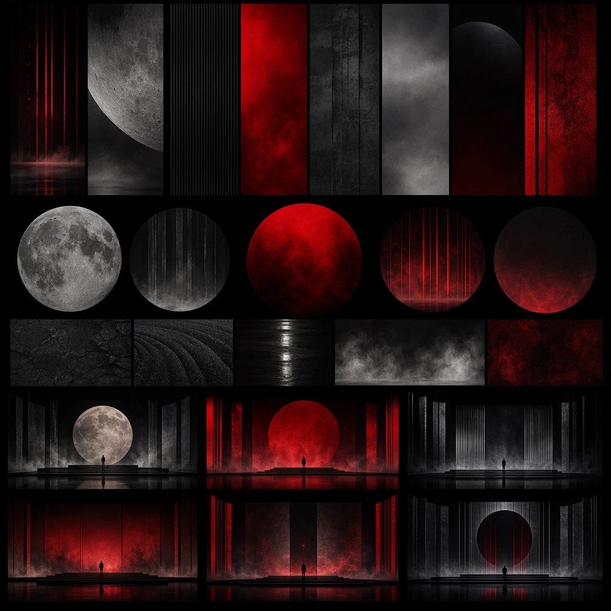

```text
Scene:
A square design board of layered texture panels, circular red gradients, black reflective fields, and grainy atmospheric surfaces arranged with clean spacing. The board should look like a stage visual concept sheet for massive LED content rather than a random abstract-art collage.

Subject:
The subject is a family of visual motifs for stage screens: lunar discs, fog-softened gradients, vertical slit textures, and reflective shadow fields. Each panel should feel like a usable scenic content ingredient that belongs to a larger performance universe.

Important details:
Keep the board disciplined and production-minded. The motifs should read clearly, feel scalable to large screens, and suggest a coherent show identity. Use texture and layout to sell professionalism, not novelty. Avoid any readable labels or software annotation.

Use case:
Stage Moodboard single study 6/9 for the Stage Visual Moodboard Performance World Prompt Atlas theme.

Constraints:
No readable text, no watermark, no logos, preserve exact 1:1 aspect ratio, no UI software panels, no readable notes, no rainbow glitch effects, no unrelated photography, no decorative scrapbook style
```

[Pinned source](https://github.com/ChaosRealmsAI/gpt-image-2-gallery/blob/5296db8c996e38776c83a0bc8c64f848dcd512b3/works/topics/stage-visual-moodboard-performance-world/packages/single-stage-language-studies/images/screen-texture-board/meta.json) · GPT Image2 · 1024×1024 · No source-declared image dependencies. · ProjectD:pending individual review.

## Prop Altar Study · stage-visual-moodboard-performance-world/single-stage-language-studies/prop-altar-study

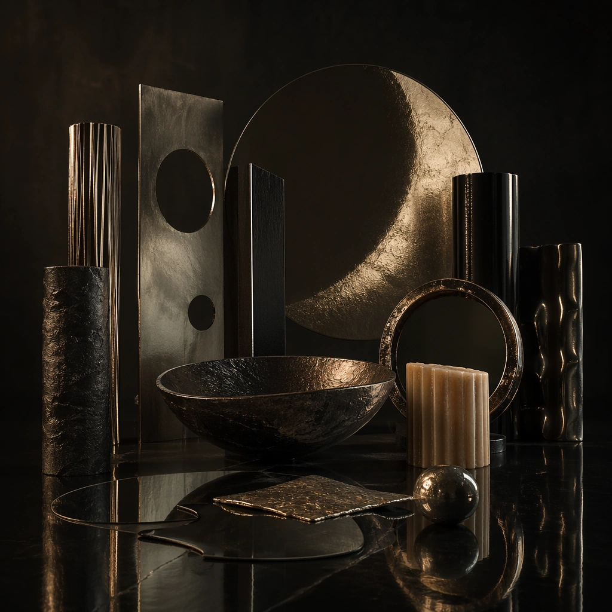

```text
Scene:
A square still life on a dark reflective table holding a few sculptural stage props, metallic forms, candles made abstract and unlit, mirrored shards, and circular scenic fragments. The lighting should be low and ceremonial, with enough clarity to present materials while maintaining mystery.

Subject:
The subject is not occult symbolism but a focused stage-prop language: a few objects that could live on stage, inform close-up camera inserts, or inspire scenic detail. The arrangement should feel deliberate and ownable, not like cluttered home decor.

Important details:
Use reflection, silhouette, and composition to create a sense of ritual performance design. The object set must remain sparse and purposeful, demonstrating how a stage world can be extended through props. Everything should feel translatable into real production design without literal readable annotation.

Use case:
Stage Moodboard single study 7/9 for the Stage Visual Moodboard Performance World Prompt Atlas theme.

Constraints:
No readable text, no watermark, no logos, preserve exact 1:1 aspect ratio, no flames, no brand objects, no fantasy weapons, no religious symbols, no tabletop clutter beyond the focused prop family
```

[Pinned source](https://github.com/ChaosRealmsAI/gpt-image-2-gallery/blob/5296db8c996e38776c83a0bc8c64f848dcd512b3/works/topics/stage-visual-moodboard-performance-world/packages/single-stage-language-studies/images/prop-altar-study/meta.json) · GPT Image2 · 1024×1024 · No source-declared image dependencies. · ProjectD:pending individual review.

## Laser Grid Study · stage-visual-moodboard-performance-world/single-stage-language-studies/laser-grid-study


```text
Scene:
A square stage-concept still with a black reflective floor and a disciplined lattice of red and white beams cutting through haze. The camera faces the grid head-on so the geometry reads clearly, like a concept rendering inside a production deck.

Subject:
The subject is the beam system itself: intersecting lines, reflective floor echoes, and an implied performer zone left open in the center. The image should demonstrate how lighting alone can create an ownable performance space.

Important details:
Keep the beams clean, the floor believable, and the empty center powerful. This should feel technical enough to inform a show, but stylish enough to function as a moodboard image. Avoid making it a generic club-laser wallpaper by preserving strong composition and negative space.

Use case:
Stage Moodboard single study 8/9 for the Stage Visual Moodboard Performance World Prompt Atlas theme.

Constraints:
No readable text, no watermark, no logos, preserve exact 1:1 aspect ratio, no audience, no DJ booth, no rainbow colors, no visible truss clutter, no readable control screens
```

[Pinned source](https://github.com/ChaosRealmsAI/gpt-image-2-gallery/blob/5296db8c996e38776c83a0bc8c64f848dcd512b3/works/topics/stage-visual-moodboard-performance-world/packages/single-stage-language-studies/images/laser-grid-study/meta.json) · GPT Image2 · 1024×1024 · No source-declared image dependencies. · ProjectD:pending individual review.

## Material Floor Board · stage-visual-moodboard-performance-world/single-stage-language-studies/material-floor-board


```text
Scene:
A square material board arranged with swatches of reflective black acrylic, smoked mirror, matte charcoal, textured rubber, and haze-lit sample panels. The presentation should feel like a serious stage-scenic material study rather than an interior-design moodboard.

Subject:
The subject is the tactile palette of a performance floor and its neighboring surfaces. Each swatch should imply how stage light, reflection, and movement would behave during a live show, creating a credible scenic language from materials alone.

Important details:
Use disciplined spacing, subtle labels implied only as empty blocks, and careful lighting to show surface response. The board should communicate production intelligence and world-building ownership. Material realism matters more than decorative beauty here.

Use case:
Stage Moodboard single study 9/9 for the Stage Visual Moodboard Performance World Prompt Atlas theme.

Constraints:
No readable text, no watermark, no logos, preserve exact 1:1 aspect ratio, no readable notes, no interior-design magazine props, no wood furniture mood, no home-decor palette, no unrelated lifestyle items
```

[Pinned source](https://github.com/ChaosRealmsAI/gpt-image-2-gallery/blob/5296db8c996e38776c83a0bc8c64f848dcd512b3/works/topics/stage-visual-moodboard-performance-world/packages/single-stage-language-studies/images/material-floor-board/meta.json) · GPT Image2 · 1024×1024 · No source-declared image dependencies. · ProjectD:pending individual review.

## Reference Anchor · steam-engine-station-noir/series-core-system/01-reference-anchor


```text
Scene:
Create a square cinematic still for Steam Engine Station Noir. Use production-grade photoreal lighting, disciplined lens behavior, and a composition that feels like a finished key frame from an original film rather than a casual snapshot. A mid-century rail platform is buried in rolling steam and hard-edged station light, with mostly monochrome tonality, wet pavement, iron structure, and one restrained red tail lamp or signal glowing through the vapor. Keep the camera in a disciplined anchor position so the full lighting event and the main spatial structure are immediately legible from edge to edge.

Subject:
Build a coherent original scene whose emotional center comes from atmosphere, light physics, and spatial clarity. Avoid relying on celebrity likeness, franchise iconography, or stylized illustration shortcuts. A lone figure in a trench coat, the locomotive mass, steel beams, and layered steam curtains should build the scene, but the person remains anonymous and secondary to the environment and the light-cutting fog. This frame should lock the canonical arrangement, scale relationship, and emotional tone that the later dependent images inherit.

Important details:
Preserve a believable physical world with strong depth layering, careful color separation, and premium image discipline. Prioritize steam density layering, wet-surface sheen, noir contrast, and restrained color use, so the image feels like a lost still from a serious black-and-white crime film rather than a cosplay set. Use this image to establish the authoritative direction of light, atmospheric density, and structural silhouette for the package.

Use case:
Steam Station series study 1/9.

Constraints:
No readable text, no watermark, no logos, preserve exact 1:1 aspect ratio, no readable station boards, no crowded commuters, no exaggerated detective props, no pristine modern train design, no bright advertising.
```

[Pinned source](https://github.com/ChaosRealmsAI/gpt-image-2-gallery/blob/5296db8c996e38776c83a0bc8c64f848dcd512b3/works/topics/steam-engine-station-noir/packages/series-core-system/images/01-reference-anchor/meta.json) · GPT Image2 · 1254×1254 · No source-declared image dependencies. · ProjectD:pending individual review.

## Closer Frame · steam-engine-station-noir/series-core-system/02-closer-frame


```text
Scene:
Create a square cinematic still for Steam Engine Station Noir. Use production-grade photoreal lighting, disciplined lens behavior, and a composition that feels like a finished key frame from an original film rather than a casual snapshot. A mid-century rail platform is buried in rolling steam and hard-edged station light, with mostly monochrome tonality, wet pavement, iron structure, and one restrained red tail lamp or signal glowing through the vapor. Move the camera closer or lower so the viewer feels more embedded inside the atmosphere while the same light direction and environment remain intact.

Subject:
Build a coherent original scene whose emotional center comes from atmosphere, light physics, and spatial clarity. Avoid relying on celebrity likeness, franchise iconography, or stylized illustration shortcuts. A lone figure in a trench coat, the locomotive mass, steel beams, and layered steam curtains should build the scene, but the person remains anonymous and secondary to the environment and the light-cutting fog. Preserve the same world logic from the reference and let one human-scale or material-scale element become more prominent without stealing focus from the atmosphere.

Important details:
Preserve a believable physical world with strong depth layering, careful color separation, and premium image discipline. Prioritize steam density layering, wet-surface sheen, noir contrast, and restrained color use, so the image feels like a lost still from a serious black-and-white crime film rather than a cosplay set. Keep the palette family, structural read, and light behavior from image 01 while increasing immediacy and tactile presence.

Use case:
Steam Station series study 2/9.

Constraints:
No readable text, no watermark, no logos, preserve exact 1:1 aspect ratio, no readable station boards, no crowded commuters, no exaggerated detective props, no pristine modern train design, no bright advertising.
```

[Pinned source](https://github.com/ChaosRealmsAI/gpt-image-2-gallery/blob/5296db8c996e38776c83a0bc8c64f848dcd512b3/works/topics/steam-engine-station-noir/packages/series-core-system/images/02-closer-frame/meta.json) · GPT Image2 · 1254×1254 · Reference images required. · ProjectD:pending individual review.

## Spatial Counterpoint · steam-engine-station-noir/series-core-system/03-spatial-counterpoint


```text
Scene:
Create a square cinematic still for Steam Engine Station Noir. Use production-grade photoreal lighting, disciplined lens behavior, and a composition that feels like a finished key frame from an original film rather than a casual snapshot. A mid-century rail platform is buried in rolling steam and hard-edged station light, with mostly monochrome tonality, wet pavement, iron structure, and one restrained red tail lamp or signal glowing through the vapor. Shift to an oblique or lateral point of view that reveals different depth layers while staying inside the same place and the same atmospheric event.

Subject:
Build a coherent original scene whose emotional center comes from atmosphere, light physics, and spatial clarity. Avoid relying on celebrity likeness, franchise iconography, or stylized illustration shortcuts. A lone figure in a trench coat, the locomotive mass, steel beams, and layered steam curtains should build the scene, but the person remains anonymous and secondary to the environment and the light-cutting fog. Hold the reference structure, but use the new angle to show secondary planes, foreground interruption, or a changed distance relationship.

Important details:
Preserve a believable physical world with strong depth layering, careful color separation, and premium image discipline. Prioritize steam density layering, wet-surface sheen, noir contrast, and restrained color use, so the image feels like a lost still from a serious black-and-white crime film rather than a cosplay set. The success condition is continuity with the reference plus a richer sense of depth, not a new location or a new lighting system.

Use case:
Steam Station series study 3/9.

Constraints:
No readable text, no watermark, no logos, preserve exact 1:1 aspect ratio, no readable station boards, no crowded commuters, no exaggerated detective props, no pristine modern train design, no bright advertising.
```

[Pinned source](https://github.com/ChaosRealmsAI/gpt-image-2-gallery/blob/5296db8c996e38776c83a0bc8c64f848dcd512b3/works/topics/steam-engine-station-noir/packages/series-core-system/images/03-spatial-counterpoint/meta.json) · GPT Image2 · 1254×1254 · Reference images required. · ProjectD:pending individual review.

## Climax Frame · steam-engine-station-noir/series-core-system/04-climax-frame


```text
Scene:
Create a square cinematic still for Steam Engine Station Noir. Use production-grade photoreal lighting, disciplined lens behavior, and a composition that feels like a finished key frame from an original film rather than a casual snapshot. A mid-century rail platform is buried in rolling steam and hard-edged station light, with mostly monochrome tonality, wet pavement, iron structure, and one restrained red tail lamp or signal glowing through the vapor. Push the composition toward the emotional peak of the same setup, with the most dramatic balance of brightness, shadow, or atmospheric density inside the established world.

Subject:
Build a coherent original scene whose emotional center comes from atmosphere, light physics, and spatial clarity. Avoid relying on celebrity likeness, franchise iconography, or stylized illustration shortcuts. A lone figure in a trench coat, the locomotive mass, steel beams, and layered steam curtains should build the scene, but the person remains anonymous and secondary to the environment and the light-cutting fog. Everything should still read as the same location and same event, but framed for maximum narrative force and visual closure.

Important details:
Preserve a believable physical world with strong depth layering, careful color separation, and premium image discipline. Prioritize steam density layering, wet-surface sheen, noir contrast, and restrained color use, so the image feels like a lost still from a serious black-and-white crime film rather than a cosplay set. Make it feel like the strongest hero frame of the sequence without breaking continuity or introducing a new design language.

Use case:
Steam Station series study 4/9.

Constraints:
No readable text, no watermark, no logos, preserve exact 1:1 aspect ratio, no readable station boards, no crowded commuters, no exaggerated detective props, no pristine modern train design, no bright advertising.
```

[Pinned source](https://github.com/ChaosRealmsAI/gpt-image-2-gallery/blob/5296db8c996e38776c83a0bc8c64f848dcd512b3/works/topics/steam-engine-station-noir/packages/series-core-system/images/04-climax-frame/meta.json) · GPT Image2 · 1254×1254 · Reference images required. · ProjectD:pending individual review.

## Surface Study · steam-engine-station-noir/single-support-studies/surface-study


```text
Scene:
Create a square cinematic still for Steam Engine Station Noir. Use production-grade photoreal lighting, disciplined lens behavior, and a composition that feels like a finished key frame from an original film rather than a casual snapshot. A mid-century rail platform is buried in rolling steam and hard-edged station light, with mostly monochrome tonality, wet pavement, iron structure, and one restrained red tail lamp or signal glowing through the vapor. Build an independent square study around the way atmosphere interacts with surfaces, keeping enough environmental context for the image to feel finished rather than cropped at random.

Subject:
Build a coherent original scene whose emotional center comes from atmosphere, light physics, and spatial clarity. Avoid relying on celebrity likeness, franchise iconography, or stylized illustration shortcuts. A lone figure in a trench coat, the locomotive mass, steel beams, and layered steam curtains should build the scene, but the person remains anonymous and secondary to the environment and the light-cutting fog. Let textures, reflections, residue, moisture, dust, or particulate response become primary, while the broader setting remains clearly implied.

Important details:
Preserve a believable physical world with strong depth layering, careful color separation, and premium image discipline. Prioritize steam density layering, wet-surface sheen, noir contrast, and restrained color use, so the image feels like a lost still from a serious black-and-white crime film rather than a cosplay set. The key is material credibility under dramatic light, with micro-contrast and controlled mood supporting the theme.

Use case:
Steam Station single study 5/9.

Constraints:
No readable text, no watermark, no logos, preserve exact 1:1 aspect ratio, no readable station boards, no crowded commuters, no exaggerated detective props, no pristine modern train design, no bright advertising.
```

[Pinned source](https://github.com/ChaosRealmsAI/gpt-image-2-gallery/blob/5296db8c996e38776c83a0bc8c64f848dcd512b3/works/topics/steam-engine-station-noir/packages/single-support-studies/images/surface-study/meta.json) · GPT Image2 · 1254×1254 · No source-declared image dependencies. · ProjectD:pending individual review.

## Silhouette Study · steam-engine-station-noir/single-support-studies/silhouette-study


```text
Scene:
Create a square cinematic still for Steam Engine Station Noir. Use production-grade photoreal lighting, disciplined lens behavior, and a composition that feels like a finished key frame from an original film rather than a casual snapshot. A mid-century rail platform is buried in rolling steam and hard-edged station light, with mostly monochrome tonality, wet pavement, iron structure, and one restrained red tail lamp or signal glowing through the vapor. Compose an independent frame where one human, animal, or object silhouette negotiates with the atmospheric light event in a clean, readable way.

Subject:
Build a coherent original scene whose emotional center comes from atmosphere, light physics, and spatial clarity. Avoid relying on celebrity likeness, franchise iconography, or stylized illustration shortcuts. A lone figure in a trench coat, the locomotive mass, steel beams, and layered steam curtains should build the scene, but the person remains anonymous and secondary to the environment and the light-cutting fog. The silhouette should supply scale and emotional orientation, but the environment still needs to carry most of the storytelling weight.

Important details:
Preserve a believable physical world with strong depth layering, careful color separation, and premium image discipline. Prioritize steam density layering, wet-surface sheen, noir contrast, and restrained color use, so the image feels like a lost still from a serious black-and-white crime film rather than a cosplay set. Keep the silhouette simple and believable, avoiding poster-like graphic flattening while preserving strong contrast.

Use case:
Steam Station single study 6/9.

Constraints:
No readable text, no watermark, no logos, preserve exact 1:1 aspect ratio, no readable station boards, no crowded commuters, no exaggerated detective props, no pristine modern train design, no bright advertising.
```

[Pinned source](https://github.com/ChaosRealmsAI/gpt-image-2-gallery/blob/5296db8c996e38776c83a0bc8c64f848dcd512b3/works/topics/steam-engine-station-noir/packages/single-support-studies/images/silhouette-study/meta.json) · GPT Image2 · 1254×1254 · No source-declared image dependencies. · ProjectD:pending individual review.

## Transition Study · steam-engine-station-noir/single-support-studies/transition-study


```text
Scene:
Create a square cinematic still for Steam Engine Station Noir. Use production-grade photoreal lighting, disciplined lens behavior, and a composition that feels like a finished key frame from an original film rather than a casual snapshot. A mid-century rail platform is buried in rolling steam and hard-edged station light, with mostly monochrome tonality, wet pavement, iron structure, and one restrained red tail lamp or signal glowing through the vapor. Treat this as an adjacent moment before or after the main event, preserving the same topic language while letting the atmosphere shift slightly in intensity or position.

Subject:
Build a coherent original scene whose emotional center comes from atmosphere, light physics, and spatial clarity. Avoid relying on celebrity likeness, franchise iconography, or stylized illustration shortcuts. A lone figure in a trench coat, the locomotive mass, steel beams, and layered steam curtains should build the scene, but the person remains anonymous and secondary to the environment and the light-cutting fog. Show the environment in transition, with clear evidence of recent motion, changing weather, or fading light, but without turning it into action spectacle.

Important details:
Preserve a believable physical world with strong depth layering, careful color separation, and premium image discipline. Prioritize steam density layering, wet-surface sheen, noir contrast, and restrained color use, so the image feels like a lost still from a serious black-and-white crime film rather than a cosplay set. Subtle temporal storytelling matters here more than maximal drama, so let traces, gradients, and environmental residue do the work.

Use case:
Steam Station single study 7/9.

Constraints:
No readable text, no watermark, no logos, preserve exact 1:1 aspect ratio, no readable station boards, no crowded commuters, no exaggerated detective props, no pristine modern train design, no bright advertising.
```

[Pinned source](https://github.com/ChaosRealmsAI/gpt-image-2-gallery/blob/5296db8c996e38776c83a0bc8c64f848dcd512b3/works/topics/steam-engine-station-noir/packages/single-support-studies/images/transition-study/meta.json) · GPT Image2 · 1254×1254 · No source-declared image dependencies. · ProjectD:pending individual review.

## Wide Study · steam-engine-station-noir/single-support-studies/wide-study


```text
Scene:
Create a square cinematic still for Steam Engine Station Noir. Use production-grade photoreal lighting, disciplined lens behavior, and a composition that feels like a finished key frame from an original film rather than a casual snapshot. A mid-century rail platform is buried in rolling steam and hard-edged station light, with mostly monochrome tonality, wet pavement, iron structure, and one restrained red tail lamp or signal glowing through the vapor. Pull back enough to explain the broader geography or architectural envelope while keeping the square crop intentional and balanced.

Subject:
Build a coherent original scene whose emotional center comes from atmosphere, light physics, and spatial clarity. Avoid relying on celebrity likeness, franchise iconography, or stylized illustration shortcuts. A lone figure in a trench coat, the locomotive mass, steel beams, and layered steam curtains should build the scene, but the person remains anonymous and secondary to the environment and the light-cutting fog. The wider frame should reveal how the main light or weather phenomenon organizes the surrounding world and not just the immediate subject.

Important details:
Preserve a believable physical world with strong depth layering, careful color separation, and premium image discipline. Prioritize steam density layering, wet-surface sheen, noir contrast, and restrained color use, so the image feels like a lost still from a serious black-and-white crime film rather than a cosplay set. Make scale legible through spacing, horizon control, and foreground-to-background separation rather than through extra props.

Use case:
Steam Station single study 8/9.

Constraints:
No readable text, no watermark, no logos, preserve exact 1:1 aspect ratio, no readable station boards, no crowded commuters, no exaggerated detective props, no pristine modern train design, no bright advertising.
```

[Pinned source](https://github.com/ChaosRealmsAI/gpt-image-2-gallery/blob/5296db8c996e38776c83a0bc8c64f848dcd512b3/works/topics/steam-engine-station-noir/packages/single-support-studies/images/wide-study/meta.json) · GPT Image2 · 1254×1254 · No source-declared image dependencies. · ProjectD:pending individual review.

## Afterglow Study · steam-engine-station-noir/single-support-studies/afterglow-study


```text
Scene:
Create a square cinematic still for Steam Engine Station Noir. Use production-grade photoreal lighting, disciplined lens behavior, and a composition that feels like a finished key frame from an original film rather than a casual snapshot. A mid-century rail platform is buried in rolling steam and hard-edged station light, with mostly monochrome tonality, wet pavement, iron structure, and one restrained red tail lamp or signal glowing through the vapor. End on a quieter independent image that holds the residue of the topic atmosphere after its loudest moment has passed, while still feeling complete and exhibition-ready.

Subject:
Build a coherent original scene whose emotional center comes from atmosphere, light physics, and spatial clarity. Avoid relying on celebrity likeness, franchise iconography, or stylized illustration shortcuts. A lone figure in a trench coat, the locomotive mass, steel beams, and layered steam curtains should build the scene, but the person remains anonymous and secondary to the environment and the light-cutting fog. The frame should suggest memory, aftermath, or lingering presence through environment first and only secondarily through any figure or object.

Important details:
Preserve a believable physical world with strong depth layering, careful color separation, and premium image discipline. Prioritize steam density layering, wet-surface sheen, noir contrast, and restrained color use, so the image feels like a lost still from a serious black-and-white crime film rather than a cosplay set. Favor restraint, believable light decay, and subtle narrative closure over spectacle or decorative excess.

Use case:
Steam Station single study 9/9.

Constraints:
No readable text, no watermark, no logos, preserve exact 1:1 aspect ratio, no readable station boards, no crowded commuters, no exaggerated detective props, no pristine modern train design, no bright advertising.
```

[Pinned source](https://github.com/ChaosRealmsAI/gpt-image-2-gallery/blob/5296db8c996e38776c83a0bc8c64f848dcd512b3/works/topics/steam-engine-station-noir/packages/single-support-studies/images/afterglow-study/meta.json) · GPT Image2 · 1254×1254 · No source-declared image dependencies. · ProjectD:pending individual review.

## Crossview Crystal Cubes · stereoscopic-depth/single-depth-studies/crossview-crystal-cubes


```text
Scene:
A clean 2:1 image split into two equal side-by-side stereo views with no divider line. Both halves show the same tabletop still life from slightly different horizontal viewpoints, designed for cross-eye viewing.

Subject:
A set of translucent crystal cubes, matte ceramic spheres, and thin brass rods arranged on a dark reflective table. The left and right halves must match object identity, count, color, lighting, and placement, but with a small correct stereo parallax shift: nearer objects shift more than farther objects.

Important details:
Photorealistic studio product photography, precise binocular disparity, identical camera height in both halves, controlled rim light, crisp reflections, visible depth layers, subtle background grid for depth confirmation, no mismatched object count between halves.

Use case:
Independent Prompt Atlas image testing whether a generated image can encode a usable side-by-side stereo pair.

Constraints:
No readable text, no labels, no watermark, no logos, no extra objects in only one half, no vertical misalignment, no left-right style mismatch, preserve exact 2:1 aspect ratio.
```

[Pinned source](https://github.com/ChaosRealmsAI/gpt-image-2-gallery/blob/5296db8c996e38776c83a0bc8c64f848dcd512b3/works/topics/stereoscopic-depth/packages/single-depth-studies/images/crossview-crystal-cubes/meta.json) · GPT Image2 · 1774×887 · No source-declared image dependencies. · ProjectD:pending individual review.

## Anaglyph Glass Corridor · stereoscopic-depth/single-depth-studies/anaglyph-glass-corridor


```text
Scene:
A square red-cyan anaglyph image of a futuristic glass corridor, composed so it can be viewed with red-cyan 3D glasses. The corridor recedes deeply from foreground to background.

Subject:
Transparent glass panels, floating white guide rails, suspended translucent cubes, and a central walkway. Near cubes should have strong red-cyan separation, midground panels moderate separation, and far background almost aligned, creating believable depth.

Important details:
Photorealistic architectural render, precise anaglyph channel offset, cyan and red fringes only where stereo separation should occur, glossy glass refraction, symmetrical perspective, clean vanishing point, dark floor reflection, high contrast but not chaotic.

Use case:
Independent Prompt Atlas image testing anaglyph depth encoding and optical material rendering.

Constraints:
No readable text, no watermark, no logos, no people, no random color fringing unrelated to depth, no tilted horizon, no broken corridor symmetry, preserve exact 1:1 aspect ratio.
```

[Pinned source](https://github.com/ChaosRealmsAI/gpt-image-2-gallery/blob/5296db8c996e38776c83a0bc8c64f848dcd512b3/works/topics/stereoscopic-depth/packages/single-depth-studies/images/anaglyph-glass-corridor/meta.json) · GPT Image2 · 1254×1254 · No source-declared image dependencies. · ProjectD:pending individual review.

## Autostereogram Hidden Fish · stereoscopic-depth/single-depth-studies/autostereogram-hidden-fish


```text
Scene:
A square single-image autostereogram-style pattern, designed like a repeating ocean texture that hides a raised 3D fish silhouette when viewed with relaxed divergent focus.

Subject:
A seamless field of small coral, bubbles, sand ripples, shells, and blue-green dot clusters. The visible surface should look like a regular repeating pattern, but the spacing should subtly encode one large hidden fish shape in the center with fins, tail, and body depth.

Important details:
Pattern-based hidden-depth image, precise horizontal repetition, small phase shifts creating the fish silhouette, ocean palette of teal, aqua, ivory, coral, and navy, dense but organized micro texture, no obvious fish outline at normal viewing distance.

Use case:
Independent Prompt Atlas image testing whether a generated image can imitate hidden-depth autostereogram logic.

Constraints:
No readable text, no watermark, no logos, no obvious central fish drawing, no random large icons, no broken repeat bands, no frame, preserve exact 1:1 aspect ratio.
```

[Pinned source](https://github.com/ChaosRealmsAI/gpt-image-2-gallery/blob/5296db8c996e38776c83a0bc8c64f848dcd512b3/works/topics/stereoscopic-depth/packages/single-depth-studies/images/autostereogram-hidden-fish/meta.json) · GPT Image2 · 1254×1254 · No source-declared image dependencies. · ProjectD:pending individual review.

## Reference Anchor · storm-and-weather-spectacle-series/series-core-system/01-reference-anchor


```text
Scene:
Create a square reference image for Storm and Weather Spectacle Series. Build a reference anchor establishing the core system with a premium, production-ready finish. Use a polished modular board or campaign surface with clean spacing, premium game-UI finish, and clear focal hierarchy. The composition should feel intentional, clean, and reusable for gallery, research, campaign, or internal handoff contexts. Lighting must support readability first, with the main forms clearly separated from the background and enough breathing room for the system to stay legible at both hero scale and thumbnail scale.

Subject:
Center a coherent original game-art system built for premium production and marketing surfaces. For this image, focus on reference anchor. Keep the same system logic stable across screenshots, cards, banners, and overview boards. This image is the canonical anchor that later series images must follow. The viewer should immediately understand what role this surface plays inside a cohesive game-production asset pack.

Important details:
Lock framing, icon grammar, palette blocking, and surface hierarchy so the kit feels production-ready and consistent. Preserve the core silhouette, framing language, and material logic from the reference image while each variation changes function. Keep materials believable, edge hierarchy disciplined, and the visual language consistent with Weather Spectacle. Use abstract interface blocks or diagram accents when helpful, but avoid any readable language. The final result should feel like a deliberate production asset rather than a random illustration.

Use case:
Storm and Weather Spectacle Series series study 1/9, designed as reference anchor within a cohesive asset pack.

Constraints:
No readable text, no watermark, no logos, preserve exact 1:1 aspect ratio, no unrelated objects, no broken visual hierarchy, no malformed anatomy or broken perspective, no random decorative clutter.
```

[Pinned source](https://github.com/ChaosRealmsAI/gpt-image-2-gallery/blob/5296db8c996e38776c83a0bc8c64f848dcd512b3/works/topics/storm-and-weather-spectacle-series/packages/series-core-system/images/01-reference-anchor/meta.json) · GPT Image2 · 1254×1254 · No source-declared image dependencies. · ProjectD:pending individual review.

## Variant One · storm-and-weather-spectacle-series/series-core-system/02-variant-one


```text
Scene:
Create a square dependent image for Storm and Weather Spectacle Series. Build a first controlled variation in the same system with a premium, production-ready finish. Use a polished modular board or campaign surface with clean spacing, premium game-UI finish, and clear focal hierarchy. The composition should feel intentional, clean, and reusable for gallery, research, campaign, or internal handoff contexts. Lighting must support readability first, with the main forms clearly separated from the background and enough breathing room for the system to stay legible at both hero scale and thumbnail scale.

Subject:
Center a coherent original game-art system built for premium production and marketing surfaces. For this image, focus on the intended support surface. Keep the same system logic stable across screenshots, cards, banners, and overview boards. Preserve exact identity or system logic from the reference image while changing only the intended variation axis. The viewer should immediately understand what role this surface plays inside a cohesive game-production asset pack.

Important details:
Lock framing, icon grammar, palette blocking, and surface hierarchy so the kit feels production-ready and consistent. Preserve the core silhouette, framing language, and material logic from the reference image while each variation changes function. Keep materials believable, edge hierarchy disciplined, and the visual language consistent with Weather Spectacle. Use abstract interface blocks or diagram accents when helpful, but avoid any readable language. The final result should feel like a deliberate production asset rather than a random illustration.

Use case:
Storm and Weather Spectacle Series series study 2/9, designed as variant one within a cohesive asset pack.

Constraints:
No readable text, no watermark, no logos, preserve exact 1:1 aspect ratio, no unrelated objects, no broken visual hierarchy, no malformed anatomy or broken perspective, no random decorative clutter.
```

[Pinned source](https://github.com/ChaosRealmsAI/gpt-image-2-gallery/blob/5296db8c996e38776c83a0bc8c64f848dcd512b3/works/topics/storm-and-weather-spectacle-series/packages/series-core-system/images/02-variant-one/meta.json) · GPT Image2 · 1254×1254 · Reference images required. · ProjectD:pending individual review.

## Variant Two · storm-and-weather-spectacle-series/series-core-system/03-variant-two


```text
Scene:
Create a square dependent image for Storm and Weather Spectacle Series. Build a second controlled variation in the same system with a premium, production-ready finish. Use a polished modular board or campaign surface with clean spacing, premium game-UI finish, and clear focal hierarchy. The composition should feel intentional, clean, and reusable for gallery, research, campaign, or internal handoff contexts. Lighting must support readability first, with the main forms clearly separated from the background and enough breathing room for the system to stay legible at both hero scale and thumbnail scale.

Subject:
Center a coherent original game-art system built for premium production and marketing surfaces. For this image, focus on the intended support surface. Keep the same system logic stable across screenshots, cards, banners, and overview boards. Preserve exact identity or system logic from the reference image while changing only the intended variation axis. The viewer should immediately understand what role this surface plays inside a cohesive game-production asset pack.

Important details:
Lock framing, icon grammar, palette blocking, and surface hierarchy so the kit feels production-ready and consistent. Preserve the core silhouette, framing language, and material logic from the reference image while each variation changes function. Keep materials believable, edge hierarchy disciplined, and the visual language consistent with Weather Spectacle. Use abstract interface blocks or diagram accents when helpful, but avoid any readable language. The final result should feel like a deliberate production asset rather than a random illustration.

Use case:
Storm and Weather Spectacle Series series study 3/9, designed as variant two within a cohesive asset pack.

Constraints:
No readable text, no watermark, no logos, preserve exact 1:1 aspect ratio, no unrelated objects, no broken visual hierarchy, no malformed anatomy or broken perspective, no random decorative clutter.
```

[Pinned source](https://github.com/ChaosRealmsAI/gpt-image-2-gallery/blob/5296db8c996e38776c83a0bc8c64f848dcd512b3/works/topics/storm-and-weather-spectacle-series/packages/series-core-system/images/03-variant-two/meta.json) · GPT Image2 · 1254×1254 · Reference images required. · ProjectD:pending individual review.

## Variant Three · storm-and-weather-spectacle-series/series-core-system/04-variant-three


```text
Scene:
Create a square dependent image for Storm and Weather Spectacle Series. Build a third controlled variation in the same system with a premium, production-ready finish. Use a polished modular board or campaign surface with clean spacing, premium game-UI finish, and clear focal hierarchy. The composition should feel intentional, clean, and reusable for gallery, research, campaign, or internal handoff contexts. Lighting must support readability first, with the main forms clearly separated from the background and enough breathing room for the system to stay legible at both hero scale and thumbnail scale.

Subject:
Center a coherent original game-art system built for premium production and marketing surfaces. For this image, focus on the intended support surface. Keep the same system logic stable across screenshots, cards, banners, and overview boards. Preserve exact identity or system logic from the reference image while changing only the intended variation axis. The viewer should immediately understand what role this surface plays inside a cohesive game-production asset pack.

Important details:
Lock framing, icon grammar, palette blocking, and surface hierarchy so the kit feels production-ready and consistent. Preserve the core silhouette, framing language, and material logic from the reference image while each variation changes function. Keep materials believable, edge hierarchy disciplined, and the visual language consistent with Weather Spectacle. Use abstract interface blocks or diagram accents when helpful, but avoid any readable language. The final result should feel like a deliberate production asset rather than a random illustration.

Use case:
Storm and Weather Spectacle Series series study 4/9, designed as variant three within a cohesive asset pack.

Constraints:
No readable text, no watermark, no logos, preserve exact 1:1 aspect ratio, no unrelated objects, no broken visual hierarchy, no malformed anatomy or broken perspective, no random decorative clutter.
```

[Pinned source](https://github.com/ChaosRealmsAI/gpt-image-2-gallery/blob/5296db8c996e38776c83a0bc8c64f848dcd512b3/works/topics/storm-and-weather-spectacle-series/packages/series-core-system/images/04-variant-three/meta.json) · GPT Image2 · 1254×1254 · Reference images required. · ProjectD:pending individual review.

## Support One · storm-and-weather-spectacle-series/single-support-studies/support-one


```text
Scene:
Create a square standalone support image for Storm and Weather Spectacle Series. Build a support-surface study with a clear focal hierarchy and a finished professional surface. Use a polished modular board or campaign surface with clean spacing, premium game-UI finish, and clear focal hierarchy. The frame should feel self-contained and polished, with enough structure to explain the system even without the reference series, yet still obviously belonging to the same theme and production world.

Subject:
Show a coherent original game-art system built for premium production and marketing surfaces in a way that emphasizes the intended support surface. Keep the same system logic stable across screenshots, cards, banners, and overview boards. Even though this image is independent, the viewer should still recognize the same universe, same commercial logic, and same production intent as the core package.

Important details:
Lock framing, icon grammar, palette blocking, and surface hierarchy so the kit feels production-ready and consistent. Preserve the broader theme language through color, framing, material choices, and modular composition. Use clean panel rhythm, premium asset presentation, and believable detail density. The image should work equally well as a gallery study, research reference, and mock production deliverable.

Use case:
Storm and Weather Spectacle Series single study 5/9, exploring support one as a support surface.

Constraints:
No readable text, no watermark, no logos, preserve exact 1:1 aspect ratio, no unrelated objects, no broken visual hierarchy, no visual noise that obscures the main surface, no accidental brand resemblance.
```

[Pinned source](https://github.com/ChaosRealmsAI/gpt-image-2-gallery/blob/5296db8c996e38776c83a0bc8c64f848dcd512b3/works/topics/storm-and-weather-spectacle-series/packages/single-support-studies/images/support-one/meta.json) · GPT Image2 · 1254×1254 · No source-declared image dependencies. · ProjectD:pending individual review.

## Support Two · storm-and-weather-spectacle-series/single-support-studies/support-two


```text
Scene:
Create a square standalone support image for Storm and Weather Spectacle Series. Build a second support-surface study with a clear focal hierarchy and a finished professional surface. Use a polished modular board or campaign surface with clean spacing, premium game-UI finish, and clear focal hierarchy. The frame should feel self-contained and polished, with enough structure to explain the system even without the reference series, yet still obviously belonging to the same theme and production world.

Subject:
Show a coherent original game-art system built for premium production and marketing surfaces in a way that emphasizes the intended support surface. Keep the same system logic stable across screenshots, cards, banners, and overview boards. Even though this image is independent, the viewer should still recognize the same universe, same commercial logic, and same production intent as the core package.

Important details:
Lock framing, icon grammar, palette blocking, and surface hierarchy so the kit feels production-ready and consistent. Preserve the broader theme language through color, framing, material choices, and modular composition. Use clean panel rhythm, premium asset presentation, and believable detail density. The image should work equally well as a gallery study, research reference, and mock production deliverable.

Use case:
Storm and Weather Spectacle Series single study 6/9, exploring support two as a support surface.

Constraints:
No readable text, no watermark, no logos, preserve exact 1:1 aspect ratio, no unrelated objects, no broken visual hierarchy, no visual noise that obscures the main surface, no accidental brand resemblance.
```

[Pinned source](https://github.com/ChaosRealmsAI/gpt-image-2-gallery/blob/5296db8c996e38776c83a0bc8c64f848dcd512b3/works/topics/storm-and-weather-spectacle-series/packages/single-support-studies/images/support-two/meta.json) · GPT Image2 · 1254×1254 · No source-declared image dependencies. · ProjectD:pending individual review.

## Support Three · storm-and-weather-spectacle-series/single-support-studies/support-three


```text
Scene:
Create a square standalone support image for Storm and Weather Spectacle Series. Build a third support-surface study with a clear focal hierarchy and a finished professional surface. Use a polished modular board or campaign surface with clean spacing, premium game-UI finish, and clear focal hierarchy. The frame should feel self-contained and polished, with enough structure to explain the system even without the reference series, yet still obviously belonging to the same theme and production world.

Subject:
Show a coherent original game-art system built for premium production and marketing surfaces in a way that emphasizes the intended support surface. Keep the same system logic stable across screenshots, cards, banners, and overview boards. Even though this image is independent, the viewer should still recognize the same universe, same commercial logic, and same production intent as the core package.

Important details:
Lock framing, icon grammar, palette blocking, and surface hierarchy so the kit feels production-ready and consistent. Preserve the broader theme language through color, framing, material choices, and modular composition. Use clean panel rhythm, premium asset presentation, and believable detail density. The image should work equally well as a gallery study, research reference, and mock production deliverable.

Use case:
Storm and Weather Spectacle Series single study 7/9, exploring support three as a support surface.

Constraints:
No readable text, no watermark, no logos, preserve exact 1:1 aspect ratio, no unrelated objects, no broken visual hierarchy, no visual noise that obscures the main surface, no accidental brand resemblance.
```

[Pinned source](https://github.com/ChaosRealmsAI/gpt-image-2-gallery/blob/5296db8c996e38776c83a0bc8c64f848dcd512b3/works/topics/storm-and-weather-spectacle-series/packages/single-support-studies/images/support-three/meta.json) · GPT Image2 · 1254×1254 · No source-declared image dependencies. · ProjectD:pending individual review.

## Support Four · storm-and-weather-spectacle-series/single-support-studies/support-four


```text
Scene:
Create a square standalone support image for Storm and Weather Spectacle Series. Build a fourth support-surface study with a clear focal hierarchy and a finished professional surface. Use a polished modular board or campaign surface with clean spacing, premium game-UI finish, and clear focal hierarchy. The frame should feel self-contained and polished, with enough structure to explain the system even without the reference series, yet still obviously belonging to the same theme and production world.

Subject:
Show a coherent original game-art system built for premium production and marketing surfaces in a way that emphasizes the intended support surface. Keep the same system logic stable across screenshots, cards, banners, and overview boards. Even though this image is independent, the viewer should still recognize the same universe, same commercial logic, and same production intent as the core package.

Important details:
Lock framing, icon grammar, palette blocking, and surface hierarchy so the kit feels production-ready and consistent. Preserve the broader theme language through color, framing, material choices, and modular composition. Use clean panel rhythm, premium asset presentation, and believable detail density. The image should work equally well as a gallery study, research reference, and mock production deliverable.

Use case:
Storm and Weather Spectacle Series single study 8/9, exploring support four as a support surface.

Constraints:
No readable text, no watermark, no logos, preserve exact 1:1 aspect ratio, no unrelated objects, no broken visual hierarchy, no visual noise that obscures the main surface, no accidental brand resemblance.
```

[Pinned source](https://github.com/ChaosRealmsAI/gpt-image-2-gallery/blob/5296db8c996e38776c83a0bc8c64f848dcd512b3/works/topics/storm-and-weather-spectacle-series/packages/single-support-studies/images/support-four/meta.json) · GPT Image2 · 1254×1254 · No source-declared image dependencies. · ProjectD:pending individual review.

## Support Five · storm-and-weather-spectacle-series/single-support-studies/support-five


```text
Scene:
Create a square standalone support image for Storm and Weather Spectacle Series. Build a fifth support-surface study with a clear focal hierarchy and a finished professional surface. Use a polished modular board or campaign surface with clean spacing, premium game-UI finish, and clear focal hierarchy. The frame should feel self-contained and polished, with enough structure to explain the system even without the reference series, yet still obviously belonging to the same theme and production world.

Subject:
Show a coherent original game-art system built for premium production and marketing surfaces in a way that emphasizes the intended support surface. Keep the same system logic stable across screenshots, cards, banners, and overview boards. Even though this image is independent, the viewer should still recognize the same universe, same commercial logic, and same production intent as the core package.

Important details:
Lock framing, icon grammar, palette blocking, and surface hierarchy so the kit feels production-ready and consistent. Preserve the broader theme language through color, framing, material choices, and modular composition. Use clean panel rhythm, premium asset presentation, and believable detail density. The image should work equally well as a gallery study, research reference, and mock production deliverable.

Use case:
Storm and Weather Spectacle Series single study 9/9, exploring support five as a support surface.

Constraints:
No readable text, no watermark, no logos, preserve exact 1:1 aspect ratio, no unrelated objects, no broken visual hierarchy, no visual noise that obscures the main surface, no accidental brand resemblance.
```

[Pinned source](https://github.com/ChaosRealmsAI/gpt-image-2-gallery/blob/5296db8c996e38776c83a0bc8c64f848dcd512b3/works/topics/storm-and-weather-spectacle-series/packages/single-support-studies/images/support-five/meta.json) · GPT Image2 · 1254×1254 · No source-declared image dependencies. · ProjectD:pending individual review.

## Reference Header World · streaming-banner-and-canvas-promo-set/series-platform-takeover/01-reference-header-world


```text
Scene:
A square promotional hero frame designed to scale into streaming banner crops, with an invented performer standing on a narrow floating light bridge inside a deep atmospheric world of mist, soft spotlights, and layered distant architecture. The composition should feel cinematic and adaptable, with strong focal center and clear negative zones for later surface changes.

Subject:
The performer is an invented musician in a long dark coat with subtle metallic trim, shoulder-length straight hair, and a poised stance facing slightly toward camera. This reference image must lock the exact face, hair base, body proportions, coat silhouette, and floating-light environment so later promo images can preserve the same identity across different streaming surfaces.

Important details:
Think like a release-week platform takeover. The world should feel premium, atmospheric, and immediately ownable at both full size and reduced crops. Use one coherent palette of midnight blue, soft silver, and ember accents; keep the light bridge as a signature cue; and preserve enough empty edges to support future surface adaptation without adding readable platform UI or text.

Use case:
Streaming Promo series study 1/9 for the Streaming Banner and Canvas Promo Set Prompt Atlas theme.

Constraints:
No readable text, no watermark, no logos, preserve exact 1:1 aspect ratio, no crowd, no handheld microphone, no giant stage screens, no brand interface, no overloaded fantasy skyline, no extra performers
```

[Pinned source](https://github.com/ChaosRealmsAI/gpt-image-2-gallery/blob/5296db8c996e38776c83a0bc8c64f848dcd512b3/works/topics/streaming-banner-and-canvas-promo-set/packages/series-platform-takeover/images/01-reference-header-world/meta.json) · GPT Image2 · 1024×1024 · No source-declared image dependencies. · ProjectD:pending individual review.

## Canvas Loop Still · streaming-banner-and-canvas-promo-set/series-platform-takeover/02-canvas-loop-still


```text
Scene:
A square promo still in the same floating-bridge world, now cropped tighter and energized by drifting haze ribbons, faint motion blur in fabric edges, and stronger light pulses under the performer’s feet. The environment must remain unmistakably tied to the reference hero frame, just optimized for a looping surface mood.

Subject:
Preserve the exact same performer from the reference image, including face shape, hair base, body proportions, and long coat silhouette. The musician now turns slightly within the frame as if caught mid-loop, while the light bridge and mist layers remain the signature spatial anchors of the streaming campaign.

Important details:
This should feel like a believable canvas still from the same release system. Keep the color world, bridge geometry, and crop discipline consistent, but introduce subtle motion implication through fabric, haze, and light sweep. The image must remain clean enough for platform use and recognizably identical to the reference release identity.

Use case:
Streaming Promo series study 2/9 for the Streaming Banner and Canvas Promo Set Prompt Atlas theme.

Constraints:
No readable text, no watermark, no logos, preserve exact 1:1 aspect ratio, preserve the exact reference face, hair base, and body proportions; no extra characters, no fake playback controls, no chaotic particles, no lens warping, no bright daylight
```

[Pinned source](https://github.com/ChaosRealmsAI/gpt-image-2-gallery/blob/5296db8c996e38776c83a0bc8c64f848dcd512b3/works/topics/streaming-banner-and-canvas-promo-set/packages/series-platform-takeover/images/02-canvas-loop-still/meta.json) · GPT Image2 · 1024×1024 · Reference images required. · ProjectD:pending individual review.

## Profile Takeover Card · streaming-banner-and-canvas-promo-set/series-platform-takeover/03-profile-takeover-card


```text
Scene:
A square streaming promo card in the same atmospheric world, with the performer shifted slightly off center so the frame carries more negative space and cleaner silhouette edges. Mist, distant architecture, and the floating bridge remain present, but the composition is calmer and more interface-ready.

Subject:
Preserve the exact same performer from the reference image with identical face, hair base, body proportions, and coat silhouette. The artist stands in the same world and same mood, now framed to allow more breathing room and profile-surface adaptability while retaining the strong release identity established by the root image.

Important details:
The key is adaptability without dilution. Keep the same signature bridge cue, the same midnight palette, and the same atmospheric layering while simplifying the composition for profile-centric placement. It should feel like a streaming profile takeover asset that clearly belongs to one release campaign and one specific artist identity.

Use case:
Streaming Promo series study 3/9 for the Streaming Banner and Canvas Promo Set Prompt Atlas theme.

Constraints:
No readable text, no watermark, no logos, preserve exact 1:1 aspect ratio, preserve the exact reference face, hair base, and body proportions; no interface icons, no notification symbols, no crowd, no large props, no busy skyline detail
```

[Pinned source](https://github.com/ChaosRealmsAI/gpt-image-2-gallery/blob/5296db8c996e38776c83a0bc8c64f848dcd512b3/works/topics/streaming-banner-and-canvas-promo-set/packages/series-platform-takeover/images/03-profile-takeover-card/meta.json) · GPT Image2 · 1024×1024 · Reference images required. · ProjectD:pending individual review.

## Discovery Promo Still · streaming-banner-and-canvas-promo-set/series-platform-takeover/04-discovery-promo-still


```text
Scene:
A square discovery-page promo still in the same floating-bridge world, now brighter in edge contrast and more graphic in silhouette so it reads immediately in a crowded browsing surface. The environment should remain familiar but slightly simplified, with signature light and mist cues supporting fast identification.

Subject:
Preserve the exact same performer from the reference image, maintaining the identical face shape, hair base, body proportions, and coat silhouette. The artist stays isolated against a slightly brighter atmospheric field, helping the profile and bridge motif read quickly without breaking the shared campaign world.

Important details:
This is the glance-speed adaptation of the same release language. Keep the world coherent, the silhouette legible, and the mood cinematic. The challenge is to simplify for discoverability without turning the image into a generic thumbnail. Signature cues from the reference must remain visible: floating bridge, cool mist, metallic trims, and disciplined negative space.

Use case:
Streaming Promo series study 4/9 for the Streaming Banner and Canvas Promo Set Prompt Atlas theme.

Constraints:
No readable text, no watermark, no logos, preserve exact 1:1 aspect ratio, preserve the exact reference face, hair base, and body proportions; no platform UI, no cluttered environment, no extra performers, no heavy effects fog, no random color shifts
```

[Pinned source](https://github.com/ChaosRealmsAI/gpt-image-2-gallery/blob/5296db8c996e38776c83a0bc8c64f848dcd512b3/works/topics/streaming-banner-and-canvas-promo-set/packages/series-platform-takeover/images/04-discovery-promo-still/meta.json) · GPT Image2 · 1024×1024 · Reference images required. · ProjectD:pending individual review.

## Playlist Cover Board · streaming-banner-and-canvas-promo-set/single-promo-surfaces/playlist-cover-board


```text
Scene:
A square design board presenting several playlist-cover style tiles arranged on a dark neutral ground, each using a related mood, portrait fragment, or atmospheric field. The board should look like a streaming-campaign workbench rather than an app screenshot, with careful spacing and premium visual polish.

Subject:
The subject is a family of compact promo tiles built around one imagined music release atmosphere: partial performer crops, environmental stills, light-bridge fragments, and abstract shape cues meant for browse surfaces. No tile needs readable text, but the family should feel coherent enough to belong to one release period.

Important details:
Prioritize small-format legibility, tone control, and system variation. The board should demonstrate how one release world can populate playlist and discovery surfaces without flattening into sameness. Use distinct but compatible crops, disciplined spacing, and enough atmospheric depth to preserve the music mood.

Use case:
Streaming Promo single study 5/9 for the Streaming Banner and Canvas Promo Set Prompt Atlas theme.

Constraints:
No readable text, no watermark, no logos, preserve exact 1:1 aspect ratio, no platform logos, no readable playlist titles, no software chrome, no extra lifestyle props, no crowded collage look
```

[Pinned source](https://github.com/ChaosRealmsAI/gpt-image-2-gallery/blob/5296db8c996e38776c83a0bc8c64f848dcd512b3/works/topics/streaming-banner-and-canvas-promo-set/packages/single-promo-surfaces/images/playlist-cover-board/meta.json) · GPT Image2 · 1024×1024 · No source-declared image dependencies. · ProjectD:pending individual review.

## Listener Milestone Card · streaming-banner-and-canvas-promo-set/single-promo-surfaces/listener-milestone-card


```text
Scene:
A square celebratory announcement card set against a deep atmospheric field with controlled sparks of light, portrait fragments, and soft metallic gradients. The frame should feel like a streaming milestone celebration surface while staying generic and platform-neutral.

Subject:
One invented musician appears through cropped portrait panels and silhouette fragments, surrounded by rings of light, confetti-like particles, and clean zones where future milestone numbers could sit. The card should communicate achievement and momentum without literal stats or readable copy.

Important details:
Keep it elegant rather than noisy. Use small bursts of light, subtle metallic edges, and a calm but optimistic palette shift within the established release mood. The composition should feel like a premium music announcement card intended for reposting across artist channels and profile surfaces.

Use case:
Streaming Promo single study 6/9 for the Streaming Banner and Canvas Promo Set Prompt Atlas theme.

Constraints:
No readable text, no watermark, no logos, preserve exact 1:1 aspect ratio, no readable numbers, no social app UI, no emoji language, no cheap party styling, no brand icons
```

[Pinned source](https://github.com/ChaosRealmsAI/gpt-image-2-gallery/blob/5296db8c996e38776c83a0bc8c64f848dcd512b3/works/topics/streaming-banner-and-canvas-promo-set/packages/single-promo-surfaces/images/listener-milestone-card/meta.json) · GPT Image2 · 1024×1024 · No source-declared image dependencies. · ProjectD:pending individual review.

## Ambient Canvas Room · streaming-banner-and-canvas-promo-set/single-promo-surfaces/ambient-canvas-room


```text
Scene:
A square ambient room with shallow water reflections, floating light strips, and low mist, photographed as a still that could anchor a looping canvas mood. The environment should feel musical and platform-safe, with strong emotional atmosphere but no cluttered narrative action.

Subject:
The subject is the release environment itself rather than a person: light bridge fragments, fog, reflection, and architectural depth arranged into a calm but ownable promo surface. It should read instantly as part of a music campaign and leave clean space for later adaptation.

Important details:
This image tests environmental world-building for streaming surfaces. Keep geometry simple, reflections believable, and color disciplined. The mood should be immersive enough to feel tied to a specific release, but abstract enough to adapt across banners, loop stills, and profile takeovers.

Use case:
Streaming Promo single study 7/9 for the Streaming Banner and Canvas Promo Set Prompt Atlas theme.

Constraints:
No readable text, no watermark, no logos, preserve exact 1:1 aspect ratio, no furniture, no visible venue branding, no crowd, no bright rainbow color, no surreal objects breaking the calm world
```

[Pinned source](https://github.com/ChaosRealmsAI/gpt-image-2-gallery/blob/5296db8c996e38776c83a0bc8c64f848dcd512b3/works/topics/streaming-banner-and-canvas-promo-set/packages/single-promo-surfaces/images/ambient-canvas-room/meta.json) · GPT Image2 · 1024×1024 · No source-declared image dependencies. · ProjectD:pending individual review.

## Release Reminder Card · streaming-banner-and-canvas-promo-set/single-promo-surfaces/release-reminder-card


```text
Scene:
A square reminder-style card with a dark field, one centered musician silhouette, and a modular stack of non-readable bars and abstract countdown shapes. The design should feel crisp and repostable, built for release anticipation rather than narrative complexity.

Subject:
The subject is a clear promotional hierarchy: one portrait or silhouette, one strong ambient light cue, and a disciplined field of abstract modules where release information would eventually live. The image must feel native to music marketing while staying entirely non-branded and non-verbal.

Important details:
Keep the composition tight, easy to scan, and emotionally direct. Use large tonal contrast, one accent color, and carefully controlled spacing so the card can survive tiny crops. It should feel like a reminder surface for a streaming release, but not like a software notification or generic event flyer.

Use case:
Streaming Promo single study 8/9 for the Streaming Banner and Canvas Promo Set Prompt Atlas theme.

Constraints:
No readable text, no watermark, no logos, preserve exact 1:1 aspect ratio, no readable countdown numerals, no app interface, no bright busy gradient mesh, no extra props, no fake device mockup frames
```

[Pinned source](https://github.com/ChaosRealmsAI/gpt-image-2-gallery/blob/5296db8c996e38776c83a0bc8c64f848dcd512b3/works/topics/streaming-banner-and-canvas-promo-set/packages/single-promo-surfaces/images/release-reminder-card/meta.json) · GPT Image2 · 1024×1024 · No source-declared image dependencies. · ProjectD:pending individual review.

## Artist Channel Header Study · streaming-banner-and-canvas-promo-set/single-promo-surfaces/artist-channel-header-study


```text
Scene:
A square composition derived from banner logic: broad negative space, one clear performer presence, atmospheric depth, and subtle horizon layers compressed into a centered tile. The frame should behave like a design study for an artist-channel header reimagined inside a square crop.

Subject:
One invented musician stands within a spacious atmospheric field while abstract header bands, distant architecture, and soft light gradients create the sense of a larger panoramic world. The composition should test whether banner logic can still feel elegant when compressed into a square.

Important details:
Use negative space and silhouette discipline as the main storytelling devices. The subject must remain immediately legible while the environment hints at a larger campaign world. This should feel like professional streaming promo design exploration rather than a literal software interface mockup.

Use case:
Streaming Promo single study 9/9 for the Streaming Banner and Canvas Promo Set Prompt Atlas theme.

Constraints:
No readable text, no watermark, no logos, preserve exact 1:1 aspect ratio, no platform icons, no readable header text, no crowd, no over-detailed skyline, no collage fragments
```

[Pinned source](https://github.com/ChaosRealmsAI/gpt-image-2-gallery/blob/5296db8c996e38776c83a0bc8c64f848dcd512b3/works/topics/streaming-banner-and-canvas-promo-set/packages/single-promo-surfaces/images/artist-channel-header-study/meta.json) · GPT Image2 · 1024×1024 · No source-declared image dependencies. · ProjectD:pending individual review.

## Reference Key Art · streaming-thumbnail-campaign/series-key-art-pivot/01-reference-key-art


```text
Scene:
A square entertainment marketing key visual for Streaming Thumbnail Campaign, designed like a polished campaign asset ready for posters, covers, feeds, or street placement. The composition should have immediate impact from a distance while still carrying layered detail up close. Keep the lighting dramatic, the hierarchy bold, and the framing tight enough to feel like real promotional art instead of a casual illustration.

Subject:
Center the piece on Reference Key Art, a frame that locks the cast hierarchy, focal rhythm, and signature sales composition for the series. Translate Develop thumbnail sets for streaming platforms that hold up at tiny sizes while staying cohesive across rows, genres, and recommendation surfaces. into a concrete campaign image with clear protagonist hierarchy, supporting world-building cues, and unmistakable promotional intent. The viewer should understand the genre, the ensemble relationships, and the commercial purpose at a glance without relying on readable text or existing brand marks.

Important details:
The challenge is disciplined hype. Preserve focal hierarchy, readable silhouette separation, strong foreground-background layering, and a convincing balance between character energy and structured layout. This theme studies structured-layout, commercial-mockup, reasoning-composition, editing-workflow through a production-ready visual system. Even if typography is unreadable, space for title blocks, badges, or platform framing should feel intentionally designed. Aim for clear hierarchy, polished craft, and immediately usable campaign logic.

Use case:
Streaming Thumbnail Campaign series study 1/4.

Constraints:
No readable text, no watermark, no logos, preserve exact 1:1 aspect ratio, no broken anatomy, no unreadable hierarchy collapse, no muddy montage, no accidental real movie logos, no random filler characters, no off-topic props.
```

[Pinned source](https://github.com/ChaosRealmsAI/gpt-image-2-gallery/blob/5296db8c996e38776c83a0bc8c64f848dcd512b3/works/topics/streaming-thumbnail-campaign/packages/series-key-art-pivot/images/01-reference-key-art/meta.json) · GPT Image2 · 1254×1254 · No source-declared image dependencies. · ProjectD:pending individual review.

## Character Surge · streaming-thumbnail-campaign/series-key-art-pivot/02-character-surge


```text
Scene:
A square entertainment marketing key visual for Streaming Thumbnail Campaign, designed like a polished campaign asset ready for posters, covers, feeds, or street placement. The composition should have immediate impact from a distance while still carrying layered detail up close. Keep the lighting dramatic, the hierarchy bold, and the framing tight enough to feel like real promotional art instead of a casual illustration.

Subject:
Center the piece on Character Surge, a frame that pushes the same poster language toward a more aggressive character-first emphasis. Translate Develop thumbnail sets for streaming platforms that hold up at tiny sizes while staying cohesive across rows, genres, and recommendation surfaces. into a concrete campaign image with clear protagonist hierarchy, supporting world-building cues, and unmistakable promotional intent. The viewer should understand the genre, the ensemble relationships, and the commercial purpose at a glance without relying on readable text or existing brand marks.

Important details:
The challenge is disciplined hype. Preserve focal hierarchy, readable silhouette separation, strong foreground-background layering, and a convincing balance between character energy and structured layout. This theme studies structured-layout, commercial-mockup, reasoning-composition, editing-workflow through a production-ready visual system. Even if typography is unreadable, space for title blocks, badges, or platform framing should feel intentionally designed. Aim for clear hierarchy, polished craft, and immediately usable campaign logic.

Use case:
Streaming Thumbnail Campaign series study 2/4.

Constraints:
No readable text, no watermark, no logos, preserve exact 1:1 aspect ratio, no broken anatomy, no unreadable hierarchy collapse, no muddy montage, no accidental real movie logos, no random filler characters, no off-topic props.
```

[Pinned source](https://github.com/ChaosRealmsAI/gpt-image-2-gallery/blob/5296db8c996e38776c83a0bc8c64f848dcd512b3/works/topics/streaming-thumbnail-campaign/packages/series-key-art-pivot/images/02-character-surge/meta.json) · GPT Image2 · 1254×1254 · Reference images required. · ProjectD:pending individual review.

## Genre Pivot · streaming-thumbnail-campaign/series-key-art-pivot/03-genre-pivot


```text
Scene:
A square entertainment marketing key visual for Streaming Thumbnail Campaign, designed like a polished campaign asset ready for posters, covers, feeds, or street placement. The composition should have immediate impact from a distance while still carrying layered detail up close. Keep the lighting dramatic, the hierarchy bold, and the framing tight enough to feel like real promotional art instead of a casual illustration.

Subject:
Center the piece on Genre Pivot, a frame that keeps the hierarchy but bends color, props, and supporting scenes toward a different subgenre. Translate Develop thumbnail sets for streaming platforms that hold up at tiny sizes while staying cohesive across rows, genres, and recommendation surfaces. into a concrete campaign image with clear protagonist hierarchy, supporting world-building cues, and unmistakable promotional intent. The viewer should understand the genre, the ensemble relationships, and the commercial purpose at a glance without relying on readable text or existing brand marks.

Important details:
The challenge is disciplined hype. Preserve focal hierarchy, readable silhouette separation, strong foreground-background layering, and a convincing balance between character energy and structured layout. This theme studies structured-layout, commercial-mockup, reasoning-composition, editing-workflow through a production-ready visual system. Even if typography is unreadable, space for title blocks, badges, or platform framing should feel intentionally designed. Aim for clear hierarchy, polished craft, and immediately usable campaign logic.

Use case:
Streaming Thumbnail Campaign series study 3/4.

Constraints:
No readable text, no watermark, no logos, preserve exact 1:1 aspect ratio, no broken anatomy, no unreadable hierarchy collapse, no muddy montage, no accidental real movie logos, no random filler characters, no off-topic props.
```

[Pinned source](https://github.com/ChaosRealmsAI/gpt-image-2-gallery/blob/5296db8c996e38776c83a0bc8c64f848dcd512b3/works/topics/streaming-thumbnail-campaign/packages/series-key-art-pivot/images/03-genre-pivot/meta.json) · GPT Image2 · 1254×1254 · Reference images required. · ProjectD:pending individual review.

## Teaser Card · streaming-thumbnail-campaign/single-rollout-assets/teaser-card


```text
Scene:
A square entertainment marketing key visual for Streaming Thumbnail Campaign, designed like a polished campaign asset ready for posters, covers, feeds, or street placement. The composition should have immediate impact from a distance while still carrying layered detail up close. Keep the lighting dramatic, the hierarchy bold, and the framing tight enough to feel like real promotional art instead of a casual illustration.

Subject:
Center the piece on Teaser Card, a frame that a compact mystery-first promo asset built for anticipation and visual tension. Translate Develop thumbnail sets for streaming platforms that hold up at tiny sizes while staying cohesive across rows, genres, and recommendation surfaces. into a concrete campaign image with clear protagonist hierarchy, supporting world-building cues, and unmistakable promotional intent. The viewer should understand the genre, the ensemble relationships, and the commercial purpose at a glance without relying on readable text or existing brand marks.

Important details:
The challenge is disciplined hype. Preserve focal hierarchy, readable silhouette separation, strong foreground-background layering, and a convincing balance between character energy and structured layout. This theme studies structured-layout, commercial-mockup, reasoning-composition, editing-workflow through a production-ready visual system. Even if typography is unreadable, space for title blocks, badges, or platform framing should feel intentionally designed. Aim for clear hierarchy, polished craft, and immediately usable campaign logic.

Use case:
Streaming Thumbnail Campaign single study 1/5.

Constraints:
No readable text, no watermark, no logos, preserve exact 1:1 aspect ratio, no broken anatomy, no unreadable hierarchy collapse, no muddy montage, no accidental real movie logos, no random filler characters, no off-topic props.
```

[Pinned source](https://github.com/ChaosRealmsAI/gpt-image-2-gallery/blob/5296db8c996e38776c83a0bc8c64f848dcd512b3/works/topics/streaming-thumbnail-campaign/packages/single-rollout-assets/images/teaser-card/meta.json) · GPT Image2 · 1254×1254 · No source-declared image dependencies. · ProjectD:pending individual review.

## Countdown Poster · streaming-thumbnail-campaign/single-rollout-assets/countdown-poster


```text
Scene:
A square entertainment marketing key visual for Streaming Thumbnail Campaign, designed like a polished campaign asset ready for posters, covers, feeds, or street placement. The composition should have immediate impact from a distance while still carrying layered detail up close. Keep the lighting dramatic, the hierarchy bold, and the framing tight enough to feel like real promotional art instead of a casual illustration.

Subject:
Center the piece on Countdown Poster, a frame that a countdown-ready campaign poster with bold hierarchy and tight emotional framing. Translate Develop thumbnail sets for streaming platforms that hold up at tiny sizes while staying cohesive across rows, genres, and recommendation surfaces. into a concrete campaign image with clear protagonist hierarchy, supporting world-building cues, and unmistakable promotional intent. The viewer should understand the genre, the ensemble relationships, and the commercial purpose at a glance without relying on readable text or existing brand marks.

Important details:
The challenge is disciplined hype. Preserve focal hierarchy, readable silhouette separation, strong foreground-background layering, and a convincing balance between character energy and structured layout. This theme studies structured-layout, commercial-mockup, reasoning-composition, editing-workflow through a production-ready visual system. Even if typography is unreadable, space for title blocks, badges, or platform framing should feel intentionally designed. Aim for clear hierarchy, polished craft, and immediately usable campaign logic.

Use case:
Streaming Thumbnail Campaign single study 2/5.

Constraints:
No readable text, no watermark, no logos, preserve exact 1:1 aspect ratio, no broken anatomy, no unreadable hierarchy collapse, no muddy montage, no accidental real movie logos, no random filler characters, no off-topic props.
```

[Pinned source](https://github.com/ChaosRealmsAI/gpt-image-2-gallery/blob/5296db8c996e38776c83a0bc8c64f848dcd512b3/works/topics/streaming-thumbnail-campaign/packages/single-rollout-assets/images/countdown-poster/meta.json) · GPT Image2 · 1254×1254 · No source-declared image dependencies. · ProjectD:pending individual review.

## Platform Crop Board · streaming-thumbnail-campaign/single-rollout-assets/platform-crop-board


```text
Scene:
A square entertainment marketing key visual for Streaming Thumbnail Campaign, designed like a polished campaign asset ready for posters, covers, feeds, or street placement. The composition should have immediate impact from a distance while still carrying layered detail up close. Keep the lighting dramatic, the hierarchy bold, and the framing tight enough to feel like real promotional art instead of a casual illustration.

Subject:
Center the piece on Platform Crop Board, a frame that a preview board showing how one campaign reads across multiple crop logics. Translate Develop thumbnail sets for streaming platforms that hold up at tiny sizes while staying cohesive across rows, genres, and recommendation surfaces. into a concrete campaign image with clear protagonist hierarchy, supporting world-building cues, and unmistakable promotional intent. The viewer should understand the genre, the ensemble relationships, and the commercial purpose at a glance without relying on readable text or existing brand marks.

Important details:
The challenge is disciplined hype. Preserve focal hierarchy, readable silhouette separation, strong foreground-background layering, and a convincing balance between character energy and structured layout. This theme studies structured-layout, commercial-mockup, reasoning-composition, editing-workflow through a production-ready visual system. Even if typography is unreadable, space for title blocks, badges, or platform framing should feel intentionally designed. Aim for clear hierarchy, polished craft, and immediately usable campaign logic.

Use case:
Streaming Thumbnail Campaign single study 3/5.

Constraints:
No readable text, no watermark, no logos, preserve exact 1:1 aspect ratio, no broken anatomy, no unreadable hierarchy collapse, no muddy montage, no accidental real movie logos, no random filler characters, no off-topic props.
```

[Pinned source](https://github.com/ChaosRealmsAI/gpt-image-2-gallery/blob/5296db8c996e38776c83a0bc8c64f848dcd512b3/works/topics/streaming-thumbnail-campaign/packages/single-rollout-assets/images/platform-crop-board/meta.json) · GPT Image2 · 1254×1254 · No source-declared image dependencies. · ProjectD:pending individual review.

## Street Proof · streaming-thumbnail-campaign/single-rollout-assets/street-proof


```text
Scene:
A square entertainment marketing key visual for Streaming Thumbnail Campaign, designed like a polished campaign asset ready for posters, covers, feeds, or street placement. The composition should have immediate impact from a distance while still carrying layered detail up close. Keep the lighting dramatic, the hierarchy bold, and the framing tight enough to feel like real promotional art instead of a casual illustration.

Subject:
Center the piece on Street Proof, a frame that a public-facing proof image showing the campaign translated into a convincing real-world display. Translate Develop thumbnail sets for streaming platforms that hold up at tiny sizes while staying cohesive across rows, genres, and recommendation surfaces. into a concrete campaign image with clear protagonist hierarchy, supporting world-building cues, and unmistakable promotional intent. The viewer should understand the genre, the ensemble relationships, and the commercial purpose at a glance without relying on readable text or existing brand marks.

Important details:
The challenge is disciplined hype. Preserve focal hierarchy, readable silhouette separation, strong foreground-background layering, and a convincing balance between character energy and structured layout. This theme studies structured-layout, commercial-mockup, reasoning-composition, editing-workflow through a production-ready visual system. Even if typography is unreadable, space for title blocks, badges, or platform framing should feel intentionally designed. Aim for clear hierarchy, polished craft, and immediately usable campaign logic.

Use case:
Streaming Thumbnail Campaign single study 4/5.

Constraints:
No readable text, no watermark, no logos, preserve exact 1:1 aspect ratio, no broken anatomy, no unreadable hierarchy collapse, no muddy montage, no accidental real movie logos, no random filler characters, no off-topic props.
```

[Pinned source](https://github.com/ChaosRealmsAI/gpt-image-2-gallery/blob/5296db8c996e38776c83a0bc8c64f848dcd512b3/works/topics/streaming-thumbnail-campaign/packages/single-rollout-assets/images/street-proof/meta.json) · GPT Image2 · 1024×1024 · No source-declared image dependencies. · ProjectD:pending individual review.

## Merch Sell Sheet · streaming-thumbnail-campaign/single-rollout-assets/merch-sell-sheet


```text
Scene:
A square entertainment marketing key visual for Streaming Thumbnail Campaign, designed like a polished campaign asset ready for posters, covers, feeds, or street placement. The composition should have immediate impact from a distance while still carrying layered detail up close. Keep the lighting dramatic, the hierarchy bold, and the framing tight enough to feel like real promotional art instead of a casual illustration.

Subject:
Center the piece on Merch Sell Sheet, a frame that a supporting sell-sheet style visual connecting the campaign to collectible or retail energy. Translate Develop thumbnail sets for streaming platforms that hold up at tiny sizes while staying cohesive across rows, genres, and recommendation surfaces. into a concrete campaign image with clear protagonist hierarchy, supporting world-building cues, and unmistakable promotional intent. The viewer should understand the genre, the ensemble relationships, and the commercial purpose at a glance without relying on readable text or existing brand marks.

Important details:
The challenge is disciplined hype. Preserve focal hierarchy, readable silhouette separation, strong foreground-background layering, and a convincing balance between character energy and structured layout. This theme studies structured-layout, commercial-mockup, reasoning-composition, editing-workflow through a production-ready visual system. Even if typography is unreadable, space for title blocks, badges, or platform framing should feel intentionally designed. Aim for clear hierarchy, polished craft, and immediately usable campaign logic.

Use case:
Streaming Thumbnail Campaign single study 5/5.

Constraints:
No readable text, no watermark, no logos, preserve exact 1:1 aspect ratio, no broken anatomy, no unreadable hierarchy collapse, no muddy montage, no accidental real movie logos, no random filler characters, no off-topic props.
```

[Pinned source](https://github.com/ChaosRealmsAI/gpt-image-2-gallery/blob/5296db8c996e38776c83a0bc8c64f848dcd512b3/works/topics/streaming-thumbnail-campaign/packages/single-rollout-assets/images/merch-sell-sheet/meta.json) · GPT Image2 · 1254×1254 · No source-declared image dependencies. · ProjectD:pending individual review.

## Stall Anchor · street-food-vernacular-brand-kit/series-core-system/01-stall-anchor


```text
Scene:
Compose a square street-food brand image that feels rooted in vernacular signage, fast service, handheld eating, and dense local texture without copying any specific real-world brand or famous location. The frame should feel energetic and commercial, with heat, packaging, and human-scale surfaces that suggest a busy street-food context. Use a square evening or late-afternoon crop of a compact food stall with warm practical lights, metal surfaces, and layered materials that feel genuinely used.

Subject:
The food must look handheld, immediate, and physically satisfying, while the brand kit emerges through color, paper, enamel, painted surfaces, stall materials, and abstract signage forms rather than readable names. Center one signature handheld food item at the counter while the stall surfaces, paper wraps, and non-legible sign-painted textures define the brand world around it.

Important details:
This topic depends on cultural and retail credibility. Preserve believable stall materials, quick-service rhythms, food wrapping logic, and the layered density of a small-footprint brand environment. Use sign-painting, stencil-like marks, or abstract lettering forms only as non-legible texture; the identity should come from visual language, not copied brands or readable text. This image establishes the reference system for the series, including camera height, tabletop discipline, prop family, and color control that later images must inherit. This anchor image must establish the identity kit for the series: wrapper palette, condiment organization, counter wear, and a fast-service mood that still feels curated.

Use case:
Street Food Kit series study 1/9, built for Prompt Atlas coverage of a food and beverage commercial visual system.

Constraints:
No readable text, no watermark, no logos, preserve exact 1:1 aspect ratio, no readable text, no logos, no famous landmarks, no franchise styling, no tourist-poster cliché, no fake AI neon overload, no generic festival booth, no readable stall name, no giant tourist crowd, no celebrity chef portrait.
```

[Pinned source](https://github.com/ChaosRealmsAI/gpt-image-2-gallery/blob/5296db8c996e38776c83a0bc8c64f848dcd512b3/works/topics/street-food-vernacular-brand-kit/packages/series-core-system/images/01-stall-anchor/meta.json) · GPT Image2 · 1024×1024 · No source-declared image dependencies. · ProjectD:pending individual review.

## Handheld Wrap Shot · street-food-vernacular-brand-kit/series-core-system/02-handheld-wrap-shot


```text
Scene:
Compose a square street-food brand image that feels rooted in vernacular signage, fast service, handheld eating, and dense local texture without copying any specific real-world brand or famous location. The frame should feel energetic and commercial, with heat, packaging, and human-scale surfaces that suggest a busy street-food context. Preserve the same lighting mood, paper palette, and street counter materials, but crop closer so the wrapped food dominates the square frame.

Subject:
The food must look handheld, immediate, and physically satisfying, while the brand kit emerges through color, paper, enamel, painted surfaces, stall materials, and abstract signage forms rather than readable names. Show one handheld wrap, taco, sandwich, or skewer bundle being held or presented, with vivid filling structure and wrapper realism.

Important details:
This topic depends on cultural and retail credibility. Preserve believable stall materials, quick-service rhythms, food wrapping logic, and the layered density of a small-footprint brand environment. Use sign-painting, stencil-like marks, or abstract lettering forms only as non-legible texture; the identity should come from visual language, not copied brands or readable text. Preserve the exact camera height, lens feel, prop family, tabletop scale, palette discipline, and brand logic established by 01-stall-anchor. Keep the series anchor visible through paper treatment, condiment hints, and stall color language while making the food feel immediate and genuinely hot.

Use case:
Street Food Kit series study 2/9, built for Prompt Atlas coverage of a food and beverage commercial visual system.

Constraints:
No readable text, no watermark, no logos, preserve exact 1:1 aspect ratio, no readable text, no logos, no famous landmarks, no franchise styling, no tourist-poster cliché, no fake AI neon overload, no generic festival booth, no full face, no influencer selfie angle, no franchise packaging.
```

[Pinned source](https://github.com/ChaosRealmsAI/gpt-image-2-gallery/blob/5296db8c996e38776c83a0bc8c64f848dcd512b3/works/topics/street-food-vernacular-brand-kit/packages/series-core-system/images/02-handheld-wrap-shot/meta.json) · GPT Image2 · 1024×1024 · Reference images required. · ProjectD:pending individual review.

## Counter Condiment Array · street-food-vernacular-brand-kit/series-core-system/03-counter-condiment-array


```text
Scene:
Compose a square street-food brand image that feels rooted in vernacular signage, fast service, handheld eating, and dense local texture without copying any specific real-world brand or famous location. The frame should feel energetic and commercial, with heat, packaging, and human-scale surfaces that suggest a busy street-food context. Maintain the same stall materials and warm practical lighting, but widen just enough to show sauce bottles, chopped garnishes, and prep containers in a disciplined layout.

Subject:
The food must look handheld, immediate, and physically satisfying, while the brand kit emerges through color, paper, enamel, painted surfaces, stall materials, and abstract signage forms rather than readable names. Feature the signature food alongside an organized condiment station that feels authentic to a fast-moving street-food setup.

Important details:
This topic depends on cultural and retail credibility. Preserve believable stall materials, quick-service rhythms, food wrapping logic, and the layered density of a small-footprint brand environment. Use sign-painting, stencil-like marks, or abstract lettering forms only as non-legible texture; the identity should come from visual language, not copied brands or readable text. Preserve the exact camera height, lens feel, prop family, tabletop scale, palette discipline, and brand logic established by 01-stall-anchor. The identity system from the anchor image must stay intact through packaging color, counter texture, and painted-surface cues, even as prep tools and sauces become more visible.

Use case:
Street Food Kit series study 3/9, built for Prompt Atlas coverage of a food and beverage commercial visual system.

Constraints:
No readable text, no watermark, no logos, preserve exact 1:1 aspect ratio, no readable text, no logos, no famous landmarks, no franchise styling, no tourist-poster cliché, no fake AI neon overload, no generic festival booth, no ingredient chaos, no readable labels, no sterile studio emptiness.
```

[Pinned source](https://github.com/ChaosRealmsAI/gpt-image-2-gallery/blob/5296db8c996e38776c83a0bc8c64f848dcd512b3/works/topics/street-food-vernacular-brand-kit/packages/series-core-system/images/03-counter-condiment-array/meta.json) · GPT Image2 · 1024×1024 · Reference images required. · ProjectD:pending individual review.

## Night Market Takeaway Kit · street-food-vernacular-brand-kit/series-core-system/04-night-market-takeaway-kit


```text
Scene:
Compose a square street-food brand image that feels rooted in vernacular signage, fast service, handheld eating, and dense local texture without copying any specific real-world brand or famous location. The frame should feel energetic and commercial, with heat, packaging, and human-scale surfaces that suggest a busy street-food context. Retain the exact stall palette and materials but pivot into a dusk or night-market mood with stronger highlights, reflective wrappers, and compact takeaway grouping.

Subject:
The food must look handheld, immediate, and physically satisfying, while the brand kit emerges through color, paper, enamel, painted surfaces, stall materials, and abstract signage forms rather than readable names. Show the hero street-food item packaged for takeaway with one side sauce, napkin, and branded-feeling paper treatment that remains non-legible.

Important details:
This topic depends on cultural and retail credibility. Preserve believable stall materials, quick-service rhythms, food wrapping logic, and the layered density of a small-footprint brand environment. Use sign-painting, stencil-like marks, or abstract lettering forms only as non-legible texture; the identity should come from visual language, not copied brands or readable text. Preserve the exact camera height, lens feel, prop family, tabletop scale, palette discipline, and brand logic established by 01-stall-anchor. Preserve the reference system through wrapper design, stall color, and lighting temperature while making portability and night ordering the new story.

Use case:
Street Food Kit series study 4/9, built for Prompt Atlas coverage of a food and beverage commercial visual system.

Constraints:
No readable text, no watermark, no logos, preserve exact 1:1 aspect ratio, no readable text, no logos, no famous landmarks, no franchise styling, no tourist-poster cliché, no fake AI neon overload, no generic festival booth, no motorbike delivery gear, no readable receipts, no festival fireworks.
```

[Pinned source](https://github.com/ChaosRealmsAI/gpt-image-2-gallery/blob/5296db8c996e38776c83a0bc8c64f848dcd512b3/works/topics/street-food-vernacular-brand-kit/packages/series-core-system/images/04-night-market-takeaway-kit/meta.json) · GPT Image2 · 1024×1024 · Reference images required. · ProjectD:pending individual review.

## Enamel Sign Board · street-food-vernacular-brand-kit/single-support-studies/enamel-sign-board


```text
Scene:
Compose a square street-food brand image that feels rooted in vernacular signage, fast service, handheld eating, and dense local texture without copying any specific real-world brand or famous location. The frame should feel energetic and commercial, with heat, packaging, and human-scale surfaces that suggest a busy street-food context. Use a square crop of one enamel or painted sign board leaning near a street-food counter, lit with warm directional light that reveals scratches and age.

Subject:
The food must look handheld, immediate, and physically satisfying, while the brand kit emerges through color, paper, enamel, painted surfaces, stall materials, and abstract signage forms rather than readable names. Pair the sign surface with a small hero food cue or wrapper so the board feels part of a living brand kit instead of a disconnected prop.

Important details:
This topic depends on cultural and retail credibility. Preserve believable stall materials, quick-service rhythms, food wrapping logic, and the layered density of a small-footprint brand environment. Use sign-painting, stencil-like marks, or abstract lettering forms only as non-legible texture; the identity should come from visual language, not copied brands or readable text. This image should feel fully self-contained while still belonging to the same broader topic and commercial world. Texture is essential: chipped enamel, brushed paint, taped corners, and metal fasteners should all feel believable and useful for campaign storytelling.

Use case:
Street Food Kit single study 5/9, built for Prompt Atlas coverage of a food and beverage commercial visual system.

Constraints:
No readable text, no watermark, no logos, preserve exact 1:1 aspect ratio, no readable text, no logos, no famous landmarks, no franchise styling, no tourist-poster cliché, no fake AI neon overload, no generic festival booth, no readable slogans, no famous transit iconography, no souvenir-shop vibe.
```

[Pinned source](https://github.com/ChaosRealmsAI/gpt-image-2-gallery/blob/5296db8c996e38776c83a0bc8c64f848dcd512b3/works/topics/street-food-vernacular-brand-kit/packages/single-support-studies/images/enamel-sign-board/meta.json) · GPT Image2 · 1024×1024 · No source-declared image dependencies. · ProjectD:pending individual review.

## Paper Wrap Flatlay · street-food-vernacular-brand-kit/single-support-studies/paper-wrap-flatlay


```text
Scene:
Compose a square street-food brand image that feels rooted in vernacular signage, fast service, handheld eating, and dense local texture without copying any specific real-world brand or famous location. The frame should feel energetic and commercial, with heat, packaging, and human-scale surfaces that suggest a busy street-food context. Shoot from overhead on a work-worn counter or tile surface, arranging wrappers, food, and sauce cups into a tight square composition.

Subject:
The food must look handheld, immediate, and physically satisfying, while the brand kit emerges through color, paper, enamel, painted surfaces, stall materials, and abstract signage forms rather than readable names. Make the paper wrap treatment central, with folds, grease marks, and color accents that feel used and practical while still photogenic.

Important details:
This topic depends on cultural and retail credibility. Preserve believable stall materials, quick-service rhythms, food wrapping logic, and the layered density of a small-footprint brand environment. Use sign-painting, stencil-like marks, or abstract lettering forms only as non-legible texture; the identity should come from visual language, not copied brands or readable text. This image should feel fully self-contained while still belonging to the same broader topic and commercial world. The image should communicate speed and authenticity through materials, not mess. Grease, paper grain, and folded corners must look real but controlled.

Use case:
Street Food Kit single study 6/9, built for Prompt Atlas coverage of a food and beverage commercial visual system.

Constraints:
No readable text, no watermark, no logos, preserve exact 1:1 aspect ratio, no readable text, no logos, no famous landmarks, no franchise styling, no tourist-poster cliché, no fake AI neon overload, no generic festival booth, no full meal clutter, no readable stamps, no pristine untouched prop styling.
```

[Pinned source](https://github.com/ChaosRealmsAI/gpt-image-2-gallery/blob/5296db8c996e38776c83a0bc8c64f848dcd512b3/works/topics/street-food-vernacular-brand-kit/packages/single-support-studies/images/paper-wrap-flatlay/meta.json) · GPT Image2 · 1024×1024 · No source-declared image dependencies. · ProjectD:pending individual review.

## Sauce Squeeze Action · street-food-vernacular-brand-kit/single-support-studies/sauce-squeeze-action


```text
Scene:
Compose a square street-food brand image that feels rooted in vernacular signage, fast service, handheld eating, and dense local texture without copying any specific real-world brand or famous location. The frame should feel energetic and commercial, with heat, packaging, and human-scale surfaces that suggest a busy street-food context. Use a square close crop of a food item on the counter as sauce is applied, with shallow background depth and warm stall light.

Subject:
The food must look handheld, immediate, and physically satisfying, while the brand kit emerges through color, paper, enamel, painted surfaces, stall materials, and abstract signage forms rather than readable names. The frame should center the food and the sauce motion, using the hand only as a service cue rather than a portrait subject.

Important details:
This topic depends on cultural and retail credibility. Preserve believable stall materials, quick-service rhythms, food wrapping logic, and the layered density of a small-footprint brand environment. Use sign-painting, stencil-like marks, or abstract lettering forms only as non-legible texture; the identity should come from visual language, not copied brands or readable text. This image should feel fully self-contained while still belonging to the same broader topic and commercial world. Motion needs to feel real: squeeze pressure, sauce viscosity, wrapper tension, and heat from the food should all align physically.

Use case:
Street Food Kit single study 7/9, built for Prompt Atlas coverage of a food and beverage commercial visual system.

Constraints:
No readable text, no watermark, no logos, preserve exact 1:1 aspect ratio, no readable text, no logos, no famous landmarks, no franchise styling, no tourist-poster cliché, no fake AI neon overload, no generic festival booth, no chef portrait, no messy splatter, no branded bottle labels.
```

[Pinned source](https://github.com/ChaosRealmsAI/gpt-image-2-gallery/blob/5296db8c996e38776c83a0bc8c64f848dcd512b3/works/topics/street-food-vernacular-brand-kit/packages/single-support-studies/images/sauce-squeeze-action/meta.json) · GPT Image2 · 1024×1024 · No source-declared image dependencies. · ProjectD:pending individual review.

## Crate Display Corner · street-food-vernacular-brand-kit/single-support-studies/crate-display-corner


```text
Scene:
Compose a square street-food brand image that feels rooted in vernacular signage, fast service, handheld eating, and dense local texture without copying any specific real-world brand or famous location. The frame should feel energetic and commercial, with heat, packaging, and human-scale surfaces that suggest a busy street-food context. Compose a square corner view of a stall or storefront using crates, stacked paper goods, and one food hero under mixed daylight and practical light.

Subject:
The food must look handheld, immediate, and physically satisfying, while the brand kit emerges through color, paper, enamel, painted surfaces, stall materials, and abstract signage forms rather than readable names. Treat the display as a mini brand environment, where ingredients and packaging reinforce the street-food concept without becoming a grocery scene.

Important details:
This topic depends on cultural and retail credibility. Preserve believable stall materials, quick-service rhythms, food wrapping logic, and the layered density of a small-footprint brand environment. Use sign-painting, stencil-like marks, or abstract lettering forms only as non-legible texture; the identity should come from visual language, not copied brands or readable text. This image should feel fully self-contained while still belonging to the same broader topic and commercial world. Wood wear, plastic crate texture, paper stack edges, and food freshness should all feel plausible and grounded in daily service.

Use case:
Street Food Kit single study 8/9, built for Prompt Atlas coverage of a food and beverage commercial visual system.

Constraints:
No readable text, no watermark, no logos, preserve exact 1:1 aspect ratio, no readable text, no logos, no famous landmarks, no franchise styling, no tourist-poster cliché, no fake AI neon overload, no generic festival booth, no supermarket produce section, no readable stickers, no clean showroom sterility.
```

[Pinned source](https://github.com/ChaosRealmsAI/gpt-image-2-gallery/blob/5296db8c996e38776c83a0bc8c64f848dcd512b3/works/topics/street-food-vernacular-brand-kit/packages/single-support-studies/images/crate-display-corner/meta.json) · GPT Image2 · 1024×1024 · No source-declared image dependencies. · ProjectD:pending individual review.

## Rush Hour Service Window · street-food-vernacular-brand-kit/single-support-studies/rush-hour-service-window


```text
Scene:
Compose a square street-food brand image that feels rooted in vernacular signage, fast service, handheld eating, and dense local texture without copying any specific real-world brand or famous location. The frame should feel energetic and commercial, with heat, packaging, and human-scale surfaces that suggest a busy street-food context. Frame a square crop at a service window with warm lights, partial hands, and a narrow counter zone that feels busy but controlled.

Subject:
The food must look handheld, immediate, and physically satisfying, while the brand kit emerges through color, paper, enamel, painted surfaces, stall materials, and abstract signage forms rather than readable names. Keep the hero food, wrapper, and service gesture central so the image communicates quick turnover and human immediacy.

Important details:
This topic depends on cultural and retail credibility. Preserve believable stall materials, quick-service rhythms, food wrapping logic, and the layered density of a small-footprint brand environment. Use sign-painting, stencil-like marks, or abstract lettering forms only as non-legible texture; the identity should come from visual language, not copied brands or readable text. This image should feel fully self-contained while still belonging to the same broader topic and commercial world. The mood should feel crowded in implication, not in clutter. Counter wear, wrapper folds, and light reflections should do the storytelling.

Use case:
Street Food Kit single study 9/9, built for Prompt Atlas coverage of a food and beverage commercial visual system.

Constraints:
No readable text, no watermark, no logos, preserve exact 1:1 aspect ratio, no readable text, no logos, no famous landmarks, no franchise styling, no tourist-poster cliché, no fake AI neon overload, no generic festival booth, no readable queue numbers, no visible cash register screen, no identifiable faces.
```

[Pinned source](https://github.com/ChaosRealmsAI/gpt-image-2-gallery/blob/5296db8c996e38776c83a0bc8c64f848dcd512b3/works/topics/street-food-vernacular-brand-kit/packages/single-support-studies/images/rush-hour-service-window/meta.json) · GPT Image2 · 1024×1024 · No source-declared image dependencies. · ProjectD:pending individual review.

## Reference Drop Anchor · streetwear-drop-campaign-portraits/series-drop-campaign-lock/01-reference-drop-anchor


```text
Scene:
Create a square 1:1 portrait image for Streetwear Drop Campaign Portraits. Use a clean campaign setup with neutral concrete or studio wall, premium directional light, and strong youth-casting energy. The frame should feel like a finished professional deliverable rather than a casual snapshot, with clear lens discipline, believable light falloff, and a palette that directly supports Create streetwear launch portraits that blend fashion attitude, youth casting, and campaign-ready framing across posters, covers, and product pages.. Keep enough surrounding space and compositional control for gallery, research, campaign, or approval-board reuse while staying photoreal and human-scaled.

Subject:
Center one young streetwear talent with medium brown skin, cropped twists, relaxed athletic proportions, and a confident direct gaze. Establish the exact same face, hair base, and body proportions that later drop variations must preserve. Use the example direction from the brief as grounding context: Create streetwear launch portraits that blend fashion attitude, youth casting, and campaign-ready framing across posters, covers, and product pages.. Wardrobe, lighting, environment, and pose may shift to serve this variation, but the viewer must immediately understand that the same reference identity is still in front of the camera.

Important details:
This backlog line is difficult because Create streetwear launch portraits that blend fashion attitude, youth casting, and campaign-ready framing across posters, covers, and product pages.. Preserve skin tone family, bone structure, eye spacing, nose shape, mouth shape, hairline logic, shoulder width, and overall body read across the entire series. preserve exact face / hair base / body proportions from the reference model. Wardrobe should feel logo-safe, contemporary, and plausible for a real brand rollout. Avoid the common failure described in the brief: ordinary image models often lose likeness once styling, lighting, or layout changes enter the frame. Success should feel like the result should feel professionally usable, coherent, and clearly built around one stable human identity.

Use case:
Streetwear Drop Campaign Portraits series study 1/9, the baseline streetwear campaign portrait.

Constraints:
No readable text, no watermark, no logos, preserve exact 1:1 aspect ratio, preserve exact face / hair base / body proportions from the reference model, no logos, no crowd, no oversized sneakers in face, no body distortion.
```

[Pinned source](https://github.com/ChaosRealmsAI/gpt-image-2-gallery/blob/5296db8c996e38776c83a0bc8c64f848dcd512b3/works/topics/streetwear-drop-campaign-portraits/packages/series-drop-campaign-lock/images/01-reference-drop-anchor/meta.json) · GPT Image2 · 1254×1254 · No source-declared image dependencies. · ProjectD:pending individual review.

## Hoodie Hero · streetwear-drop-campaign-portraits/series-drop-campaign-lock/02-hoodie-hero


```text
Scene:
Create a square 1:1 portrait image for Streetwear Drop Campaign Portraits. Use a square fashion-ad portrait with crisp fabric folds, subtle texture, and confident direct gaze. The frame should feel like a finished professional deliverable rather than a casual snapshot, with clear lens discipline, believable light falloff, and a palette that directly supports Create streetwear launch portraits that blend fashion attitude, youth casting, and campaign-ready framing across posters, covers, and product pages.. Keep enough surrounding space and compositional control for gallery, research, campaign, or approval-board reuse while staying photoreal and human-scaled.

Subject:
Center one young streetwear talent with medium brown skin, cropped twists, relaxed athletic proportions, and a confident direct gaze. Use the same model and identity while making a hoodie or sweatshirt the visual focus. Use the example direction from the brief as grounding context: Create streetwear launch portraits that blend fashion attitude, youth casting, and campaign-ready framing across posters, covers, and product pages.. Wardrobe, lighting, environment, and pose may shift to serve this variation, but the viewer must immediately understand that the same reference identity is still in front of the camera.

Important details:
This backlog line is difficult because Create streetwear launch portraits that blend fashion attitude, youth casting, and campaign-ready framing across posters, covers, and product pages.. Preserve skin tone family, bone structure, eye spacing, nose shape, mouth shape, hairline logic, shoulder width, and overall body read across the entire series. preserve exact face / hair base / body proportions from the reference model. Garment emphasis can change, but the person must remain exact. Avoid the common failure described in the brief: ordinary image models often lose likeness once styling, lighting, or layout changes enter the frame. Success should feel like the result should feel professionally usable, coherent, and clearly built around one stable human identity.

Use case:
Streetwear Drop Campaign Portraits series study 2/9, a hoodie-first campaign hero.

Constraints:
No readable text, no watermark, no logos, preserve exact 1:1 aspect ratio, preserve exact face / hair base / body proportions from the reference model, no new facial features, no giant hood shadow hiding face, no logo print, no random props.
```

[Pinned source](https://github.com/ChaosRealmsAI/gpt-image-2-gallery/blob/5296db8c996e38776c83a0bc8c64f848dcd512b3/works/topics/streetwear-drop-campaign-portraits/packages/series-drop-campaign-lock/images/02-hoodie-hero/meta.json) · GPT Image2 · 1254×1254 · Reference images required. · ProjectD:pending individual review.

## Varsity Layer · streetwear-drop-campaign-portraits/series-drop-campaign-lock/03-varsity-layer


```text
Scene:
Create a square 1:1 portrait image for Streetwear Drop Campaign Portraits. Use a sharper fashion-light setup that shows jacket structure, collar detail, and a clear shoulder line. The frame should feel like a finished professional deliverable rather than a casual snapshot, with clear lens discipline, believable light falloff, and a palette that directly supports Create streetwear launch portraits that blend fashion attitude, youth casting, and campaign-ready framing across posters, covers, and product pages.. Keep enough surrounding space and compositional control for gallery, research, campaign, or approval-board reuse while staying photoreal and human-scaled.

Subject:
Center one young streetwear talent with medium brown skin, cropped twists, relaxed athletic proportions, and a confident direct gaze. Keep the reference identity locked while shifting styling toward layered streetwear with clean casting attitude. Use the example direction from the brief as grounding context: Create streetwear launch portraits that blend fashion attitude, youth casting, and campaign-ready framing across posters, covers, and product pages.. Wardrobe, lighting, environment, and pose may shift to serve this variation, but the viewer must immediately understand that the same reference identity is still in front of the camera.

Important details:
This backlog line is difficult because Create streetwear launch portraits that blend fashion attitude, youth casting, and campaign-ready framing across posters, covers, and product pages.. Preserve skin tone family, bone structure, eye spacing, nose shape, mouth shape, hairline logic, shoulder width, and overall body read across the entire series. preserve exact face / hair base / body proportions from the reference model. This should feel like one real drop, not a different brand or different talent. Avoid the common failure described in the brief: ordinary image models often lose likeness once styling, lighting, or layout changes enter the frame. Success should feel like the result should feel professionally usable, coherent, and clearly built around one stable human identity.

Use case:
Streetwear Drop Campaign Portraits series study 3/9, a layered streetwear portrait.

Constraints:
No readable text, no watermark, no logos, preserve exact 1:1 aspect ratio, preserve exact face / hair base / body proportions from the reference model, no off-model beard or hair, no cartoon accessories, no brand text, no costume mismatch.
```

[Pinned source](https://github.com/ChaosRealmsAI/gpt-image-2-gallery/blob/5296db8c996e38776c83a0bc8c64f848dcd512b3/works/topics/streetwear-drop-campaign-portraits/packages/series-drop-campaign-lock/images/03-varsity-layer/meta.json) · GPT Image2 · 1254×1254 · Reference images required. · ProjectD:pending individual review.

## Cap And Denim · streetwear-drop-campaign-portraits/series-drop-campaign-lock/04-cap-and-denim


```text
Scene:
Create a square 1:1 portrait image for Streetwear Drop Campaign Portraits. Use a campaign frame with quiet urban texture, measured shadow, and a slightly looser crop. The frame should feel like a finished professional deliverable rather than a casual snapshot, with clear lens discipline, believable light falloff, and a palette that directly supports Create streetwear launch portraits that blend fashion attitude, youth casting, and campaign-ready framing across posters, covers, and product pages.. Keep enough surrounding space and compositional control for gallery, research, campaign, or approval-board reuse while staying photoreal and human-scaled.

Subject:
Center one young streetwear talent with medium brown skin, cropped twists, relaxed athletic proportions, and a confident direct gaze. Introduce a cap or denim layer only if it keeps the same face visible and preserves the same head size, jawline, and hair base as the reference. Use the example direction from the brief as grounding context: Create streetwear launch portraits that blend fashion attitude, youth casting, and campaign-ready framing across posters, covers, and product pages.. Wardrobe, lighting, environment, and pose may shift to serve this variation, but the viewer must immediately understand that the same reference identity is still in front of the camera.

Important details:
This backlog line is difficult because Create streetwear launch portraits that blend fashion attitude, youth casting, and campaign-ready framing across posters, covers, and product pages.. Preserve skin tone family, bone structure, eye spacing, nose shape, mouth shape, hairline logic, shoulder width, and overall body read across the entire series. preserve exact face / hair base / body proportions from the reference model. Accessories should support styling, not obscure identity. Avoid the common failure described in the brief: ordinary image models often lose likeness once styling, lighting, or layout changes enter the frame. Success should feel like the result should feel professionally usable, coherent, and clearly built around one stable human identity.

Use case:
Streetwear Drop Campaign Portraits series study 4/9, a cap-and-denim variation.

Constraints:
No readable text, no watermark, no logos, preserve exact 1:1 aspect ratio, preserve exact face / hair base / body proportions from the reference model, no hat shadow hiding eyes, no face shrink, no background graffiti text, no second cast member.
```

[Pinned source](https://github.com/ChaosRealmsAI/gpt-image-2-gallery/blob/5296db8c996e38776c83a0bc8c64f848dcd512b3/works/topics/streetwear-drop-campaign-portraits/packages/series-drop-campaign-lock/images/04-cap-and-denim/meta.json) · GPT Image2 · 1254×1254 · Reference images required. · ProjectD:pending individual review.

## Detail Crop Hands · streetwear-drop-campaign-portraits/series-drop-campaign-lock/05-detail-crop-hands


```text
Scene:
Create a square 1:1 portrait image for Streetwear Drop Campaign Portraits. Use a closer portrait focusing on cuffs, zipper pulls, hands, and face in the same frame with premium texture control. The frame should feel like a finished professional deliverable rather than a casual snapshot, with clear lens discipline, believable light falloff, and a palette that directly supports Create streetwear launch portraits that blend fashion attitude, youth casting, and campaign-ready framing across posters, covers, and product pages.. Keep enough surrounding space and compositional control for gallery, research, campaign, or approval-board reuse while staying photoreal and human-scaled.

Subject:
Center one young streetwear talent with medium brown skin, cropped twists, relaxed athletic proportions, and a confident direct gaze. Stay with the same model while moving closer to garment detail and hand gesture. Hands must remain believable and belong to the same person. Use the example direction from the brief as grounding context: Create streetwear launch portraits that blend fashion attitude, youth casting, and campaign-ready framing across posters, covers, and product pages.. Wardrobe, lighting, environment, and pose may shift to serve this variation, but the viewer must immediately understand that the same reference identity is still in front of the camera.

Important details:
This backlog line is difficult because Create streetwear launch portraits that blend fashion attitude, youth casting, and campaign-ready framing across posters, covers, and product pages.. Preserve skin tone family, bone structure, eye spacing, nose shape, mouth shape, hairline logic, shoulder width, and overall body read across the entire series. preserve exact face / hair base / body proportions from the reference model. This frame proves the drop can support detail crops without identity drift. Avoid the common failure described in the brief: ordinary image models often lose likeness once styling, lighting, or layout changes enter the frame. Success should feel like the result should feel professionally usable, coherent, and clearly built around one stable human identity.

Use case:
Streetwear Drop Campaign Portraits series study 5/9, a detail crop with hands and garment finish.

Constraints:
No readable text, no watermark, no logos, preserve exact 1:1 aspect ratio, preserve exact face / hair base / body proportions from the reference model, no broken fingers, no giant jewelry branding, no unreadable patches, no face drift.
```

[Pinned source](https://github.com/ChaosRealmsAI/gpt-image-2-gallery/blob/5296db8c996e38776c83a0bc8c64f848dcd512b3/works/topics/streetwear-drop-campaign-portraits/packages/series-drop-campaign-lock/images/05-detail-crop-hands/meta.json) · GPT Image2 · 1254×1254 · Reference images required. · ProjectD:pending individual review.

## Duo Cast Street Step · streetwear-drop-campaign-portraits/series-drop-campaign-lock/06-duo-cast-street-step


```text
Scene:
Create a square 1:1 portrait image for Streetwear Drop Campaign Portraits. Use a square campaign frame on steps or sidewalk where the reference model remains primary and a secondary cast partner supports the mood. The frame should feel like a finished professional deliverable rather than a casual snapshot, with clear lens discipline, believable light falloff, and a palette that directly supports Create streetwear launch portraits that blend fashion attitude, youth casting, and campaign-ready framing across posters, covers, and product pages.. Keep enough surrounding space and compositional control for gallery, research, campaign, or approval-board reuse while staying photoreal and human-scaled.

Subject:
Center one young streetwear talent with medium brown skin, cropped twists, relaxed athletic proportions, and a confident direct gaze. The same reference model must remain the unmistakable lead subject even if one second person briefly joins the frame. Preserve exact face / hair base / body proportions from the reference model. Use the example direction from the brief as grounding context: Create streetwear launch portraits that blend fashion attitude, youth casting, and campaign-ready framing across posters, covers, and product pages.. Wardrobe, lighting, environment, and pose may shift to serve this variation, but the viewer must immediately understand that the same reference identity is still in front of the camera.

Important details:
This backlog line is difficult because Create streetwear launch portraits that blend fashion attitude, youth casting, and campaign-ready framing across posters, covers, and product pages.. Preserve skin tone family, bone structure, eye spacing, nose shape, mouth shape, hairline logic, shoulder width, and overall body read across the entire series. preserve exact face / hair base / body proportions from the reference model. Use the extra cast only to sell streetwear community energy, not to replace the hero. Avoid the common failure described in the brief: ordinary image models often lose likeness once styling, lighting, or layout changes enter the frame. Success should feel like the result should feel professionally usable, coherent, and clearly built around one stable human identity.

Use case:
Streetwear Drop Campaign Portraits series study 6/9, a duo-cast campaign variation.

Constraints:
No readable text, no watermark, no logos, preserve exact 1:1 aspect ratio, preserve exact face / hair base / body proportions from the reference model, no identity swap, no crowd, no logo bag, no ambiguous lead subject.
```

[Pinned source](https://github.com/ChaosRealmsAI/gpt-image-2-gallery/blob/5296db8c996e38776c83a0bc8c64f848dcd512b3/works/topics/streetwear-drop-campaign-portraits/packages/series-drop-campaign-lock/images/06-duo-cast-street-step/meta.json) · GPT Image2 · 1254×1254 · Reference images required. · ProjectD:pending individual review.

## Poster Cover · streetwear-drop-campaign-portraits/series-drop-campaign-lock/07-poster-cover


```text
Scene:
Create a square 1:1 portrait image for Streetwear Drop Campaign Portraits. Use a cleaner, more graphic portrait crop with strong negative space and release-campaign confidence. The frame should feel like a finished professional deliverable rather than a casual snapshot, with clear lens discipline, believable light falloff, and a palette that directly supports Create streetwear launch portraits that blend fashion attitude, youth casting, and campaign-ready framing across posters, covers, and product pages.. Keep enough surrounding space and compositional control for gallery, research, campaign, or approval-board reuse while staying photoreal and human-scaled.

Subject:
Center one young streetwear talent with medium brown skin, cropped twists, relaxed athletic proportions, and a confident direct gaze. Turn the same subject into a cover-style frame that could survive poster or launch-card usage without readable type. Use the example direction from the brief as grounding context: Create streetwear launch portraits that blend fashion attitude, youth casting, and campaign-ready framing across posters, covers, and product pages.. Wardrobe, lighting, environment, and pose may shift to serve this variation, but the viewer must immediately understand that the same reference identity is still in front of the camera.

Important details:
This backlog line is difficult because Create streetwear launch portraits that blend fashion attitude, youth casting, and campaign-ready framing across posters, covers, and product pages.. Preserve skin tone family, bone structure, eye spacing, nose shape, mouth shape, hairline logic, shoulder width, and overall body read across the entire series. preserve exact face / hair base / body proportions from the reference model. The model should feel aspirational but still exactly anchored to image 01. Avoid the common failure described in the brief: ordinary image models often lose likeness once styling, lighting, or layout changes enter the frame. Success should feel like the result should feel professionally usable, coherent, and clearly built around one stable human identity.

Use case:
Streetwear Drop Campaign Portraits series study 7/9, a poster-like streetwear cover.

Constraints:
No readable text, no watermark, no logos, preserve exact 1:1 aspect ratio, preserve exact face / hair base / body proportions from the reference model, no fake logos, no readable slogans, no distorted jacket proportions, no fake magazine masthead.
```

[Pinned source](https://github.com/ChaosRealmsAI/gpt-image-2-gallery/blob/5296db8c996e38776c83a0bc8c64f848dcd512b3/works/topics/streetwear-drop-campaign-portraits/packages/series-drop-campaign-lock/images/07-poster-cover/meta.json) · GPT Image2 · 1254×1254 · Reference images required. · ProjectD:pending individual review.

## Night Rimlight Portrait · streetwear-drop-campaign-portraits/series-drop-campaign-lock/08-night-rimlight-portrait


```text
Scene:
Create a square 1:1 portrait image for Streetwear Drop Campaign Portraits. Use a darker frame with sodium or cool rim light, subtle pavement reflection, and still-clear facial readability. The frame should feel like a finished professional deliverable rather than a casual snapshot, with clear lens discipline, believable light falloff, and a palette that directly supports Create streetwear launch portraits that blend fashion attitude, youth casting, and campaign-ready framing across posters, covers, and product pages.. Keep enough surrounding space and compositional control for gallery, research, campaign, or approval-board reuse while staying photoreal and human-scaled.

Subject:
Center one young streetwear talent with medium brown skin, cropped twists, relaxed athletic proportions, and a confident direct gaze. Use moodier urban light while keeping the exact same face, hairstyle base, and body scale from the reference. Use the example direction from the brief as grounding context: Create streetwear launch portraits that blend fashion attitude, youth casting, and campaign-ready framing across posters, covers, and product pages.. Wardrobe, lighting, environment, and pose may shift to serve this variation, but the viewer must immediately understand that the same reference identity is still in front of the camera.

Important details:
This backlog line is difficult because Create streetwear launch portraits that blend fashion attitude, youth casting, and campaign-ready framing across posters, covers, and product pages.. Preserve skin tone family, bone structure, eye spacing, nose shape, mouth shape, hairline logic, shoulder width, and overall body read across the entire series. preserve exact face / hair base / body proportions from the reference model. Atmosphere may deepen, but likeness must stay stable. Avoid the common failure described in the brief: ordinary image models often lose likeness once styling, lighting, or layout changes enter the frame. Success should feel like the result should feel professionally usable, coherent, and clearly built around one stable human identity.

Use case:
Streetwear Drop Campaign Portraits series study 8/9, a night-lit streetwear portrait.

Constraints:
No readable text, no watermark, no logos, preserve exact 1:1 aspect ratio, preserve exact face / hair base / body proportions from the reference model, no neon overload, no rainstorm chaos, no hidden face, no unrelated skyline spectacle.
```

[Pinned source](https://github.com/ChaosRealmsAI/gpt-image-2-gallery/blob/5296db8c996e38776c83a0bc8c64f848dcd512b3/works/topics/streetwear-drop-campaign-portraits/packages/series-drop-campaign-lock/images/08-night-rimlight-portrait/meta.json) · GPT Image2 · 1254×1254 · Reference images required. · ProjectD:pending individual review.

## Campaign Contact Sheet · streetwear-drop-campaign-portraits/series-drop-campaign-lock/09-campaign-contact-sheet


```text
Scene:
Create a square 1:1 portrait image for Streetwear Drop Campaign Portraits. Use a square layout combining portrait-first photography with restrained campaign-board cues and tidy panel structure. The frame should feel like a finished professional deliverable rather than a casual snapshot, with clear lens discipline, believable light falloff, and a palette that directly supports Create streetwear launch portraits that blend fashion attitude, youth casting, and campaign-ready framing across posters, covers, and product pages.. Keep enough surrounding space and compositional control for gallery, research, campaign, or approval-board reuse while staying photoreal and human-scaled.

Subject:
Center one young streetwear talent with medium brown skin, cropped twists, relaxed athletic proportions, and a confident direct gaze. Resolve the same identity into a finished drop-campaign board or approval layout without readable text or logos. Use the example direction from the brief as grounding context: Create streetwear launch portraits that blend fashion attitude, youth casting, and campaign-ready framing across posters, covers, and product pages.. Wardrobe, lighting, environment, and pose may shift to serve this variation, but the viewer must immediately understand that the same reference identity is still in front of the camera.

Important details:
This backlog line is difficult because Create streetwear launch portraits that blend fashion attitude, youth casting, and campaign-ready framing across posters, covers, and product pages.. Preserve skin tone family, bone structure, eye spacing, nose shape, mouth shape, hairline logic, shoulder width, and overall body read across the entire series. preserve exact face / hair base / body proportions from the reference model. Presentation can become more structured, but the same hero talent must still dominate every crop. Avoid the common failure described in the brief: ordinary image models often lose likeness once styling, lighting, or layout changes enter the frame. Success should feel like the result should feel professionally usable, coherent, and clearly built around one stable human identity.

Use case:
Streetwear Drop Campaign Portraits series study 9/9, a final campaign-board finish.

Constraints:
No readable text, no watermark, no logos, preserve exact 1:1 aspect ratio, preserve exact face / hair base / body proportions from the reference model, no readable captions, no brand logo, no broken panel alignment, no collage confusion.
```

[Pinned source](https://github.com/ChaosRealmsAI/gpt-image-2-gallery/blob/5296db8c996e38776c83a0bc8c64f848dcd512b3/works/topics/streetwear-drop-campaign-portraits/packages/series-drop-campaign-lock/images/09-campaign-contact-sheet/meta.json) · GPT Image2 · 1254×1254 · Reference images required. · ProjectD:pending individual review.

## Resort Arrival Anchor · summer-escape-brand-campaign-set/series-escape-rollout/01-resort-arrival-anchor


```text
Scene:
Create a square premium summer campaign image under bright coastal or resort light with high sun clarity, crisp shadows, pale stone, turquoise water reflections, citrus accents, and linen-soft warmth. The frame should feel like a brand world for light vacation and seasonal appetite rather than a travel postcard. Keep the image polished, high-end, and commercially useful across beverage, fashion, travel, or home-lifestyle campaign surfaces.

Subject:
Center a composed leisure-arrival arrangement with travel bag, towel or linen, drink or fruit cue, sunglasses-like accessory shapes, and a few architectural or poolside elements that suggest immediate escape. The subject should communicate movement away from routine and toward premium rest. Build distinct foreground and background layers so the scene reads both as an aspirational lifestyle image and as a reusable campaign anchor.

Important details:
Lock the summer grammar here: clean sun, cool water reflections, pale natural surfaces, citrus freshness, light textiles, and premium breathing room. Avoid overpacked vacation clichés. The anchor should feel editorial and commercial at once, able to support travel, beverage, fashion, beauty, or home brands that want a polished summer-escape visual language.

Use case:
Summer Escape series study 1/9.

Constraints:
No readable text, no watermark, no logos, preserve exact 1:1 aspect ratio, no readable travel tags, no brand logos, no crowd, no tropical cliché overload, no cruise-ship feel, no loud inflatable toys, no text on towels, no cheap souvenir props.
```

[Pinned source](https://github.com/ChaosRealmsAI/gpt-image-2-gallery/blob/5296db8c996e38776c83a0bc8c64f848dcd512b3/works/topics/summer-escape-brand-campaign-set/packages/series-escape-rollout/images/01-resort-arrival-anchor/meta.json) · GPT Image2 · 1024×1024 · No source-declared image dependencies. · ProjectD:pending individual review.

## Beach Club Variation · summer-escape-brand-campaign-set/series-escape-rollout/02-beach-club-variation


```text
Scene:
Create a square dependent summer image in the exact same bright escape world, preserving the same sun quality, turquoise reflection, pale stone, and citrus-linen palette from the reference image, but shift the framing toward a beach-club accessory scene. The continuity should feel exact, as though the same campaign shoot has moved a few steps toward a more style-led leisure surface.

Subject:
Feature beach-club accessories such as bag, sandals, hat-like form, towel, drink cue, and polished seasonal objects arranged into one premium leisure composition. Preserve exact visual identity from the reference model while changing the category emphasis. The subject should feel aspirational, brand-neutral, and suitable for fashion, hospitality, or travel campaign rollout.

Important details:
Keep the same premium summer grammar: bright but not harsh, airy but not empty, tactile but not cluttered. Materials such as woven texture, leather, linen, glass, and stone should feel real. The image should remain usable as a commercial hero asset for summer retail and seasonal brand storytelling.

Use case:
Summer Escape series study 2/9.

Constraints:
No readable text, no watermark, no logos, preserve exact 1:1 aspect ratio, preserve exact campaign identity from the reference image, no readable labels, no crowd, no loud novelty floaties, no logo sandals, no beach-trash realism, no tropical cliché props, no saturated party vibe.
```

[Pinned source](https://github.com/ChaosRealmsAI/gpt-image-2-gallery/blob/5296db8c996e38776c83a0bc8c64f848dcd512b3/works/topics/summer-escape-brand-campaign-set/packages/series-escape-rollout/images/02-beach-club-variation/meta.json) · GPT Image2 · 1024×1024 · Reference images required. · ProjectD:pending individual review.

## Citrus Beverage Variation · summer-escape-brand-campaign-set/series-escape-rollout/03-citrus-beverage-variation


```text
Scene:
Create a square dependent summer campaign image in the same resort-lit environment, preserving the exact sun, water reflections, pale mineral surfaces, and citrus-linen palette from the reference image, but tighten the composition around a premium cold beverage story. The image should still feel obviously part of the anchor world while becoming more appetite-driven and product-centered.

Subject:
Show chilled beverage vessels, citrus slices, condensation, tray or tabletop support, linen, and one or two travel or leisure accents integrated into a premium summer setting. Preserve exact campaign identity from the reference model while changing emphasis toward thirst, refreshment, and appetite. Keep the objects original, non-branded, and commercially persuasive.

Important details:
Condensation, glass, ice, citrus texture, stone heat, and reflected water light must all feel convincing. Keep the composition clean and aspirational. This should function as a summer beverage campaign hero while still living inside the same broader escape system established by the reference image.

Use case:
Summer Escape series study 3/9.

Constraints:
No readable text, no watermark, no logos, preserve exact 1:1 aspect ratio, preserve exact campaign identity from the reference image, no readable labels, no soda-brand cues, no party clutter, no cocktail-menu text, no crowd, no cheap beach-bar décor, no overly tropical fruit pile.
```

[Pinned source](https://github.com/ChaosRealmsAI/gpt-image-2-gallery/blob/5296db8c996e38776c83a0bc8c64f848dcd512b3/works/topics/summer-escape-brand-campaign-set/packages/series-escape-rollout/images/03-citrus-beverage-variation/meta.json) · GPT Image2 · 1024×1024 · Reference images required. · ProjectD:pending individual review.

## Linen Travel Variation · summer-escape-brand-campaign-set/series-escape-rollout/04-linen-travel-variation


```text
Scene:
Create a square dependent summer image within the same bright escape world, preserving the exact high-sun clarity, water reflections, pale surfaces, and citrus accents from the reference image, but widen the composition into a polished travel-set or room-arrival arrangement. The continuity should feel exact, with the same premium leisure language applied to a more tactile textile and packing story.

Subject:
Feature folded linen garments or textiles, travel accessories, bag, sunglasses-like form, and a few bright seasonal cues arranged into a calm premium summer composition. Preserve exact visual identity from the reference model while shifting emphasis toward wardrobe and travel preparation. The result should feel aspirational, brand-neutral, and useful for fashion, hotel, or lifestyle summer rollout.

Important details:
Fabric realism matters. Linen weave, leather trim, glass, stone, and sunlit shadow edges should all feel tactile and convincing. Keep the space breathable and refined. The image should read as one more polished deliverable from the same summer campaign, not a different aesthetic or a generic flatlay.

Use case:
Summer Escape series study 4/9.

Constraints:
No readable text, no watermark, no logos, preserve exact 1:1 aspect ratio, preserve exact campaign identity from the reference image, no readable garment labels, no logos, no crowd, no suitcase airport tags, no tropical cliché props, no messy packing, no cheap beach souvenirs.
```

[Pinned source](https://github.com/ChaosRealmsAI/gpt-image-2-gallery/blob/5296db8c996e38776c83a0bc8c64f848dcd512b3/works/topics/summer-escape-brand-campaign-set/packages/series-escape-rollout/images/04-linen-travel-variation/meta.json) · GPT Image2 · 1024×1024 · Reference images required. · ProjectD:pending individual review.

## Poolside Still Life · summer-escape-brand-campaign-set/single-seasonal-mood-studies/poolside-still-life


```text
Scene:
Create a square poolside still life under sharp summer sun with crisp shadows, reflected water caustics, pale stone, and controlled color pops from citrus or textiles. The frame should feel polished and aspirational rather than casual vacation photography. Keep the composition art-directed and commercially clean, with enough negative space and surface definition that the image can work across hospitality, beverage, fashion, or travel brand campaigns.

Subject:
Show a towel, beverage glass, fruit, accessory forms, and pool edge arranged into a coherent premium leisure scene. The subject should communicate heat relief, comfort, and escape through object relationships and light rather than through visible people. Focus on tactile materials and the subtle discipline of a high-end summer setup.

Important details:
Surface realism is crucial. Stone heat, water shimmer, citrus texture, fabric weave, condensation, and shadow geometry should all feel convincing. Keep the palette bright but tasteful. The image should behave like a versatile campaign asset for summer escape messaging without slipping into generic influencer beach content.

Use case:
Summer Escape single study 5/9.

Constraints:
No readable text, no watermark, no logos, preserve exact 1:1 aspect ratio, no readable labels, no logos, no inflatable toy cliché, no crowd, no messy sunscreen clutter, no cruise-ship vibe, no neon party colors, no text on towels.
```

[Pinned source](https://github.com/ChaosRealmsAI/gpt-image-2-gallery/blob/5296db8c996e38776c83a0bc8c64f848dcd512b3/works/topics/summer-escape-brand-campaign-set/packages/single-seasonal-mood-studies/images/poolside-still-life/meta.json) · GPT Image2 · 1024×1024 · No source-declared image dependencies. · ProjectD:pending individual review.

## Roadside Motel Leisure · summer-escape-brand-campaign-set/single-seasonal-mood-studies/roadside-motel-leisure


```text
Scene:
Create a square summer travel image with bright late-afternoon light, sun-faded architectural color, warm pavement, and a polished roadside-motel atmosphere. The frame should feel cinematic and premium, not retro-kitsch parody. Use strong architecture, selective props, and measured heat haze to communicate a brief stop inside a larger escape narrative.

Subject:
Show a motel or roadside setup with bag, cool drink, linen, sunglasses-like form, car edge or doorway, and simple travel objects arranged into a scene of pause and relief. The subject should communicate freedom, route-change, and temporary leisure without visible branding or travel-text signage. Keep it original, tactile, and commercially sharp.

Important details:
Light quality and material wear matter. Painted wall texture, chrome, fabric, glass, and hot concrete should all read clearly. The result should support travel, beverage, or lifestyle summer campaigns with a more narrative, road-trip inflection. Avoid nostalgia cliché and keep the tone elegant, current, and highly usable. Keep the frame precise enough for gallery, research, and campaign reuse, with believable materials and a strong thumbnail read.

Use case:
Summer Escape single study 6/9.

Constraints:
No readable text, no watermark, no logos, preserve exact 1:1 aspect ratio, no readable motel signs, no car logos, no crowd, no retro-kitsch overload, no route-number text, no cheap souvenir props, no messy parking lot trash, no neon-night palette.
```

[Pinned source](https://github.com/ChaosRealmsAI/gpt-image-2-gallery/blob/5296db8c996e38776c83a0bc8c64f848dcd512b3/works/topics/summer-escape-brand-campaign-set/packages/single-seasonal-mood-studies/images/roadside-motel-leisure/meta.json) · GPT Image2 · 1024×1024 · No source-declared image dependencies. · ProjectD:pending individual review.

## Fruit Market Refreshment · summer-escape-brand-campaign-set/single-seasonal-mood-studies/fruit-market-refreshment


```text
Scene:
Create a square produce-and-refreshment campaign image under bright summer daylight with fabric shade, crisp color, and enough structure that the frame feels premium rather than documentary. The scene should celebrate appetite and freshness in a way useful for beverage, grocery, travel, or lifestyle campaigns. Keep the composition intentional, breathable, and polished.

Subject:
Show fruit display, chilled drink cue, basket or crate forms, linen, and one or two travel or leisure accents arranged into a coherent summer refreshment image. The subject should communicate abundance, brightness, and thirst relief without becoming crowded or rustic. Focus on material freshness, color grouping, and a clear commercial mood.

Important details:
Fruit skin texture, condensation, woven fibers, shade cloth, and sunlit edges should all feel real. Keep the palette vibrant but disciplined. The final image should function as a support asset for seasonal appetite-driven campaigns, with enough originality to avoid generic market photography. Keep the frame precise enough for gallery, research, and campaign reuse, with believable materials and a strong thumbnail read.

Use case:
Summer Escape single study 7/9.

Constraints:
No readable text, no watermark, no logos, preserve exact 1:1 aspect ratio, no readable price signs, no logos, no crowd, no messy market chaos, no rustic cliché overload, no cheap picnic props, no muddy shadows, no text on packaging.
```

[Pinned source](https://github.com/ChaosRealmsAI/gpt-image-2-gallery/blob/5296db8c996e38776c83a0bc8c64f848dcd512b3/works/topics/summer-escape-brand-campaign-set/packages/single-seasonal-mood-studies/images/fruit-market-refreshment/meta.json) · GPT Image2 · 1024×1024 · No source-declared image dependencies. · ProjectD:pending individual review.

## Room Arrival Cooldown · summer-escape-brand-campaign-set/single-seasonal-mood-studies/room-arrival-cooldown


```text
Scene:
Create a square hotel-room or villa-arrival image with cool interior shade, a slice of bright exterior sun, and a polished feeling of relief from heat. The frame should feel calm, premium, and commercially useful for travel or lifestyle branding. Use architecture, textiles, and a few well-placed objects to show the transition from active summer heat into rest.

Subject:
Show a bed or seating edge, folded linen, drink or fruit cue, travel bag, and one or two accessories arranged into a believable arrival scene. The subject should communicate ease, comfort, and refined pause without visible people or readable hotel materials. Keep it tactile, original, and clearly summer-oriented.

Important details:
Texture and temperature contrast matter most. Linen softness, cool wall shadow, glass condensation, warm sun spill, and smooth flooring should all feel convincing. The result should support hotel, fashion, or travel summer campaigns that want a calm, restorative surface rather than an outdoor spectacle. Keep the frame precise enough for gallery, research, and campaign reuse, with believable materials and a strong thumbnail read.

Use case:
Summer Escape single study 8/9.

Constraints:
No readable text, no watermark, no logos, preserve exact 1:1 aspect ratio, no readable room numbers, no hotel logos, no crowd, no towel animals, no tropical cliché décor, no minibar clutter, no beach-sand mess, no text on objects.
```

[Pinned source](https://github.com/ChaosRealmsAI/gpt-image-2-gallery/blob/5296db8c996e38776c83a0bc8c64f848dcd512b3/works/topics/summer-escape-brand-campaign-set/packages/single-seasonal-mood-studies/images/room-arrival-cooldown/meta.json) · GPT Image2 · 1024×1024 · No source-declared image dependencies. · ProjectD:pending individual review.

## Travel Detail Seat Study · summer-escape-brand-campaign-set/single-seasonal-mood-studies/travel-detail-seat-study


```text
Scene:
Create a square close travel-detail image with bright side light, shallow but believable depth, and a premium editorial crop. The setting can be a car, lounge seat, or transit-adjacent resting place, but it should remain airy and summery. Keep the composition focused on tactile travel pleasure rather than on crowded narrative.

Subject:
Focus on a seat edge, bag, folded linen, sunglasses-like form, drink or fruit cue, and one or two travel objects arranged into a concise premium summer story. The subject should communicate readiness, comfort, and movement through texture and placement. Make the details feel plausible and brand-neutral.

Important details:
Leather, woven fibers, linen, glass, and sunlit shadow edges should all feel precise. The image should serve as a support crop for travel, fashion, or hospitality summer campaigns. Avoid generic airport imagery and avoid overloading the frame with props. Tactile luxury and warm-season mobility are the main signals. Keep the frame precise enough for gallery, research, and campaign reuse, with believable materials and a strong thumbnail read.

Use case:
Summer Escape single study 9/9.

Constraints:
No readable text, no watermark, no logos, preserve exact 1:1 aspect ratio, no readable baggage tags, no brand logos, no crowd, no passport text, no airport signage, no messy clutter, no tropical cliché props, no hard flash aesthetic.
```

[Pinned source](https://github.com/ChaosRealmsAI/gpt-image-2-gallery/blob/5296db8c996e38776c83a0bc8c64f848dcd512b3/works/topics/summer-escape-brand-campaign-set/packages/single-seasonal-mood-studies/images/travel-detail-seat-study/meta.json) · GPT Image2 · 1024×1024 · No source-declared image dependencies. · ProjectD:pending individual review.

## Reference Key Art · super-deformed-trailer-cover/series-key-art-pivot/01-reference-key-art


```text
Scene:
A square entertainment marketing key visual for Super-Deformed Trailer Cover, designed like a polished campaign asset ready for posters, covers, feeds, or street placement. The composition should have immediate impact from a distance while still carrying layered detail up close. Keep the lighting dramatic, the hierarchy bold, and the framing tight enough to feel like real promotional art instead of a casual illustration.

Subject:
Center the piece on Reference Key Art, a frame that locks the cast hierarchy, focal rhythm, and signature sales composition for the series. Translate Create high-click trailer covers and promo posters using exaggerated super-deformed character styling, strong expressions, and clean headline zones. into a concrete campaign image with clear protagonist hierarchy, supporting world-building cues, and unmistakable promotional intent. The viewer should understand the genre, the ensemble relationships, and the commercial purpose at a glance without relying on readable text or existing brand marks.

Important details:
The challenge is disciplined hype. Preserve focal hierarchy, readable silhouette separation, strong foreground-background layering, and a convincing balance between character energy and structured layout. This theme studies style-transfer, structured-layout, commercial-mockup, editing-workflow through a production-ready visual system. Even if typography is unreadable, space for title blocks, badges, or platform framing should feel intentionally designed. Aim for clear hierarchy, polished craft, and immediately usable campaign logic.

Use case:
Super-Deformed Trailer Cover series study 1/4.

Constraints:
No readable text, no watermark, no logos, preserve exact 1:1 aspect ratio, no broken anatomy, no unreadable hierarchy collapse, no muddy montage, no accidental real movie logos, no random filler characters, no off-topic props.
```

[Pinned source](https://github.com/ChaosRealmsAI/gpt-image-2-gallery/blob/5296db8c996e38776c83a0bc8c64f848dcd512b3/works/topics/super-deformed-trailer-cover/packages/series-key-art-pivot/images/01-reference-key-art/meta.json) · GPT Image2 · 1254×1254 · No source-declared image dependencies. · ProjectD:pending individual review.

## Character Surge · super-deformed-trailer-cover/series-key-art-pivot/02-character-surge


```text
Scene:
A square entertainment marketing key visual for Super-Deformed Trailer Cover, designed like a polished campaign asset ready for posters, covers, feeds, or street placement. The composition should have immediate impact from a distance while still carrying layered detail up close. Keep the lighting dramatic, the hierarchy bold, and the framing tight enough to feel like real promotional art instead of a casual illustration.

Subject:
Center the piece on Character Surge, a frame that pushes the same poster language toward a more aggressive character-first emphasis. Translate Create high-click trailer covers and promo posters using exaggerated super-deformed character styling, strong expressions, and clean headline zones. into a concrete campaign image with clear protagonist hierarchy, supporting world-building cues, and unmistakable promotional intent. The viewer should understand the genre, the ensemble relationships, and the commercial purpose at a glance without relying on readable text or existing brand marks.

Important details:
The challenge is disciplined hype. Preserve focal hierarchy, readable silhouette separation, strong foreground-background layering, and a convincing balance between character energy and structured layout. This theme studies style-transfer, structured-layout, commercial-mockup, editing-workflow through a production-ready visual system. Even if typography is unreadable, space for title blocks, badges, or platform framing should feel intentionally designed. Aim for clear hierarchy, polished craft, and immediately usable campaign logic.

Use case:
Super-Deformed Trailer Cover series study 2/4.

Constraints:
No readable text, no watermark, no logos, preserve exact 1:1 aspect ratio, no broken anatomy, no unreadable hierarchy collapse, no muddy montage, no accidental real movie logos, no random filler characters, no off-topic props.
```

[Pinned source](https://github.com/ChaosRealmsAI/gpt-image-2-gallery/blob/5296db8c996e38776c83a0bc8c64f848dcd512b3/works/topics/super-deformed-trailer-cover/packages/series-key-art-pivot/images/02-character-surge/meta.json) · GPT Image2 · 1254×1254 · Reference images required. · ProjectD:pending individual review.

## Genre Pivot · super-deformed-trailer-cover/series-key-art-pivot/03-genre-pivot


```text
Scene:
A square entertainment marketing key visual for Super-Deformed Trailer Cover, designed like a polished campaign asset ready for posters, covers, feeds, or street placement. The composition should have immediate impact from a distance while still carrying layered detail up close. Keep the lighting dramatic, the hierarchy bold, and the framing tight enough to feel like real promotional art instead of a casual illustration.

Subject:
Center the piece on Genre Pivot, a frame that keeps the hierarchy but bends color, props, and supporting scenes toward a different subgenre. Translate Create high-click trailer covers and promo posters using exaggerated super-deformed character styling, strong expressions, and clean headline zones. into a concrete campaign image with clear protagonist hierarchy, supporting world-building cues, and unmistakable promotional intent. The viewer should understand the genre, the ensemble relationships, and the commercial purpose at a glance without relying on readable text or existing brand marks.

Important details:
The challenge is disciplined hype. Preserve focal hierarchy, readable silhouette separation, strong foreground-background layering, and a convincing balance between character energy and structured layout. This theme studies style-transfer, structured-layout, commercial-mockup, editing-workflow through a production-ready visual system. Even if typography is unreadable, space for title blocks, badges, or platform framing should feel intentionally designed. Aim for clear hierarchy, polished craft, and immediately usable campaign logic.

Use case:
Super-Deformed Trailer Cover series study 3/4.

Constraints:
No readable text, no watermark, no logos, preserve exact 1:1 aspect ratio, no broken anatomy, no unreadable hierarchy collapse, no muddy montage, no accidental real movie logos, no random filler characters, no off-topic props.
```

[Pinned source](https://github.com/ChaosRealmsAI/gpt-image-2-gallery/blob/5296db8c996e38776c83a0bc8c64f848dcd512b3/works/topics/super-deformed-trailer-cover/packages/series-key-art-pivot/images/03-genre-pivot/meta.json) · GPT Image2 · 1254×1254 · Reference images required. · ProjectD:pending individual review.

## Finale Ensemble · super-deformed-trailer-cover/series-key-art-pivot/04-finale-ensemble


```text
Scene:
A square entertainment marketing key visual for Super-Deformed Trailer Cover, designed like a polished campaign asset ready for posters, covers, feeds, or street placement. The composition should have immediate impact from a distance while still carrying layered detail up close. Keep the lighting dramatic, the hierarchy bold, and the framing tight enough to feel like real promotional art instead of a casual illustration.

Subject:
Center the piece on Finale Ensemble, a frame that expands the same layout into a climax-heavy ensemble poster without losing readability. Translate Create high-click trailer covers and promo posters using exaggerated super-deformed character styling, strong expressions, and clean headline zones. into a concrete campaign image with clear protagonist hierarchy, supporting world-building cues, and unmistakable promotional intent. The viewer should understand the genre, the ensemble relationships, and the commercial purpose at a glance without relying on readable text or existing brand marks.

Important details:
The challenge is disciplined hype. Preserve focal hierarchy, readable silhouette separation, strong foreground-background layering, and a convincing balance between character energy and structured layout. This theme studies style-transfer, structured-layout, commercial-mockup, editing-workflow through a production-ready visual system. Even if typography is unreadable, space for title blocks, badges, or platform framing should feel intentionally designed. Aim for clear hierarchy, polished craft, and immediately usable campaign logic.

Use case:
Super-Deformed Trailer Cover series study 4/4.

Constraints:
No readable text, no watermark, no logos, preserve exact 1:1 aspect ratio, no broken anatomy, no unreadable hierarchy collapse, no muddy montage, no accidental real movie logos, no random filler characters, no off-topic props.
```

[Pinned source](https://github.com/ChaosRealmsAI/gpt-image-2-gallery/blob/5296db8c996e38776c83a0bc8c64f848dcd512b3/works/topics/super-deformed-trailer-cover/packages/series-key-art-pivot/images/04-finale-ensemble/meta.json) · GPT Image2 · 1254×1254 · Reference images required. · ProjectD:pending individual review.

## Teaser Card · super-deformed-trailer-cover/single-rollout-assets/teaser-card


```text
Scene:
A square entertainment marketing key visual for Super-Deformed Trailer Cover, designed like a polished campaign asset ready for posters, covers, feeds, or street placement. The composition should have immediate impact from a distance while still carrying layered detail up close. Keep the lighting dramatic, the hierarchy bold, and the framing tight enough to feel like real promotional art instead of a casual illustration.

Subject:
Center the piece on Teaser Card, a frame that a compact mystery-first promo asset built for anticipation and visual tension. Translate Create high-click trailer covers and promo posters using exaggerated super-deformed character styling, strong expressions, and clean headline zones. into a concrete campaign image with clear protagonist hierarchy, supporting world-building cues, and unmistakable promotional intent. The viewer should understand the genre, the ensemble relationships, and the commercial purpose at a glance without relying on readable text or existing brand marks.

Important details:
The challenge is disciplined hype. Preserve focal hierarchy, readable silhouette separation, strong foreground-background layering, and a convincing balance between character energy and structured layout. This theme studies style-transfer, structured-layout, commercial-mockup, editing-workflow through a production-ready visual system. Even if typography is unreadable, space for title blocks, badges, or platform framing should feel intentionally designed. Aim for clear hierarchy, polished craft, and immediately usable campaign logic.

Use case:
Super-Deformed Trailer Cover single study 1/5.

Constraints:
No readable text, no watermark, no logos, preserve exact 1:1 aspect ratio, no broken anatomy, no unreadable hierarchy collapse, no muddy montage, no accidental real movie logos, no random filler characters, no off-topic props.
```

[Pinned source](https://github.com/ChaosRealmsAI/gpt-image-2-gallery/blob/5296db8c996e38776c83a0bc8c64f848dcd512b3/works/topics/super-deformed-trailer-cover/packages/single-rollout-assets/images/teaser-card/meta.json) · GPT Image2 · 1254×1254 · No source-declared image dependencies. · ProjectD:pending individual review.

## Countdown Poster · super-deformed-trailer-cover/single-rollout-assets/countdown-poster


```text
Scene:
A square entertainment marketing key visual for Super-Deformed Trailer Cover, designed like a polished campaign asset ready for posters, covers, feeds, or street placement. The composition should have immediate impact from a distance while still carrying layered detail up close. Keep the lighting dramatic, the hierarchy bold, and the framing tight enough to feel like real promotional art instead of a casual illustration.

Subject:
Center the piece on Countdown Poster, a frame that a countdown-ready campaign poster with bold hierarchy and tight emotional framing. Translate Create high-click trailer covers and promo posters using exaggerated super-deformed character styling, strong expressions, and clean headline zones. into a concrete campaign image with clear protagonist hierarchy, supporting world-building cues, and unmistakable promotional intent. The viewer should understand the genre, the ensemble relationships, and the commercial purpose at a glance without relying on readable text or existing brand marks.

Important details:
The challenge is disciplined hype. Preserve focal hierarchy, readable silhouette separation, strong foreground-background layering, and a convincing balance between character energy and structured layout. This theme studies style-transfer, structured-layout, commercial-mockup, editing-workflow through a production-ready visual system. Even if typography is unreadable, space for title blocks, badges, or platform framing should feel intentionally designed. Aim for clear hierarchy, polished craft, and immediately usable campaign logic.

Use case:
Super-Deformed Trailer Cover single study 2/5.

Constraints:
No readable text, no watermark, no logos, preserve exact 1:1 aspect ratio, no broken anatomy, no unreadable hierarchy collapse, no muddy montage, no accidental real movie logos, no random filler characters, no off-topic props.
```

[Pinned source](https://github.com/ChaosRealmsAI/gpt-image-2-gallery/blob/5296db8c996e38776c83a0bc8c64f848dcd512b3/works/topics/super-deformed-trailer-cover/packages/single-rollout-assets/images/countdown-poster/meta.json) · GPT Image2 · 1254×1254 · No source-declared image dependencies. · ProjectD:pending individual review.

## Platform Crop Board · super-deformed-trailer-cover/single-rollout-assets/platform-crop-board


```text
Scene:
A square entertainment marketing key visual for Super-Deformed Trailer Cover, designed like a polished campaign asset ready for posters, covers, feeds, or street placement. The composition should have immediate impact from a distance while still carrying layered detail up close. Keep the lighting dramatic, the hierarchy bold, and the framing tight enough to feel like real promotional art instead of a casual illustration.

Subject:
Center the piece on Platform Crop Board, a frame that a preview board showing how one campaign reads across multiple crop logics. Translate Create high-click trailer covers and promo posters using exaggerated super-deformed character styling, strong expressions, and clean headline zones. into a concrete campaign image with clear protagonist hierarchy, supporting world-building cues, and unmistakable promotional intent. The viewer should understand the genre, the ensemble relationships, and the commercial purpose at a glance without relying on readable text or existing brand marks.

Important details:
The challenge is disciplined hype. Preserve focal hierarchy, readable silhouette separation, strong foreground-background layering, and a convincing balance between character energy and structured layout. This theme studies style-transfer, structured-layout, commercial-mockup, editing-workflow through a production-ready visual system. Even if typography is unreadable, space for title blocks, badges, or platform framing should feel intentionally designed. Aim for clear hierarchy, polished craft, and immediately usable campaign logic.

Use case:
Super-Deformed Trailer Cover single study 3/5.

Constraints:
No readable text, no watermark, no logos, preserve exact 1:1 aspect ratio, no broken anatomy, no unreadable hierarchy collapse, no muddy montage, no accidental real movie logos, no random filler characters, no off-topic props.
```

[Pinned source](https://github.com/ChaosRealmsAI/gpt-image-2-gallery/blob/5296db8c996e38776c83a0bc8c64f848dcd512b3/works/topics/super-deformed-trailer-cover/packages/single-rollout-assets/images/platform-crop-board/meta.json) · GPT Image2 · 1254×1254 · No source-declared image dependencies. · ProjectD:pending individual review.

## Street Proof · super-deformed-trailer-cover/single-rollout-assets/street-proof


```text
Scene:
A square entertainment marketing key visual for Super-Deformed Trailer Cover, designed like a polished campaign asset ready for posters, covers, feeds, or street placement. The composition should have immediate impact from a distance while still carrying layered detail up close. Keep the lighting dramatic, the hierarchy bold, and the framing tight enough to feel like real promotional art instead of a casual illustration.

Subject:
Center the piece on Street Proof, a frame that a public-facing proof image showing the campaign translated into a convincing real-world display. Translate Create high-click trailer covers and promo posters using exaggerated super-deformed character styling, strong expressions, and clean headline zones. into a concrete campaign image with clear protagonist hierarchy, supporting world-building cues, and unmistakable promotional intent. The viewer should understand the genre, the ensemble relationships, and the commercial purpose at a glance without relying on readable text or existing brand marks.

Important details:
The challenge is disciplined hype. Preserve focal hierarchy, readable silhouette separation, strong foreground-background layering, and a convincing balance between character energy and structured layout. This theme studies style-transfer, structured-layout, commercial-mockup, editing-workflow through a production-ready visual system. Even if typography is unreadable, space for title blocks, badges, or platform framing should feel intentionally designed. Aim for clear hierarchy, polished craft, and immediately usable campaign logic.

Use case:
Super-Deformed Trailer Cover single study 4/5.

Constraints:
No readable text, no watermark, no logos, preserve exact 1:1 aspect ratio, no broken anatomy, no unreadable hierarchy collapse, no muddy montage, no accidental real movie logos, no random filler characters, no off-topic props.
```

[Pinned source](https://github.com/ChaosRealmsAI/gpt-image-2-gallery/blob/5296db8c996e38776c83a0bc8c64f848dcd512b3/works/topics/super-deformed-trailer-cover/packages/single-rollout-assets/images/street-proof/meta.json) · GPT Image2 · 1254×1254 · No source-declared image dependencies. · ProjectD:pending individual review.

## Merch Sell Sheet · super-deformed-trailer-cover/single-rollout-assets/merch-sell-sheet


```text
Scene:
A square entertainment marketing key visual for Super-Deformed Trailer Cover, designed like a polished campaign asset ready for posters, covers, feeds, or street placement. The composition should have immediate impact from a distance while still carrying layered detail up close. Keep the lighting dramatic, the hierarchy bold, and the framing tight enough to feel like real promotional art instead of a casual illustration.

Subject:
Center the piece on Merch Sell Sheet, a frame that a supporting sell-sheet style visual connecting the campaign to collectible or retail energy. Translate Create high-click trailer covers and promo posters using exaggerated super-deformed character styling, strong expressions, and clean headline zones. into a concrete campaign image with clear protagonist hierarchy, supporting world-building cues, and unmistakable promotional intent. The viewer should understand the genre, the ensemble relationships, and the commercial purpose at a glance without relying on readable text or existing brand marks.

Important details:
The challenge is disciplined hype. Preserve focal hierarchy, readable silhouette separation, strong foreground-background layering, and a convincing balance between character energy and structured layout. This theme studies style-transfer, structured-layout, commercial-mockup, editing-workflow through a production-ready visual system. Even if typography is unreadable, space for title blocks, badges, or platform framing should feel intentionally designed. Aim for clear hierarchy, polished craft, and immediately usable campaign logic.

Use case:
Super-Deformed Trailer Cover single study 5/5.

Constraints:
No readable text, no watermark, no logos, preserve exact 1:1 aspect ratio, no broken anatomy, no unreadable hierarchy collapse, no muddy montage, no accidental real movie logos, no random filler characters, no off-topic props.
```

[Pinned source](https://github.com/ChaosRealmsAI/gpt-image-2-gallery/blob/5296db8c996e38776c83a0bc8c64f848dcd512b3/works/topics/super-deformed-trailer-cover/packages/single-rollout-assets/images/merch-sell-sheet/meta.json) · GPT Image2 · 1254×1254 · No source-declared image dependencies. · ProjectD:pending individual review.

## Main Panorama · supercell-plains-storm/single-landscape-studies/01-main-panorama


```text
Scene:
Create a square, photoreal landscape study of supercell plains storm. Compose it as the clearest monument-scale establishing view, using a wide, level camera position with deep atmospheric recession and a calm, authoritative horizon. Let broad, sculpting natural light describe the major masses before it picks out the smaller details Keep the frame cinematic but disciplined, with a clear foreground, middle distance, and far mass so the viewer can measure real depth. The image should feel like a field photograph made with patience, precision, and sublime restraint rather than a fantasy matte painting.

Subject:
Show a rotating supercell thunderstorm over open plains, with a visible mesocyclone, green-tinted lower sky, golden wheat fields, and one isolated farmhouse with a lit porch. This variation should emphasize hero panorama. The main landform must dominate the composition, but secondary elements should quietly explain how the place works: water paths, sediment lines, snow bands, surf, ash, wind streaks, stars, or human traces where appropriate. Everything in the image should support the same idea of scale and climate, so the scene reads as one coherent environment rather than a stack of spectacular details.

Important details:
Preserve storm-scale cloud rotation, believable shelf and inflow structure, tension between calm land and violent sky, and clear atmospheric depth across miles of open country. Keep one dominant landform, one secondary supporting rhythm, and a restrained scale witness so the scene reads immediately. Keep geology, weather, and atmosphere physically believable. Use subtle micro-texture, tonal separation, and air perspective to reinforce distance. If a human, vehicle, tent, caravan, bird, or boat appears, it must remain tiny and subordinate to the landscape, functioning only as a scale witness. The composition should feel original, severe, and elegant, with no decorative filler and no imitation of any copyrighted visual property.

Use case:
Supercell Plains Storm single study 1/9, exploring the hero panorama variation.

Constraints:
No readable text, no watermark, no logos, preserve exact 1:1 aspect ratio, no tornado touching down unless implied at a great distance, no apocalyptic debris, no city skyline, no lightning overload, no split-screen layout, no collage fragments, no exaggerated fisheye distortion, no kitsch color grading, no artificial border, no split-panel treatment.
```

[Pinned source](https://github.com/ChaosRealmsAI/gpt-image-2-gallery/blob/5296db8c996e38776c83a0bc8c64f848dcd512b3/works/topics/supercell-plains-storm/packages/single-landscape-studies/images/01-main-panorama/meta.json) · GPT Image2 · 1254×1254 · No source-declared image dependencies. · ProjectD:pending individual review.

## Foreground Path · supercell-plains-storm/single-landscape-studies/02-foreground-path


```text
Scene:
Create a square, photoreal landscape study of supercell plains storm. Compose it as a ground-level entry path that pulls the viewer into the terrain, using a lower vantage with a strong foreground element such as a ridge line, shoreline, stream, boot track, or wet surface leading inward. Let the foreground remain tactile and detailed while the distance opens gradually Keep the frame cinematic but disciplined, with a clear foreground, middle distance, and far mass so the viewer can measure real depth. The image should feel like a field photograph made with patience, precision, and sublime restraint rather than a fantasy matte painting.

Subject:
Show a rotating supercell thunderstorm over open plains, with a visible mesocyclone, green-tinted lower sky, golden wheat fields, and one isolated farmhouse with a lit porch. This variation should emphasize foreground-led composition. The main landform must dominate the composition, but secondary elements should quietly explain how the place works: water paths, sediment lines, snow bands, surf, ash, wind streaks, stars, or human traces where appropriate. Everything in the image should support the same idea of scale and climate, so the scene reads as one coherent environment rather than a stack of spectacular details.

Important details:
Preserve storm-scale cloud rotation, believable shelf and inflow structure, tension between calm land and violent sky, and clear atmospheric depth across miles of open country. The image should reward close looking through layered depth cues rather than pure spectacle alone. Keep geology, weather, and atmosphere physically believable. Use subtle micro-texture, tonal separation, and air perspective to reinforce distance. If a human, vehicle, tent, caravan, bird, or boat appears, it must remain tiny and subordinate to the landscape, functioning only as a scale witness. The composition should feel original, severe, and elegant, with no decorative filler and no imitation of any copyrighted visual property.

Use case:
Supercell Plains Storm single study 2/9, exploring the foreground-led composition variation.

Constraints:
No readable text, no watermark, no logos, preserve exact 1:1 aspect ratio, no tornado touching down unless implied at a great distance, no apocalyptic debris, no city skyline, no lightning overload, no blocked foreground, no random props, no awkward dead zone in the lower third, no kitsch color grading, no artificial border, no split-panel treatment.
```

[Pinned source](https://github.com/ChaosRealmsAI/gpt-image-2-gallery/blob/5296db8c996e38776c83a0bc8c64f848dcd512b3/works/topics/supercell-plains-storm/packages/single-landscape-studies/images/02-foreground-path/meta.json) · GPT Image2 · 1254×1254 · No source-declared image dependencies. · ProjectD:pending individual review.

## Aerial Geometry · supercell-plains-storm/single-landscape-studies/03-aerial-geometry


```text
Scene:
Create a square, photoreal landscape study of supercell plains storm. Compose it as the planform geometry and overall shape logic of the landscape, using an elevated oblique aerial view that still preserves believable scale and natural topography. Let light reveal contour, fracture, and pattern instead of flattening the terrain Keep the frame cinematic but disciplined, with a clear foreground, middle distance, and far mass so the viewer can measure real depth. The image should feel like a field photograph made with patience, precision, and sublime restraint rather than a fantasy matte painting.

Subject:
Show a rotating supercell thunderstorm over open plains, with a visible mesocyclone, green-tinted lower sky, golden wheat fields, and one isolated farmhouse with a lit porch. This variation should emphasize aerial scale read. The main landform must dominate the composition, but secondary elements should quietly explain how the place works: water paths, sediment lines, snow bands, surf, ash, wind streaks, stars, or human traces where appropriate. Everything in the image should support the same idea of scale and climate, so the scene reads as one coherent environment rather than a stack of spectacular details.

Important details:
Preserve storm-scale cloud rotation, believable shelf and inflow structure, tension between calm land and violent sky, and clear atmospheric depth across miles of open country. Emphasize rhythm, repetition, and large-form geometry without losing physical realism. Keep geology, weather, and atmosphere physically believable. Use subtle micro-texture, tonal separation, and air perspective to reinforce distance. If a human, vehicle, tent, caravan, bird, or boat appears, it must remain tiny and subordinate to the landscape, functioning only as a scale witness. The composition should feel original, severe, and elegant, with no decorative filler and no imitation of any copyrighted visual property.

Use case:
Supercell Plains Storm single study 3/9, exploring the aerial scale read variation.

Constraints:
No readable text, no watermark, no logos, preserve exact 1:1 aspect ratio, no tornado touching down unless implied at a great distance, no apocalyptic debris, no city skyline, no lightning overload, no map labels, no diagram arrows, no satellite-interface graphics, no kitsch color grading, no artificial border, no split-panel treatment.
```

[Pinned source](https://github.com/ChaosRealmsAI/gpt-image-2-gallery/blob/5296db8c996e38776c83a0bc8c64f848dcd512b3/works/topics/supercell-plains-storm/packages/single-landscape-studies/images/03-aerial-geometry/meta.json) · GPT Image2 · 1254×1254 · No source-declared image dependencies. · ProjectD:pending individual review.

## Atmosphere Event · supercell-plains-storm/single-landscape-studies/04-atmosphere-event


```text
Scene:
Create a square, photoreal landscape study of supercell plains storm. Compose it as the moment when weather, particles, or moving air become the main dramatic agent, using a stable documentary framing that lets the environmental event stay legible. Let the air itself carry visible density through haze, spray, ash, dust, snow, or storm structure Keep the frame cinematic but disciplined, with a clear foreground, middle distance, and far mass so the viewer can measure real depth. The image should feel like a field photograph made with patience, precision, and sublime restraint rather than a fantasy matte painting.

Subject:
Show a rotating supercell thunderstorm over open plains, with a visible mesocyclone, green-tinted lower sky, golden wheat fields, and one isolated farmhouse with a lit porch. This variation should emphasize weather-driven study. The main landform must dominate the composition, but secondary elements should quietly explain how the place works: water paths, sediment lines, snow bands, surf, ash, wind streaks, stars, or human traces where appropriate. Everything in the image should support the same idea of scale and climate, so the scene reads as one coherent environment rather than a stack of spectacular details.

Important details:
Preserve storm-scale cloud rotation, believable shelf and inflow structure, tension between calm land and violent sky, and clear atmospheric depth across miles of open country. The atmosphere must feel physically plausible and tied to terrain, wind direction, temperature, and moisture. Keep geology, weather, and atmosphere physically believable. Use subtle micro-texture, tonal separation, and air perspective to reinforce distance. If a human, vehicle, tent, caravan, bird, or boat appears, it must remain tiny and subordinate to the landscape, functioning only as a scale witness. The composition should feel original, severe, and elegant, with no decorative filler and no imitation of any copyrighted visual property.

Use case:
Supercell Plains Storm single study 4/9, exploring the weather-driven study variation.

Constraints:
No readable text, no watermark, no logos, preserve exact 1:1 aspect ratio, no tornado touching down unless implied at a great distance, no apocalyptic debris, no city skyline, no lightning overload, no disaster-movie excess, no impossible lightning clutter, no synthetic smoke plumes, no kitsch color grading, no artificial border, no split-panel treatment.
```

[Pinned source](https://github.com/ChaosRealmsAI/gpt-image-2-gallery/blob/5296db8c996e38776c83a0bc8c64f848dcd512b3/works/topics/supercell-plains-storm/packages/single-landscape-studies/images/04-atmosphere-event/meta.json) · GPT Image2 · 1254×1254 · No source-declared image dependencies. · ProjectD:pending individual review.

## Light Contrast · supercell-plains-storm/single-landscape-studies/05-light-contrast


```text
Scene:
Create a square, photoreal landscape study of supercell plains storm. Compose it as directional light carving sharp separation between illuminated and shadowed forms, using a composition built around light falloff, shadow shape, and reflective control rather than camera gimmicks. Let one strong light source create crisp hierarchy and believable color temperature shifts Keep the frame cinematic but disciplined, with a clear foreground, middle distance, and far mass so the viewer can measure real depth. The image should feel like a field photograph made with patience, precision, and sublime restraint rather than a fantasy matte painting.

Subject:
Show a rotating supercell thunderstorm over open plains, with a visible mesocyclone, green-tinted lower sky, golden wheat fields, and one isolated farmhouse with a lit porch. This variation should emphasize light-structure study. The main landform must dominate the composition, but secondary elements should quietly explain how the place works: water paths, sediment lines, snow bands, surf, ash, wind streaks, stars, or human traces where appropriate. Everything in the image should support the same idea of scale and climate, so the scene reads as one coherent environment rather than a stack of spectacular details.

Important details:
Preserve storm-scale cloud rotation, believable shelf and inflow structure, tension between calm land and violent sky, and clear atmospheric depth across miles of open country. Surface brightness, shadow depth, and reflected light should all agree with the material and weather conditions. Keep geology, weather, and atmosphere physically believable. Use subtle micro-texture, tonal separation, and air perspective to reinforce distance. If a human, vehicle, tent, caravan, bird, or boat appears, it must remain tiny and subordinate to the landscape, functioning only as a scale witness. The composition should feel original, severe, and elegant, with no decorative filler and no imitation of any copyrighted visual property.

Use case:
Supercell Plains Storm single study 5/9, exploring the light-structure study variation.

Constraints:
No readable text, no watermark, no logos, preserve exact 1:1 aspect ratio, no tornado touching down unless implied at a great distance, no apocalyptic debris, no city skyline, no lightning overload, no blown highlights, no muddy blacks, no theatrical stage lighting, no kitsch color grading, no artificial border, no split-panel treatment.
```

[Pinned source](https://github.com/ChaosRealmsAI/gpt-image-2-gallery/blob/5296db8c996e38776c83a0bc8c64f848dcd512b3/works/topics/supercell-plains-storm/packages/single-landscape-studies/images/05-light-contrast/meta.json) · GPT Image2 · 1254×1254 · No source-declared image dependencies. · ProjectD:pending individual review.

## Material Close · supercell-plains-storm/single-landscape-studies/06-material-close


```text
Scene:
Create a square, photoreal landscape study of supercell plains storm. Compose it as surface texture and material transitions while still keeping the full environment recognizable, using a tighter medium-wide crop that gives more area to texture, fracture, grain, water, ice, lava, salt, or stone. Let texture remain readable without making the scene feel like a macro shot Keep the frame cinematic but disciplined, with a clear foreground, middle distance, and far mass so the viewer can measure real depth. The image should feel like a field photograph made with patience, precision, and sublime restraint rather than a fantasy matte painting.

Subject:
Show a rotating supercell thunderstorm over open plains, with a visible mesocyclone, green-tinted lower sky, golden wheat fields, and one isolated farmhouse with a lit porch. This variation should emphasize material realism check. The main landform must dominate the composition, but secondary elements should quietly explain how the place works: water paths, sediment lines, snow bands, surf, ash, wind streaks, stars, or human traces where appropriate. Everything in the image should support the same idea of scale and climate, so the scene reads as one coherent environment rather than a stack of spectacular details.

Important details:
Preserve storm-scale cloud rotation, believable shelf and inflow structure, tension between calm land and violent sky, and clear atmospheric depth across miles of open country. Micro-texture, edge wear, wetness, frost, dust, foam, or sediment should deepen realism rather than distract from scale. Keep geology, weather, and atmosphere physically believable. Use subtle micro-texture, tonal separation, and air perspective to reinforce distance. If a human, vehicle, tent, caravan, bird, or boat appears, it must remain tiny and subordinate to the landscape, functioning only as a scale witness. The composition should feel original, severe, and elegant, with no decorative filler and no imitation of any copyrighted visual property.

Use case:
Supercell Plains Storm single study 6/9, exploring the material realism check variation.

Constraints:
No readable text, no watermark, no logos, preserve exact 1:1 aspect ratio, no tornado touching down unless implied at a great distance, no apocalyptic debris, no city skyline, no lightning overload, no extreme macro abstraction, no plastic-looking surfaces, no shallow depth-of-field blur, no kitsch color grading, no artificial border, no split-panel treatment.
```

[Pinned source](https://github.com/ChaosRealmsAI/gpt-image-2-gallery/blob/5296db8c996e38776c83a0bc8c64f848dcd512b3/works/topics/supercell-plains-storm/packages/single-landscape-studies/images/06-material-close/meta.json) · GPT Image2 · 1024×1024 · No source-declared image dependencies. · ProjectD:pending individual review.

## Scale Witness · supercell-plains-storm/single-landscape-studies/07-scale-witness


```text
Scene:
Create a square, photoreal landscape study of supercell plains storm. Compose it as a tiny human, animal, tent, vehicle, or craft that reveals the vastness of the environment, using a balanced frame where the witness remains small but unmistakable. Let the scale marker stay visible without becoming the true subject Keep the frame cinematic but disciplined, with a clear foreground, middle distance, and far mass so the viewer can measure real depth. The image should feel like a field photograph made with patience, precision, and sublime restraint rather than a fantasy matte painting.

Subject:
Show a rotating supercell thunderstorm over open plains, with a visible mesocyclone, green-tinted lower sky, golden wheat fields, and one isolated farmhouse with a lit porch. This variation should emphasize scale comparison. The main landform must dominate the composition, but secondary elements should quietly explain how the place works: water paths, sediment lines, snow bands, surf, ash, wind streaks, stars, or human traces where appropriate. Everything in the image should support the same idea of scale and climate, so the scene reads as one coherent environment rather than a stack of spectacular details.

Important details:
Preserve storm-scale cloud rotation, believable shelf and inflow structure, tension between calm land and violent sky, and clear atmospheric depth across miles of open country. The viewer should understand the environment first and the witness second, with clean spatial separation between them. Keep geology, weather, and atmosphere physically believable. Use subtle micro-texture, tonal separation, and air perspective to reinforce distance. If a human, vehicle, tent, caravan, bird, or boat appears, it must remain tiny and subordinate to the landscape, functioning only as a scale witness. The composition should feel original, severe, and elegant, with no decorative filler and no imitation of any copyrighted visual property.

Use case:
Supercell Plains Storm single study 7/9, exploring the scale comparison variation.

Constraints:
No readable text, no watermark, no logos, preserve exact 1:1 aspect ratio, no tornado touching down unless implied at a great distance, no apocalyptic debris, no city skyline, no lightning overload, no crowd scenes, no heroic close-up character framing, no busy gear pile, no kitsch color grading, no artificial border, no split-panel treatment.
```

[Pinned source](https://github.com/ChaosRealmsAI/gpt-image-2-gallery/blob/5296db8c996e38776c83a0bc8c64f848dcd512b3/works/topics/supercell-plains-storm/packages/single-landscape-studies/images/07-scale-witness/meta.json) · GPT Image2 · 1254×1254 · No source-declared image dependencies. · ProjectD:pending individual review.

## Abstract Rhythm · supercell-plains-storm/single-landscape-studies/08-abstract-rhythm


```text
Scene:
Create a square, photoreal landscape study of supercell plains storm. Compose it as the near-abstract rhythm of repeated natural forms, lines, and tonal bands, using a disciplined crop that approaches abstraction while remaining unmistakably a real place. Let shape and tonal cadence dominate before small narrative details Keep the frame cinematic but disciplined, with a clear foreground, middle distance, and far mass so the viewer can measure real depth. The image should feel like a field photograph made with patience, precision, and sublime restraint rather than a fantasy matte painting.

Subject:
Show a rotating supercell thunderstorm over open plains, with a visible mesocyclone, green-tinted lower sky, golden wheat fields, and one isolated farmhouse with a lit porch. This variation should emphasize formal composition study. The main landform must dominate the composition, but secondary elements should quietly explain how the place works: water paths, sediment lines, snow bands, surf, ash, wind streaks, stars, or human traces where appropriate. Everything in the image should support the same idea of scale and climate, so the scene reads as one coherent environment rather than a stack of spectacular details.

Important details:
Preserve storm-scale cloud rotation, believable shelf and inflow structure, tension between calm land and violent sky, and clear atmospheric depth across miles of open country. Pattern, repetition, and negative space should feel discovered in nature, not graphically imposed. Keep geology, weather, and atmosphere physically believable. Use subtle micro-texture, tonal separation, and air perspective to reinforce distance. If a human, vehicle, tent, caravan, bird, or boat appears, it must remain tiny and subordinate to the landscape, functioning only as a scale witness. The composition should feel original, severe, and elegant, with no decorative filler and no imitation of any copyrighted visual property.

Use case:
Supercell Plains Storm single study 8/9, exploring the formal composition study variation.

Constraints:
No readable text, no watermark, no logos, preserve exact 1:1 aspect ratio, no tornado touching down unless implied at a great distance, no apocalyptic debris, no city skyline, no lightning overload, no graphic overlays, no surreal floating elements, no ornamental symmetry cheats, no kitsch color grading, no artificial border, no split-panel treatment.
```

[Pinned source](https://github.com/ChaosRealmsAI/gpt-image-2-gallery/blob/5296db8c996e38776c83a0bc8c64f848dcd512b3/works/topics/supercell-plains-storm/packages/single-landscape-studies/images/08-abstract-rhythm/meta.json) · GPT Image2 · 1254×1254 · No source-declared image dependencies. · ProjectD:pending individual review.

## Final Iconic · supercell-plains-storm/single-landscape-studies/09-final-iconic


```text
Scene:
Create a square, photoreal landscape study of supercell plains storm. Compose it as the cleanest, most iconic summary of the whole landscape idea, using a distilled composition with one unforgettable silhouette or mass relationship and generous breathing room. Let the scene resolve into a memorable final image with strong legibility at thumbnail size Keep the frame cinematic but disciplined, with a clear foreground, middle distance, and far mass so the viewer can measure real depth. The image should feel like a field photograph made with patience, precision, and sublime restraint rather than a fantasy matte painting.

Subject:
Show a rotating supercell thunderstorm over open plains, with a visible mesocyclone, green-tinted lower sky, golden wheat fields, and one isolated farmhouse with a lit porch. This variation should emphasize iconic final plate. The main landform must dominate the composition, but secondary elements should quietly explain how the place works: water paths, sediment lines, snow bands, surf, ash, wind streaks, stars, or human traces where appropriate. Everything in the image should support the same idea of scale and climate, so the scene reads as one coherent environment rather than a stack of spectacular details.

Important details:
Preserve storm-scale cloud rotation, believable shelf and inflow structure, tension between calm land and violent sky, and clear atmospheric depth across miles of open country. Keep the frame spare, confident, and monumental, with every element earning its place. Keep geology, weather, and atmosphere physically believable. Use subtle micro-texture, tonal separation, and air perspective to reinforce distance. If a human, vehicle, tent, caravan, bird, or boat appears, it must remain tiny and subordinate to the landscape, functioning only as a scale witness. The composition should feel original, severe, and elegant, with no decorative filler and no imitation of any copyrighted visual property.

Use case:
Supercell Plains Storm single study 9/9, exploring the iconic final plate variation.

Constraints:
No readable text, no watermark, no logos, preserve exact 1:1 aspect ratio, no tornado touching down unless implied at a great distance, no apocalyptic debris, no city skyline, no lightning overload, no cluttered edges, no competing focal points, no visual noise in empty space, no kitsch color grading, no artificial border, no split-panel treatment.
```

[Pinned source](https://github.com/ChaosRealmsAI/gpt-image-2-gallery/blob/5296db8c996e38776c83a0bc8c64f848dcd512b3/works/topics/supercell-plains-storm/packages/single-landscape-studies/images/09-final-iconic/meta.json) · GPT Image2 · 1254×1254 · No source-declared image dependencies. · ProjectD:pending individual review.

## Bottle Ingredient Hero · supplement-and-health-product-trust-visuals/single-health-product-studies/bottle-ingredient-hero


```text
Scene:
A square primary product hero shot for Supplement and Health Product Trust Visuals. Compose it as a centered studio composition with one bottle, supporting ingredient forms, and calm data-like layout blocks. Use a palette of clean white, soft leaf green, amber glass, pale stone, and quiet navy accents, premium studio lighting with soft shadow discipline, and a mood of clean, compliant, and trust-building. The frame should feel like a real healthcare communication asset art-directed for professional delivery, not a stock photo, speculative concept render, or generic corporate template. Keep the camera distance, negative space, and depth cues disciplined so the image reads immediately even at thumbnail size.

Subject:
Center on a generic supplement bottle with abstract label zones, capsules, botanical ingredient fragments, and subtle scientific structure cues. Show enough surrounding context that the viewer understands the intended service surface, user situation, and institutional setting. Every object, person, diagram, device crop, or spatial cue should support clarity, trust, and practical use. If people appear, keep them anonymous, natural, privacy-safe, and grounded in believable body language rather than promotional posing.

Important details:
Maintain health-product communication built from ingredient logic, honest pack photography, subtle science cues, and retail-ready structure rather than hype. Make the product feel trustworthy through materials, lighting, and composition rather than through loud claims or glossy exaggeration. Use abstract icon shapes, color blocks, chart bars, interface modules, or non-legible placeholder microcopy whenever information structure is needed, but never readable text. Materials, spacing, lighting, and hierarchy should feel production-ready and healthcare-specific. Avoid generic lifestyle filler, decorative noise, or design gestures that do not reinforce the communication goal.

Use case:
Health Product single study 1/9 for a product detail page hero visual.

Constraints:
No readable text, no watermark, no logos, preserve exact 1:1 aspect ratio, no miracle-claim aesthetics, no aggressive bodybuilding energy, no luxury-beauty excess, no visible brand names, no sports-nutrition aggression, no beauty-brand sparkle.
```

[Pinned source](https://github.com/ChaosRealmsAI/gpt-image-2-gallery/blob/5296db8c996e38776c83a0bc8c64f848dcd512b3/works/topics/supplement-and-health-product-trust-visuals/packages/single-health-product-studies/images/bottle-ingredient-hero/meta.json) · GPT Image2 · 1024×1024 · No source-declared image dependencies. · ProjectD:pending individual review.

## Gummy Family Lineup · supplement-and-health-product-trust-visuals/single-health-product-studies/gummy-family-lineup


```text
Scene:
A square product family lineup board for Supplement and Health Product Trust Visuals. Compose it as a disciplined pack lineup with flavor or benefit differentiation shown through color and shape systems. Use a palette of clean white, soft leaf green, amber glass, pale stone, and quiet navy accents, premium studio lighting with soft shadow discipline, and a mood of clean, compliant, and trust-building. The frame should feel like a real healthcare communication asset art-directed for professional delivery, not a stock photo, speculative concept render, or generic corporate template. Keep the camera distance, negative space, and depth cues disciplined so the image reads immediately even at thumbnail size.

Subject:
Center on a family of health gummies or soft supplements staged with transparent bowls, soft shadows, and non-legible benefit modules. Show enough surrounding context that the viewer understands the intended service surface, user situation, and institutional setting. Every object, person, diagram, device crop, or spatial cue should support clarity, trust, and practical use. If people appear, keep them anonymous, natural, privacy-safe, and grounded in believable body language rather than promotional posing.

Important details:
Maintain health-product communication built from ingredient logic, honest pack photography, subtle science cues, and retail-ready structure rather than hype. The lineup should show variety while preserving a strong trust layer and consistent compliant polish. Use abstract icon shapes, color blocks, chart bars, interface modules, or non-legible placeholder microcopy whenever information structure is needed, but never readable text. Materials, spacing, lighting, and hierarchy should feel production-ready and healthcare-specific. Avoid generic lifestyle filler, decorative noise, or design gestures that do not reinforce the communication goal.

Use case:
Health Product single study 2/9 for a supplement range overview board.

Constraints:
No readable text, no watermark, no logos, preserve exact 1:1 aspect ratio, no miracle-claim aesthetics, no aggressive bodybuilding energy, no luxury-beauty excess, no visible brand names, no candy-commercial chaos, no childish mascots.
```

[Pinned source](https://github.com/ChaosRealmsAI/gpt-image-2-gallery/blob/5296db8c996e38776c83a0bc8c64f848dcd512b3/works/topics/supplement-and-health-product-trust-visuals/packages/single-health-product-studies/images/gummy-family-lineup/meta.json) · GPT Image2 · 1024×1024 · No source-declared image dependencies. · ProjectD:pending individual review.

## Sachet and Box Flatlay · supplement-and-health-product-trust-visuals/single-health-product-studies/sachet-and-box-flatlay


```text
Scene:
A square flatlay of retail packaging surfaces for Supplement and Health Product Trust Visuals. Compose it from directly above with cartons, sachets, leaflets, and dose accessories precisely spaced. Use a palette of clean white, soft leaf green, amber glass, pale stone, and quiet navy accents, premium studio lighting with soft shadow discipline, and a mood of clean, compliant, and trust-building. The frame should feel like a real healthcare communication asset art-directed for professional delivery, not a stock photo, speculative concept render, or generic corporate template. Keep the camera distance, negative space, and depth cues disciplined so the image reads immediately even at thumbnail size.

Subject:
Center on a coordinated health-product packaging set with minimal structural graphics, ingredient-color coding, and premium paper textures. Show enough surrounding context that the viewer understands the intended service surface, user situation, and institutional setting. Every object, person, diagram, device crop, or spatial cue should support clarity, trust, and practical use. If people appear, keep them anonymous, natural, privacy-safe, and grounded in believable body language rather than promotional posing.

Important details:
Maintain health-product communication built from ingredient logic, honest pack photography, subtle science cues, and retail-ready structure rather than hype. Convey maturity and retail readiness while avoiding pharmaceutical coldness or FMCG shouting. Use abstract icon shapes, color blocks, chart bars, interface modules, or non-legible placeholder microcopy whenever information structure is needed, but never readable text. Materials, spacing, lighting, and hierarchy should feel production-ready and healthcare-specific. Avoid generic lifestyle filler, decorative noise, or design gestures that do not reinforce the communication goal.

Use case:
Health Product single study 3/9 for a packaging system review board.

Constraints:
No readable text, no watermark, no logos, preserve exact 1:1 aspect ratio, no miracle-claim aesthetics, no aggressive bodybuilding energy, no luxury-beauty excess, no visible brand names, no pharmacy-drug confusion, no glossy supermarket clutter.
```

[Pinned source](https://github.com/ChaosRealmsAI/gpt-image-2-gallery/blob/5296db8c996e38776c83a0bc8c64f848dcd512b3/works/topics/supplement-and-health-product-trust-visuals/packages/single-health-product-studies/images/sachet-and-box-flatlay/meta.json) · GPT Image2 · 1024×1024 · No source-declared image dependencies. · ProjectD:pending individual review.

## Clean Label PDP Board · supplement-and-health-product-trust-visuals/single-health-product-studies/clean-label-pdp-board


```text
Scene:
A square product detail page system board for Supplement and Health Product Trust Visuals. Compose it as a square mockup combining pack photography, ingredient story cards, and usage guidance modules. Use a palette of clean white, soft leaf green, amber glass, pale stone, and quiet navy accents, premium studio lighting with soft shadow discipline, and a mood of clean, compliant, and trust-building. The frame should feel like a real healthcare communication asset art-directed for professional delivery, not a stock photo, speculative concept render, or generic corporate template. Keep the camera distance, negative space, and depth cues disciplined so the image reads immediately even at thumbnail size.

Subject:
Center on a health-product page layout with bottle renders, capsule closeups, origin imagery, and clean compliance-minded placeholder blocks. Show enough surrounding context that the viewer understands the intended service surface, user situation, and institutional setting. Every object, person, diagram, device crop, or spatial cue should support clarity, trust, and practical use. If people appear, keep them anonymous, natural, privacy-safe, and grounded in believable body language rather than promotional posing.

Important details:
Maintain health-product communication built from ingredient logic, honest pack photography, subtle science cues, and retail-ready structure rather than hype. The layout should feel transparent and premium, with evidence-minded structure instead of dense technical jargon. Use abstract icon shapes, color blocks, chart bars, interface modules, or non-legible placeholder microcopy whenever information structure is needed, but never readable text. Materials, spacing, lighting, and hierarchy should feel production-ready and healthcare-specific. Avoid generic lifestyle filler, decorative noise, or design gestures that do not reinforce the communication goal.

Use case:
Health Product single study 4/9 for a clean-label product detail page concept.

Constraints:
No readable text, no watermark, no logos, preserve exact 1:1 aspect ratio, no miracle-claim aesthetics, no aggressive bodybuilding energy, no luxury-beauty excess, no visible brand names, no startup-tech gimmicks, no pseudo-medical intimidation.
```

[Pinned source](https://github.com/ChaosRealmsAI/gpt-image-2-gallery/blob/5296db8c996e38776c83a0bc8c64f848dcd512b3/works/topics/supplement-and-health-product-trust-visuals/packages/single-health-product-studies/images/clean-label-pdp-board/meta.json) · GPT Image2 · 1024×1024 · No source-declared image dependencies. · ProjectD:pending individual review.

## Routine Pack Trust Scene · supplement-and-health-product-trust-visuals/single-health-product-studies/routine-pack-trust-scene


```text
Scene:
A square daily routine lifestyle-commerce scene for Supplement and Health Product Trust Visuals. Compose it as a calm bathroom or kitchen counter environment with one product family integrated into normal life. Use a palette of clean white, soft leaf green, amber glass, pale stone, and quiet navy accents, premium studio lighting with soft shadow discipline, and a mood of clean, compliant, and trust-building. The frame should feel like a real healthcare communication asset art-directed for professional delivery, not a stock photo, speculative concept render, or generic corporate template. Keep the camera distance, negative space, and depth cues disciplined so the image reads immediately even at thumbnail size.

Subject:
Center on supplements staged alongside water, breakfast objects, and a simple routine tracker while still keeping the product as the hero. Show enough surrounding context that the viewer understands the intended service surface, user situation, and institutional setting. Every object, person, diagram, device crop, or spatial cue should support clarity, trust, and practical use. If people appear, keep them anonymous, natural, privacy-safe, and grounded in believable body language rather than promotional posing.

Important details:
Maintain health-product communication built from ingredient logic, honest pack photography, subtle science cues, and retail-ready structure rather than hype. Ground the image in believable daily use so the communication feels helpful and adult rather than aspirational hype. Use abstract icon shapes, color blocks, chart bars, interface modules, or non-legible placeholder microcopy whenever information structure is needed, but never readable text. Materials, spacing, lighting, and hierarchy should feel production-ready and healthcare-specific. Avoid generic lifestyle filler, decorative noise, or design gestures that do not reinforce the communication goal.

Use case:
Health Product single study 5/9 for a routine-oriented campaign visual.

Constraints:
No readable text, no watermark, no logos, preserve exact 1:1 aspect ratio, no miracle-claim aesthetics, no aggressive bodybuilding energy, no luxury-beauty excess, no visible brand names, no influencer vanity-table vibe, no cluttered pantry shot.
```

[Pinned source](https://github.com/ChaosRealmsAI/gpt-image-2-gallery/blob/5296db8c996e38776c83a0bc8c64f848dcd512b3/works/topics/supplement-and-health-product-trust-visuals/packages/single-health-product-studies/images/routine-pack-trust-scene/meta.json) · GPT Image2 · 1024×1024 · No source-declared image dependencies. · ProjectD:pending individual review.

## Capsule Macro Material · supplement-and-health-product-trust-visuals/single-health-product-studies/capsule-macro-material


```text
Scene:
A square macro ingredient and capsule study for Supplement and Health Product Trust Visuals. Compose it as a close-up material board with translucent capsules, powders, granules, and ingredient textures. Use a palette of clean white, soft leaf green, amber glass, pale stone, and quiet navy accents, premium studio lighting with soft shadow discipline, and a mood of clean, compliant, and trust-building. The frame should feel like a real healthcare communication asset art-directed for professional delivery, not a stock photo, speculative concept render, or generic corporate template. Keep the camera distance, negative space, and depth cues disciplined so the image reads immediately even at thumbnail size.

Subject:
Center on a refined macro visual exploring the tactile and material qualities of a supplement product without any label dependence. Show enough surrounding context that the viewer understands the intended service surface, user situation, and institutional setting. Every object, person, diagram, device crop, or spatial cue should support clarity, trust, and practical use. If people appear, keep them anonymous, natural, privacy-safe, and grounded in believable body language rather than promotional posing.

Important details:
Maintain health-product communication built from ingredient logic, honest pack photography, subtle science cues, and retail-ready structure rather than hype. The macro should suggest purity, measured formulation, and careful manufacturing rather than laboratory fiction. Use abstract icon shapes, color blocks, chart bars, interface modules, or non-legible placeholder microcopy whenever information structure is needed, but never readable text. Materials, spacing, lighting, and hierarchy should feel production-ready and healthcare-specific. Avoid generic lifestyle filler, decorative noise, or design gestures that do not reinforce the communication goal.

Use case:
Health Product single study 6/9 for an ingredient quality supporting asset.

Constraints:
No readable text, no watermark, no logos, preserve exact 1:1 aspect ratio, no miracle-claim aesthetics, no aggressive bodybuilding energy, no luxury-beauty excess, no visible brand names, no sci-fi chemistry glow, no medical-horror translucency.
```

[Pinned source](https://github.com/ChaosRealmsAI/gpt-image-2-gallery/blob/5296db8c996e38776c83a0bc8c64f848dcd512b3/works/topics/supplement-and-health-product-trust-visuals/packages/single-health-product-studies/images/capsule-macro-material/meta.json) · GPT Image2 · 1024×1024 · No source-declared image dependencies. · ProjectD:pending individual review.

## Retail Shelf Comparison · supplement-and-health-product-trust-visuals/single-health-product-studies/retail-shelf-comparison


```text
Scene:
A square retail shelf communication board for Supplement and Health Product Trust Visuals. Compose it as a shelf scene paired with close crop cards and packaging-detail modules. Use a palette of clean white, soft leaf green, amber glass, pale stone, and quiet navy accents, premium studio lighting with soft shadow discipline, and a mood of clean, compliant, and trust-building. The frame should feel like a real healthcare communication asset art-directed for professional delivery, not a stock photo, speculative concept render, or generic corporate template. Keep the camera distance, negative space, and depth cues disciplined so the image reads immediately even at thumbnail size.

Subject:
Center on a health-product line presented in a clean retail environment, showing how the identity stands out through structure and calmness rather than loud claims. Show enough surrounding context that the viewer understands the intended service surface, user situation, and institutional setting. Every object, person, diagram, device crop, or spatial cue should support clarity, trust, and practical use. If people appear, keep them anonymous, natural, privacy-safe, and grounded in believable body language rather than promotional posing.

Important details:
Maintain health-product communication built from ingredient logic, honest pack photography, subtle science cues, and retail-ready structure rather than hype. Keep the shelf believable and uncluttered, with compliant packaging cues and premium spacing. Use abstract icon shapes, color blocks, chart bars, interface modules, or non-legible placeholder microcopy whenever information structure is needed, but never readable text. Materials, spacing, lighting, and hierarchy should feel production-ready and healthcare-specific. Avoid generic lifestyle filler, decorative noise, or design gestures that do not reinforce the communication goal.

Use case:
Health Product single study 7/9 for a retail visibility study.

Constraints:
No readable text, no watermark, no logos, preserve exact 1:1 aspect ratio, no miracle-claim aesthetics, no aggressive bodybuilding energy, no luxury-beauty excess, no visible brand names, no supermarket chaos, no giant sale stickers.
```

[Pinned source](https://github.com/ChaosRealmsAI/gpt-image-2-gallery/blob/5296db8c996e38776c83a0bc8c64f848dcd512b3/works/topics/supplement-and-health-product-trust-visuals/packages/single-health-product-studies/images/retail-shelf-comparison/meta.json) · GPT Image2 · 1024×1024 · No source-declared image dependencies. · ProjectD:pending individual review.

## Ingredient Origin Collage · supplement-and-health-product-trust-visuals/single-health-product-studies/ingredient-origin-collage


```text
Scene:
A square ingredient origin storytelling board for Supplement and Health Product Trust Visuals. Compose it as a square collage of raw materials, extraction cues, and pack surfaces arranged with scientific restraint. Use a palette of clean white, soft leaf green, amber glass, pale stone, and quiet navy accents, premium studio lighting with soft shadow discipline, and a mood of clean, compliant, and trust-building. The frame should feel like a real healthcare communication asset art-directed for professional delivery, not a stock photo, speculative concept render, or generic corporate template. Keep the camera distance, negative space, and depth cues disciplined so the image reads immediately even at thumbnail size.

Subject:
Center on a visual story linking plant or mineral ingredients to the final product through tactile source imagery and subtle process fragments. Show enough surrounding context that the viewer understands the intended service surface, user situation, and institutional setting. Every object, person, diagram, device crop, or spatial cue should support clarity, trust, and practical use. If people appear, keep them anonymous, natural, privacy-safe, and grounded in believable body language rather than promotional posing.

Important details:
Maintain health-product communication built from ingredient logic, honest pack photography, subtle science cues, and retail-ready structure rather than hype. The collage should feel transparent and grounded, not mystical, rustic, or pseudo-naturalist. Use abstract icon shapes, color blocks, chart bars, interface modules, or non-legible placeholder microcopy whenever information structure is needed, but never readable text. Materials, spacing, lighting, and hierarchy should feel production-ready and healthcare-specific. Avoid generic lifestyle filler, decorative noise, or design gestures that do not reinforce the communication goal.

Use case:
Health Product single study 8/9 for an ingredient transparency campaign asset.

Constraints:
No readable text, no watermark, no logos, preserve exact 1:1 aspect ratio, no miracle-claim aesthetics, no aggressive bodybuilding energy, no luxury-beauty excess, no visible brand names, no exoticized wellness fantasy, no rustic-farm overkill.
```

[Pinned source](https://github.com/ChaosRealmsAI/gpt-image-2-gallery/blob/5296db8c996e38776c83a0bc8c64f848dcd512b3/works/topics/supplement-and-health-product-trust-visuals/packages/single-health-product-studies/images/ingredient-origin-collage/meta.json) · GPT Image2 · 1024×1024 · No source-declared image dependencies. · ProjectD:pending individual review.

## Compliance Ready Campaign Board · supplement-and-health-product-trust-visuals/single-health-product-studies/compliance-ready-campaign-board


```text
Scene:
A square full campaign summary board for Supplement and Health Product Trust Visuals. Compose it as a final square toolkit with hero shot, retail scene, page mockup, and ingredient cards all visible together. Use a palette of clean white, soft leaf green, amber glass, pale stone, and quiet navy accents, premium studio lighting with soft shadow discipline, and a mood of clean, compliant, and trust-building. The frame should feel like a real healthcare communication asset art-directed for professional delivery, not a stock photo, speculative concept render, or generic corporate template. Keep the camera distance, negative space, and depth cues disciplined so the image reads immediately even at thumbnail size.

Subject:
Center on a scalable health-product visual system that can extend from product pages to retail displays and soft education surfaces. Show enough surrounding context that the viewer understands the intended service surface, user situation, and institutional setting. Every object, person, diagram, device crop, or spatial cue should support clarity, trust, and practical use. If people appear, keep them anonymous, natural, privacy-safe, and grounded in believable body language rather than promotional posing.

Important details:
Maintain health-product communication built from ingredient logic, honest pack photography, subtle science cues, and retail-ready structure rather than hype. The final board should clearly prove that trust, polish, and commercial appeal can coexist in health-product communication. Use abstract icon shapes, color blocks, chart bars, interface modules, or non-legible placeholder microcopy whenever information structure is needed, but never readable text. Materials, spacing, lighting, and hierarchy should feel production-ready and healthcare-specific. Avoid generic lifestyle filler, decorative noise, or design gestures that do not reinforce the communication goal.

Use case:
Health Product single study 9/9 for a complete supplement visual system summary.

Constraints:
No readable text, no watermark, no logos, preserve exact 1:1 aspect ratio, no miracle-claim aesthetics, no aggressive bodybuilding energy, no luxury-beauty excess, no visible brand names, no random mood-board scraps, no inconsistent pack families.
```

[Pinned source](https://github.com/ChaosRealmsAI/gpt-image-2-gallery/blob/5296db8c996e38776c83a0bc8c64f848dcd512b3/works/topics/supplement-and-health-product-trust-visuals/packages/single-health-product-studies/images/compliance-ready-campaign-board/meta.json) · GPT Image2 · 1024×1024 · No source-declared image dependencies. · ProjectD:pending individual review.

## Hinoki Counter Anchor · sushi-sashimi-surgical-precision/series-core-system/01-hinoki-counter-anchor


```text
Scene:
Create a square high-end sushi photograph on pale hinoki wood or a neutral omakase counter, lit with precise raking light that reveals grain in fish and separation in rice. The environment should feel silent, expensive, and almost clinical in its cleanliness. Space, alignment, and proportion matter as much as the ingredients themselves. Arrange the composition as a square close overhead-to-three-quarter view on a pale hinoki counter, with soft raking light pulling subtle shadows beneath each piece. The counter should feel freshly wiped and fragrant, with visible wood grain but no distraction.

Subject:
Present four pristine pieces in a calm line: two nigiri, one sashimi slice, and one small garnish element such as a shiso fold or wasabi dome, each spaced with almost ceremonial precision. Fish grain, rice shape, and knife-cut edges must all read clearly. The lineup should feel like the opening of a top omakase progression.

Important details:
Every ingredient should reward macro inspection: fish grain direction, cut angle, moisture, knife marks, rice-grain separation, wasabi texture, shiso curl, and the grain of the wood beneath all need to remain distinct. The result should communicate mastery through restraint and surgical care rather than abundance. This first image establishes the counter grain, camera height, spacing rhythm, and macro realism for the series, so every grain of rice and every slice angle must feel disciplined and repeatable. The mood should be quiet, surgical, and confident.

Use case:
Sushi and sashimi precision series study 1/9, defining the anchor counter language for later fish variations.

Constraints:
No readable text, no watermark, no logos, preserve exact 1:1 aspect ratio, no soy sauce pools, no decorative restaurant clutter, no readable menu cards, no plastic sushi display look, no overloaded garnish, no chopsticks, no lacquer tray, no decorative flowers.
```

[Pinned source](https://github.com/ChaosRealmsAI/gpt-image-2-gallery/blob/5296db8c996e38776c83a0bc8c64f848dcd512b3/works/topics/sushi-sashimi-surgical-precision/packages/series-core-system/images/01-hinoki-counter-anchor/meta.json) · GPT Image2 · 1254×1254 · No source-declared image dependencies. · ProjectD:pending individual review.

## Tuna Akami Lineup · sushi-sashimi-surgical-precision/series-core-system/02-tuna-akami-lineup


```text
Scene:
Create a square high-end sushi photograph on pale hinoki wood or a neutral omakase counter, lit with precise raking light that reveals grain in fish and separation in rice. The environment should feel silent, expensive, and almost clinical in its cleanliness. Space, alignment, and proportion matter as much as the ingredients themselves. Keep the exact counter angle, wood grain direction, spacing rhythm, and raking light established by the reference image so the series continuity remains immediate. The frame should stay spare and silent.

Subject:
Feature several pieces built around deep red tuna, including pristine nigiri and a sashimi slice with visible grain and a faint moist sheen. Rice grains should stay individually legible beneath the fish, and a restrained wasabi accent may sit nearby. The scene should feel colder, leaner, and incredibly exact.

Important details:
Every ingredient should reward macro inspection: fish grain direction, cut angle, moisture, knife marks, rice-grain separation, wasabi texture, shiso curl, and the grain of the wood beneath all need to remain distinct. The result should communicate mastery through restraint and surgical care rather than abundance. Preserve exact counter geometry, camera height, and spacing from the reference model while shifting the fish family to red tuna. Muscle grain, cut plane smoothness, and rice compression need to remain especially convincing at close range.

Use case:
Sushi and sashimi precision series study 2/9, adapting the anchor lineup to tuna grain and rice control.

Constraints:
No readable text, no watermark, no logos, preserve exact 1:1 aspect ratio, no soy sauce pools, no decorative restaurant clutter, no readable menu cards, no plastic sushi display look, no overloaded garnish, no torch marks, no spicy sauce drizzles, no sesame scatter.
```

[Pinned source](https://github.com/ChaosRealmsAI/gpt-image-2-gallery/blob/5296db8c996e38776c83a0bc8c64f848dcd512b3/works/topics/sushi-sashimi-surgical-precision/packages/series-core-system/images/02-tuna-akami-lineup/meta.json) · GPT Image2 · 1254×1254 · Reference images required. · ProjectD:pending individual review.

## Sea Bream Silver Shear · sushi-sashimi-surgical-precision/series-core-system/03-sea-bream-silver-shear


```text
Scene:
Create a square high-end sushi photograph on pale hinoki wood or a neutral omakase counter, lit with precise raking light that reveals grain in fish and separation in rice. The environment should feel silent, expensive, and almost clinical in its cleanliness. Space, alignment, and proportion matter as much as the ingredients themselves. Maintain the exact counter perspective, wood tone, spacing, and raking light from the reference image so the omakase sequence remains coherent. The atmosphere should stay quiet and nearly clinical.

Subject:
Present pale sea bream nigiri and sashimi with delicate translucency, subtle silver skin traces, and one curled shiso leaf as the only major accent. The fish slices should show knife discipline and soft internal striation, while the rice remains tight and countable. The composition should feel lighter and more ethereal than the tuna variation.

Important details:
Every ingredient should reward macro inspection: fish grain direction, cut angle, moisture, knife marks, rice-grain separation, wasabi texture, shiso curl, and the grain of the wood beneath all need to remain distinct. The result should communicate mastery through restraint and surgical care rather than abundance. Preserve exact counter geometry, spacing, and light logic from the reference model while emphasizing pale translucency, silver skin sheen, and delicate knife work. Rice grains must remain individually readable, never mashed into one mass.

Use case:
Sushi and sashimi precision series study 3/9, translating the anchor lineup into translucent white-fish precision.

Constraints:
No readable text, no watermark, no logos, preserve exact 1:1 aspect ratio, no soy sauce pools, no decorative restaurant clutter, no readable menu cards, no plastic sushi display look, no overloaded garnish, no citrus slices everywhere, no plated salad garnish, no decorative ceramic bowls.
```

[Pinned source](https://github.com/ChaosRealmsAI/gpt-image-2-gallery/blob/5296db8c996e38776c83a0bc8c64f848dcd512b3/works/topics/sushi-sashimi-surgical-precision/packages/series-core-system/images/03-sea-bream-silver-shear/meta.json) · GPT Image2 · 1254×1254 · Reference images required. · ProjectD:pending individual review.

## Uni Gunkan Vector · sushi-sashimi-surgical-precision/series-core-system/04-uni-gunkan-vector


```text
Scene:
Create a square high-end sushi photograph on pale hinoki wood or a neutral omakase counter, lit with precise raking light that reveals grain in fish and separation in rice. The environment should feel silent, expensive, and almost clinical in its cleanliness. Space, alignment, and proportion matter as much as the ingredients themselves. Use the same counter framing, camera height, spacing rhythm, and raking light established by the reference image, allowing the darker nori and brighter roe tones to create the primary contrast. The wood surface should remain calm and pale.

Subject:
Show a compact uni gunkan alongside a matching sashimi or supplemental shellfish piece, with the sea urchin tongues appearing soft, glossy, and clearly segmented. The nori collar should look crisp and thin, and the rice beneath must remain structured. A tiny wasabi dome can complete the set.

Important details:
Every ingredient should reward macro inspection: fish grain direction, cut angle, moisture, knife marks, rice-grain separation, wasabi texture, shiso curl, and the grain of the wood beneath all need to remain distinct. The result should communicate mastery through restraint and surgical care rather than abundance. Preserve exact counter geometry, light direction, and spacing from the reference model while changing the material vocabulary toward soft roe, crisp nori, and marine gloss. The uni must avoid looking like generic orange puree and instead show delicate lobed texture.

Use case:
Sushi and sashimi precision series study 4/9, concluding the anchor lineup with uni and nori precision.

Constraints:
No readable text, no watermark, no logos, preserve exact 1:1 aspect ratio, no soy sauce pools, no decorative restaurant clutter, no readable menu cards, no plastic sushi display look, no overloaded garnish, no overloaded roe decorations, no sauce painting, no casual izakaya clutter.
```

[Pinned source](https://github.com/ChaosRealmsAI/gpt-image-2-gallery/blob/5296db8c996e38776c83a0bc8c64f848dcd512b3/works/topics/sushi-sashimi-surgical-precision/packages/series-core-system/images/04-uni-gunkan-vector/meta.json) · GPT Image2 · 1254×1254 · Reference images required. · ProjectD:pending individual review.

## Sashimi Fan Study · sushi-sashimi-surgical-precision/single-support-studies/sashimi-fan-study


```text
Scene:
Create a square high-end sushi photograph on pale hinoki wood or a neutral omakase counter, lit with precise raking light that reveals grain in fish and separation in rice. The environment should feel silent, expensive, and almost clinical in its cleanliness. Space, alignment, and proportion matter as much as the ingredients themselves. Create a square overhead-to-slight-angle composition on pale wood or neutral stone, using restrained raking light and plenty of negative space. The mood should be calm and ceremonious.

Subject:
Arrange a fan of sashimi slices with exact spacing and consistent knife thickness, allowing the grain direction and translucency of the fish to read clearly from piece to piece. One shiso leaf and a tiny wasabi mound may anchor the arrangement, but the fish remains the entire story. The fan should feel deliberate and almost geometric.

Important details:
Every ingredient should reward macro inspection: fish grain direction, cut angle, moisture, knife marks, rice-grain separation, wasabi texture, shiso curl, and the grain of the wood beneath all need to remain distinct. The result should communicate mastery through restraint and surgical care rather than abundance. Focus on knife-clean edges, subtle moisture, and the variation between overlapping slices. The composition should feel like a material study of fish structure rather than a general seafood plate.

Use case:
Sushi and sashimi precision single study 5/9, isolating sashimi fan arrangement and slice discipline.

Constraints:
No readable text, no watermark, no logos, preserve exact 1:1 aspect ratio, no soy sauce pools, no decorative restaurant clutter, no readable menu cards, no plastic sushi display look, no overloaded garnish, no soy dish, no decorative flowers, no restaurant-table clutter.
```

[Pinned source](https://github.com/ChaosRealmsAI/gpt-image-2-gallery/blob/5296db8c996e38776c83a0bc8c64f848dcd512b3/works/topics/sushi-sashimi-surgical-precision/packages/single-support-studies/images/sashimi-fan-study/meta.json) · GPT Image2 · 1254×1254 · No source-declared image dependencies. · ProjectD:pending individual review.

## Rice Density Macro · sushi-sashimi-surgical-precision/single-support-studies/rice-density-macro


```text
Scene:
Create a square high-end sushi photograph on pale hinoki wood or a neutral omakase counter, lit with precise raking light that reveals grain in fish and separation in rice. The environment should feel silent, expensive, and almost clinical in its cleanliness. Space, alignment, and proportion matter as much as the ingredients themselves. Use a square macro frame on pale wood with shallow depth of field that still keeps the rice structure readable across the main bite. Soft side light should emphasize individual grains.

Subject:
Show one piece of nigiri close enough that the rice architecture becomes the main subject beneath a thin slice of fish. Individual grains should remain visible and lightly adhered, showing the precise compression needed to support the topping without becoming dense paste. The fish should provide context and contrast, not dominate.

Important details:
Every ingredient should reward macro inspection: fish grain direction, cut angle, moisture, knife marks, rice-grain separation, wasabi texture, shiso curl, and the grain of the wood beneath all need to remain distinct. The result should communicate mastery through restraint and surgical care rather than abundance. The success depends on grain-by-grain clarity, slight gloss from seasoned rice, and the pressure relationship between topping and rice bed. The bite should feel disciplined, airy, and expertly formed.

Use case:
Sushi and sashimi precision single study 6/9, making rice architecture the true hero of the frame.

Constraints:
No readable text, no watermark, no logos, preserve exact 1:1 aspect ratio, no soy sauce pools, no decorative restaurant clutter, no readable menu cards, no plastic sushi display look, no overloaded garnish, no sticky clumped rice, no sauce glossing everything, no garnish clutter.
```

[Pinned source](https://github.com/ChaosRealmsAI/gpt-image-2-gallery/blob/5296db8c996e38776c83a0bc8c64f848dcd512b3/works/topics/sushi-sashimi-surgical-precision/packages/single-support-studies/images/rice-density-macro/meta.json) · GPT Image2 · 1254×1254 · No source-declared image dependencies. · ProjectD:pending individual review.

## Wasabi Dome Balance · sushi-sashimi-surgical-precision/single-support-studies/wasabi-dome-balance


```text
Scene:
Create a square high-end sushi photograph on pale hinoki wood or a neutral omakase counter, lit with precise raking light that reveals grain in fish and separation in rice. The environment should feel silent, expensive, and almost clinical in its cleanliness. Space, alignment, and proportion matter as much as the ingredients themselves. Create a square minimalist counter photograph on hinoki or pale stone with broad negative space and precise top-side lighting. The scene should feel almost like a design study.

Subject:
Feature one immaculate wasabi dome beside one or two sushi elements, making the condiment geometry a meaningful part of the composition rather than an afterthought. The dome should show fine ridges and moist matte texture, while the neighboring fish and rice keep the culinary context intact. The arrangement should be sparse and exact.

Important details:
Every ingredient should reward macro inspection: fish grain direction, cut angle, moisture, knife marks, rice-grain separation, wasabi texture, shiso curl, and the grain of the wood beneath all need to remain distinct. The result should communicate mastery through restraint and surgical care rather than abundance. Make the wasabi feel freshly shaped and tactile rather than like generic green paste. The scene should prove that even a tiny condiment form participates in the precision language of high-end sushi.

Use case:
Sushi and sashimi precision single study 7/9, treating the wasabi dome as a formal element of omakase composition.

Constraints:
No readable text, no watermark, no logos, preserve exact 1:1 aspect ratio, no soy sauce pools, no decorative restaurant clutter, no readable menu cards, no plastic sushi display look, no overloaded garnish, no giant condiment portion, no bright neon green, no side-dish clutter.
```

[Pinned source](https://github.com/ChaosRealmsAI/gpt-image-2-gallery/blob/5296db8c996e38776c83a0bc8c64f848dcd512b3/works/topics/sushi-sashimi-surgical-precision/packages/single-support-studies/images/wasabi-dome-balance/meta.json) · GPT Image2 · 1254×1254 · No source-declared image dependencies. · ProjectD:pending individual review.

## Knife Cut Board · sushi-sashimi-surgical-precision/single-support-studies/knife-cut-board


```text
Scene:
Create a square high-end sushi photograph on pale hinoki wood or a neutral omakase counter, lit with precise raking light that reveals grain in fish and separation in rice. The environment should feel silent, expensive, and almost clinical in its cleanliness. Space, alignment, and proportion matter as much as the ingredients themselves. Use a square three-quarter close view on a pale cutting board or hinoki block under calm raking light, keeping the environment clean enough to feel almost ceremonial. The board texture should remain visible but restrained.

Subject:
Show a few freshly cut sashimi slices arranged beside the zone where they were just portioned, with subtle knife traces in the moisture and grain direction of the fish. A long knife may rest softly out of focus at the edge of frame, never dominating the composition. The image should suggest mastery without showing hands.

Important details:
Every ingredient should reward macro inspection: fish grain direction, cut angle, moisture, knife marks, rice-grain separation, wasabi texture, shiso curl, and the grain of the wood beneath all need to remain distinct. The result should communicate mastery through restraint and surgical care rather than abundance. Emphasize cut planes, residual moisture, and the relationship between blade discipline and final slice geometry. The prep context should enrich the story while staying as immaculate as the service counter.

Use case:
Sushi and sashimi precision single study 8/9, shifting from finished service to the knife-work behind it.

Constraints:
No readable text, no watermark, no logos, preserve exact 1:1 aspect ratio, no soy sauce pools, no decorative restaurant clutter, no readable menu cards, no plastic sushi display look, no overloaded garnish, no fish market mess, no blood or offcuts, no readable knife branding.
```

[Pinned source](https://github.com/ChaosRealmsAI/gpt-image-2-gallery/blob/5296db8c996e38776c83a0bc8c64f848dcd512b3/works/topics/sushi-sashimi-surgical-precision/packages/single-support-studies/images/knife-cut-board/meta.json) · GPT Image2 · 1254×1254 · No source-declared image dependencies. · ProjectD:pending individual review.

## Cedar Box Omakase Grid · sushi-sashimi-surgical-precision/single-support-studies/cedar-box-omakase-grid


```text
Scene:
Create a square high-end sushi photograph on pale hinoki wood or a neutral omakase counter, lit with precise raking light that reveals grain in fish and separation in rice. The environment should feel silent, expensive, and almost clinical in its cleanliness. Space, alignment, and proportion matter as much as the ingredients themselves. Create a square overhead photograph of a cedar presentation box with compartments or clear spacing logic, lit by soft natural-looking light. The wood should feel fragrant, pale, and finely crafted.

Subject:
Arrange a small omakase assortment inside the box: several nigiri, a sashimi piece, one garnish compartment, and a precise wasabi element, all spaced with near-architectural control. The box should feel like an extension of the chef's discipline rather than packaging. The food must remain the hero.

Important details:
Every ingredient should reward macro inspection: fish grain direction, cut angle, moisture, knife marks, rice-grain separation, wasabi texture, shiso curl, and the grain of the wood beneath all need to remain distinct. The result should communicate mastery through restraint and surgical care rather than abundance. Balance order and appetite by making every compartment and spacing decision feel deliberate. Wood grain, rice separation, fish sheen, and the exact edges of each piece should all stay visible from above.

Use case:
Sushi and sashimi precision single study 9/9, broadening the topic into a cedar-box tasting grid.

Constraints:
No readable text, no watermark, no logos, preserve exact 1:1 aspect ratio, no soy sauce pools, no decorative restaurant clutter, no readable menu cards, no plastic sushi display look, no overloaded garnish, no disposable takeout cues, no soy packets, no printed branding.
```

[Pinned source](https://github.com/ChaosRealmsAI/gpt-image-2-gallery/blob/5296db8c996e38776c83a0bc8c64f848dcd512b3/works/topics/sushi-sashimi-surgical-precision/packages/single-support-studies/images/cedar-box-omakase-grid/meta.json) · GPT Image2 · 1254×1254 · No source-declared image dependencies. · ProjectD:pending individual review.

## Spiral Ascent · suspense-staircase-shadow/single-suspense-staircase-shadow/01-spiral-ascent


```text
Scene:
A square black-and-white thriller frame with hard contrast, deep blacks, silvery highlights, and geometric shadow patterns cast by railings, blinds, or stained glass. The camera should feel deliberate and predatory, often high above or pinned to an anxious architectural angle. Look straight down into a spiral staircase where the steps tighten toward a black center and blind-shadow bars cross the walls.

Subject:
Build the image around stairs, shadows, landings, banisters, and one isolated figure whose presence is defined as much by silhouette as by body. Fear should come from spacing, emptiness, and the logic of light rather than from explicit violence. A solitary figure climbs upward along the inner rail, stretched into a long dark shape by the overhead lamp.

Important details:
The governing grammar is suspense through architecture. Preserve crisp edges between light and shadow, polished floor reflections, severe stair geometry, and a sense of silent movement just before or after an event. Avoid modern clutter, color accents, or loose handheld energy. Make the geometry elegant and merciless, with the shadow almost functioning as a second character.

Use case:
Suspense Staircase Shadow single study 1/9.

Constraints:
No readable text, no watermark, no logos, preserve exact 1:1 aspect ratio, no gore, no monsters, no readable signage, no casual daylight realism, no fog machine effect, no broken anatomy, no low-detail background, no accidental text fragments.
```

[Pinned source](https://github.com/ChaosRealmsAI/gpt-image-2-gallery/blob/5296db8c996e38776c83a0bc8c64f848dcd512b3/works/topics/suspense-staircase-shadow/packages/single-suspense-staircase-shadow/images/01-spiral-ascent/meta.json) · GPT Image2 · 1254×1254 · No source-declared image dependencies. · ProjectD:pending individual review.

## Landing Listener · suspense-staircase-shadow/single-suspense-staircase-shadow/02-landing-listener


```text
Scene:
A square black-and-white thriller frame with hard contrast, deep blacks, silvery highlights, and geometric shadow patterns cast by railings, blinds, or stained glass. The camera should feel deliberate and predatory, often high above or pinned to an anxious architectural angle. Stage a half-lit landing with a curved banister, patterned runner, and a bright sliver of door light cutting in from off frame.

Subject:
Build the image around stairs, shadows, landings, banisters, and one isolated figure whose presence is defined as much by silhouette as by body. Fear should come from spacing, emptiness, and the logic of light rather than from explicit violence. A woman in a dark coat freezes near the banister, listening toward the unseen doorway while her shadow doubles along the wall.

Important details:
The governing grammar is suspense through architecture. Preserve crisp edges between light and shadow, polished floor reflections, severe stair geometry, and a sense of silent movement just before or after an event. Avoid modern clutter, color accents, or loose handheld energy. Use silence and clean tonal separation so the moment feels suspended between curiosity and dread.

Use case:
Suspense Staircase Shadow single study 2/9.

Constraints:
No readable text, no watermark, no logos, preserve exact 1:1 aspect ratio, no gore, no monsters, no readable signage, no casual daylight realism, no fog machine effect, no broken anatomy, no low-detail background, no accidental text fragments.
```

[Pinned source](https://github.com/ChaosRealmsAI/gpt-image-2-gallery/blob/5296db8c996e38776c83a0bc8c64f848dcd512b3/works/topics/suspense-staircase-shadow/packages/single-suspense-staircase-shadow/images/02-landing-listener/meta.json) · GPT Image2 · 1254×1254 · No source-declared image dependencies. · ProjectD:pending individual review.

## Key On Step · suspense-staircase-shadow/single-suspense-staircase-shadow/03-key-on-step


```text
Scene:
A square black-and-white thriller frame with hard contrast, deep blacks, silvery highlights, and geometric shadow patterns cast by railings, blinds, or stained glass. The camera should feel deliberate and predatory, often high above or pinned to an anxious architectural angle. Use a narrow stair run with polished wood risers and a bright overhead beam that isolates the middle three steps.

Subject:
Build the image around stairs, shadows, landings, banisters, and one isolated figure whose presence is defined as much by silhouette as by body. Fear should come from spacing, emptiness, and the logic of light rather than from explicit violence. A single metal key lies on one illuminated step while the lower portion of a descending figure enters only as shadow.

Important details:
The governing grammar is suspense through architecture. Preserve crisp edges between light and shadow, polished floor reflections, severe stair geometry, and a sense of silent movement just before or after an event. Avoid modern clutter, color accents, or loose handheld energy. The image should feel almost absurdly simple, with suspense created by scale, emptiness, and the importance of a small object.

Use case:
Suspense Staircase Shadow single study 3/9.

Constraints:
No readable text, no watermark, no logos, preserve exact 1:1 aspect ratio, no gore, no monsters, no readable signage, no casual daylight realism, no fog machine effect, no broken anatomy, no low-detail background, no accidental text fragments.
```

[Pinned source](https://github.com/ChaosRealmsAI/gpt-image-2-gallery/blob/5296db8c996e38776c83a0bc8c64f848dcd512b3/works/topics/suspense-staircase-shadow/packages/single-suspense-staircase-shadow/images/03-key-on-step/meta.json) · GPT Image2 · 1254×1254 · No source-declared image dependencies. · ProjectD:pending individual review.

## Banister Pursuit · suspense-staircase-shadow/single-suspense-staircase-shadow/04-banister-pursuit


```text
Scene:
A square black-and-white thriller frame with hard contrast, deep blacks, silvery highlights, and geometric shadow patterns cast by railings, blinds, or stained glass. The camera should feel deliberate and predatory, often high above or pinned to an anxious architectural angle. Shoot diagonally across a multi-level stairwell so banister rails stack into dense stripes over a pale floor below.

Subject:
Build the image around stairs, shadows, landings, banisters, and one isolated figure whose presence is defined as much by silhouette as by body. Fear should come from spacing, emptiness, and the logic of light rather than from explicit violence. Two figures are visible only as separated shadows on different levels, one clearly gaining on the other.

Important details:
The governing grammar is suspense through architecture. Preserve crisp edges between light and shadow, polished floor reflections, severe stair geometry, and a sense of silent movement just before or after an event. Avoid modern clutter, color accents, or loose handheld energy. Keep bodies secondary and let the rail geometry do most of the emotional work.

Use case:
Suspense Staircase Shadow single study 4/9.

Constraints:
No readable text, no watermark, no logos, preserve exact 1:1 aspect ratio, no gore, no monsters, no readable signage, no casual daylight realism, no fog machine effect, no broken anatomy, no low-detail background, no accidental text fragments.
```

[Pinned source](https://github.com/ChaosRealmsAI/gpt-image-2-gallery/blob/5296db8c996e38776c83a0bc8c64f848dcd512b3/works/topics/suspense-staircase-shadow/packages/single-suspense-staircase-shadow/images/04-banister-pursuit/meta.json) · GPT Image2 · 1254×1254 · No source-declared image dependencies. · ProjectD:pending individual review.

## Attic Hatch · suspense-staircase-shadow/single-suspense-staircase-shadow/05-attic-hatch


```text
Scene:
A square black-and-white thriller frame with hard contrast, deep blacks, silvery highlights, and geometric shadow patterns cast by railings, blinds, or stained glass. The camera should feel deliberate and predatory, often high above or pinned to an anxious architectural angle. Show a tight final stair flight leading to a small attic hatch blazing with white light at the top.

Subject:
Build the image around stairs, shadows, landings, banisters, and one isolated figure whose presence is defined as much by silhouette as by body. Fear should come from spacing, emptiness, and the logic of light rather than from explicit violence. A man with hat brim lowered pauses two steps below the hatch while his shadow pours down the wall behind him.

Important details:
The governing grammar is suspense through architecture. Preserve crisp edges between light and shadow, polished floor reflections, severe stair geometry, and a sense of silent movement just before or after an event. Avoid modern clutter, color accents, or loose handheld energy. The contrast between the small bright square and the surrounding darkness should carry the whole composition.

Use case:
Suspense Staircase Shadow single study 5/9.

Constraints:
No readable text, no watermark, no logos, preserve exact 1:1 aspect ratio, no gore, no monsters, no readable signage, no casual daylight realism, no fog machine effect, no broken anatomy, no low-detail background, no accidental text fragments.
```

[Pinned source](https://github.com/ChaosRealmsAI/gpt-image-2-gallery/blob/5296db8c996e38776c83a0bc8c64f848dcd512b3/works/topics/suspense-staircase-shadow/packages/single-suspense-staircase-shadow/images/05-attic-hatch/meta.json) · GPT Image2 · 1254×1254 · No source-declared image dependencies. · ProjectD:pending individual review.

## Velvet Hall Descent · suspense-staircase-shadow/single-suspense-staircase-shadow/06-velvet-hall-descent


```text
Scene:
A square black-and-white thriller frame with hard contrast, deep blacks, silvery highlights, and geometric shadow patterns cast by railings, blinds, or stained glass. The camera should feel deliberate and predatory, often high above or pinned to an anxious architectural angle. Use a grand hall stair with velvet runner, mirrored wall panels, and one chandelier casting sharp pools of light onto the steps.

Subject:
Build the image around stairs, shadows, landings, banisters, and one isolated figure whose presence is defined as much by silhouette as by body. Fear should come from spacing, emptiness, and the logic of light rather than from explicit violence. A gloved hand trails along the banister while the body remains mostly outside frame, turning descent into a fragmentary threat.

Important details:
The governing grammar is suspense through architecture. Preserve crisp edges between light and shadow, polished floor reflections, severe stair geometry, and a sense of silent movement just before or after an event. Avoid modern clutter, color accents, or loose handheld energy. Favor gleaming banister metal, hard shadows, and a feeling of expensive danger over overt action.

Use case:
Suspense Staircase Shadow single study 6/9.

Constraints:
No readable text, no watermark, no logos, preserve exact 1:1 aspect ratio, no gore, no monsters, no readable signage, no casual daylight realism, no fog machine effect, no broken anatomy, no low-detail background, no accidental text fragments.
```

[Pinned source](https://github.com/ChaosRealmsAI/gpt-image-2-gallery/blob/5296db8c996e38776c83a0bc8c64f848dcd512b3/works/topics/suspense-staircase-shadow/packages/single-suspense-staircase-shadow/images/06-velvet-hall-descent/meta.json) · GPT Image2 · 1254×1254 · No source-declared image dependencies. · ProjectD:pending individual review.

## Window Slat Trap · suspense-staircase-shadow/single-suspense-staircase-shadow/07-window-slat-trap


```text
Scene:
A square black-and-white thriller frame with hard contrast, deep blacks, silvery highlights, and geometric shadow patterns cast by railings, blinds, or stained glass. The camera should feel deliberate and predatory, often high above or pinned to an anxious architectural angle. Frame a square stair landing beneath a tall window fitted with slatted blinds that project prison-bar shadows over the floor.

Subject:
Build the image around stairs, shadows, landings, banisters, and one isolated figure whose presence is defined as much by silhouette as by body. Fear should come from spacing, emptiness, and the logic of light rather than from explicit violence. A seated figure waits on the lowest visible step with face half-hidden in darkness, as if trapped by the light itself.

Important details:
The governing grammar is suspense through architecture. Preserve crisp edges between light and shadow, polished floor reflections, severe stair geometry, and a sense of silent movement just before or after an event. Avoid modern clutter, color accents, or loose handheld energy. The barred shadow pattern should feel accusatory and architectural, not decorative.

Use case:
Suspense Staircase Shadow single study 7/9.

Constraints:
No readable text, no watermark, no logos, preserve exact 1:1 aspect ratio, no gore, no monsters, no readable signage, no casual daylight realism, no fog machine effect, no broken anatomy, no low-detail background, no accidental text fragments.
```

[Pinned source](https://github.com/ChaosRealmsAI/gpt-image-2-gallery/blob/5296db8c996e38776c83a0bc8c64f848dcd512b3/works/topics/suspense-staircase-shadow/packages/single-suspense-staircase-shadow/images/07-window-slat-trap/meta.json) · GPT Image2 · 1254×1254 · No source-declared image dependencies. · ProjectD:pending individual review.

## Mirror Below · suspense-staircase-shadow/single-suspense-staircase-shadow/08-mirror-below


```text
Scene:
A square black-and-white thriller frame with hard contrast, deep blacks, silvery highlights, and geometric shadow patterns cast by railings, blinds, or stained glass. The camera should feel deliberate and predatory, often high above or pinned to an anxious architectural angle. Look down a stairwell toward a mirror at the bottom landing that catches a second view of the upper steps.

Subject:
Build the image around stairs, shadows, landings, banisters, and one isolated figure whose presence is defined as much by silhouette as by body. Fear should come from spacing, emptiness, and the logic of light rather than from explicit violence. A descending woman appears both directly and as reflection, creating uncertainty about distance and timing.

Important details:
The governing grammar is suspense through architecture. Preserve crisp edges between light and shadow, polished floor reflections, severe stair geometry, and a sense of silent movement just before or after an event. Avoid modern clutter, color accents, or loose handheld energy. Keep the mirror clean and believable, using duplication to sharpen suspense rather than create fantasy.

Use case:
Suspense Staircase Shadow single study 8/9.

Constraints:
No readable text, no watermark, no logos, preserve exact 1:1 aspect ratio, no gore, no monsters, no readable signage, no casual daylight realism, no fog machine effect, no broken anatomy, no low-detail background, no accidental text fragments.
```

[Pinned source](https://github.com/ChaosRealmsAI/gpt-image-2-gallery/blob/5296db8c996e38776c83a0bc8c64f848dcd512b3/works/topics/suspense-staircase-shadow/packages/single-suspense-staircase-shadow/images/08-mirror-below/meta.json) · GPT Image2 · 1254×1254 · No source-declared image dependencies. · ProjectD:pending individual review.

## Final Turn · suspense-staircase-shadow/single-suspense-staircase-shadow/09-final-turn


```text
Scene:
A square black-and-white thriller frame with hard contrast, deep blacks, silvery highlights, and geometric shadow patterns cast by railings, blinds, or stained glass. The camera should feel deliberate and predatory, often high above or pinned to an anxious architectural angle. Use the last turning corner of a staircase, where one wall goes fully black and the next flight emerges into a thin strip of light.

Subject:
Build the image around stairs, shadows, landings, banisters, and one isolated figure whose presence is defined as much by silhouette as by body. Fear should come from spacing, emptiness, and the logic of light rather than from explicit violence. Only the lower legs of a person are visible mid-turn, making the rest of the body disappear around the corner.

Important details:
The governing grammar is suspense through architecture. Preserve crisp edges between light and shadow, polished floor reflections, severe stair geometry, and a sense of silent movement just before or after an event. Avoid modern clutter, color accents, or loose handheld energy. The disappearing body should feel more ominous than any explicit threat, with clean edges and no unnecessary props.

Use case:
Suspense Staircase Shadow single study 9/9.

Constraints:
No readable text, no watermark, no logos, preserve exact 1:1 aspect ratio, no gore, no monsters, no readable signage, no casual daylight realism, no fog machine effect, no broken anatomy, no low-detail background, no accidental text fragments.
```

[Pinned source](https://github.com/ChaosRealmsAI/gpt-image-2-gallery/blob/5296db8c996e38776c83a0bc8c64f848dcd512b3/works/topics/suspense-staircase-shadow/packages/single-suspense-staircase-shadow/images/09-final-turn/meta.json) · GPT Image2 · 1254×1254 · No source-declared image dependencies. · ProjectD:pending individual review.

## Canonical One-Sheet · swiss-international-grid/single-poster-studies/01-canonical-one-sheet


```text
Scene:
A square straight-on studio view of a pristine poster mounted on a matte wall with even museum lighting, crisp corners, and enough breathing room around the sheet for the full composition to read as an intentional object. The poster should express rigorous Swiss grid design with modular columns, disciplined margins, quiet asymmetry, and large white fields, using red, black, white, graphite gray, and occasional cool silver paper tone and a tactile surface appropriate to the medium.

Subject:
Build the flagship poster statement for this style, with the strongest hierarchy, the clearest subject silhouette, and the most disciplined balance between image field, pseudo-typography, and empty space. Use gallery objects, arrows, cropped still-life fragments, line charts, timetable bars, and alignment guides as the main visual ingredients, and organize them with grotesk typographic blocks, rules, and index markers rendered as non-readable layout forms. For the contemporary-subject axis, thread in shared bicycles, transit maps, and civic information cues reduced into a severe exhibition grid. The poster must feel like an original design object rather than a reproduction of any known work.

Important details:
Treat this as the cleanest thesis image in the set: the paper should look fresh, the inks or paint should feel deliberate, and every formal rule of the style should be easy to study at a glance. Preserve baseline precision, invisible column logic, severe spacing discipline, and crisp edge hierarchy. Keep every letterform abstract and non-readable, as if it were a typographic texture rather than language. Make the style unmistakable through composition, palette, surface behavior, and symbolic compression. no centered symmetry, no distressed paper, no decorative ornament, no playful doodles.

Use case:
Swiss Grid single study 1/9, establishing the cleanest museum-grade poster reading.

Constraints:
No readable text, no watermark, no logos, preserve exact 1:1 aspect ratio, no copyrighted characters, no real brand marks, no QR codes, no interface chrome, no accidental gibberish lettering.
```

[Pinned source](https://github.com/ChaosRealmsAI/gpt-image-2-gallery/blob/5296db8c996e38776c83a0bc8c64f848dcd512b3/works/topics/swiss-international-grid/packages/single-poster-studies/images/01-canonical-one-sheet/meta.json) · GPT Image2 · 1254×1254 · No source-declared image dependencies. · ProjectD:pending individual review.

## Print Proof Flatlay · swiss-international-grid/single-poster-studies/02-print-proof-flatlay


```text
Scene:
A square overhead tabletop photograph of a fresh poster proof on neutral worktable paper, lit by cool daylight, with crop marks, tape tabs, and slight paper bow visible around the sheet. The poster should express rigorous Swiss grid design with modular columns, disciplined margins, quiet asymmetry, and large white fields, using red, black, white, graphite gray, and occasional cool silver paper tone and a tactile surface appropriate to the medium.

Subject:
Design the poster as a print-shop proof, preserving the same poster language while allowing production clues such as edge trims, registration targets, and process marks to frame the composition. Use gallery objects, arrows, cropped still-life fragments, line charts, timetable bars, and alignment guides as the main visual ingredients, and organize them with grotesk typographic blocks, rules, and index markers rendered as non-readable layout forms. For the contemporary-subject axis, thread in shared bicycles, transit maps, and civic information cues reduced into a severe exhibition grid. The poster must feel like an original design object rather than a reproduction of any known work.

Important details:
The image must still read as a finished poster concept, but it should carry believable print-process evidence and material tactility instead of gallery-wall perfection. Preserve baseline precision, invisible column logic, severe spacing discipline, and crisp edge hierarchy. Keep every letterform abstract and non-readable, as if it were a typographic texture rather than language. Make the style unmistakable through composition, palette, surface behavior, and symbolic compression. no centered symmetry, no distressed paper, no decorative ornament, no playful doodles.

Use case:
Swiss Grid single study 2/9, testing production realism and process evidence.

Constraints:
No readable text, no watermark, no logos, preserve exact 1:1 aspect ratio, no copyrighted characters, no real brand marks, no QR codes, no interface chrome, no accidental gibberish lettering.
```

[Pinned source](https://github.com/ChaosRealmsAI/gpt-image-2-gallery/blob/5296db8c996e38776c83a0bc8c64f848dcd512b3/works/topics/swiss-international-grid/packages/single-poster-studies/images/02-print-proof-flatlay/meta.json) · GPT Image2 · 1254×1254 · No source-declared image dependencies. · ProjectD:pending individual review.

## Transit Lightbox · swiss-international-grid/single-poster-studies/03-transit-lightbox


```text
Scene:
A square dusk street photograph of a backlit transit poster glowing inside glass, with faint rain reflections, soft city blur in the distance, and the poster remaining fully legible as a composition. The poster should express rigorous Swiss grid design with modular columns, disciplined margins, quiet asymmetry, and large white fields, using red, black, white, graphite gray, and occasional cool silver paper tone and a tactile surface appropriate to the medium.

Subject:
Adapt the poster into a public-facing lightbox version that still honors the original style grammar while feeling bold enough to stop a passerby from several meters away. Use gallery objects, arrows, cropped still-life fragments, line charts, timetable bars, and alignment guides as the main visual ingredients, and organize them with grotesk typographic blocks, rules, and index markers rendered as non-readable layout forms. For the contemporary-subject axis, thread in shared bicycles, transit maps, and civic information cues reduced into a severe exhibition grid. The poster must feel like an original design object rather than a reproduction of any known work.

Important details:
Let the style survive the illumination test: color blocking, silhouette contrast, and abstract lettering should stay controlled under bright internal light and reflective glass. Preserve baseline precision, invisible column logic, severe spacing discipline, and crisp edge hierarchy. Keep every letterform abstract and non-readable, as if it were a typographic texture rather than language. Make the style unmistakable through composition, palette, surface behavior, and symbolic compression. no centered symmetry, no distressed paper, no decorative ornament, no playful doodles.

Use case:
Swiss Grid single study 3/9, testing distance readability in public display.

Constraints:
No readable text, no watermark, no logos, preserve exact 1:1 aspect ratio, no copyrighted characters, no real brand marks, no QR codes, no interface chrome, no accidental gibberish lettering.
```

[Pinned source](https://github.com/ChaosRealmsAI/gpt-image-2-gallery/blob/5296db8c996e38776c83a0bc8c64f848dcd512b3/works/topics/swiss-international-grid/packages/single-poster-studies/images/03-transit-lightbox/meta.json) · GPT Image2 · 1254×1254 · No source-declared image dependencies. · ProjectD:pending individual review.

## Wheatpaste Wall Layer · swiss-international-grid/single-poster-studies/04-wheatpaste-wall


```text
Scene:
A square urban wall study with the poster pasted onto rough plaster among torn edges and older paper remnants, photographed in soft overcast light so texture, glue bubbles, and surface scars stay visible. The poster should express rigorous Swiss grid design with modular columns, disciplined margins, quiet asymmetry, and large white fields, using red, black, white, graphite gray, and occasional cool silver paper tone and a tactile surface appropriate to the medium.

Subject:
Create a version that feels made for the street, with the poster carrying enough formal force to survive abrasion, layering, and imperfect placement without losing its visual identity. Use gallery objects, arrows, cropped still-life fragments, line charts, timetable bars, and alignment guides as the main visual ingredients, and organize them with grotesk typographic blocks, rules, and index markers rendered as non-readable layout forms. For the contemporary-subject axis, thread in shared bicycles, transit maps, and civic information cues reduced into a severe exhibition grid. The poster must feel like an original design object rather than a reproduction of any known work.

Important details:
Keep the main design intact but let the environment add grit: lifted corners, tiny tears, wrinkled paper, and older color fragments around the perimeter should amplify the style rather than dilute it. Preserve baseline precision, invisible column logic, severe spacing discipline, and crisp edge hierarchy. Keep every letterform abstract and non-readable, as if it were a typographic texture rather than language. Make the style unmistakable through composition, palette, surface behavior, and symbolic compression. no centered symmetry, no distressed paper, no decorative ornament, no playful doodles.

Use case:
Swiss Grid single study 4/9, testing street-life durability and layered context.

Constraints:
No readable text, no watermark, no logos, preserve exact 1:1 aspect ratio, no copyrighted characters, no real brand marks, no QR codes, no interface chrome, no accidental gibberish lettering.
```

[Pinned source](https://github.com/ChaosRealmsAI/gpt-image-2-gallery/blob/5296db8c996e38776c83a0bc8c64f848dcd512b3/works/topics/swiss-international-grid/packages/single-poster-studies/images/04-wheatpaste-wall/meta.json) · GPT Image2 · 1254×1254 · No source-declared image dependencies. · ProjectD:pending individual review.

## Folded Archive Copy · swiss-international-grid/single-poster-studies/05-folded-archive-copy


```text
Scene:
A square conservation-table view of a vintage poster laid on gray felt under raking light, with visible fold lines, softened corners, and subtle aging that still preserves the integrity of the image. The poster should express rigorous Swiss grid design with modular columns, disciplined margins, quiet asymmetry, and large white fields, using red, black, white, graphite gray, and occasional cool silver paper tone and a tactile surface appropriate to the medium.

Subject:
Present the poster as an archive copy that has been stored, unfolded, and carefully documented, letting age and handling reveal how the design holds up across time. Use gallery objects, arrows, cropped still-life fragments, line charts, timetable bars, and alignment guides as the main visual ingredients, and organize them with grotesk typographic blocks, rules, and index markers rendered as non-readable layout forms. For the contemporary-subject axis, thread in shared bicycles, transit maps, and civic information cues reduced into a severe exhibition grid. The poster must feel like an original design object rather than a reproduction of any known work.

Important details:
Aging must stay believable rather than theatrical: slight yellowing, fold memory, edge wear, and pigment variation should support the historical or crafted feeling of the style. Preserve baseline precision, invisible column logic, severe spacing discipline, and crisp edge hierarchy. Keep every letterform abstract and non-readable, as if it were a typographic texture rather than language. Make the style unmistakable through composition, palette, surface behavior, and symbolic compression. no centered symmetry, no distressed paper, no decorative ornament, no playful doodles.

Use case:
Swiss Grid single study 5/9, testing archival endurance and age character.

Constraints:
No readable text, no watermark, no logos, preserve exact 1:1 aspect ratio, no copyrighted characters, no real brand marks, no QR codes, no interface chrome, no accidental gibberish lettering.
```

[Pinned source](https://github.com/ChaosRealmsAI/gpt-image-2-gallery/blob/5296db8c996e38776c83a0bc8c64f848dcd512b3/works/topics/swiss-international-grid/packages/single-poster-studies/images/05-folded-archive-copy/meta.json) · GPT Image2 · 1254×1254 · No source-declared image dependencies. · ProjectD:pending individual review.

## Twin Poster Diptych · swiss-international-grid/single-poster-studies/06-twin-poster-diptych


```text
Scene:
A square white-wall installation showing two companion posters hung side by side with equal spacing, photographed frontally so the pair reads as a designed conversation rather than two unrelated sheets. The poster should express rigorous Swiss grid design with modular columns, disciplined margins, quiet asymmetry, and large white fields, using red, black, white, graphite gray, and occasional cool silver paper tone and a tactile surface appropriate to the medium.

Subject:
Compose a matched diptych: two posters sharing one style system while splitting the narrative across paired motifs, mirrored masses, or complementary color emphasis. Use gallery objects, arrows, cropped still-life fragments, line charts, timetable bars, and alignment guides as the main visual ingredients, and organize them with grotesk typographic blocks, rules, and index markers rendered as non-readable layout forms. For the contemporary-subject axis, thread in shared bicycles, transit maps, and civic information cues reduced into a severe exhibition grid. The poster must feel like an original design object rather than a reproduction of any known work.

Important details:
Both halves should feel distinct yet inseparable. Preserve one coherent visual language, but let each sheet carry its own focal symbol and rhythm without readable wording. Preserve baseline precision, invisible column logic, severe spacing discipline, and crisp edge hierarchy. Keep every letterform abstract and non-readable, as if it were a typographic texture rather than language. Make the style unmistakable through composition, palette, surface behavior, and symbolic compression. no centered symmetry, no distressed paper, no decorative ornament, no playful doodles.

Use case:
Swiss Grid single study 6/9, testing system flexibility across a paired set.

Constraints:
No readable text, no watermark, no logos, preserve exact 1:1 aspect ratio, no copyrighted characters, no real brand marks, no QR codes, no interface chrome, no accidental gibberish lettering.
```

[Pinned source](https://github.com/ChaosRealmsAI/gpt-image-2-gallery/blob/5296db8c996e38776c83a0bc8c64f848dcd512b3/works/topics/swiss-international-grid/packages/single-poster-studies/images/06-twin-poster-diptych/meta.json) · GPT Image2 · 1254×1254 · No source-declared image dependencies. · ProjectD:pending individual review.

## Stacked Print Bundle · swiss-international-grid/single-poster-studies/07-stacked-print-bundle


```text
Scene:
A square tabletop shot of several poster prints stacked and slightly fanned, with curled corners, offset edges, and soft directional light revealing paper thickness and ink behavior. The poster should express rigorous Swiss grid design with modular columns, disciplined margins, quiet asymmetry, and large white fields, using red, black, white, graphite gray, and occasional cool silver paper tone and a tactile surface appropriate to the medium.

Subject:
Design the top poster to dominate while nearby duplicate sheets echo the same composition, creating a tactile print-run scene rather than a single isolated sheet. Use gallery objects, arrows, cropped still-life fragments, line charts, timetable bars, and alignment guides as the main visual ingredients, and organize them with grotesk typographic blocks, rules, and index markers rendered as non-readable layout forms. For the contemporary-subject axis, thread in shared bicycles, transit maps, and civic information cues reduced into a severe exhibition grid. The poster must feel like an original design object rather than a reproduction of any known work.

Important details:
Use the stack to emphasize production character: edge shadows, repeated motifs peeking from beneath, and subtle misalignment should enrich the material reading without changing the core design. Preserve baseline precision, invisible column logic, severe spacing discipline, and crisp edge hierarchy. Keep every letterform abstract and non-readable, as if it were a typographic texture rather than language. Make the style unmistakable through composition, palette, surface behavior, and symbolic compression. no centered symmetry, no distressed paper, no decorative ornament, no playful doodles.

Use case:
Swiss Grid single study 7/9, testing print-run tactility and repeat presence.

Constraints:
No readable text, no watermark, no logos, preserve exact 1:1 aspect ratio, no copyrighted characters, no real brand marks, no QR codes, no interface chrome, no accidental gibberish lettering.
```

[Pinned source](https://github.com/ChaosRealmsAI/gpt-image-2-gallery/blob/5296db8c996e38776c83a0bc8c64f848dcd512b3/works/topics/swiss-international-grid/packages/single-poster-studies/images/07-stacked-print-bundle/meta.json) · GPT Image2 · 1254×1254 · No source-declared image dependencies. · ProjectD:pending individual review.

## Kiosk Night Glow · swiss-international-grid/single-poster-studies/08-kiosk-night-glow


```text
Scene:
A square nighttime city view with the poster wrapping part of a cylindrical kiosk, wet pavement reflecting nearby light, and the composition holding together under moody urban illumination. The poster should express rigorous Swiss grid design with modular columns, disciplined margins, quiet asymmetry, and large white fields, using red, black, white, graphite gray, and occasional cool silver paper tone and a tactile surface appropriate to the medium.

Subject:
Reframe the design for a dramatic street-placement context, where the poster has to project style and mood through reflection, curvature, and surrounding darkness. Use gallery objects, arrows, cropped still-life fragments, line charts, timetable bars, and alignment guides as the main visual ingredients, and organize them with grotesk typographic blocks, rules, and index markers rendered as non-readable layout forms. For the contemporary-subject axis, thread in shared bicycles, transit maps, and civic information cues reduced into a severe exhibition grid. The poster must feel like an original design object rather than a reproduction of any known work.

Important details:
The design should remain instantly recognizable despite the cylindrical wrap. Preserve major blocks, symbolic shapes, and abstract title forms so the style still feels authoritative at night. Preserve baseline precision, invisible column logic, severe spacing discipline, and crisp edge hierarchy. Keep every letterform abstract and non-readable, as if it were a typographic texture rather than language. Make the style unmistakable through composition, palette, surface behavior, and symbolic compression. no centered symmetry, no distressed paper, no decorative ornament, no playful doodles.

Use case:
Swiss Grid single study 8/9, testing atmospheric display under rain and glow.

Constraints:
No readable text, no watermark, no logos, preserve exact 1:1 aspect ratio, no copyrighted characters, no real brand marks, no QR codes, no interface chrome, no accidental gibberish lettering.
```

[Pinned source](https://github.com/ChaosRealmsAI/gpt-image-2-gallery/blob/5296db8c996e38776c83a0bc8c64f848dcd512b3/works/topics/swiss-international-grid/packages/single-poster-studies/images/08-kiosk-night-glow/meta.json) · GPT Image2 · 1254×1254 · No source-declared image dependencies. · ProjectD:pending individual review.

## Contemporary Remix · swiss-international-grid/single-poster-studies/09-contemporary-remix


```text
Scene:
A square front-facing poster presentation on a clean neutral wall, lit like a premium print test, with crisp edges and a polished but still tactile finish appropriate to the style. The poster should express rigorous Swiss grid design with modular columns, disciplined margins, quiet asymmetry, and large white fields, using red, black, white, graphite gray, and occasional cool silver paper tone and a tactile surface appropriate to the medium.

Subject:
Apply the historical poster language to a contemporary urban subject so the old visual grammar proves it can carry present-day themes without losing authenticity or formal discipline. Use gallery objects, arrows, cropped still-life fragments, line charts, timetable bars, and alignment guides as the main visual ingredients, and organize them with grotesk typographic blocks, rules, and index markers rendered as non-readable layout forms. For the contemporary-subject axis, thread in shared bicycles, transit maps, and civic information cues reduced into a severe exhibition grid. The poster must feel like an original design object rather than a reproduction of any known work.

Important details:
This is not parody. The contemporary subject should feel genuinely absorbed into the style through palette, composition, symbolic compression, and non-readable lettering treatment. Preserve baseline precision, invisible column logic, severe spacing discipline, and crisp edge hierarchy. Keep every letterform abstract and non-readable, as if it were a typographic texture rather than language. Make the style unmistakable through composition, palette, surface behavior, and symbolic compression. no centered symmetry, no distressed paper, no decorative ornament, no playful doodles.

Use case:
Swiss Grid single study 9/9, testing historical grammar on a present-day subject.

Constraints:
No readable text, no watermark, no logos, preserve exact 1:1 aspect ratio, no copyrighted characters, no real brand marks, no QR codes, no interface chrome, no accidental gibberish lettering.
```

[Pinned source](https://github.com/ChaosRealmsAI/gpt-image-2-gallery/blob/5296db8c996e38776c83a0bc8c64f848dcd512b3/works/topics/swiss-international-grid/packages/single-poster-studies/images/09-contemporary-remix/meta.json) · GPT Image2 · 1254×1254 · No source-declared image dependencies. · ProjectD:pending individual review.

## Hero Shot · symmetric-hdr-architecture/single-symmetric-hdr-architecture-studies/hero-shot


```text
Scene:
A square photographic image with intentional lens choice, coherent light, and a subject that feels observed rather than merely decorated. Build the frame around a definitive frame that establishes the subject’s strongest visual identity. Keep the lighting, camera distance, and spatial organization tuned for a high-signal research image rather than a casual snapshot. The image belongs to the Symmetric HDR Architecture theme and should feel immediately legible as a prompt atlas theme for symmetric hdr architecture, testing photorealism, world-knowledge, optical-illusion-geometry, commercial-mockup with gpt image 2..

Subject:
Center the study on a definitive frame that establishes the subject’s strongest visual identity. Translate the theme into a concrete visual statement instead of an abstract mood board: the viewer should understand what kind of image this is, what is being tested, and why the composition is difficult. Use the slug idea of symmetric hdr architecture as a literal guide for subject matter, materials, and staging. If helpful, borrow the broad visual cues suggested by Apple Park, HDR, but keep the result original and specific to this study.

Important details:
The realism should come from timing, optics, and material response: atmosphere, contrast, depth, motion, and tiny physical cues all need to agree. Preserve a disciplined square composition, clear focal hierarchy, and enough secondary information to make the image feel complete rather than underspecified. The image should look polished, novel, and exhibition-ready, with topic-specific credibility coming from the way surfaces, structure, and visual language reinforce Symmetric HDR Architecture. Avoid generic filler elements that do not serve the main concept.

Use case:
Symmetric HDR Architecture single study 1/8, testing photorealism, world-knowledge, optical-illusion-geometry, commercial-mockup through the hero shot variation.

Constraints:
No readable text, no watermark, no logos, preserve exact 1:1 aspect ratio, no watermark, no cheap HDR excess, no unreadable signage, no fake stock-photo posing, no compositing seams, no arbitrary lens flare.
```

[Pinned source](https://github.com/ChaosRealmsAI/gpt-image-2-gallery/blob/5296db8c996e38776c83a0bc8c64f848dcd512b3/works/topics/symmetric-hdr-architecture/packages/single-symmetric-hdr-architecture-studies/images/hero-shot/meta.json) · GPT Image2 · 1254×1254 · No source-declared image dependencies. · ProjectD:pending individual review.

## Macro Study · symmetric-hdr-architecture/single-symmetric-hdr-architecture-studies/macro-study


```text
Scene:
A square photographic image with intentional lens choice, coherent light, and a subject that feels observed rather than merely decorated. Build the frame around closer observation that reveals fine structure and optical behavior. Keep the lighting, camera distance, and spatial organization tuned for a high-signal research image rather than a casual snapshot. The image belongs to the Symmetric HDR Architecture theme and should feel immediately legible as a prompt atlas theme for symmetric hdr architecture, testing photorealism, world-knowledge, optical-illusion-geometry, commercial-mockup with gpt image 2..

Subject:
Center the study on closer observation that reveals fine structure and optical behavior. Translate the theme into a concrete visual statement instead of an abstract mood board: the viewer should understand what kind of image this is, what is being tested, and why the composition is difficult. Use the slug idea of symmetric hdr architecture as a literal guide for subject matter, materials, and staging. If helpful, borrow the broad visual cues suggested by Apple Park, HDR, but keep the result original and specific to this study.

Important details:
The realism should come from timing, optics, and material response: atmosphere, contrast, depth, motion, and tiny physical cues all need to agree. Preserve a disciplined square composition, clear focal hierarchy, and enough secondary information to make the image feel complete rather than underspecified. The image should look polished, novel, and exhibition-ready, with topic-specific credibility coming from the way surfaces, structure, and visual language reinforce Symmetric HDR Architecture. Avoid generic filler elements that do not serve the main concept.

Use case:
Symmetric HDR Architecture single study 2/8, testing photorealism, world-knowledge, optical-illusion-geometry, commercial-mockup through the macro study variation.

Constraints:
No readable text, no watermark, no logos, preserve exact 1:1 aspect ratio, no watermark, no cheap HDR excess, no unreadable signage, no fake stock-photo posing, no compositing seams, no arbitrary lens flare.
```

[Pinned source](https://github.com/ChaosRealmsAI/gpt-image-2-gallery/blob/5296db8c996e38776c83a0bc8c64f848dcd512b3/works/topics/symmetric-hdr-architecture/packages/single-symmetric-hdr-architecture-studies/images/macro-study/meta.json) · GPT Image2 · 1254×1254 · No source-declared image dependencies. · ProjectD:pending individual review.

## Side Light Study · symmetric-hdr-architecture/single-symmetric-hdr-architecture-studies/side-light-study


```text
Scene:
A square photographic image with intentional lens choice, coherent light, and a subject that feels observed rather than merely decorated. Build the frame around a directional-light treatment that increases form and drama. Keep the lighting, camera distance, and spatial organization tuned for a high-signal research image rather than a casual snapshot. The image belongs to the Symmetric HDR Architecture theme and should feel immediately legible as a prompt atlas theme for symmetric hdr architecture, testing photorealism, world-knowledge, optical-illusion-geometry, commercial-mockup with gpt image 2..

Subject:
Center the study on a directional-light treatment that increases form and drama. Translate the theme into a concrete visual statement instead of an abstract mood board: the viewer should understand what kind of image this is, what is being tested, and why the composition is difficult. Use the slug idea of symmetric hdr architecture as a literal guide for subject matter, materials, and staging. If helpful, borrow the broad visual cues suggested by Apple Park, HDR, but keep the result original and specific to this study.

Important details:
The realism should come from timing, optics, and material response: atmosphere, contrast, depth, motion, and tiny physical cues all need to agree. Preserve a disciplined square composition, clear focal hierarchy, and enough secondary information to make the image feel complete rather than underspecified. The image should look polished, novel, and exhibition-ready, with topic-specific credibility coming from the way surfaces, structure, and visual language reinforce Symmetric HDR Architecture. Avoid generic filler elements that do not serve the main concept.

Use case:
Symmetric HDR Architecture single study 3/8, testing photorealism, world-knowledge, optical-illusion-geometry, commercial-mockup through the side light study variation.

Constraints:
No readable text, no watermark, no logos, preserve exact 1:1 aspect ratio, no watermark, no cheap HDR excess, no unreadable signage, no fake stock-photo posing, no compositing seams, no arbitrary lens flare.
```

[Pinned source](https://github.com/ChaosRealmsAI/gpt-image-2-gallery/blob/5296db8c996e38776c83a0bc8c64f848dcd512b3/works/topics/symmetric-hdr-architecture/packages/single-symmetric-hdr-architecture-studies/images/side-light-study/meta.json) · GPT Image2 · 1254×1254 · No source-declared image dependencies. · ProjectD:pending individual review.

## Motion Moment · symmetric-hdr-architecture/single-symmetric-hdr-architecture-studies/motion-moment


```text
Scene:
A square photographic image with intentional lens choice, coherent light, and a subject that feels observed rather than merely decorated. Build the frame around a time-sensitive or kinetic phenomenon captured at the right instant. Keep the lighting, camera distance, and spatial organization tuned for a high-signal research image rather than a casual snapshot. The image belongs to the Symmetric HDR Architecture theme and should feel immediately legible as a prompt atlas theme for symmetric hdr architecture, testing photorealism, world-knowledge, optical-illusion-geometry, commercial-mockup with gpt image 2..

Subject:
Center the study on a time-sensitive or kinetic phenomenon captured at the right instant. Translate the theme into a concrete visual statement instead of an abstract mood board: the viewer should understand what kind of image this is, what is being tested, and why the composition is difficult. Use the slug idea of symmetric hdr architecture as a literal guide for subject matter, materials, and staging. If helpful, borrow the broad visual cues suggested by Apple Park, HDR, but keep the result original and specific to this study.

Important details:
The realism should come from timing, optics, and material response: atmosphere, contrast, depth, motion, and tiny physical cues all need to agree. Preserve a disciplined square composition, clear focal hierarchy, and enough secondary information to make the image feel complete rather than underspecified. The image should look polished, novel, and exhibition-ready, with topic-specific credibility coming from the way surfaces, structure, and visual language reinforce Symmetric HDR Architecture. Avoid generic filler elements that do not serve the main concept.

Use case:
Symmetric HDR Architecture single study 4/8, testing photorealism, world-knowledge, optical-illusion-geometry, commercial-mockup through the motion moment variation.

Constraints:
No readable text, no watermark, no logos, preserve exact 1:1 aspect ratio, no watermark, no cheap HDR excess, no unreadable signage, no fake stock-photo posing, no compositing seams, no arbitrary lens flare.
```

[Pinned source](https://github.com/ChaosRealmsAI/gpt-image-2-gallery/blob/5296db8c996e38776c83a0bc8c64f848dcd512b3/works/topics/symmetric-hdr-architecture/packages/single-symmetric-hdr-architecture-studies/images/motion-moment/meta.json) · GPT Image2 · 1254×1254 · No source-declared image dependencies. · ProjectD:pending individual review.

## Low-Light Atlas · symmetric-hdr-architecture/single-symmetric-hdr-architecture-studies/low-light-atlas


```text
Scene:
A square photographic image with intentional lens choice, coherent light, and a subject that feels observed rather than merely decorated. Build the frame around a dusk, night, or low-light frame with disciplined exposure. Keep the lighting, camera distance, and spatial organization tuned for a high-signal research image rather than a casual snapshot. The image belongs to the Symmetric HDR Architecture theme and should feel immediately legible as a prompt atlas theme for symmetric hdr architecture, testing photorealism, world-knowledge, optical-illusion-geometry, commercial-mockup with gpt image 2..

Subject:
Center the study on a dusk, night, or low-light frame with disciplined exposure. Translate the theme into a concrete visual statement instead of an abstract mood board: the viewer should understand what kind of image this is, what is being tested, and why the composition is difficult. Use the slug idea of symmetric hdr architecture as a literal guide for subject matter, materials, and staging. If helpful, borrow the broad visual cues suggested by Apple Park, HDR, but keep the result original and specific to this study.

Important details:
The realism should come from timing, optics, and material response: atmosphere, contrast, depth, motion, and tiny physical cues all need to agree. Preserve a disciplined square composition, clear focal hierarchy, and enough secondary information to make the image feel complete rather than underspecified. The image should look polished, novel, and exhibition-ready, with topic-specific credibility coming from the way surfaces, structure, and visual language reinforce Symmetric HDR Architecture. Avoid generic filler elements that do not serve the main concept.

Use case:
Symmetric HDR Architecture single study 5/8, testing photorealism, world-knowledge, optical-illusion-geometry, commercial-mockup through the low-light atlas variation.

Constraints:
No readable text, no watermark, no logos, preserve exact 1:1 aspect ratio, no watermark, no cheap HDR excess, no unreadable signage, no fake stock-photo posing, no compositing seams, no arbitrary lens flare.
```

[Pinned source](https://github.com/ChaosRealmsAI/gpt-image-2-gallery/blob/5296db8c996e38776c83a0bc8c64f848dcd512b3/works/topics/symmetric-hdr-architecture/packages/single-symmetric-hdr-architecture-studies/images/low-light-atlas/meta.json) · GPT Image2 · 1254×1254 · No source-declared image dependencies. · ProjectD:pending individual review.

## Specimen Table · symmetric-hdr-architecture/single-symmetric-hdr-architecture-studies/specimen-table


```text
Scene:
A square photographic image with intentional lens choice, coherent light, and a subject that feels observed rather than merely decorated. Build the frame around a carefully arranged or comparative frame that still feels photographic. Keep the lighting, camera distance, and spatial organization tuned for a high-signal research image rather than a casual snapshot. The image belongs to the Symmetric HDR Architecture theme and should feel immediately legible as a prompt atlas theme for symmetric hdr architecture, testing photorealism, world-knowledge, optical-illusion-geometry, commercial-mockup with gpt image 2..

Subject:
Center the study on a carefully arranged or comparative frame that still feels photographic. Translate the theme into a concrete visual statement instead of an abstract mood board: the viewer should understand what kind of image this is, what is being tested, and why the composition is difficult. Use the slug idea of symmetric hdr architecture as a literal guide for subject matter, materials, and staging. If helpful, borrow the broad visual cues suggested by Apple Park, HDR, but keep the result original and specific to this study.

Important details:
The realism should come from timing, optics, and material response: atmosphere, contrast, depth, motion, and tiny physical cues all need to agree. Preserve a disciplined square composition, clear focal hierarchy, and enough secondary information to make the image feel complete rather than underspecified. The image should look polished, novel, and exhibition-ready, with topic-specific credibility coming from the way surfaces, structure, and visual language reinforce Symmetric HDR Architecture. Avoid generic filler elements that do not serve the main concept.

Use case:
Symmetric HDR Architecture single study 6/8, testing photorealism, world-knowledge, optical-illusion-geometry, commercial-mockup through the specimen table variation.

Constraints:
No readable text, no watermark, no logos, preserve exact 1:1 aspect ratio, no watermark, no cheap HDR excess, no unreadable signage, no fake stock-photo posing, no compositing seams, no arbitrary lens flare.
```

[Pinned source](https://github.com/ChaosRealmsAI/gpt-image-2-gallery/blob/5296db8c996e38776c83a0bc8c64f848dcd512b3/works/topics/symmetric-hdr-architecture/packages/single-symmetric-hdr-architecture-studies/images/specimen-table/meta.json) · GPT Image2 · 1254×1254 · No source-declared image dependencies. · ProjectD:pending individual review.

## Atmospheric View · symmetric-hdr-architecture/single-symmetric-hdr-architecture-studies/atmospheric-view


```text
Scene:
A square photographic image with intentional lens choice, coherent light, and a subject that feels observed rather than merely decorated. Build the frame around weather, haze, or volumetric light used to deepen realism. Keep the lighting, camera distance, and spatial organization tuned for a high-signal research image rather than a casual snapshot. The image belongs to the Symmetric HDR Architecture theme and should feel immediately legible as a prompt atlas theme for symmetric hdr architecture, testing photorealism, world-knowledge, optical-illusion-geometry, commercial-mockup with gpt image 2..

Subject:
Center the study on weather, haze, or volumetric light used to deepen realism. Translate the theme into a concrete visual statement instead of an abstract mood board: the viewer should understand what kind of image this is, what is being tested, and why the composition is difficult. Use the slug idea of symmetric hdr architecture as a literal guide for subject matter, materials, and staging. If helpful, borrow the broad visual cues suggested by Apple Park, HDR, but keep the result original and specific to this study.

Important details:
The realism should come from timing, optics, and material response: atmosphere, contrast, depth, motion, and tiny physical cues all need to agree. Preserve a disciplined square composition, clear focal hierarchy, and enough secondary information to make the image feel complete rather than underspecified. The image should look polished, novel, and exhibition-ready, with topic-specific credibility coming from the way surfaces, structure, and visual language reinforce Symmetric HDR Architecture. Avoid generic filler elements that do not serve the main concept.

Use case:
Symmetric HDR Architecture single study 7/8, testing photorealism, world-knowledge, optical-illusion-geometry, commercial-mockup through the atmospheric view variation.

Constraints:
No readable text, no watermark, no logos, preserve exact 1:1 aspect ratio, no watermark, no cheap HDR excess, no unreadable signage, no fake stock-photo posing, no compositing seams, no arbitrary lens flare.
```

[Pinned source](https://github.com/ChaosRealmsAI/gpt-image-2-gallery/blob/5296db8c996e38776c83a0bc8c64f848dcd512b3/works/topics/symmetric-hdr-architecture/packages/single-symmetric-hdr-architecture-studies/images/atmospheric-view/meta.json) · GPT Image2 · 1254×1254 · No source-declared image dependencies. · ProjectD:pending individual review.

## Signature Frame · symmetric-hdr-architecture/single-symmetric-hdr-architecture-studies/signature-frame


```text
Scene:
A square photographic image with intentional lens choice, coherent light, and a subject that feels observed rather than merely decorated. Build the frame around the most memorable final image for the topic. Keep the lighting, camera distance, and spatial organization tuned for a high-signal research image rather than a casual snapshot. The image belongs to the Symmetric HDR Architecture theme and should feel immediately legible as a prompt atlas theme for symmetric hdr architecture, testing photorealism, world-knowledge, optical-illusion-geometry, commercial-mockup with gpt image 2..

Subject:
Center the study on the most memorable final image for the topic. Translate the theme into a concrete visual statement instead of an abstract mood board: the viewer should understand what kind of image this is, what is being tested, and why the composition is difficult. Use the slug idea of symmetric hdr architecture as a literal guide for subject matter, materials, and staging. If helpful, borrow the broad visual cues suggested by Apple Park, HDR, but keep the result original and specific to this study.

Important details:
The realism should come from timing, optics, and material response: atmosphere, contrast, depth, motion, and tiny physical cues all need to agree. Preserve a disciplined square composition, clear focal hierarchy, and enough secondary information to make the image feel complete rather than underspecified. The image should look polished, novel, and exhibition-ready, with topic-specific credibility coming from the way surfaces, structure, and visual language reinforce Symmetric HDR Architecture. Avoid generic filler elements that do not serve the main concept.

Use case:
Symmetric HDR Architecture single study 8/8, testing photorealism, world-knowledge, optical-illusion-geometry, commercial-mockup through the signature frame variation.

Constraints:
No readable text, no watermark, no logos, preserve exact 1:1 aspect ratio, no watermark, no cheap HDR excess, no unreadable signage, no fake stock-photo posing, no compositing seams, no arbitrary lens flare.
```

[Pinned source](https://github.com/ChaosRealmsAI/gpt-image-2-gallery/blob/5296db8c996e38776c83a0bc8c64f848dcd512b3/works/topics/symmetric-hdr-architecture/packages/single-symmetric-hdr-architecture-studies/images/signature-frame/meta.json) · GPT Image2 · 1254×1254 · No source-declared image dependencies. · ProjectD:pending individual review.

## Hotel Lobby Portrait · symmetrical-pastel-dollhouse-cinematography/single-symmetrical-pastel-dollhouse-cinematography/01-hotel-lobby-portrait


```text
Scene:
A square cinematic frame built with absolute left-right symmetry and a straight-on camera at human height. The palette is powder pink, mint, butter yellow, pale blue, and faded coral, with soft daylight and a miniature dollhouse clarity. The architecture should feel handcrafted, tidy, slightly theatrical, and emotionally precise rather than casual or naturalistic. Stage the action in a narrow boutique hotel lobby with a reception desk centered beneath a brass key cabinet, matching potted plants at both edges, and a powder-blue carpet that divides the composition like a ruler line.

Subject:
Place one or two front-facing figures exactly on the central axis, with costumes, props, and furnishings arranged like curated museum pieces. The people should feel composed and deadpan, never candid, and the room must read as a cutaway stage set where every shelf, lamp, chair, and curtain participates in the symmetry. A young concierge in a pastel blazer stands perfectly still facing the lens, while a guest with a tiny suitcase mirrors the posture on the opposite side of the frame.

Important details:
The signature rules are central balance, flat frontal staging, pastel temperature control, crisp prop spacing, and a charming handmade scale. Preserve clean rectangles, color-coded rooms, disciplined eye-line, and the sense that the camera is respectfully observing an invented world. Avoid messy realism, loose camera motion, asymmetrical clutter, and dramatic lens distortion. The visual pleasure should come from the measured spacing of bell, lamp, umbrella stand, and framed wall ornaments, all aligned with almost obsessive care.

Use case:
Symmetrical Pastel Dollhouse Cinematography single study 1/9.

Constraints:
No readable text, no watermark, no logos, preserve exact 1:1 aspect ratio, no dutch angle, no chaotic crowd, no gritty grime, no harsh neon, no visible brand packaging, no broken anatomy, no low-detail background, no accidental text fragments.
```

[Pinned source](https://github.com/ChaosRealmsAI/gpt-image-2-gallery/blob/5296db8c996e38776c83a0bc8c64f848dcd512b3/works/topics/symmetrical-pastel-dollhouse-cinematography/packages/single-symmetrical-pastel-dollhouse-cinematography/images/01-hotel-lobby-portrait/meta.json) · GPT Image2 · 1254×1254 · No source-declared image dependencies. · ProjectD:pending individual review.

## Bathroom Inspection · symmetrical-pastel-dollhouse-cinematography/single-symmetrical-pastel-dollhouse-cinematography/02-bathroom-inspection


```text
Scene:
A square cinematic frame built with absolute left-right symmetry and a straight-on camera at human height. The palette is powder pink, mint, butter yellow, pale blue, and faded coral, with soft daylight and a miniature dollhouse clarity. The architecture should feel handcrafted, tidy, slightly theatrical, and emotionally precise rather than casual or naturalistic. Use a tiled pastel bathroom cut open like a display box, with twin sinks, twin mirrors, matching towels, and a mint bathtub centered beneath a frosted window.

Subject:
Place one or two front-facing figures exactly on the central axis, with costumes, props, and furnishings arranged like curated museum pieces. The people should feel composed and deadpan, never candid, and the room must read as a cutaway stage set where every shelf, lamp, chair, and curtain participates in the symmetry. A caretaker in a coral uniform stands centered between the sinks holding white gloves, while a child in a pale yellow raincoat looks directly at the viewer from the tub edge.

Important details:
The signature rules are central balance, flat frontal staging, pastel temperature control, crisp prop spacing, and a charming handmade scale. Preserve clean rectangles, color-coded rooms, disciplined eye-line, and the sense that the camera is respectfully observing an invented world. Avoid messy realism, loose camera motion, asymmetrical clutter, and dramatic lens distortion. Keep every bottle, soap dish, washcloth, and chrome fixture paired and evenly spaced so the room feels diagrammed but still tender.

Use case:
Symmetrical Pastel Dollhouse Cinematography single study 2/9.

Constraints:
No readable text, no watermark, no logos, preserve exact 1:1 aspect ratio, no dutch angle, no chaotic crowd, no gritty grime, no harsh neon, no visible brand packaging, no broken anatomy, no low-detail background, no accidental text fragments.
```

[Pinned source](https://github.com/ChaosRealmsAI/gpt-image-2-gallery/blob/5296db8c996e38776c83a0bc8c64f848dcd512b3/works/topics/symmetrical-pastel-dollhouse-cinematography/packages/single-symmetrical-pastel-dollhouse-cinematography/images/02-bathroom-inspection/meta.json) · GPT Image2 · 1254×1254 · No source-declared image dependencies. · ProjectD:pending individual review.

## Train Compartment Pause · symmetrical-pastel-dollhouse-cinematography/single-symmetrical-pastel-dollhouse-cinematography/03-train-compartment-pause


```text
Scene:
A square cinematic frame built with absolute left-right symmetry and a straight-on camera at human height. The palette is powder pink, mint, butter yellow, pale blue, and faded coral, with soft daylight and a miniature dollhouse clarity. The architecture should feel handcrafted, tidy, slightly theatrical, and emotionally precise rather than casual or naturalistic. Compose a train compartment as a rectangular jewel box, with equal luggage racks, matching curtains, and identical reading lamps framing a central window washed in pale gray daylight.

Subject:
Place one or two front-facing figures exactly on the central axis, with costumes, props, and furnishings arranged like curated museum pieces. The people should feel composed and deadpan, never candid, and the room must read as a cutaway stage set where every shelf, lamp, chair, and curtain participates in the symmetry. Seat a traveler in a plum coat on the exact centerline, knees together and hands folded, while two boxed pastries and a silver thermos sit on the table with measured spacing.

Important details:
The signature rules are central balance, flat frontal staging, pastel temperature control, crisp prop spacing, and a charming handmade scale. Preserve clean rectangles, color-coded rooms, disciplined eye-line, and the sense that the camera is respectfully observing an invented world. Avoid messy realism, loose camera motion, asymmetrical clutter, and dramatic lens distortion. The shot should suggest controlled stillness and handcrafted travel nostalgia, with every upholstered surface feeling tactile, crisp, and intentionally color-blocked.

Use case:
Symmetrical Pastel Dollhouse Cinematography single study 3/9.

Constraints:
No readable text, no watermark, no logos, preserve exact 1:1 aspect ratio, no dutch angle, no chaotic crowd, no gritty grime, no harsh neon, no visible brand packaging, no broken anatomy, no low-detail background, no accidental text fragments.
```

[Pinned source](https://github.com/ChaosRealmsAI/gpt-image-2-gallery/blob/5296db8c996e38776c83a0bc8c64f848dcd512b3/works/topics/symmetrical-pastel-dollhouse-cinematography/packages/single-symmetrical-pastel-dollhouse-cinematography/images/03-train-compartment-pause/meta.json) · GPT Image2 · 1254×1254 · No source-declared image dependencies. · ProjectD:pending individual review.

## Lunch Counter Stillness · symmetrical-pastel-dollhouse-cinematography/single-symmetrical-pastel-dollhouse-cinematography/04-lunch-counter-stillness


```text
Scene:
A square cinematic frame built with absolute left-right symmetry and a straight-on camera at human height. The palette is powder pink, mint, butter yellow, pale blue, and faded coral, with soft daylight and a miniature dollhouse clarity. The architecture should feel handcrafted, tidy, slightly theatrical, and emotionally precise rather than casual or naturalistic. Set the frame inside a compact luncheonette with a mint counter at the exact midpoint, a striped awning indoors, and mirrored condiment shelves on both sides under buttery afternoon light.

Subject:
Place one or two front-facing figures exactly on the central axis, with costumes, props, and furnishings arranged like curated museum pieces. The people should feel composed and deadpan, never candid, and the room must read as a cutaway stage set where every shelf, lamp, chair, and curtain participates in the symmetry. A server in a pink apron stands centered behind a plate of lemon cake, while two empty stools and two untouched milkshakes create an almost ceremonial sense of waiting.

Important details:
The signature rules are central balance, flat frontal staging, pastel temperature control, crisp prop spacing, and a charming handmade scale. Preserve clean rectangles, color-coded rooms, disciplined eye-line, and the sense that the camera is respectfully observing an invented world. Avoid messy realism, loose camera motion, asymmetrical clutter, and dramatic lens distortion. Preserve a toy-like scale in the stools, pastry dome, cash tray, and counter trim so the image reads like a collectible diorama rather than a busy restaurant.

Use case:
Symmetrical Pastel Dollhouse Cinematography single study 4/9.

Constraints:
No readable text, no watermark, no logos, preserve exact 1:1 aspect ratio, no dutch angle, no chaotic crowd, no gritty grime, no harsh neon, no visible brand packaging, no broken anatomy, no low-detail background, no accidental text fragments.
```

[Pinned source](https://github.com/ChaosRealmsAI/gpt-image-2-gallery/blob/5296db8c996e38776c83a0bc8c64f848dcd512b3/works/topics/symmetrical-pastel-dollhouse-cinematography/packages/single-symmetrical-pastel-dollhouse-cinematography/images/04-lunch-counter-stillness/meta.json) · GPT Image2 · 1254×1254 · No source-declared image dependencies. · ProjectD:pending individual review.

## Courtyard Bellhop · symmetrical-pastel-dollhouse-cinematography/single-symmetrical-pastel-dollhouse-cinematography/05-courtyard-bellhop


```text
Scene:
A square cinematic frame built with absolute left-right symmetry and a straight-on camera at human height. The palette is powder pink, mint, butter yellow, pale blue, and faded coral, with soft daylight and a miniature dollhouse clarity. The architecture should feel handcrafted, tidy, slightly theatrical, and emotionally precise rather than casual or naturalistic. Open onto an enclosed hotel courtyard with a central fountain bowl, checkerboard paving, and two narrow staircases rising with identical angles toward matching balcony doors.

Subject:
Place one or two front-facing figures exactly on the central axis, with costumes, props, and furnishings arranged like curated museum pieces. The people should feel composed and deadpan, never candid, and the room must read as a cutaway stage set where every shelf, lamp, chair, and curtain participates in the symmetry. Place a bellhop in a lavender uniform on the fountain axis holding stacked hat boxes, while two doves and two folded deck chairs echo the geometry at equal distances.

Important details:
The signature rules are central balance, flat frontal staging, pastel temperature control, crisp prop spacing, and a charming handmade scale. Preserve clean rectangles, color-coded rooms, disciplined eye-line, and the sense that the camera is respectfully observing an invented world. Avoid messy realism, loose camera motion, asymmetrical clutter, and dramatic lens distortion. The courtyard should feel sunlit yet soft, with chalky pastel masonry, clipped hedges, and a deliberately reduced sense of scale that makes every object slightly precious.

Use case:
Symmetrical Pastel Dollhouse Cinematography single study 5/9.

Constraints:
No readable text, no watermark, no logos, preserve exact 1:1 aspect ratio, no dutch angle, no chaotic crowd, no gritty grime, no harsh neon, no visible brand packaging, no broken anatomy, no low-detail background, no accidental text fragments.
```

[Pinned source](https://github.com/ChaosRealmsAI/gpt-image-2-gallery/blob/5296db8c996e38776c83a0bc8c64f848dcd512b3/works/topics/symmetrical-pastel-dollhouse-cinematography/packages/single-symmetrical-pastel-dollhouse-cinematography/images/05-courtyard-bellhop/meta.json) · GPT Image2 · 1254×1254 · No source-declared image dependencies. · ProjectD:pending individual review.

## Playroom Inventory · symmetrical-pastel-dollhouse-cinematography/single-symmetrical-pastel-dollhouse-cinematography/06-playroom-inventory


```text
Scene:
A square cinematic frame built with absolute left-right symmetry and a straight-on camera at human height. The palette is powder pink, mint, butter yellow, pale blue, and faded coral, with soft daylight and a miniature dollhouse clarity. The architecture should feel handcrafted, tidy, slightly theatrical, and emotionally precise rather than casual or naturalistic. Construct a playroom as a frontal cabinet of compartments, with shelves, toy trunks, and painted wall panels balanced exactly left to right in peach, aqua, and cream.

Subject:
Place one or two front-facing figures exactly on the central axis, with costumes, props, and furnishings arranged like curated museum pieces. The people should feel composed and deadpan, never candid, and the room must read as a cutaway stage set where every shelf, lamp, chair, and curtain participates in the symmetry. A child in a mustard cardigan stands centered on a round rug holding a model airplane, while plush animals, blocks, and paper kites are arranged in disciplined bilateral order.

Important details:
The signature rules are central balance, flat frontal staging, pastel temperature control, crisp prop spacing, and a charming handmade scale. Preserve clean rectangles, color-coded rooms, disciplined eye-line, and the sense that the camera is respectfully observing an invented world. Avoid messy realism, loose camera motion, asymmetrical clutter, and dramatic lens distortion. Every toy should feel handmade and tactile, never branded or noisy, and the whole room should maintain a quiet catalog quality despite its cheerful color.

Use case:
Symmetrical Pastel Dollhouse Cinematography single study 6/9.

Constraints:
No readable text, no watermark, no logos, preserve exact 1:1 aspect ratio, no dutch angle, no chaotic crowd, no gritty grime, no harsh neon, no visible brand packaging, no broken anatomy, no low-detail background, no accidental text fragments.
```

[Pinned source](https://github.com/ChaosRealmsAI/gpt-image-2-gallery/blob/5296db8c996e38776c83a0bc8c64f848dcd512b3/works/topics/symmetrical-pastel-dollhouse-cinematography/packages/single-symmetrical-pastel-dollhouse-cinematography/images/06-playroom-inventory/meta.json) · GPT Image2 · 1254×1254 · No source-declared image dependencies. · ProjectD:pending individual review.

## Winter Balcony Arrival · symmetrical-pastel-dollhouse-cinematography/single-symmetrical-pastel-dollhouse-cinematography/07-winter-balcony-arrival


```text
Scene:
A square cinematic frame built with absolute left-right symmetry and a straight-on camera at human height. The palette is powder pink, mint, butter yellow, pale blue, and faded coral, with soft daylight and a miniature dollhouse clarity. The architecture should feel handcrafted, tidy, slightly theatrical, and emotionally precise rather than casual or naturalistic. Use a snow-dusted balcony facade with double doors, paired lanterns, and matching wicker chairs facing inward toward a centered tea table under cold pastel morning light.

Subject:
Place one or two front-facing figures exactly on the central axis, with costumes, props, and furnishings arranged like curated museum pieces. The people should feel composed and deadpan, never candid, and the room must read as a cutaway stage set where every shelf, lamp, chair, and curtain participates in the symmetry. A woman in a pale blue coat stands in the middle holding a boxed pastry string-tied in cream paper, while a small dog sits exactly on the rug medallion below her feet.

Important details:
The signature rules are central balance, flat frontal staging, pastel temperature control, crisp prop spacing, and a charming handmade scale. Preserve clean rectangles, color-coded rooms, disciplined eye-line, and the sense that the camera is respectfully observing an invented world. Avoid messy realism, loose camera motion, asymmetrical clutter, and dramatic lens distortion. Keep the snow gentle and graphic, the balcony rails evenly spaced, and the palette restrained so the image feels elegant, wistful, and composed instead of dramatic.

Use case:
Symmetrical Pastel Dollhouse Cinematography single study 7/9.

Constraints:
No readable text, no watermark, no logos, preserve exact 1:1 aspect ratio, no dutch angle, no chaotic crowd, no gritty grime, no harsh neon, no visible brand packaging, no broken anatomy, no low-detail background, no accidental text fragments.
```

[Pinned source](https://github.com/ChaosRealmsAI/gpt-image-2-gallery/blob/5296db8c996e38776c83a0bc8c64f848dcd512b3/works/topics/symmetrical-pastel-dollhouse-cinematography/packages/single-symmetrical-pastel-dollhouse-cinematography/images/07-winter-balcony-arrival/meta.json) · GPT Image2 · 1254×1254 · No source-declared image dependencies. · ProjectD:pending individual review.

## Poolside Direct Address · symmetrical-pastel-dollhouse-cinematography/single-symmetrical-pastel-dollhouse-cinematography/08-poolside-direct-address


```text
Scene:
A square cinematic frame built with absolute left-right symmetry and a straight-on camera at human height. The palette is powder pink, mint, butter yellow, pale blue, and faded coral, with soft daylight and a miniature dollhouse clarity. The architecture should feel handcrafted, tidy, slightly theatrical, and emotionally precise rather than casual or naturalistic. Frame a rectangular indoor pool from the short end so the water becomes a centered strip of pale turquoise, flanked by identical loungers, striped towels, and potted palms.

Subject:
Place one or two front-facing figures exactly on the central axis, with costumes, props, and furnishings arranged like curated museum pieces. The people should feel composed and deadpan, never candid, and the room must read as a cutaway stage set where every shelf, lamp, chair, and curtain participates in the symmetry. A lifeguard in a tomato-red sweater stands at the far center facing the camera, while one swimmer sits at the pool edge in a mirrored pose that reinforces the severe order.

Important details:
The signature rules are central balance, flat frontal staging, pastel temperature control, crisp prop spacing, and a charming handmade scale. Preserve clean rectangles, color-coded rooms, disciplined eye-line, and the sense that the camera is respectfully observing an invented world. Avoid messy realism, loose camera motion, asymmetrical clutter, and dramatic lens distortion. The room should feel dry, quiet, and lightly whimsical, with candy-toned tiles and precise vertical lines controlling the eye from foreground to background.

Use case:
Symmetrical Pastel Dollhouse Cinematography single study 8/9.

Constraints:
No readable text, no watermark, no logos, preserve exact 1:1 aspect ratio, no dutch angle, no chaotic crowd, no gritty grime, no harsh neon, no visible brand packaging, no broken anatomy, no low-detail background, no accidental text fragments.
```

[Pinned source](https://github.com/ChaosRealmsAI/gpt-image-2-gallery/blob/5296db8c996e38776c83a0bc8c64f848dcd512b3/works/topics/symmetrical-pastel-dollhouse-cinematography/packages/single-symmetrical-pastel-dollhouse-cinematography/images/08-poolside-direct-address/meta.json) · GPT Image2 · 1254×1254 · No source-declared image dependencies. · ProjectD:pending individual review.

## Elevator Ceremony · symmetrical-pastel-dollhouse-cinematography/single-symmetrical-pastel-dollhouse-cinematography/09-elevator-ceremony


```text
Scene:
A square cinematic frame built with absolute left-right symmetry and a straight-on camera at human height. The palette is powder pink, mint, butter yellow, pale blue, and faded coral, with soft daylight and a miniature dollhouse clarity. The architecture should feel handcrafted, tidy, slightly theatrical, and emotionally precise rather than casual or naturalistic. Stage the image inside an elevator vestibule with centered brass doors, mirrored call panels, matching luggage carts, and a runner carpet splitting the composition into equal halves.

Subject:
Place one or two front-facing figures exactly on the central axis, with costumes, props, and furnishings arranged like curated museum pieces. The people should feel composed and deadpan, never candid, and the room must read as a cutaway stage set where every shelf, lamp, chair, and curtain participates in the symmetry. A porter stands square to the lens with white gloves and a parcel balanced at chest height, while a guest in a lemon coat waits two steps behind on the same axis.

Important details:
The signature rules are central balance, flat frontal staging, pastel temperature control, crisp prop spacing, and a charming handmade scale. Preserve clean rectangles, color-coded rooms, disciplined eye-line, and the sense that the camera is respectfully observing an invented world. Avoid messy realism, loose camera motion, asymmetrical clutter, and dramatic lens distortion. Let the charm come from the repetition of sconces, floor tiles, and parcel ribbons, all rendered with handmade neatness and pastel restraint.

Use case:
Symmetrical Pastel Dollhouse Cinematography single study 9/9.

Constraints:
No readable text, no watermark, no logos, preserve exact 1:1 aspect ratio, no dutch angle, no chaotic crowd, no gritty grime, no harsh neon, no visible brand packaging, no broken anatomy, no low-detail background, no accidental text fragments.
```

[Pinned source](https://github.com/ChaosRealmsAI/gpt-image-2-gallery/blob/5296db8c996e38776c83a0bc8c64f848dcd512b3/works/topics/symmetrical-pastel-dollhouse-cinematography/packages/single-symmetrical-pastel-dollhouse-cinematography/images/09-elevator-ceremony/meta.json) · GPT Image2 · 1254×1254 · No source-declared image dependencies. · ProjectD:pending individual review.

## Reference Anchor · taiwanese-paper-and-stationery-lifestyle/series-theme-core/01-reference-anchor


```text
Scene:
A square premium key-art frame built for a reference-dependent production series. Stage a reference anchor for taiwanese paper and stationery lifestyle taiwanese paper and stationery lifestyle with one unmistakable core subject and disciplined composition with controlled lighting, clear silhouette separation, and a camera setup that feels deliberate enough for campaign reuse. The composition should carry strong focal hierarchy, believable depth, and polished surface behavior while still staying stable enough to support downstream dependent variations.

Subject:
Center the image on a reference anchor for taiwanese paper and stationery lifestyle taiwanese paper and stationery lifestyle with one unmistakable core subject and disciplined composition. The result should feel like a concrete, shippable asset for a taiwanese paper and stationery lifestyle taiwanese paper and stationery lifestyle visual system, not a generic fantasy render. Build the subject with layered materials, stable anatomy or engineering logic, and enough specificity that later images can inherit the same underlying identity. This image is the root reference that defines continuity for the rest of the series. The viewer should immediately understand what is being preserved across the sequence and what is changing in this particular beat.

Important details:
establish the base identity, silhouette logic, palette rhythm, and layout system that downstream variations must preserve. Make continuity explicit through repeatable shape language, proportion control, and a coherent palette system. Changes in pose, angle, mood, rarity, weather, or layout should still feel downstream of one stable source. Avoid clutter that would confuse reference use. Any interface-like blocks or graphic surfaces must remain abstract and unreadable. Keep the image polished, original, and suitable for both gallery display and production review.

Use case:
taiwanese paper and stationery lifestyle taiwanese paper and stationery lifestyle series study 1/4, focused on reference anchor.

Constraints:
No readable text, no watermark, no logos, preserve exact 1:1 aspect ratio, no extra subject duplication, no noisy background, no broken continuity, no off-model redesign, no accidental franchise resemblance.
```

[Pinned source](https://github.com/ChaosRealmsAI/gpt-image-2-gallery/blob/5296db8c996e38776c83a0bc8c64f848dcd512b3/works/topics/taiwanese-paper-and-stationery-lifestyle/packages/series-theme-core/images/01-reference-anchor/meta.json) · GPT Image2 · 1254×1254 · No source-declared image dependencies. · ProjectD:pending individual review.

## Variation One · taiwanese-paper-and-stationery-lifestyle/series-theme-core/02-variation-one


```text
Scene:
A square premium key-art frame built for a reference-dependent production series. Stage the same core concept reinterpreted through a first controlled variation for taiwanese paper and stationery lifestyle taiwanese paper and stationery lifestyle with controlled lighting, clear silhouette separation, and a camera setup that feels deliberate enough for campaign reuse. The composition should carry strong focal hierarchy, believable depth, and polished surface behavior while still staying stable enough to support downstream dependent variations.

Subject:
Center the image on the same core concept reinterpreted through a first controlled variation for taiwanese paper and stationery lifestyle taiwanese paper and stationery lifestyle. The result should feel like a concrete, shippable asset for a taiwanese paper and stationery lifestyle taiwanese paper and stationery lifestyle visual system, not a generic fantasy render. Build the subject with layered materials, stable anatomy or engineering logic, and enough specificity that later images can inherit the same underlying identity. Preserve the same core subject identity, silhouette logic, material language, and composition system from the reference image from the reference image while changing only what this variation needs. The viewer should immediately understand what is being preserved across the sequence and what is changing in this particular beat.

Important details:
change mood, framing, or emphasis while preserving the same underlying visual system and subject continuity. Make continuity explicit through repeatable shape language, proportion control, and a coherent palette system. Changes in pose, angle, mood, rarity, weather, or layout should still feel downstream of one stable source. Avoid clutter that would confuse reference use. Any interface-like blocks or graphic surfaces must remain abstract and unreadable. Keep the image polished, original, and suitable for both gallery display and production review.

Use case:
taiwanese paper and stationery lifestyle taiwanese paper and stationery lifestyle series study 2/4, focused on variation one.

Constraints:
No readable text, no watermark, no logos, preserve exact 1:1 aspect ratio, no unrelated redesign, no continuity drift, no broken continuity, no off-model redesign, no accidental franchise resemblance.
```

[Pinned source](https://github.com/ChaosRealmsAI/gpt-image-2-gallery/blob/5296db8c996e38776c83a0bc8c64f848dcd512b3/works/topics/taiwanese-paper-and-stationery-lifestyle/packages/series-theme-core/images/02-variation-one/meta.json) · GPT Image2 · 1254×1254 · Reference images required. · ProjectD:pending individual review.

## Variation Two · taiwanese-paper-and-stationery-lifestyle/series-theme-core/03-variation-two


```text
Scene:
A square premium key-art frame built for a reference-dependent production series. Stage the same core concept pushed into a second variation with different pacing or surface behavior for taiwanese paper and stationery lifestyle taiwanese paper and stationery lifestyle with controlled lighting, clear silhouette separation, and a camera setup that feels deliberate enough for campaign reuse. The composition should carry strong focal hierarchy, believable depth, and polished surface behavior while still staying stable enough to support downstream dependent variations.

Subject:
Center the image on the same core concept pushed into a second variation with different pacing or surface behavior for taiwanese paper and stationery lifestyle taiwanese paper and stationery lifestyle. The result should feel like a concrete, shippable asset for a taiwanese paper and stationery lifestyle taiwanese paper and stationery lifestyle visual system, not a generic fantasy render. Build the subject with layered materials, stable anatomy or engineering logic, and enough specificity that later images can inherit the same underlying identity. Preserve the same core subject identity, silhouette logic, material language, and composition system from the reference image from the reference image while changing only what this variation needs. The viewer should immediately understand what is being preserved across the sequence and what is changing in this particular beat.

Important details:
the viewer should still read one connected family rather than three disconnected ideas. Make continuity explicit through repeatable shape language, proportion control, and a coherent palette system. Changes in pose, angle, mood, rarity, weather, or layout should still feel downstream of one stable source. Avoid clutter that would confuse reference use. Any interface-like blocks or graphic surfaces must remain abstract and unreadable. Keep the image polished, original, and suitable for both gallery display and production review.

Use case:
taiwanese paper and stationery lifestyle taiwanese paper and stationery lifestyle series study 3/4, focused on variation two.

Constraints:
No readable text, no watermark, no logos, preserve exact 1:1 aspect ratio, no random props, no off-model shift, no broken continuity, no off-model redesign, no accidental franchise resemblance.
```

[Pinned source](https://github.com/ChaosRealmsAI/gpt-image-2-gallery/blob/5296db8c996e38776c83a0bc8c64f848dcd512b3/works/topics/taiwanese-paper-and-stationery-lifestyle/packages/series-theme-core/images/03-variation-two/meta.json) · GPT Image2 · 1254×1254 · Reference images required. · ProjectD:pending individual review.

## Variation Three · taiwanese-paper-and-stationery-lifestyle/series-theme-core/04-variation-three


```text
Scene:
A square premium key-art frame built for a reference-dependent production series. Stage the same core concept in a third polished variation that completes the reference-led set for taiwanese paper and stationery lifestyle taiwanese paper and stationery lifestyle with controlled lighting, clear silhouette separation, and a camera setup that feels deliberate enough for campaign reuse. The composition should carry strong focal hierarchy, believable depth, and polished surface behavior while still staying stable enough to support downstream dependent variations.

Subject:
Center the image on the same core concept in a third polished variation that completes the reference-led set for taiwanese paper and stationery lifestyle taiwanese paper and stationery lifestyle. The result should feel like a concrete, shippable asset for a taiwanese paper and stationery lifestyle taiwanese paper and stationery lifestyle visual system, not a generic fantasy render. Build the subject with layered materials, stable anatomy or engineering logic, and enough specificity that later images can inherit the same underlying identity. Preserve the same core subject identity, silhouette logic, material language, and composition system from the reference image from the reference image while changing only what this variation needs. The viewer should immediately understand what is being preserved across the sequence and what is changing in this particular beat.

Important details:
keep continuity obvious while introducing a fresh but coherent downstream use case. Make continuity explicit through repeatable shape language, proportion control, and a coherent palette system. Changes in pose, angle, mood, rarity, weather, or layout should still feel downstream of one stable source. Avoid clutter that would confuse reference use. Any interface-like blocks or graphic surfaces must remain abstract and unreadable. Keep the image polished, original, and suitable for both gallery display and production review.

Use case:
taiwanese paper and stationery lifestyle taiwanese paper and stationery lifestyle series study 4/4, focused on variation three.

Constraints:
No readable text, no watermark, no logos, preserve exact 1:1 aspect ratio, no franchise mimicry, no broken hierarchy, no broken continuity, no off-model redesign, no accidental franchise resemblance.
```

[Pinned source](https://github.com/ChaosRealmsAI/gpt-image-2-gallery/blob/5296db8c996e38776c83a0bc8c64f848dcd512b3/works/topics/taiwanese-paper-and-stationery-lifestyle/packages/series-theme-core/images/04-variation-three/meta.json) · GPT Image2 · 1254×1254 · Reference images required. · ProjectD:pending individual review.

## Hero Study · taiwanese-paper-and-stationery-lifestyle/single-theme-extensions/hero-study


```text
Scene:
A square production-ready image designed for a game-art review wall and a commercial gallery at the same time. Frame a flagship hero study for taiwanese paper and stationery lifestyle taiwanese paper and stationery lifestyle presented as a polished, production-ready surface with disciplined lighting, clean edge separation, and enough surrounding context to prove how the asset would behave in a real product surface. The camera, crop, and tonal balance should feel intentional rather than generic, with high readability at first glance and convincing material response under closer inspection.

Subject:
Center the study on a flagship hero study for taiwanese paper and stationery lifestyle taiwanese paper and stationery lifestyle presented as a polished, production-ready surface. Translate the topic into a concrete, shippable visual statement instead of a loose mood board. Build layered object relationships, believable surface finish, and strong silhouette grouping so the image reads immediately as part of a taiwanese paper and stationery lifestyle taiwanese paper and stationery lifestyle visual system. The subject should feel made for a live game pipeline: useful in store, UI, campaign, or art-review contexts, with visual hierarchy strong enough to survive aggressive cropping.

Important details:
make the core idea immediately legible and premium enough for gallery or campaign use. Keep every supporting element subordinate to the main read, and make category separation obvious through form, color zoning, depth, and material logic rather than words. Where panels, cards, badges, or interface blocks appear, they must look professionally structured but remain unreadable. The visual language should feel premium, original, and coherent across this package, with no filler clutter and no accidental resemblance to a specific shipped game IP.

Use case:
taiwanese paper and stationery lifestyle taiwanese paper and stationery lifestyle single study 1/5, focused on hero study.

Constraints:
No readable text, no watermark, no logos, preserve exact 1:1 aspect ratio, no generic stock staging, no readable text, no broken hierarchy, no generic stock-photo staging, no accidental UI gibberish.
```

[Pinned source](https://github.com/ChaosRealmsAI/gpt-image-2-gallery/blob/5296db8c996e38776c83a0bc8c64f848dcd512b3/works/topics/taiwanese-paper-and-stationery-lifestyle/packages/single-theme-extensions/images/hero-study/meta.json) · GPT Image2 · 1254×1254 · No source-declared image dependencies. · ProjectD:pending individual review.
