# ChaosRealmsAI GPT Image2 — source archive 17

**Source-paired archive; all items here await individual ProjectD editorial review.** Full source prompts, model evidence, native dimensions, reference requirements and unchanged author-published2400px renditions are retained. These are GPT Image2, not2.6. Raw generation PNGs are absent from this source tree.

MIT · copyright2026 GPT Image2 Hub / ChaosRealmsAI. [Full source license](sources/chaos-gpt-image-2/LICENSE). Original external rights retained.

## Detail Proof · taiwanese-paper-and-stationery-lifestyle/single-theme-extensions/detail-proof


```text
Scene:
A square production-ready image designed for a game-art review wall and a commercial gallery at the same time. Frame a detail-focused proof image for taiwanese paper and stationery lifestyle taiwanese paper and stationery lifestyle that zooms into the most important material or structural cue with disciplined lighting, clean edge separation, and enough surrounding context to prove how the asset would behave in a real product surface. The camera, crop, and tonal balance should feel intentional rather than generic, with high readability at first glance and convincing material response under closer inspection.

Subject:
Center the study on a detail-focused proof image for taiwanese paper and stationery lifestyle taiwanese paper and stationery lifestyle that zooms into the most important material or structural cue. Translate the topic into a concrete, shippable visual statement instead of a loose mood board. Build layered object relationships, believable surface finish, and strong silhouette grouping so the image reads immediately as part of a taiwanese paper and stationery lifestyle taiwanese paper and stationery lifestyle visual system. The subject should feel made for a live game pipeline: useful in store, UI, campaign, or art-review contexts, with visual hierarchy strong enough to survive aggressive cropping.

Important details:
micro detail should reinforce credibility without losing the main idea. Keep every supporting element subordinate to the main read, and make category separation obvious through form, color zoning, depth, and material logic rather than words. Where panels, cards, badges, or interface blocks appear, they must look professionally structured but remain unreadable. The visual language should feel premium, original, and coherent across this package, with no filler clutter and no accidental resemblance to a specific shipped game IP.

Use case:
taiwanese paper and stationery lifestyle taiwanese paper and stationery lifestyle single study 2/5, focused on detail proof.

Constraints:
No readable text, no watermark, no logos, preserve exact 1:1 aspect ratio, no unreadable clutter, no measurement text, no broken hierarchy, no generic stock-photo staging, no accidental UI gibberish.
```

[Pinned source](https://github.com/ChaosRealmsAI/gpt-image-2-gallery/blob/5296db8c996e38776c83a0bc8c64f848dcd512b3/works/topics/taiwanese-paper-and-stationery-lifestyle/packages/single-theme-extensions/images/detail-proof/meta.json) · GPT Image2 · 1254×1254 · No source-declared image dependencies. · ProjectD:pending individual review.

## System Board · taiwanese-paper-and-stationery-lifestyle/single-theme-extensions/system-board

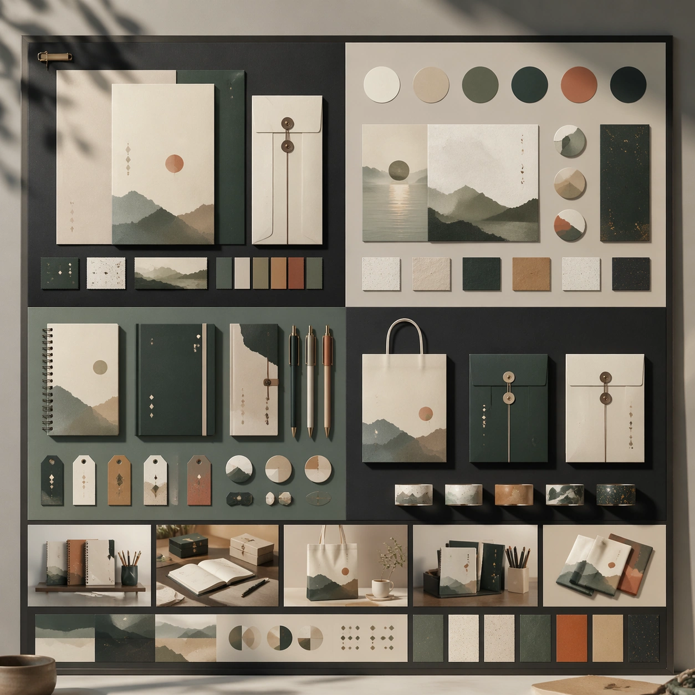

```text
Scene:
A square production-ready image designed for a game-art review wall and a commercial gallery at the same time. Frame a system-board layout for taiwanese paper and stationery lifestyle taiwanese paper and stationery lifestyle that organizes multiple related elements into one coherent review surface with disciplined lighting, clean edge separation, and enough surrounding context to prove how the asset would behave in a real product surface. The camera, crop, and tonal balance should feel intentional rather than generic, with high readability at first glance and convincing material response under closer inspection.

Subject:
Center the study on a system-board layout for taiwanese paper and stationery lifestyle taiwanese paper and stationery lifestyle that organizes multiple related elements into one coherent review surface. Translate the topic into a concrete, shippable visual statement instead of a loose mood board. Build layered object relationships, believable surface finish, and strong silhouette grouping so the image reads immediately as part of a taiwanese paper and stationery lifestyle taiwanese paper and stationery lifestyle visual system. The subject should feel made for a live game pipeline: useful in store, UI, campaign, or art-review contexts, with visual hierarchy strong enough to survive aggressive cropping.

Important details:
the board should feel design-ready and structured even though every label remains abstract. Keep every supporting element subordinate to the main read, and make category separation obvious through form, color zoning, depth, and material logic rather than words. Where panels, cards, badges, or interface blocks appear, they must look professionally structured but remain unreadable. The visual language should feel premium, original, and coherent across this package, with no filler clutter and no accidental resemblance to a specific shipped game IP.

Use case:
taiwanese paper and stationery lifestyle taiwanese paper and stationery lifestyle single study 3/5, focused on system board.

Constraints:
No readable text, no watermark, no logos, preserve exact 1:1 aspect ratio, no readable labels, no placeholder lorem ipsum, no broken hierarchy, no generic stock-photo staging, no accidental UI gibberish.
```

[Pinned source](https://github.com/ChaosRealmsAI/gpt-image-2-gallery/blob/5296db8c996e38776c83a0bc8c64f848dcd512b3/works/topics/taiwanese-paper-and-stationery-lifestyle/packages/single-theme-extensions/images/system-board/meta.json) · GPT Image2 · 1254×1254 · No source-declared image dependencies. · ProjectD:pending individual review.

## Promo Crop · taiwanese-paper-and-stationery-lifestyle/single-theme-extensions/promo-crop

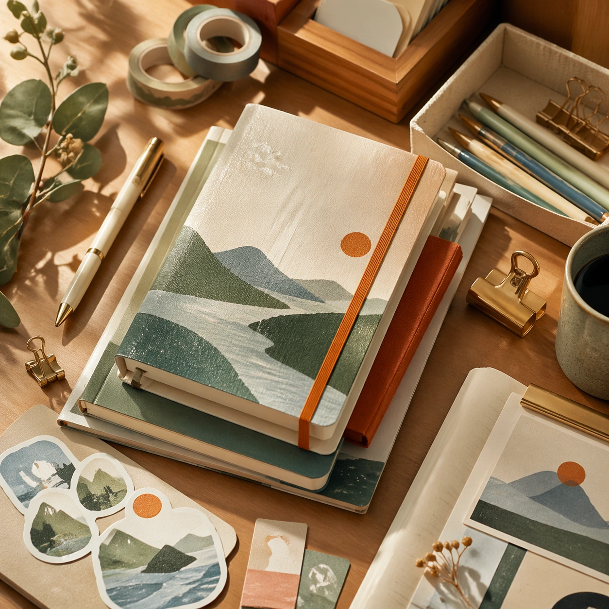

```text
Scene:
A square production-ready image designed for a game-art review wall and a commercial gallery at the same time. Frame a promo-oriented crop for taiwanese paper and stationery lifestyle taiwanese paper and stationery lifestyle optimized for social, storefront, or poster reuse with disciplined lighting, clean edge separation, and enough surrounding context to prove how the asset would behave in a real product surface. The camera, crop, and tonal balance should feel intentional rather than generic, with high readability at first glance and convincing material response under closer inspection.

Subject:
Center the study on a promo-oriented crop for taiwanese paper and stationery lifestyle taiwanese paper and stationery lifestyle optimized for social, storefront, or poster reuse. Translate the topic into a concrete, shippable visual statement instead of a loose mood board. Build layered object relationships, believable surface finish, and strong silhouette grouping so the image reads immediately as part of a taiwanese paper and stationery lifestyle taiwanese paper and stationery lifestyle visual system. The subject should feel made for a live game pipeline: useful in store, UI, campaign, or art-review contexts, with visual hierarchy strong enough to survive aggressive cropping.

Important details:
keep strong hierarchy and conversion energy without relying on explicit copy. Keep every supporting element subordinate to the main read, and make category separation obvious through form, color zoning, depth, and material logic rather than words. Where panels, cards, badges, or interface blocks appear, they must look professionally structured but remain unreadable. The visual language should feel premium, original, and coherent across this package, with no filler clutter and no accidental resemblance to a specific shipped game IP.

Use case:
taiwanese paper and stationery lifestyle taiwanese paper and stationery lifestyle single study 4/5, focused on promo crop.

Constraints:
No readable text, no watermark, no logos, preserve exact 1:1 aspect ratio, no slogans, no logos, no broken hierarchy, no generic stock-photo staging, no accidental UI gibberish.
```

[Pinned source](https://github.com/ChaosRealmsAI/gpt-image-2-gallery/blob/5296db8c996e38776c83a0bc8c64f848dcd512b3/works/topics/taiwanese-paper-and-stationery-lifestyle/packages/single-theme-extensions/images/promo-crop/meta.json) · GPT Image2 · 1254×1254 · No source-declared image dependencies. · ProjectD:pending individual review.

## Finale Study · taiwanese-paper-and-stationery-lifestyle/single-theme-extensions/finale-study

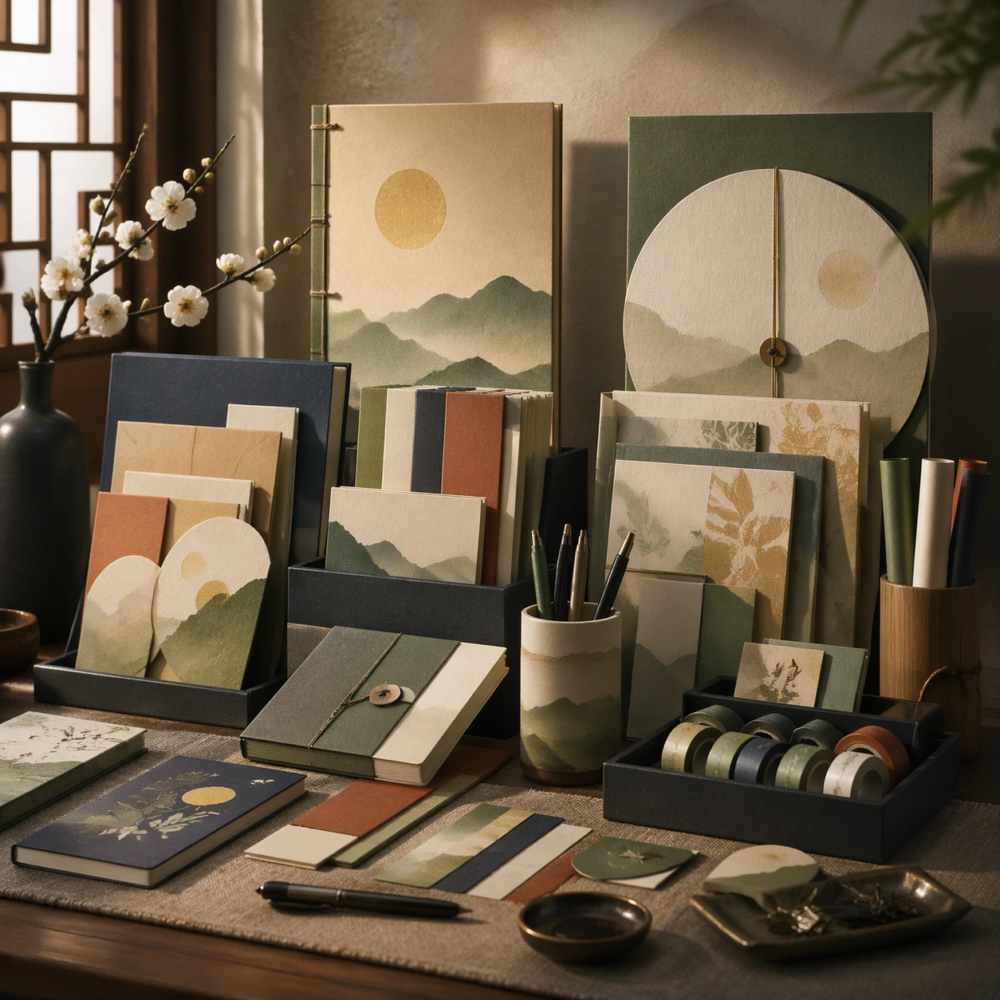

```text
Scene:
A square production-ready image designed for a game-art review wall and a commercial gallery at the same time. Frame a finale study for taiwanese paper and stationery lifestyle taiwanese paper and stationery lifestyle that pushes the topic to its most polished and complete expression with disciplined lighting, clean edge separation, and enough surrounding context to prove how the asset would behave in a real product surface. The camera, crop, and tonal balance should feel intentional rather than generic, with high readability at first glance and convincing material response under closer inspection.

Subject:
Center the study on a finale study for taiwanese paper and stationery lifestyle taiwanese paper and stationery lifestyle that pushes the topic to its most polished and complete expression. Translate the topic into a concrete, shippable visual statement instead of a loose mood board. Build layered object relationships, believable surface finish, and strong silhouette grouping so the image reads immediately as part of a taiwanese paper and stationery lifestyle taiwanese paper and stationery lifestyle visual system. The subject should feel made for a live game pipeline: useful in store, UI, campaign, or art-review contexts, with visual hierarchy strong enough to survive aggressive cropping.

Important details:
the closing image should feel definitive, high-signal, and suitable for feature placement. Keep every supporting element subordinate to the main read, and make category separation obvious through form, color zoning, depth, and material logic rather than words. Where panels, cards, badges, or interface blocks appear, they must look professionally structured but remain unreadable. The visual language should feel premium, original, and coherent across this package, with no filler clutter and no accidental resemblance to a specific shipped game IP.

Use case:
taiwanese paper and stationery lifestyle taiwanese paper and stationery lifestyle single study 5/5, focused on finale study.

Constraints:
No readable text, no watermark, no logos, preserve exact 1:1 aspect ratio, no text blocks, no derivative character likeness, no broken hierarchy, no generic stock-photo staging, no accidental UI gibberish.
```

[Pinned source](https://github.com/ChaosRealmsAI/gpt-image-2-gallery/blob/5296db8c996e38776c83a0bc8c64f848dcd512b3/works/topics/taiwanese-paper-and-stationery-lifestyle/packages/single-theme-extensions/images/finale-study/meta.json) · GPT Image2 · 1254×1254 · No source-declared image dependencies. · ProjectD:pending individual review.

## Color Field Threshold · tarot-card-deck/single-tarot-card-deck-studies/color-field-threshold

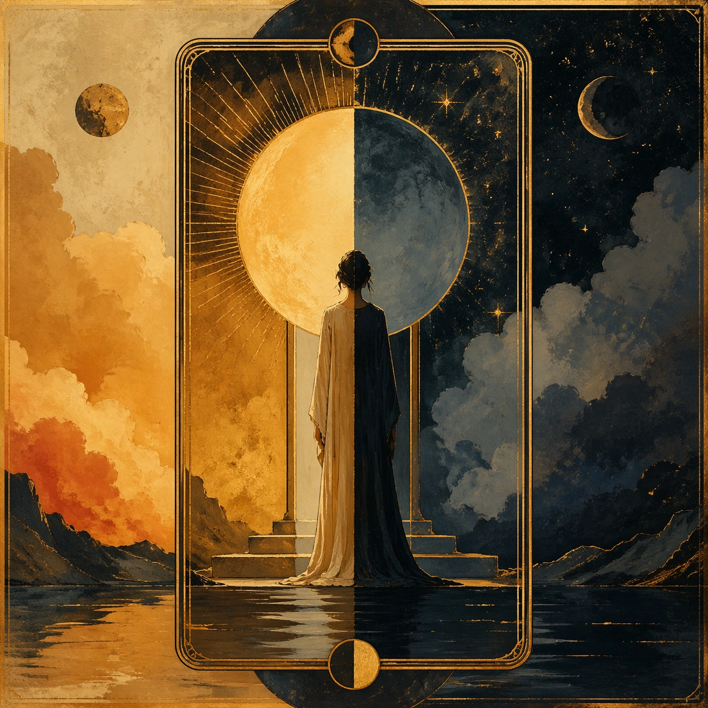

```text
Scene:
A square, gallery-ready composition with painterly surfaces, controlled negative space, and a deliberate fine-art presentation. Build the frame around a few dominant blocks or atmospheres of color with slow transitions and emotional weight. Keep the lighting, camera distance, and spatial organization tuned for a high-signal research image rather than a casual snapshot. The image belongs to the Tarot Card Deck theme and should feel immediately legible as a prompt atlas theme for tarot card deck, testing multi-image-reference with gpt image 2..

Subject:
Center the study on a few dominant blocks or atmospheres of color with slow transitions and emotional weight. Translate the theme into a concrete visual statement instead of an abstract mood board: the viewer should understand what kind of image this is, what is being tested, and why the composition is difficult. Use the slug idea of tarot card deck as a literal guide for subject matter, materials, and staging.

Important details:
Focus on authored mark-making, hierarchy, rhythm, and a visual idea that reads immediately before the viewer inspects the brushwork. Preserve a disciplined square composition, clear focal hierarchy, and enough secondary information to make the image feel complete rather than underspecified. The image should look polished, novel, and exhibition-ready, with topic-specific credibility coming from the way surfaces, structure, and visual language reinforce Tarot Card Deck. Avoid generic filler elements that do not serve the main concept.

Use case:
Tarot Card Deck single study 2/8, testing multi-image-reference through the color field threshold variation.

Constraints:
No readable text, no watermark, no logos, preserve exact 1:1 aspect ratio, no direct copy of a known artwork, no comic speech bubbles, no accidental typography, no low-effort doodle energy, no muddy center, no fake museum label.
```

[Pinned source](https://github.com/ChaosRealmsAI/gpt-image-2-gallery/blob/5296db8c996e38776c83a0bc8c64f848dcd512b3/works/topics/tarot-card-deck/packages/single-tarot-card-deck-studies/images/color-field-threshold/meta.json) · GPT Image2 · 1254×1254 · No source-declared image dependencies. · ProjectD:pending individual review.

## Fractured Figure Surge · tarot-card-deck/single-tarot-card-deck-studies/fractured-figure-surge

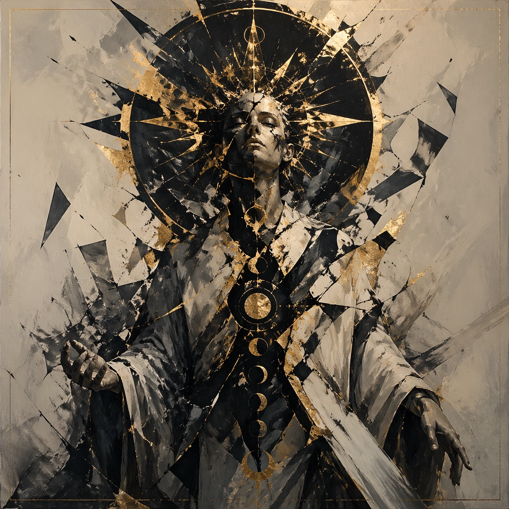

```text
Scene:
A square, gallery-ready composition with painterly surfaces, controlled negative space, and a deliberate fine-art presentation. Build the frame around a figure-like presence that emerges and dissolves through broken strokes and unstable edges. Keep the lighting, camera distance, and spatial organization tuned for a high-signal research image rather than a casual snapshot. The image belongs to the Tarot Card Deck theme and should feel immediately legible as a prompt atlas theme for tarot card deck, testing multi-image-reference with gpt image 2..

Subject:
Center the study on a figure-like presence that emerges and dissolves through broken strokes and unstable edges. Translate the theme into a concrete visual statement instead of an abstract mood board: the viewer should understand what kind of image this is, what is being tested, and why the composition is difficult. Use the slug idea of tarot card deck as a literal guide for subject matter, materials, and staging.

Important details:
Focus on authored mark-making, hierarchy, rhythm, and a visual idea that reads immediately before the viewer inspects the brushwork. Preserve a disciplined square composition, clear focal hierarchy, and enough secondary information to make the image feel complete rather than underspecified. The image should look polished, novel, and exhibition-ready, with topic-specific credibility coming from the way surfaces, structure, and visual language reinforce Tarot Card Deck. Avoid generic filler elements that do not serve the main concept.

Use case:
Tarot Card Deck single study 3/8, testing multi-image-reference through the fractured figure surge variation.

Constraints:
No readable text, no watermark, no logos, preserve exact 1:1 aspect ratio, no direct copy of a known artwork, no comic speech bubbles, no accidental typography, no low-effort doodle energy, no muddy center, no fake museum label.
```

[Pinned source](https://github.com/ChaosRealmsAI/gpt-image-2-gallery/blob/5296db8c996e38776c83a0bc8c64f848dcd512b3/works/topics/tarot-card-deck/packages/single-tarot-card-deck-studies/images/fractured-figure-surge/meta.json) · GPT Image2 · 1254×1254 · No source-declared image dependencies. · ProjectD:pending individual review.

## Black Brush Choir · tarot-card-deck/single-tarot-card-deck-studies/black-brush-choir

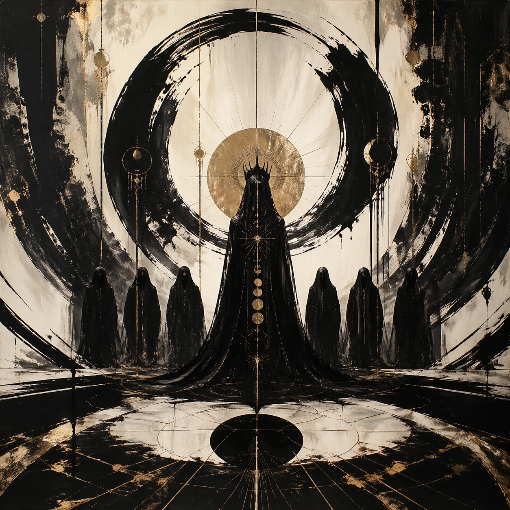

```text
Scene:
A square, gallery-ready composition with painterly surfaces, controlled negative space, and a deliberate fine-art presentation. Build the frame around large decisive black gestures that create rhythm, tension, and architectural pressure. Keep the lighting, camera distance, and spatial organization tuned for a high-signal research image rather than a casual snapshot. The image belongs to the Tarot Card Deck theme and should feel immediately legible as a prompt atlas theme for tarot card deck, testing multi-image-reference with gpt image 2..

Subject:
Center the study on large decisive black gestures that create rhythm, tension, and architectural pressure. Translate the theme into a concrete visual statement instead of an abstract mood board: the viewer should understand what kind of image this is, what is being tested, and why the composition is difficult. Use the slug idea of tarot card deck as a literal guide for subject matter, materials, and staging.

Important details:
Focus on authored mark-making, hierarchy, rhythm, and a visual idea that reads immediately before the viewer inspects the brushwork. Preserve a disciplined square composition, clear focal hierarchy, and enough secondary information to make the image feel complete rather than underspecified. The image should look polished, novel, and exhibition-ready, with topic-specific credibility coming from the way surfaces, structure, and visual language reinforce Tarot Card Deck. Avoid generic filler elements that do not serve the main concept.

Use case:
Tarot Card Deck single study 4/8, testing multi-image-reference through the black brush choir variation.

Constraints:
No readable text, no watermark, no logos, preserve exact 1:1 aspect ratio, no direct copy of a known artwork, no comic speech bubbles, no accidental typography, no low-effort doodle energy, no muddy center, no fake museum label.
```

[Pinned source](https://github.com/ChaosRealmsAI/gpt-image-2-gallery/blob/5296db8c996e38776c83a0bc8c64f848dcd512b3/works/topics/tarot-card-deck/packages/single-tarot-card-deck-studies/images/black-brush-choir/meta.json) · GPT Image2 · 1254×1254 · No source-declared image dependencies. · ProjectD:pending individual review.

## Studio Floor Afterimage · tarot-card-deck/single-tarot-card-deck-studies/studio-floor-afterimage

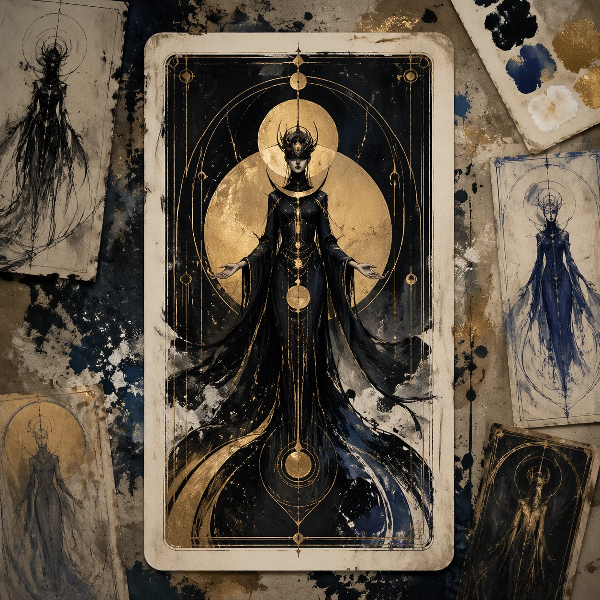

```text
Scene:
A square, gallery-ready composition with painterly surfaces, controlled negative space, and a deliberate fine-art presentation. Build the frame around evidence of process, splatter, drag, and layered correction without becoming documentary clutter. Keep the lighting, camera distance, and spatial organization tuned for a high-signal research image rather than a casual snapshot. The image belongs to the Tarot Card Deck theme and should feel immediately legible as a prompt atlas theme for tarot card deck, testing multi-image-reference with gpt image 2..

Subject:
Center the study on evidence of process, splatter, drag, and layered correction without becoming documentary clutter. Translate the theme into a concrete visual statement instead of an abstract mood board: the viewer should understand what kind of image this is, what is being tested, and why the composition is difficult. Use the slug idea of tarot card deck as a literal guide for subject matter, materials, and staging.

Important details:
Focus on authored mark-making, hierarchy, rhythm, and a visual idea that reads immediately before the viewer inspects the brushwork. Preserve a disciplined square composition, clear focal hierarchy, and enough secondary information to make the image feel complete rather than underspecified. The image should look polished, novel, and exhibition-ready, with topic-specific credibility coming from the way surfaces, structure, and visual language reinforce Tarot Card Deck. Avoid generic filler elements that do not serve the main concept.

Use case:
Tarot Card Deck single study 5/8, testing multi-image-reference through the studio floor afterimage variation.

Constraints:
No readable text, no watermark, no logos, preserve exact 1:1 aspect ratio, no direct copy of a known artwork, no comic speech bubbles, no accidental typography, no low-effort doodle energy, no muddy center, no fake museum label.
```

[Pinned source](https://github.com/ChaosRealmsAI/gpt-image-2-gallery/blob/5296db8c996e38776c83a0bc8c64f848dcd512b3/works/topics/tarot-card-deck/packages/single-tarot-card-deck-studies/images/studio-floor-afterimage/meta.json) · GPT Image2 · 1254×1254 · No source-declared image dependencies. · ProjectD:pending individual review.

## 厚涂天气 · tarot-card-deck/single-tarot-card-deck-studies/impasto-weather

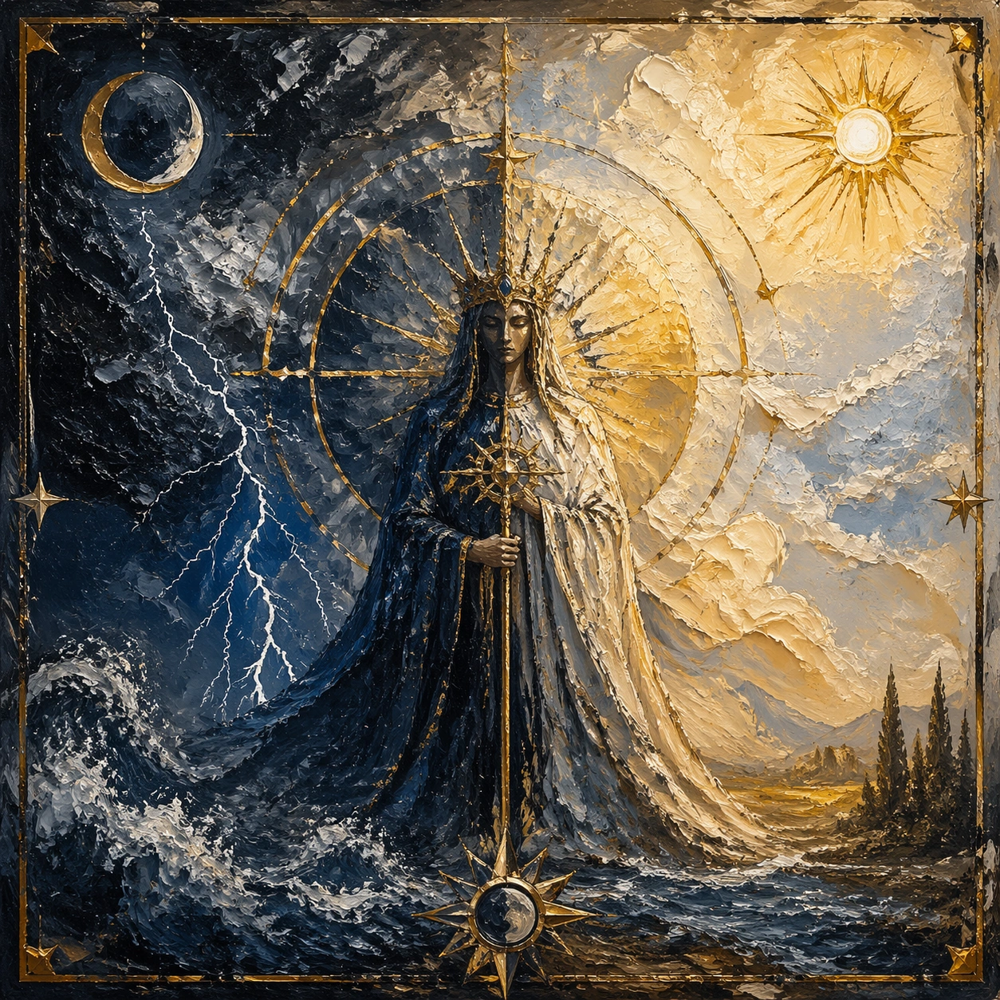

```text
Scene:
A square, gallery-ready composition with painterly surfaces, controlled negative space, and a deliberate fine-art presentation. Build the frame around surface build-up, scrape marks, and thick tactile passages that feel meteorological. Keep the lighting, camera distance, and spatial organization tuned for a high-signal research image rather than a casual snapshot. The image belongs to the Tarot Card Deck theme and should feel immediately legible as a prompt atlas theme for tarot card deck, testing multi-image-reference with gpt image 2..

Subject:
Center the study on surface build-up, scrape marks, and thick tactile passages that feel meteorological. Translate the theme into a concrete visual statement instead of an abstract mood board: the viewer should understand what kind of image this is, what is being tested, and why the composition is difficult. Use the slug idea of tarot card deck as a literal guide for subject matter, materials, and staging.

Important details:
Focus on authored mark-making, hierarchy, rhythm, and a visual idea that reads immediately before the viewer inspects the brushwork. Preserve a disciplined square composition, clear focal hierarchy, and enough secondary information to make the image feel complete rather than underspecified. The image should look polished, novel, and exhibition-ready, with topic-specific credibility coming from the way surfaces, structure, and visual language reinforce Tarot Card Deck. Avoid generic filler elements that do not serve the main concept.

Use case:
Tarot Card Deck single study 6/8, testing multi-image-reference through the 厚涂天气 variation.

Constraints:
No readable text, no watermark, no logos, preserve exact 1:1 aspect ratio, no direct copy of a known artwork, no comic speech bubbles, no accidental typography, no low-effort doodle energy, no muddy center, no fake museum label.
```

[Pinned source](https://github.com/ChaosRealmsAI/gpt-image-2-gallery/blob/5296db8c996e38776c83a0bc8c64f848dcd512b3/works/topics/tarot-card-deck/packages/single-tarot-card-deck-studies/images/impasto-weather/meta.json) · GPT Image2 · 1254×1254 · No source-declared image dependencies. · ProjectD:pending individual review.

## Gesture Architecture · tarot-card-deck/single-tarot-card-deck-studies/gesture-architecture

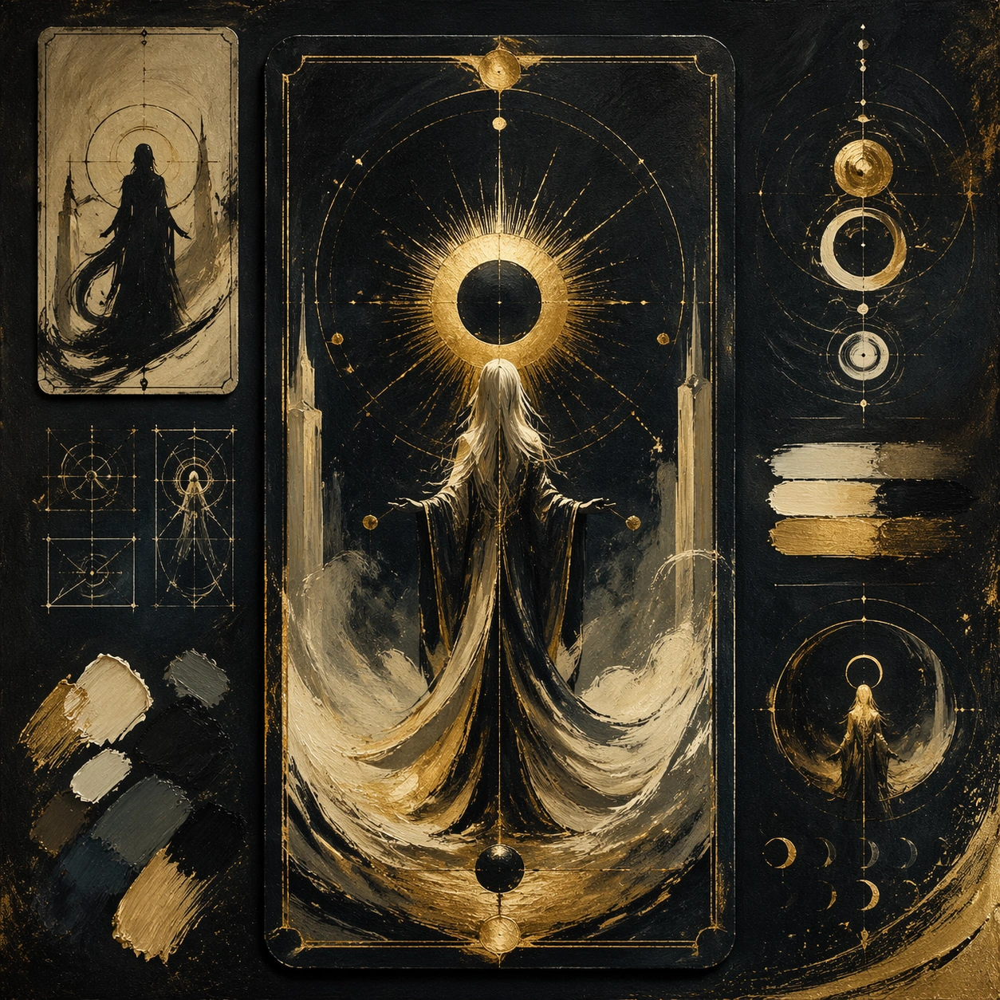

```text
Scene:
A square, gallery-ready composition with painterly surfaces, controlled negative space, and a deliberate fine-art presentation. Build the frame around brush movement that locks into a hidden compositional scaffold rather than random motion. Keep the lighting, camera distance, and spatial organization tuned for a high-signal research image rather than a casual snapshot. The image belongs to the Tarot Card Deck theme and should feel immediately legible as a prompt atlas theme for tarot card deck, testing multi-image-reference with gpt image 2..

Subject:
Center the study on brush movement that locks into a hidden compositional scaffold rather than random motion. Translate the theme into a concrete visual statement instead of an abstract mood board: the viewer should understand what kind of image this is, what is being tested, and why the composition is difficult. Use the slug idea of tarot card deck as a literal guide for subject matter, materials, and staging.

Important details:
Focus on authored mark-making, hierarchy, rhythm, and a visual idea that reads immediately before the viewer inspects the brushwork. Preserve a disciplined square composition, clear focal hierarchy, and enough secondary information to make the image feel complete rather than underspecified. The image should look polished, novel, and exhibition-ready, with topic-specific credibility coming from the way surfaces, structure, and visual language reinforce Tarot Card Deck. Avoid generic filler elements that do not serve the main concept.

Use case:
Tarot Card Deck single study 7/8, testing multi-image-reference through the gesture architecture variation.

Constraints:
No readable text, no watermark, no logos, preserve exact 1:1 aspect ratio, no direct copy of a known artwork, no comic speech bubbles, no accidental typography, no low-effort doodle energy, no muddy center, no fake museum label.
```

[Pinned source](https://github.com/ChaosRealmsAI/gpt-image-2-gallery/blob/5296db8c996e38776c83a0bc8c64f848dcd512b3/works/topics/tarot-card-deck/packages/single-tarot-card-deck-studies/images/gesture-architecture/meta.json) · GPT Image2 · 1254×1254 · No source-declared image dependencies. · ProjectD:pending individual review.

## Museum Wall Hang · tarot-card-deck/single-tarot-card-deck-studies/museum-wall-hang

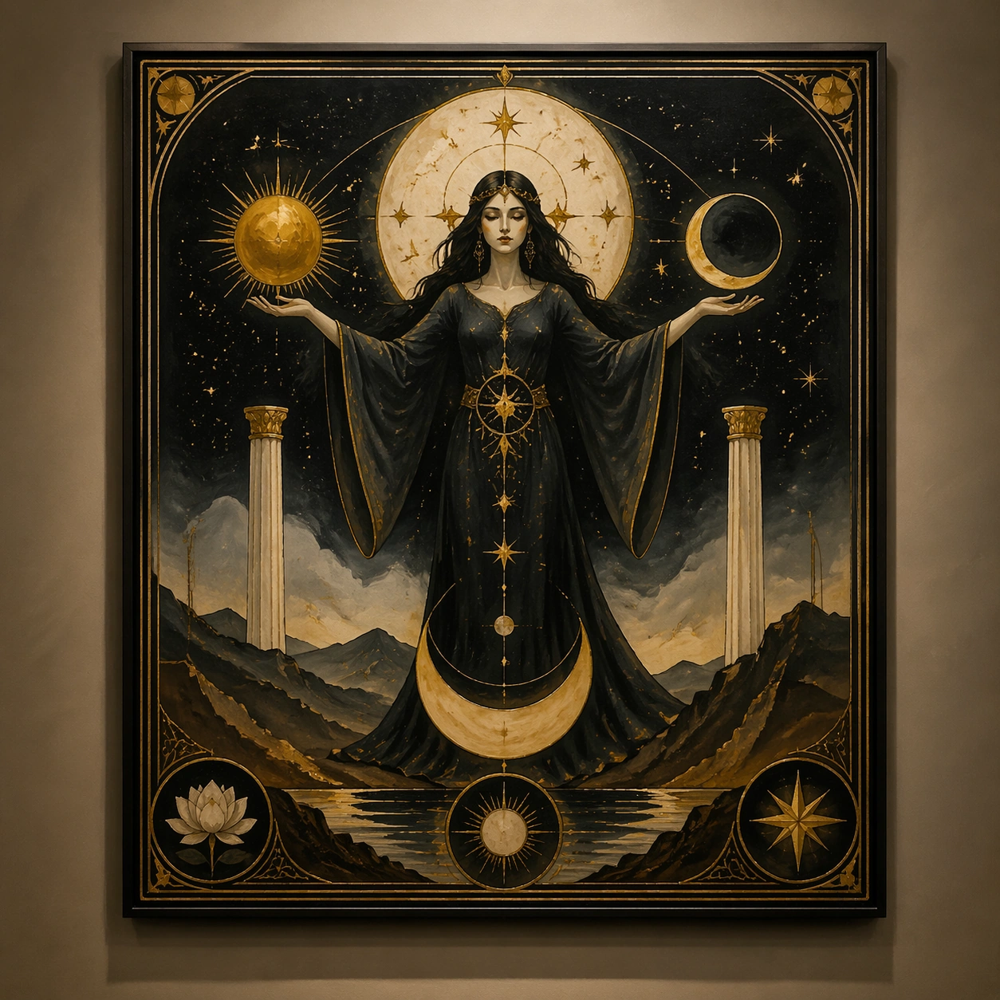

```text
Scene:
A square, gallery-ready composition with painterly surfaces, controlled negative space, and a deliberate fine-art presentation. Build the frame around a resolved exhibition-grade work whose internal balance feels complete and intentional. Keep the lighting, camera distance, and spatial organization tuned for a high-signal research image rather than a casual snapshot. The image belongs to the Tarot Card Deck theme and should feel immediately legible as a prompt atlas theme for tarot card deck, testing multi-image-reference with gpt image 2..

Subject:
Center the study on a resolved exhibition-grade work whose internal balance feels complete and intentional. Translate the theme into a concrete visual statement instead of an abstract mood board: the viewer should understand what kind of image this is, what is being tested, and why the composition is difficult. Use the slug idea of tarot card deck as a literal guide for subject matter, materials, and staging.

Important details:
Focus on authored mark-making, hierarchy, rhythm, and a visual idea that reads immediately before the viewer inspects the brushwork. Preserve a disciplined square composition, clear focal hierarchy, and enough secondary information to make the image feel complete rather than underspecified. The image should look polished, novel, and exhibition-ready, with topic-specific credibility coming from the way surfaces, structure, and visual language reinforce Tarot Card Deck. Avoid generic filler elements that do not serve the main concept.

Use case:
Tarot Card Deck single study 8/8, testing multi-image-reference through the museum wall hang variation.

Constraints:
No readable text, no watermark, no logos, preserve exact 1:1 aspect ratio, no direct copy of a known artwork, no comic speech bubbles, no accidental typography, no low-effort doodle energy, no muddy center, no fake museum label.
```

[Pinned source](https://github.com/ChaosRealmsAI/gpt-image-2-gallery/blob/5296db8c996e38776c83a0bc8c64f848dcd512b3/works/topics/tarot-card-deck/packages/single-tarot-card-deck-studies/images/museum-wall-hang/meta.json) · GPT Image2 · 1254×1254 · No source-declared image dependencies. · ProjectD:pending individual review.

## Reference Anchor · tassili-rock-art-living/series-core-discovery/01-reference-anchor

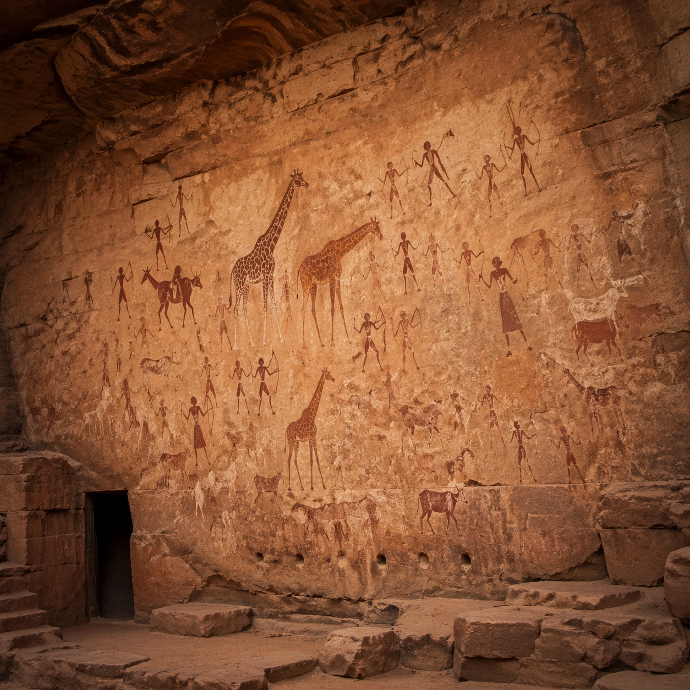

```text
Scene:
A square documentary image composed like a premium archaeology magazine feature. Use warm Sahara sandstone, dusty red-brown pigment, muted ivory chalk, and low dusk light. Frame a Tassili sandstone wall filled with prehistoric painted figures, giraffes, dancers, and hunters that seem gently volumetric without becoming fantasy creatures with crisp depth layering, restrained contrast, and subtle atmospheric depth so the scene feels excavated, observed, and historically grounded rather than theatrical or game-like. Keep the light directional but believable, as if captured during a careful field visit.

Subject:
Center the image on a Tassili sandstone wall filled with prehistoric painted figures, giraffes, dancers, and hunters that seem gently volumetric without becoming fantasy creatures. Include culturally accurate surface logic, region-specific setting, and believable human-scale cues in stairs, doorways, cut blocks, relief edges, or water depth. Shapes, carvings, masonry joints, and site wear should feel studied from real archaeology, with no generic ancient-world mashup and no ornamental filler borrowed from another civilization.

Important details:
Keep the imagery recognizably North African rock art, with elongated figures, animal profile logic, archaeological weathering, and only a restrained suggestion of volume emerging from the painted surface. Emphasize sandstone shelter walls, mineral pigment residues, dust-softened ledges, weathering crust, and subtle low-relief transitions where painting meets stone. Keep inscriptions, painted registers, symbolic motifs, or carved bands visually plausible but not readable. Preserve a museum-grade balance between beauty and evidence: light should reveal relief depth, edge wear, repairs, sediment traces, and excavation context without turning the site into fantasy spectacle. The composition should feel like a definitive reference frame that later variations can inherit exactly.

Use case:
Tassili Rock Art Coming Alive series study 1/9.

Constraints:
No readable text, no watermark, no logos, preserve exact 1:1 aspect ratio, no glowing magic portals, no comic-book action poses, no modern graffiti, no surreal monsters, no tourists, no anachronistic props, no collage layout, no exaggerated fantasy lighting.
```

[Pinned source](https://github.com/ChaosRealmsAI/gpt-image-2-gallery/blob/5296db8c996e38776c83a0bc8c64f848dcd512b3/works/topics/tassili-rock-art-living/packages/series-core-discovery/images/01-reference-anchor/meta.json) · GPT Image2 · 1254×1254 · No source-declared image dependencies. · ProjectD:pending individual review.

## Human Scale Reveal · tassili-rock-art-living/series-core-discovery/02-human-scale-reveal

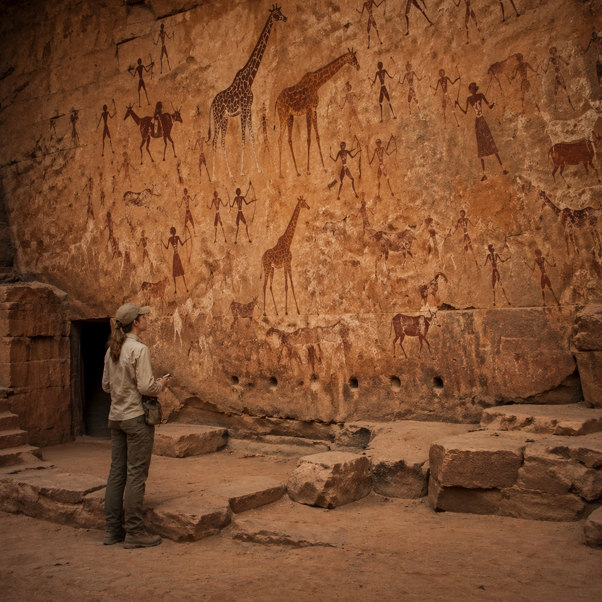

```text
Scene:
A square follow-up field image from the same site, slightly closer and lower than the reference anchor, with careful documentary framing and the same material palette. The camera should feel physically present inside the archaeological space, using natural light, soft depth separation, and one clear human figure to explain scale without turning the image into lifestyle photography.

Subject:
Show the same site identity established in the reference anchor, now with an archaeologist, conservator, or field researcher moving through the scene in practical neutral clothing. The person should be small relative to the monument and clearly secondary to the architecture, water, or painted wall system. Keep the main forms, structural rhythm, and civilizational markers unchanged.

Important details:
Preserve the exact site identity, base geometry, material behavior, and cultural signatures from the reference model. Only vary vantage, gesture, and scale cues. Keep the imagery recognizably North African rock art, with elongated figures, animal profile logic, archaeological weathering, and only a restrained suggestion of volume emerging from the painted surface. Human presence should clarify stair height, wall size, carving depth, or spatial compression while respecting conservation protocol and historical seriousness. Keep any tools understated and generic, with no readable labels. The image must still look like a rigorous archaeological record first and a dramatic scene second.

Use case:
Tassili Rock Art Coming Alive series study 2/9.

Constraints:
No readable text, no watermark, no logos, preserve exact 1:1 aspect ratio, preserve exact site identity from the reference image, no glowing magic portals, no comic-book action poses, no modern graffiti, no surreal monsters, no fashion editorial styling, no crowd, no cinematic props.
```

[Pinned source](https://github.com/ChaosRealmsAI/gpt-image-2-gallery/blob/5296db8c996e38776c83a0bc8c64f848dcd512b3/works/topics/tassili-rock-art-living/packages/series-core-discovery/images/02-human-scale-reveal/meta.json) · GPT Image2 · 1254×1254 · Reference images required. · ProjectD:pending individual review.

## Surface Close Study · tassili-rock-art-living/series-core-discovery/03-surface-close-study

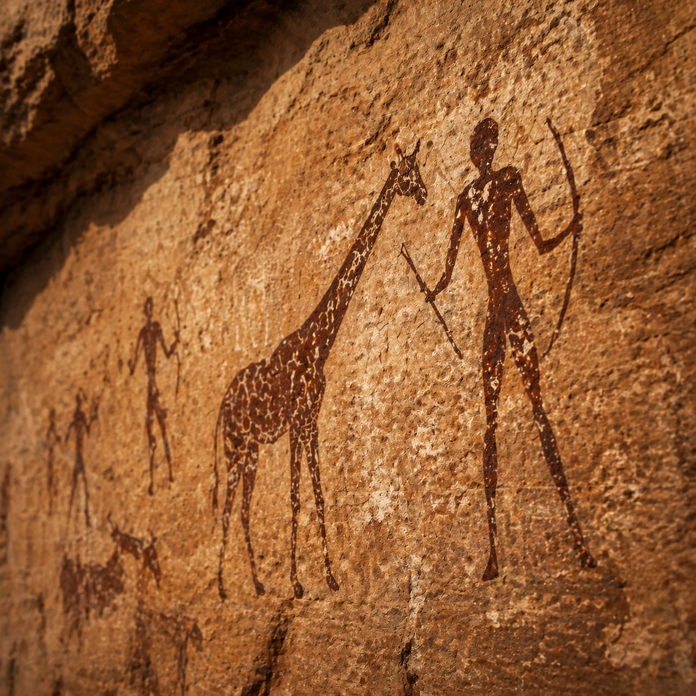

```text
Scene:
A square close study framed within the same site established by the reference anchor. Use a tight crop, shallow but believable depth of field, and raking light that reveals tactile evidence in surface relief, pigment, tool marks, moisture, or marine wear. The image should feel like a museum conservation photograph elevated to gallery quality.

Subject:
Focus on a materially rich portion of the same site: carved edges, painted plaster, fitted stone, root-wrapped masonry, submerged paving, or quarry-cut facial planes depending on the civilization. The composition should remain anchored to the original location and show enough surrounding context that viewers still recognize the parent site rather than mistaking it for an unrelated artifact.

Important details:
Preserve the exact site identity from the reference model while shifting emphasis to forensic surface evidence. Keep the imagery recognizably North African rock art, with elongated figures, animal profile logic, archaeological weathering, and only a restrained suggestion of volume emerging from the painted surface. Make micro-texture, fracture lines, pigment retention, water wear, plant interaction, dust, or chisel traces visually persuasive. Avoid decorative clutter. Every mark should feel like evidence of making, weathering, excavation, or conservation. Keep any symbolic marks non-legible and historically appropriate, and make the light reveal depth without flattening the material richness.

Use case:
Tassili Rock Art Coming Alive series study 3/9.

Constraints:
No readable text, no watermark, no logos, preserve exact 1:1 aspect ratio, preserve exact site identity from the reference image, no glowing magic portals, no comic-book action poses, no modern graffiti, no surreal monsters, no isolated floating artifact, no studio backdrop, no fake macro abstraction.
```

[Pinned source](https://github.com/ChaosRealmsAI/gpt-image-2-gallery/blob/5296db8c996e38776c83a0bc8c64f848dcd512b3/works/topics/tassili-rock-art-living/packages/series-core-discovery/images/03-surface-close-study/meta.json) · GPT Image2 · 1254×1254 · Reference images required. · ProjectD:pending individual review.

## Atmospheric Wide Reveal · tassili-rock-art-living/series-core-discovery/04-atmospheric-wide-reveal

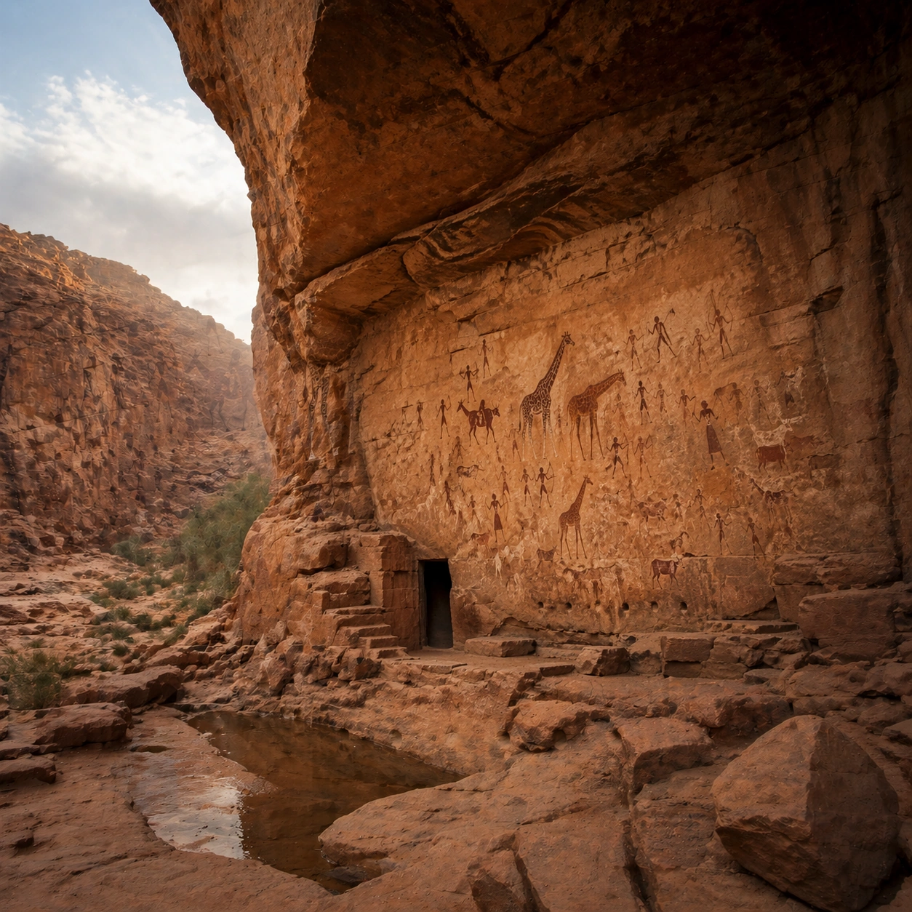

```text
Scene:
A square wide reveal of the same site under a slightly different environmental condition, with more surrounding geography or architecture visible while keeping the anchor landmark dominant. Use disciplined composition, atmospheric perspective, and natural light behavior so the image feels like a patient field photograph captured after the reference shot rather than a different fantasy set.

Subject:
Show the same site identity with broader context: approaches, terraces, ring walls, canyon slot, canopy volume, quarry slope, or chamber boundaries depending on the location. The anchor structure must remain instantly recognizable. Environmental scale should deepen understanding of why the site is placed here and how people, water, topography, or vegetation shape the experience of the monument.

Important details:
Preserve the exact landmark, materials, and civilizational cues from the reference model while allowing wider framing and a different atmospheric emphasis. Keep the imagery recognizably North African rock art, with elongated figures, animal profile logic, archaeological weathering, and only a restrained suggestion of volume emerging from the painted surface. Use geography and environmental systems to add meaning: drainage, mist, current, valley depth, roots, irrigation, or enclosure logic. The image should feel both beautiful and evidentiary, with no compositional tricks that break continuity with the established site.

Use case:
Tassili Rock Art Coming Alive series study 4/9.

Constraints:
No readable text, no watermark, no logos, preserve exact 1:1 aspect ratio, preserve exact site identity from the reference image, no glowing magic portals, no comic-book action poses, no modern graffiti, no surreal monsters, no unrelated landmarks, no speculative mashup architecture, no posterized grading.
```

[Pinned source](https://github.com/ChaosRealmsAI/gpt-image-2-gallery/blob/5296db8c996e38776c83a0bc8c64f848dcd512b3/works/topics/tassili-rock-art-living/packages/series-core-discovery/images/04-atmospheric-wide-reveal/meta.json) · GPT Image2 · 1254×1254 · Reference images required. · ProjectD:pending individual review.

## Excavation Overview · tassili-rock-art-living/single-context-studies/excavation-overview

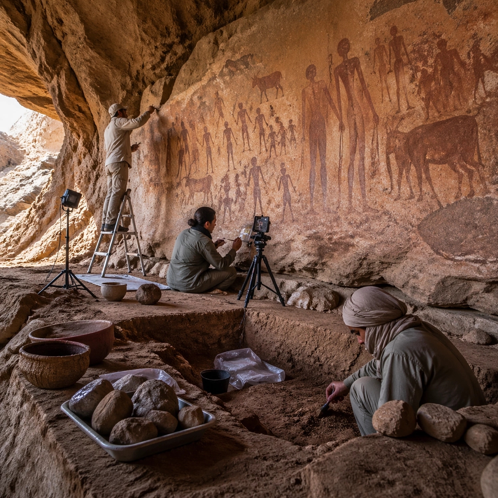

```text
Scene:
A square independent archaeology study composed from a slightly elevated fieldwork viewpoint. Use balanced natural light, crisp evidence hierarchy, and practical site organization so the image feels publishable in a museum report and still visually strong enough for a gallery wall. The frame should explain where excavation is happening without relying on readable markers or diagrams.

Subject:
Show a rock shelter documentation scene with careful raking light, measured photography equipment, and researchers tracking pigment preservation across the wall. Include grounded human traces such as ladders, trays, brushes, baskets, light rigs, or measuring tools only when they support archaeological realism and remain visually secondary. The site should stay culturally specific, with architecture, surface treatment, sediment, and environmental context all belonging to the correct civilization rather than a generic dig.

Important details:
Keep the imagery recognizably North African rock art, with elongated figures, animal profile logic, archaeological weathering, and only a restrained suggestion of volume emerging from the painted surface. Prioritize evidence relationships: exposed layers, cleaned edges, protected surfaces, loose fragments, and transitions between buried and revealed material. Let color, wear, and composition explain what has just been uncovered. The image must feel methodical rather than adventurous. Keep any site tags, notes, or markers abstract and unreadable. Avoid sensational treasure imagery and keep the atmosphere scholarly, patient, and materially convincing.

Use case:
Tassili Rock Art Coming Alive single study 5/9.

Constraints:
No readable text, no watermark, no logos, preserve exact 1:1 aspect ratio, no glowing magic portals, no comic-book action poses, no modern graffiti, no surreal monsters, no treasure-chest clichés, no action-movie posing, no arbitrary props, no infographic overlay.
```

[Pinned source](https://github.com/ChaosRealmsAI/gpt-image-2-gallery/blob/5296db8c996e38776c83a0bc8c64f848dcd512b3/works/topics/tassili-rock-art-living/packages/single-context-studies/images/excavation-overview/meta.json) · GPT Image2 · 1254×1254 · No source-declared image dependencies. · ProjectD:pending individual review.

## Artifact Tableau · tassili-rock-art-living/single-context-studies/artifact-tableau

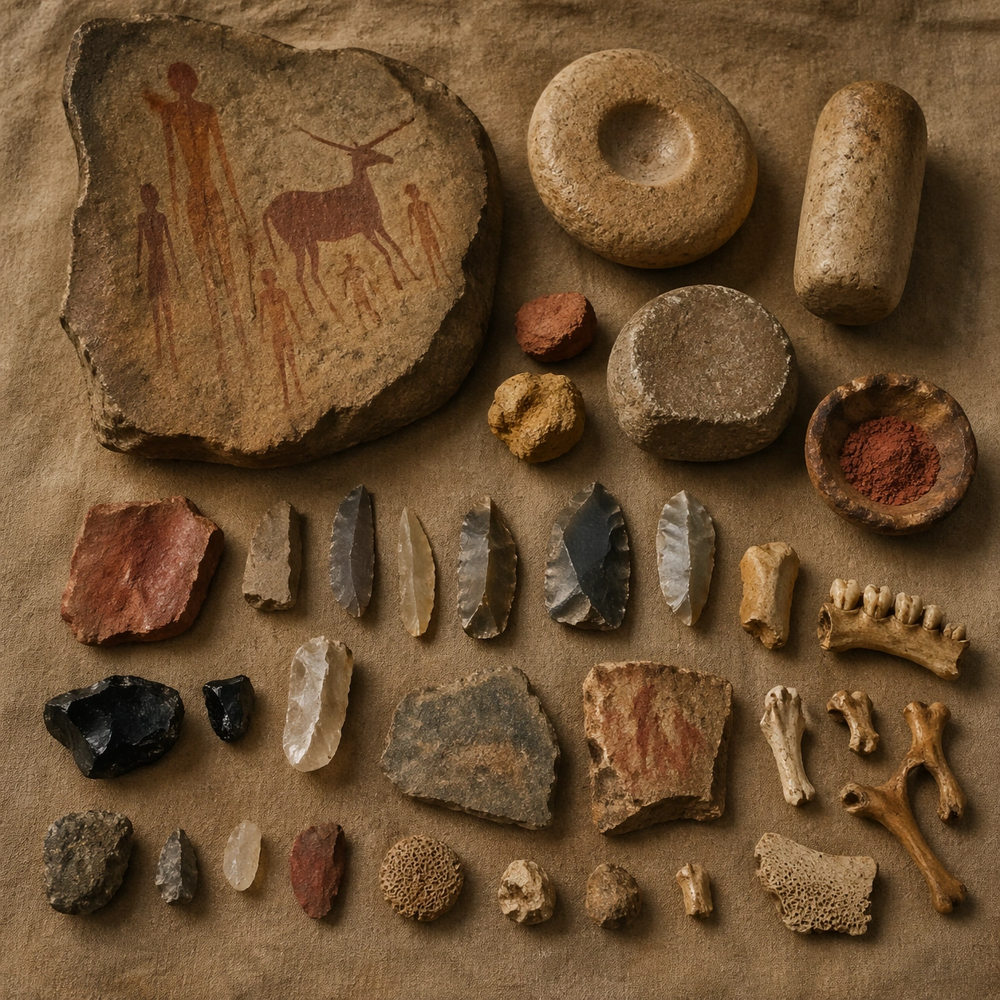

```text
Scene:
A square artifact and material study arranged like a high-end conservation photograph. Use soft directional light, controlled shadow falloff, and a neutral work surface so every fragment reads clearly. The image should feel intimate and scientific, but still rich enough to communicate the broader civilization through craft, wear, and material vocabulary alone.

Subject:
Present pigment stones, grinding tools, stone flakes, faunal fragments, and documented samples arranged on a desert field cloth. Arrange the pieces with disciplined spacing and believable conservation handling. Include enough variation in scale, finish, and damage state to suggest excavation reality rather than a perfectly staged luxury still life. Nothing should look modern or decorative for its own sake; every object must feel like evidence tied to the same cultural world as the main topic.

Important details:
Emphasize tactile surfaces, honest aging, and historically grounded material behavior. Keep the imagery recognizably North African rock art, with elongated figures, animal profile logic, archaeological weathering, and only a restrained suggestion of volume emerging from the painted surface. Show abrasion, dust, corrosion, cracks, mineral bloom, pigment retention, or edge polish where appropriate. Keep the arrangement orderly but not sterile, as if prepared for a serious cataloging session. No readable labels, no museum placards, and no visual shortcuts that turn the study into product photography detached from archaeology.

Use case:
Tassili Rock Art Coming Alive single study 6/9.

Constraints:
No readable text, no watermark, no logos, preserve exact 1:1 aspect ratio, no glowing magic portals, no comic-book action poses, no modern graffiti, no surreal monsters, no luxury advertising gloss, no floating objects, no velvet jewelry styling, no unrelated tools.
```

[Pinned source](https://github.com/ChaosRealmsAI/gpt-image-2-gallery/blob/5296db8c996e38776c83a0bc8c64f848dcd512b3/works/topics/tassili-rock-art-living/packages/single-context-studies/images/artifact-tableau/meta.json) · GPT Image2 · 1254×1254 · No source-declared image dependencies. · ProjectD:pending individual review.

## Light Shift Study · tassili-rock-art-living/single-context-studies/light-shift-study

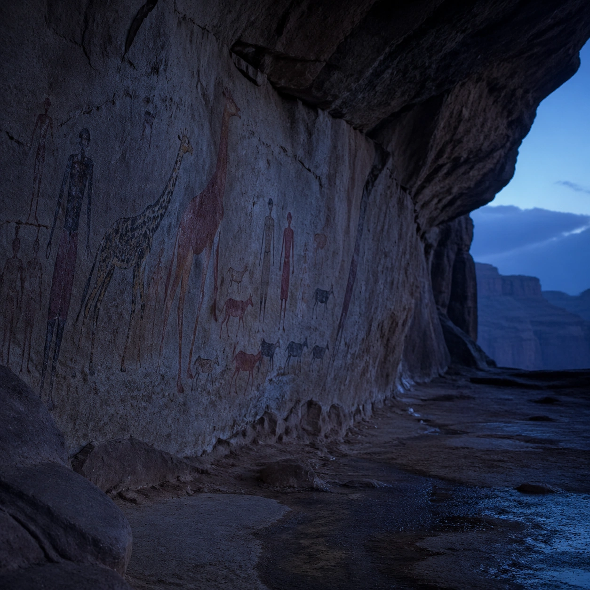

```text
Scene:
A square mood variation from the same civilization theme, built around cooler twilight light that emphasizes rock relief, shelter depth, and the subtle boundary between flat image and low volume. The image should stay grounded in field realism while testing how different illumination changes material reading, atmosphere, and emotional register. Keep the frame self-contained and coherent, as if photographed during a second visit under altered conditions.

Subject:
Show a culturally accurate site or interior connected to the same world as the main topic, but not as a direct dependency on the series reference. The focus should be on how light transforms relief, color, moisture, water, dust, or vegetation while preserving archaeological credibility. Architectural forms, objects, and setting must still belong to the same civilization with no cross-cultural contamination.

Important details:
Keep the imagery recognizably North African rock art, with elongated figures, animal profile logic, archaeological weathering, and only a restrained suggestion of volume emerging from the painted surface. Use the shift in light to reveal different evidence than the other studies: pigment glow, root sheen, caustics, wet stone, canyon shadow, marine haze, terrace depth, or quarry moisture. Keep the result serious and observational rather than romanticized. Non-readable motifs are acceptable, but there should be no signs, captions, or modern display devices. The image should feel like a rigorous visual experiment in historical atmosphere.

Use case:
Tassili Rock Art Coming Alive single study 7/9.

Constraints:
No readable text, no watermark, no logos, preserve exact 1:1 aspect ratio, no glowing magic portals, no comic-book action poses, no modern graffiti, no surreal monsters, no theatrical color filters, no supernatural effects, no montage composition, no glossy concept-art exaggeration.
```

[Pinned source](https://github.com/ChaosRealmsAI/gpt-image-2-gallery/blob/5296db8c996e38776c83a0bc8c64f848dcd512b3/works/topics/tassili-rock-art-living/packages/single-context-studies/images/light-shift-study/meta.json) · GPT Image2 · 1254×1254 · No source-declared image dependencies. · ProjectD:pending individual review.

## Survey Perspective · tassili-rock-art-living/single-context-studies/survey-perspective

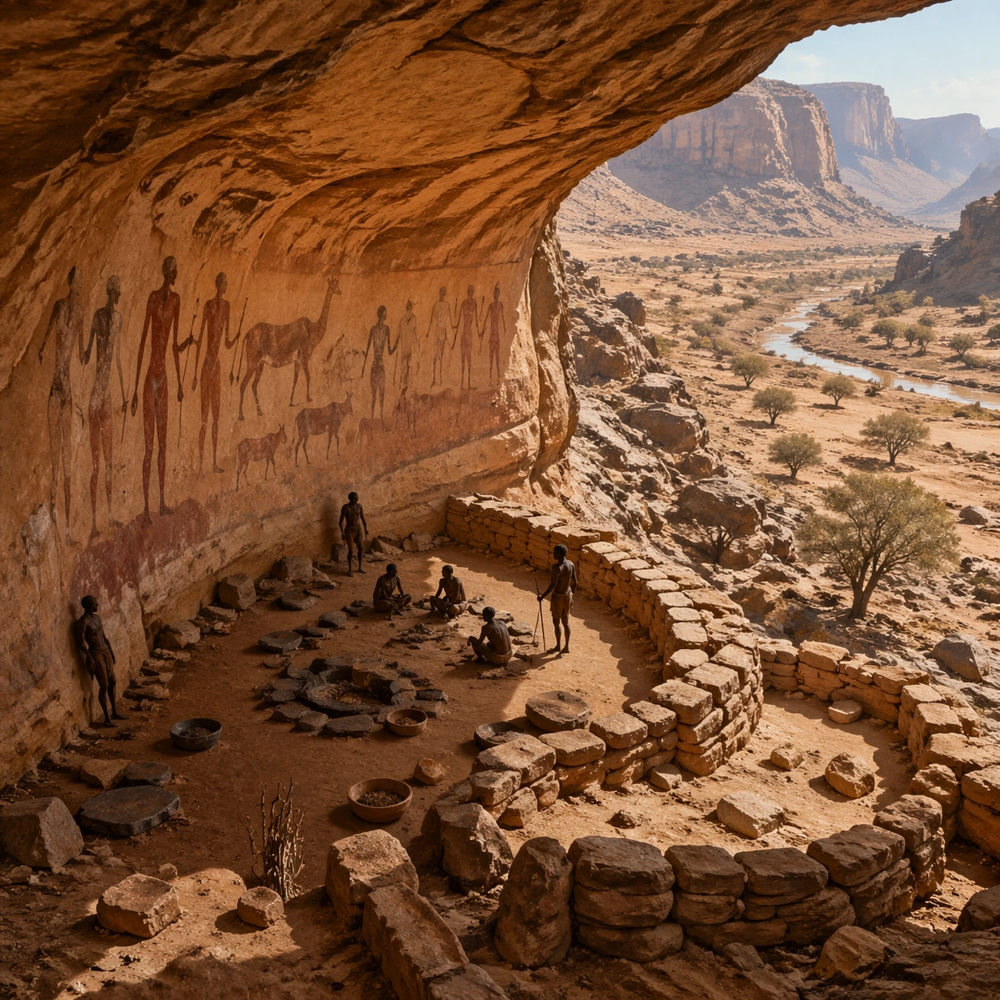

```text
Scene:
A square survey-oriented image that explains spatial logic with the clarity of an expert field overview while still reading as a finished artwork. Use a stable elevated vantage, clean depth layering, and enough visible terrain or architecture to make relationships legible without turning the frame into a literal map. The scene should feel analytical and cinematic at the same time.

Subject:
Show a shelter-wide survey perspective that shows wall curvature, figure placement, floor deposits, and the environmental setting of the painted chamber. Organize the composition so paths, terraces, walls, courtyards, chambers, canals, root systems, or quarry clusters can be read as a coherent system. The image should reveal how the civilization used land, water, elevation, enclosure, or monumentality. Keep all architecture, materials, and environmental details consistent with the correct place and period.

Important details:
Keep the imagery recognizably North African rock art, with elongated figures, animal profile logic, archaeological weathering, and only a restrained suggestion of volume emerging from the painted surface. This image should reward close looking by showing infrastructural logic: how stone courses align, how water moves, how rooms connect, how carved masses sit inside geology, or how vegetation interacts with built form. Avoid explicit annotation. Let composition, light, and scale cues do the explanatory work. Keep any measuring elements generic and unreadable, and make the image feel like serious research made visually elegant.

Use case:
Tassili Rock Art Coming Alive single study 8/9.

Constraints:
No readable text, no watermark, no logos, preserve exact 1:1 aspect ratio, no glowing magic portals, no comic-book action poses, no modern graffiti, no surreal monsters, no infographic arrows, no split-screen layout, no impossible aerial geometry, no unrelated settlements.
```

[Pinned source](https://github.com/ChaosRealmsAI/gpt-image-2-gallery/blob/5296db8c996e38776c83a0bc8c64f848dcd512b3/works/topics/tassili-rock-art-living/packages/single-context-studies/images/survey-perspective/meta.json) · GPT Image2 · 1254×1254 · No source-declared image dependencies. · ProjectD:pending individual review.

## Editorial Reconstruction · tassili-rock-art-living/single-context-studies/editorial-reconstruction

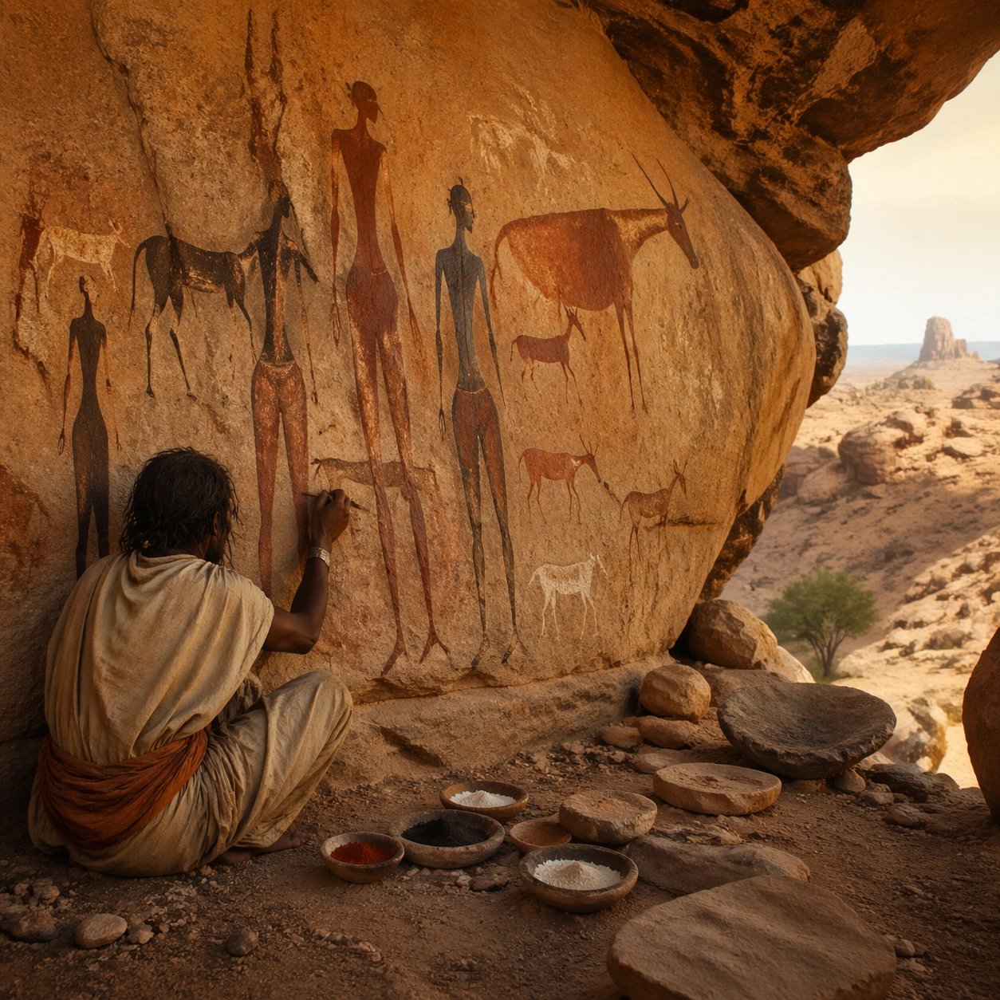

```text
Scene:
A square hero image designed for a museum wall graphic or flagship magazine cover, but without any actual typography. Use strong focal hierarchy, refined contrast, and a polished finish that still feels rooted in archaeological evidence. The frame should look complete on its own and communicate why this civilization remains visually unforgettable.

Subject:
Build the image around a serious editorial reconstruction that treats the paintings as living human evidence, not fantasy animation. Present architecture, artifacts, environment, and atmosphere as one coherent statement. The composition can be more distilled than a field snapshot, but it must remain culturally specific, materially persuasive, and free of fantasy shorthand. Nothing should feel like a movie poster or commercial franchise imitation.

Important details:
Keep the imagery recognizably North African rock art, with elongated figures, animal profile logic, archaeological weathering, and only a restrained suggestion of volume emerging from the painted surface. Distill the site or cultural world into one decisive visual argument: place, craft, weathering, engineering, and memory. Use the strongest material signatures from this civilization and let them sit in a believable environment with controlled dramatic weight. Keep any carved or painted symbols non-readable. The result should look like responsible high-end visual storytelling for research and public interpretation, not a spectacle-first matte painting.

Use case:
Tassili Rock Art Coming Alive single study 9/9.

Constraints:
No readable text, no watermark, no logos, preserve exact 1:1 aspect ratio, no glowing magic portals, no comic-book action poses, no modern graffiti, no surreal monsters, no movie-poster tropes, no overdesigned framing devices, no collage layout, no brand-like iconography.
```

[Pinned source](https://github.com/ChaosRealmsAI/gpt-image-2-gallery/blob/5296db8c996e38776c83a0bc8c64f848dcd512b3/works/topics/tassili-rock-art-living/packages/single-context-studies/images/editorial-reconstruction/meta.json) · GPT Image2 · 1254×1254 · No source-declared image dependencies. · ProjectD:pending individual review.

## Classic Parlor Wall · tattoo-flash-sheet/single-parlor-flash-studies/01-classic-parlor-wall

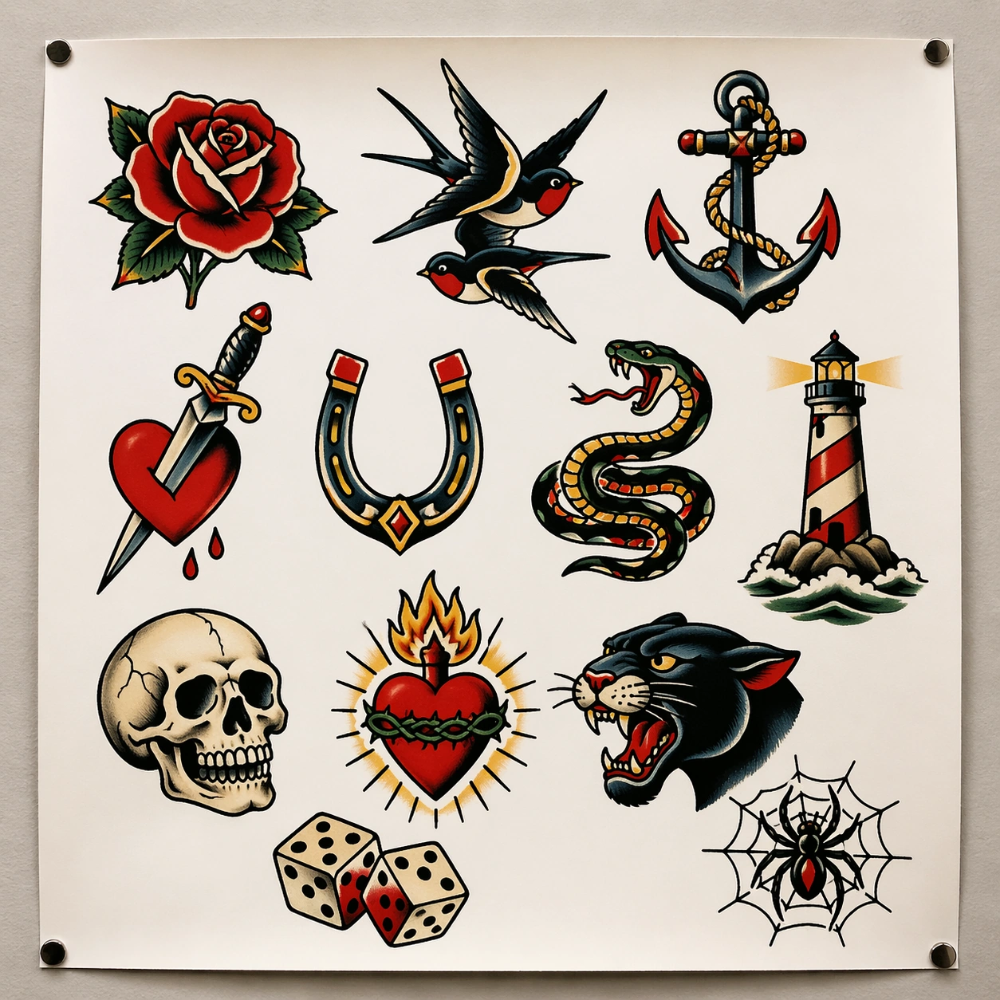

```text
Scene:
A square straight-on photograph of a single bright white flash sheet pinned to a neutral tattoo studio wall, lit by soft overhead shop lighting with very slight paper curl at the corners and faint shadows from the pins. The sheet should fill most of the frame and read like a clean commercial presentation surface, with balanced margins and enough empty white space for each design to breathe.

Subject:
Create a classic American traditional tattoo flash sheet containing around twelve isolated motifs arranged in a disciplined gridless salon layout. Include a red rose, swallow pair, ship anchor, dagger through heart, horseshoe, snake coil, lighthouse, skull, sacred heart, panther head, lucky dice, and webbed spider. Every motif should be fully self-contained, outlined in bold black, and colored with the restrained old-school palette of red, yellow, green, navy, cream, and black. The drawings must look ready for customers to choose from, not like decorative poster art or scrapbook stickers.

Important details:
The core visual rule is tattoo-parlor usability. Each design must have strong silhouette separation, even line weight, controlled fill areas, and consistent shading logic. Preserve generous white paper between motifs, small crop-safe margins, and a believable studio-wall presentation. The image should feel commercial and contemporary, even while the motifs come from traditional flash language. Avoid painterly rendering, background scenery, and extra props that distract from the sheet itself.

Use case:
Tattoo Flash Sheet single study 1/8, establishing a clean parlor-ready old-school flash board with many independent selectable motifs.

Constraints:
No readable text, no watermark, no logos, preserve exact 1:1 aspect ratio, no skin, no tattooed human body, no illegible scribble labels, no poster frame, no collage overlap, no glossy 3D render finish.
```

[Pinned source](https://github.com/ChaosRealmsAI/gpt-image-2-gallery/blob/5296db8c996e38776c83a0bc8c64f848dcd512b3/works/topics/tattoo-flash-sheet/packages/single-parlor-flash-studies/images/01-classic-parlor-wall/meta.json) · GPT Image2 · 1254×1254 · No source-declared image dependencies. · ProjectD:pending individual review.

## Blackwork Night Creatures · tattoo-flash-sheet/single-parlor-flash-studies/02-blackwork-night-creatures

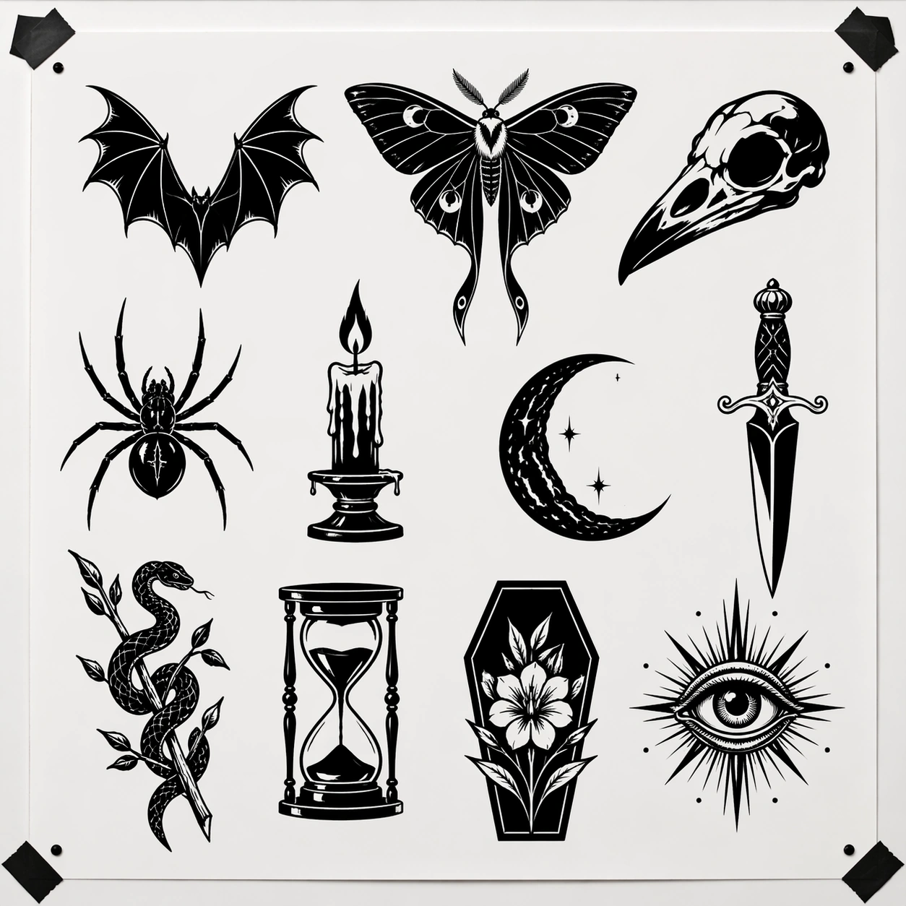

```text
Scene:
A square flat flash-sheet presentation photographed straight-on against a clean matte white backing board inside a contemporary tattoo studio. Lighting is bright and neutral, revealing crisp paper texture, black ink saturation, and generous negative space. The page should feel archival and precise, as if prepared for a client consultation wall or portfolio binder.

Subject:
Design a pure blackwork tattoo flash sheet with around eleven nocturnal or ominous motifs: bat wings, luna moth, raven skull, spider, candle flame, crescent moon, dagger, snake wrapped around a branch, hourglass, coffin bloom, and all-seeing eye. Each icon should be isolated and composed as a tattoo-ready emblem, using heavy black masses, sharp negative cutouts, and controlled line detail rather than grayscale painting. The composition should feel cohesive as a substyle collection, but each individual motif must remain distinct and selectable. No motif should touch another, and every silhouette should read instantly from a distance.

Important details:
The key rule is discipline of black ink. Favor solid fills, skin-break thinking translated into white paper gaps, and precise ornamental symmetry where appropriate. The sheet must feel like a professional blackwork artist's flash offering, not a gothic poster. Keep the board clean, with optional tiny registration dots or tape corners as nonverbal shop cues, but no captions. The tension comes from balancing darkness of motif with cleanliness of layout.

Use case:
Tattoo Flash Sheet single study 2/8, testing commercial blackwork presentation with strong silhouette readability and no reliance on color.

Constraints:
No readable text, no watermark, no logos, preserve exact 1:1 aspect ratio, no gray airbrush portrait, no textured paper stains, no overlapping motifs, no human body, no neon color, no decorative background scene.
```

[Pinned source](https://github.com/ChaosRealmsAI/gpt-image-2-gallery/blob/5296db8c996e38776c83a0bc8c64f848dcd512b3/works/topics/tattoo-flash-sheet/packages/single-parlor-flash-studies/images/02-blackwork-night-creatures/meta.json) · GPT Image2 · 1254×1254 · No source-declared image dependencies. · ProjectD:pending individual review.

## Western Roadside Charms · tattoo-flash-sheet/single-parlor-flash-studies/03-western-roadside-charms

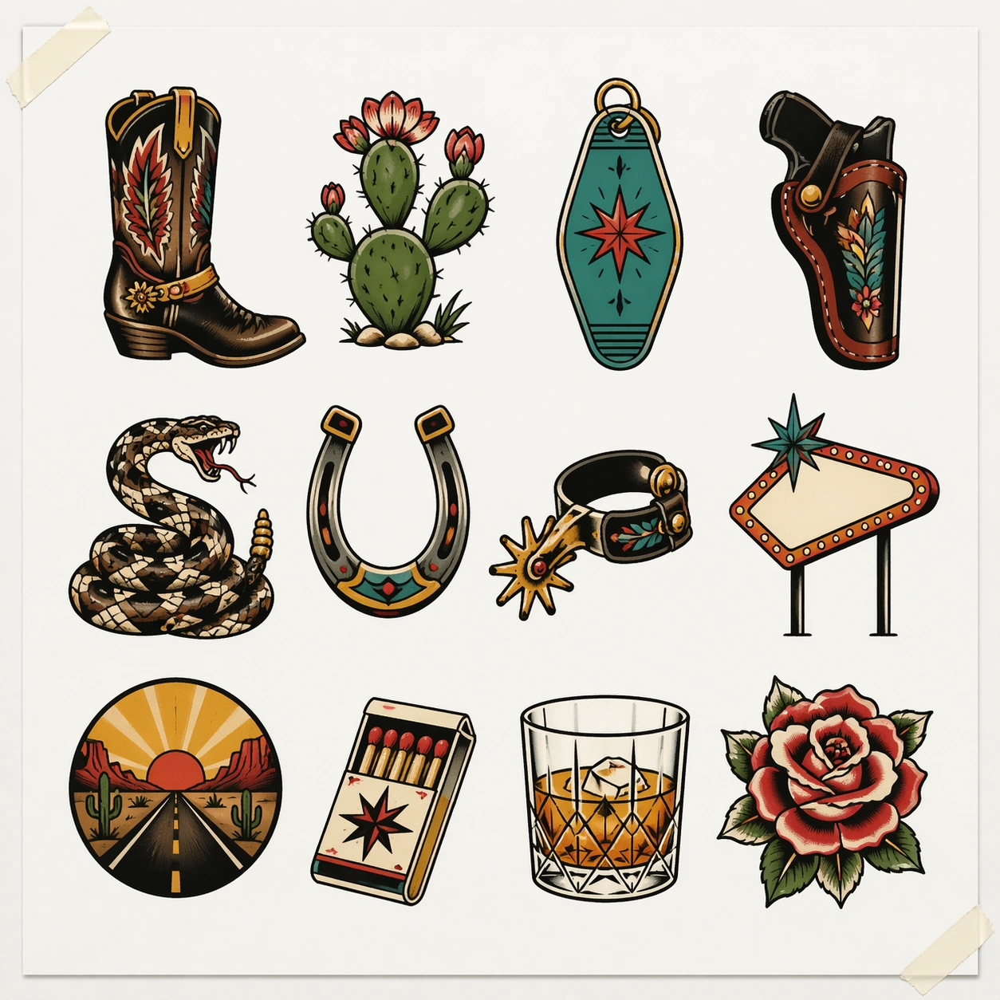

```text
Scene:
A square flash sheet lying flat on a spotless drafting table, photographed from directly above so the white paper becomes a clean field for evenly spaced tattoo motifs. Light is crisp and studio neutral, with only faint edge shadows and a subtle hint of masking tape at two corners. The page should feel like a product-ready design sheet from a modern custom tattoo parlor.

Subject:
Create a western roadside themed flash sheet with about twelve independent motifs: cowboy boot, prickly pear cactus, motel key fob, revolver holster without gun, rattlesnake, horseshoe, spur, roadside sign shape without readable words, highway sunset, matchbook, whiskey glass, and desert rose. Render the motifs in a contemporary tattoo-flash language that mixes American traditional color blocking with a slightly polished commercial finish. Each emblem must be isolated, fully framed by white paper, and strong enough to be chosen individually by a client.

Important details:
The important control point is motif variety within a unified retail sheet. Keep line weights confident, color fills restrained, and shadows minimal. The page should read as body-art inventory rather than illustration editorial. Use dusty red, mustard, turquoise, black, cream, and cactus green, with enough white space so the table never feels crowded. Avoid turning the sheet into a narrative western poster or a scrapbook page.

Use case:
Tattoo Flash Sheet single study 3/8, testing themed commercial flash with multiple independent western motifs and disciplined paper layout.

Constraints:
No readable text, no watermark, no logos, preserve exact 1:1 aspect ratio, no full desert scene background, no human cowboy portrait, no collage overlap, no fake brand marks, no glossy sticker sheen, no tattooed skin.
```

[Pinned source](https://github.com/ChaosRealmsAI/gpt-image-2-gallery/blob/5296db8c996e38776c83a0bc8c64f848dcd512b3/works/topics/tattoo-flash-sheet/packages/single-parlor-flash-studies/images/03-western-roadside-charms/meta.json) · GPT Image2 · 1254×1254 · No source-declared image dependencies. · ProjectD:pending individual review.

## Lucky Love Icons · tattoo-flash-sheet/single-parlor-flash-studies/04-lucky-love-icons

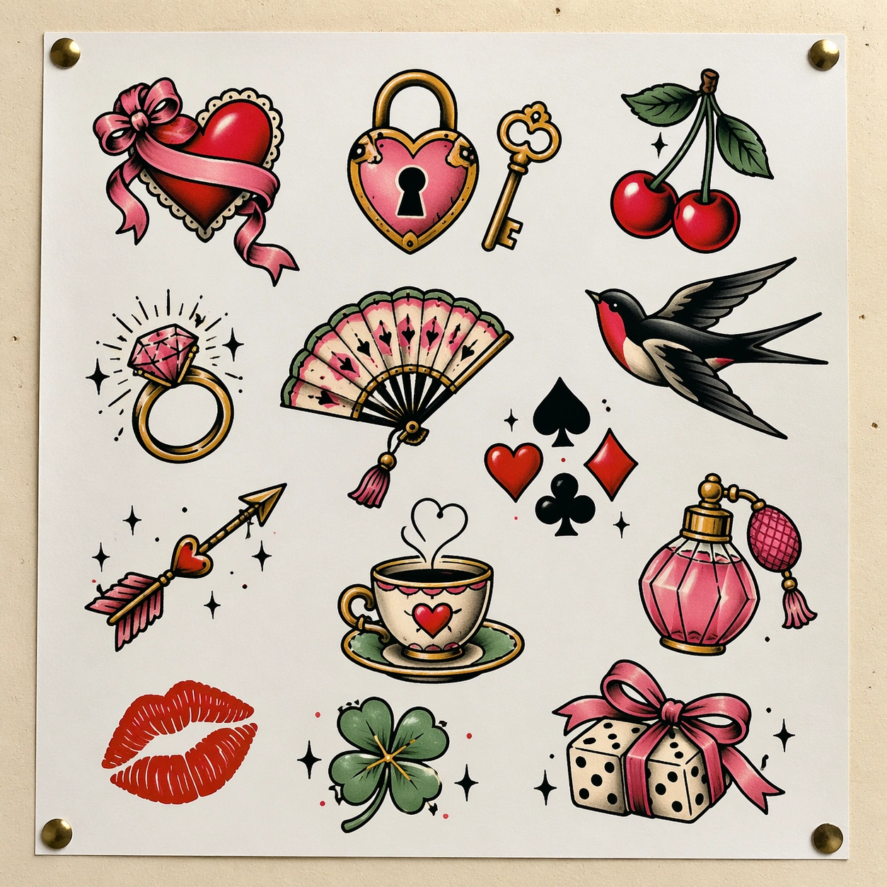

```text
Scene:
A square front-facing flash sheet mounted on a pale cream pinboard in a boutique tattoo studio, lit softly so the white paper remains bright while the colored inks stay saturated and tactile. The board fills the frame with a little breathing room around the edges, and the sheet looks freshly printed, flat, and ready for walk-in clients to browse.

Subject:
Build a lively flash sheet of around thirteen lucky and romantic icons: ribboned heart, lock and key, pair of cherries, swallow, starburst ring, hand fan, playing card suit cluster, tiny cupid arrow, teacup with steam heart, perfume bottle, lipstick kiss icon, lucky clover, and dice wrapped in ribbon. The motifs should feel modern, playful, and commercial while still grounded in tattoo flash conventions such as bold outer line, clean fill shapes, selective highlights, and independent composition. The arrangement should feel curated rather than mechanically gridded, with motifs balancing each other across the page.

Important details:
This sheet succeeds when the imagery is sweet without becoming kawaii sticker clutter. Preserve tattoo practicality: decisive outlines, limited color families, and enough white negative space around every piece. Use cherry red, bubblegum pink, cream, black, mint, and gold accents, but keep the paper itself dominant. The overall impression should be a tattoo shop flash board for charming small pieces, not a stationery product mockup.

Use case:
Tattoo Flash Sheet single study 4/8, testing a playful romantic flash set that still reads as professional tattoo inventory.

Constraints:
No readable text, no watermark, no logos, preserve exact 1:1 aspect ratio, no glitter explosion background, no sticker drop shadows, no human hands, no fashion magazine cover styling, no overlapping motifs, no plastic toy rendering.
```

[Pinned source](https://github.com/ChaosRealmsAI/gpt-image-2-gallery/blob/5296db8c996e38776c83a0bc8c64f848dcd512b3/works/topics/tattoo-flash-sheet/packages/single-parlor-flash-studies/images/04-lucky-love-icons/meta.json) · GPT Image2 · 1254×1254 · No source-declared image dependencies. · ProjectD:pending individual review.

## Maritime Memory Sheet · tattoo-flash-sheet/single-parlor-flash-studies/05-maritime-memory-sheet

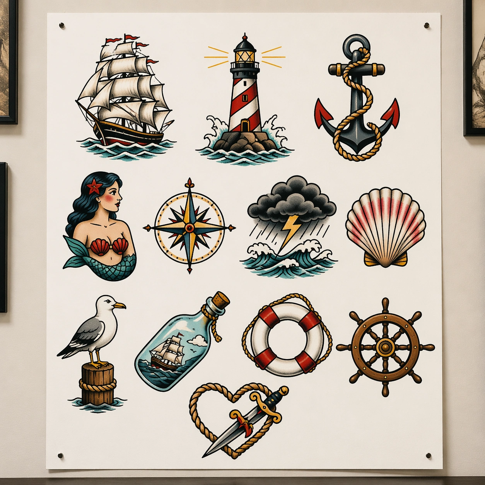

```text
Scene:
A square tattoo flash sheet displayed against a slightly warm white wall in a nautical-themed but contemporary tattoo studio, photographed straight-on with soft even light. The paper should appear crisp and substantial, with tiny pinholes, natural margin spacing, and just enough environmental shadow to feel physically present without distracting from the artwork.

Subject:
Design a maritime memory flash sheet with approximately twelve isolated motifs: clipper ship, lighthouse, rope-wrapped anchor, mermaid bust, compass rose, storm cloud over waves, shell, gull, bottle with tiny sea scene, lifebuoy, ship wheel, and dagger crossing a rope heart. The visual language should blend classic sailor tattoo heritage with tidy modern shop presentation. Each emblem must be ready to tattoo as an independent piece, using confident outlines, flat but rich color blocks, and modest stylized shading rather than painterly realism.

Important details:
The success condition is recognizable sailor flash without nostalgia turning muddy. Keep spacing generous and the palette controlled with navy, crimson, seafoam, cream, gold, and black. The sheet should feel like a real consultation-wall product that respects tattoo production constraints: no overcomplicated micro detail, no motifs touching, no decorative frame, no surrounding beach scene. Maintain the balance between heritage symbolism and retail clarity.

Use case:
Tattoo Flash Sheet single study 5/8, testing nautical flash vocabulary on a clean modern sheet that still feels rooted in tattoo history.

Constraints:
No readable text, no watermark, no logos, preserve exact 1:1 aspect ratio, no full ocean background, no photoreal sailor portrait, no aged parchment effect, no sticker-style drop shadows, no overlapping motifs, no body skin context.
```

[Pinned source](https://github.com/ChaosRealmsAI/gpt-image-2-gallery/blob/5296db8c996e38776c83a0bc8c64f848dcd512b3/works/topics/tattoo-flash-sheet/packages/single-parlor-flash-studies/images/05-maritime-memory-sheet/meta.json) · GPT Image2 · 1254×1254 · No source-declared image dependencies. · ProjectD:pending individual review.

## Floral Dagger Study · tattoo-flash-sheet/single-parlor-flash-studies/06-floral-dagger-study

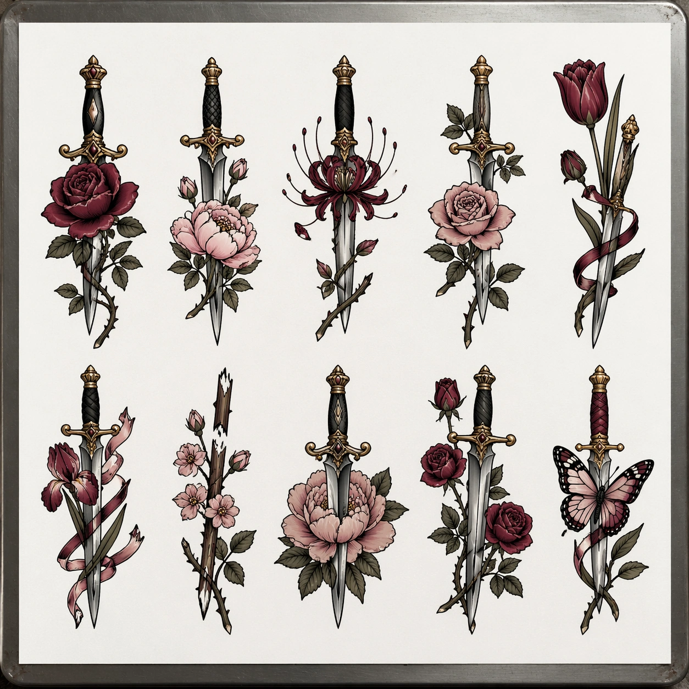

```text
Scene:
A square overhead studio capture of a pristine white tattoo flash sheet resting on a metal-edged worktable, with diffuse daylight from above and very light shadowing along the page edges. The framing is clinical and presentation-driven, like a portfolio page being documented for a tattoo artist archive. Leave generous white margins so the motifs feel collectible and easy to compare.

Subject:
Create a floral-and-blade flash sheet containing around ten independent tattoo designs built from daggers, roses, peonies, thorn vines, spider lilies, tulips, iris blooms, ribbon wraps, broken stem clusters, and a single butterfly crossing one blade. The compositions should feel sharper and more elegant than basic parlor flash, but still ready for skin translation: bold line foundation, controlled line taper, deliberate color pockets, and strong mid-size silhouettes. Each motif should sit on its own, with no connecting background flourishes.

Important details:
The visual challenge is balancing softness of flower petals with the hard geometry of blades. Keep the sheet feeling commercial and body-art specific, not like botanical illustration or packaging art. Use burgundy, blush pink, dark olive, muted gold, silver-gray, and black outlines. Maintain consistent paper rhythm, with motifs distributed across the page in a way that feels curated by an experienced tattooer. Avoid excess filigree and avoid delicate details that would disappear at tattoo scale.

Use case:
Tattoo Flash Sheet single study 6/8, testing whether a more elegant floral-dagger substyle can still read as practical flash-sheet inventory.

Constraints:
No readable text, no watermark, no logos, preserve exact 1:1 aspect ratio, no bouquet background, no blood, no fantasy swords, no overlapping motifs, no perfume-ad illustration styling, no human body, no glossy foil effects.
```

[Pinned source](https://github.com/ChaosRealmsAI/gpt-image-2-gallery/blob/5296db8c996e38776c83a0bc8c64f848dcd512b3/works/topics/tattoo-flash-sheet/packages/single-parlor-flash-studies/images/06-floral-dagger-study/meta.json) · GPT Image2 · 1254×1254 · No source-declared image dependencies. · ProjectD:pending individual review.

## Pet Memorial Charms · tattoo-flash-sheet/single-parlor-flash-studies/07-pet-memorial-charms

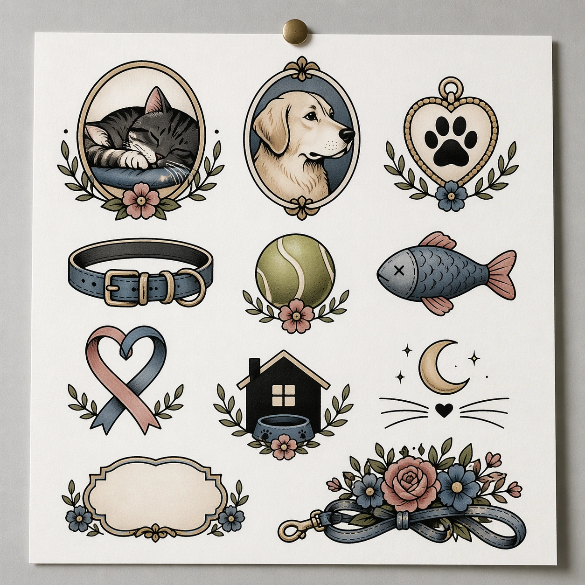

```text
Scene:
A square front-facing flash sheet pinned to a pale gray consultation-board wall in a friendly neighborhood tattoo studio, illuminated with soft natural light that keeps the white paper clean and the ink colors calm. The sheet should feel personal and emotionally gentle while still being organized like a professional service offering.

Subject:
Create a pet memorial flash sheet with roughly eleven isolated motifs suitable for commemorative tattoos: sleeping cat portrait medallion, dog head cameo, paw print charm, collar buckle, favorite tennis ball, fish toy, ribbon heart, house silhouette with tiny bowl, moon over whiskers, framed tag shape without readable text, and bouquet wrapped around a leash knot. The page should feel intentionally designed for clients choosing small-to-medium memorial pieces. Use a visual language that blends classic flash clarity with softer sentimental styling, not photographic pet portrait realism.

Important details:
The important rule is emotional restraint. Keep the motifs tender and specific, but still tattoo-ready with strong outlines, limited fill complexity, and clear silhouette. Preserve white paper dominance and respectful spacing so the sheet feels consultative rather than crowded. Use muted blues, dusty rose, warm cream, olive, and black. The presentation must stay commercial and shop-realistic, avoiding scrapbook craft cues or greeting-card sentimentality.

Use case:
Tattoo Flash Sheet single study 7/8, testing whether memorial subject matter can be handled with parlor-ready clarity and quiet emotional tone.

Constraints:
No readable text, no watermark, no logos, preserve exact 1:1 aspect ratio, no realistic fur-photo collage, no human portrait, no candles on a grave, no overlapping motifs, no glitter effects, no tattooed skin background.
```

[Pinned source](https://github.com/ChaosRealmsAI/gpt-image-2-gallery/blob/5296db8c996e38776c83a0bc8c64f848dcd512b3/works/topics/tattoo-flash-sheet/packages/single-parlor-flash-studies/images/07-pet-memorial-charms/meta.json) · GPT Image2 · 1254×1254 · No source-declared image dependencies. · ProjectD:pending individual review.

## City Pop Flash Board · tattoo-flash-sheet/single-parlor-flash-studies/08-city-pop-flash-board

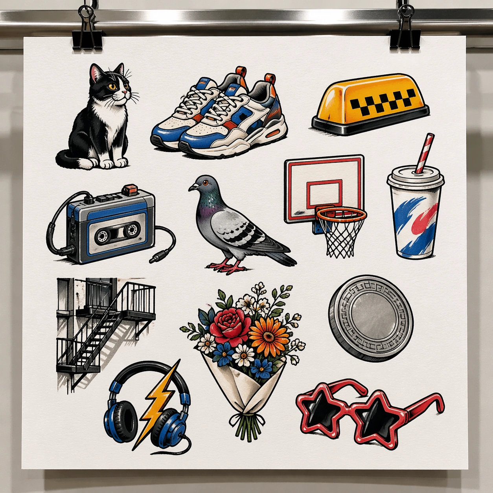

```text
Scene:
A square straight-on studio image of a white flash sheet clipped to a metal display rail in a modern urban tattoo shop. The wall is neutral and clean, lit by bright gallery-like overhead fixtures that keep colors crisp and the paper texture visible. The frame should feel commercial, contemporary, and body-art specific rather than editorial or lifestyle styled.

Subject:
Design a city-pop tattoo flash sheet with around twelve independent modern urban motifs: bodega cat, sneakers, taxi roof light, soda cup with straw, portable cassette player, pigeon silhouette, basketball hoop, apartment fire escape fragment, deli flower bouquet, subway token-like coin without text, lightning-bolt headphones, and bubble-star sunglasses. The art should bridge tattoo flash conventions with contemporary street retail taste. Each emblem must be bold, separate, and tattoo-ready, using clean outlines, simplified fill blocks, selective highlights, and disciplined empty paper around every design.

Important details:
The sheet should feel current without drifting into sticker-brand illustration. Keep the commercial flash logic first: isolated choices on a white page, consistent line confidence, and balanced spacing. The palette can use cobalt, safety orange, cherry red, mint, black, silver-gray, and cream, but avoid visual noise. The overall impression should be a flash board that a city-based tattoo studio could genuinely hang for walk-in clients who want modern small pieces.

Use case:
Tattoo Flash Sheet single study 8/8, testing a contemporary urban flash collection that stays clean, legible, and commercially believable.

Constraints:
No readable text, no watermark, no logos, preserve exact 1:1 aspect ratio, no full street scene background, no fashion model, no sticker pack overlap, no shiny plastic packaging, no human body, no chaotic graffiti wall behind the sheet.
```

[Pinned source](https://github.com/ChaosRealmsAI/gpt-image-2-gallery/blob/5296db8c996e38776c83a0bc8c64f848dcd512b3/works/topics/tattoo-flash-sheet/packages/single-parlor-flash-studies/images/08-city-pop-flash-board/meta.json) · GPT Image2 · 1254×1254 · No source-declared image dependencies. · ProjectD:pending individual review.

## Reference Club Identity · team-brand-and-fan-social-rollout/series-fan-energy-system/01-reference-club-identity

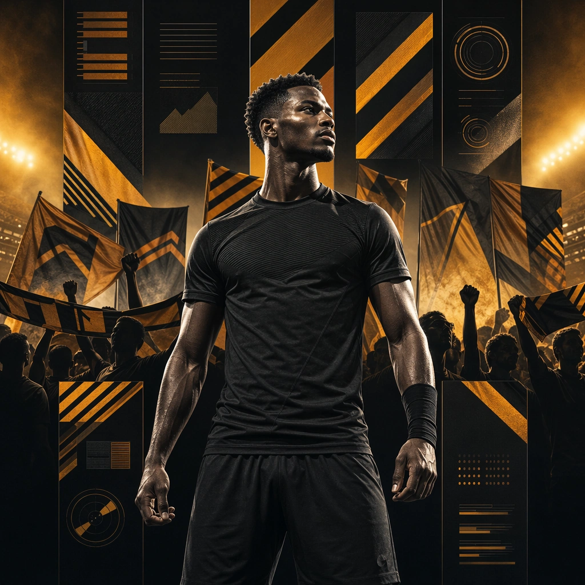

```text
Scene:
Create a square club identity hero poster for Team Rollout, using a fictional club-culture world with bold supporter colors, fabric texture, floodlit haze, and premium social-poster polish. The frame should feel commercial, polished, and immediately useful for a real client deliverable rather than a one-off art experiment. Keep the composition readable at thumbnail scale while still rewarding a closer look with layered depth, clean negative space, and strong directional light. Build the image so it clearly supports sports communication, with enough modular structure to imply information architecture without relying on literal words.

Subject:
Center the image on one original lead athlete framed against organized supporter silhouettes, scarf patterns, and abstract banners, arranged as lead athlete before fan wall. Treat the subject as original and brandless, with believable apparel construction, realistic body proportions, and strong emotional legibility. Surround the subject with supporting environmental cues that reinforce the category but never overpower the main figure. All secondary objects, props, and background elements should strengthen the same professional sports or fitness context.

Important details:
This first image must establish the full reference system for later derivatives: club-neutral poster geometry, non-readable social modules, and merch-adjacent textile energy. The emotional tone should read as supporter pride. Make the visual language reusable, disciplined, and commercially credible, with clean edges, coherent light behavior, and obvious hierarchy. Abstract panels, diagram bands, or stat-like modules are welcome, but they must remain non-readable and subordinate to the main visual message. The result should feel original, specific, and ready to anchor a larger package.

Use case:
Team Rollout series study 1/9, the reference image for the package.

Constraints:
No readable text, no watermark, no logos, preserve exact 1:1 aspect ratio, no brand marks, no copied famous team or product identity, no generic stock-photo stiffness, no cluttered background noise, no celebrity likenesses.
```

[Pinned source](https://github.com/ChaosRealmsAI/gpt-image-2-gallery/blob/5296db8c996e38776c83a0bc8c64f848dcd512b3/works/topics/team-brand-and-fan-social-rollout/packages/series-fan-energy-system/images/01-reference-club-identity/meta.json) · GPT Image2 · 1024×1024 · No source-declared image dependencies. · ProjectD:pending individual review.

## Rivalry Pulse Tile · team-brand-and-fan-social-rollout/series-fan-energy-system/02-rivalry-pulse-tile


```text
Scene:
Build a square rivalry pulse tile derived from the reference image for Team Rollout. Preserve the exact world established by the reference image, including the same palette family, lighting direction, environmental logic, and surface finish. The new frame should feel like a deliberate extension of one campaign system, not a separate concept. Shift the hierarchy to suit this use case, but keep the overall composition commercial, polished, and ready for real rollout.

Subject:
Use the same original subject identity and anchor cues introduced by the reference image, now organized as same athlete against opposing color field. Keep faces, hair logic, body proportions, apparel or product construction, and major supporting forms consistent with the reference. Allow only the layout emphasis, pose, crop, and contextual energy to change so the result clearly belongs to the same package.

Important details:
Continuity is the main challenge. Preserve the exact reference language for color, materials, framing rhythm, and overall brandless campaign grammar while steering the tone toward compressed confrontation. Keep any stat blocks, schedule modules, arrows, badges, or callout panels non-readable. The derivative should prove that the same art direction can handle a different communication task without losing identity or utility. Make it credible for production use, with clean edges, intentional spacing, and no random decorative elements.

Use case:
Team Rollout series study 2/9, a derivative surface linked to 01-reference-club-identity.

Constraints:
No readable text, no watermark, no logos, preserve exact 1:1 aspect ratio, no new subject identity, no brand marks, no palette drift, no unrelated props, no collage chaos, no copied public-figure styling.
```

[Pinned source](https://github.com/ChaosRealmsAI/gpt-image-2-gallery/blob/5296db8c996e38776c83a0bc8c64f848dcd512b3/works/topics/team-brand-and-fan-social-rollout/packages/series-fan-energy-system/images/02-rivalry-pulse-tile/meta.json) · GPT Image2 · 1024×1024 · Reference images required. · ProjectD:pending individual review.

## Home Crowd Poster · team-brand-and-fan-social-rollout/series-fan-energy-system/03-home-crowd-poster

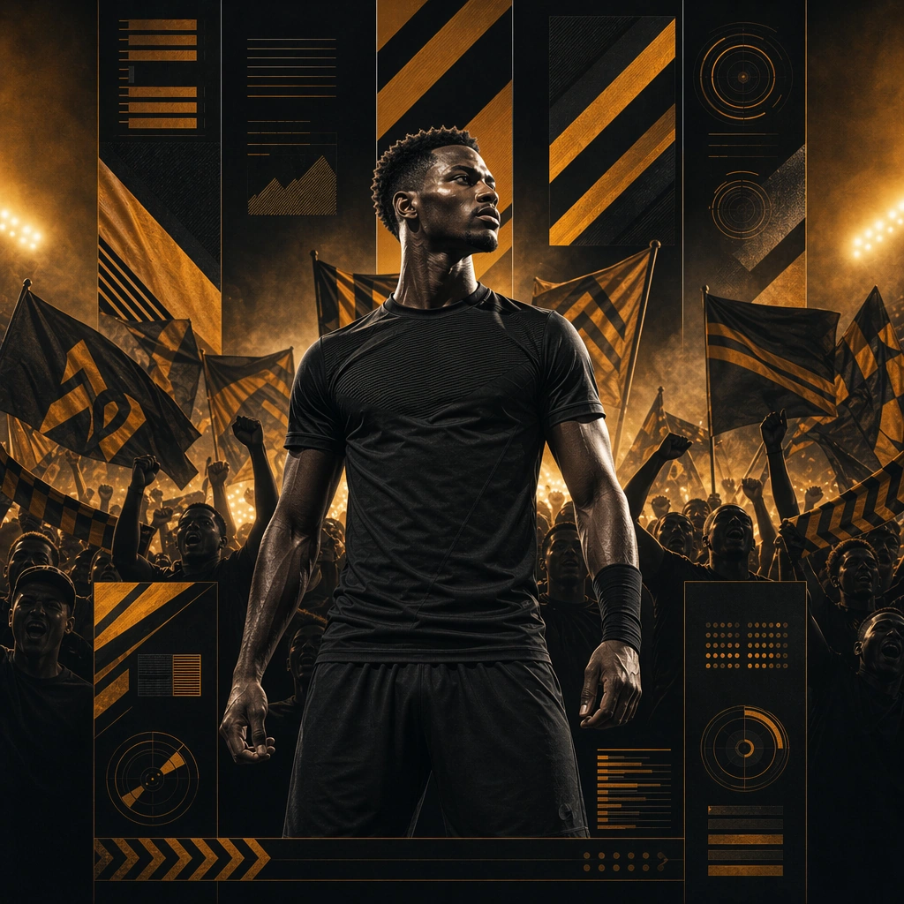

```text
Scene:
Build a square home crowd poster derived from the reference image for Team Rollout. Preserve the exact world established by the reference image, including the same palette family, lighting direction, environmental logic, and surface finish. The new frame should feel like a deliberate extension of one campaign system, not a separate concept. Shift the hierarchy to suit this use case, but keep the overall composition commercial, polished, and ready for real rollout.

Subject:
Use the same original subject identity and anchor cues introduced by the reference image, now organized as same athlete with visible supporter layers. Keep faces, hair logic, body proportions, apparel or product construction, and major supporting forms consistent with the reference. Allow only the layout emphasis, pose, crop, and contextual energy to change so the result clearly belongs to the same package.

Important details:
Continuity is the main challenge. Preserve the exact reference language for color, materials, framing rhythm, and overall brandless campaign grammar while steering the tone toward collective belonging. Keep any stat blocks, schedule modules, arrows, badges, or callout panels non-readable. The derivative should prove that the same art direction can handle a different communication task without losing identity or utility. Make it credible for production use, with clean edges, intentional spacing, and no random decorative elements.

Use case:
Team Rollout series study 3/9, a derivative surface linked to 01-reference-club-identity.

Constraints:
No readable text, no watermark, no logos, preserve exact 1:1 aspect ratio, no new subject identity, no brand marks, no palette drift, no unrelated props, no collage chaos, no copied public-figure styling.
```

[Pinned source](https://github.com/ChaosRealmsAI/gpt-image-2-gallery/blob/5296db8c996e38776c83a0bc8c64f848dcd512b3/works/topics/team-brand-and-fan-social-rollout/packages/series-fan-energy-system/images/03-home-crowd-poster/meta.json) · GPT Image2 · 1024×1024 · Reference images required. · ProjectD:pending individual review.

## Merch Drop Variant · team-brand-and-fan-social-rollout/series-fan-energy-system/04-merch-drop-variant

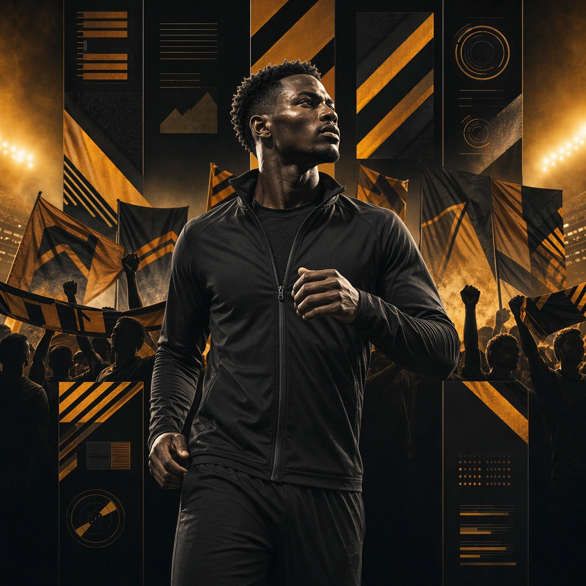

```text
Scene:
Build a square merch drop social variant derived from the reference image for Team Rollout. Preserve the exact world established by the reference image, including the same palette family, lighting direction, environmental logic, and surface finish. The new frame should feel like a deliberate extension of one campaign system, not a separate concept. Shift the hierarchy to suit this use case, but keep the overall composition commercial, polished, and ready for real rollout.

Subject:
Use the same original subject identity and anchor cues introduced by the reference image, now organized as same athlete in related warmup layer. Keep faces, hair logic, body proportions, apparel or product construction, and major supporting forms consistent with the reference. Allow only the layout emphasis, pose, crop, and contextual energy to change so the result clearly belongs to the same package.

Important details:
Continuity is the main challenge. Preserve the exact reference language for color, materials, framing rhythm, and overall brandless campaign grammar while steering the tone toward fashion-forward energy. Keep any stat blocks, schedule modules, arrows, badges, or callout panels non-readable. The derivative should prove that the same art direction can handle a different communication task without losing identity or utility. Make it credible for production use, with clean edges, intentional spacing, and no random decorative elements.

Use case:
Team Rollout series study 4/9, a derivative surface linked to 01-reference-club-identity.

Constraints:
No readable text, no watermark, no logos, preserve exact 1:1 aspect ratio, no new subject identity, no brand marks, no palette drift, no unrelated props, no collage chaos, no copied public-figure styling.
```

[Pinned source](https://github.com/ChaosRealmsAI/gpt-image-2-gallery/blob/5296db8c996e38776c83a0bc8c64f848dcd512b3/works/topics/team-brand-and-fan-social-rollout/packages/series-fan-energy-system/images/04-merch-drop-variant/meta.json) · GPT Image2 · 1024×1024 · Reference images required. · ProjectD:pending individual review.

## Chant Night Social · team-brand-and-fan-social-rollout/single-support-studies/chant-night-social

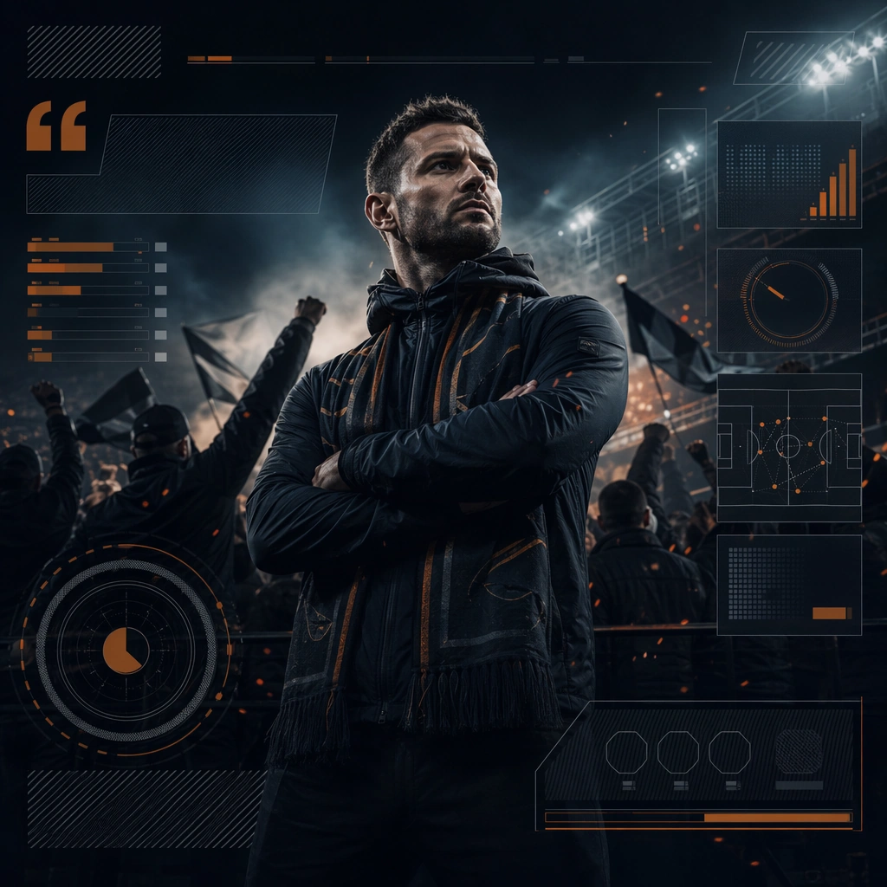

```text
Scene:
Create a square supporter-night social tile for Team Rollout, using team-social storytelling driven by supporter texture, urban club identity, and brandless sports-fashion polish. The composition should read as a practical, production-ready sports or fitness surface with a clear hierarchy, premium lighting, and obvious commercial intent. Keep the environment specific enough to feel real, but leave enough control in the layout for non-readable information modules, campaign blocks, or visualized metrics. Aim for a finish that works for a brand, club, app, academy, or event operator.

Subject:
Build the image around fan leader amid raised silhouettes. The subject should be original, believable, and free of any real-brand or celebrity cues. Use realistic apparel, safe body mechanics when movement is visible, and environmental props that support the category without clutter. The subject must stay visually dominant so the design still works as a communication asset rather than a pure scene study.

Important details:
The mood should read as collective intensity. Treat layout, light, and supporting graphic structure as part of one polished delivery surface. Any schedule blocks, metric panels, quote zones, badges, or path diagrams must stay abstract and non-readable. Prioritize usefulness, clarity, and category truth over spectacle. The image should feel distinct from the series package while still belonging naturally to the same topic and business use case.

Use case:
Team Rollout single study 5/9, an independent rollout surface for the topic.

Constraints:
No readable text, no watermark, no logos, preserve exact 1:1 aspect ratio, no brand marks, no public-figure resemblance, no generic stock layout, no cluttered UI imitation, no accidental copyrighted insignia.
```

[Pinned source](https://github.com/ChaosRealmsAI/gpt-image-2-gallery/blob/5296db8c996e38776c83a0bc8c64f848dcd512b3/works/topics/team-brand-and-fan-social-rollout/packages/single-support-studies/images/chant-night-social/meta.json) · GPT Image2 · 1024×1024 · No source-declared image dependencies. · ProjectD:pending individual review.

## Away Trip Fan Pass · team-brand-and-fan-social-rollout/single-support-studies/away-trip-fan-pass

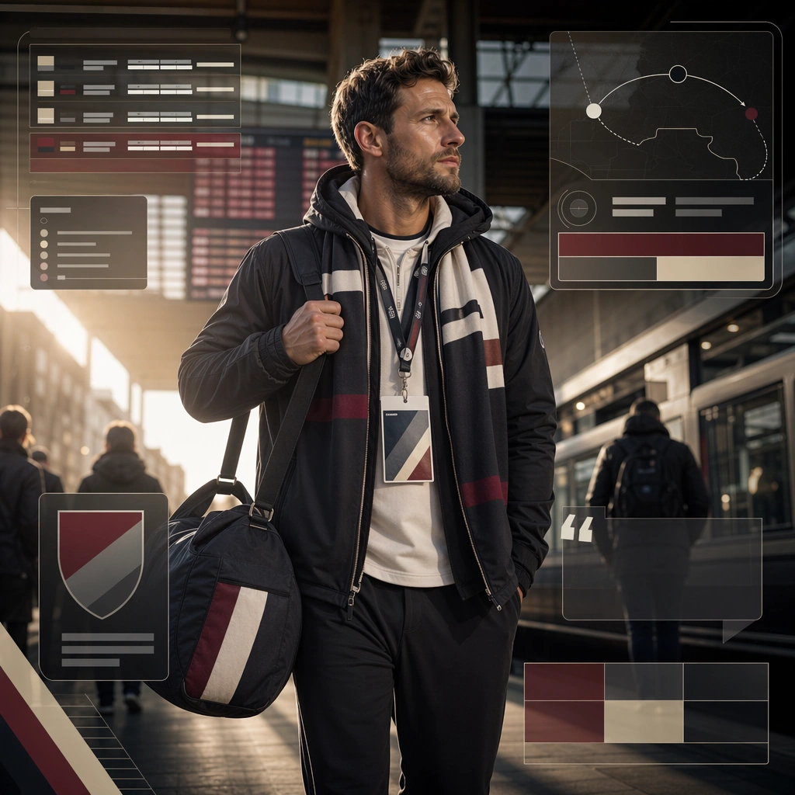

```text
Scene:
Create a square away-trip fan pass for Team Rollout, using team-social storytelling driven by supporter texture, urban club identity, and brandless sports-fashion polish. The composition should read as a practical, production-ready sports or fitness surface with a clear hierarchy, premium lighting, and obvious commercial intent. Keep the environment specific enough to feel real, but leave enough control in the layout for non-readable information modules, campaign blocks, or visualized metrics. Aim for a finish that works for a brand, club, app, academy, or event operator.

Subject:
Build the image around supporter in transit context. The subject should be original, believable, and free of any real-brand or celebrity cues. Use realistic apparel, safe body mechanics when movement is visible, and environmental props that support the category without clutter. The subject must stay visually dominant so the design still works as a communication asset rather than a pure scene study.

Important details:
The mood should read as travel-day momentum. Treat layout, light, and supporting graphic structure as part of one polished delivery surface. Any schedule blocks, metric panels, quote zones, badges, or path diagrams must stay abstract and non-readable. Prioritize usefulness, clarity, and category truth over spectacle. The image should feel distinct from the series package while still belonging naturally to the same topic and business use case.

Use case:
Team Rollout single study 6/9, an independent rollout surface for the topic.

Constraints:
No readable text, no watermark, no logos, preserve exact 1:1 aspect ratio, no brand marks, no public-figure resemblance, no generic stock layout, no cluttered UI imitation, no accidental copyrighted insignia.
```

[Pinned source](https://github.com/ChaosRealmsAI/gpt-image-2-gallery/blob/5296db8c996e38776c83a0bc8c64f848dcd512b3/works/topics/team-brand-and-fan-social-rollout/packages/single-support-studies/images/away-trip-fan-pass/meta.json) · GPT Image2 · 1024×1024 · No source-declared image dependencies. · ProjectD:pending individual review.

## Supporter Club Membership · team-brand-and-fan-social-rollout/single-support-studies/supporter-club-membership

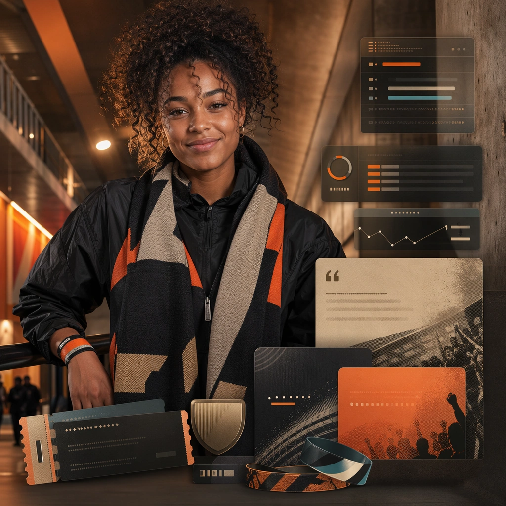

```text
Scene:
Create a square supporter membership asset for Team Rollout, using team-social storytelling driven by supporter texture, urban club identity, and brandless sports-fashion polish. The composition should read as a practical, production-ready sports or fitness surface with a clear hierarchy, premium lighting, and obvious commercial intent. Keep the environment specific enough to feel real, but leave enough control in the layout for non-readable information modules, campaign blocks, or visualized metrics. Aim for a finish that works for a brand, club, app, academy, or event operator.

Subject:
Build the image around fan portrait with card modules. The subject should be original, believable, and free of any real-brand or celebrity cues. Use realistic apparel, safe body mechanics when movement is visible, and environmental props that support the category without clutter. The subject must stay visually dominant so the design still works as a communication asset rather than a pure scene study.

Important details:
The mood should read as warm belonging. Treat layout, light, and supporting graphic structure as part of one polished delivery surface. Any schedule blocks, metric panels, quote zones, badges, or path diagrams must stay abstract and non-readable. Prioritize usefulness, clarity, and category truth over spectacle. The image should feel distinct from the series package while still belonging naturally to the same topic and business use case.

Use case:
Team Rollout single study 7/9, an independent rollout surface for the topic.

Constraints:
No readable text, no watermark, no logos, preserve exact 1:1 aspect ratio, no brand marks, no public-figure resemblance, no generic stock layout, no cluttered UI imitation, no accidental copyrighted insignia.
```

[Pinned source](https://github.com/ChaosRealmsAI/gpt-image-2-gallery/blob/5296db8c996e38776c83a0bc8c64f848dcd512b3/works/topics/team-brand-and-fan-social-rollout/packages/single-support-studies/images/supporter-club-membership/meta.json) · GPT Image2 · 1024×1024 · No source-declared image dependencies. · ProjectD:pending individual review.

## Community Matchday Recap · team-brand-and-fan-social-rollout/single-support-studies/community-matchday-recap

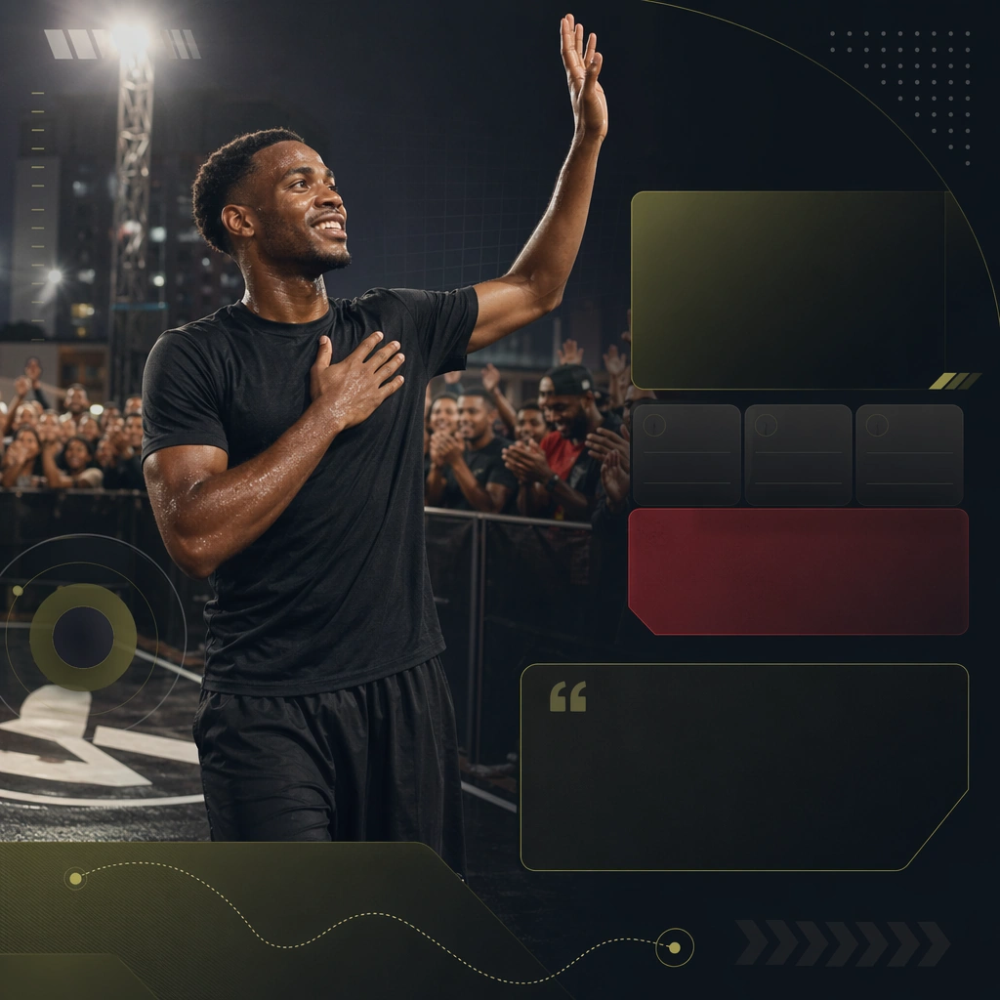

```text
Scene:
Create a square community recap tile for Team Rollout, using team-social storytelling driven by supporter texture, urban club identity, and brandless sports-fashion polish. The composition should read as a practical, production-ready sports or fitness surface with a clear hierarchy, premium lighting, and obvious commercial intent. Keep the environment specific enough to feel real, but leave enough control in the layout for non-readable information modules, campaign blocks, or visualized metrics. Aim for a finish that works for a brand, club, app, academy, or event operator.

Subject:
Build the image around athlete acknowledging supporters. The subject should be original, believable, and free of any real-brand or celebrity cues. Use realistic apparel, safe body mechanics when movement is visible, and environmental props that support the category without clutter. The subject must stay visually dominant so the design still works as a communication asset rather than a pure scene study.

Important details:
The mood should read as shared pride. Treat layout, light, and supporting graphic structure as part of one polished delivery surface. Any schedule blocks, metric panels, quote zones, badges, or path diagrams must stay abstract and non-readable. Prioritize usefulness, clarity, and category truth over spectacle. The image should feel distinct from the series package while still belonging naturally to the same topic and business use case.

Use case:
Team Rollout single study 8/9, an independent rollout surface for the topic.

Constraints:
No readable text, no watermark, no logos, preserve exact 1:1 aspect ratio, no brand marks, no public-figure resemblance, no generic stock layout, no cluttered UI imitation, no accidental copyrighted insignia.
```

[Pinned source](https://github.com/ChaosRealmsAI/gpt-image-2-gallery/blob/5296db8c996e38776c83a0bc8c64f848dcd512b3/works/topics/team-brand-and-fan-social-rollout/packages/single-support-studies/images/community-matchday-recap/meta.json) · GPT Image2 · 1024×1024 · No source-declared image dependencies. · ProjectD:pending individual review.

## Street Flag Fashion Board · team-brand-and-fan-social-rollout/single-support-studies/street-flag-fashion-board

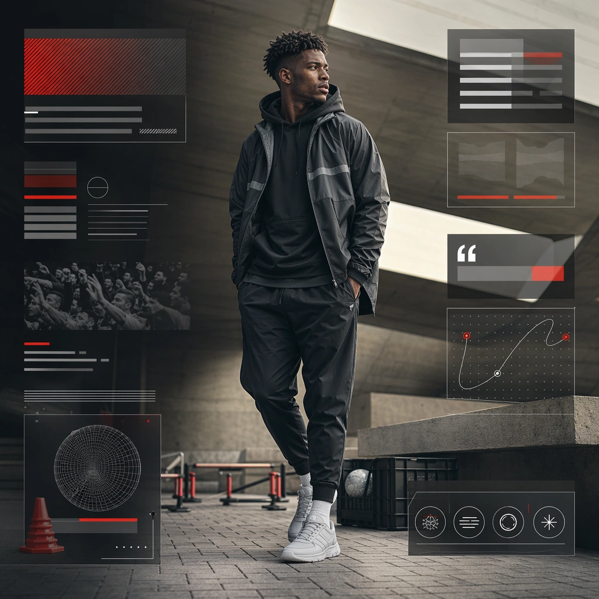

```text
Scene:
Create a square street-fashion team board for Team Rollout, using team-social storytelling driven by supporter texture, urban club identity, and brandless sports-fashion polish. The composition should read as a practical, production-ready sports or fitness surface with a clear hierarchy, premium lighting, and obvious commercial intent. Keep the environment specific enough to feel real, but leave enough control in the layout for non-readable information modules, campaign blocks, or visualized metrics. Aim for a finish that works for a brand, club, app, academy, or event operator.

Subject:
Build the image around supporter or athlete in layered outerwear. The subject should be original, believable, and free of any real-brand or celebrity cues. Use realistic apparel, safe body mechanics when movement is visible, and environmental props that support the category without clutter. The subject must stay visually dominant so the design still works as a communication asset rather than a pure scene study.

Important details:
The mood should read as urban style confidence. Treat layout, light, and supporting graphic structure as part of one polished delivery surface. Any schedule blocks, metric panels, quote zones, badges, or path diagrams must stay abstract and non-readable. Prioritize usefulness, clarity, and category truth over spectacle. The image should feel distinct from the series package while still belonging naturally to the same topic and business use case.

Use case:
Team Rollout single study 9/9, an independent rollout surface for the topic.

Constraints:
No readable text, no watermark, no logos, preserve exact 1:1 aspect ratio, no brand marks, no public-figure resemblance, no generic stock layout, no cluttered UI imitation, no accidental copyrighted insignia.
```

[Pinned source](https://github.com/ChaosRealmsAI/gpt-image-2-gallery/blob/5296db8c996e38776c83a0bc8c64f848dcd512b3/works/topics/team-brand-and-fan-social-rollout/packages/single-support-studies/images/street-flag-fashion-board/meta.json) · GPT Image2 · 1024×1024 · No source-declared image dependencies. · ProjectD:pending individual review.

## Reference Anchor · teaser-one-sheet-tension-poster/series-core-system/01-reference-anchor

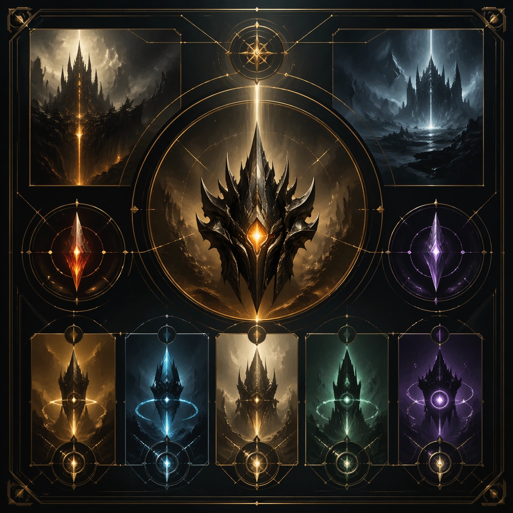

```text
Scene:
Create a square reference image for Teaser One-Sheet Tension Poster. Build a reference anchor establishing the core system with a premium, production-ready finish. Use a polished modular board or campaign surface with clean spacing, premium game-UI finish, and clear focal hierarchy. The composition should feel intentional, clean, and reusable for gallery, research, campaign, or internal handoff contexts. Lighting must support readability first, with the main forms clearly separated from the background and enough breathing room for the system to stay legible at both hero scale and thumbnail scale.

Subject:
Center a coherent original game-art system built for premium production and marketing surfaces. For this image, focus on reference anchor. Keep the same system logic stable across screenshots, cards, banners, and overview boards. This image is the canonical anchor that later series images must follow. The viewer should immediately understand what role this surface plays inside a cohesive game-production asset pack.

Important details:
Lock framing, icon grammar, palette blocking, and surface hierarchy so the kit feels production-ready and consistent. Preserve the core silhouette, framing language, and material logic from the reference image while each variation changes function. Keep materials believable, edge hierarchy disciplined, and the visual language consistent with Teaser Poster. Use abstract interface blocks or diagram accents when helpful, but avoid any readable language. The final result should feel like a deliberate production asset rather than a random illustration.

Use case:
Teaser One-Sheet Tension Poster series study 1/9, designed as reference anchor within a cohesive asset pack.

Constraints:
No readable text, no watermark, no logos, preserve exact 1:1 aspect ratio, no unrelated objects, no broken visual hierarchy, no malformed anatomy or broken perspective, no random decorative clutter.
```

[Pinned source](https://github.com/ChaosRealmsAI/gpt-image-2-gallery/blob/5296db8c996e38776c83a0bc8c64f848dcd512b3/works/topics/teaser-one-sheet-tension-poster/packages/series-core-system/images/01-reference-anchor/meta.json) · GPT Image2 · 1254×1254 · No source-declared image dependencies. · ProjectD:pending individual review.

## Variant One · teaser-one-sheet-tension-poster/series-core-system/02-variant-one

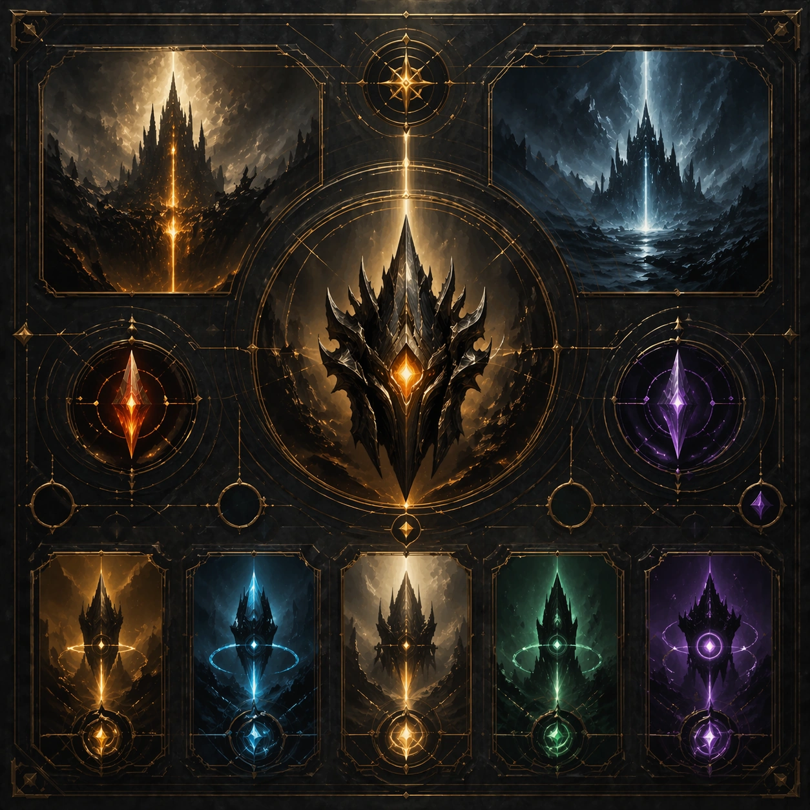

```text
Scene:
Create a square dependent image for Teaser One-Sheet Tension Poster. Build a first controlled variation in the same system with a premium, production-ready finish. Use a polished modular board or campaign surface with clean spacing, premium game-UI finish, and clear focal hierarchy. The composition should feel intentional, clean, and reusable for gallery, research, campaign, or internal handoff contexts. Lighting must support readability first, with the main forms clearly separated from the background and enough breathing room for the system to stay legible at both hero scale and thumbnail scale.

Subject:
Center a coherent original game-art system built for premium production and marketing surfaces. For this image, focus on the intended support surface. Keep the same system logic stable across screenshots, cards, banners, and overview boards. Preserve exact identity or system logic from the reference image while changing only the intended variation axis. The viewer should immediately understand what role this surface plays inside a cohesive game-production asset pack.

Important details:
Lock framing, icon grammar, palette blocking, and surface hierarchy so the kit feels production-ready and consistent. Preserve the core silhouette, framing language, and material logic from the reference image while each variation changes function. Keep materials believable, edge hierarchy disciplined, and the visual language consistent with Teaser Poster. Use abstract interface blocks or diagram accents when helpful, but avoid any readable language. The final result should feel like a deliberate production asset rather than a random illustration.

Use case:
Teaser One-Sheet Tension Poster series study 2/9, designed as variant one within a cohesive asset pack.

Constraints:
No readable text, no watermark, no logos, preserve exact 1:1 aspect ratio, no unrelated objects, no broken visual hierarchy, no malformed anatomy or broken perspective, no random decorative clutter.
```

[Pinned source](https://github.com/ChaosRealmsAI/gpt-image-2-gallery/blob/5296db8c996e38776c83a0bc8c64f848dcd512b3/works/topics/teaser-one-sheet-tension-poster/packages/series-core-system/images/02-variant-one/meta.json) · GPT Image2 · 1254×1254 · Reference images required. · ProjectD:pending individual review.

## Variant Two · teaser-one-sheet-tension-poster/series-core-system/03-variant-two

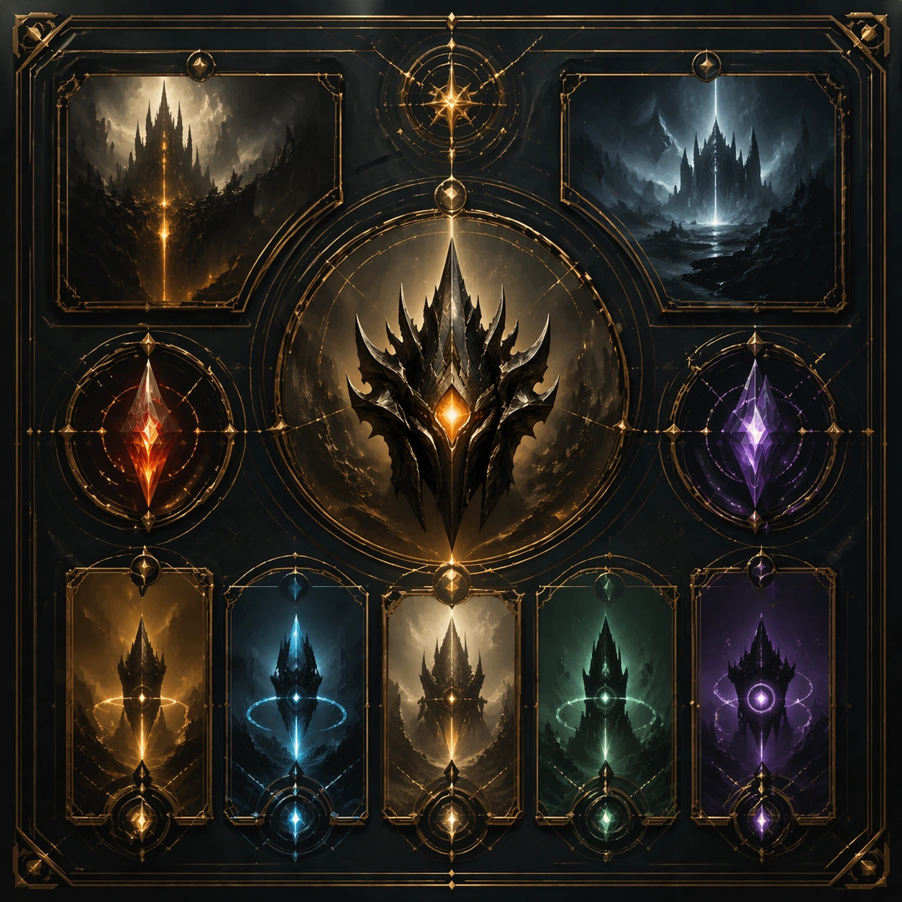

```text
Scene:
Create a square dependent image for Teaser One-Sheet Tension Poster. Build a second controlled variation in the same system with a premium, production-ready finish. Use a polished modular board or campaign surface with clean spacing, premium game-UI finish, and clear focal hierarchy. The composition should feel intentional, clean, and reusable for gallery, research, campaign, or internal handoff contexts. Lighting must support readability first, with the main forms clearly separated from the background and enough breathing room for the system to stay legible at both hero scale and thumbnail scale.

Subject:
Center a coherent original game-art system built for premium production and marketing surfaces. For this image, focus on the intended support surface. Keep the same system logic stable across screenshots, cards, banners, and overview boards. Preserve exact identity or system logic from the reference image while changing only the intended variation axis. The viewer should immediately understand what role this surface plays inside a cohesive game-production asset pack.

Important details:
Lock framing, icon grammar, palette blocking, and surface hierarchy so the kit feels production-ready and consistent. Preserve the core silhouette, framing language, and material logic from the reference image while each variation changes function. Keep materials believable, edge hierarchy disciplined, and the visual language consistent with Teaser Poster. Use abstract interface blocks or diagram accents when helpful, but avoid any readable language. The final result should feel like a deliberate production asset rather than a random illustration.

Use case:
Teaser One-Sheet Tension Poster series study 3/9, designed as variant two within a cohesive asset pack.

Constraints:
No readable text, no watermark, no logos, preserve exact 1:1 aspect ratio, no unrelated objects, no broken visual hierarchy, no malformed anatomy or broken perspective, no random decorative clutter.
```

[Pinned source](https://github.com/ChaosRealmsAI/gpt-image-2-gallery/blob/5296db8c996e38776c83a0bc8c64f848dcd512b3/works/topics/teaser-one-sheet-tension-poster/packages/series-core-system/images/03-variant-two/meta.json) · GPT Image2 · 1254×1254 · Reference images required. · ProjectD:pending individual review.

## Variant Three · teaser-one-sheet-tension-poster/series-core-system/04-variant-three

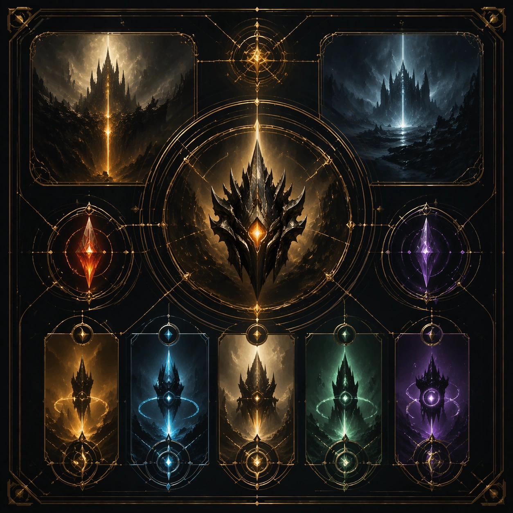

```text
Scene:
Create a square dependent image for Teaser One-Sheet Tension Poster. Build a third controlled variation in the same system with a premium, production-ready finish. Use a polished modular board or campaign surface with clean spacing, premium game-UI finish, and clear focal hierarchy. The composition should feel intentional, clean, and reusable for gallery, research, campaign, or internal handoff contexts. Lighting must support readability first, with the main forms clearly separated from the background and enough breathing room for the system to stay legible at both hero scale and thumbnail scale.

Subject:
Center a coherent original game-art system built for premium production and marketing surfaces. For this image, focus on the intended support surface. Keep the same system logic stable across screenshots, cards, banners, and overview boards. Preserve exact identity or system logic from the reference image while changing only the intended variation axis. The viewer should immediately understand what role this surface plays inside a cohesive game-production asset pack.

Important details:
Lock framing, icon grammar, palette blocking, and surface hierarchy so the kit feels production-ready and consistent. Preserve the core silhouette, framing language, and material logic from the reference image while each variation changes function. Keep materials believable, edge hierarchy disciplined, and the visual language consistent with Teaser Poster. Use abstract interface blocks or diagram accents when helpful, but avoid any readable language. The final result should feel like a deliberate production asset rather than a random illustration.

Use case:
Teaser One-Sheet Tension Poster series study 4/9, designed as variant three within a cohesive asset pack.

Constraints:
No readable text, no watermark, no logos, preserve exact 1:1 aspect ratio, no unrelated objects, no broken visual hierarchy, no malformed anatomy or broken perspective, no random decorative clutter.
```

[Pinned source](https://github.com/ChaosRealmsAI/gpt-image-2-gallery/blob/5296db8c996e38776c83a0bc8c64f848dcd512b3/works/topics/teaser-one-sheet-tension-poster/packages/series-core-system/images/04-variant-three/meta.json) · GPT Image2 · 1254×1254 · Reference images required. · ProjectD:pending individual review.

## Support One · teaser-one-sheet-tension-poster/single-support-studies/support-one

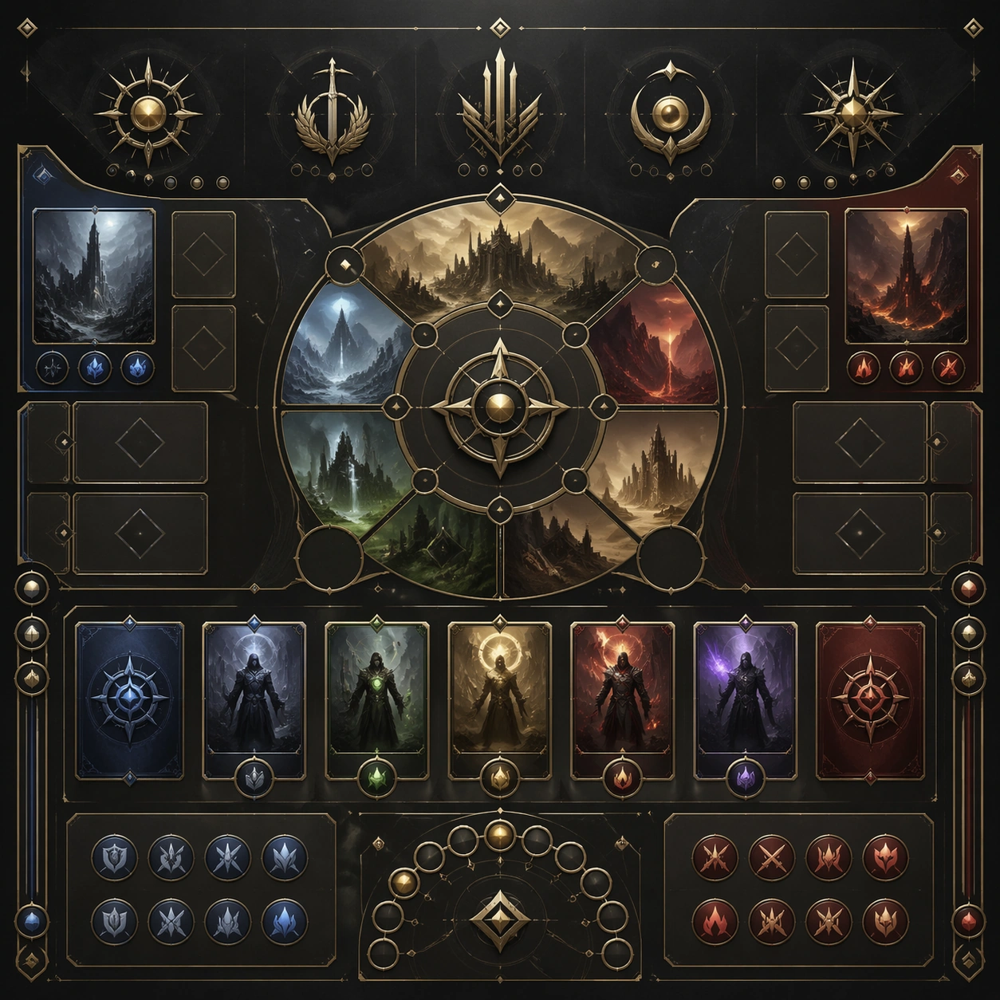

```text
Scene:
Create a square standalone support image for Teaser One-Sheet Tension Poster. Build a support-surface study with a clear focal hierarchy and a finished professional surface. Use a polished modular board or campaign surface with clean spacing, premium game-UI finish, and clear focal hierarchy. The frame should feel self-contained and polished, with enough structure to explain the system even without the reference series, yet still obviously belonging to the same theme and production world.

Subject:
Show a coherent original game-art system built for premium production and marketing surfaces in a way that emphasizes the intended support surface. Keep the same system logic stable across screenshots, cards, banners, and overview boards. Even though this image is independent, the viewer should still recognize the same universe, same commercial logic, and same production intent as the core package.

Important details:
Lock framing, icon grammar, palette blocking, and surface hierarchy so the kit feels production-ready and consistent. Preserve the broader theme language through color, framing, material choices, and modular composition. Use clean panel rhythm, premium asset presentation, and believable detail density. The image should work equally well as a gallery study, research reference, and mock production deliverable.

Use case:
Teaser One-Sheet Tension Poster single study 5/9, exploring support one as a support surface.

Constraints:
No readable text, no watermark, no logos, preserve exact 1:1 aspect ratio, no unrelated objects, no broken visual hierarchy, no visual noise that obscures the main surface, no accidental brand resemblance.
```

[Pinned source](https://github.com/ChaosRealmsAI/gpt-image-2-gallery/blob/5296db8c996e38776c83a0bc8c64f848dcd512b3/works/topics/teaser-one-sheet-tension-poster/packages/single-support-studies/images/support-one/meta.json) · GPT Image2 · 1254×1254 · No source-declared image dependencies. · ProjectD:pending individual review.

## Support Two · teaser-one-sheet-tension-poster/single-support-studies/support-two

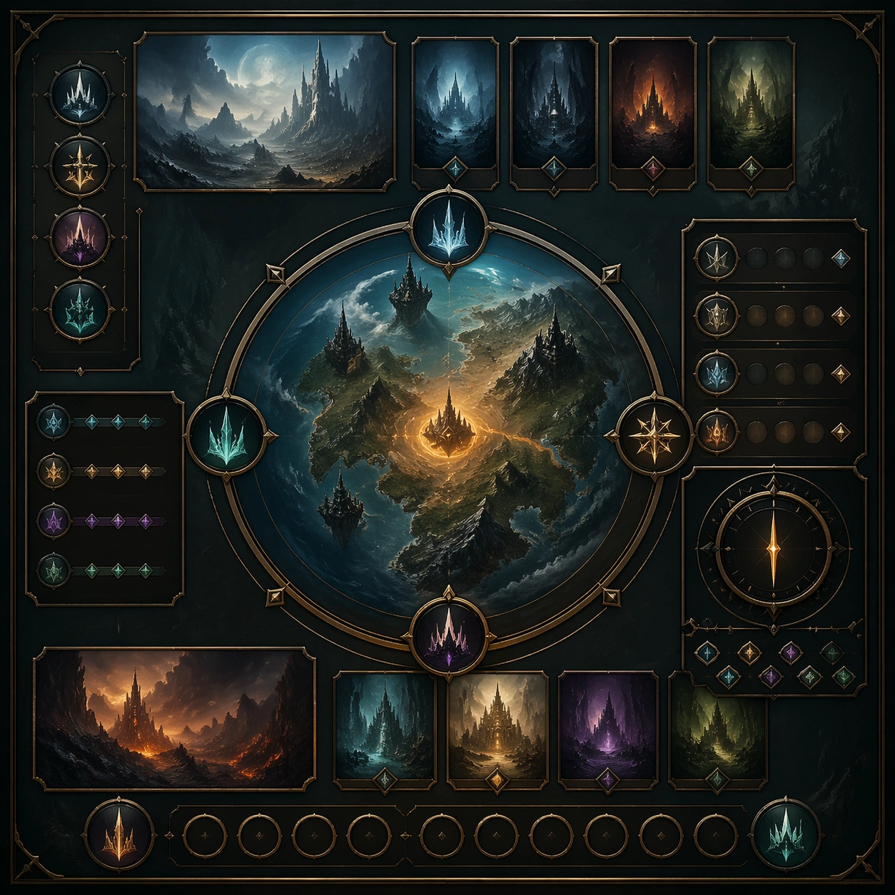

```text
Scene:
Create a square standalone support image for Teaser One-Sheet Tension Poster. Build a second support-surface study with a clear focal hierarchy and a finished professional surface. Use a polished modular board or campaign surface with clean spacing, premium game-UI finish, and clear focal hierarchy. The frame should feel self-contained and polished, with enough structure to explain the system even without the reference series, yet still obviously belonging to the same theme and production world.

Subject:
Show a coherent original game-art system built for premium production and marketing surfaces in a way that emphasizes the intended support surface. Keep the same system logic stable across screenshots, cards, banners, and overview boards. Even though this image is independent, the viewer should still recognize the same universe, same commercial logic, and same production intent as the core package.

Important details:
Lock framing, icon grammar, palette blocking, and surface hierarchy so the kit feels production-ready and consistent. Preserve the broader theme language through color, framing, material choices, and modular composition. Use clean panel rhythm, premium asset presentation, and believable detail density. The image should work equally well as a gallery study, research reference, and mock production deliverable.

Use case:
Teaser One-Sheet Tension Poster single study 6/9, exploring support two as a support surface.

Constraints:
No readable text, no watermark, no logos, preserve exact 1:1 aspect ratio, no unrelated objects, no broken visual hierarchy, no visual noise that obscures the main surface, no accidental brand resemblance.
```

[Pinned source](https://github.com/ChaosRealmsAI/gpt-image-2-gallery/blob/5296db8c996e38776c83a0bc8c64f848dcd512b3/works/topics/teaser-one-sheet-tension-poster/packages/single-support-studies/images/support-two/meta.json) · GPT Image2 · 1254×1254 · No source-declared image dependencies. · ProjectD:pending individual review.

## Support Three · teaser-one-sheet-tension-poster/single-support-studies/support-three

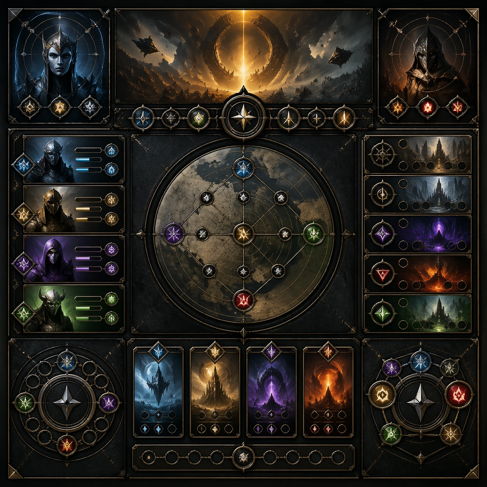

```text
Scene:
Create a square standalone support image for Teaser One-Sheet Tension Poster. Build a third support-surface study with a clear focal hierarchy and a finished professional surface. Use a polished modular board or campaign surface with clean spacing, premium game-UI finish, and clear focal hierarchy. The frame should feel self-contained and polished, with enough structure to explain the system even without the reference series, yet still obviously belonging to the same theme and production world.

Subject:
Show a coherent original game-art system built for premium production and marketing surfaces in a way that emphasizes the intended support surface. Keep the same system logic stable across screenshots, cards, banners, and overview boards. Even though this image is independent, the viewer should still recognize the same universe, same commercial logic, and same production intent as the core package.

Important details:
Lock framing, icon grammar, palette blocking, and surface hierarchy so the kit feels production-ready and consistent. Preserve the broader theme language through color, framing, material choices, and modular composition. Use clean panel rhythm, premium asset presentation, and believable detail density. The image should work equally well as a gallery study, research reference, and mock production deliverable.

Use case:
Teaser One-Sheet Tension Poster single study 7/9, exploring support three as a support surface.

Constraints:
No readable text, no watermark, no logos, preserve exact 1:1 aspect ratio, no unrelated objects, no broken visual hierarchy, no visual noise that obscures the main surface, no accidental brand resemblance.
```

[Pinned source](https://github.com/ChaosRealmsAI/gpt-image-2-gallery/blob/5296db8c996e38776c83a0bc8c64f848dcd512b3/works/topics/teaser-one-sheet-tension-poster/packages/single-support-studies/images/support-three/meta.json) · GPT Image2 · 1254×1254 · No source-declared image dependencies. · ProjectD:pending individual review.

## Support Four · teaser-one-sheet-tension-poster/single-support-studies/support-four

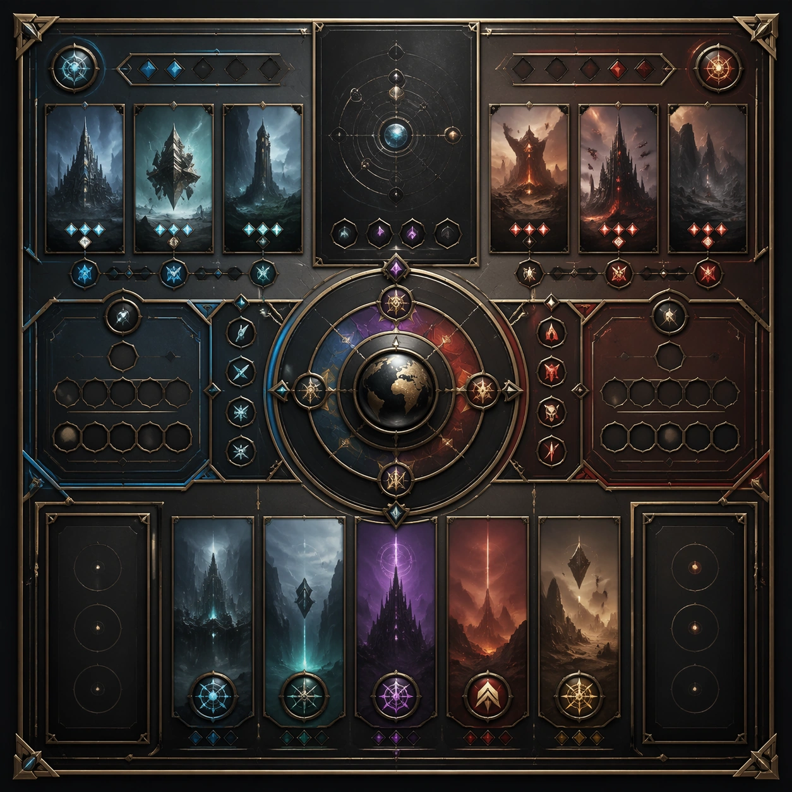

```text
Scene:
Create a square standalone support image for Teaser One-Sheet Tension Poster. Build a fourth support-surface study with a clear focal hierarchy and a finished professional surface. Use a polished modular board or campaign surface with clean spacing, premium game-UI finish, and clear focal hierarchy. The frame should feel self-contained and polished, with enough structure to explain the system even without the reference series, yet still obviously belonging to the same theme and production world.

Subject:
Show a coherent original game-art system built for premium production and marketing surfaces in a way that emphasizes the intended support surface. Keep the same system logic stable across screenshots, cards, banners, and overview boards. Even though this image is independent, the viewer should still recognize the same universe, same commercial logic, and same production intent as the core package.

Important details:
Lock framing, icon grammar, palette blocking, and surface hierarchy so the kit feels production-ready and consistent. Preserve the broader theme language through color, framing, material choices, and modular composition. Use clean panel rhythm, premium asset presentation, and believable detail density. The image should work equally well as a gallery study, research reference, and mock production deliverable.

Use case:
Teaser One-Sheet Tension Poster single study 8/9, exploring support four as a support surface.

Constraints:
No readable text, no watermark, no logos, preserve exact 1:1 aspect ratio, no unrelated objects, no broken visual hierarchy, no visual noise that obscures the main surface, no accidental brand resemblance.
```

[Pinned source](https://github.com/ChaosRealmsAI/gpt-image-2-gallery/blob/5296db8c996e38776c83a0bc8c64f848dcd512b3/works/topics/teaser-one-sheet-tension-poster/packages/single-support-studies/images/support-four/meta.json) · GPT Image2 · 1254×1254 · No source-declared image dependencies. · ProjectD:pending individual review.

## Support Five · teaser-one-sheet-tension-poster/single-support-studies/support-five

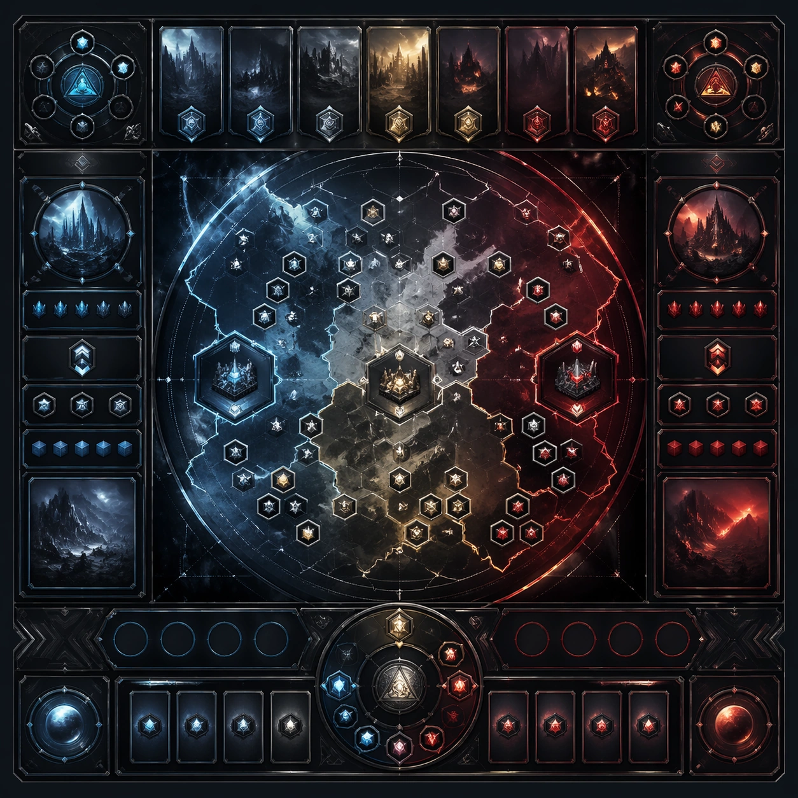

```text
Scene:
Create a square standalone support image for Teaser One-Sheet Tension Poster. Build a fifth support-surface study with a clear focal hierarchy and a finished professional surface. Use a polished modular board or campaign surface with clean spacing, premium game-UI finish, and clear focal hierarchy. The frame should feel self-contained and polished, with enough structure to explain the system even without the reference series, yet still obviously belonging to the same theme and production world.

Subject:
Show a coherent original game-art system built for premium production and marketing surfaces in a way that emphasizes the intended support surface. Keep the same system logic stable across screenshots, cards, banners, and overview boards. Even though this image is independent, the viewer should still recognize the same universe, same commercial logic, and same production intent as the core package.

Important details:
Lock framing, icon grammar, palette blocking, and surface hierarchy so the kit feels production-ready and consistent. Preserve the broader theme language through color, framing, material choices, and modular composition. Use clean panel rhythm, premium asset presentation, and believable detail density. The image should work equally well as a gallery study, research reference, and mock production deliverable.

Use case:
Teaser One-Sheet Tension Poster single study 9/9, exploring support five as a support surface.

Constraints:
No readable text, no watermark, no logos, preserve exact 1:1 aspect ratio, no unrelated objects, no broken visual hierarchy, no visual noise that obscures the main surface, no accidental brand resemblance.
```

[Pinned source](https://github.com/ChaosRealmsAI/gpt-image-2-gallery/blob/5296db8c996e38776c83a0bc8c64f848dcd512b3/works/topics/teaser-one-sheet-tension-poster/packages/single-support-studies/images/support-five/meta.json) · GPT Image2 · 1254×1254 · No source-declared image dependencies. · ProjectD:pending individual review.

## Hero Shot · telescope-nebula-galaxy/single-telescope-nebula-galaxy-studies/hero-shot

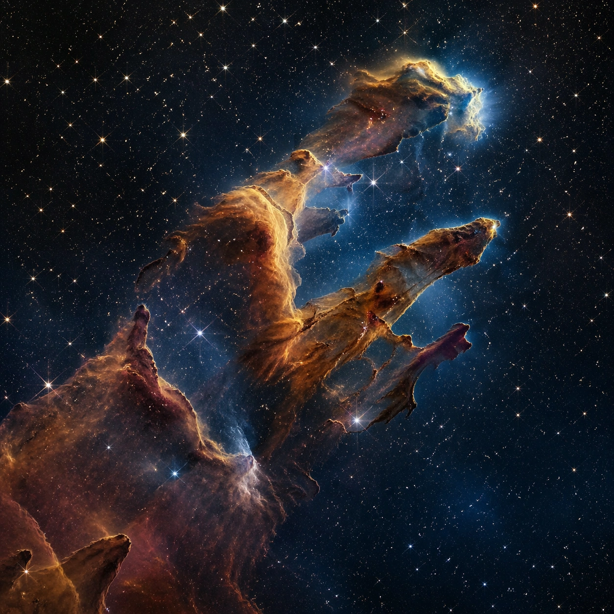

```text
Scene:
A square photographic image with intentional lens choice, coherent light, and a subject that feels observed rather than merely decorated. Build the frame around a definitive frame that establishes the subject’s strongest visual identity. Keep the lighting, camera distance, and spatial organization tuned for a high-signal research image rather than a casual snapshot. The image belongs to the Telescope Nebula Galaxy theme and should feel immediately legible as a prompt atlas theme for telescope nebula galaxy, testing photorealism, world-knowledge with gpt image 2..

Subject:
Center the study on a definitive frame that establishes the subject’s strongest visual identity. Translate the theme into a concrete visual statement instead of an abstract mood board: the viewer should understand what kind of image this is, what is being tested, and why the composition is difficult. Use the slug idea of telescope nebula galaxy as a literal guide for subject matter, materials, and staging. If helpful, borrow the broad visual cues suggested by Pillars of Creation, JWST, but keep the result original and specific to this study.

Important details:
The realism should come from timing, optics, and material response: atmosphere, contrast, depth, motion, and tiny physical cues all need to agree. Preserve a disciplined square composition, clear focal hierarchy, and enough secondary information to make the image feel complete rather than underspecified. The image should look polished, novel, and exhibition-ready, with topic-specific credibility coming from the way surfaces, structure, and visual language reinforce Telescope Nebula Galaxy. Avoid generic filler elements that do not serve the main concept.

Use case:
Telescope Nebula Galaxy single study 1/8, testing photorealism, world-knowledge through the hero shot variation.

Constraints:
No readable text, no watermark, no logos, preserve exact 1:1 aspect ratio, no watermark, no cheap HDR excess, no unreadable signage, no fake stock-photo posing, no compositing seams, no arbitrary lens flare.
```

[Pinned source](https://github.com/ChaosRealmsAI/gpt-image-2-gallery/blob/5296db8c996e38776c83a0bc8c64f848dcd512b3/works/topics/telescope-nebula-galaxy/packages/single-telescope-nebula-galaxy-studies/images/hero-shot/meta.json) · GPT Image2 · 1254×1254 · No source-declared image dependencies. · ProjectD:pending individual review.

## Macro Study · telescope-nebula-galaxy/single-telescope-nebula-galaxy-studies/macro-study

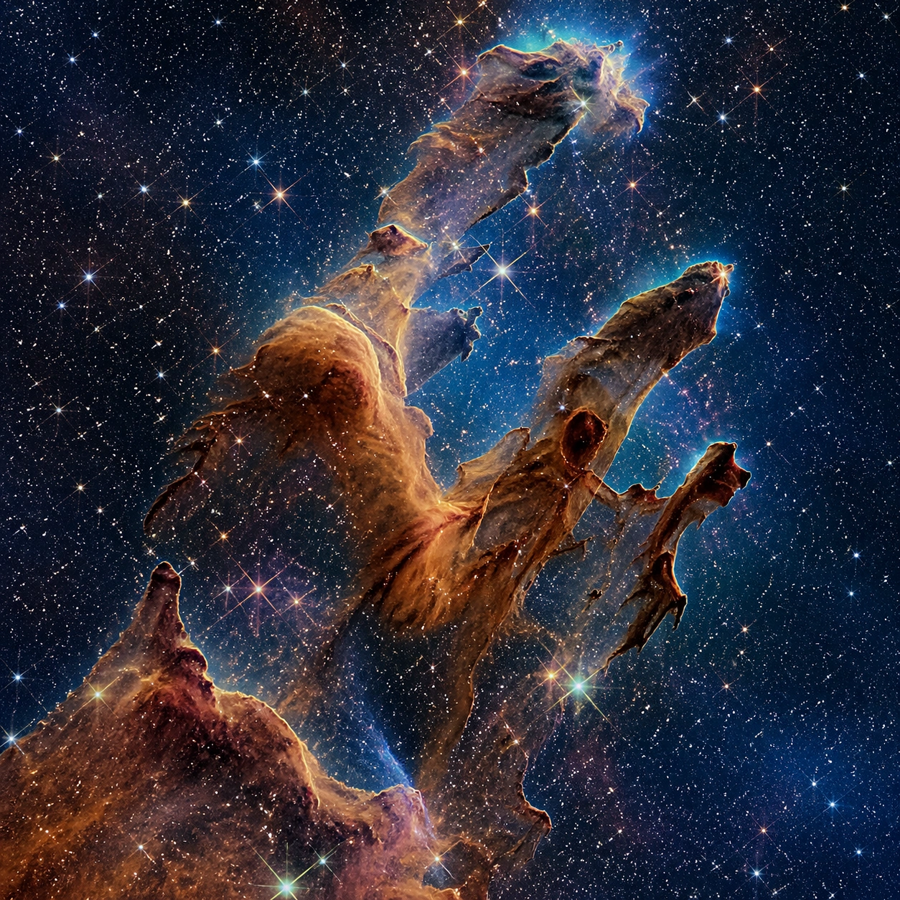

```text
Scene:
A square photographic image with intentional lens choice, coherent light, and a subject that feels observed rather than merely decorated. Build the frame around closer observation that reveals fine structure and optical behavior. Keep the lighting, camera distance, and spatial organization tuned for a high-signal research image rather than a casual snapshot. The image belongs to the Telescope Nebula Galaxy theme and should feel immediately legible as a prompt atlas theme for telescope nebula galaxy, testing photorealism, world-knowledge with gpt image 2..

Subject:
Center the study on closer observation that reveals fine structure and optical behavior. Translate the theme into a concrete visual statement instead of an abstract mood board: the viewer should understand what kind of image this is, what is being tested, and why the composition is difficult. Use the slug idea of telescope nebula galaxy as a literal guide for subject matter, materials, and staging. If helpful, borrow the broad visual cues suggested by Pillars of Creation, JWST, but keep the result original and specific to this study.

Important details:
The realism should come from timing, optics, and material response: atmosphere, contrast, depth, motion, and tiny physical cues all need to agree. Preserve a disciplined square composition, clear focal hierarchy, and enough secondary information to make the image feel complete rather than underspecified. The image should look polished, novel, and exhibition-ready, with topic-specific credibility coming from the way surfaces, structure, and visual language reinforce Telescope Nebula Galaxy. Avoid generic filler elements that do not serve the main concept.

Use case:
Telescope Nebula Galaxy single study 2/8, testing photorealism, world-knowledge through the macro study variation.

Constraints:
No readable text, no watermark, no logos, preserve exact 1:1 aspect ratio, no watermark, no cheap HDR excess, no unreadable signage, no fake stock-photo posing, no compositing seams, no arbitrary lens flare.
```

[Pinned source](https://github.com/ChaosRealmsAI/gpt-image-2-gallery/blob/5296db8c996e38776c83a0bc8c64f848dcd512b3/works/topics/telescope-nebula-galaxy/packages/single-telescope-nebula-galaxy-studies/images/macro-study/meta.json) · GPT Image2 · 1254×1254 · No source-declared image dependencies. · ProjectD:pending individual review.

## Side Light Study · telescope-nebula-galaxy/single-telescope-nebula-galaxy-studies/side-light-study

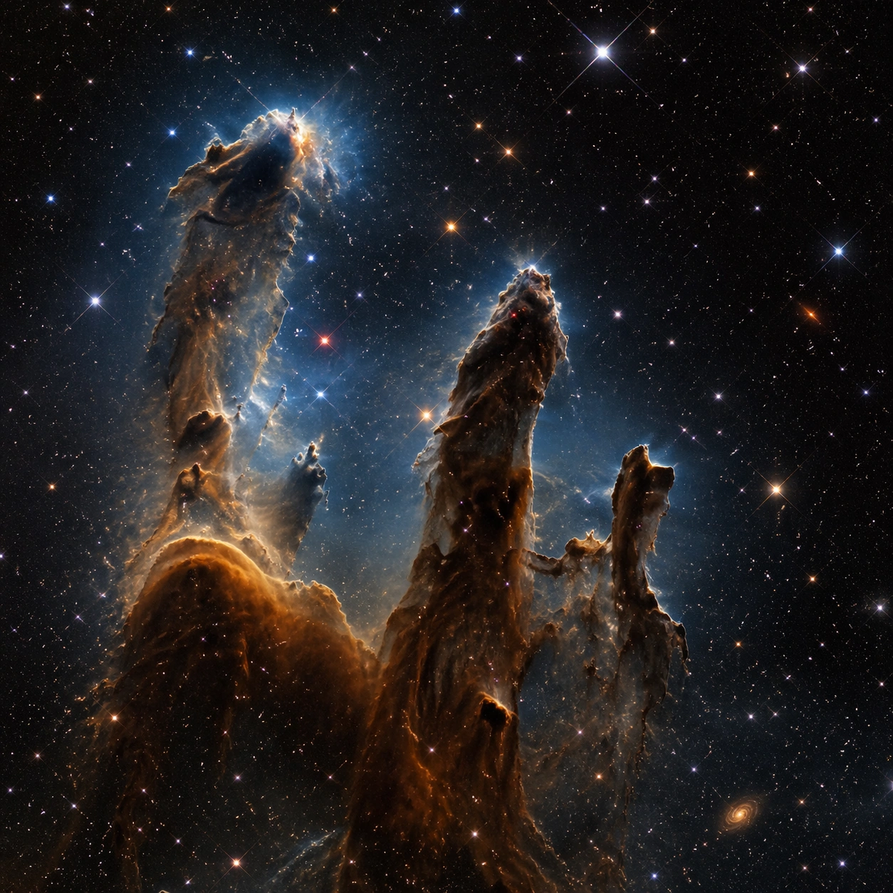

```text
Scene:
A square photographic image with intentional lens choice, coherent light, and a subject that feels observed rather than merely decorated. Build the frame around a directional-light treatment that increases form and drama. Keep the lighting, camera distance, and spatial organization tuned for a high-signal research image rather than a casual snapshot. The image belongs to the Telescope Nebula Galaxy theme and should feel immediately legible as a prompt atlas theme for telescope nebula galaxy, testing photorealism, world-knowledge with gpt image 2..

Subject:
Center the study on a directional-light treatment that increases form and drama. Translate the theme into a concrete visual statement instead of an abstract mood board: the viewer should understand what kind of image this is, what is being tested, and why the composition is difficult. Use the slug idea of telescope nebula galaxy as a literal guide for subject matter, materials, and staging. If helpful, borrow the broad visual cues suggested by Pillars of Creation, JWST, but keep the result original and specific to this study.

Important details:
The realism should come from timing, optics, and material response: atmosphere, contrast, depth, motion, and tiny physical cues all need to agree. Preserve a disciplined square composition, clear focal hierarchy, and enough secondary information to make the image feel complete rather than underspecified. The image should look polished, novel, and exhibition-ready, with topic-specific credibility coming from the way surfaces, structure, and visual language reinforce Telescope Nebula Galaxy. Avoid generic filler elements that do not serve the main concept.

Use case:
Telescope Nebula Galaxy single study 3/8, testing photorealism, world-knowledge through the side light study variation.

Constraints:
No readable text, no watermark, no logos, preserve exact 1:1 aspect ratio, no watermark, no cheap HDR excess, no unreadable signage, no fake stock-photo posing, no compositing seams, no arbitrary lens flare.
```

[Pinned source](https://github.com/ChaosRealmsAI/gpt-image-2-gallery/blob/5296db8c996e38776c83a0bc8c64f848dcd512b3/works/topics/telescope-nebula-galaxy/packages/single-telescope-nebula-galaxy-studies/images/side-light-study/meta.json) · GPT Image2 · 1254×1254 · No source-declared image dependencies. · ProjectD:pending individual review.

## Motion Moment · telescope-nebula-galaxy/single-telescope-nebula-galaxy-studies/motion-moment

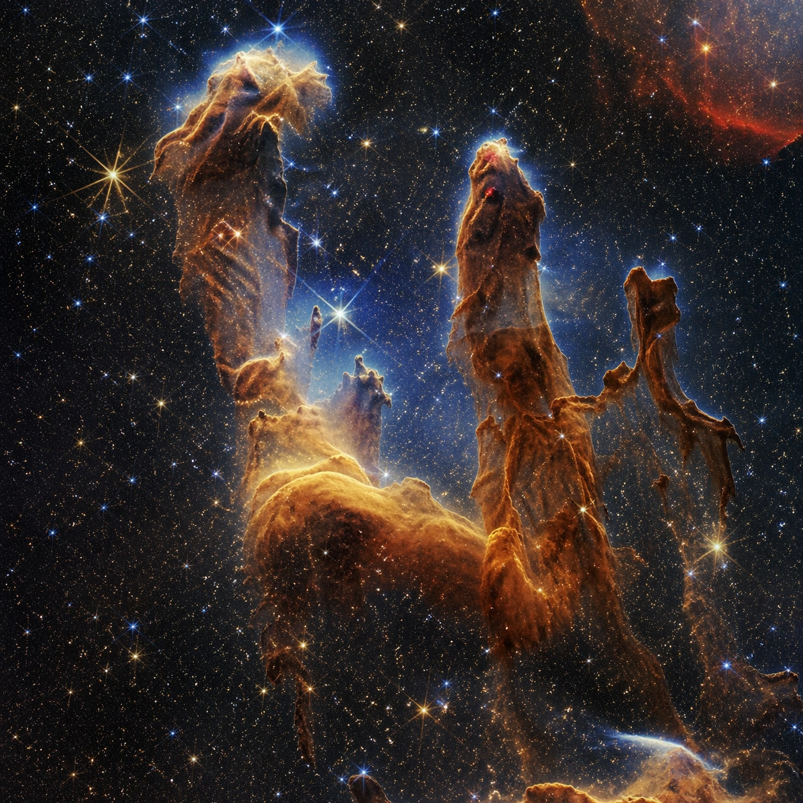

```text
Scene:
A square photographic image with intentional lens choice, coherent light, and a subject that feels observed rather than merely decorated. Build the frame around a time-sensitive or kinetic phenomenon captured at the right instant. Keep the lighting, camera distance, and spatial organization tuned for a high-signal research image rather than a casual snapshot. The image belongs to the Telescope Nebula Galaxy theme and should feel immediately legible as a prompt atlas theme for telescope nebula galaxy, testing photorealism, world-knowledge with gpt image 2..

Subject:
Center the study on a time-sensitive or kinetic phenomenon captured at the right instant. Translate the theme into a concrete visual statement instead of an abstract mood board: the viewer should understand what kind of image this is, what is being tested, and why the composition is difficult. Use the slug idea of telescope nebula galaxy as a literal guide for subject matter, materials, and staging. If helpful, borrow the broad visual cues suggested by Pillars of Creation, JWST, but keep the result original and specific to this study.

Important details:
The realism should come from timing, optics, and material response: atmosphere, contrast, depth, motion, and tiny physical cues all need to agree. Preserve a disciplined square composition, clear focal hierarchy, and enough secondary information to make the image feel complete rather than underspecified. The image should look polished, novel, and exhibition-ready, with topic-specific credibility coming from the way surfaces, structure, and visual language reinforce Telescope Nebula Galaxy. Avoid generic filler elements that do not serve the main concept.

Use case:
Telescope Nebula Galaxy single study 4/8, testing photorealism, world-knowledge through the motion moment variation.

Constraints:
No readable text, no watermark, no logos, preserve exact 1:1 aspect ratio, no watermark, no cheap HDR excess, no unreadable signage, no fake stock-photo posing, no compositing seams, no arbitrary lens flare.
```

[Pinned source](https://github.com/ChaosRealmsAI/gpt-image-2-gallery/blob/5296db8c996e38776c83a0bc8c64f848dcd512b3/works/topics/telescope-nebula-galaxy/packages/single-telescope-nebula-galaxy-studies/images/motion-moment/meta.json) · GPT Image2 · 1254×1254 · No source-declared image dependencies. · ProjectD:pending individual review.

## Low-Light Atlas · telescope-nebula-galaxy/single-telescope-nebula-galaxy-studies/low-light-atlas


```text
Scene:
A square photographic image with intentional lens choice, coherent light, and a subject that feels observed rather than merely decorated. Build the frame around a dusk, night, or low-light frame with disciplined exposure. Keep the lighting, camera distance, and spatial organization tuned for a high-signal research image rather than a casual snapshot. The image belongs to the Telescope Nebula Galaxy theme and should feel immediately legible as a prompt atlas theme for telescope nebula galaxy, testing photorealism, world-knowledge with gpt image 2..

Subject:
Center the study on a dusk, night, or low-light frame with disciplined exposure. Translate the theme into a concrete visual statement instead of an abstract mood board: the viewer should understand what kind of image this is, what is being tested, and why the composition is difficult. Use the slug idea of telescope nebula galaxy as a literal guide for subject matter, materials, and staging. If helpful, borrow the broad visual cues suggested by Pillars of Creation, JWST, but keep the result original and specific to this study.

Important details:
The realism should come from timing, optics, and material response: atmosphere, contrast, depth, motion, and tiny physical cues all need to agree. Preserve a disciplined square composition, clear focal hierarchy, and enough secondary information to make the image feel complete rather than underspecified. The image should look polished, novel, and exhibition-ready, with topic-specific credibility coming from the way surfaces, structure, and visual language reinforce Telescope Nebula Galaxy. Avoid generic filler elements that do not serve the main concept.

Use case:
Telescope Nebula Galaxy single study 5/8, testing photorealism, world-knowledge through the low-light atlas variation.

Constraints:
No readable text, no watermark, no logos, preserve exact 1:1 aspect ratio, no watermark, no cheap HDR excess, no unreadable signage, no fake stock-photo posing, no compositing seams, no arbitrary lens flare.
```

[Pinned source](https://github.com/ChaosRealmsAI/gpt-image-2-gallery/blob/5296db8c996e38776c83a0bc8c64f848dcd512b3/works/topics/telescope-nebula-galaxy/packages/single-telescope-nebula-galaxy-studies/images/low-light-atlas/meta.json) · GPT Image2 · 1254×1254 · No source-declared image dependencies. · ProjectD:pending individual review.

## Specimen Table · telescope-nebula-galaxy/single-telescope-nebula-galaxy-studies/specimen-table

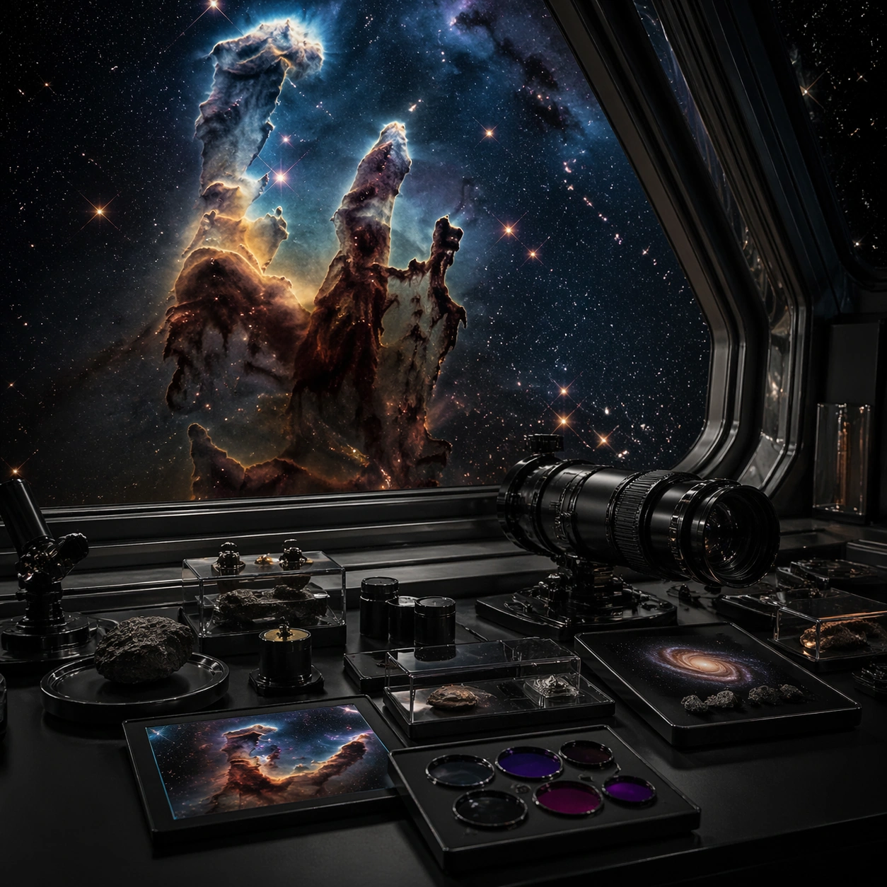

```text
Scene:
A square photographic image with intentional lens choice, coherent light, and a subject that feels observed rather than merely decorated. Build the frame around a carefully arranged or comparative frame that still feels photographic. Keep the lighting, camera distance, and spatial organization tuned for a high-signal research image rather than a casual snapshot. The image belongs to the Telescope Nebula Galaxy theme and should feel immediately legible as a prompt atlas theme for telescope nebula galaxy, testing photorealism, world-knowledge with gpt image 2..

Subject:
Center the study on a carefully arranged or comparative frame that still feels photographic. Translate the theme into a concrete visual statement instead of an abstract mood board: the viewer should understand what kind of image this is, what is being tested, and why the composition is difficult. Use the slug idea of telescope nebula galaxy as a literal guide for subject matter, materials, and staging. If helpful, borrow the broad visual cues suggested by Pillars of Creation, JWST, but keep the result original and specific to this study.

Important details:
The realism should come from timing, optics, and material response: atmosphere, contrast, depth, motion, and tiny physical cues all need to agree. Preserve a disciplined square composition, clear focal hierarchy, and enough secondary information to make the image feel complete rather than underspecified. The image should look polished, novel, and exhibition-ready, with topic-specific credibility coming from the way surfaces, structure, and visual language reinforce Telescope Nebula Galaxy. Avoid generic filler elements that do not serve the main concept.

Use case:
Telescope Nebula Galaxy single study 6/8, testing photorealism, world-knowledge through the specimen table variation.

Constraints:
No readable text, no watermark, no logos, preserve exact 1:1 aspect ratio, no watermark, no cheap HDR excess, no unreadable signage, no fake stock-photo posing, no compositing seams, no arbitrary lens flare.
```

[Pinned source](https://github.com/ChaosRealmsAI/gpt-image-2-gallery/blob/5296db8c996e38776c83a0bc8c64f848dcd512b3/works/topics/telescope-nebula-galaxy/packages/single-telescope-nebula-galaxy-studies/images/specimen-table/meta.json) · GPT Image2 · 1254×1254 · No source-declared image dependencies. · ProjectD:pending individual review.

## Atmospheric View · telescope-nebula-galaxy/single-telescope-nebula-galaxy-studies/atmospheric-view

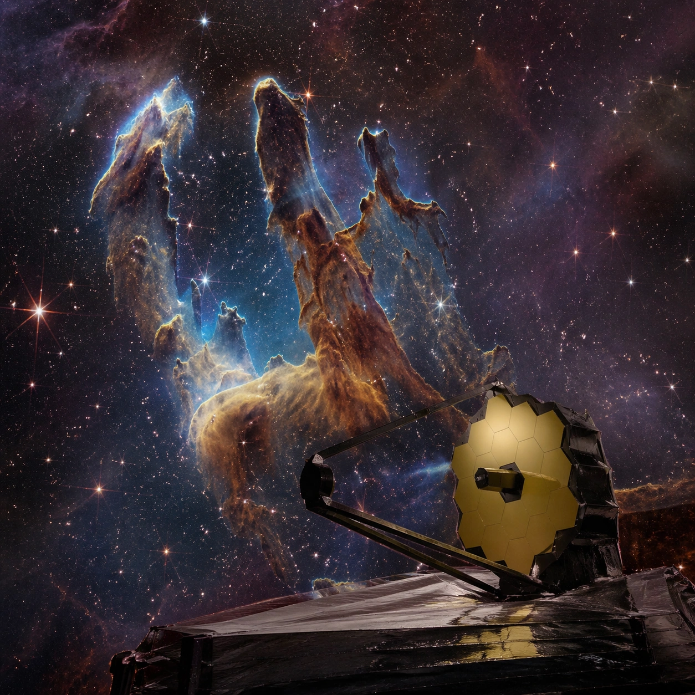

```text
Scene:
A square photographic image with intentional lens choice, coherent light, and a subject that feels observed rather than merely decorated. Build the frame around weather, haze, or volumetric light used to deepen realism. Keep the lighting, camera distance, and spatial organization tuned for a high-signal research image rather than a casual snapshot. The image belongs to the Telescope Nebula Galaxy theme and should feel immediately legible as a prompt atlas theme for telescope nebula galaxy, testing photorealism, world-knowledge with gpt image 2..

Subject:
Center the study on weather, haze, or volumetric light used to deepen realism. Translate the theme into a concrete visual statement instead of an abstract mood board: the viewer should understand what kind of image this is, what is being tested, and why the composition is difficult. Use the slug idea of telescope nebula galaxy as a literal guide for subject matter, materials, and staging. If helpful, borrow the broad visual cues suggested by Pillars of Creation, JWST, but keep the result original and specific to this study.

Important details:
The realism should come from timing, optics, and material response: atmosphere, contrast, depth, motion, and tiny physical cues all need to agree. Preserve a disciplined square composition, clear focal hierarchy, and enough secondary information to make the image feel complete rather than underspecified. The image should look polished, novel, and exhibition-ready, with topic-specific credibility coming from the way surfaces, structure, and visual language reinforce Telescope Nebula Galaxy. Avoid generic filler elements that do not serve the main concept.

Use case:
Telescope Nebula Galaxy single study 7/8, testing photorealism, world-knowledge through the atmospheric view variation.

Constraints:
No readable text, no watermark, no logos, preserve exact 1:1 aspect ratio, no watermark, no cheap HDR excess, no unreadable signage, no fake stock-photo posing, no compositing seams, no arbitrary lens flare.
```

[Pinned source](https://github.com/ChaosRealmsAI/gpt-image-2-gallery/blob/5296db8c996e38776c83a0bc8c64f848dcd512b3/works/topics/telescope-nebula-galaxy/packages/single-telescope-nebula-galaxy-studies/images/atmospheric-view/meta.json) · GPT Image2 · 1254×1254 · No source-declared image dependencies. · ProjectD:pending individual review.

## Signature Frame · telescope-nebula-galaxy/single-telescope-nebula-galaxy-studies/signature-frame


```text
Scene:
A square photographic image with intentional lens choice, coherent light, and a subject that feels observed rather than merely decorated. Build the frame around the most memorable final image for the topic. Keep the lighting, camera distance, and spatial organization tuned for a high-signal research image rather than a casual snapshot. The image belongs to the Telescope Nebula Galaxy theme and should feel immediately legible as a prompt atlas theme for telescope nebula galaxy, testing photorealism, world-knowledge with gpt image 2..

Subject:
Center the study on the most memorable final image for the topic. Translate the theme into a concrete visual statement instead of an abstract mood board: the viewer should understand what kind of image this is, what is being tested, and why the composition is difficult. Use the slug idea of telescope nebula galaxy as a literal guide for subject matter, materials, and staging. If helpful, borrow the broad visual cues suggested by Pillars of Creation, JWST, but keep the result original and specific to this study.

Important details:
The realism should come from timing, optics, and material response: atmosphere, contrast, depth, motion, and tiny physical cues all need to agree. Preserve a disciplined square composition, clear focal hierarchy, and enough secondary information to make the image feel complete rather than underspecified. The image should look polished, novel, and exhibition-ready, with topic-specific credibility coming from the way surfaces, structure, and visual language reinforce Telescope Nebula Galaxy. Avoid generic filler elements that do not serve the main concept.

Use case:
Telescope Nebula Galaxy single study 8/8, testing photorealism, world-knowledge through the signature frame variation.

Constraints:
No readable text, no watermark, no logos, preserve exact 1:1 aspect ratio, no watermark, no cheap HDR excess, no unreadable signage, no fake stock-photo posing, no compositing seams, no arbitrary lens flare.
```

[Pinned source](https://github.com/ChaosRealmsAI/gpt-image-2-gallery/blob/5296db8c996e38776c83a0bc8c64f848dcd512b3/works/topics/telescope-nebula-galaxy/packages/single-telescope-nebula-galaxy-studies/images/signature-frame/meta.json) · GPT Image2 · 1254×1254 · No source-declared image dependencies. · ProjectD:pending individual review.

## Reference Tile · tessellation-pattern/series-living-tiles/01-reference-tile


```text
Scene:
A square crop showing a flat seamless tessellation design on matte ceramic tile, viewed straight-on with no perspective distortion. The tile surface is softly lit like a museum catalog photograph, with tiny glaze texture and crisp printed edges. The composition must read as a repeatable pattern that can continue beyond all four borders.

Subject:
An Escher-inspired interlocking fish-to-bird tessellation: fish silhouettes flow from the left and gradually transform into bird silhouettes toward the right, while every positive shape also creates a matching negative shape. Each figure is complete, edge-matched, and locked into neighboring figures with no gaps and no overlaps. The underlying geometry uses repeating curved diamonds and mirrored S-shaped seams.

Important details:
Precise optical-illusion geometry, seamless tile logic, clean silhouette boundaries, balanced teal, ivory, graphite, and muted gold palette, subtle ceramic glaze, no text, no frame, no visible grout lines. The left and right borders must connect visually, and the top and bottom borders must also connect visually. The pattern should be legible both as individual animals and as one continuous mathematical tiling.

Use case:
Reference image for a fanout series. Later images must preserve this same seamless interlocking lattice while changing material and narrative content.

Constraints:
No readable text, no watermark, no logos, no isolated central emblem, no blank border, no broken tiles, no random wallpaper noise, no perspective angle, no objects casting shadows over the pattern, preserve exact 1:1 aspect ratio.
```

[Pinned source](https://github.com/ChaosRealmsAI/gpt-image-2-gallery/blob/5296db8c996e38776c83a0bc8c64f848dcd512b3/works/topics/tessellation-pattern/packages/series-living-tiles/images/01-reference-tile/meta.json) · GPT Image2 · 1254×1254 · No source-declared image dependencies. · ProjectD:pending individual review.

## Coral Lattice · tessellation-pattern/series-living-tiles/02-coral-lattice


```text
Scene:
Same square, straight-on seamless tile view as the reference image. Preserve the full repeatable lattice, edge alignment, figure scale, and overall pattern density from the reference. The surface now looks like a living reef relief photographed under clear shallow water, with soft caustic highlights and fine organic texture.

Subject:
Use the same interlocking fish-to-bird tessellation geometry from the reference image, but reinterpret the figures as coral reef creatures and branching coral forms. Fish shapes become tiny reef fish with subtle scale texture; bird shapes become wing-like coral fans and sea-bird silhouettes made of coral polyps. The exact seam logic must remain complete, gapless, and repeatable across all four borders.

Important details:
Accurate reference preservation, no geometry drift, no new loose shapes outside the lattice. Use coral pink, seafoam, turquoise, ivory sand, and deep blue shadow. Add fine coral pores, algae edges, and underwater caustics while keeping the original tessellation readable. The image should still look like one precise seamless pattern, not a random reef illustration.

Use case:
Second image in a reference-dependent tessellation series. It should prove that the queue can use image 01 as --ref while changing material language and subject details.

Constraints:
PRESERVE the reference image lattice, crop, camera angle, border continuity, and figure count. No readable text, no watermark, no logos, no extra central icon, no broken edges, no perspective view, no frame, no random decorative scatter, preserve exact 1:1 aspect ratio.
```

[Pinned source](https://github.com/ChaosRealmsAI/gpt-image-2-gallery/blob/5296db8c996e38776c83a0bc8c64f848dcd512b3/works/topics/tessellation-pattern/packages/series-living-tiles/images/02-coral-lattice/meta.json) · GPT Image2 · 1254×1254 · Reference images required. · ProjectD:pending individual review.

## Moth Lattice · tessellation-pattern/series-living-tiles/03-moth-lattice


```text
Scene:
Same square, straight-on seamless tile view as the reference image. Preserve the reference lattice, border continuity, object scale, pattern rhythm, and no-perspective catalog composition. The surface now looks like a natural history plate made from pinned moth wings and translucent paper, evenly lit on a neutral archival background.

Subject:
Use the same interlocking fish-to-bird tessellation geometry from the reference image, but reinterpret the figures as moths, wing fragments, and feather-like silhouettes. Fish forms become patterned moth bodies and folded wings; bird forms become open moth wings with eye spots and fine scales. Every figure must still interlock exactly with neighboring shapes and continue seamlessly through the image borders.

Important details:
Accurate geometry preservation from the reference, delicate wing veins, powdery scale texture, muted ochre, slate, cream, rust, and ink-black markings. Keep the original optical illusion readable: viewers should see both individual moth shapes and the larger repeating tessellation. No loose specimens should sit on top of the pattern; everything must be part of the locked lattice.

Use case:
Third image in a reference-dependent tessellation fanout series, testing whether a single base geometry can drive a different biological material language.

Constraints:
PRESERVE the reference image lattice, crop, camera angle, border continuity, and figure count. No readable text, no watermark, no labels, no pins with shadows, no frame, no broken edge repeats, no random wallpaper scatter, preserve exact 1:1 aspect ratio.
```

[Pinned source](https://github.com/ChaosRealmsAI/gpt-image-2-gallery/blob/5296db8c996e38776c83a0bc8c64f848dcd512b3/works/topics/tessellation-pattern/packages/series-living-tiles/images/03-moth-lattice/meta.json) · GPT Image2 · 1254×1254 · Reference images required. · ProjectD:pending individual review.

## City Lattice · tessellation-pattern/series-living-tiles/04-city-lattice


```text
Scene:
Same square, straight-on seamless tile view as the reference image. Preserve the exact reference lattice, border continuity, figure scale, and flat no-perspective composition. The surface now appears as an isometric-looking but still flat urban planning map printed on satin paper, with tiny roof textures and street-like seams integrated into the tessellation.

Subject:
Use the same interlocking fish-to-bird tessellation geometry from the reference image, but reinterpret every shape as a miniature city block, rooftop garden, canal edge, bridge, or plaza. Fish silhouettes become curved canal districts; bird silhouettes become angular roof clusters and park wedges. The reference seam logic must remain complete and gapless, with every city district locking into the next and continuing through all four borders.

Important details:
Accurate lattice preservation, map-like clarity, tiny rooftops, micro parks, canals, bridges, warm window dots, slate roofs, moss green parks, pale stone streets, muted blue water. The image should feel like a precise impossible city plan generated from the same tessellation, not a normal top-down city map. Keep the pattern readable at thumbnail scale.

Use case:
Fourth image in a reference-dependent tessellation fanout series, testing structural continuity while changing the scene into an architectural miniature map.

Constraints:
PRESERVE the reference image lattice, crop, camera angle, border continuity, and figure count. No readable text, no watermark, no map labels, no logos, no perspective skyline, no frame, no broken edge repeats, no random scattered buildings outside the pattern, preserve exact 1:1 aspect ratio.
```

[Pinned source](https://github.com/ChaosRealmsAI/gpt-image-2-gallery/blob/5296db8c996e38776c83a0bc8c64f848dcd512b3/works/topics/tessellation-pattern/packages/series-living-tiles/images/04-city-lattice/meta.json) · GPT Image2 · 1254×1254 · Reference images required. · ProjectD:pending individual review.

## Philosophy Lineage · thematic-subway-map/single-knowledge-transit-maps/02-philosophy-lineage


```text
Scene:
A square educational wall poster styled as a modern subway system map, printed on matte pale cream stock. The design is front-facing, crisp, and technical, with generous margins and a balanced legend panel in the lower right. Use calm academic colors: deep blue, burgundy, ochre, teal, charcoal, and muted purple. The poster should feel useful for a university hallway or museum shop.

Subject:
A thematic subway map of philosophy history. Route lines represent major schools and questions: metaphysics, ethics, political thought, empiricism, rationalism, existentialism, analytic logic, and eastern wisdom. The lines branch from an ancient forum-like origin hub, pass through dense medieval and enlightenment transfer zones, and spread into modern debates. Larger circular transfer stations indicate conceptual collisions such as mind-body, virtue, reason, social contract, language, suffering, and freedom. Small icons show scrolls, lamps, scales, dialogue bubbles, and labyrinths.

Important details:
The map must express lineage and influence without relying on readable names. Use station dots, interchange rings, branching lines, route colors, and section density to show chronology and cross-pollination. Keep all label areas as non-readable short glyph bars, with no actual text. Transit geometry should be disciplined: consistent stroke widths, clean corners, obvious transfer circles, and no accidental tangles. The network should feel like a knowledge graph converted into a professional public-transport diagram.

Use case:
Thematic Subway Map single study 2/8, testing philosophical lineage abstraction, structured hierarchy, and transfer-based reasoning composition.

Constraints:
No readable text, no watermark, no logos, preserve exact 1:1 aspect ratio, no real philosopher portraits, no fake university emblem, no random symbols, no illegible paragraph blocks, no chaotic route crossing, no geographic base map.
```

[Pinned source](https://github.com/ChaosRealmsAI/gpt-image-2-gallery/blob/5296db8c996e38776c83a0bc8c64f848dcd512b3/works/topics/thematic-subway-map/packages/single-knowledge-transit-maps/images/02-philosophy-lineage/meta.json) · GPT Image2 · 1254×1254 · No source-declared image dependencies. · ProjectD:pending individual review.

## AI History Rail · thematic-subway-map/single-knowledge-transit-maps/03-ai-history-rail


```text
Scene:
A square technology exhibition poster designed as a clean subway map on white synthetic paper. The map is straight-on, flat, and highly structured, using crisp digital linework, small station nodes, and a dark navy header band made only of abstract glyph marks. Use a modern palette of electric blue, neural green, orange, magenta, black, and silver gray, but keep the overall design disciplined and not cyberpunk.

Subject:
A thematic transit diagram of AI development from early symbolic ideas to contemporary multimodal systems. Route lines represent symbolic AI, expert systems, machine learning, neural networks, reinforcement learning, computer vision, language models, and image generation. The network begins at a left-side origin hub, moves through several winter-like sparse sections, thickens around a deep-learning interchange, and expands into a dense modern terminal cluster. Transfer stations mark moments where methods converge: data scale, GPUs, attention, self-supervision, alignment, tools, and multimodal interfaces.

Important details:
The map should show historical reasoning through topology, not readable dates. Use station density to imply periods of rapid progress, long straight segments for slow eras, and large multi-ring interchanges for breakthroughs. Small icon glyphs may suggest chips, eyes, speech bubbles, robots, and image tiles, but all labels must be non-readable. Keep line crossings clean, route colors consistent, and legend blocks tidy. The poster should feel like a museum-grade technical diagram and commercial educational product.

Use case:
Thematic Subway Map single study 3/8, testing AI-history abstraction, dense route logic, and clean technical-diagram hierarchy.

Constraints:
No readable text, no watermark, no logos, preserve exact 1:1 aspect ratio, no real company marks, no actual model names, no readable years, no fake UI screenshots, no chaotic circuit-board background, no messy station labels.
```

[Pinned source](https://github.com/ChaosRealmsAI/gpt-image-2-gallery/blob/5296db8c996e38776c83a0bc8c64f848dcd512b3/works/topics/thematic-subway-map/packages/single-knowledge-transit-maps/images/03-ai-history-rail/meta.json) · GPT Image2 · 1254×1254 · No source-declared image dependencies. · ProjectD:pending individual review.

## Chinese Dynasty Network · thematic-subway-map/single-knowledge-transit-maps/04-chinese-dynasty-network


```text
Scene:
A square museum-shop poster styled as an elegant transit map on warm ivory paper. The design is front-facing, clean, and balanced, combining public-transport diagram language with subtle historical ornament. Use restrained colors inspired by lacquer red, jade green, imperial yellow, ink black, porcelain blue, and bronze gray. Keep the background mostly plain, with no scroll border or aged parchment effects.

Subject:
A thematic subway map of Chinese dynastic succession and cultural currents. A main chronological trunk line runs across the center, with branch lines for northern regimes, southern courts, frontier states, literary flourishing, trade routes, and administrative reforms. Major transfer hubs represent unification, division, capital shifts, examination culture, maritime exchange, and reform cycles. Station dots vary in size to suggest dynastic weight and transition intensity. Tiny abstract icons show seals, city gates, river bends, books, and bronze vessels.

Important details:
The map must be a reasoning diagram, not a literal geography map. Use route structure to show continuity, splits, reunification, and parallel developments. Avoid readable dynasty names or dates; represent station labels as small non-readable glyph capsules. Keep line thickness consistent, transfer hubs clear, and routes easy to trace. The historical style should remain subtle and premium, supporting the transit-map clarity rather than overwhelming it with decoration.

Use case:
Thematic Subway Map single study 4/8, testing dynastic transition abstraction, historical hierarchy, and clean map-like composition.

Constraints:
No readable text, no watermark, no logos, preserve exact 1:1 aspect ratio, no real national emblem, no portrait illustrations, no battlefield scene, no fake Chinese characters, no overly ornate scroll texture, no random line tangles.
```

[Pinned source](https://github.com/ChaosRealmsAI/gpt-image-2-gallery/blob/5296db8c996e38776c83a0bc8c64f848dcd512b3/works/topics/thematic-subway-map/packages/single-knowledge-transit-maps/images/04-chinese-dynasty-network/meta.json) · GPT Image2 · 1254×1254 · No source-declared image dependencies. · ProjectD:pending individual review.

## Jazz Evolution Map · thematic-subway-map/single-knowledge-transit-maps/05-jazz-evolution-map


```text
Scene:
A square music-culture poster designed as a metropolitan subway map on matte cream paper. The map is crisp and front-facing, with a subtle record-sleeve sensibility but no album art or artist portraits. Use a lively yet controlled palette: brass gold, deep blue, smoky black, warm red, mint green, and muted violet. The lines should feel rhythmic while still obeying strict transit-diagram geometry.

Subject:
A thematic subway map of jazz evolution. Route lines represent blues roots, swing, bebop, cool jazz, hard bop, modal, fusion, free jazz, and contemporary scenes. A central improvisation interchange connects many routes, while side branches show rhythm sections, horn language, club culture, recording technology, and global influence. Station dots form syncopated clusters, with larger transfer circles where styles merge. Small non-readable icon marks suggest saxophones, drums, piano keys, vinyl records, microphones, and dancing silhouettes.

Important details:
The composition must balance musical energy with map clarity. Lines may curve gently like phrasing, but they should still use consistent stroke widths, clear bends, regular station intervals, and readable transfer hubs. Avoid making it look like abstract album-cover scribbles. All label zones should be tiny non-readable glyph blocks; no actual performer names or song titles. Include a clean legend strip with colored route samples, icons, and station symbols, but no legible text.

Use case:
Thematic Subway Map single study 5/8, testing cultural evolution mapping, rhythmic route composition, and polished music-poster diagram design.

Constraints:
No readable text, no watermark, no logos, preserve exact 1:1 aspect ratio, no real musician likenesses, no record label marks, no sheet music notation, no nightclub photo background, no chaotic swirls, no fake readable album titles.
```

[Pinned source](https://github.com/ChaosRealmsAI/gpt-image-2-gallery/blob/5296db8c996e38776c83a0bc8c64f848dcd512b3/works/topics/thematic-subway-map/packages/single-knowledge-transit-maps/images/05-jazz-evolution-map/meta.json) · GPT Image2 · 1254×1254 · No source-declared image dependencies. · ProjectD:pending individual review.

## Climate System Loop · thematic-subway-map/single-knowledge-transit-maps/06-climate-system-loop


```text
Scene:
A square science communication poster styled as a technical subway map on clean white board stock. Use a calm environmental palette: ocean blue, forest green, cloud gray, solar yellow, heat red, ice cyan, and soil brown. The diagram is front-facing and vector-crisp, with a compact legend panel and small icon system. The design should feel suitable for an exhibition wall or educational product.

Subject:
A thematic subway map of Earth's climate system. Circular and looping route lines represent atmosphere, ocean circulation, carbon cycle, water cycle, ice-albedo feedback, biosphere, human emissions, and adaptation pathways. Large transfer stations show interaction points: evaporation, cloud formation, heat exchange, photosynthesis, runoff, warming feedback, urban infrastructure, and mitigation. Some lines form closed loops, while others branch outward to show pressures and responses. Tiny icons suggest sun, cloud, leaf, wave, glacier, factory silhouette, city block, and soil layers.

Important details:
The network should communicate system dynamics through route topology. Feedback loops must be visually distinct from one-way branches; transfer hubs must be clear and not buried under overlapping lines. Use arrows sparingly as small direction markers, but avoid readable labels. Keep station spacing consistent, line weights uniform, and crossings clean. The map should look like a rigorous climate-systems diagram translated into transit language, not a decorative eco poster.

Use case:
Thematic Subway Map single study 6/8, testing system-loop reasoning, scientific structured layout, and commercial educational map design.

Constraints:
No readable text, no watermark, no logos, preserve exact 1:1 aspect ratio, no political slogans, no real agency branding, no disaster photo collage, no messy infographic paragraphs, no random arrows, no globe clip art background.
```

[Pinned source](https://github.com/ChaosRealmsAI/gpt-image-2-gallery/blob/5296db8c996e38776c83a0bc8c64f848dcd512b3/works/topics/thematic-subway-map/packages/single-knowledge-transit-maps/images/06-climate-system-loop/meta.json) · GPT Image2 · 1254×1254 · No source-declared image dependencies. · ProjectD:pending individual review.

## World Cuisine Lines · thematic-subway-map/single-knowledge-transit-maps/07-world-cuisine-lines


```text
Scene:
A square commercial food-culture poster designed as a clean subway map on warm white paper. The style is bright, friendly, and precise, with flat vector lines, circular station dots, and a compact icon legend. Use appetite-friendly but restrained colors: chili red, noodle yellow, herb green, ocean blue, spice orange, rice white, and charcoal. The poster should feel like something sold in a culinary museum shop or used in a food festival exhibit.

Subject:
A thematic subway map of world cuisine relationships. Route lines represent staple grains, spice routes, fermentation, street food, noodle families, seafood traditions, baking, and tea-and-dessert culture. Transfer hubs show shared techniques such as steaming, grilling, pickling, broth-making, flatbread, dumplings, and chili oil. Station clusters imply regional families without drawing a real geography map. Small icons show bowls, chopsticks, bread, fish, jars, steam, leaves, and clay pots.

Important details:
The map must show relationship logic without readable cuisine names. Use line colors and transfer hubs to suggest shared ingredients and cooking methods. Keep the station intervals regular, the legend orderly, and the route intersections easy to follow. Avoid food photography; this is a technical-diagram poster with playful culinary icons. All label positions should use short non-readable glyph marks only. The composition should be dense enough to reward inspection but not so crowded that it loses transit-map clarity.

Use case:
Thematic Subway Map single study 7/8, testing culinary knowledge abstraction, commercial poster appeal, and structured route readability.

Constraints:
No readable text, no watermark, no logos, preserve exact 1:1 aspect ratio, no real restaurant brands, no national flags, no food photos, no tourist map base, no messy ingredient pile, no fake menu text, no random icon clutter.
```

[Pinned source](https://github.com/ChaosRealmsAI/gpt-image-2-gallery/blob/5296db8c996e38776c83a0bc8c64f848dcd512b3/works/topics/thematic-subway-map/packages/single-knowledge-transit-maps/images/07-world-cuisine-lines/meta.json) · GPT Image2 · 1254×1254 · No source-declared image dependencies. · ProjectD:pending individual review.

## Startup Growth Transit · thematic-subway-map/single-knowledge-transit-maps/08-startup-growth-transit


```text
Scene:
A square business workshop poster designed as a polished subway route map on light gray-white paper. The map is front-facing, clean, and highly structured, with a restrained SaaS palette: cobalt blue, mint green, amber, coral, slate, violet, and black. It should look like a premium product-strategy canvas or conference wall graphic without using any real company identity.

Subject:
A thematic subway map of startup growth. Route lines represent idea discovery, customer research, product design, engineering, go-to-market, fundraising, operations, and retention. The network begins at a small origin loop, expands through validation stations, splits at product-market-fit, and becomes denser around scale-up interchanges. Transfer hubs show major decision points: problem clarity, prototype, launch, revenue, hiring, compliance, support, and international expansion. Small icons suggest lightbulbs, users, gears, charts, tickets, shields, rockets, and support headsets.

Important details:
The map should function like a reasoning diagram for business stages. Use line density and hub size to show complexity increasing over time. Keep all station labels as non-readable glyph blocks, with no actual startup jargon text. Lines must be clean, layered, and traceable; avoid crossing chaos. Include a small legend and a route-status inset using colored bars and station symbols. The result should feel commercially useful, not like a decorative motivational poster.

Use case:
Thematic Subway Map single study 8/8, testing business-process abstraction, structured-layout control, and commercial transit-map mockup quality.

Constraints:
No readable text, no watermark, no logos, preserve exact 1:1 aspect ratio, no real company names, no stock-market ticker, no motivational slogan, no messy flowchart arrows, no fake UI dashboard, no random spreadsheet blocks.
```

[Pinned source](https://github.com/ChaosRealmsAI/gpt-image-2-gallery/blob/5296db8c996e38776c83a0bc8c64f848dcd512b3/works/topics/thematic-subway-map/packages/single-knowledge-transit-maps/images/08-startup-growth-transit/meta.json) · GPT Image2 · 1254×1254 · No source-declared image dependencies. · ProjectD:pending individual review.

## Reference Market Mountain · thinking-mode/series-market-reasoning/01-reference-market-mountain


```text
Scene:
A square editorial illustration in a refined magazine style, viewed straight-on like a finished art board. The scene is a stylized mountain range made from layered trend lines, small chart paths, and paper-cut ridges. The background is warm off-white newsprint with subtle ink grain, quiet margins, and a few tiny non-readable hand-drawn annotation marks.

Subject:
Five small runner characters move across the trend mountains, each representing a different abstract market signal rather than a real company. One runner climbs a steep blue ridge, one slides down a graphite slope, one crosses a flat plateau, one pauses at a fork, and one follows a dotted forecast trail. A central reasoning path connects the runners through cause, uncertainty, and outcome using arrows, dashed lines, and simple icons.

Important details:
Structured visual reasoning, clear editorial hierarchy, New Yorker-inspired hand-drawn sophistication without copying a specific artist, muted blue, graphite, tomato red, moss green, and cream palette. The image must feel like an intelligent data essay: chart structure, characters, annotations, and visual metaphors are all legible as a system. Use tiny pseudo-writing only; no readable real stock names, numbers, dates, or claims.

Use case:
Reference image for a Thinking Mode series. Later images should preserve this editorial chart-mountain language, character scale, annotation style, color restraint, and square composition while changing the reasoning layer.

Constraints:
No readable text, no real company names, no real ticker symbols, no logos, no watermark, no literal financial advice, no photorealistic computer screens, no chaotic infographic clutter, preserve exact 1:1 aspect ratio.
```

[Pinned source](https://github.com/ChaosRealmsAI/gpt-image-2-gallery/blob/5296db8c996e38776c83a0bc8c64f848dcd512b3/works/topics/thinking-mode/packages/series-market-reasoning/images/01-reference-market-mountain/meta.json) · GPT Image2 · 1254×1254 · No source-declared image dependencies. · ProjectD:pending individual review.

## Earnings Weather Map · thinking-mode/series-market-reasoning/02-earnings-weather-map


```text
Scene:
Same square editorial art-board composition, warm newsprint background, muted palette, small runner characters, and hand-drawn annotation style as the reference image. Preserve the reference image's chart-mountain language and visual hierarchy.

Subject:
Transform the market mountain into an earnings weather map. The same abstract runner characters now move under weather systems made from bar-chart clouds, rain made of tiny dots, sunbursts shaped like upward arrows, and fog banks covering uncertain slopes. The central reasoning path should show how signals pass through expectation, surprise, and uncertainty without using readable text.

Important details:
Maintain the reference style: elegant magazine illustration, structured layout, tiny pseudo-annotations, clean margins, muted blue, graphite, tomato red, moss green, and cream. The image should communicate multi-step analysis through visual metaphors: weather fronts, forecast paths, risk zones, and character decisions. No real data, no ticker symbols, no readable labels.

Use case:
Second image in a reference-dependent Thinking Mode series, testing whether the same visual reasoning language can express a different analytical frame.

Constraints:
PRESERVE the reference image's square crop, character scale, editorial line quality, annotation style, and restrained color system. No readable text, no real companies, no logos, no watermark, no literal financial advice, no crowded dashboard UI, preserve exact 1:1 aspect ratio.
```

[Pinned source](https://github.com/ChaosRealmsAI/gpt-image-2-gallery/blob/5296db8c996e38776c83a0bc8c64f848dcd512b3/works/topics/thinking-mode/packages/series-market-reasoning/images/02-earnings-weather-map/meta.json) · GPT Image2 · 1254×1254 · Reference images required. · ProjectD:pending individual review.

## Supply Chain Switchboard · thinking-mode/series-market-reasoning/03-supply-chain-switchboard


```text
Scene:
Same square editorial illustration style as the reference image: warm newsprint background, small characters, restrained colors, thin ink lines, quiet margins, and pseudo-handwritten notes. Keep the same visual grammar but change the reasoning metaphor.

Subject:
Turn the trend mountains into a supply-chain switchboard. The runner characters now stand at small levers, cables, and signal lights that connect abstract factories, shipping lanes, warehouses, and demand hills. The central reasoning path should show cause and effect moving through the switchboard: one lever changes a cable tension, a signal light changes color, a route opens, and a trend ridge shifts.

Important details:
Structured cause-and-effect layout, readable flow without readable words, clean arrows, dotted routes, small icons, and hand-drawn editorial charm. Preserve the reference's character scale, visual restraint, and chart-like mountain forms. The image should feel like a model thinking through interconnected variables, not a literal industrial diagram.

Use case:
Third image in a reference-dependent Thinking Mode series, using the same art direction to visualize supply-chain reasoning and dependency chains.

Constraints:
PRESERVE the reference image's square crop, annotation style, small runners, muted palette, and editorial hierarchy. No readable text, no real companies, no logos, no watermark, no photorealistic machinery, no dense technical schematic, preserve exact 1:1 aspect ratio.
```

[Pinned source](https://github.com/ChaosRealmsAI/gpt-image-2-gallery/blob/5296db8c996e38776c83a0bc8c64f848dcd512b3/works/topics/thinking-mode/packages/series-market-reasoning/images/03-supply-chain-switchboard/meta.json) · GPT Image2 · 1254×1254 · Reference images required. · ProjectD:pending individual review.

## Sentiment Newsroom · thinking-mode/series-market-reasoning/04-sentiment-newsroom


```text
Scene:
Same square editorial art-board composition as the reference image, with warm newsprint texture, thin ink lines, muted colors, small runner characters, and tiny non-readable handwritten notes. Preserve the reference's calm visual hierarchy and chart-mountain grammar.

Subject:
Transform the market mountain into a sentiment newsroom. The runners now move through desks, headline-shaped hills, speech-bubble clouds, and signal flags. Some bubbles lift trend ridges upward, others weigh them down like sandbags. A central reasoning route links observation, interpretation, contradiction, and decision using arrows, folded paper markers, and visual symbols without readable text.

Important details:
Sophisticated editorial illustration, structured reasoning, clear cause-and-effect reading path, and restrained composition. Keep the same abstract market-signal characters and small-scale annotation marks from the reference. The result should look like a visual essay about how narrative sentiment changes interpretation, not a social media dashboard.

Use case:
Fourth image in a reference-dependent Thinking Mode series, preserving the visual language while showing sentiment and news interpretation as a reasoning layer.

Constraints:
PRESERVE the reference image's square crop, character scale, muted palette, pseudo-annotations, and editorial chart-mountain language. No readable text, no real news headlines, no real companies, no logos, no watermark, no literal financial advice, no crowded UI, preserve exact 1:1 aspect ratio.
```

[Pinned source](https://github.com/ChaosRealmsAI/gpt-image-2-gallery/blob/5296db8c996e38776c83a0bc8c64f848dcd512b3/works/topics/thinking-mode/packages/series-market-reasoning/images/04-sentiment-newsroom/meta.json) · GPT Image2 · 1254×1254 · Reference images required. · ProjectD:pending individual review.

## Model Thought Trace · thinking-mode/single-reasoning-studies/model-thought-trace


```text
Scene:
A square abstract editorial diagram on off-white paper, like a museum-quality print about cognition. The image uses clean modular panels, soft graphite lines, translucent vellum overlays, and a restrained palette of blue, red, green, amber, and black.

Subject:
A visible thought trace: seven rounded reasoning nodes connected by a looping path, with small evidence fragments entering from the left and a finished visual answer emerging on the right. Each node has a distinct metaphor: observation lens, comparison scales, memory shelf, contradiction knot, synthesis loom, critique mirror, and final composition frame. All marks inside nodes are abstract symbols, not readable text.

Important details:
The layout must be structured and easy to follow, showing step-by-step reasoning without exposing actual chain-of-thought words. Use arrows, layers, icons, and spatial grouping to imply process. The image should feel precise, calm, and intelligent, with enough visual complexity to reward close inspection while staying clean at thumbnail size.

Use case:
Independent Thinking Mode single image, demonstrating how a model's multi-step reasoning can be represented as a visual process diagram without literal text.

Constraints:
No readable text, no code, no real prompt snippets, no private chain-of-thought text, no logos, no watermark, no brain cliché, no sci-fi glow, no chaotic flowchart, preserve exact 1:1 aspect ratio.
```

[Pinned source](https://github.com/ChaosRealmsAI/gpt-image-2-gallery/blob/5296db8c996e38776c83a0bc8c64f848dcd512b3/works/topics/thinking-mode/packages/single-reasoning-studies/images/model-thought-trace/meta.json) · GPT Image2 · 1254×1254 · No source-declared image dependencies. · ProjectD:pending individual review.

## Editorial Data Room · thinking-mode/single-reasoning-studies/editorial-data-room


```text
Scene:
A square cutaway editorial illustration of a compact data newsroom, seen from a slightly elevated front angle. The room is built like a miniature stage set with tidy desks, wall boards, pinned cards, chart-like murals, and warm overhead lamps. The style is sophisticated magazine illustration with paper texture and restrained color.

Subject:
A teamless newsroom where objects perform the reasoning: a sorting table groups evidence cards, a wall board compares three abstract scenarios, a small printer releases a blank decision sheet, and an overhead track connects sources to conclusion. No people are visible; the furniture and diagrams imply the thinking process. All notes are pseudo-writing and symbol marks only.

Important details:
Highly organized layout, readable zones, clear path from inputs to synthesis, subtle humor, tiny icons, chart shapes, and editorial craft. The image should feel like a visual newsroom for analysis: structured, calm, and full of purposeful details. Use cream, ink black, muted teal, warm yellow, and red accent marks.

Use case:
Independent Thinking Mode single image, testing complex multi-zone composition and reasoning visualization in one coherent scene.

Constraints:
No readable text, no real news headlines, no real data, no logos, no watermark, no humans, no messy office clutter, no photorealistic computer UI, preserve exact 1:1 aspect ratio.
```

[Pinned source](https://github.com/ChaosRealmsAI/gpt-image-2-gallery/blob/5296db8c996e38776c83a0bc8c64f848dcd512b3/works/topics/thinking-mode/packages/single-reasoning-studies/images/editorial-data-room/meta.json) · GPT Image2 · 1254×1254 · No source-declared image dependencies. · ProjectD:pending individual review.

## Reference Anchor · three-dimensional-product-ui-depth-system/series-core-system/01-reference-anchor


```text
Scene:
Create a square reference image for Three-Dimensional Product UI Depth System. Build a reference anchor establishing the core system with a premium, production-ready finish. Use a polished modular board or campaign surface with clean spacing, premium game-UI finish, and clear focal hierarchy. The composition should feel intentional, clean, and reusable for gallery, research, campaign, or internal handoff contexts. Lighting must support readability first, with the main forms clearly separated from the background and enough breathing room for the system to stay legible at both hero scale and thumbnail scale.

Subject:
Center a coherent original game-art system built for premium production and marketing surfaces. For this image, focus on reference anchor. Keep the same system logic stable across screenshots, cards, banners, and overview boards. This image is the canonical anchor that later series images must follow. The viewer should immediately understand what role this surface plays inside a cohesive game-production asset pack.

Important details:
Lock framing, icon grammar, palette blocking, and surface hierarchy so the kit feels production-ready and consistent. Preserve the core silhouette, framing language, and material logic from the reference image while each variation changes function. Keep materials believable, edge hierarchy disciplined, and the visual language consistent with 3D UI Depth. Use abstract interface blocks or diagram accents when helpful, but avoid any readable language. The final result should feel like a deliberate production asset rather than a random illustration.

Use case:
Three-Dimensional Product UI Depth System series study 1/9, designed as reference anchor within a cohesive asset pack.

Constraints:
No readable text, no watermark, no logos, preserve exact 1:1 aspect ratio, no unrelated objects, no broken visual hierarchy, no malformed anatomy or broken perspective, no random decorative clutter.
```

[Pinned source](https://github.com/ChaosRealmsAI/gpt-image-2-gallery/blob/5296db8c996e38776c83a0bc8c64f848dcd512b3/works/topics/three-dimensional-product-ui-depth-system/packages/series-core-system/images/01-reference-anchor/meta.json) · GPT Image2 · 1254×1254 · No source-declared image dependencies. · ProjectD:pending individual review.

## Variant One · three-dimensional-product-ui-depth-system/series-core-system/02-variant-one


```text
Scene:
Create a square dependent image for Three-Dimensional Product UI Depth System. Build a first controlled variation in the same system with a premium, production-ready finish. Use a polished modular board or campaign surface with clean spacing, premium game-UI finish, and clear focal hierarchy. The composition should feel intentional, clean, and reusable for gallery, research, campaign, or internal handoff contexts. Lighting must support readability first, with the main forms clearly separated from the background and enough breathing room for the system to stay legible at both hero scale and thumbnail scale.

Subject:
Center a coherent original game-art system built for premium production and marketing surfaces. For this image, focus on the intended support surface. Keep the same system logic stable across screenshots, cards, banners, and overview boards. Preserve exact identity or system logic from the reference image while changing only the intended variation axis. The viewer should immediately understand what role this surface plays inside a cohesive game-production asset pack.

Important details:
Lock framing, icon grammar, palette blocking, and surface hierarchy so the kit feels production-ready and consistent. Preserve the core silhouette, framing language, and material logic from the reference image while each variation changes function. Keep materials believable, edge hierarchy disciplined, and the visual language consistent with 3D UI Depth. Use abstract interface blocks or diagram accents when helpful, but avoid any readable language. The final result should feel like a deliberate production asset rather than a random illustration.

Use case:
Three-Dimensional Product UI Depth System series study 2/9, designed as variant one within a cohesive asset pack.

Constraints:
No readable text, no watermark, no logos, preserve exact 1:1 aspect ratio, no unrelated objects, no broken visual hierarchy, no malformed anatomy or broken perspective, no random decorative clutter.
```

[Pinned source](https://github.com/ChaosRealmsAI/gpt-image-2-gallery/blob/5296db8c996e38776c83a0bc8c64f848dcd512b3/works/topics/three-dimensional-product-ui-depth-system/packages/series-core-system/images/02-variant-one/meta.json) · GPT Image2 · 1254×1254 · Reference images required. · ProjectD:pending individual review.

## Variant Two · three-dimensional-product-ui-depth-system/series-core-system/03-variant-two


```text
Scene:
Create a square dependent image for Three-Dimensional Product UI Depth System. Build a second controlled variation in the same system with a premium, production-ready finish. Use a polished modular board or campaign surface with clean spacing, premium game-UI finish, and clear focal hierarchy. The composition should feel intentional, clean, and reusable for gallery, research, campaign, or internal handoff contexts. Lighting must support readability first, with the main forms clearly separated from the background and enough breathing room for the system to stay legible at both hero scale and thumbnail scale.

Subject:
Center a coherent original game-art system built for premium production and marketing surfaces. For this image, focus on the intended support surface. Keep the same system logic stable across screenshots, cards, banners, and overview boards. Preserve exact identity or system logic from the reference image while changing only the intended variation axis. The viewer should immediately understand what role this surface plays inside a cohesive game-production asset pack.

Important details:
Lock framing, icon grammar, palette blocking, and surface hierarchy so the kit feels production-ready and consistent. Preserve the core silhouette, framing language, and material logic from the reference image while each variation changes function. Keep materials believable, edge hierarchy disciplined, and the visual language consistent with 3D UI Depth. Use abstract interface blocks or diagram accents when helpful, but avoid any readable language. The final result should feel like a deliberate production asset rather than a random illustration.

Use case:
Three-Dimensional Product UI Depth System series study 3/9, designed as variant two within a cohesive asset pack.

Constraints:
No readable text, no watermark, no logos, preserve exact 1:1 aspect ratio, no unrelated objects, no broken visual hierarchy, no malformed anatomy or broken perspective, no random decorative clutter.
```

[Pinned source](https://github.com/ChaosRealmsAI/gpt-image-2-gallery/blob/5296db8c996e38776c83a0bc8c64f848dcd512b3/works/topics/three-dimensional-product-ui-depth-system/packages/series-core-system/images/03-variant-two/meta.json) · GPT Image2 · 1254×1254 · Reference images required. · ProjectD:pending individual review.

## Variant Three · three-dimensional-product-ui-depth-system/series-core-system/04-variant-three


```text
Scene:
Create a square dependent image for Three-Dimensional Product UI Depth System. Build a third controlled variation in the same system with a premium, production-ready finish. Use a polished modular board or campaign surface with clean spacing, premium game-UI finish, and clear focal hierarchy. The composition should feel intentional, clean, and reusable for gallery, research, campaign, or internal handoff contexts. Lighting must support readability first, with the main forms clearly separated from the background and enough breathing room for the system to stay legible at both hero scale and thumbnail scale.

Subject:
Center a coherent original game-art system built for premium production and marketing surfaces. For this image, focus on the intended support surface. Keep the same system logic stable across screenshots, cards, banners, and overview boards. Preserve exact identity or system logic from the reference image while changing only the intended variation axis. The viewer should immediately understand what role this surface plays inside a cohesive game-production asset pack.

Important details:
Lock framing, icon grammar, palette blocking, and surface hierarchy so the kit feels production-ready and consistent. Preserve the core silhouette, framing language, and material logic from the reference image while each variation changes function. Keep materials believable, edge hierarchy disciplined, and the visual language consistent with 3D UI Depth. Use abstract interface blocks or diagram accents when helpful, but avoid any readable language. The final result should feel like a deliberate production asset rather than a random illustration.

Use case:
Three-Dimensional Product UI Depth System series study 4/9, designed as variant three within a cohesive asset pack.

Constraints:
No readable text, no watermark, no logos, preserve exact 1:1 aspect ratio, no unrelated objects, no broken visual hierarchy, no malformed anatomy or broken perspective, no random decorative clutter.
```

[Pinned source](https://github.com/ChaosRealmsAI/gpt-image-2-gallery/blob/5296db8c996e38776c83a0bc8c64f848dcd512b3/works/topics/three-dimensional-product-ui-depth-system/packages/series-core-system/images/04-variant-three/meta.json) · GPT Image2 · 1254×1254 · Reference images required. · ProjectD:pending individual review.

## Support One · three-dimensional-product-ui-depth-system/single-support-studies/support-one


```text
Scene:
Create a square standalone support image for Three-Dimensional Product UI Depth System. Build a support-surface study with a clear focal hierarchy and a finished professional surface. Use a polished modular board or campaign surface with clean spacing, premium game-UI finish, and clear focal hierarchy. The frame should feel self-contained and polished, with enough structure to explain the system even without the reference series, yet still obviously belonging to the same theme and production world.

Subject:
Show a coherent original game-art system built for premium production and marketing surfaces in a way that emphasizes the intended support surface. Keep the same system logic stable across screenshots, cards, banners, and overview boards. Even though this image is independent, the viewer should still recognize the same universe, same commercial logic, and same production intent as the core package.

Important details:
Lock framing, icon grammar, palette blocking, and surface hierarchy so the kit feels production-ready and consistent. Preserve the broader theme language through color, framing, material choices, and modular composition. Use clean panel rhythm, premium asset presentation, and believable detail density. The image should work equally well as a gallery study, research reference, and mock production deliverable.

Use case:
Three-Dimensional Product UI Depth System single study 5/9, exploring support one as a support surface.

Constraints:
No readable text, no watermark, no logos, preserve exact 1:1 aspect ratio, no unrelated objects, no broken visual hierarchy, no visual noise that obscures the main surface, no accidental brand resemblance.
```

[Pinned source](https://github.com/ChaosRealmsAI/gpt-image-2-gallery/blob/5296db8c996e38776c83a0bc8c64f848dcd512b3/works/topics/three-dimensional-product-ui-depth-system/packages/single-support-studies/images/support-one/meta.json) · GPT Image2 · 1254×1254 · No source-declared image dependencies. · ProjectD:pending individual review.

## Support Two · three-dimensional-product-ui-depth-system/single-support-studies/support-two


```text
Scene:
Create a square standalone support image for Three-Dimensional Product UI Depth System. Build a second support-surface study with a clear focal hierarchy and a finished professional surface. Use a polished modular board or campaign surface with clean spacing, premium game-UI finish, and clear focal hierarchy. The frame should feel self-contained and polished, with enough structure to explain the system even without the reference series, yet still obviously belonging to the same theme and production world.

Subject:
Show a coherent original game-art system built for premium production and marketing surfaces in a way that emphasizes the intended support surface. Keep the same system logic stable across screenshots, cards, banners, and overview boards. Even though this image is independent, the viewer should still recognize the same universe, same commercial logic, and same production intent as the core package.

Important details:
Lock framing, icon grammar, palette blocking, and surface hierarchy so the kit feels production-ready and consistent. Preserve the broader theme language through color, framing, material choices, and modular composition. Use clean panel rhythm, premium asset presentation, and believable detail density. The image should work equally well as a gallery study, research reference, and mock production deliverable.

Use case:
Three-Dimensional Product UI Depth System single study 6/9, exploring support two as a support surface.

Constraints:
No readable text, no watermark, no logos, preserve exact 1:1 aspect ratio, no unrelated objects, no broken visual hierarchy, no visual noise that obscures the main surface, no accidental brand resemblance.
```

[Pinned source](https://github.com/ChaosRealmsAI/gpt-image-2-gallery/blob/5296db8c996e38776c83a0bc8c64f848dcd512b3/works/topics/three-dimensional-product-ui-depth-system/packages/single-support-studies/images/support-two/meta.json) · GPT Image2 · 1254×1254 · No source-declared image dependencies. · ProjectD:pending individual review.

## Support Three · three-dimensional-product-ui-depth-system/single-support-studies/support-three


```text
Scene:
Create a square standalone support image for Three-Dimensional Product UI Depth System. Build a third support-surface study with a clear focal hierarchy and a finished professional surface. Use a polished modular board or campaign surface with clean spacing, premium game-UI finish, and clear focal hierarchy. The frame should feel self-contained and polished, with enough structure to explain the system even without the reference series, yet still obviously belonging to the same theme and production world.

Subject:
Show a coherent original game-art system built for premium production and marketing surfaces in a way that emphasizes the intended support surface. Keep the same system logic stable across screenshots, cards, banners, and overview boards. Even though this image is independent, the viewer should still recognize the same universe, same commercial logic, and same production intent as the core package.

Important details:
Lock framing, icon grammar, palette blocking, and surface hierarchy so the kit feels production-ready and consistent. Preserve the broader theme language through color, framing, material choices, and modular composition. Use clean panel rhythm, premium asset presentation, and believable detail density. The image should work equally well as a gallery study, research reference, and mock production deliverable.

Use case:
Three-Dimensional Product UI Depth System single study 7/9, exploring support three as a support surface.

Constraints:
No readable text, no watermark, no logos, preserve exact 1:1 aspect ratio, no unrelated objects, no broken visual hierarchy, no visual noise that obscures the main surface, no accidental brand resemblance.
```

[Pinned source](https://github.com/ChaosRealmsAI/gpt-image-2-gallery/blob/5296db8c996e38776c83a0bc8c64f848dcd512b3/works/topics/three-dimensional-product-ui-depth-system/packages/single-support-studies/images/support-three/meta.json) · GPT Image2 · 1254×1254 · No source-declared image dependencies. · ProjectD:pending individual review.

## Support Four · three-dimensional-product-ui-depth-system/single-support-studies/support-four


```text
Scene:
Create a square standalone support image for Three-Dimensional Product UI Depth System. Build a fourth support-surface study with a clear focal hierarchy and a finished professional surface. Use a polished modular board or campaign surface with clean spacing, premium game-UI finish, and clear focal hierarchy. The frame should feel self-contained and polished, with enough structure to explain the system even without the reference series, yet still obviously belonging to the same theme and production world.

Subject:
Show a coherent original game-art system built for premium production and marketing surfaces in a way that emphasizes the intended support surface. Keep the same system logic stable across screenshots, cards, banners, and overview boards. Even though this image is independent, the viewer should still recognize the same universe, same commercial logic, and same production intent as the core package.

Important details:
Lock framing, icon grammar, palette blocking, and surface hierarchy so the kit feels production-ready and consistent. Preserve the broader theme language through color, framing, material choices, and modular composition. Use clean panel rhythm, premium asset presentation, and believable detail density. The image should work equally well as a gallery study, research reference, and mock production deliverable.

Use case:
Three-Dimensional Product UI Depth System single study 8/9, exploring support four as a support surface.

Constraints:
No readable text, no watermark, no logos, preserve exact 1:1 aspect ratio, no unrelated objects, no broken visual hierarchy, no visual noise that obscures the main surface, no accidental brand resemblance.
```

[Pinned source](https://github.com/ChaosRealmsAI/gpt-image-2-gallery/blob/5296db8c996e38776c83a0bc8c64f848dcd512b3/works/topics/three-dimensional-product-ui-depth-system/packages/single-support-studies/images/support-four/meta.json) · GPT Image2 · 1254×1254 · No source-declared image dependencies. · ProjectD:pending individual review.

## Support Five · three-dimensional-product-ui-depth-system/single-support-studies/support-five


```text
Scene:
Create a square standalone support image for Three-Dimensional Product UI Depth System. Build a fifth support-surface study with a clear focal hierarchy and a finished professional surface. Use a polished modular board or campaign surface with clean spacing, premium game-UI finish, and clear focal hierarchy. The frame should feel self-contained and polished, with enough structure to explain the system even without the reference series, yet still obviously belonging to the same theme and production world.

Subject:
Show a coherent original game-art system built for premium production and marketing surfaces in a way that emphasizes the intended support surface. Keep the same system logic stable across screenshots, cards, banners, and overview boards. Even though this image is independent, the viewer should still recognize the same universe, same commercial logic, and same production intent as the core package.

Important details:
Lock framing, icon grammar, palette blocking, and surface hierarchy so the kit feels production-ready and consistent. Preserve the broader theme language through color, framing, material choices, and modular composition. Use clean panel rhythm, premium asset presentation, and believable detail density. The image should work equally well as a gallery study, research reference, and mock production deliverable.

Use case:
Three-Dimensional Product UI Depth System single study 9/9, exploring support five as a support surface.

Constraints:
No readable text, no watermark, no logos, preserve exact 1:1 aspect ratio, no unrelated objects, no broken visual hierarchy, no visual noise that obscures the main surface, no accidental brand resemblance.
```

[Pinned source](https://github.com/ChaosRealmsAI/gpt-image-2-gallery/blob/5296db8c996e38776c83a0bc8c64f848dcd512b3/works/topics/three-dimensional-product-ui-depth-system/packages/single-support-studies/images/support-five/meta.json) · GPT Image2 · 1254×1254 · No source-declared image dependencies. · ProjectD:pending individual review.

## Reference Anchor · thunderstorm-cinematic-strobe/series-core-system/01-reference-anchor


```text
Scene:
Create a square cinematic still for Thunderstorm Cinematic Strobe. Use production-grade photoreal lighting, disciplined lens behavior, and a composition that feels like a finished key frame from an original film rather than a casual snapshot. A lonely wet highway at night is split open by a lightning flash, with black storm mass above, slick asphalt reflecting cold light, distant taillight streaks cutting red through the rain, and sheets of water visible in the air. Keep the camera in a disciplined anchor position so the full lighting event and the main spatial structure are immediately legible from edge to edge.

Subject:
Build a coherent original scene whose emotional center comes from atmosphere, light physics, and spatial clarity. Avoid relying on celebrity likeness, franchise iconography, or stylized illustration shortcuts. The roadway, the lightning event, and one or two vehicles far enough away to remain anonymous should carry the image, with guardrails, lane geometry, and storm cloud depth staying legible under the strobe. This frame should lock the canonical arrangement, scale relationship, and emotional tone that the later dependent images inherit.

Important details:
Preserve a believable physical world with strong depth layering, careful color separation, and premium image discipline. Balance the feeling of a frozen lightning moment with believable long-exposure traces, crisp raindrops, internal cloud illumination, and directional reflections on the pavement so the weather feels physically dangerous and immediate. Use this image to establish the authoritative direction of light, atmospheric density, and structural silhouette for the package.

Use case:
Thunderstorm Strobe series study 1/9.

Constraints:
No readable text, no watermark, no logos, preserve exact 1:1 aspect ratio, no city skyline, no readable road signs, no disaster-movie debris, no fantasy electric colors, no vehicle close-up hero shot.
```

[Pinned source](https://github.com/ChaosRealmsAI/gpt-image-2-gallery/blob/5296db8c996e38776c83a0bc8c64f848dcd512b3/works/topics/thunderstorm-cinematic-strobe/packages/series-core-system/images/01-reference-anchor/meta.json) · GPT Image2 · 1254×1254 · No source-declared image dependencies. · ProjectD:pending individual review.

## Closer Frame · thunderstorm-cinematic-strobe/series-core-system/02-closer-frame


```text
Scene:
Create a square cinematic still for Thunderstorm Cinematic Strobe. Use production-grade photoreal lighting, disciplined lens behavior, and a composition that feels like a finished key frame from an original film rather than a casual snapshot. A lonely wet highway at night is split open by a lightning flash, with black storm mass above, slick asphalt reflecting cold light, distant taillight streaks cutting red through the rain, and sheets of water visible in the air. Move the camera closer or lower so the viewer feels more embedded inside the atmosphere while the same light direction and environment remain intact.

Subject:
Build a coherent original scene whose emotional center comes from atmosphere, light physics, and spatial clarity. Avoid relying on celebrity likeness, franchise iconography, or stylized illustration shortcuts. The roadway, the lightning event, and one or two vehicles far enough away to remain anonymous should carry the image, with guardrails, lane geometry, and storm cloud depth staying legible under the strobe. Preserve the same world logic from the reference and let one human-scale or material-scale element become more prominent without stealing focus from the atmosphere.

Important details:
Preserve a believable physical world with strong depth layering, careful color separation, and premium image discipline. Balance the feeling of a frozen lightning moment with believable long-exposure traces, crisp raindrops, internal cloud illumination, and directional reflections on the pavement so the weather feels physically dangerous and immediate. Keep the palette family, structural read, and light behavior from image 01 while increasing immediacy and tactile presence.

Use case:
Thunderstorm Strobe series study 2/9.

Constraints:
No readable text, no watermark, no logos, preserve exact 1:1 aspect ratio, no city skyline, no readable road signs, no disaster-movie debris, no fantasy electric colors, no vehicle close-up hero shot.
```

[Pinned source](https://github.com/ChaosRealmsAI/gpt-image-2-gallery/blob/5296db8c996e38776c83a0bc8c64f848dcd512b3/works/topics/thunderstorm-cinematic-strobe/packages/series-core-system/images/02-closer-frame/meta.json) · GPT Image2 · 1254×1254 · Reference images required. · ProjectD:pending individual review.

## Spatial Counterpoint · thunderstorm-cinematic-strobe/series-core-system/03-spatial-counterpoint


```text
Scene:
Create a square cinematic still for Thunderstorm Cinematic Strobe. Use production-grade photoreal lighting, disciplined lens behavior, and a composition that feels like a finished key frame from an original film rather than a casual snapshot. A lonely wet highway at night is split open by a lightning flash, with black storm mass above, slick asphalt reflecting cold light, distant taillight streaks cutting red through the rain, and sheets of water visible in the air. Shift to an oblique or lateral point of view that reveals different depth layers while staying inside the same place and the same atmospheric event.

Subject:
Build a coherent original scene whose emotional center comes from atmosphere, light physics, and spatial clarity. Avoid relying on celebrity likeness, franchise iconography, or stylized illustration shortcuts. The roadway, the lightning event, and one or two vehicles far enough away to remain anonymous should carry the image, with guardrails, lane geometry, and storm cloud depth staying legible under the strobe. Hold the reference structure, but use the new angle to show secondary planes, foreground interruption, or a changed distance relationship.

Important details:
Preserve a believable physical world with strong depth layering, careful color separation, and premium image discipline. Balance the feeling of a frozen lightning moment with believable long-exposure traces, crisp raindrops, internal cloud illumination, and directional reflections on the pavement so the weather feels physically dangerous and immediate. The success condition is continuity with the reference plus a richer sense of depth, not a new location or a new lighting system.

Use case:
Thunderstorm Strobe series study 3/9.

Constraints:
No readable text, no watermark, no logos, preserve exact 1:1 aspect ratio, no city skyline, no readable road signs, no disaster-movie debris, no fantasy electric colors, no vehicle close-up hero shot.
```

[Pinned source](https://github.com/ChaosRealmsAI/gpt-image-2-gallery/blob/5296db8c996e38776c83a0bc8c64f848dcd512b3/works/topics/thunderstorm-cinematic-strobe/packages/series-core-system/images/03-spatial-counterpoint/meta.json) · GPT Image2 · 1254×1254 · Reference images required. · ProjectD:pending individual review.

## Climax Frame · thunderstorm-cinematic-strobe/series-core-system/04-climax-frame


```text
Scene:
Create a square cinematic still for Thunderstorm Cinematic Strobe. Use production-grade photoreal lighting, disciplined lens behavior, and a composition that feels like a finished key frame from an original film rather than a casual snapshot. A lonely wet highway at night is split open by a lightning flash, with black storm mass above, slick asphalt reflecting cold light, distant taillight streaks cutting red through the rain, and sheets of water visible in the air. Push the composition toward the emotional peak of the same setup, with the most dramatic balance of brightness, shadow, or atmospheric density inside the established world.

Subject:
Build a coherent original scene whose emotional center comes from atmosphere, light physics, and spatial clarity. Avoid relying on celebrity likeness, franchise iconography, or stylized illustration shortcuts. The roadway, the lightning event, and one or two vehicles far enough away to remain anonymous should carry the image, with guardrails, lane geometry, and storm cloud depth staying legible under the strobe. Everything should still read as the same location and same event, but framed for maximum narrative force and visual closure.

Important details:
Preserve a believable physical world with strong depth layering, careful color separation, and premium image discipline. Balance the feeling of a frozen lightning moment with believable long-exposure traces, crisp raindrops, internal cloud illumination, and directional reflections on the pavement so the weather feels physically dangerous and immediate. Make it feel like the strongest hero frame of the sequence without breaking continuity or introducing a new design language.

Use case:
Thunderstorm Strobe series study 4/9.

Constraints:
No readable text, no watermark, no logos, preserve exact 1:1 aspect ratio, no city skyline, no readable road signs, no disaster-movie debris, no fantasy electric colors, no vehicle close-up hero shot.
```

[Pinned source](https://github.com/ChaosRealmsAI/gpt-image-2-gallery/blob/5296db8c996e38776c83a0bc8c64f848dcd512b3/works/topics/thunderstorm-cinematic-strobe/packages/series-core-system/images/04-climax-frame/meta.json) · GPT Image2 · 1254×1254 · Reference images required. · ProjectD:pending individual review.

## Surface Study · thunderstorm-cinematic-strobe/single-support-studies/surface-study


```text
Scene:
Create a square cinematic still for Thunderstorm Cinematic Strobe. Use production-grade photoreal lighting, disciplined lens behavior, and a composition that feels like a finished key frame from an original film rather than a casual snapshot. A lonely wet highway at night is split open by a lightning flash, with black storm mass above, slick asphalt reflecting cold light, distant taillight streaks cutting red through the rain, and sheets of water visible in the air. Build an independent square study around the way atmosphere interacts with surfaces, keeping enough environmental context for the image to feel finished rather than cropped at random.

Subject:
Build a coherent original scene whose emotional center comes from atmosphere, light physics, and spatial clarity. Avoid relying on celebrity likeness, franchise iconography, or stylized illustration shortcuts. The roadway, the lightning event, and one or two vehicles far enough away to remain anonymous should carry the image, with guardrails, lane geometry, and storm cloud depth staying legible under the strobe. Let textures, reflections, residue, moisture, dust, or particulate response become primary, while the broader setting remains clearly implied.

Important details:
Preserve a believable physical world with strong depth layering, careful color separation, and premium image discipline. Balance the feeling of a frozen lightning moment with believable long-exposure traces, crisp raindrops, internal cloud illumination, and directional reflections on the pavement so the weather feels physically dangerous and immediate. The key is material credibility under dramatic light, with micro-contrast and controlled mood supporting the theme.

Use case:
Thunderstorm Strobe single study 5/9.

Constraints:
No readable text, no watermark, no logos, preserve exact 1:1 aspect ratio, no city skyline, no readable road signs, no disaster-movie debris, no fantasy electric colors, no vehicle close-up hero shot.
```

[Pinned source](https://github.com/ChaosRealmsAI/gpt-image-2-gallery/blob/5296db8c996e38776c83a0bc8c64f848dcd512b3/works/topics/thunderstorm-cinematic-strobe/packages/single-support-studies/images/surface-study/meta.json) · GPT Image2 · 1254×1254 · No source-declared image dependencies. · ProjectD:pending individual review.

## Silhouette Study · thunderstorm-cinematic-strobe/single-support-studies/silhouette-study


```text
Scene:
Create a square cinematic still for Thunderstorm Cinematic Strobe. Use production-grade photoreal lighting, disciplined lens behavior, and a composition that feels like a finished key frame from an original film rather than a casual snapshot. A lonely wet highway at night is split open by a lightning flash, with black storm mass above, slick asphalt reflecting cold light, distant taillight streaks cutting red through the rain, and sheets of water visible in the air. Compose an independent frame where one human, animal, or object silhouette negotiates with the atmospheric light event in a clean, readable way.

Subject:
Build a coherent original scene whose emotional center comes from atmosphere, light physics, and spatial clarity. Avoid relying on celebrity likeness, franchise iconography, or stylized illustration shortcuts. The roadway, the lightning event, and one or two vehicles far enough away to remain anonymous should carry the image, with guardrails, lane geometry, and storm cloud depth staying legible under the strobe. The silhouette should supply scale and emotional orientation, but the environment still needs to carry most of the storytelling weight.

Important details:
Preserve a believable physical world with strong depth layering, careful color separation, and premium image discipline. Balance the feeling of a frozen lightning moment with believable long-exposure traces, crisp raindrops, internal cloud illumination, and directional reflections on the pavement so the weather feels physically dangerous and immediate. Keep the silhouette simple and believable, avoiding poster-like graphic flattening while preserving strong contrast.

Use case:
Thunderstorm Strobe single study 6/9.

Constraints:
No readable text, no watermark, no logos, preserve exact 1:1 aspect ratio, no city skyline, no readable road signs, no disaster-movie debris, no fantasy electric colors, no vehicle close-up hero shot.
```

[Pinned source](https://github.com/ChaosRealmsAI/gpt-image-2-gallery/blob/5296db8c996e38776c83a0bc8c64f848dcd512b3/works/topics/thunderstorm-cinematic-strobe/packages/single-support-studies/images/silhouette-study/meta.json) · GPT Image2 · 1254×1254 · No source-declared image dependencies. · ProjectD:pending individual review.

## Transition Study · thunderstorm-cinematic-strobe/single-support-studies/transition-study


```text
Scene:
Create a square cinematic still for Thunderstorm Cinematic Strobe. Use production-grade photoreal lighting, disciplined lens behavior, and a composition that feels like a finished key frame from an original film rather than a casual snapshot. A lonely wet highway at night is split open by a lightning flash, with black storm mass above, slick asphalt reflecting cold light, distant taillight streaks cutting red through the rain, and sheets of water visible in the air. Treat this as an adjacent moment before or after the main event, preserving the same topic language while letting the atmosphere shift slightly in intensity or position.

Subject:
Build a coherent original scene whose emotional center comes from atmosphere, light physics, and spatial clarity. Avoid relying on celebrity likeness, franchise iconography, or stylized illustration shortcuts. The roadway, the lightning event, and one or two vehicles far enough away to remain anonymous should carry the image, with guardrails, lane geometry, and storm cloud depth staying legible under the strobe. Show the environment in transition, with clear evidence of recent motion, changing weather, or fading light, but without turning it into action spectacle.

Important details:
Preserve a believable physical world with strong depth layering, careful color separation, and premium image discipline. Balance the feeling of a frozen lightning moment with believable long-exposure traces, crisp raindrops, internal cloud illumination, and directional reflections on the pavement so the weather feels physically dangerous and immediate. Subtle temporal storytelling matters here more than maximal drama, so let traces, gradients, and environmental residue do the work.

Use case:
Thunderstorm Strobe single study 7/9.

Constraints:
No readable text, no watermark, no logos, preserve exact 1:1 aspect ratio, no city skyline, no readable road signs, no disaster-movie debris, no fantasy electric colors, no vehicle close-up hero shot.
```

[Pinned source](https://github.com/ChaosRealmsAI/gpt-image-2-gallery/blob/5296db8c996e38776c83a0bc8c64f848dcd512b3/works/topics/thunderstorm-cinematic-strobe/packages/single-support-studies/images/transition-study/meta.json) · GPT Image2 · 1254×1254 · No source-declared image dependencies. · ProjectD:pending individual review.

## Wide Study · thunderstorm-cinematic-strobe/single-support-studies/wide-study


```text
Scene:
Create a square cinematic still for Thunderstorm Cinematic Strobe. Use production-grade photoreal lighting, disciplined lens behavior, and a composition that feels like a finished key frame from an original film rather than a casual snapshot. A lonely wet highway at night is split open by a lightning flash, with black storm mass above, slick asphalt reflecting cold light, distant taillight streaks cutting red through the rain, and sheets of water visible in the air. Pull back enough to explain the broader geography or architectural envelope while keeping the square crop intentional and balanced.

Subject:
Build a coherent original scene whose emotional center comes from atmosphere, light physics, and spatial clarity. Avoid relying on celebrity likeness, franchise iconography, or stylized illustration shortcuts. The roadway, the lightning event, and one or two vehicles far enough away to remain anonymous should carry the image, with guardrails, lane geometry, and storm cloud depth staying legible under the strobe. The wider frame should reveal how the main light or weather phenomenon organizes the surrounding world and not just the immediate subject.

Important details:
Preserve a believable physical world with strong depth layering, careful color separation, and premium image discipline. Balance the feeling of a frozen lightning moment with believable long-exposure traces, crisp raindrops, internal cloud illumination, and directional reflections on the pavement so the weather feels physically dangerous and immediate. Make scale legible through spacing, horizon control, and foreground-to-background separation rather than through extra props.

Use case:
Thunderstorm Strobe single study 8/9.

Constraints:
No readable text, no watermark, no logos, preserve exact 1:1 aspect ratio, no city skyline, no readable road signs, no disaster-movie debris, no fantasy electric colors, no vehicle close-up hero shot.
```

[Pinned source](https://github.com/ChaosRealmsAI/gpt-image-2-gallery/blob/5296db8c996e38776c83a0bc8c64f848dcd512b3/works/topics/thunderstorm-cinematic-strobe/packages/single-support-studies/images/wide-study/meta.json) · GPT Image2 · 1254×1254 · No source-declared image dependencies. · ProjectD:pending individual review.

## Afterglow Study · thunderstorm-cinematic-strobe/single-support-studies/afterglow-study


```text
Scene:
Create a square cinematic still for Thunderstorm Cinematic Strobe. Use production-grade photoreal lighting, disciplined lens behavior, and a composition that feels like a finished key frame from an original film rather than a casual snapshot. A lonely wet highway at night is split open by a lightning flash, with black storm mass above, slick asphalt reflecting cold light, distant taillight streaks cutting red through the rain, and sheets of water visible in the air. End on a quieter independent image that holds the residue of the topic atmosphere after its loudest moment has passed, while still feeling complete and exhibition-ready.

Subject:
Build a coherent original scene whose emotional center comes from atmosphere, light physics, and spatial clarity. Avoid relying on celebrity likeness, franchise iconography, or stylized illustration shortcuts. The roadway, the lightning event, and one or two vehicles far enough away to remain anonymous should carry the image, with guardrails, lane geometry, and storm cloud depth staying legible under the strobe. The frame should suggest memory, aftermath, or lingering presence through environment first and only secondarily through any figure or object.

Important details:
Preserve a believable physical world with strong depth layering, careful color separation, and premium image discipline. Balance the feeling of a frozen lightning moment with believable long-exposure traces, crisp raindrops, internal cloud illumination, and directional reflections on the pavement so the weather feels physically dangerous and immediate. Favor restraint, believable light decay, and subtle narrative closure over spectacle or decorative excess.

Use case:
Thunderstorm Strobe single study 9/9.

Constraints:
No readable text, no watermark, no logos, preserve exact 1:1 aspect ratio, no city skyline, no readable road signs, no disaster-movie debris, no fantasy electric colors, no vehicle close-up hero shot.
```

[Pinned source](https://github.com/ChaosRealmsAI/gpt-image-2-gallery/blob/5296db8c996e38776c83a0bc8c64f848dcd512b3/works/topics/thunderstorm-cinematic-strobe/packages/single-support-studies/images/afterglow-study/meta.json) · GPT Image2 · 1254×1254 · No source-declared image dependencies. · ProjectD:pending individual review.

## Horizon Balance Overview · tidal-locked-terminator-life/single-terminator-life-studies/horizon-balance-overview


```text
Scene:
Create a wide square landscape of the terminator zone where one side of the horizon glows warm amber from the permanent sunward edge while the opposite side fades into violet cold. The middle ground should remain in stable twilight with crisp terrain detail and no sense of day-night transition. Build the frame as a square natural history study with disciplined composition, believable lighting, and enough environmental evidence to explain how this organism or system functions without any caption. Keep the image polished, observational, and suitable for a research gallery rather than pulp fantasy spectacle.

Subject:
Show the biome as a directional system: plants leaning toward one constant light source, animals following thermal corridors, and landforms catching long lateral shadows. The ecosystem should feel settled into this permanent imbalance, not temporarily caught at sunset. Show the anatomy, habitat interaction, and scale cues clearly so the viewer can infer locomotion, feeding, reproduction, or ecological role from the visual alone. Every visible structure should feel evolved for a purpose, with layered foreground, midground, and background information that rewards close inspection.

Important details:
Assume the sun never changes position in the sky from this biome. Organisms should show enduring asymmetry, thermal management, and directional growth because the warm side and cold side of the world remain stable over evolutionary time. Orientation is everything. Use shadows, foliage angle, skin texture, and atmospheric color to make the one-sided world immediately legible. Keep the scene scientifically composed and avoid melodramatic fantasy skies. Favor coherent biology over decorative excess: tissues, shells, membranes, spores, tendrils, fins, silica lattices, or atmospheric sacs should all follow one material logic. Preserve a convincing relationship between the environment and the body plan, use restrained color hierarchy, and make the image feel like a serious speculative field record rather than a random monster concept.

Use case:
Tidal Locked Terminator Life single study 1/9.

Constraints:
No readable text, no watermark, no logos, preserve exact 1:1 aspect ratio, no rotating sunset implication, no Earth dusk skyline, no aurora overload, no human settlement lights, no accidental brand resemblance, no direct copy of known terrestrial species, no cartoon simplification.
```

[Pinned source](https://github.com/ChaosRealmsAI/gpt-image-2-gallery/blob/5296db8c996e38776c83a0bc8c64f848dcd512b3/works/topics/tidal-locked-terminator-life/packages/single-terminator-life-studies/images/horizon-balance-overview/meta.json) · GPT Image2 · 1024×1024 · No source-declared image dependencies. · ProjectD:pending individual review.

## Sunward Plant Ridge · tidal-locked-terminator-life/single-terminator-life-studies/sunward-plant-ridge


```text
Scene:
Frame a ridge-top botanical study under stable twilight, with the warm horizon just outside the frame casting long lateral light across the scene. Every plant should be visibly angled toward the same source, with reflective tissues on the warm side and insulated structures on the cold side. Build the frame as a square natural history study with disciplined composition, believable lighting, and enough environmental evidence to explain how this organism or system functions without any caption. Keep the image polished, observational, and suitable for a research gallery rather than pulp fantasy spectacle.

Subject:
Focus on several plant analogs with one-sided leaf fans, mirrored shadow surfaces, and root buttresses resisting constant wind and heat asymmetry. A few small grazers or pollinators can appear, but the plants should dominate the composition. Show the anatomy, habitat interaction, and scale cues clearly so the viewer can infer locomotion, feeding, reproduction, or ecological role from the visual alone. Every visible structure should feel evolved for a purpose, with layered foreground, midground, and background information that rewards close inspection.

Important details:
Assume the sun never changes position in the sky from this biome. Organisms should show enduring asymmetry, thermal management, and directional growth because the warm side and cold side of the world remain stable over evolutionary time. The plant anatomy should clearly encode environmental adaptation: sunward photosynthetic surfaces, leeward storage tissues, and asymmetric growth rings. Avoid Earth flowers or trees copied into a new sky; this is an evolved twilight flora. Favor coherent biology over decorative excess: tissues, shells, membranes, spores, tendrils, fins, silica lattices, or atmospheric sacs should all follow one material logic. Preserve a convincing relationship between the environment and the body plan, use restrained color hierarchy, and make the image feel like a serious speculative field record rather than a random monster concept.

Use case:
Tidal Locked Terminator Life single study 2/9.

Constraints:
No readable text, no watermark, no logos, preserve exact 1:1 aspect ratio, no bilateral symmetry in plant crowns, no flower-garden look, no tropical lushness, no readable signage, no accidental brand resemblance, no direct copy of known terrestrial species, no cartoon simplification.
```

[Pinned source](https://github.com/ChaosRealmsAI/gpt-image-2-gallery/blob/5296db8c996e38776c83a0bc8c64f848dcd512b3/works/topics/tidal-locked-terminator-life/packages/single-terminator-life-studies/images/sunward-plant-ridge/meta.json) · GPT Image2 · 1024×1024 · No source-declared image dependencies. · ProjectD:pending individual review.

## Leeward Herd Crossing · tidal-locked-terminator-life/single-terminator-life-studies/leeward-herd-crossing


```text
Scene:
Set the scene on a broad plain where the colder side of the terminator belt is visible as bluish haze beyond dark stone outcrops. The light should come from one low permanent direction, creating long shadows that emphasize the herd’s movement across the terrain. Build the frame as a square natural history study with disciplined composition, believable lighting, and enough environmental evidence to explain how this organism or system functions without any caption. Keep the image polished, observational, and suitable for a research gallery rather than pulp fantasy spectacle.

Subject:
Show asymmetrical grazers with larger heat-shield fins on one flank, offset eye placement, and directional coat texture tuned to crosswinds. Their movement should follow a subtle thermal contour visible in vegetation and ground moisture. Show the anatomy, habitat interaction, and scale cues clearly so the viewer can infer locomotion, feeding, reproduction, or ecological role from the visual alone. Every visible structure should feel evolved for a purpose, with layered foreground, midground, and background information that rewards close inspection.

Important details:
Assume the sun never changes position in the sky from this biome. Organisms should show enduring asymmetry, thermal management, and directional growth because the warm side and cold side of the world remain stable over evolutionary time. Behavior and anatomy should reinforce each other. These animals do not wander randomly; they track stable climate bands across a world that never rotates into night or day. Make their asymmetry feel evolved, useful, and elegant. Favor coherent biology over decorative excess: tissues, shells, membranes, spores, tendrils, fins, silica lattices, or atmospheric sacs should all follow one material logic. Preserve a convincing relationship between the environment and the body plan, use restrained color hierarchy, and make the image feel like a serious speculative field record rather than a random monster concept.

Use case:
Tidal Locked Terminator Life single study 3/9.

Constraints:
No readable text, no watermark, no logos, preserve exact 1:1 aspect ratio, no zebra or antelope copy, no sunset safari look, no symmetrical horn crowns, no cinematic dust explosion, no accidental brand resemblance, no direct copy of known terrestrial species, no cartoon simplification.
```

[Pinned source](https://github.com/ChaosRealmsAI/gpt-image-2-gallery/blob/5296db8c996e38776c83a0bc8c64f848dcd512b3/works/topics/tidal-locked-terminator-life/packages/single-terminator-life-studies/images/leeward-herd-crossing/meta.json) · GPT Image2 · 1024×1024 · No source-declared image dependencies. · ProjectD:pending individual review.

## Asymmetric Grazer Profile · tidal-locked-terminator-life/single-terminator-life-studies/asymmetric-grazer-profile


```text
Scene:
Build a clean profile study in the open terminator landscape with the animal standing on a low rise under steady lateral light. The square frame should keep background detail subdued so the body plan reads clearly against the perpetual twilight. Build the frame as a square natural history study with disciplined composition, believable lighting, and enough environmental evidence to explain how this organism or system functions without any caption. Keep the image polished, observational, and suitable for a research gallery rather than pulp fantasy spectacle.

Subject:
Center on one mature grazer whose warm-side anatomy differs visibly from the cold-side anatomy: expanded thermal fins, denser insulation, offset sensory organs, and a gait adapted to cross-slope travel. The animal should feel plausible and calm rather than monstrous. Show the anatomy, habitat interaction, and scale cues clearly so the viewer can infer locomotion, feeding, reproduction, or ecological role from the visual alone. Every visible structure should feel evolved for a purpose, with layered foreground, midground, and background information that rewards close inspection.

Important details:
Assume the sun never changes position in the sky from this biome. Organisms should show enduring asymmetry, thermal management, and directional growth because the warm side and cold side of the world remain stable over evolutionary time. This is a morphology image, so asymmetry must be precise and justified. Every uneven feature should suggest a role in temperature control, vision, or wind management within a world of permanent directional stress. Favor coherent biology over decorative excess: tissues, shells, membranes, spores, tendrils, fins, silica lattices, or atmospheric sacs should all follow one material logic. Preserve a convincing relationship between the environment and the body plan, use restrained color hierarchy, and make the image feel like a serious speculative field record rather than a random monster concept.

Use case:
Tidal Locked Terminator Life single study 4/9.

Constraints:
No readable text, no watermark, no logos, preserve exact 1:1 aspect ratio, no mirrored body halves, no fantasy chimera mixing, no heroic battle pose, no flat museum-cutout background, no accidental brand resemblance, no direct copy of known terrestrial species, no cartoon simplification.
```

[Pinned source](https://github.com/ChaosRealmsAI/gpt-image-2-gallery/blob/5296db8c996e38776c83a0bc8c64f848dcd512b3/works/topics/tidal-locked-terminator-life/packages/single-terminator-life-studies/images/asymmetric-grazer-profile/meta.json) · GPT Image2 · 1024×1024 · No source-declared image dependencies. · ProjectD:pending individual review.

## Heat Fin Reflection Pool · tidal-locked-terminator-life/single-terminator-life-studies/heat-fin-reflection-pool


```text
Scene:
Compose the image around a shallow reflective pool in the twilight belt, where warm side-light skims across the water and makes the air shimmer just above the surface. Rock, mist, and long shadows should all point in the same unchanging direction. Build the frame as a square natural history study with disciplined composition, believable lighting, and enough environmental evidence to explain how this organism or system functions without any caption. Keep the image polished, observational, and suitable for a research gallery rather than pulp fantasy spectacle.

Subject:
Show a semi-aquatic or heat-stressed organism extending specialized cooling fins into the air while drinking or resting by the pool. The reflection should help clarify its asymmetrical body plan without turning the image into a mirror gimmick. Show the anatomy, habitat interaction, and scale cues clearly so the viewer can infer locomotion, feeding, reproduction, or ecological role from the visual alone. Every visible structure should feel evolved for a purpose, with layered foreground, midground, and background information that rewards close inspection.

Important details:
Assume the sun never changes position in the sky from this biome. Organisms should show enduring asymmetry, thermal management, and directional growth because the warm side and cold side of the world remain stable over evolutionary time. Use water as an ecological tool, not decorative scenery. The pool should read as a thermal refuge shaped by stable climate, and the animal’s behavior should feel adapted to repeated use of such refuges in permanent twilight. Favor coherent biology over decorative excess: tissues, shells, membranes, spores, tendrils, fins, silica lattices, or atmospheric sacs should all follow one material logic. Preserve a convincing relationship between the environment and the body plan, use restrained color hierarchy, and make the image feel like a serious speculative field record rather than a random monster concept.

Use case:
Tidal Locked Terminator Life single study 5/9.

Constraints:
No readable text, no watermark, no logos, preserve exact 1:1 aspect ratio, no sunset romance framing, no Earth flamingo or deer copy, no magical glowing water, no symmetrical reflection trickery, no accidental brand resemblance, no direct copy of known terrestrial species, no cartoon simplification.
```

[Pinned source](https://github.com/ChaosRealmsAI/gpt-image-2-gallery/blob/5296db8c996e38776c83a0bc8c64f848dcd512b3/works/topics/tidal-locked-terminator-life/packages/single-terminator-life-studies/images/heat-fin-reflection-pool/meta.json) · GPT Image2 · 1024×1024 · No source-declared image dependencies. · ProjectD:pending individual review.

## Pollinator Crepuscular Cloud · tidal-locked-terminator-life/single-terminator-life-studies/pollinator-crepuscular-cloud


```text
Scene:
Create a hovering pollination scene in the calm core of the terminator zone, where rows of one-sided bloom structures face the same warm horizon. The light should be delicate but directional, with enough air haze to reveal movement without blurring the forms. Build the frame as a square natural history study with disciplined composition, believable lighting, and enough environmental evidence to explain how this organism or system functions without any caption. Keep the image polished, observational, and suitable for a research gallery rather than pulp fantasy spectacle.

Subject:
Feature a cloud of pollinator organisms whose bodies are shaped for the persistent crosswind and narrow temperature band of the twilight biome. Their interaction with the plant structures should suggest coevolution rather than generic insect behavior. Show the anatomy, habitat interaction, and scale cues clearly so the viewer can infer locomotion, feeding, reproduction, or ecological role from the visual alone. Every visible structure should feel evolved for a purpose, with layered foreground, midground, and background information that rewards close inspection.

Important details:
Assume the sun never changes position in the sky from this biome. Organisms should show enduring asymmetry, thermal management, and directional growth because the warm side and cold side of the world remain stable over evolutionary time. Keep the biology grounded: bloom geometry, landing surfaces, and pollinator flight mechanics should all reflect the world’s one-direction light and thermal asymmetry. The scene should feel alive, precise, and unlike an Earth meadow. Favor coherent biology over decorative excess: tissues, shells, membranes, spores, tendrils, fins, silica lattices, or atmospheric sacs should all follow one material logic. Preserve a convincing relationship between the environment and the body plan, use restrained color hierarchy, and make the image feel like a serious speculative field record rather than a random monster concept.

Use case:
Tidal Locked Terminator Life single study 6/9.

Constraints:
No readable text, no watermark, no logos, preserve exact 1:1 aspect ratio, no butterfly copy, no flower-field cliche, no glowing fairy dust, no bright noon lighting, no accidental brand resemblance, no direct copy of known terrestrial species, no cartoon simplification.
```

[Pinned source](https://github.com/ChaosRealmsAI/gpt-image-2-gallery/blob/5296db8c996e38776c83a0bc8c64f848dcd512b3/works/topics/tidal-locked-terminator-life/packages/single-terminator-life-studies/images/pollinator-crepuscular-cloud/meta.json) · GPT Image2 · 1024×1024 · No source-declared image dependencies. · ProjectD:pending individual review.

## Canyon Shelter Colony · tidal-locked-terminator-life/single-terminator-life-studies/canyon-shelter-colony


```text
Scene:
Set the viewpoint inside a canyon whose walls soften the direct thermal contrast of the open terminator plain. The square frame should use reflected warm light on one wall and cool shade on the other to show why the canyon serves as refuge. Build the frame as a square natural history study with disciplined composition, believable lighting, and enough environmental evidence to explain how this organism or system functions without any caption. Keep the image polished, observational, and suitable for a research gallery rather than pulp fantasy spectacle.

Subject:
Show clustered organisms occupying narrow ledges, thermal seep pockets, and sheltered vegetation niches. Different age groups or species can coexist here if the canyon naturally creates a more stable microclimate. Show the anatomy, habitat interaction, and scale cues clearly so the viewer can infer locomotion, feeding, reproduction, or ecological role from the visual alone. Every visible structure should feel evolved for a purpose, with layered foreground, midground, and background information that rewards close inspection.

Important details:
Assume the sun never changes position in the sky from this biome. Organisms should show enduring asymmetry, thermal management, and directional growth because the warm side and cold side of the world remain stable over evolutionary time. The refuge logic must be obvious through geology, light, and posture. Organisms should appear concentrated where conditions narrow the thermal stress between the world’s two permanent extremes. Favor coherent biology over decorative excess: tissues, shells, membranes, spores, tendrils, fins, silica lattices, or atmospheric sacs should all follow one material logic. Preserve a convincing relationship between the environment and the body plan, use restrained color hierarchy, and make the image feel like a serious speculative field record rather than a random monster concept.

Use case:
Tidal Locked Terminator Life single study 7/9.

Constraints:
No readable text, no watermark, no logos, preserve exact 1:1 aspect ratio, no fantasy cave settlement, no human torches, no dramatic lava fissure, no cathedral architecture, no accidental brand resemblance, no direct copy of known terrestrial species, no cartoon simplification.
```

[Pinned source](https://github.com/ChaosRealmsAI/gpt-image-2-gallery/blob/5296db8c996e38776c83a0bc8c64f848dcd512b3/works/topics/tidal-locked-terminator-life/packages/single-terminator-life-studies/images/canyon-shelter-colony/meta.json) · GPT Image2 · 1024×1024 · No source-declared image dependencies. · ProjectD:pending individual review.

## Migratory Thermal Route · tidal-locked-terminator-life/single-terminator-life-studies/migratory-thermal-route


```text
Scene:
Use a slightly elevated vantage to reveal a narrow thermal corridor winding across the terrain like a living path. The warm side and cold side of the planet should remain legible in the sky and surface color, but the corridor itself should guide the eye through the square frame. Build the frame as a square natural history study with disciplined composition, believable lighting, and enough environmental evidence to explain how this organism or system functions without any caption. Keep the image polished, observational, and suitable for a research gallery rather than pulp fantasy spectacle.

Subject:
Show several species using the same route for different reasons: grazers, scavengers, and predators all taking advantage of a stable temperature band. Their spacing should imply a functioning food web rather than random crowding. Show the anatomy, habitat interaction, and scale cues clearly so the viewer can infer locomotion, feeding, reproduction, or ecological role from the visual alone. Every visible structure should feel evolved for a purpose, with layered foreground, midground, and background information that rewards close inspection.

Important details:
Assume the sun never changes position in the sky from this biome. Organisms should show enduring asymmetry, thermal management, and directional growth because the warm side and cold side of the world remain stable over evolutionary time. This image should explain movement ecology through landscape design. Ground texture, plant distribution, and body orientation should all reveal why this route persists over geological time on a tidally locked world. Favor coherent biology over decorative excess: tissues, shells, membranes, spores, tendrils, fins, silica lattices, or atmospheric sacs should all follow one material logic. Preserve a convincing relationship between the environment and the body plan, use restrained color hierarchy, and make the image feel like a serious speculative field record rather than a random monster concept.

Use case:
Tidal Locked Terminator Life single study 8/9.

Constraints:
No readable text, no watermark, no logos, preserve exact 1:1 aspect ratio, no road markings, no human caravan, no dust-storm action spectacle, no generic fantasy migration parade, no accidental brand resemblance, no direct copy of known terrestrial species, no cartoon simplification.
```

[Pinned source](https://github.com/ChaosRealmsAI/gpt-image-2-gallery/blob/5296db8c996e38776c83a0bc8c64f848dcd512b3/works/topics/tidal-locked-terminator-life/packages/single-terminator-life-studies/images/migratory-thermal-route/meta.json) · GPT Image2 · 1024×1024 · No source-declared image dependencies. · ProjectD:pending individual review.

## Twilight Biome Finale · tidal-locked-terminator-life/single-terminator-life-studies/twilight-biome-finale


```text
Scene:
Finish with a synthesis landscape that gathers the essential elements of the terminator zone into one coherent twilight view: directional plants, asymmetrical animals, warm and cool horizons, and a stable thermal corridor. The square frame should feel like a final atlas plate for this world. Build the frame as a square natural history study with disciplined composition, believable lighting, and enough environmental evidence to explain how this organism or system functions without any caption. Keep the image polished, observational, and suitable for a research gallery rather than pulp fantasy spectacle.

Subject:
Arrange multiple species and terrain cues so the viewer can read the biome as a whole system without losing realism. No single creature should dominate; the focus is the environmental logic that shapes all life here. Show the anatomy, habitat interaction, and scale cues clearly so the viewer can infer locomotion, feeding, reproduction, or ecological role from the visual alone. Every visible structure should feel evolved for a purpose, with layered foreground, midground, and background information that rewards close inspection.

Important details:
Assume the sun never changes position in the sky from this biome. Organisms should show enduring asymmetry, thermal management, and directional growth because the warm side and cold side of the world remain stable over evolutionary time. Preserve the permanent one-sidedness of the world in every visible choice. This image should read as a serious speculative exobiology scene, not a generic alien sunset landscape. Favor coherent biology over decorative excess: tissues, shells, membranes, spores, tendrils, fins, silica lattices, or atmospheric sacs should all follow one material logic. Preserve a convincing relationship between the environment and the body plan, use restrained color hierarchy, and make the image feel like a serious speculative field record rather than a random monster concept.

Use case:
Tidal Locked Terminator Life single study 9/9.

Constraints:
No readable text, no watermark, no logos, preserve exact 1:1 aspect ratio, no rotating-sun illusion, no city skyline, no fantasy monument, no abstract matte-painting blur, no accidental brand resemblance, no direct copy of known terrestrial species, no cartoon simplification.
```

[Pinned source](https://github.com/ChaosRealmsAI/gpt-image-2-gallery/blob/5296db8c996e38776c83a0bc8c64f848dcd512b3/works/topics/tidal-locked-terminator-life/packages/single-terminator-life-studies/images/twilight-biome-finale/meta.json) · GPT Image2 · 1024×1024 · No source-declared image dependencies. · ProjectD:pending individual review.

## Street Corner · tilt-shift-miniature-world/single-tilt-shift-miniature-world-studies/street-corner


```text
Scene:
A square scene where miniature scale is believable through lens behavior, surface detail, and carefully staged environmental cues. Build the frame around a smaller urban or narrative vignette with dense hand-scale detail. Keep the lighting, camera distance, and spatial organization tuned for a high-signal research image rather than a casual snapshot. The image belongs to the Tilt-Shift Miniature World theme and should feel immediately legible as a prompt atlas theme for tilt-shift miniature world, testing photorealism, physics-materials, style-transfer with gpt image 2..

Subject:
Center the study on a smaller urban or narrative vignette with dense hand-scale detail. Translate the theme into a concrete visual statement instead of an abstract mood board: the viewer should understand what kind of image this is, what is being tested, and why the composition is difficult. Use the slug idea of tilt shift miniature world as a literal guide for subject matter, materials, and staging. If helpful, borrow the broad visual cues suggested by tilt-shift, but keep the result original and specific to this study.

Important details:
The charm should come from credible micro-world logic: tiny infrastructure, scaled weathering, selective focus, and a clear sense of inhabited smallness. Preserve a disciplined square composition, clear focal hierarchy, and enough secondary information to make the image feel complete rather than underspecified. The image should look polished, novel, and exhibition-ready, with topic-specific credibility coming from the way surfaces, structure, and visual language reinforce Tilt-Shift Miniature World. Avoid generic filler elements that do not serve the main concept.

Use case:
Tilt-Shift Miniature World single study 2/8, testing photorealism, physics-materials, style-transfer through the street corner variation.

Constraints:
No readable text, no watermark, no logos, preserve exact 1:1 aspect ratio, no giant human hands, no obvious toy-store packaging, no random oversized props, no readable text, no flat diorama cuteness without realism, no muddy depth cues.
```

[Pinned source](https://github.com/ChaosRealmsAI/gpt-image-2-gallery/blob/5296db8c996e38776c83a0bc8c64f848dcd512b3/works/topics/tilt-shift-miniature-world/packages/single-tilt-shift-miniature-world-studies/images/street-corner/meta.json) · GPT Image2 · 1254×1254 · No source-declared image dependencies. · ProjectD:pending individual review.

## Workshop Interior · tilt-shift-miniature-world/single-tilt-shift-miniature-world-studies/workshop-interior


```text
Scene:
A square scene where miniature scale is believable through lens behavior, surface detail, and carefully staged environmental cues. Build the frame around an intimate micro interior built with convincing tiny tools and materials. Keep the lighting, camera distance, and spatial organization tuned for a high-signal research image rather than a casual snapshot. The image belongs to the Tilt-Shift Miniature World theme and should feel immediately legible as a prompt atlas theme for tilt-shift miniature world, testing photorealism, physics-materials, style-transfer with gpt image 2..

Subject:
Center the study on an intimate micro interior built with convincing tiny tools and materials. Translate the theme into a concrete visual statement instead of an abstract mood board: the viewer should understand what kind of image this is, what is being tested, and why the composition is difficult. Use the slug idea of tilt shift miniature world as a literal guide for subject matter, materials, and staging. If helpful, borrow the broad visual cues suggested by tilt-shift, but keep the result original and specific to this study.

Important details:
The charm should come from credible micro-world logic: tiny infrastructure, scaled weathering, selective focus, and a clear sense of inhabited smallness. Preserve a disciplined square composition, clear focal hierarchy, and enough secondary information to make the image feel complete rather than underspecified. The image should look polished, novel, and exhibition-ready, with topic-specific credibility coming from the way surfaces, structure, and visual language reinforce Tilt-Shift Miniature World. Avoid generic filler elements that do not serve the main concept.

Use case:
Tilt-Shift Miniature World single study 3/8, testing photorealism, physics-materials, style-transfer through the workshop interior variation.

Constraints:
No readable text, no watermark, no logos, preserve exact 1:1 aspect ratio, no giant human hands, no obvious toy-store packaging, no random oversized props, no readable text, no flat diorama cuteness without realism, no muddy depth cues.
```

[Pinned source](https://github.com/ChaosRealmsAI/gpt-image-2-gallery/blob/5296db8c996e38776c83a0bc8c64f848dcd512b3/works/topics/tilt-shift-miniature-world/packages/single-tilt-shift-miniature-world-studies/images/workshop-interior/meta.json) · GPT Image2 · 1254×1254 · No source-declared image dependencies. · ProjectD:pending individual review.

## Transit Snapshot · tilt-shift-miniature-world/single-tilt-shift-miniature-world-studies/transit-snapshot


```text
Scene:
A square scene where miniature scale is believable through lens behavior, surface detail, and carefully staged environmental cues. Build the frame around movement or infrastructure that makes the small world feel functional. Keep the lighting, camera distance, and spatial organization tuned for a high-signal research image rather than a casual snapshot. The image belongs to the Tilt-Shift Miniature World theme and should feel immediately legible as a prompt atlas theme for tilt-shift miniature world, testing photorealism, physics-materials, style-transfer with gpt image 2..

Subject:
Center the study on movement or infrastructure that makes the small world feel functional. Translate the theme into a concrete visual statement instead of an abstract mood board: the viewer should understand what kind of image this is, what is being tested, and why the composition is difficult. Use the slug idea of tilt shift miniature world as a literal guide for subject matter, materials, and staging. If helpful, borrow the broad visual cues suggested by tilt-shift, but keep the result original and specific to this study.

Important details:
The charm should come from credible micro-world logic: tiny infrastructure, scaled weathering, selective focus, and a clear sense of inhabited smallness. Preserve a disciplined square composition, clear focal hierarchy, and enough secondary information to make the image feel complete rather than underspecified. The image should look polished, novel, and exhibition-ready, with topic-specific credibility coming from the way surfaces, structure, and visual language reinforce Tilt-Shift Miniature World. Avoid generic filler elements that do not serve the main concept.

Use case:
Tilt-Shift Miniature World single study 4/8, testing photorealism, physics-materials, style-transfer through the transit snapshot variation.

Constraints:
No readable text, no watermark, no logos, preserve exact 1:1 aspect ratio, no giant human hands, no obvious toy-store packaging, no random oversized props, no readable text, no flat diorama cuteness without realism, no muddy depth cues.
```

[Pinned source](https://github.com/ChaosRealmsAI/gpt-image-2-gallery/blob/5296db8c996e38776c83a0bc8c64f848dcd512b3/works/topics/tilt-shift-miniature-world/packages/single-tilt-shift-miniature-world-studies/images/transit-snapshot/meta.json) · GPT Image2 · 1254×1254 · No source-declared image dependencies. · ProjectD:pending individual review.

## Night Window · tilt-shift-miniature-world/single-tilt-shift-miniature-world-studies/night-window


```text
Scene:
A square scene where miniature scale is believable through lens behavior, surface detail, and carefully staged environmental cues. Build the frame around small illuminated interiors that sell scale and atmosphere together. Keep the lighting, camera distance, and spatial organization tuned for a high-signal research image rather than a casual snapshot. The image belongs to the Tilt-Shift Miniature World theme and should feel immediately legible as a prompt atlas theme for tilt-shift miniature world, testing photorealism, physics-materials, style-transfer with gpt image 2..

Subject:
Center the study on small illuminated interiors that sell scale and atmosphere together. Translate the theme into a concrete visual statement instead of an abstract mood board: the viewer should understand what kind of image this is, what is being tested, and why the composition is difficult. Use the slug idea of tilt shift miniature world as a literal guide for subject matter, materials, and staging. If helpful, borrow the broad visual cues suggested by tilt-shift, but keep the result original and specific to this study.

Important details:
The charm should come from credible micro-world logic: tiny infrastructure, scaled weathering, selective focus, and a clear sense of inhabited smallness. Preserve a disciplined square composition, clear focal hierarchy, and enough secondary information to make the image feel complete rather than underspecified. The image should look polished, novel, and exhibition-ready, with topic-specific credibility coming from the way surfaces, structure, and visual language reinforce Tilt-Shift Miniature World. Avoid generic filler elements that do not serve the main concept.

Use case:
Tilt-Shift Miniature World single study 5/8, testing photorealism, physics-materials, style-transfer through the night window variation.

Constraints:
No readable text, no watermark, no logos, preserve exact 1:1 aspect ratio, no giant human hands, no obvious toy-store packaging, no random oversized props, no readable text, no flat diorama cuteness without realism, no muddy depth cues.
```

[Pinned source](https://github.com/ChaosRealmsAI/gpt-image-2-gallery/blob/5296db8c996e38776c83a0bc8c64f848dcd512b3/works/topics/tilt-shift-miniature-world/packages/single-tilt-shift-miniature-world-studies/images/night-window/meta.json) · GPT Image2 · 1254×1254 · No source-declared image dependencies. · ProjectD:pending individual review.

## Market Table · tilt-shift-miniature-world/single-tilt-shift-miniature-world-studies/market-table


```text
Scene:
A square scene where miniature scale is believable through lens behavior, surface detail, and carefully staged environmental cues. Build the frame around a dense arrangement of tiny goods or activity zones. Keep the lighting, camera distance, and spatial organization tuned for a high-signal research image rather than a casual snapshot. The image belongs to the Tilt-Shift Miniature World theme and should feel immediately legible as a prompt atlas theme for tilt-shift miniature world, testing photorealism, physics-materials, style-transfer with gpt image 2..

Subject:
Center the study on a dense arrangement of tiny goods or activity zones. Translate the theme into a concrete visual statement instead of an abstract mood board: the viewer should understand what kind of image this is, what is being tested, and why the composition is difficult. Use the slug idea of tilt shift miniature world as a literal guide for subject matter, materials, and staging. If helpful, borrow the broad visual cues suggested by tilt-shift, but keep the result original and specific to this study.

Important details:
The charm should come from credible micro-world logic: tiny infrastructure, scaled weathering, selective focus, and a clear sense of inhabited smallness. Preserve a disciplined square composition, clear focal hierarchy, and enough secondary information to make the image feel complete rather than underspecified. The image should look polished, novel, and exhibition-ready, with topic-specific credibility coming from the way surfaces, structure, and visual language reinforce Tilt-Shift Miniature World. Avoid generic filler elements that do not serve the main concept.

Use case:
Tilt-Shift Miniature World single study 6/8, testing photorealism, physics-materials, style-transfer through the market table variation.

Constraints:
No readable text, no watermark, no logos, preserve exact 1:1 aspect ratio, no giant human hands, no obvious toy-store packaging, no random oversized props, no readable text, no flat diorama cuteness without realism, no muddy depth cues.
```

[Pinned source](https://github.com/ChaosRealmsAI/gpt-image-2-gallery/blob/5296db8c996e38776c83a0bc8c64f848dcd512b3/works/topics/tilt-shift-miniature-world/packages/single-tilt-shift-miniature-world-studies/images/market-table/meta.json) · GPT Image2 · 1254×1254 · No source-declared image dependencies. · ProjectD:pending individual review.

## Weather Scene · tilt-shift-miniature-world/single-tilt-shift-miniature-world-studies/weather-scene


```text
Scene:
A square scene where miniature scale is believable through lens behavior, surface detail, and carefully staged environmental cues. Build the frame around rain, fog, snow, or light used to prove physical scale. Keep the lighting, camera distance, and spatial organization tuned for a high-signal research image rather than a casual snapshot. The image belongs to the Tilt-Shift Miniature World theme and should feel immediately legible as a prompt atlas theme for tilt-shift miniature world, testing photorealism, physics-materials, style-transfer with gpt image 2..

Subject:
Center the study on rain, fog, snow, or light used to prove physical scale. Translate the theme into a concrete visual statement instead of an abstract mood board: the viewer should understand what kind of image this is, what is being tested, and why the composition is difficult. Use the slug idea of tilt shift miniature world as a literal guide for subject matter, materials, and staging. If helpful, borrow the broad visual cues suggested by tilt-shift, but keep the result original and specific to this study.

Important details:
The charm should come from credible micro-world logic: tiny infrastructure, scaled weathering, selective focus, and a clear sense of inhabited smallness. Preserve a disciplined square composition, clear focal hierarchy, and enough secondary information to make the image feel complete rather than underspecified. The image should look polished, novel, and exhibition-ready, with topic-specific credibility coming from the way surfaces, structure, and visual language reinforce Tilt-Shift Miniature World. Avoid generic filler elements that do not serve the main concept.

Use case:
Tilt-Shift Miniature World single study 7/8, testing photorealism, physics-materials, style-transfer through the weather scene variation.

Constraints:
No readable text, no watermark, no logos, preserve exact 1:1 aspect ratio, no giant human hands, no obvious toy-store packaging, no random oversized props, no readable text, no flat diorama cuteness without realism, no muddy depth cues.
```

[Pinned source](https://github.com/ChaosRealmsAI/gpt-image-2-gallery/blob/5296db8c996e38776c83a0bc8c64f848dcd512b3/works/topics/tilt-shift-miniature-world/packages/single-tilt-shift-miniature-world-studies/images/weather-scene/meta.json) · GPT Image2 · 1254×1254 · No source-declared image dependencies. · ProjectD:pending individual review.

## Signature World · tilt-shift-miniature-world/single-tilt-shift-miniature-world-studies/signature-world


```text
Scene:
A square scene where miniature scale is believable through lens behavior, surface detail, and carefully staged environmental cues. Build the frame around the clearest and most memorable final miniature composition. Keep the lighting, camera distance, and spatial organization tuned for a high-signal research image rather than a casual snapshot. The image belongs to the Tilt-Shift Miniature World theme and should feel immediately legible as a prompt atlas theme for tilt-shift miniature world, testing photorealism, physics-materials, style-transfer with gpt image 2..

Subject:
Center the study on the clearest and most memorable final miniature composition. Translate the theme into a concrete visual statement instead of an abstract mood board: the viewer should understand what kind of image this is, what is being tested, and why the composition is difficult. Use the slug idea of tilt shift miniature world as a literal guide for subject matter, materials, and staging. If helpful, borrow the broad visual cues suggested by tilt-shift, but keep the result original and specific to this study.

Important details:
The charm should come from credible micro-world logic: tiny infrastructure, scaled weathering, selective focus, and a clear sense of inhabited smallness. Preserve a disciplined square composition, clear focal hierarchy, and enough secondary information to make the image feel complete rather than underspecified. The image should look polished, novel, and exhibition-ready, with topic-specific credibility coming from the way surfaces, structure, and visual language reinforce Tilt-Shift Miniature World. Avoid generic filler elements that do not serve the main concept.

Use case:
Tilt-Shift Miniature World single study 8/8, testing photorealism, physics-materials, style-transfer through the signature world variation.

Constraints:
No readable text, no watermark, no logos, preserve exact 1:1 aspect ratio, no giant human hands, no obvious toy-store packaging, no random oversized props, no readable text, no flat diorama cuteness without realism, no muddy depth cues.
```

[Pinned source](https://github.com/ChaosRealmsAI/gpt-image-2-gallery/blob/5296db8c996e38776c83a0bc8c64f848dcd512b3/works/topics/tilt-shift-miniature-world/packages/single-tilt-shift-miniature-world-studies/images/signature-world/meta.json) · GPT Image2 · 1254×1254 · No source-declared image dependencies. · ProjectD:pending individual review.

## Street Bent Skyward · time-folded-urban-spectacle/single-time-folded-urban-spectacle/01-street-bent-skyward


```text
Scene:
A square large-format city spectacle where architecture bends, folds, loops, or stacks while remaining physically convincing enough to feel like a photographed event. Use broad daylight or clear night atmosphere, dense urban material detail, and a sense of immense scale achieved through believable streets, facades, traffic patterns, and tiny witnesses. Show a broad boulevard rising vertically at the far end until storefronts and parked cars become a standing wall against the sky.

Subject:
The subject is the city itself as a time-distorted machine, with roads, bridges, towers, or plazas curling into impossible but coherent formations. Human figures should remain small, secondary, and practical, acting only as scale markers for the urban transformation. Pedestrians in the foreground stop beside crosswalk paint and newspaper boxes, staring upward at the folded street plane.

Important details:
The signature rule is to make the impossible read as engineered reality rather than fantasy painting. Preserve concrete, glass, asphalt, railings, shadows, and structural rhythm with enough discipline that the folded geometry feels like a captured phenomenon. Avoid cartoon simplification, magical particles, or decorative sci-fi ornament. The fold must feel clean, weighty, and infrastructural, with real curb lines, drainage channels, and traffic lights continuing into the vertical section.

Use case:
Time-Folded Urban Spectacle single study 1/9.

Constraints:
No readable text, no watermark, no logos, preserve exact 1:1 aspect ratio, no fantasy castle shapes, no random levitating debris without structure, no superhero cues, no branded billboards, no unreadable poster text, no broken anatomy, no low-detail background, no accidental text fragments.
```

[Pinned source](https://github.com/ChaosRealmsAI/gpt-image-2-gallery/blob/5296db8c996e38776c83a0bc8c64f848dcd512b3/works/topics/time-folded-urban-spectacle/packages/single-time-folded-urban-spectacle/images/01-street-bent-skyward/meta.json) · GPT Image2 · 1254×1254 · No source-declared image dependencies. · ProjectD:pending individual review.

## Subway Loop Plaza · time-folded-urban-spectacle/single-time-folded-urban-spectacle/02-subway-loop-plaza


```text
Scene:
A square large-format city spectacle where architecture bends, folds, loops, or stacks while remaining physically convincing enough to feel like a photographed event. Use broad daylight or clear night atmosphere, dense urban material detail, and a sense of immense scale achieved through believable streets, facades, traffic patterns, and tiny witnesses. Build an open civic plaza where subway entrances spiral into a visible loop of platforms and staircases above ground, like a transit knot turned inside out.

Subject:
The subject is the city itself as a time-distorted machine, with roads, bridges, towers, or plazas curling into impossible but coherent formations. Human figures should remain small, secondary, and practical, acting only as scale markers for the urban transformation. Commuters with umbrellas and satchels remain tiny around the edges while the looped infrastructure dominates the center.

Important details:
The signature rule is to make the impossible read as engineered reality rather than fantasy painting. Preserve concrete, glass, asphalt, railings, shadows, and structural rhythm with enough discipline that the folded geometry feels like a captured phenomenon. Avoid cartoon simplification, magical particles, or decorative sci-fi ornament. Keep the railings, escalator housings, and stone paving plausible so the spectacle feels architectural rather than abstract.

Use case:
Time-Folded Urban Spectacle single study 2/9.

Constraints:
No readable text, no watermark, no logos, preserve exact 1:1 aspect ratio, no fantasy castle shapes, no random levitating debris without structure, no superhero cues, no branded billboards, no unreadable poster text, no broken anatomy, no low-detail background, no accidental text fragments.
```

[Pinned source](https://github.com/ChaosRealmsAI/gpt-image-2-gallery/blob/5296db8c996e38776c83a0bc8c64f848dcd512b3/works/topics/time-folded-urban-spectacle/packages/single-time-folded-urban-spectacle/images/02-subway-loop-plaza/meta.json) · GPT Image2 · 1254×1254 · No source-declared image dependencies. · ProjectD:pending individual review.

## River Ring Overpass · time-folded-urban-spectacle/single-time-folded-urban-spectacle/03-river-ring-overpass


```text
Scene:
A square large-format city spectacle where architecture bends, folds, loops, or stacks while remaining physically convincing enough to feel like a photographed event. Use broad daylight or clear night atmosphere, dense urban material detail, and a sense of immense scale achieved through believable streets, facades, traffic patterns, and tiny witnesses. Place the camera near a river embankment where bridges and elevated roads arc into a giant ring crossing above the water.

Subject:
The subject is the city itself as a time-distorted machine, with roads, bridges, towers, or plazas curling into impossible but coherent formations. Human figures should remain small, secondary, and practical, acting only as scale markers for the urban transformation. Small service boats and a line of cyclists keep the scene grounded while the overpass circle frames the skyline.

Important details:
The signature rule is to make the impossible read as engineered reality rather than fantasy painting. Preserve concrete, glass, asphalt, railings, shadows, and structural rhythm with enough discipline that the folded geometry feels like a captured phenomenon. Avoid cartoon simplification, magical particles, or decorative sci-fi ornament. The structure should show guardrails, lane markings, expansion joints, and shadow logic that make the ring read as buildable mass.

Use case:
Time-Folded Urban Spectacle single study 3/9.

Constraints:
No readable text, no watermark, no logos, preserve exact 1:1 aspect ratio, no fantasy castle shapes, no random levitating debris without structure, no superhero cues, no branded billboards, no unreadable poster text, no broken anatomy, no low-detail background, no accidental text fragments.
```

[Pinned source](https://github.com/ChaosRealmsAI/gpt-image-2-gallery/blob/5296db8c996e38776c83a0bc8c64f848dcd512b3/works/topics/time-folded-urban-spectacle/packages/single-time-folded-urban-spectacle/images/03-river-ring-overpass/meta.json) · GPT Image2 · 1254×1254 · No source-declared image dependencies. · ProjectD:pending individual review.

## Market Hourglass · time-folded-urban-spectacle/single-time-folded-urban-spectacle/04-market-hourglass


```text
Scene:
A square large-format city spectacle where architecture bends, folds, loops, or stacks while remaining physically convincing enough to feel like a photographed event. Use broad daylight or clear night atmosphere, dense urban material detail, and a sense of immense scale achieved through believable streets, facades, traffic patterns, and tiny witnesses. Show an old wholesale market square compressed into an hourglass pinch in the middle, with stalls and balconies bending toward a narrow temporal throat.

Subject:
The subject is the city itself as a time-distorted machine, with roads, bridges, towers, or plazas curling into impossible but coherent formations. Human figures should remain small, secondary, and practical, acting only as scale markers for the urban transformation. Merchants, crates, and scooters remain small and ordinary, intensifying the scale of the impossible spatial squeeze.

Important details:
The signature rule is to make the impossible read as engineered reality rather than fantasy painting. Preserve concrete, glass, asphalt, railings, shadows, and structural rhythm with enough discipline that the folded geometry feels like a captured phenomenon. Avoid cartoon simplification, magical particles, or decorative sci-fi ornament. Use believable awnings, cables, and masonry so the hourglass effect feels like the city has obeyed a hidden force instead of dissolving into fantasy.

Use case:
Time-Folded Urban Spectacle single study 4/9.

Constraints:
No readable text, no watermark, no logos, preserve exact 1:1 aspect ratio, no fantasy castle shapes, no random levitating debris without structure, no superhero cues, no branded billboards, no unreadable poster text, no broken anatomy, no low-detail background, no accidental text fragments.
```

[Pinned source](https://github.com/ChaosRealmsAI/gpt-image-2-gallery/blob/5296db8c996e38776c83a0bc8c64f848dcd512b3/works/topics/time-folded-urban-spectacle/packages/single-time-folded-urban-spectacle/images/04-market-hourglass/meta.json) · GPT Image2 · 1254×1254 · No source-declared image dependencies. · ProjectD:pending individual review.

## Museum Courtyard Fold · time-folded-urban-spectacle/single-time-folded-urban-spectacle/05-museum-courtyard-fold


```text
Scene:
A square large-format city spectacle where architecture bends, folds, loops, or stacks while remaining physically convincing enough to feel like a photographed event. Use broad daylight or clear night atmosphere, dense urban material detail, and a sense of immense scale achieved through believable streets, facades, traffic patterns, and tiny witnesses. Compose a stone museum courtyard whose four sides hinge upward into a partial cube, leaving the central paving exposed like a lidless box.

Subject:
The subject is the city itself as a time-distorted machine, with roads, bridges, towers, or plazas curling into impossible but coherent formations. Human figures should remain small, secondary, and practical, acting only as scale markers for the urban transformation. Visitors stand around a sculpture plinth at the bottom center, appearing minute beneath the lifted walls.

Important details:
The signature rule is to make the impossible read as engineered reality rather than fantasy painting. Preserve concrete, glass, asphalt, railings, shadows, and structural rhythm with enough discipline that the folded geometry feels like a captured phenomenon. Avoid cartoon simplification, magical particles, or decorative sci-fi ornament. Keep the stone cornices, windows, and shadow angles consistent so the upward hinge reads as one continuous architectural event.

Use case:
Time-Folded Urban Spectacle single study 5/9.

Constraints:
No readable text, no watermark, no logos, preserve exact 1:1 aspect ratio, no fantasy castle shapes, no random levitating debris without structure, no superhero cues, no branded billboards, no unreadable poster text, no broken anatomy, no low-detail background, no accidental text fragments.
```

[Pinned source](https://github.com/ChaosRealmsAI/gpt-image-2-gallery/blob/5296db8c996e38776c83a0bc8c64f848dcd512b3/works/topics/time-folded-urban-spectacle/packages/single-time-folded-urban-spectacle/images/05-museum-courtyard-fold/meta.json) · GPT Image2 · 1254×1254 · No source-declared image dependencies. · ProjectD:pending individual review.

## Residential Canyon Twist · time-folded-urban-spectacle/single-time-folded-urban-spectacle/06-residential-canyon-twist


```text
Scene:
A square large-format city spectacle where architecture bends, folds, loops, or stacks while remaining physically convincing enough to feel like a photographed event. Use broad daylight or clear night atmosphere, dense urban material detail, and a sense of immense scale achieved through believable streets, facades, traffic patterns, and tiny witnesses. Use a canyon of apartment towers twisting around a narrow street, with laundry balconies and window grids spiraling but not collapsing.

Subject:
The subject is the city itself as a time-distorted machine, with roads, bridges, towers, or plazas curling into impossible but coherent formations. Human figures should remain small, secondary, and practical, acting only as scale markers for the urban transformation. A delivery cyclist and a parked van give the street a humble everyday scale at the center bottom.

Important details:
The signature rule is to make the impossible read as engineered reality rather than fantasy painting. Preserve concrete, glass, asphalt, railings, shadows, and structural rhythm with enough discipline that the folded geometry feels like a captured phenomenon. Avoid cartoon simplification, magical particles, or decorative sci-fi ornament. The twist should preserve believable structural rhythm, plumbing stacks, window spacing, and weathered facade detail.

Use case:
Time-Folded Urban Spectacle single study 6/9.

Constraints:
No readable text, no watermark, no logos, preserve exact 1:1 aspect ratio, no fantasy castle shapes, no random levitating debris without structure, no superhero cues, no branded billboards, no unreadable poster text, no broken anatomy, no low-detail background, no accidental text fragments.
```

[Pinned source](https://github.com/ChaosRealmsAI/gpt-image-2-gallery/blob/5296db8c996e38776c83a0bc8c64f848dcd512b3/works/topics/time-folded-urban-spectacle/packages/single-time-folded-urban-spectacle/images/06-residential-canyon-twist/meta.json) · GPT Image2 · 1254×1254 · No source-declared image dependencies. · ProjectD:pending individual review.

## Night Bridge Recursion · time-folded-urban-spectacle/single-time-folded-urban-spectacle/07-night-bridge-recursion


```text
Scene:
A square large-format city spectacle where architecture bends, folds, loops, or stacks while remaining physically convincing enough to feel like a photographed event. Use broad daylight or clear night atmosphere, dense urban material detail, and a sense of immense scale achieved through believable streets, facades, traffic patterns, and tiny witnesses. Set the scene at blue hour with a suspension bridge repeating into itself in nested arcs over a dark harbor.

Subject:
The subject is the city itself as a time-distorted machine, with roads, bridges, towers, or plazas curling into impossible but coherent formations. Human figures should remain small, secondary, and practical, acting only as scale markers for the urban transformation. Harbor workers, sodium lights, and freight containers remain tiny and practical under the recursive bridge loops.

Important details:
The signature rule is to make the impossible read as engineered reality rather than fantasy painting. Preserve concrete, glass, asphalt, railings, shadows, and structural rhythm with enough discipline that the folded geometry feels like a captured phenomenon. Avoid cartoon simplification, magical particles, or decorative sci-fi ornament. Use real steel members, cable tension patterns, and atmospheric haze so the recursion feels like a giant engineered echo.

Use case:
Time-Folded Urban Spectacle single study 7/9.

Constraints:
No readable text, no watermark, no logos, preserve exact 1:1 aspect ratio, no fantasy castle shapes, no random levitating debris without structure, no superhero cues, no branded billboards, no unreadable poster text, no broken anatomy, no low-detail background, no accidental text fragments.
```

[Pinned source](https://github.com/ChaosRealmsAI/gpt-image-2-gallery/blob/5296db8c996e38776c83a0bc8c64f848dcd512b3/works/topics/time-folded-urban-spectacle/packages/single-time-folded-urban-spectacle/images/07-night-bridge-recursion/meta.json) · GPT Image2 · 1254×1254 · No source-declared image dependencies. · ProjectD:pending individual review.

## Scaffold City Vault · time-folded-urban-spectacle/single-time-folded-urban-spectacle/08-scaffold-cathedral-city


```text
Scene:
A square large-format city spectacle where architecture bends, folds, loops, or stacks while remaining physically convincing enough to feel like a photographed event. Use broad daylight or clear night atmosphere, dense urban material detail, and a sense of immense scale achieved through believable streets, facades, traffic patterns, and tiny witnesses. Build a downtown renovation zone where scaffolding, cranes, and office towers rise into a vaulted urban canopy over the street.

Subject:
The subject is the city itself as a time-distorted machine, with roads, bridges, towers, or plazas curling into impossible but coherent formations. Human figures should remain small, secondary, and practical, acting only as scale markers for the urban transformation. Construction workers and orange cones stay tiny at ground level, reinforcing the megastructure above.

Important details:
The signature rule is to make the impossible read as engineered reality rather than fantasy painting. Preserve concrete, glass, asphalt, railings, shadows, and structural rhythm with enough discipline that the folded geometry feels like a captured phenomenon. Avoid cartoon simplification, magical particles, or decorative sci-fi ornament. The vault should feel assembled from practical urban systems such as scaffold tubes, netting, temporary lights, and tower cores.

Use case:
Time-Folded Urban Spectacle single study 8/9.

Constraints:
No readable text, no watermark, no logos, preserve exact 1:1 aspect ratio, no fantasy castle shapes, no random levitating debris without structure, no superhero cues, no branded billboards, no unreadable poster text, no broken anatomy, no low-detail background, no accidental text fragments.
```

[Pinned source](https://github.com/ChaosRealmsAI/gpt-image-2-gallery/blob/5296db8c996e38776c83a0bc8c64f848dcd512b3/works/topics/time-folded-urban-spectacle/packages/single-time-folded-urban-spectacle/images/08-scaffold-cathedral-city/meta.json) · GPT Image2 · 1254×1254 · No source-declared image dependencies. · ProjectD:pending individual review.

## Rooftop Time Maze · time-folded-urban-spectacle/single-time-folded-urban-spectacle/09-rooftop-time-maze


```text
Scene:
A square large-format city spectacle where architecture bends, folds, loops, or stacks while remaining physically convincing enough to feel like a photographed event. Use broad daylight or clear night atmosphere, dense urban material detail, and a sense of immense scale achieved through believable streets, facades, traffic patterns, and tiny witnesses. Look across rooftops where terraces, stair towers, and sky bridges fold into a layered maze around a central void.

Subject:
The subject is the city itself as a time-distorted machine, with roads, bridges, towers, or plazas curling into impossible but coherent formations. Human figures should remain small, secondary, and practical, acting only as scale markers for the urban transformation. Laundry lines, rooftop gardens, and a lone maintenance worker keep the city tactile and inhabited.

Important details:
The signature rule is to make the impossible read as engineered reality rather than fantasy painting. Preserve concrete, glass, asphalt, railings, shadows, and structural rhythm with enough discipline that the folded geometry feels like a captured phenomenon. Avoid cartoon simplification, magical particles, or decorative sci-fi ornament. Preserve waterproof membranes, vents, railings, and shadow breaks so the maze feels like a captured urban anomaly, not a video-game environment.

Use case:
Time-Folded Urban Spectacle single study 9/9.

Constraints:
No readable text, no watermark, no logos, preserve exact 1:1 aspect ratio, no fantasy castle shapes, no random levitating debris without structure, no superhero cues, no branded billboards, no unreadable poster text, no broken anatomy, no low-detail background, no accidental text fragments.
```

[Pinned source](https://github.com/ChaosRealmsAI/gpt-image-2-gallery/blob/5296db8c996e38776c83a0bc8c64f848dcd512b3/works/topics/time-folded-urban-spectacle/packages/single-time-folded-urban-spectacle/images/09-rooftop-time-maze/meta.json) · GPT Image2 · 1254×1254 · No source-declared image dependencies. · ProjectD:pending individual review.

## Reference Scholar Desk · time-space-contrast/series-scholar-tech-desk/01-reference-scholar-desk


```text
Scene:
A horizontal 16:9 cinematic photograph inside a late imperial Chinese scholar's study, viewed from a low three-quarter angle across a dark wooden desk. Morning light enters through carved lattice windows and catches suspended dust, bamboo blinds, stacked thread-bound books, inkstone, brush rest, porcelain water dropper, and a plain modern black smartphone lying on the desk. The image should feel real, richly textured, and immediately legible as a time-space collision.

Subject:
A young historical scholar in layered pale linen and blue-gray silk robes sits at the desk, hair tied in a simple topknot under a soft black cloth cap. He leans forward with calm curiosity, one hand resting beside a brush and the other hovering near the glowing phone. His expression is thoughtful rather than comedic. The room contains period-accurate furniture, scroll storage tubes, a low screen, ceramic tea cup, worn floorboards, and no modern objects except the phone.

Important details:
This is the reference image for a continuity series. Establish the scholar's face, robe color, desk layout, window position, light direction, and exact room geometry clearly enough for later images to preserve them. The smartphone screen may glow with abstract colored blocks only, never readable text or logos. Balance historical material accuracy with photoreal modern technology, avoiding fantasy costume cues or stage-prop flatness.

Use case:
Time-Space Contrast series study 1/8, establishing the scholar identity and study reference for later modern-tech interactions.

Constraints:
No readable text, no watermark, no logos, preserve exact 16:9 horizontal aspect ratio, no brand marks, no extra modern objects, no anachronistic clothing fasteners, no caricature expression, no fantasy palace styling.
```

[Pinned source](https://github.com/ChaosRealmsAI/gpt-image-2-gallery/blob/5296db8c996e38776c83a0bc8c64f848dcd512b3/works/topics/time-space-contrast/packages/series-scholar-tech-desk/images/01-reference-scholar-desk/meta.json) · GPT Image2 · 1672×941 · No source-declared image dependencies. · ProjectD:pending individual review.

## Pocket Glass Message · time-space-contrast/series-scholar-tech-desk/02-pocket-glass-message


```text
Scene:
A horizontal 16:9 cinematic image in the same late imperial scholar's study as the reference, keeping the desk, lattice windows, bamboo blinds, floorboards, scroll tubes, and morning light direction consistent. The camera remains low and slightly off-center, looking across the desk toward the scholar. The mood is quiet, realistic, and charged by the contrast between old paper culture and a modern pocket glass device.

Subject:
Use the reference as the primary identity and room guide. The same young scholar, with the same face, cloth cap, blue-gray silk robe, pale inner layers, and thoughtful demeanor, now holds the smartphone upright in both hands as if receiving an impossible message. Beside him are an inkstone, brush, seal paste box, folded fan, tea cup, and a half-unrolled blank scroll. The phone screen glows softly with abstract speech-bubble shapes and color blocks, but no readable characters.

Important details:
Preserve the scholar's identity, robe palette, desk layout, window placement, and period material accuracy from image 01. The modern object should look genuinely manufactured: glass reflections, thin black bezel, slight fingerprints, and cool screen light falling onto his fingers. The historical props must not become generic fantasy décor. The image should make the time-space contrast instantly clear without relying on labels, comedy, or obvious branding.

Use case:
Time-Space Contrast series study 2/8, testing reference-based identity and space continuity while changing the scholar's modern-tech interaction.

Constraints:
No readable text, no watermark, no logos, preserve exact 16:9 horizontal aspect ratio, no brand marks, no changed scholar face, no extra modern devices, no malformed hands, no neon sci-fi room lighting, no costume inaccuracies.
```

[Pinned source](https://github.com/ChaosRealmsAI/gpt-image-2-gallery/blob/5296db8c996e38776c83a0bc8c64f848dcd512b3/works/topics/time-space-contrast/packages/series-scholar-tech-desk/images/02-pocket-glass-message/meta.json) · GPT Image2 · 1672×941 · Reference images required. · ProjectD:pending individual review.

## VR Astronomy Lesson · time-space-contrast/series-scholar-tech-desk/03-vr-astronomy-lesson


```text
Scene:
A horizontal 16:9 cinematic photograph in the same preserved scholar's study, with the same carved window wall, desk angle, morning light, books, ink tools, porcelain cup, and muted wood tones from the reference image. The room remains historically grounded, but a subtle modern glow creates a second light source. The frame should feel like a serious museum-quality period drama disrupted by one contemporary device.

Subject:
Use the reference as the primary guide for the same scholar's face, robe colors, cap, posture language, desk placement, and room geometry. The scholar now wears a plain matte black VR headset over his eyes while seated at the desk. His hands hover above a star chart and blank scroll, as if he is comparing traditional astronomy diagrams with an invisible digital sky. Around him are a bronze armillary-sphere-like study model, brush tray, folded books, and a small oil lamp.

Important details:
The VR headset must be clearly modern but unbranded: smooth plastic shell, soft strap, glassy sensor areas, no labels. Keep the historical props plausible and tactile, with silk robe folds, worn wooden desk edges, hand-ground ink, and dust in sunlight. The contrast should come from accurate old-world scholarship meeting modern immersion, not from fantasy holograms. If any projected light appears, it must be abstract constellations with no readable symbols.

Use case:
Time-Space Contrast series study 3/8, testing continuity of scholar identity and room setting during a VR astronomy anachronism.

Constraints:
No readable text, no watermark, no logos, preserve exact 16:9 horizontal aspect ratio, no brand marks, no changed robe colors, no extra modern furniture, no sci-fi armor, no floating captions, no inconsistent window or desk geometry.
```

[Pinned source](https://github.com/ChaosRealmsAI/gpt-image-2-gallery/blob/5296db8c996e38776c83a0bc8c64f848dcd512b3/works/topics/time-space-contrast/packages/series-scholar-tech-desk/images/03-vr-astronomy-lesson/meta.json) · GPT Image2 · 1672×941 · Reference images required. · ProjectD:pending individual review.

## Handheld Battle Game · time-space-contrast/series-scholar-tech-desk/04-handheld-battle-game


```text
Scene:
A horizontal 16:9 cinematic photograph in the same late imperial scholar's study, preserving the reference image's room layout, desk position, lattice-window light, bamboo blinds, muted wood surfaces, book stacks, ink tools, and realistic dust. The frame should be wide enough to show the period setting clearly while focusing on the scholar's hands and modern device. The mood is concentrated, slightly tense, and visually witty without becoming parody.

Subject:
Use the reference as the primary guide for the same scholar's identity, robe layers, cap, face shape, posture, and desk environment. The scholar now holds a small unbranded handheld gaming console above a blank practice scroll. His brows are gently furrowed in strategic focus. The screen shows a colorful abstract battle-map interface made of shapes, lanes, and tiny icons, but no readable text, no numbers, and no recognizable game branding. Brushes, seal stones, a tea cup, and thread-bound books surround the device.

Important details:
Keep the historical costume and props accurate: cloth cap, silk robe folds, wooden brush rack, inkstone sheen, ceramic glaze, and natural window light. The gaming device should have believable plastic, glass, joysticks, buttons, reflections, and cool screen spill on fingers. The time-space joke must come from the disciplined contrast between scholarly ritual and modern play, not from exaggerated cartoon expressions or cluttered neon effects.

Use case:
Time-Space Contrast series study 4/8, testing reference continuity while introducing a handheld battle-game anachronism.

Constraints:
No readable text, no watermark, no logos, preserve exact 16:9 horizontal aspect ratio, no brand marks, no changed scholar identity, no extra players, no fantasy weapons, no illegible hands, no inconsistent room layout.
```

[Pinned source](https://github.com/ChaosRealmsAI/gpt-image-2-gallery/blob/5296db8c996e38776c83a0bc8c64f848dcd512b3/works/topics/time-space-contrast/packages/series-scholar-tech-desk/images/04-handheld-battle-game/meta.json) · GPT Image2 · 1672×941 · Reference images required. · ProjectD:pending individual review.

## Qing VR Parlor · time-space-contrast/single-historical-tech-collisions/01-qing-vr-parlor


```text
Scene:
A horizontal 16:9 photoreal interior of a Qing dynasty upper-class parlor, composed like a still from a prestige period film. The room has dark carved hardwood furniture, embroidered seat cushions, blue-and-white porcelain, a lacquer side table, silk wall hangings with abstract floral motifs, a moon-gate doorway, and soft afternoon light filtered through paper windows. The wide frame should leave enough space to compare historical domestic detail with one modern object.

Subject:
A Qing-era noblewoman sits upright on a carved chair wearing layered silk robes with cloud collar details, a formal headdress, embroidered shoes, and restrained jewelry. She wears a plain black VR headset over her eyes, holding the side straps carefully with both hands as if being fitted for an impossible court entertainment. Two attendants in period dress stand nearby with reserved curiosity, one holding a tray with tea cups, the other lifting a folded silk sleeve away from the headset cable-free device.

Important details:
Keep the scene culturally grounded: accurate robe layering, Manchu-inspired court silhouette, polished wood furniture, porcelain scale, and domestic etiquette. The VR headset must look modern but unbranded, with matte plastic, soft padding, and subtle reflections. The humor should come from precise contradiction between formal historical composure and futuristic immersion. Do not turn the parlor into cyberpunk; modern technology is limited to the headset.

Use case:
Time-Space Contrast single study 5/8, an independent Qing parlor VR collision testing photoreal world knowledge.

Constraints:
No readable text, no watermark, no logos, preserve exact 16:9 horizontal aspect ratio, no brand marks, no fantasy palace armor, no neon holograms, no inaccurate modern furniture, no exaggerated comedy faces, no extra devices.
```

[Pinned source](https://github.com/ChaosRealmsAI/gpt-image-2-gallery/blob/5296db8c996e38776c83a0bc8c64f848dcd512b3/works/topics/time-space-contrast/packages/single-historical-tech-collisions/images/01-qing-vr-parlor/meta.json) · GPT Image2 · 1672×941 · No source-declared image dependencies. · ProjectD:pending individual review.

## Tang Poet Mobile Game · time-space-contrast/single-historical-tech-collisions/02-tang-poet-mobile-game


```text
Scene:
A horizontal 16:9 photoreal night scene in a Tang dynasty wine house courtyard, with lantern light, painted wooden beams, stone paving, low tables, ceramic wine cups, musical instruments, and distant garden rocks. The frame is cinematic and balanced: the historical environment occupies most of the image, while one modern phone creates the unmistakable time-space contrast. Warm lanterns mix with the cool glow of the screen.

Subject:
A Tang poet figure inspired by the romantic image of a wandering literary celebrity reclines beside a low table in flowing white and pale green robes, loose hair under a soft cloth wrap, wine cup nearby, and brush materials pushed aside. He holds a modern smartphone horizontally with both hands, absorbed in a colorful mobile battle game. Several companions in Tang dress lean in, amused and astonished, while a musician pauses mid-performance.

Important details:
Keep the Tang setting plausible: robe shapes, table height, wine vessels, lantern structure, courtyard architecture, and social posture should feel researched rather than generic fantasy. The smartphone must be unbranded with realistic glass, black bezel, finger reflections, and a screen showing abstract game lanes and colored hero-like shapes but no readable text, logos, or recognizable game interface. The joke should be instantly legible: ancient poetry culture collides with competitive mobile play.

Use case:
Time-Space Contrast single study 6/8, an independent Tang poet gaming scene for historical-modern fusion.

Constraints:
No readable text, no watermark, no logos, preserve exact 16:9 horizontal aspect ratio, no brand marks, no named game UI, no fantasy armor, no inaccurate plastic props beyond the phone, no distorted hands, no crowded unreadable composition.
```

[Pinned source](https://github.com/ChaosRealmsAI/gpt-image-2-gallery/blob/5296db8c996e38776c83a0bc8c64f848dcd512b3/works/topics/time-space-contrast/packages/single-historical-tech-collisions/images/02-tang-poet-mobile-game/meta.json) · GPT Image2 · 1672×941 · No source-declared image dependencies. · ProjectD:pending individual review.

## Han Courier Drone · time-space-contrast/single-historical-tech-collisions/03-han-courier-drone


```text
Scene:
A horizontal 16:9 photoreal image on a Han dynasty frontier road, with packed earth, beacon-tower silhouette, low mountains, dry grass, wooden signposts without readable marks, and late golden light. The composition is wide and spacious, allowing a horse courier, period equipment, and a hovering modern drone to occupy distinct zones. The atmosphere should feel like serious historical reportage interrupted by one impossible machine.

Subject:
A Han courier in layered hemp and wool travel garments stands beside a saddled horse, carrying a bamboo document tube, leather belt pouch, wrapped bow case, and practical boots. He looks upward with alert professional focus as a compact quadcopter drone hovers at eye level, its camera gimbal facing him. The horse is calm but attentive. A second courier farther back shields his eyes from dust and light, grounding the scale of the road.

Important details:
The historical details should be plausible: frontier clothing, horse tack, beacon architecture, document tubes, road dust, and weathered materials. The drone must be modern, small, unbranded, with four rotors, camera lens, gray plastic body, and subtle motion blur on blades. No sci-fi weaponry or fantasy armor. The time-space contrast should read as logistics meeting logistics: ancient messenger network confronted by aerial delivery and surveillance technology.

Use case:
Time-Space Contrast single study 7/8, an independent Han courier and drone scene for world-knowledge composition.

Constraints:
No readable text, no watermark, no logos, preserve exact 16:9 horizontal aspect ratio, no brand marks, no futuristic city, no fantasy military armor, no oversized drone, no duplicated horses, no illegible dust cloud hiding the main interaction.
```

[Pinned source](https://github.com/ChaosRealmsAI/gpt-image-2-gallery/blob/5296db8c996e38776c83a0bc8c64f848dcd512b3/works/topics/time-space-contrast/packages/single-historical-tech-collisions/images/03-han-courier-drone/meta.json) · GPT Image2 · 1672×941 · No source-declared image dependencies. · ProjectD:pending individual review.

## Republican Laptop Studio · time-space-contrast/single-historical-tech-collisions/04-republican-laptop-studio


```text
Scene:
A horizontal 16:9 photoreal interior of a 1930s Shanghai-style portrait photography studio, with painted backdrop, patterned tile floor, wooden camera tripod, fabric reflector, carved chair, qipao display mannequin, and soft window light mixed with a small practical lamp. The composition should be elegant, restrained, and historically grounded, with one modern laptop creating a precise time-space rupture inside an otherwise period-correct room.

Subject:
A Republican-era studio photographer in a long gown and round spectacles sits at a wooden worktable, comparing glass-plate negatives with a slim modern laptop. A fashionable woman in a silk qipao waits near the backdrop, watching the glowing screen with composed curiosity. The laptop is open but unbranded, showing abstract image-editing panels as colored blocks and tonal curves without readable text. Period cameras, chemical bottles, retouching brushes, and paper envelopes sit around it.

Important details:
Keep the 1930s setting plausible: studio furniture, camera technology, textile patterns, hairstyle, spectacles, qipao cut, and photographic workflow should feel researched. The laptop must be the only modern object and should cast a cool reflection on nearby negatives. The scene tests editing-workflow contrast without displaying actual UI words. The viewer should understand old photographic craft meeting digital postproduction instantly from the objects and gestures.

Use case:
Time-Space Contrast single study 8/8, an independent early-modern photo studio and laptop editing collision.

Constraints:
No readable text, no watermark, no logos, preserve exact 16:9 horizontal aspect ratio, no brand marks, no modern office furniture, no neon cyberpunk lighting, no inaccurate costumes, no readable software interface, no clutter that hides the laptop interaction.
```

[Pinned source](https://github.com/ChaosRealmsAI/gpt-image-2-gallery/blob/5296db8c996e38776c83a0bc8c64f848dcd512b3/works/topics/time-space-contrast/packages/single-historical-tech-collisions/images/04-republican-laptop-studio/meta.json) · GPT Image2 · 1672×941 · No source-declared image dependencies. · ProjectD:pending individual review.

## Tool Hero · tool-and-device-hero-render-system/series-core-system/01-reference-anchor


```text
Scene:
A square premium studio scene with subtle floor reflection, soft shadow, and controlled key light over a dark neutral gradient. Compose the frame as a square key visual with disciplined camera placement, premium lighting control, and believable real-world scale. The tonal range should feel polished and intentional, with enough atmosphere to create depth without obscuring form. Keep contrast calibrated for launch, catalog, or research presentation use rather than casual snapshot aesthetics.

Subject:
Center an original cordless precision drill-driver with a magnesium frame, rubber grip overmold, satin metal chuck, compact battery base, and carefully resolved vent geometry. Make the subject feel original, production-aware, and clearly grounded in Tool and Device Hero Render System. For this series image, preserve exact core subject identity, proportions, base geometry, and material language from the reference image whenever continuity matters. The focal hierarchy should be immediate: primary form first, then material behavior, then supporting environmental cues that clarify use context and difficulty.

Important details:
Show the full tool clearly with precise grip, chuck, battery, metallic finish, and ergonomically believable proportions. The result should feel like a catalog hero approved for launch use. Preserve exact tool silhouette, grip shape, chuck design, battery geometry, vent pattern, and color blocking across the series. Materials must look tactile and production-ready rather than toy-like or over-stylized. Use believable materials, engineering logic, and professional composition discipline. Reflections, shadows, edge breaks, texture scale, interface density, and small physical joints must all support realism. Avoid filler props, vague mood-board clutter, or any element that weakens the sense of a purpose-built industrial or automotive image.

Use case:
Tool Renders series study 1/9 for Tool and Device Hero Render System, built as image 01-reference-anchor.

Constraints:
No readable text, no watermark, no logos, preserve exact 1:1 aspect ratio, no brand logos, no readable labels, no workshop mess, no sparks, no impossible tool bits, no sci-fi glow.
```

[Pinned source](https://github.com/ChaosRealmsAI/gpt-image-2-gallery/blob/5296db8c996e38776c83a0bc8c64f848dcd512b3/works/topics/tool-and-device-hero-render-system/packages/series-core-system/images/01-reference-anchor/meta.json) · GPT Image2 · 1024×1024 · No source-declared image dependencies. · ProjectD:pending individual review.

## Bench Context · tool-and-device-hero-render-system/series-core-system/02-context-shift


```text
Scene:
A square clean workbench setup with directional industrial light, shallow contextual depth, and highly controlled supporting objects. Compose the frame as a square key visual with disciplined camera placement, premium lighting control, and believable real-world scale. The tonal range should feel polished and intentional, with enough atmosphere to create depth without obscuring form. Keep contrast calibrated for launch, catalog, or research presentation use rather than casual snapshot aesthetics.

Subject:
Center an original cordless precision drill-driver with a magnesium frame, rubber grip overmold, satin metal chuck, compact battery base, and carefully resolved vent geometry. Make the subject feel original, production-aware, and clearly grounded in Tool and Device Hero Render System. For this series image, preserve exact core subject identity, proportions, base geometry, and material language from the reference image whenever continuity matters. The focal hierarchy should be immediate: primary form first, then material behavior, then supporting environmental cues that clarify use context and difficulty.

Important details:
Keep the exact same tool identity while using bench materials and accessory hints to add use context. The image should stay polished and market-ready, not gritty or documentary. Preserve exact tool silhouette, grip shape, chuck design, battery geometry, vent pattern, and color blocking across the series. Materials must look tactile and production-ready rather than toy-like or over-stylized. Use believable materials, engineering logic, and professional composition discipline. Reflections, shadows, edge breaks, texture scale, interface density, and small physical joints must all support realism. Avoid filler props, vague mood-board clutter, or any element that weakens the sense of a purpose-built industrial or automotive image.

Use case:
Tool Renders series study 2/9 for Tool and Device Hero Render System, built as image 02-context-shift.

Constraints:
No readable text, no watermark, no logos, preserve exact 1:1 aspect ratio, no brand logos, no readable labels, no workshop mess, no sparks, no impossible tool bits, no sci-fi glow.
```

[Pinned source](https://github.com/ChaosRealmsAI/gpt-image-2-gallery/blob/5296db8c996e38776c83a0bc8c64f848dcd512b3/works/topics/tool-and-device-hero-render-system/packages/series-core-system/images/02-context-shift/meta.json) · GPT Image2 · 1024×1024 · Reference images required. · ProjectD:pending individual review.

## Material Pass · tool-and-device-hero-render-system/series-core-system/03-surface-study


```text
Scene:
A square close product shot with grazing light, high tactile realism, and careful specular control across multiple materials. Compose the frame as a square key visual with disciplined camera placement, premium lighting control, and believable real-world scale. The tonal range should feel polished and intentional, with enough atmosphere to create depth without obscuring form. Keep contrast calibrated for launch, catalog, or research presentation use rather than casual snapshot aesthetics.

Subject:
Center an original cordless precision drill-driver with a magnesium frame, rubber grip overmold, satin metal chuck, compact battery base, and carefully resolved vent geometry. Make the subject feel original, production-aware, and clearly grounded in Tool and Device Hero Render System. For this series image, preserve exact core subject identity, proportions, base geometry, and material language from the reference image whenever continuity matters. The focal hierarchy should be immediate: primary form first, then material behavior, then supporting environmental cues that clarify use context and difficulty.

Important details:
Push rubber, metal, plastic, seams, and tolerances without losing the recognizable object identity. The crop should sell physical quality and manufacturing maturity. Preserve exact tool silhouette, grip shape, chuck design, battery geometry, vent pattern, and color blocking across the series. Materials must look tactile and production-ready rather than toy-like or over-stylized. Use believable materials, engineering logic, and professional composition discipline. Reflections, shadows, edge breaks, texture scale, interface density, and small physical joints must all support realism. Avoid filler props, vague mood-board clutter, or any element that weakens the sense of a purpose-built industrial or automotive image.

Use case:
Tool Renders series study 3/9 for Tool and Device Hero Render System, built as image 03-surface-study.

Constraints:
No readable text, no watermark, no logos, preserve exact 1:1 aspect ratio, no brand logos, no readable labels, no workshop mess, no sparks, no impossible tool bits, no sci-fi glow.
```

[Pinned source](https://github.com/ChaosRealmsAI/gpt-image-2-gallery/blob/5296db8c996e38776c83a0bc8c64f848dcd512b3/works/topics/tool-and-device-hero-render-system/packages/series-core-system/images/03-surface-study/meta.json) · GPT Image2 · 1024×1024 · Reference images required. · ProjectD:pending individual review.

## Retail Display · tool-and-device-hero-render-system/series-core-system/04-presentation-master


```text
Scene:
A square retail display environment with a premium packout surface, clean shelving rhythm, and focused lighting that isolates the hero object. Compose the frame as a square key visual with disciplined camera placement, premium lighting control, and believable real-world scale. The tonal range should feel polished and intentional, with enough atmosphere to create depth without obscuring form. Keep contrast calibrated for launch, catalog, or research presentation use rather than casual snapshot aesthetics.

Subject:
Center an original cordless precision drill-driver with a magnesium frame, rubber grip overmold, satin metal chuck, compact battery base, and carefully resolved vent geometry. Make the subject feel original, production-aware, and clearly grounded in Tool and Device Hero Render System. For this series image, preserve exact core subject identity, proportions, base geometry, and material language from the reference image whenever continuity matters. The focal hierarchy should be immediate: primary form first, then material behavior, then supporting environmental cues that clarify use context and difficulty.

Important details:
Keep the same tool unmistakably intact while showing how it can anchor a sellable display concept. The overall image should feel polished, practical, and product-driven. Preserve exact tool silhouette, grip shape, chuck design, battery geometry, vent pattern, and color blocking across the series. Materials must look tactile and production-ready rather than toy-like or over-stylized. Use believable materials, engineering logic, and professional composition discipline. Reflections, shadows, edge breaks, texture scale, interface density, and small physical joints must all support realism. Avoid filler props, vague mood-board clutter, or any element that weakens the sense of a purpose-built industrial or automotive image.

Use case:
Tool Renders series study 4/9 for Tool and Device Hero Render System, built as image 04-presentation-master.

Constraints:
No readable text, no watermark, no logos, preserve exact 1:1 aspect ratio, no brand logos, no readable labels, no workshop mess, no sparks, no impossible tool bits, no sci-fi glow.
```

[Pinned source](https://github.com/ChaosRealmsAI/gpt-image-2-gallery/blob/5296db8c996e38776c83a0bc8c64f848dcd512b3/works/topics/tool-and-device-hero-render-system/packages/series-core-system/images/04-presentation-master/meta.json) · GPT Image2 · 1024×1024 · Reference images required. · ProjectD:pending individual review.

## Camera Device Hero · tool-and-device-hero-render-system/single-support-studies/support-one


```text
Scene:
A square dark-neutral studio with concentrated top light, crisp reflections, and soft shadow falloff around one object. Compose the frame as a square key visual with disciplined camera placement, premium lighting control, and believable real-world scale. The tonal range should feel polished and intentional, with enough atmosphere to create depth without obscuring form. Keep contrast calibrated for launch, catalog, or research presentation use rather than casual snapshot aesthetics.

Subject:
Center an original compact professional device with lens surfaces, metal dials, textured grip, and clean assembly lines. Make the subject feel original, production-aware, and clearly grounded in Tool and Device Hero Render System. Treat this as an independent study that must feel complete and coherent without relying on any external reference image. The focal hierarchy should be immediate: primary form first, then material behavior, then supporting environmental cues that clarify use context and difficulty.

Important details:
Prioritize real materials and control placement over nostalgia or branding. The result should feel expensive, deliberate, and fit for hard-surface product marketing. The visual language should still feel native to Tool and Device Hero Render System, using disciplined industrial or campaign composition instead of generic stock photography. Use believable materials, engineering logic, and professional composition discipline. Reflections, shadows, edge breaks, texture scale, interface density, and small physical joints must all support realism. Avoid filler props, vague mood-board clutter, or any element that weakens the sense of a purpose-built industrial or automotive image.

Use case:
Tool Renders single study 5/9 for Tool and Device Hero Render System, built as image support-one.

Constraints:
No readable text, no watermark, no logos, preserve exact 1:1 aspect ratio, no logos, no readable labels, no workshop clutter, no toy aesthetics, no fake interface text, no cartoon gloss.
```

[Pinned source](https://github.com/ChaosRealmsAI/gpt-image-2-gallery/blob/5296db8c996e38776c83a0bc8c64f848dcd512b3/works/topics/tool-and-device-hero-render-system/packages/single-support-studies/images/support-one/meta.json) · GPT Image2 · 1024×1024 · No source-declared image dependencies. · ProjectD:pending individual review.

## Speaker Material Study · tool-and-device-hero-render-system/single-support-studies/support-two


```text
Scene:
A square product-table scene with soft side light, deep tactile contrast, and tightly controlled negative space. Compose the frame as a square key visual with disciplined camera placement, premium lighting control, and believable real-world scale. The tonal range should feel polished and intentional, with enough atmosphere to create depth without obscuring form. Keep contrast calibrated for launch, catalog, or research presentation use rather than casual snapshot aesthetics.

Subject:
Center an original desktop speaker object with perforated grille, anodized shell, rubber base, and discreet interface elements. Make the subject feel original, production-aware, and clearly grounded in Tool and Device Hero Render System. Treat this as an independent study that must feel complete and coherent without relying on any external reference image. The focal hierarchy should be immediate: primary form first, then material behavior, then supporting environmental cues that clarify use context and difficulty.

Important details:
Make the object feel premium, quiet, and precisely manufactured. The image should read as industrial product communication, not home decor styling. The visual language should still feel native to Tool and Device Hero Render System, using disciplined industrial or campaign composition instead of generic stock photography. Use believable materials, engineering logic, and professional composition discipline. Reflections, shadows, edge breaks, texture scale, interface density, and small physical joints must all support realism. Avoid filler props, vague mood-board clutter, or any element that weakens the sense of a purpose-built industrial or automotive image.

Use case:
Tool Renders single study 6/9 for Tool and Device Hero Render System, built as image support-two.

Constraints:
No readable text, no watermark, no logos, preserve exact 1:1 aspect ratio, no logos, no readable labels, no workshop clutter, no toy aesthetics, no fake interface text, no cartoon gloss.
```

[Pinned source](https://github.com/ChaosRealmsAI/gpt-image-2-gallery/blob/5296db8c996e38776c83a0bc8c64f848dcd512b3/works/topics/tool-and-device-hero-render-system/packages/single-support-studies/images/support-two/meta.json) · GPT Image2 · 1024×1024 · No source-declared image dependencies. · ProjectD:pending individual review.

## Tool Family Lineup · tool-and-device-hero-render-system/single-support-studies/support-three


```text
Scene:
A square lineup stage with neutral backdrop, disciplined spacing, and even premium lighting across multiple objects. Compose the frame as a square key visual with disciplined camera placement, premium lighting control, and believable real-world scale. The tonal range should feel polished and intentional, with enough atmosphere to create depth without obscuring form. Keep contrast calibrated for launch, catalog, or research presentation use rather than casual snapshot aesthetics.

Subject:
Center an original family of drill, driver, and compact cutting tools arranged by scale and category. Make the subject feel original, production-aware, and clearly grounded in Tool and Device Hero Render System. Treat this as an independent study that must feel complete and coherent without relying on any external reference image. The focal hierarchy should be immediate: primary form first, then material behavior, then supporting environmental cues that clarify use context and difficulty.

Important details:
Focus on family coherence, color blocking, ergonomic credibility, and shared detailing cues. The lineup should feel like a deliberate product platform. The visual language should still feel native to Tool and Device Hero Render System, using disciplined industrial or campaign composition instead of generic stock photography. Use believable materials, engineering logic, and professional composition discipline. Reflections, shadows, edge breaks, texture scale, interface density, and small physical joints must all support realism. Avoid filler props, vague mood-board clutter, or any element that weakens the sense of a purpose-built industrial or automotive image.

Use case:
Tool Renders single study 7/9 for Tool and Device Hero Render System, built as image support-three.

Constraints:
No readable text, no watermark, no logos, preserve exact 1:1 aspect ratio, no logos, no readable labels, no workshop clutter, no toy aesthetics, no fake interface text, no cartoon gloss.
```

[Pinned source](https://github.com/ChaosRealmsAI/gpt-image-2-gallery/blob/5296db8c996e38776c83a0bc8c64f848dcd512b3/works/topics/tool-and-device-hero-render-system/packages/single-support-studies/images/support-three/meta.json) · GPT Image2 · 1024×1024 · No source-declared image dependencies. · ProjectD:pending individual review.

## Charging Dock Mockup · tool-and-device-hero-render-system/single-support-studies/support-four


```text
Scene:
A square countertop display scene with calm retail lighting, premium reflections, and soft architectural support in the background. Compose the frame as a square key visual with disciplined camera placement, premium lighting control, and believable real-world scale. The tonal range should feel polished and intentional, with enough atmosphere to create depth without obscuring form. Keep contrast calibrated for launch, catalog, or research presentation use rather than casual snapshot aesthetics.

Subject:
Center an original device docked into a sculpted charging base with accessories and support surfaces arranged nearby. Make the subject feel original, production-aware, and clearly grounded in Tool and Device Hero Render System. Treat this as an independent study that must feel complete and coherent without relying on any external reference image. The focal hierarchy should be immediate: primary form first, then material behavior, then supporting environmental cues that clarify use context and difficulty.

Important details:
Keep the scene minimal, sellable, and physically plausible. The dock should feel purpose-built, not like a generic consumer charging puck. The visual language should still feel native to Tool and Device Hero Render System, using disciplined industrial or campaign composition instead of generic stock photography. Use believable materials, engineering logic, and professional composition discipline. Reflections, shadows, edge breaks, texture scale, interface density, and small physical joints must all support realism. Avoid filler props, vague mood-board clutter, or any element that weakens the sense of a purpose-built industrial or automotive image.

Use case:
Tool Renders single study 8/9 for Tool and Device Hero Render System, built as image support-four.

Constraints:
No readable text, no watermark, no logos, preserve exact 1:1 aspect ratio, no logos, no readable labels, no workshop clutter, no toy aesthetics, no fake interface text, no cartoon gloss.
```

[Pinned source](https://github.com/ChaosRealmsAI/gpt-image-2-gallery/blob/5296db8c996e38776c83a0bc8c64f848dcd512b3/works/topics/tool-and-device-hero-render-system/packages/single-support-studies/images/support-four/meta.json) · GPT Image2 · 1024×1024 · No source-declared image dependencies. · ProjectD:pending individual review.

## Accessory Breakdown Board · tool-and-device-hero-render-system/single-support-studies/support-five


```text
Scene:
A square technical-product board with clean spacing, crisp neutral light, and subtle support shadows around arranged components. Compose the frame as a square key visual with disciplined camera placement, premium lighting control, and believable real-world scale. The tonal range should feel polished and intentional, with enough atmosphere to create depth without obscuring form. Keep contrast calibrated for launch, catalog, or research presentation use rather than casual snapshot aesthetics.

Subject:
Center an original tool ecosystem of bits, chargers, cases, clamps, and mounts presented in ordered layers. Make the subject feel original, production-aware, and clearly grounded in Tool and Device Hero Render System. Treat this as an independent study that must feel complete and coherent without relying on any external reference image. The focal hierarchy should be immediate: primary form first, then material behavior, then supporting environmental cues that clarify use context and difficulty.

Important details:
Make the board feel catalog-ready and serious, with clear ecosystem logic and no readable labeling. Every component should appear useful and intentional. The visual language should still feel native to Tool and Device Hero Render System, using disciplined industrial or campaign composition instead of generic stock photography. Use believable materials, engineering logic, and professional composition discipline. Reflections, shadows, edge breaks, texture scale, interface density, and small physical joints must all support realism. Avoid filler props, vague mood-board clutter, or any element that weakens the sense of a purpose-built industrial or automotive image.

Use case:
Tool Renders single study 9/9 for Tool and Device Hero Render System, built as image support-five.

Constraints:
No readable text, no watermark, no logos, preserve exact 1:1 aspect ratio, no logos, no readable labels, no workshop clutter, no toy aesthetics, no fake interface text, no cartoon gloss.
```

[Pinned source](https://github.com/ChaosRealmsAI/gpt-image-2-gallery/blob/5296db8c996e38776c83a0bc8c64f848dcd512b3/works/topics/tool-and-device-hero-render-system/packages/single-support-studies/images/support-five/meta.json) · GPT Image2 · 1024×1024 · No source-declared image dependencies. · ProjectD:pending individual review.

## Reference Drop Poster · tour-merch-and-ticket-drop-system/series-drop-identity/01-reference-drop-poster


```text
Scene:
A square collector-style tour drop poster photographed or rendered as a premium printed surface pinned against a dark wall, lit with soft raking light so paper texture, ink richness, and metallic accents show clearly. The composition should feel like the master graphic source for an entire merch and ticket launch.

Subject:
The subject is a single owned graphic system: an invented portrait cue or symbolic character fragment, one abstract emblem shape, modular bars for future information, and a deep premium palette of black, silver, and one ember accent. This first image must lock the exact emblem geometry, portrait cue, palette, and spacing logic that later product surfaces preserve.

Important details:
Think like a limited tour merch drop with design discipline. The poster should feel collectible, contemporary, and music-specific, with enough shape clarity to migrate onto apparel, tickets, and accessories. Avoid literal readable tour names; the system ownership should come from symbols, material feel, and composition.

Use case:
Tour Merch series study 1/9 for the Tour Merch and Ticket Drop System Prompt Atlas theme.

Constraints:
No readable text, no watermark, no logos, preserve exact 1:1 aspect ratio, no readable dates, no sponsor logos, no cheap clip-art mascot, no crowded collage, no product clutter around the poster
```

[Pinned source](https://github.com/ChaosRealmsAI/gpt-image-2-gallery/blob/5296db8c996e38776c83a0bc8c64f848dcd512b3/works/topics/tour-merch-and-ticket-drop-system/packages/series-drop-identity/images/01-reference-drop-poster/meta.json) · GPT Image2 · 1024×1024 · No source-declared image dependencies. · ProjectD:pending individual review.

## Ticket Pack Variant · tour-merch-and-ticket-drop-system/series-drop-identity/02-ticket-pack-variant


```text
Scene:
A square product composition of layered ticket stubs, passes, and sleeves arranged on a dark matte surface with soft directional light. The objects should feel collectible and tactile, while the overall design remains visibly derived from the reference poster identity.

Subject:
Preserve the exact same emblem geometry, portrait cue, palette, and spacing logic from the reference image. The subject now becomes a ticket pack, but it must still clearly belong to the same tour drop language rather than a different campaign.

Important details:
Use realistic paper stock, foil accents, die cuts, and subtle shadows to create desirability. The ticket surfaces should feel premium and music-specific, with empty information zones represented only as abstract modules. The root poster identity must remain obvious across every object.

Use case:
Tour Merch series study 2/9 for the Tour Merch and Ticket Drop System Prompt Atlas theme.

Constraints:
No readable text, no watermark, no logos, preserve exact 1:1 aspect ratio, preserve the same emblem and palette from the reference; no readable seat numbers, no barcodes, no sponsor marks, no unrelated packaging filler, no bright souvenir-shop colors
```

[Pinned source](https://github.com/ChaosRealmsAI/gpt-image-2-gallery/blob/5296db8c996e38776c83a0bc8c64f848dcd512b3/works/topics/tour-merch-and-ticket-drop-system/packages/series-drop-identity/images/02-ticket-pack-variant/meta.json) · GPT Image2 · 1024×1024 · Reference images required. · ProjectD:pending individual review.

## Shirt Fold Variant · tour-merch-and-ticket-drop-system/series-drop-identity/03-shirt-fold-variant


```text
Scene:
A square product shot of a folded shirt on a dark textured surface with controlled top light and faint shadow, photographed like a premium merch release asset. The print area should be visible enough to carry the master graphic while the surrounding styling stays minimal.

Subject:
Preserve the exact same emblem geometry, portrait cue, palette, and spacing logic from the reference image. The design must migrate naturally onto the shirt fold, proving that the root drop identity can survive on apparel without needing readable typography.

Important details:
The garment should feel premium and believable: thick cotton, subtle fabric texture, and restrained styling. The point is system transfer, not fashion editorial excess. Keep the visual identity consistent and the product shot clean enough to feel ready for launch-week merchandising.

Use case:
Tour Merch series study 3/9 for the Tour Merch and Ticket Drop System Prompt Atlas theme.

Constraints:
No readable text, no watermark, no logos, preserve exact 1:1 aspect ratio, preserve the same emblem and palette from the reference; no model wearing the shirt, no brand tags, no price sticker, no bright packaging, no retail shelf environment
```

[Pinned source](https://github.com/ChaosRealmsAI/gpt-image-2-gallery/blob/5296db8c996e38776c83a0bc8c64f848dcd512b3/works/topics/tour-merch-and-ticket-drop-system/packages/series-drop-identity/images/03-shirt-fold-variant/meta.json) · GPT Image2 · 1024×1024 · Reference images required. · ProjectD:pending individual review.

## Tote Bag Display · tour-merch-and-ticket-drop-system/single-merch-object-studies/tote-bag-display


```text
Scene:
A square studio product shot of a tote bag hanging from a simple hook or leaning against a dark wall under soft directional light. The bag should feel premium and design-led, with enough surface visibility to communicate the tour identity clearly.

Subject:
The subject is the soft-good translation of a music merch drop: one strong graphic cue, controlled palette, and collector-grade mood carried onto a tote bag with minimal styling. The bag should feel like part of a limited live-tour bundle, not generic retail fashion.

Important details:
Use fabric texture, print finish, and negative space carefully. The image should feel ready for release-week commerce and social promo, with no readable branding or price information. Keep styling restrained so the design system stays central.

Use case:
Tour Merch single study 5/9 for the Tour Merch and Ticket Drop System Prompt Atlas theme.

Constraints:
No readable text, no watermark, no logos, preserve exact 1:1 aspect ratio, no model, no fashion lookbook scene, no bright retail packaging, no brand tags, no busy environment
```

[Pinned source](https://github.com/ChaosRealmsAI/gpt-image-2-gallery/blob/5296db8c996e38776c83a0bc8c64f848dcd512b3/works/topics/tour-merch-and-ticket-drop-system/packages/single-merch-object-studies/images/tote-bag-display/meta.json) · GPT Image2 · 1024×1024 · No source-declared image dependencies. · ProjectD:pending individual review.

## Sticker Pack Flatlay · tour-merch-and-ticket-drop-system/single-merch-object-studies/sticker-pack-flatlay


```text
Scene:
A square tabletop flat lay of die-cut stickers, small backing cards, and translucent sleeves on a matte dark surface under soft light. The arrangement should feel collectible and intentionally merch-like rather than playful or childish.

Subject:
The sticker family should carry fragments of a tour graphic language: emblems, portrait crops, abstract bars, and atmospheric shapes arranged into a premium pack. The set should suggest real commerce packaging without any readable product names.

Important details:
Use cut contours, satin finishes, and disciplined spacing to present the sticker pack as a serious launch asset. The image should feel like part of a merch release toolkit that could appear on a ticketing page or social drop card.

Use case:
Tour Merch single study 6/9 for the Tour Merch and Ticket Drop System Prompt Atlas theme.

Constraints:
No readable text, no watermark, no logos, preserve exact 1:1 aspect ratio, no cartoon mascot style, no notebook props, no readable labels, no retail price sticker, no rainbow novelty palette
```

[Pinned source](https://github.com/ChaosRealmsAI/gpt-image-2-gallery/blob/5296db8c996e38776c83a0bc8c64f848dcd512b3/works/topics/tour-merch-and-ticket-drop-system/packages/single-merch-object-studies/images/sticker-pack-flatlay/meta.json) · GPT Image2 · 1024×1024 · No source-declared image dependencies. · ProjectD:pending individual review.

## Bundle Box Insert · tour-merch-and-ticket-drop-system/single-merch-object-studies/bundle-box-insert


```text
Scene:
A square overhead unboxing-style composition showing tissue paper, layered inserts, a small accessory, and folded soft goods inside a dark collector box. The shot should feel tactile and premium, with careful light on paper folds and textured surfaces.

Subject:
The subject is the bundle reveal itself: coordinated printed surfaces, accessory hints, and a coherent graphic language tying the whole box together. The objects should feel music-specific and limited-edition without showing readable SKU text or commercial branding.

Important details:
Focus on material layering and launch desirability. Tissue, card stock, soft goods, and small objects should all reinforce one collector system. The scene should feel curated and musical, not like generic beauty or lifestyle subscription packaging.

Use case:
Tour Merch single study 7/9 for the Tour Merch and Ticket Drop System Prompt Atlas theme.

Constraints:
No readable text, no watermark, no logos, preserve exact 1:1 aspect ratio, no shipping labels, no brand boxes, no price tags, no packing peanuts, no extra unrelated consumer products
```

[Pinned source](https://github.com/ChaosRealmsAI/gpt-image-2-gallery/blob/5296db8c996e38776c83a0bc8c64f848dcd512b3/works/topics/tour-merch-and-ticket-drop-system/packages/single-merch-object-studies/images/bundle-box-insert/meta.json) · GPT Image2 · 1024×1024 · No source-declared image dependencies. · ProjectD:pending individual review.

## Merch Table Display · tour-merch-and-ticket-drop-system/single-merch-object-studies/merch-table-display


```text
Scene:
A square environmental shot of a tidy merch table before doors open, with folded shirts, poster tubes, accessory trays, and one sign board arranged under dim practical venue light. The scene should feel real and music-specific, not like a generic retail checkout counter.

Subject:
The table carries a coherent drop identity through repeated graphic cues, dark palette, and controlled presentation. It should communicate the excitement of live-show commerce while keeping every object part of one curated launch family.

Important details:
Use practical realism and layout discipline. The table must feel functional, but also photogenic enough for promo use. Keep the environment subdued so the merch family dominates, and avoid readable pricing or visible sponsor marks.

Use case:
Tour Merch single study 8/9 for the Tour Merch and Ticket Drop System Prompt Atlas theme.

Constraints:
No readable text, no watermark, no logos, preserve exact 1:1 aspect ratio, no crowd hands, no readable price lists, no sponsor signage, no venue branding, no cluttered cash-register focus
```

[Pinned source](https://github.com/ChaosRealmsAI/gpt-image-2-gallery/blob/5296db8c996e38776c83a0bc8c64f848dcd512b3/works/topics/tour-merch-and-ticket-drop-system/packages/single-merch-object-studies/images/merch-table-display/meta.json) · GPT Image2 · 1024×1024 · No source-declared image dependencies. · ProjectD:pending individual review.

## Ticket Wallet Pack · tour-merch-and-ticket-drop-system/single-merch-object-studies/ticket-wallet-pack


```text
Scene:
A square close product photograph of a ticket wallet, passes, translucent sleeves, and small paper inserts spread on black velvet with low directional light. The materials should feel luxurious and collectible without crossing into fashion-accessory branding.

Subject:
The subject is the set of entry objects themselves, designed with one premium music-drop language of emblems, dark color, and subtle metallic cues. The composition should feel like high-value tour collateral meant to be photographed and shared.

Important details:
Keep it tactile, minimal, and coherent. The wallet, passes, and inserts should look like parts of one system. Use shadow, texture, and spacing to suggest exclusivity while avoiding literal seat numbers or readable ticket data.

Use case:
Tour Merch single study 9/9 for the Tour Merch and Ticket Drop System Prompt Atlas theme.

Constraints:
No readable text, no watermark, no logos, preserve exact 1:1 aspect ratio, no readable seat info, no barcode, no brand logo, no wallet brand styling, no extra jewelry or lifestyle props
```

[Pinned source](https://github.com/ChaosRealmsAI/gpt-image-2-gallery/blob/5296db8c996e38776c83a0bc8c64f848dcd512b3/works/topics/tour-merch-and-ticket-drop-system/packages/single-merch-object-studies/images/ticket-wallet-pack/meta.json) · GPT Image2 · 1024×1024 · No source-declared image dependencies. · ProjectD:pending individual review.

## Reference Main Tour Poster · tour-poster-city-rollout-family/series-city-rollout/01-reference-main-tour-poster


```text
Scene:
A square hero tour-poster composition built like a high-end announcement key art, with one performer centered on a stage-like platform and tall spotlight beams cutting through haze behind them. The frame should feel ready to scale into city-specific posters, keeping large modular zones where date and venue information could later appear as graphic blocks rather than readable text.

Subject:
An invented headlining musician stands in a dramatic but controlled pose, wearing a long coat and holding a low, relaxed stance that suggests stage authority. This reference image must lock the exact face, hair base, body proportions, wardrobe silhouette, and poster hierarchy so later city variants can preserve the same tour identity.

Important details:
Treat the date and city information as non-readable graphic modules: stacked bars, block fields, and rhythmic typographic placeholders. The lighting architecture, performer scale, and negative space are the real system. The poster must feel energetic and live, but still professionally laid out for ticketing and campaign deployment rather than chaotic fan art.

Use case:
Tour Posters series study 1/9 for the Tour Poster City Rollout Family Prompt Atlas theme.

Constraints:
No readable text, no watermark, no logos, preserve exact 1:1 aspect ratio, no readable dates, no venue logos, no crowd hands, no confetti storm, no extra band members, no brand sponsorship marks
```

[Pinned source](https://github.com/ChaosRealmsAI/gpt-image-2-gallery/blob/5296db8c996e38776c83a0bc8c64f848dcd512b3/works/topics/tour-poster-city-rollout-family/packages/series-city-rollout/images/01-reference-main-tour-poster/meta.json) · GPT Image2 · 1024×1024 · No source-declared image dependencies. · ProjectD:pending individual review.

## Arena Night Variant · tour-poster-city-rollout-family/series-city-rollout/02-arena-night-variant


```text
Scene:
A square city-rollout poster in the same tour design language, now pushed toward deeper night atmosphere, denser haze, and a wider beam spread that implies a large arena setting. The frame must remain recognizably based on the reference poster, with the same modular block hierarchy and subject scale.

Subject:
Preserve the exact same headlining musician from the reference image, including face shape, hair base, body proportions, and long-coat silhouette. The performer stands with the same core stage authority, now surrounded by larger light cones and faint architectural depth that suggest a bigger live environment without adding a literal crowd.

Important details:
The city rollout should feel like a variation inside one ticketing campaign, not a new visual system. Keep the same non-readable date-block logic, same spotlight architecture, and same performer lock while deepening the mood and scale. This should feel usable for an arena-stop announcement where identity clarity matters more than decorative complexity.

Use case:
Tour Posters series study 2/9 for the Tour Poster City Rollout Family Prompt Atlas theme.

Constraints:
No readable text, no watermark, no logos, preserve exact 1:1 aspect ratio, preserve the exact reference face, hair base, and body proportions; no readable city name, no crowd sea, no sponsor logos, no fireworks, no random color palette shift
```

[Pinned source](https://github.com/ChaosRealmsAI/gpt-image-2-gallery/blob/5296db8c996e38776c83a0bc8c64f848dcd512b3/works/topics/tour-poster-city-rollout-family/packages/series-city-rollout/images/02-arena-night-variant/meta.json) · GPT Image2 · 1024×1024 · Reference images required. · ProjectD:pending individual review.

## Theater Velvet Variant · tour-poster-city-rollout-family/series-city-rollout/03-theater-velvet-variant


```text
Scene:
A square poster using the same hierarchy as the reference tour image, but now framed by dark velvet curtains, narrower spotlights, and warmer side light that suggest a more intimate theater environment. The composition must stay modular and campaign-consistent, not drift into costume-drama poster language.

Subject:
Preserve the exact same headlining musician from the reference image, with identical face shape, hair base, body proportions, and long-coat silhouette. The performer remains centered and dominant, while the environment shifts into theater warmth and ceremonial framing around them.

Important details:
Use velvet texture and warmer highlights to imply venue scale change while keeping the poster system intact. Date and venue information should still exist only as abstract graphic bands and stacked blocks. The emotional shift is intimacy, not identity replacement. It should still read as the same tour campaign at a glance.

Use case:
Tour Posters series study 3/9 for the Tour Poster City Rollout Family Prompt Atlas theme.

Constraints:
No readable text, no watermark, no logos, preserve exact 1:1 aspect ratio, preserve the exact reference face, hair base, and body proportions; no readable marquee text, no orchestra crowd, no costume swap, no decorative gold ornament excess, no sponsor marks
```

[Pinned source](https://github.com/ChaosRealmsAI/gpt-image-2-gallery/blob/5296db8c996e38776c83a0bc8c64f848dcd512b3/works/topics/tour-poster-city-rollout-family/packages/series-city-rollout/images/03-theater-velvet-variant/meta.json) · GPT Image2 · 1024×1024 · Reference images required. · ProjectD:pending individual review.

## Open Air Dusk Variant · tour-poster-city-rollout-family/series-city-rollout/04-open-air-dusk-variant


```text
Scene:
A square tour-poster variation in the same overall design system, now opening toward a dusky outdoor horizon with softer haze, wider light beams, and a faint sense of wind moving through the scene. The poster should still behave like part of the same ticketing rollout, not like a disconnected landscape poster.

Subject:
Preserve the exact same headlining musician from the reference image, including face shape, hair base, body proportions, and long-coat silhouette. The performer remains the anchor while the environment shifts to a more open-air atmosphere, with stage-light geometry reaching into the dusk sky behind them.

Important details:
Keep the same block hierarchy, same abstract date fields, and same subject placement logic. The novelty comes from venue mood, not from new branding. This should feel like a believable outdoor stop variation inside the same tour rollout family, balancing openness with controlled poster clarity.

Use case:
Tour Posters series study 4/9 for the Tour Poster City Rollout Family Prompt Atlas theme.

Constraints:
No readable text, no watermark, no logos, preserve exact 1:1 aspect ratio, preserve the exact reference face, hair base, and body proportions; no readable festival names, no crowd field, no fireworks, no giant stage screens, no sunset postcard look
```

[Pinned source](https://github.com/ChaosRealmsAI/gpt-image-2-gallery/blob/5296db8c996e38776c83a0bc8c64f848dcd512b3/works/topics/tour-poster-city-rollout-family/packages/series-city-rollout/images/04-open-air-dusk-variant/meta.json) · GPT Image2 · 1024×1024 · Reference images required. · ProjectD:pending individual review.

## Ticket Header Study · tour-poster-city-rollout-family/single-tour-assets/ticket-header-study


```text
Scene:
A square promo header concept with broad negative space, one strong performer silhouette, and modular stacked information zones built as non-readable bars. The image should feel like it could sit atop a ticket page or sales landing surface while retaining the drama of a tour poster.

Subject:
The subject is a controlled combination of live-performance identity and modular information hierarchy: one headliner figure, spotlight architecture, and placeholder blocks for dates, city, and venue. It should look musical and commercial, not like a generic event website header.

Important details:
Use shape contrast, beam geometry, and carefully spaced modules to make the surface instantly scannable. Keep the live-show energy present, but do not let the layout collapse into a noisy flyer. The image should suggest ticketing clarity without rendering any actual readable information.

Use case:
Tour Posters single study 5/9 for the Tour Poster City Rollout Family Prompt Atlas theme.

Constraints:
No readable text, no watermark, no logos, preserve exact 1:1 aspect ratio, no readable dates, no sponsor logos, no browser UI, no crowd photo background, no fake QR code
```

[Pinned source](https://github.com/ChaosRealmsAI/gpt-image-2-gallery/blob/5296db8c996e38776c83a0bc8c64f848dcd512b3/works/topics/tour-poster-city-rollout-family/packages/single-tour-assets/images/ticket-header-study/meta.json) · GPT Image2 · 1024×1024 · No source-declared image dependencies. · ProjectD:pending individual review.

## Lobby Lightbox Wall · tour-poster-city-rollout-family/single-tour-assets/lobby-lightbox-wall


```text
Scene:
A square environmental photograph of a dim venue lobby lined with backlit poster lightboxes. The lightboxes should display a coherent headliner campaign language across multiple panels, creating the sense of a full tour rollout environment before doors open.

Subject:
The subject is the wall of campaign surfaces itself: repeated performer imagery, spotlight geometry, and non-readable date modules translated into illuminated display panels. The hallway should feel real, with polished floor reflections and practical lighting, but the posters remain the unmistakable focal point.

Important details:
This is a deployment study. Keep the environment believable and minimal, and let repetition sell ownership. The lightboxes should feel like a real tour promotion occupying physical space, not a trade-show booth. Strong poster hierarchy and atmospheric light are more important than environmental decoration.

Use case:
Tour Posters single study 6/9 for the Tour Poster City Rollout Family Prompt Atlas theme.

Constraints:
No readable text, no watermark, no logos, preserve exact 1:1 aspect ratio, no venue logos, no audience queue, no readable directional signage, no branded concessions, no random ads sharing the wall
```

[Pinned source](https://github.com/ChaosRealmsAI/gpt-image-2-gallery/blob/5296db8c996e38776c83a0bc8c64f848dcd512b3/works/topics/tour-poster-city-rollout-family/packages/single-tour-assets/images/lobby-lightbox-wall/meta.json) · GPT Image2 · 1024×1024 · No source-declared image dependencies. · ProjectD:pending individual review.

## VIP Laminate Flatlay · tour-poster-city-rollout-family/single-tour-assets/vip-laminate-flatlay


```text
Scene:
A square top-down product shot of stacked laminates, satin lanyards, clipped cards, and translucent sleeves on a dark tabletop. Light should skim the plastic and satin surfaces so the materials feel real and tactile, while the layout remains clean and premium.

Subject:
The access objects carry the tour’s visual system through performer crops, beam graphics, and modular bar fields reserved for future event data. They should feel like genuine backstage or VIP credentials, yet free of any readable names, dates, or brand marks.

Important details:
Focus on material realism and campaign continuity. The badge family should clearly belong to a live-music rollout, not to a conference or corporate event. Use a tight palette, controlled spacing, and consistent abstract hierarchy so the identity survives across small practical objects.

Use case:
Tour Posters single study 7/9 for the Tour Poster City Rollout Family Prompt Atlas theme.

Constraints:
No readable text, no watermark, no logos, preserve exact 1:1 aspect ratio, no barcodes, no readable names, no corporate event styling, no extra office supplies, no bright plastic toy colors
```

[Pinned source](https://github.com/ChaosRealmsAI/gpt-image-2-gallery/blob/5296db8c996e38776c83a0bc8c64f848dcd512b3/works/topics/tour-poster-city-rollout-family/packages/single-tour-assets/images/vip-laminate-flatlay/meta.json) · GPT Image2 · 1024×1024 · No source-declared image dependencies. · ProjectD:pending individual review.

## Wheatpaste Night Wall · tour-poster-city-rollout-family/single-tour-assets/wheatpaste-night-wall


```text
Scene:
A square straight-on street photograph of a damp city wall pasted with multiple copies of the same tour poster, lit by sodium street spill and reflected rain on the pavement below. The scene should feel urban and tactile, but still composed enough to show poster hierarchy clearly.

Subject:
The poster family features one performer, spotlight beams, and abstract modular information fields repeated across the wall. Tears, overlaps, and wrinkles are allowed, but the campaign must remain legible as one owned live-tour identity rather than anonymous street clutter.

Important details:
Use repetition, wet texture, and poster wear to suggest real-world rollout. Keep other environmental elements quiet so the posters dominate. The mood should be urgent and live, but the design system must still read as professional, coherent, and adaptable to ticketing culture.

Use case:
Tour Posters single study 8/9 for the Tour Poster City Rollout Family Prompt Atlas theme.

Constraints:
No readable text, no watermark, no logos, preserve exact 1:1 aspect ratio, no readable graffiti, no brand billboards nearby, no passing crowd, no daylight, no unrelated posters breaking the campaign repetition
```

[Pinned source](https://github.com/ChaosRealmsAI/gpt-image-2-gallery/blob/5296db8c996e38776c83a0bc8c64f848dcd512b3/works/topics/tour-poster-city-rollout-family/packages/single-tour-assets/images/wheatpaste-night-wall/meta.json) · GPT Image2 · 1024×1024 · No source-declared image dependencies. · ProjectD:pending individual review.

## Queue Sign Study · tour-poster-city-rollout-family/single-tour-assets/queue-sign-study


```text
Scene:
A square product-environment shot of a freestanding sign board inside a dim entry corridor, lit with clean practical light and slight floor reflections. The board should look real and usable, but it also needs enough visual drama to feel like part of the main tour campaign.

Subject:
The sign board carries the same performer-led graphic identity, spotlight cues, and modular non-readable information blocks that define the larger tour poster system. It should feel like a crowd-flow object that still belongs inside a serious live-music rollout, not generic venue signage.

Important details:
Balance utility and campaign character. Use a clean frame, believable material build, and restrained environmental context so the sign board reads clearly. The live-show energy should come from lighting and poster cues, not from crowd chaos or literal readable instructions.

Use case:
Tour Posters single study 9/9 for the Tour Poster City Rollout Family Prompt Atlas theme.

Constraints:
No readable text, no watermark, no logos, preserve exact 1:1 aspect ratio, no arrows with readable labels, no venue logo, no crowd queue, no emergency signage, no cheap plastic retail look
```

[Pinned source](https://github.com/ChaosRealmsAI/gpt-image-2-gallery/blob/5296db8c996e38776c83a0bc8c64f848dcd512b3/works/topics/tour-poster-city-rollout-family/packages/single-tour-assets/images/queue-sign-study/meta.json) · GPT Image2 · 1024×1024 · No source-declared image dependencies. · ProjectD:pending individual review.

## Reference Drill Board · training-drill-and-coaching-explainer-kit/series-coaching-sequence/01-reference-drill-board


```text
Scene:
Create a square reference drill board for Training Explainer, using a bright premium training facility with clear floor markings, coaching props, and balanced realism-plus-diagram overlays. The frame should feel commercial, polished, and immediately useful for a real client deliverable rather than a one-off art experiment. Keep the composition readable at thumbnail scale while still rewarding a closer look with layered depth, clean negative space, and strong directional light. Build the image so it clearly supports sports communication, with enough modular structure to imply information architecture without relying on literal words.

Subject:
Center the image on one original coach guiding one or two original athletes through a simple branded-neutral drill setup, arranged as coach with athletes in setup position. Treat the subject as original and brandless, with believable apparel construction, realistic body proportions, and strong emotional legibility. Surround the subject with supporting environmental cues that reinforce the category but never overpower the main figure. All secondary objects, props, and background elements should strengthen the same professional sports or fitness context.

Important details:
This first image must establish the full reference system for later derivatives: instructional panel structure, non-readable sequence blocks, and elegant arrow-based motion guidance. The emotional tone should read as clear instructional calm. Make the visual language reusable, disciplined, and commercially credible, with clean edges, coherent light behavior, and obvious hierarchy. Abstract panels, diagram bands, or stat-like modules are welcome, but they must remain non-readable and subordinate to the main visual message. The result should feel original, specific, and ready to anchor a larger package.

Use case:
Training Explainer series study 1/9, the reference image for the package.

Constraints:
No readable text, no watermark, no logos, preserve exact 1:1 aspect ratio, no brand marks, no copied famous team or product identity, no generic stock-photo stiffness, no cluttered background noise, no celebrity likenesses.
```

[Pinned source](https://github.com/ChaosRealmsAI/gpt-image-2-gallery/blob/5296db8c996e38776c83a0bc8c64f848dcd512b3/works/topics/training-drill-and-coaching-explainer-kit/packages/series-coaching-sequence/images/01-reference-drill-board/meta.json) · GPT Image2 · 1024×1024 · No source-declared image dependencies. · ProjectD:pending individual review.

## Step Progression Board · training-drill-and-coaching-explainer-kit/series-coaching-sequence/02-step-progression-board


```text
Scene:
Build a square step progression board derived from the reference image for Training Explainer. Preserve the exact world established by the reference image, including the same palette family, lighting direction, environmental logic, and surface finish. The new frame should feel like a deliberate extension of one campaign system, not a separate concept. Shift the hierarchy to suit this use case, but keep the overall composition commercial, polished, and ready for real rollout.

Subject:
Use the same original subject identity and anchor cues introduced by the reference image, now organized as same coach and athletes in movement stages. Keep faces, hair logic, body proportions, apparel or product construction, and major supporting forms consistent with the reference. Allow only the layout emphasis, pose, crop, and contextual energy to change so the result clearly belongs to the same package.

Important details:
Continuity is the main challenge. Preserve the exact reference language for color, materials, framing rhythm, and overall brandless campaign grammar while steering the tone toward ordered teaching flow. Keep any stat blocks, schedule modules, arrows, badges, or callout panels non-readable. The derivative should prove that the same art direction can handle a different communication task without losing identity or utility. Make it credible for production use, with clean edges, intentional spacing, and no random decorative elements.

Use case:
Training Explainer series study 2/9, a derivative surface linked to 01-reference-drill-board.

Constraints:
No readable text, no watermark, no logos, preserve exact 1:1 aspect ratio, no new subject identity, no brand marks, no palette drift, no unrelated props, no collage chaos, no copied public-figure styling.
```

[Pinned source](https://github.com/ChaosRealmsAI/gpt-image-2-gallery/blob/5296db8c996e38776c83a0bc8c64f848dcd512b3/works/topics/training-drill-and-coaching-explainer-kit/packages/series-coaching-sequence/images/02-step-progression-board/meta.json) · GPT Image2 · 1024×1024 · Reference images required. · ProjectD:pending individual review.

## Common Mistake Correction · training-drill-and-coaching-explainer-kit/series-coaching-sequence/03-common-mistake-correction


```text
Scene:
Build a square mistake-correction board derived from the reference image for Training Explainer. Preserve the exact world established by the reference image, including the same palette family, lighting direction, environmental logic, and surface finish. The new frame should feel like a deliberate extension of one campaign system, not a separate concept. Shift the hierarchy to suit this use case, but keep the overall composition commercial, polished, and ready for real rollout.

Subject:
Use the same original subject identity and anchor cues introduced by the reference image, now organized as same athlete shown in correct and flawed posture. Keep faces, hair logic, body proportions, apparel or product construction, and major supporting forms consistent with the reference. Allow only the layout emphasis, pose, crop, and contextual energy to change so the result clearly belongs to the same package.

Important details:
Continuity is the main challenge. Preserve the exact reference language for color, materials, framing rhythm, and overall brandless campaign grammar while steering the tone toward constructive comparison. Keep any stat blocks, schedule modules, arrows, badges, or callout panels non-readable. The derivative should prove that the same art direction can handle a different communication task without losing identity or utility. Make it credible for production use, with clean edges, intentional spacing, and no random decorative elements.

Use case:
Training Explainer series study 3/9, a derivative surface linked to 01-reference-drill-board.

Constraints:
No readable text, no watermark, no logos, preserve exact 1:1 aspect ratio, no new subject identity, no brand marks, no palette drift, no unrelated props, no collage chaos, no copied public-figure styling.
```

[Pinned source](https://github.com/ChaosRealmsAI/gpt-image-2-gallery/blob/5296db8c996e38776c83a0bc8c64f848dcd512b3/works/topics/training-drill-and-coaching-explainer-kit/packages/series-coaching-sequence/images/03-common-mistake-correction/meta.json) · GPT Image2 · 1024×1024 · Reference images required. · ProjectD:pending individual review.

## Session Flow Variant · training-drill-and-coaching-explainer-kit/series-coaching-sequence/04-session-flow-variant


```text
Scene:
Build a square session-flow variant derived from the reference image for Training Explainer. Preserve the exact world established by the reference image, including the same palette family, lighting direction, environmental logic, and surface finish. The new frame should feel like a deliberate extension of one campaign system, not a separate concept. Shift the hierarchy to suit this use case, but keep the overall composition commercial, polished, and ready for real rollout.

Subject:
Use the same original subject identity and anchor cues introduced by the reference image, now organized as same cast inside grouped session map. Keep faces, hair logic, body proportions, apparel or product construction, and major supporting forms consistent with the reference. Allow only the layout emphasis, pose, crop, and contextual energy to change so the result clearly belongs to the same package.

Important details:
Continuity is the main challenge. Preserve the exact reference language for color, materials, framing rhythm, and overall brandless campaign grammar while steering the tone toward operational overview. Keep any stat blocks, schedule modules, arrows, badges, or callout panels non-readable. The derivative should prove that the same art direction can handle a different communication task without losing identity or utility. Make it credible for production use, with clean edges, intentional spacing, and no random decorative elements.

Use case:
Training Explainer series study 4/9, a derivative surface linked to 01-reference-drill-board.

Constraints:
No readable text, no watermark, no logos, preserve exact 1:1 aspect ratio, no new subject identity, no brand marks, no palette drift, no unrelated props, no collage chaos, no copied public-figure styling.
```

[Pinned source](https://github.com/ChaosRealmsAI/gpt-image-2-gallery/blob/5296db8c996e38776c83a0bc8c64f848dcd512b3/works/topics/training-drill-and-coaching-explainer-kit/packages/series-coaching-sequence/images/04-session-flow-variant/meta.json) · GPT Image2 · 1024×1024 · Reference images required. · ProjectD:pending individual review.

## Sprint Form Check · training-drill-and-coaching-explainer-kit/single-support-studies/sprint-form-check


```text
Scene:
Create a square sprint form-check board for Training Explainer, using coaching communication that blends real athletic motion with structured educational overlays and premium layout clarity. The composition should read as a practical, production-ready sports or fitness surface with a clear hierarchy, premium lighting, and obvious commercial intent. Keep the environment specific enough to feel real, but leave enough control in the layout for non-readable information modules, campaign blocks, or visualized metrics. Aim for a finish that works for a brand, club, app, academy, or event operator.

Subject:
Build the image around sprinter in controlled motion. The subject should be original, believable, and free of any real-brand or celebrity cues. Use realistic apparel, safe body mechanics when movement is visible, and environmental props that support the category without clutter. The subject must stay visually dominant so the design still works as a communication asset rather than a pure scene study.

Important details:
The mood should read as mechanical clarity. Treat layout, light, and supporting graphic structure as part of one polished delivery surface. Any schedule blocks, metric panels, quote zones, badges, or path diagrams must stay abstract and non-readable. Prioritize usefulness, clarity, and category truth over spectacle. The image should feel distinct from the series package while still belonging naturally to the same topic and business use case.

Use case:
Training Explainer single study 5/9, an independent rollout surface for the topic.

Constraints:
No readable text, no watermark, no logos, preserve exact 1:1 aspect ratio, no brand marks, no public-figure resemblance, no generic stock layout, no cluttered UI imitation, no accidental copyrighted insignia.
```

[Pinned source](https://github.com/ChaosRealmsAI/gpt-image-2-gallery/blob/5296db8c996e38776c83a0bc8c64f848dcd512b3/works/topics/training-drill-and-coaching-explainer-kit/packages/single-support-studies/images/sprint-form-check/meta.json) · GPT Image2 · 1024×1024 · No source-declared image dependencies. · ProjectD:pending individual review.

## Dumbbell Complex Grid · training-drill-and-coaching-explainer-kit/single-support-studies/dumbbell-complex-grid


```text
Scene:
Create a square dumbbell-complex grid for Training Explainer, using coaching communication that blends real athletic motion with structured educational overlays and premium layout clarity. The composition should read as a practical, production-ready sports or fitness surface with a clear hierarchy, premium lighting, and obvious commercial intent. Keep the environment specific enough to feel real, but leave enough control in the layout for non-readable information modules, campaign blocks, or visualized metrics. Aim for a finish that works for a brand, club, app, academy, or event operator.

Subject:
Build the image around athlete executing a dumbbell sequence. The subject should be original, believable, and free of any real-brand or celebrity cues. Use realistic apparel, safe body mechanics when movement is visible, and environmental props that support the category without clutter. The subject must stay visually dominant so the design still works as a communication asset rather than a pure scene study.

Important details:
The mood should read as safe sequential structure. Treat layout, light, and supporting graphic structure as part of one polished delivery surface. Any schedule blocks, metric panels, quote zones, badges, or path diagrams must stay abstract and non-readable. Prioritize usefulness, clarity, and category truth over spectacle. The image should feel distinct from the series package while still belonging naturally to the same topic and business use case.

Use case:
Training Explainer single study 6/9, an independent rollout surface for the topic.

Constraints:
No readable text, no watermark, no logos, preserve exact 1:1 aspect ratio, no brand marks, no public-figure resemblance, no generic stock layout, no cluttered UI imitation, no accidental copyrighted insignia.
```

[Pinned source](https://github.com/ChaosRealmsAI/gpt-image-2-gallery/blob/5296db8c996e38776c83a0bc8c64f848dcd512b3/works/topics/training-drill-and-coaching-explainer-kit/packages/single-support-studies/images/dumbbell-complex-grid/meta.json) · GPT Image2 · 1024×1024 · No source-declared image dependencies. · ProjectD:pending individual review.

## Passing Lane Diagram · training-drill-and-coaching-explainer-kit/single-support-studies/passing-lane-diagram


```text
Scene:
Create a square passing-lane diagram for Training Explainer, using coaching communication that blends real athletic motion with structured educational overlays and premium layout clarity. The composition should read as a practical, production-ready sports or fitness surface with a clear hierarchy, premium lighting, and obvious commercial intent. Keep the environment specific enough to feel real, but leave enough control in the layout for non-readable information modules, campaign blocks, or visualized metrics. Aim for a finish that works for a brand, club, app, academy, or event operator.

Subject:
Build the image around small athlete group in passing pattern. The subject should be original, believable, and free of any real-brand or celebrity cues. Use realistic apparel, safe body mechanics when movement is visible, and environmental props that support the category without clutter. The subject must stay visually dominant so the design still works as a communication asset rather than a pure scene study.

Important details:
The mood should read as spatial logic. Treat layout, light, and supporting graphic structure as part of one polished delivery surface. Any schedule blocks, metric panels, quote zones, badges, or path diagrams must stay abstract and non-readable. Prioritize usefulness, clarity, and category truth over spectacle. The image should feel distinct from the series package while still belonging naturally to the same topic and business use case.

Use case:
Training Explainer single study 7/9, an independent rollout surface for the topic.

Constraints:
No readable text, no watermark, no logos, preserve exact 1:1 aspect ratio, no brand marks, no public-figure resemblance, no generic stock layout, no cluttered UI imitation, no accidental copyrighted insignia.
```

[Pinned source](https://github.com/ChaosRealmsAI/gpt-image-2-gallery/blob/5296db8c996e38776c83a0bc8c64f848dcd512b3/works/topics/training-drill-and-coaching-explainer-kit/packages/single-support-studies/images/passing-lane-diagram/meta.json) · GPT Image2 · 1024×1024 · No source-declared image dependencies. · ProjectD:pending individual review.

## Mobility Circuit Board · training-drill-and-coaching-explainer-kit/single-support-studies/mobility-circuit-board


```text
Scene:
Create a square mobility-circuit board for Training Explainer, using coaching communication that blends real athletic motion with structured educational overlays and premium layout clarity. The composition should read as a practical, production-ready sports or fitness surface with a clear hierarchy, premium lighting, and obvious commercial intent. Keep the environment specific enough to feel real, but leave enough control in the layout for non-readable information modules, campaign blocks, or visualized metrics. Aim for a finish that works for a brand, club, app, academy, or event operator.

Subject:
Build the image around coach and athletes across mobility stations. The subject should be original, believable, and free of any real-brand or celebrity cues. Use realistic apparel, safe body mechanics when movement is visible, and environmental props that support the category without clutter. The subject must stay visually dominant so the design still works as a communication asset rather than a pure scene study.

Important details:
The mood should read as airy organized prep. Treat layout, light, and supporting graphic structure as part of one polished delivery surface. Any schedule blocks, metric panels, quote zones, badges, or path diagrams must stay abstract and non-readable. Prioritize usefulness, clarity, and category truth over spectacle. The image should feel distinct from the series package while still belonging naturally to the same topic and business use case.

Use case:
Training Explainer single study 8/9, an independent rollout surface for the topic.

Constraints:
No readable text, no watermark, no logos, preserve exact 1:1 aspect ratio, no brand marks, no public-figure resemblance, no generic stock layout, no cluttered UI imitation, no accidental copyrighted insignia.
```

[Pinned source](https://github.com/ChaosRealmsAI/gpt-image-2-gallery/blob/5296db8c996e38776c83a0bc8c64f848dcd512b3/works/topics/training-drill-and-coaching-explainer-kit/packages/single-support-studies/images/mobility-circuit-board/meta.json) · GPT Image2 · 1024×1024 · No source-declared image dependencies. · ProjectD:pending individual review.

## Goalkeeper Reaction Drill · training-drill-and-coaching-explainer-kit/single-support-studies/goalkeeper-reaction-drill


```text
Scene:
Create a square reaction-drill coaching board for Training Explainer, using coaching communication that blends real athletic motion with structured educational overlays and premium layout clarity. The composition should read as a practical, production-ready sports or fitness surface with a clear hierarchy, premium lighting, and obvious commercial intent. Keep the environment specific enough to feel real, but leave enough control in the layout for non-readable information modules, campaign blocks, or visualized metrics. Aim for a finish that works for a brand, club, app, academy, or event operator.

Subject:
Build the image around athlete reacting to target markers. The subject should be original, believable, and free of any real-brand or celebrity cues. Use realistic apparel, safe body mechanics when movement is visible, and environmental props that support the category without clutter. The subject must stay visually dominant so the design still works as a communication asset rather than a pure scene study.

Important details:
The mood should read as sharp readiness. Treat layout, light, and supporting graphic structure as part of one polished delivery surface. Any schedule blocks, metric panels, quote zones, badges, or path diagrams must stay abstract and non-readable. Prioritize usefulness, clarity, and category truth over spectacle. The image should feel distinct from the series package while still belonging naturally to the same topic and business use case.

Use case:
Training Explainer single study 9/9, an independent rollout surface for the topic.

Constraints:
No readable text, no watermark, no logos, preserve exact 1:1 aspect ratio, no brand marks, no public-figure resemblance, no generic stock layout, no cluttered UI imitation, no accidental copyrighted insignia.
```

[Pinned source](https://github.com/ChaosRealmsAI/gpt-image-2-gallery/blob/5296db8c996e38776c83a0bc8c64f848dcd512b3/works/topics/training-drill-and-coaching-explainer-kit/packages/single-support-studies/images/goalkeeper-reaction-drill/meta.json) · GPT Image2 · 1024×1024 · No source-declared image dependencies. · ProjectD:pending individual review.

## Hero Spread · type-specimen-book/single-type-specimen-book-studies/hero-spread


```text
Scene:
A square editorial or interface layout study with exact margins, confident grid structure, and premium print or screen presentation. Build the frame around a primary spread or headline surface with immediate hierarchy. Keep the lighting, camera distance, and spatial organization tuned for a high-signal research image rather than a casual snapshot. The image belongs to the Type Specimen Book theme and should feel immediately legible as a prompt atlas theme for type specimen book, testing text-rendering with gpt image 2..

Subject:
Center the study on a primary spread or headline surface with immediate hierarchy. Translate the theme into a concrete visual statement instead of an abstract mood board: the viewer should understand what kind of image this is, what is being tested, and why the composition is difficult. Use the slug idea of type specimen book as a literal guide for subject matter, materials, and staging. If helpful, borrow the broad visual cues suggested by ABC..., Light, Regular, Bold, Black, but keep the result original and specific to this study.

Important details:
Typography fields must stay unreadable, but hierarchy, rhythm, and page architecture should feel convincing enough for design review. Preserve a disciplined square composition, clear focal hierarchy, and enough secondary information to make the image feel complete rather than underspecified. The image should look polished, novel, and exhibition-ready, with topic-specific credibility coming from the way surfaces, structure, and visual language reinforce Type Specimen Book. Avoid generic filler elements that do not serve the main concept.

Use case:
Type Specimen Book single study 1/8, testing text-rendering through the hero spread variation.

Constraints:
No readable text, no watermark, no logos, preserve exact 1:1 aspect ratio, no readable text, no logo lockups from real brands, no broken grid, no arbitrary poster clutter, no malformed columns, no accidental lorem ipsum.
```

[Pinned source](https://github.com/ChaosRealmsAI/gpt-image-2-gallery/blob/5296db8c996e38776c83a0bc8c64f848dcd512b3/works/topics/type-specimen-book/packages/single-type-specimen-book-studies/images/hero-spread/meta.json) · GPT Image2 · 1254×1254 · No source-declared image dependencies. · ProjectD:pending individual review.

## Variant Grid · type-specimen-book/single-type-specimen-book-studies/variant-grid


```text
Scene:
A square editorial or interface layout study with exact margins, confident grid structure, and premium print or screen presentation. Build the frame around multiple aligned variations sharing one disciplined layout system. Keep the lighting, camera distance, and spatial organization tuned for a high-signal research image rather than a casual snapshot. The image belongs to the Type Specimen Book theme and should feel immediately legible as a prompt atlas theme for type specimen book, testing text-rendering with gpt image 2..

Subject:
Center the study on multiple aligned variations sharing one disciplined layout system. Translate the theme into a concrete visual statement instead of an abstract mood board: the viewer should understand what kind of image this is, what is being tested, and why the composition is difficult. Use the slug idea of type specimen book as a literal guide for subject matter, materials, and staging. If helpful, borrow the broad visual cues suggested by ABC..., Light, Regular, Bold, Black, but keep the result original and specific to this study.

Important details:
Typography fields must stay unreadable, but hierarchy, rhythm, and page architecture should feel convincing enough for design review. Preserve a disciplined square composition, clear focal hierarchy, and enough secondary information to make the image feel complete rather than underspecified. The image should look polished, novel, and exhibition-ready, with topic-specific credibility coming from the way surfaces, structure, and visual language reinforce Type Specimen Book. Avoid generic filler elements that do not serve the main concept.

Use case:
Type Specimen Book single study 2/8, testing text-rendering through the variant grid variation.

Constraints:
No readable text, no watermark, no logos, preserve exact 1:1 aspect ratio, no readable text, no logo lockups from real brands, no broken grid, no arbitrary poster clutter, no malformed columns, no accidental lorem ipsum.
```

[Pinned source](https://github.com/ChaosRealmsAI/gpt-image-2-gallery/blob/5296db8c996e38776c83a0bc8c64f848dcd512b3/works/topics/type-specimen-book/packages/single-type-specimen-book-studies/images/variant-grid/meta.json) · GPT Image2 · 1254×1254 · No source-declared image dependencies. · ProjectD:pending individual review.

## Desk Review · type-specimen-book/single-type-specimen-book-studies/desk-review


```text
Scene:
A square editorial or interface layout study with exact margins, confident grid structure, and premium print or screen presentation. Build the frame around a presentation context that shows the layout as a reviewed design object. Keep the lighting, camera distance, and spatial organization tuned for a high-signal research image rather than a casual snapshot. The image belongs to the Type Specimen Book theme and should feel immediately legible as a prompt atlas theme for type specimen book, testing text-rendering with gpt image 2..

Subject:
Center the study on a presentation context that shows the layout as a reviewed design object. Translate the theme into a concrete visual statement instead of an abstract mood board: the viewer should understand what kind of image this is, what is being tested, and why the composition is difficult. Use the slug idea of type specimen book as a literal guide for subject matter, materials, and staging. If helpful, borrow the broad visual cues suggested by ABC..., Light, Regular, Bold, Black, but keep the result original and specific to this study.

Important details:
Typography fields must stay unreadable, but hierarchy, rhythm, and page architecture should feel convincing enough for design review. Preserve a disciplined square composition, clear focal hierarchy, and enough secondary information to make the image feel complete rather than underspecified. The image should look polished, novel, and exhibition-ready, with topic-specific credibility coming from the way surfaces, structure, and visual language reinforce Type Specimen Book. Avoid generic filler elements that do not serve the main concept.

Use case:
Type Specimen Book single study 3/8, testing text-rendering through the desk review variation.

Constraints:
No readable text, no watermark, no logos, preserve exact 1:1 aspect ratio, no readable text, no logo lockups from real brands, no broken grid, no arbitrary poster clutter, no malformed columns, no accidental lorem ipsum.
```

[Pinned source](https://github.com/ChaosRealmsAI/gpt-image-2-gallery/blob/5296db8c996e38776c83a0bc8c64f848dcd512b3/works/topics/type-specimen-book/packages/single-type-specimen-book-studies/images/desk-review/meta.json) · GPT Image2 · 1254×1254 · No source-declared image dependencies. · ProjectD:pending individual review.

## Material Closeup · type-specimen-book/single-type-specimen-book-studies/material-closeup


```text
Scene:
A square editorial or interface layout study with exact margins, confident grid structure, and premium print or screen presentation. Build the frame around print grain, paper, or screen detail without losing overall composition. Keep the lighting, camera distance, and spatial organization tuned for a high-signal research image rather than a casual snapshot. The image belongs to the Type Specimen Book theme and should feel immediately legible as a prompt atlas theme for type specimen book, testing text-rendering with gpt image 2..

Subject:
Center the study on print grain, paper, or screen detail without losing overall composition. Translate the theme into a concrete visual statement instead of an abstract mood board: the viewer should understand what kind of image this is, what is being tested, and why the composition is difficult. Use the slug idea of type specimen book as a literal guide for subject matter, materials, and staging. If helpful, borrow the broad visual cues suggested by ABC..., Light, Regular, Bold, Black, but keep the result original and specific to this study.

Important details:
Typography fields must stay unreadable, but hierarchy, rhythm, and page architecture should feel convincing enough for design review. Preserve a disciplined square composition, clear focal hierarchy, and enough secondary information to make the image feel complete rather than underspecified. The image should look polished, novel, and exhibition-ready, with topic-specific credibility coming from the way surfaces, structure, and visual language reinforce Type Specimen Book. Avoid generic filler elements that do not serve the main concept.

Use case:
Type Specimen Book single study 4/8, testing text-rendering through the material closeup variation.

Constraints:
No readable text, no watermark, no logos, preserve exact 1:1 aspect ratio, no readable text, no logo lockups from real brands, no broken grid, no arbitrary poster clutter, no malformed columns, no accidental lorem ipsum.
```

[Pinned source](https://github.com/ChaosRealmsAI/gpt-image-2-gallery/blob/5296db8c996e38776c83a0bc8c64f848dcd512b3/works/topics/type-specimen-book/packages/single-type-specimen-book-studies/images/material-closeup/meta.json) · GPT Image2 · 1254×1254 · No source-declared image dependencies. · ProjectD:pending individual review.

## Archive Sheet · type-specimen-book/single-type-specimen-book-studies/archive-sheet


```text
Scene:
A square editorial or interface layout study with exact margins, confident grid structure, and premium print or screen presentation. Build the frame around a flat archival or proof-like sheet with modular content blocks. Keep the lighting, camera distance, and spatial organization tuned for a high-signal research image rather than a casual snapshot. The image belongs to the Type Specimen Book theme and should feel immediately legible as a prompt atlas theme for type specimen book, testing text-rendering with gpt image 2..

Subject:
Center the study on a flat archival or proof-like sheet with modular content blocks. Translate the theme into a concrete visual statement instead of an abstract mood board: the viewer should understand what kind of image this is, what is being tested, and why the composition is difficult. Use the slug idea of type specimen book as a literal guide for subject matter, materials, and staging. If helpful, borrow the broad visual cues suggested by ABC..., Light, Regular, Bold, Black, but keep the result original and specific to this study.

Important details:
Typography fields must stay unreadable, but hierarchy, rhythm, and page architecture should feel convincing enough for design review. Preserve a disciplined square composition, clear focal hierarchy, and enough secondary information to make the image feel complete rather than underspecified. The image should look polished, novel, and exhibition-ready, with topic-specific credibility coming from the way surfaces, structure, and visual language reinforce Type Specimen Book. Avoid generic filler elements that do not serve the main concept.

Use case:
Type Specimen Book single study 5/8, testing text-rendering through the archive sheet variation.

Constraints:
No readable text, no watermark, no logos, preserve exact 1:1 aspect ratio, no readable text, no logo lockups from real brands, no broken grid, no arbitrary poster clutter, no malformed columns, no accidental lorem ipsum.
```

[Pinned source](https://github.com/ChaosRealmsAI/gpt-image-2-gallery/blob/5296db8c996e38776c83a0bc8c64f848dcd512b3/works/topics/type-specimen-book/packages/single-type-specimen-book-studies/images/archive-sheet/meta.json) · GPT Image2 · 1254×1254 · No source-declared image dependencies. · ProjectD:pending individual review.

## 陈列展示 · type-specimen-book/single-type-specimen-book-studies/retail-presentation


```text
Scene:
A square editorial or interface layout study with exact margins, confident grid structure, and premium print or screen presentation. Build the frame around a polished display context that still preserves layout logic. Keep the lighting, camera distance, and spatial organization tuned for a high-signal research image rather than a casual snapshot. The image belongs to the Type Specimen Book theme and should feel immediately legible as a prompt atlas theme for type specimen book, testing text-rendering with gpt image 2..

Subject:
Center the study on a polished display context that still preserves layout logic. Translate the theme into a concrete visual statement instead of an abstract mood board: the viewer should understand what kind of image this is, what is being tested, and why the composition is difficult. Use the slug idea of type specimen book as a literal guide for subject matter, materials, and staging. If helpful, borrow the broad visual cues suggested by ABC..., Light, Regular, Bold, Black, but keep the result original and specific to this study.

Important details:
Typography fields must stay unreadable, but hierarchy, rhythm, and page architecture should feel convincing enough for design review. Preserve a disciplined square composition, clear focal hierarchy, and enough secondary information to make the image feel complete rather than underspecified. The image should look polished, novel, and exhibition-ready, with topic-specific credibility coming from the way surfaces, structure, and visual language reinforce Type Specimen Book. Avoid generic filler elements that do not serve the main concept.

Use case:
Type Specimen Book single study 6/8, testing text-rendering through the 陈列展示 variation.

Constraints:
No readable text, no watermark, no logos, preserve exact 1:1 aspect ratio, no readable text, no logo lockups from real brands, no broken grid, no arbitrary poster clutter, no malformed columns, no accidental lorem ipsum.
```

[Pinned source](https://github.com/ChaosRealmsAI/gpt-image-2-gallery/blob/5296db8c996e38776c83a0bc8c64f848dcd512b3/works/topics/type-specimen-book/packages/single-type-specimen-book-studies/images/retail-presentation/meta.json) · GPT Image2 · 1254×1254 · No source-declared image dependencies. · ProjectD:pending individual review.

## System Board · type-specimen-book/single-type-specimen-book-studies/system-board


```text
Scene:
A square editorial or interface layout study with exact margins, confident grid structure, and premium print or screen presentation. Build the frame around a family of elements organized into a coherent visual language. Keep the lighting, camera distance, and spatial organization tuned for a high-signal research image rather than a casual snapshot. The image belongs to the Type Specimen Book theme and should feel immediately legible as a prompt atlas theme for type specimen book, testing text-rendering with gpt image 2..

Subject:
Center the study on a family of elements organized into a coherent visual language. Translate the theme into a concrete visual statement instead of an abstract mood board: the viewer should understand what kind of image this is, what is being tested, and why the composition is difficult. Use the slug idea of type specimen book as a literal guide for subject matter, materials, and staging. If helpful, borrow the broad visual cues suggested by ABC..., Light, Regular, Bold, Black, but keep the result original and specific to this study.

Important details:
Typography fields must stay unreadable, but hierarchy, rhythm, and page architecture should feel convincing enough for design review. Preserve a disciplined square composition, clear focal hierarchy, and enough secondary information to make the image feel complete rather than underspecified. The image should look polished, novel, and exhibition-ready, with topic-specific credibility coming from the way surfaces, structure, and visual language reinforce Type Specimen Book. Avoid generic filler elements that do not serve the main concept.

Use case:
Type Specimen Book single study 7/8, testing text-rendering through the system board variation.

Constraints:
No readable text, no watermark, no logos, preserve exact 1:1 aspect ratio, no readable text, no logo lockups from real brands, no broken grid, no arbitrary poster clutter, no malformed columns, no accidental lorem ipsum.
```

[Pinned source](https://github.com/ChaosRealmsAI/gpt-image-2-gallery/blob/5296db8c996e38776c83a0bc8c64f848dcd512b3/works/topics/type-specimen-book/packages/single-type-specimen-book-studies/images/system-board/meta.json) · GPT Image2 · 1254×1254 · No source-declared image dependencies. · ProjectD:pending individual review.

## Signature Layout · type-specimen-book/single-type-specimen-book-studies/signature-layout


```text
Scene:
A square editorial or interface layout study with exact margins, confident grid structure, and premium print or screen presentation. Build the frame around the most distilled expression of the topic’s layout identity. Keep the lighting, camera distance, and spatial organization tuned for a high-signal research image rather than a casual snapshot. The image belongs to the Type Specimen Book theme and should feel immediately legible as a prompt atlas theme for type specimen book, testing text-rendering with gpt image 2..

Subject:
Center the study on the most distilled expression of the topic’s layout identity. Translate the theme into a concrete visual statement instead of an abstract mood board: the viewer should understand what kind of image this is, what is being tested, and why the composition is difficult. Use the slug idea of type specimen book as a literal guide for subject matter, materials, and staging. If helpful, borrow the broad visual cues suggested by ABC..., Light, Regular, Bold, Black, but keep the result original and specific to this study.

Important details:
Typography fields must stay unreadable, but hierarchy, rhythm, and page architecture should feel convincing enough for design review. Preserve a disciplined square composition, clear focal hierarchy, and enough secondary information to make the image feel complete rather than underspecified. The image should look polished, novel, and exhibition-ready, with topic-specific credibility coming from the way surfaces, structure, and visual language reinforce Type Specimen Book. Avoid generic filler elements that do not serve the main concept.

Use case:
Type Specimen Book single study 8/8, testing text-rendering through the signature layout variation.

Constraints:
No readable text, no watermark, no logos, preserve exact 1:1 aspect ratio, no readable text, no logo lockups from real brands, no broken grid, no arbitrary poster clutter, no malformed columns, no accidental lorem ipsum.
```

[Pinned source](https://github.com/ChaosRealmsAI/gpt-image-2-gallery/blob/5296db8c996e38776c83a0bc8c64f848dcd512b3/works/topics/type-specimen-book/packages/single-type-specimen-book-studies/images/signature-layout/meta.json) · GPT Image2 · 1254×1254 · No source-declared image dependencies. · ProjectD:pending individual review.

## Hero Spread · ui-screenshot-prototype/single-ui-screenshot-prototype-studies/hero-spread


```text
Scene:
A square editorial or interface layout study with exact margins, confident grid structure, and premium print or screen presentation. Build the frame around a primary spread or headline surface with immediate hierarchy. Keep the lighting, camera distance, and spatial organization tuned for a high-signal research image rather than a casual snapshot. The image belongs to the UI Screenshot Prototype theme and should feel immediately legible as a prompt atlas theme for ui screenshot prototype, testing structured-layout, style-transfer with gpt image 2..

Subject:
Center the study on a primary spread or headline surface with immediate hierarchy. Translate the theme into a concrete visual statement instead of an abstract mood board: the viewer should understand what kind of image this is, what is being tested, and why the composition is difficult. Use the slug idea of ui screenshot prototype as a literal guide for subject matter, materials, and staging. If helpful, borrow the broad visual cues suggested by iOS app, onboarding, but keep the result original and specific to this study.

Important details:
Typography fields must stay unreadable, but hierarchy, rhythm, and page architecture should feel convincing enough for design review. Preserve a disciplined square composition, clear focal hierarchy, and enough secondary information to make the image feel complete rather than underspecified. The image should look polished, novel, and exhibition-ready, with topic-specific credibility coming from the way surfaces, structure, and visual language reinforce UI Screenshot Prototype. Avoid generic filler elements that do not serve the main concept.

Use case:
UI Screenshot Prototype single study 1/8, testing structured-layout, style-transfer through the hero spread variation.

Constraints:
No readable text, no watermark, no logos, preserve exact 1:1 aspect ratio, no readable text, no logo lockups from real brands, no broken grid, no arbitrary poster clutter, no malformed columns, no accidental lorem ipsum.
```

[Pinned source](https://github.com/ChaosRealmsAI/gpt-image-2-gallery/blob/5296db8c996e38776c83a0bc8c64f848dcd512b3/works/topics/ui-screenshot-prototype/packages/single-ui-screenshot-prototype-studies/images/hero-spread/meta.json) · GPT Image2 · 1254×1254 · No source-declared image dependencies. · ProjectD:pending individual review.

## Variant Grid · ui-screenshot-prototype/single-ui-screenshot-prototype-studies/variant-grid


```text
Scene:
A square editorial or interface layout study with exact margins, confident grid structure, and premium print or screen presentation. Build the frame around multiple aligned variations sharing one disciplined layout system. Keep the lighting, camera distance, and spatial organization tuned for a high-signal research image rather than a casual snapshot. The image belongs to the UI Screenshot Prototype theme and should feel immediately legible as a prompt atlas theme for ui screenshot prototype, testing structured-layout, style-transfer with gpt image 2..

Subject:
Center the study on multiple aligned variations sharing one disciplined layout system. Translate the theme into a concrete visual statement instead of an abstract mood board: the viewer should understand what kind of image this is, what is being tested, and why the composition is difficult. Use the slug idea of ui screenshot prototype as a literal guide for subject matter, materials, and staging. If helpful, borrow the broad visual cues suggested by iOS app, onboarding, but keep the result original and specific to this study.

Important details:
Typography fields must stay unreadable, but hierarchy, rhythm, and page architecture should feel convincing enough for design review. Preserve a disciplined square composition, clear focal hierarchy, and enough secondary information to make the image feel complete rather than underspecified. The image should look polished, novel, and exhibition-ready, with topic-specific credibility coming from the way surfaces, structure, and visual language reinforce UI Screenshot Prototype. Avoid generic filler elements that do not serve the main concept.

Use case:
UI Screenshot Prototype single study 2/8, testing structured-layout, style-transfer through the variant grid variation.

Constraints:
No readable text, no watermark, no logos, preserve exact 1:1 aspect ratio, no readable text, no logo lockups from real brands, no broken grid, no arbitrary poster clutter, no malformed columns, no accidental lorem ipsum.
```

[Pinned source](https://github.com/ChaosRealmsAI/gpt-image-2-gallery/blob/5296db8c996e38776c83a0bc8c64f848dcd512b3/works/topics/ui-screenshot-prototype/packages/single-ui-screenshot-prototype-studies/images/variant-grid/meta.json) · GPT Image2 · 1254×1254 · No source-declared image dependencies. · ProjectD:pending individual review.

## Desk Review · ui-screenshot-prototype/single-ui-screenshot-prototype-studies/desk-review


```text
Scene:
A square editorial or interface layout study with exact margins, confident grid structure, and premium print or screen presentation. Build the frame around a presentation context that shows the layout as a reviewed design object. Keep the lighting, camera distance, and spatial organization tuned for a high-signal research image rather than a casual snapshot. The image belongs to the UI Screenshot Prototype theme and should feel immediately legible as a prompt atlas theme for ui screenshot prototype, testing structured-layout, style-transfer with gpt image 2..

Subject:
Center the study on a presentation context that shows the layout as a reviewed design object. Translate the theme into a concrete visual statement instead of an abstract mood board: the viewer should understand what kind of image this is, what is being tested, and why the composition is difficult. Use the slug idea of ui screenshot prototype as a literal guide for subject matter, materials, and staging. If helpful, borrow the broad visual cues suggested by iOS app, onboarding, but keep the result original and specific to this study.

Important details:
Typography fields must stay unreadable, but hierarchy, rhythm, and page architecture should feel convincing enough for design review. Preserve a disciplined square composition, clear focal hierarchy, and enough secondary information to make the image feel complete rather than underspecified. The image should look polished, novel, and exhibition-ready, with topic-specific credibility coming from the way surfaces, structure, and visual language reinforce UI Screenshot Prototype. Avoid generic filler elements that do not serve the main concept.

Use case:
UI Screenshot Prototype single study 3/8, testing structured-layout, style-transfer through the desk review variation.

Constraints:
No readable text, no watermark, no logos, preserve exact 1:1 aspect ratio, no readable text, no logo lockups from real brands, no broken grid, no arbitrary poster clutter, no malformed columns, no accidental lorem ipsum.
```

[Pinned source](https://github.com/ChaosRealmsAI/gpt-image-2-gallery/blob/5296db8c996e38776c83a0bc8c64f848dcd512b3/works/topics/ui-screenshot-prototype/packages/single-ui-screenshot-prototype-studies/images/desk-review/meta.json) · GPT Image2 · 1254×1254 · No source-declared image dependencies. · ProjectD:pending individual review.

## Material Closeup · ui-screenshot-prototype/single-ui-screenshot-prototype-studies/material-closeup


```text
Scene:
A square editorial or interface layout study with exact margins, confident grid structure, and premium print or screen presentation. Build the frame around print grain, paper, or screen detail without losing overall composition. Keep the lighting, camera distance, and spatial organization tuned for a high-signal research image rather than a casual snapshot. The image belongs to the UI Screenshot Prototype theme and should feel immediately legible as a prompt atlas theme for ui screenshot prototype, testing structured-layout, style-transfer with gpt image 2..

Subject:
Center the study on print grain, paper, or screen detail without losing overall composition. Translate the theme into a concrete visual statement instead of an abstract mood board: the viewer should understand what kind of image this is, what is being tested, and why the composition is difficult. Use the slug idea of ui screenshot prototype as a literal guide for subject matter, materials, and staging. If helpful, borrow the broad visual cues suggested by iOS app, onboarding, but keep the result original and specific to this study.

Important details:
Typography fields must stay unreadable, but hierarchy, rhythm, and page architecture should feel convincing enough for design review. Preserve a disciplined square composition, clear focal hierarchy, and enough secondary information to make the image feel complete rather than underspecified. The image should look polished, novel, and exhibition-ready, with topic-specific credibility coming from the way surfaces, structure, and visual language reinforce UI Screenshot Prototype. Avoid generic filler elements that do not serve the main concept.

Use case:
UI Screenshot Prototype single study 4/8, testing structured-layout, style-transfer through the material closeup variation.

Constraints:
No readable text, no watermark, no logos, preserve exact 1:1 aspect ratio, no readable text, no logo lockups from real brands, no broken grid, no arbitrary poster clutter, no malformed columns, no accidental lorem ipsum.
```

[Pinned source](https://github.com/ChaosRealmsAI/gpt-image-2-gallery/blob/5296db8c996e38776c83a0bc8c64f848dcd512b3/works/topics/ui-screenshot-prototype/packages/single-ui-screenshot-prototype-studies/images/material-closeup/meta.json) · GPT Image2 · 1254×1254 · No source-declared image dependencies. · ProjectD:pending individual review.

## Archive Sheet · ui-screenshot-prototype/single-ui-screenshot-prototype-studies/archive-sheet


```text
Scene:
A square editorial or interface layout study with exact margins, confident grid structure, and premium print or screen presentation. Build the frame around a flat archival or proof-like sheet with modular content blocks. Keep the lighting, camera distance, and spatial organization tuned for a high-signal research image rather than a casual snapshot. The image belongs to the UI Screenshot Prototype theme and should feel immediately legible as a prompt atlas theme for ui screenshot prototype, testing structured-layout, style-transfer with gpt image 2..

Subject:
Center the study on a flat archival or proof-like sheet with modular content blocks. Translate the theme into a concrete visual statement instead of an abstract mood board: the viewer should understand what kind of image this is, what is being tested, and why the composition is difficult. Use the slug idea of ui screenshot prototype as a literal guide for subject matter, materials, and staging. If helpful, borrow the broad visual cues suggested by iOS app, onboarding, but keep the result original and specific to this study.

Important details:
Typography fields must stay unreadable, but hierarchy, rhythm, and page architecture should feel convincing enough for design review. Preserve a disciplined square composition, clear focal hierarchy, and enough secondary information to make the image feel complete rather than underspecified. The image should look polished, novel, and exhibition-ready, with topic-specific credibility coming from the way surfaces, structure, and visual language reinforce UI Screenshot Prototype. Avoid generic filler elements that do not serve the main concept.

Use case:
UI Screenshot Prototype single study 5/8, testing structured-layout, style-transfer through the archive sheet variation.

Constraints:
No readable text, no watermark, no logos, preserve exact 1:1 aspect ratio, no readable text, no logo lockups from real brands, no broken grid, no arbitrary poster clutter, no malformed columns, no accidental lorem ipsum.
```

[Pinned source](https://github.com/ChaosRealmsAI/gpt-image-2-gallery/blob/5296db8c996e38776c83a0bc8c64f848dcd512b3/works/topics/ui-screenshot-prototype/packages/single-ui-screenshot-prototype-studies/images/archive-sheet/meta.json) · GPT Image2 · 1254×1254 · No source-declared image dependencies. · ProjectD:pending individual review.

## 陈列展示 · ui-screenshot-prototype/single-ui-screenshot-prototype-studies/retail-presentation


```text
Scene:
A square editorial or interface layout study with exact margins, confident grid structure, and premium print or screen presentation. Build the frame around a polished display context that still preserves layout logic. Keep the lighting, camera distance, and spatial organization tuned for a high-signal research image rather than a casual snapshot. The image belongs to the UI Screenshot Prototype theme and should feel immediately legible as a prompt atlas theme for ui screenshot prototype, testing structured-layout, style-transfer with gpt image 2..

Subject:
Center the study on a polished display context that still preserves layout logic. Translate the theme into a concrete visual statement instead of an abstract mood board: the viewer should understand what kind of image this is, what is being tested, and why the composition is difficult. Use the slug idea of ui screenshot prototype as a literal guide for subject matter, materials, and staging. If helpful, borrow the broad visual cues suggested by iOS app, onboarding, but keep the result original and specific to this study.

Important details:
Typography fields must stay unreadable, but hierarchy, rhythm, and page architecture should feel convincing enough for design review. Preserve a disciplined square composition, clear focal hierarchy, and enough secondary information to make the image feel complete rather than underspecified. The image should look polished, novel, and exhibition-ready, with topic-specific credibility coming from the way surfaces, structure, and visual language reinforce UI Screenshot Prototype. Avoid generic filler elements that do not serve the main concept.

Use case:
UI Screenshot Prototype single study 6/8, testing structured-layout, style-transfer through the 陈列展示 variation.

Constraints:
No readable text, no watermark, no logos, preserve exact 1:1 aspect ratio, no readable text, no logo lockups from real brands, no broken grid, no arbitrary poster clutter, no malformed columns, no accidental lorem ipsum.
```

[Pinned source](https://github.com/ChaosRealmsAI/gpt-image-2-gallery/blob/5296db8c996e38776c83a0bc8c64f848dcd512b3/works/topics/ui-screenshot-prototype/packages/single-ui-screenshot-prototype-studies/images/retail-presentation/meta.json) · GPT Image2 · 1254×1254 · No source-declared image dependencies. · ProjectD:pending individual review.

## System Board · ui-screenshot-prototype/single-ui-screenshot-prototype-studies/system-board


```text
Scene:
A square editorial or interface layout study with exact margins, confident grid structure, and premium print or screen presentation. Build the frame around a family of elements organized into a coherent visual language. Keep the lighting, camera distance, and spatial organization tuned for a high-signal research image rather than a casual snapshot. The image belongs to the UI Screenshot Prototype theme and should feel immediately legible as a prompt atlas theme for ui screenshot prototype, testing structured-layout, style-transfer with gpt image 2..

Subject:
Center the study on a family of elements organized into a coherent visual language. Translate the theme into a concrete visual statement instead of an abstract mood board: the viewer should understand what kind of image this is, what is being tested, and why the composition is difficult. Use the slug idea of ui screenshot prototype as a literal guide for subject matter, materials, and staging. If helpful, borrow the broad visual cues suggested by iOS app, onboarding, but keep the result original and specific to this study.

Important details:
Typography fields must stay unreadable, but hierarchy, rhythm, and page architecture should feel convincing enough for design review. Preserve a disciplined square composition, clear focal hierarchy, and enough secondary information to make the image feel complete rather than underspecified. The image should look polished, novel, and exhibition-ready, with topic-specific credibility coming from the way surfaces, structure, and visual language reinforce UI Screenshot Prototype. Avoid generic filler elements that do not serve the main concept.

Use case:
UI Screenshot Prototype single study 7/8, testing structured-layout, style-transfer through the system board variation.

Constraints:
No readable text, no watermark, no logos, preserve exact 1:1 aspect ratio, no readable text, no logo lockups from real brands, no broken grid, no arbitrary poster clutter, no malformed columns, no accidental lorem ipsum.
```

[Pinned source](https://github.com/ChaosRealmsAI/gpt-image-2-gallery/blob/5296db8c996e38776c83a0bc8c64f848dcd512b3/works/topics/ui-screenshot-prototype/packages/single-ui-screenshot-prototype-studies/images/system-board/meta.json) · GPT Image2 · 1254×1254 · No source-declared image dependencies. · ProjectD:pending individual review.

## Signature Layout · ui-screenshot-prototype/single-ui-screenshot-prototype-studies/signature-layout


```text
Scene:
A square editorial or interface layout study with exact margins, confident grid structure, and premium print or screen presentation. Build the frame around the most distilled expression of the topic’s layout identity. Keep the lighting, camera distance, and spatial organization tuned for a high-signal research image rather than a casual snapshot. The image belongs to the UI Screenshot Prototype theme and should feel immediately legible as a prompt atlas theme for ui screenshot prototype, testing structured-layout, style-transfer with gpt image 2..

Subject:
Center the study on the most distilled expression of the topic’s layout identity. Translate the theme into a concrete visual statement instead of an abstract mood board: the viewer should understand what kind of image this is, what is being tested, and why the composition is difficult. Use the slug idea of ui screenshot prototype as a literal guide for subject matter, materials, and staging. If helpful, borrow the broad visual cues suggested by iOS app, onboarding, but keep the result original and specific to this study.

Important details:
Typography fields must stay unreadable, but hierarchy, rhythm, and page architecture should feel convincing enough for design review. Preserve a disciplined square composition, clear focal hierarchy, and enough secondary information to make the image feel complete rather than underspecified. The image should look polished, novel, and exhibition-ready, with topic-specific credibility coming from the way surfaces, structure, and visual language reinforce UI Screenshot Prototype. Avoid generic filler elements that do not serve the main concept.

Use case:
UI Screenshot Prototype single study 8/8, testing structured-layout, style-transfer through the signature layout variation.

Constraints:
No readable text, no watermark, no logos, preserve exact 1:1 aspect ratio, no readable text, no logo lockups from real brands, no broken grid, no arbitrary poster clutter, no malformed columns, no accidental lorem ipsum.
```

[Pinned source](https://github.com/ChaosRealmsAI/gpt-image-2-gallery/blob/5296db8c996e38776c83a0bc8c64f848dcd512b3/works/topics/ui-screenshot-prototype/packages/single-ui-screenshot-prototype-studies/images/signature-layout/meta.json) · GPT Image2 · 1254×1254 · No source-declared image dependencies. · ProjectD:pending individual review.

## Great Wall Terrain Scroll · ultra-long-scroll-painting/single-scroll-studies/great-wall-terrain-scroll


```text
Scene:
A single vertical 9:21 illustrated terrain scroll, like a museum-grade painted map seen from a high oblique angle. The scroll travels from rugged northern mountains at the top through watchtowers and ridgelines toward lower valleys and villages at the bottom.

Subject:
A continuous Great Wall terrain narrative: crenellated wall segments climbing ridges, beacon towers, steep stone stairs, mountain passes, dry grasses, distant villages, switchback paths, old caravan traces, and changing weather bands. The wall must remain spatially continuous through the entire image.

Important details:
Extreme vertical 9:21 aspect ratio, readable topographic logic, hand-painted cartographic detail, believable Chinese mountain geology, mist depth, tiny human-scale landmarks, accurate wall geometry following ridgelines, clear foreground-middle-background layering, rich detail without visual clutter.

Use case:
Independent Prompt Atlas image for testing long-format landscape continuity, world-knowledge detail, and dense structured composition.

Constraints:
No readable text, no labels, no watermark, no logos, no map pins, no fantasy castle additions, no disconnected wall fragments, no frame, preserve exact 9:21 vertical aspect ratio.
```

[Pinned source](https://github.com/ChaosRealmsAI/gpt-image-2-gallery/blob/5296db8c996e38776c83a0bc8c64f848dcd512b3/works/topics/ultra-long-scroll-painting/packages/single-scroll-studies/images/great-wall-terrain-scroll/meta.json) · GPT Image2 · 821×1915 · No source-declared image dependencies. · ProjectD:pending individual review.

## Lifetime River Scroll · ultra-long-scroll-painting/single-scroll-studies/lifetime-river-scroll


```text
Scene:
A single vertical 9:21 allegorical scroll in a refined editorial painting style. A river begins as a small spring at the top, grows through towns and seasons in the middle, and reaches a wide moonlit estuary at the bottom.

Subject:
One human life shown as a continuous river timeline without text: childhood paper boats near the source, student notebooks beside a bridge, first apartment windows, workbench and tools, family dinner light, hospital corridor calmness, old hands planting a tree, and a final open sea horizon. All moments must be connected by the same river path.

Important details:
Extreme vertical scroll composition, emotionally clear but not sentimental, coherent time progression, recurring visual motifs, seasonal color transitions, dense micro scenes that remain readable in a gallery thumbnail, painterly detail, careful negative space around major life moments.

Use case:
Independent Prompt Atlas image for testing reasoning composition, extreme aspect ratio, and long-form visual narrative without text labels.

Constraints:
No readable text, no captions, no watermark, no logos, no disjointed panels, no fantasy glow, no celebrity likeness, preserve exact 9:21 vertical aspect ratio.
```

[Pinned source](https://github.com/ChaosRealmsAI/gpt-image-2-gallery/blob/5296db8c996e38776c83a0bc8c64f848dcd512b3/works/topics/ultra-long-scroll-painting/packages/single-scroll-studies/images/lifetime-river-scroll/meta.json) · GPT Image2 · 821×1915 · No source-declared image dependencies. · ProjectD:pending individual review.

## Hero Shot · underwater-bubble-light/single-underwater-bubble-light-studies/hero-shot


```text
Scene:
A square photographic image with intentional lens choice, coherent light, and a subject that feels observed rather than merely decorated. Build the frame around a definitive frame that establishes the subject’s strongest visual identity. Keep the lighting, camera distance, and spatial organization tuned for a high-signal research image rather than a casual snapshot. The image belongs to the Underwater Bubble Light theme and should feel immediately legible as a prompt atlas theme for underwater bubble light, testing photorealism, physics-materials with gpt image 2..

Subject:
Center the study on a definitive frame that establishes the subject’s strongest visual identity. Translate the theme into a concrete visual statement instead of an abstract mood board: the viewer should understand what kind of image this is, what is being tested, and why the composition is difficult. Use the slug idea of underwater bubble light as a literal guide for subject matter, materials, and staging.

Important details:
The realism should come from timing, optics, and material response: atmosphere, contrast, depth, motion, and tiny physical cues all need to agree. Preserve a disciplined square composition, clear focal hierarchy, and enough secondary information to make the image feel complete rather than underspecified. The image should look polished, novel, and exhibition-ready, with topic-specific credibility coming from the way surfaces, structure, and visual language reinforce Underwater Bubble Light. Avoid generic filler elements that do not serve the main concept.

Use case:
Underwater Bubble Light single study 1/8, testing photorealism, physics-materials through the hero shot variation.

Constraints:
No readable text, no watermark, no logos, preserve exact 1:1 aspect ratio, no watermark, no cheap HDR excess, no unreadable signage, no fake stock-photo posing, no compositing seams, no arbitrary lens flare.
```

[Pinned source](https://github.com/ChaosRealmsAI/gpt-image-2-gallery/blob/5296db8c996e38776c83a0bc8c64f848dcd512b3/works/topics/underwater-bubble-light/packages/single-underwater-bubble-light-studies/images/hero-shot/meta.json) · GPT Image2 · 1254×1254 · No source-declared image dependencies. · ProjectD:pending individual review.

## Macro Study · underwater-bubble-light/single-underwater-bubble-light-studies/macro-study


```text
Scene:
A square photographic image with intentional lens choice, coherent light, and a subject that feels observed rather than merely decorated. Build the frame around closer observation that reveals fine structure and optical behavior. Keep the lighting, camera distance, and spatial organization tuned for a high-signal research image rather than a casual snapshot. The image belongs to the Underwater Bubble Light theme and should feel immediately legible as a prompt atlas theme for underwater bubble light, testing photorealism, physics-materials with gpt image 2..

Subject:
Center the study on closer observation that reveals fine structure and optical behavior. Translate the theme into a concrete visual statement instead of an abstract mood board: the viewer should understand what kind of image this is, what is being tested, and why the composition is difficult. Use the slug idea of underwater bubble light as a literal guide for subject matter, materials, and staging.

Important details:
The realism should come from timing, optics, and material response: atmosphere, contrast, depth, motion, and tiny physical cues all need to agree. Preserve a disciplined square composition, clear focal hierarchy, and enough secondary information to make the image feel complete rather than underspecified. The image should look polished, novel, and exhibition-ready, with topic-specific credibility coming from the way surfaces, structure, and visual language reinforce Underwater Bubble Light. Avoid generic filler elements that do not serve the main concept.

Use case:
Underwater Bubble Light single study 2/8, testing photorealism, physics-materials through the macro study variation.

Constraints:
No readable text, no watermark, no logos, preserve exact 1:1 aspect ratio, no watermark, no cheap HDR excess, no unreadable signage, no fake stock-photo posing, no compositing seams, no arbitrary lens flare.
```

[Pinned source](https://github.com/ChaosRealmsAI/gpt-image-2-gallery/blob/5296db8c996e38776c83a0bc8c64f848dcd512b3/works/topics/underwater-bubble-light/packages/single-underwater-bubble-light-studies/images/macro-study/meta.json) · GPT Image2 · 1254×1254 · No source-declared image dependencies. · ProjectD:pending individual review.

## Side Light Study · underwater-bubble-light/single-underwater-bubble-light-studies/side-light-study


```text
Scene:
A square photographic image with intentional lens choice, coherent light, and a subject that feels observed rather than merely decorated. Build the frame around a directional-light treatment that increases form and drama. Keep the lighting, camera distance, and spatial organization tuned for a high-signal research image rather than a casual snapshot. The image belongs to the Underwater Bubble Light theme and should feel immediately legible as a prompt atlas theme for underwater bubble light, testing photorealism, physics-materials with gpt image 2..

Subject:
Center the study on a directional-light treatment that increases form and drama. Translate the theme into a concrete visual statement instead of an abstract mood board: the viewer should understand what kind of image this is, what is being tested, and why the composition is difficult. Use the slug idea of underwater bubble light as a literal guide for subject matter, materials, and staging.

Important details:
The realism should come from timing, optics, and material response: atmosphere, contrast, depth, motion, and tiny physical cues all need to agree. Preserve a disciplined square composition, clear focal hierarchy, and enough secondary information to make the image feel complete rather than underspecified. The image should look polished, novel, and exhibition-ready, with topic-specific credibility coming from the way surfaces, structure, and visual language reinforce Underwater Bubble Light. Avoid generic filler elements that do not serve the main concept.

Use case:
Underwater Bubble Light single study 3/8, testing photorealism, physics-materials through the side light study variation.

Constraints:
No readable text, no watermark, no logos, preserve exact 1:1 aspect ratio, no watermark, no cheap HDR excess, no unreadable signage, no fake stock-photo posing, no compositing seams, no arbitrary lens flare.
```

[Pinned source](https://github.com/ChaosRealmsAI/gpt-image-2-gallery/blob/5296db8c996e38776c83a0bc8c64f848dcd512b3/works/topics/underwater-bubble-light/packages/single-underwater-bubble-light-studies/images/side-light-study/meta.json) · GPT Image2 · 1254×1254 · No source-declared image dependencies. · ProjectD:pending individual review.

## Motion Moment · underwater-bubble-light/single-underwater-bubble-light-studies/motion-moment


```text
Scene:
A square photographic image with intentional lens choice, coherent light, and a subject that feels observed rather than merely decorated. Build the frame around a time-sensitive or kinetic phenomenon captured at the right instant. Keep the lighting, camera distance, and spatial organization tuned for a high-signal research image rather than a casual snapshot. The image belongs to the Underwater Bubble Light theme and should feel immediately legible as a prompt atlas theme for underwater bubble light, testing photorealism, physics-materials with gpt image 2..

Subject:
Center the study on a time-sensitive or kinetic phenomenon captured at the right instant. Translate the theme into a concrete visual statement instead of an abstract mood board: the viewer should understand what kind of image this is, what is being tested, and why the composition is difficult. Use the slug idea of underwater bubble light as a literal guide for subject matter, materials, and staging.

Important details:
The realism should come from timing, optics, and material response: atmosphere, contrast, depth, motion, and tiny physical cues all need to agree. Preserve a disciplined square composition, clear focal hierarchy, and enough secondary information to make the image feel complete rather than underspecified. The image should look polished, novel, and exhibition-ready, with topic-specific credibility coming from the way surfaces, structure, and visual language reinforce Underwater Bubble Light. Avoid generic filler elements that do not serve the main concept.

Use case:
Underwater Bubble Light single study 4/8, testing photorealism, physics-materials through the motion moment variation.

Constraints:
No readable text, no watermark, no logos, preserve exact 1:1 aspect ratio, no watermark, no cheap HDR excess, no unreadable signage, no fake stock-photo posing, no compositing seams, no arbitrary lens flare.
```

[Pinned source](https://github.com/ChaosRealmsAI/gpt-image-2-gallery/blob/5296db8c996e38776c83a0bc8c64f848dcd512b3/works/topics/underwater-bubble-light/packages/single-underwater-bubble-light-studies/images/motion-moment/meta.json) · GPT Image2 · 1254×1254 · No source-declared image dependencies. · ProjectD:pending individual review.

## Low-Light Atlas · underwater-bubble-light/single-underwater-bubble-light-studies/low-light-atlas


```text
Scene:
A square photographic image with intentional lens choice, coherent light, and a subject that feels observed rather than merely decorated. Build the frame around a dusk, night, or low-light frame with disciplined exposure. Keep the lighting, camera distance, and spatial organization tuned for a high-signal research image rather than a casual snapshot. The image belongs to the Underwater Bubble Light theme and should feel immediately legible as a prompt atlas theme for underwater bubble light, testing photorealism, physics-materials with gpt image 2..

Subject:
Center the study on a dusk, night, or low-light frame with disciplined exposure. Translate the theme into a concrete visual statement instead of an abstract mood board: the viewer should understand what kind of image this is, what is being tested, and why the composition is difficult. Use the slug idea of underwater bubble light as a literal guide for subject matter, materials, and staging.

Important details:
The realism should come from timing, optics, and material response: atmosphere, contrast, depth, motion, and tiny physical cues all need to agree. Preserve a disciplined square composition, clear focal hierarchy, and enough secondary information to make the image feel complete rather than underspecified. The image should look polished, novel, and exhibition-ready, with topic-specific credibility coming from the way surfaces, structure, and visual language reinforce Underwater Bubble Light. Avoid generic filler elements that do not serve the main concept.

Use case:
Underwater Bubble Light single study 5/8, testing photorealism, physics-materials through the low-light atlas variation.

Constraints:
No readable text, no watermark, no logos, preserve exact 1:1 aspect ratio, no watermark, no cheap HDR excess, no unreadable signage, no fake stock-photo posing, no compositing seams, no arbitrary lens flare.
```

[Pinned source](https://github.com/ChaosRealmsAI/gpt-image-2-gallery/blob/5296db8c996e38776c83a0bc8c64f848dcd512b3/works/topics/underwater-bubble-light/packages/single-underwater-bubble-light-studies/images/low-light-atlas/meta.json) · GPT Image2 · 1254×1254 · No source-declared image dependencies. · ProjectD:pending individual review.

## Specimen Table · underwater-bubble-light/single-underwater-bubble-light-studies/specimen-table


```text
Scene:
A square photographic image with intentional lens choice, coherent light, and a subject that feels observed rather than merely decorated. Build the frame around a carefully arranged or comparative frame that still feels photographic. Keep the lighting, camera distance, and spatial organization tuned for a high-signal research image rather than a casual snapshot. The image belongs to the Underwater Bubble Light theme and should feel immediately legible as a prompt atlas theme for underwater bubble light, testing photorealism, physics-materials with gpt image 2..

Subject:
Center the study on a carefully arranged or comparative frame that still feels photographic. Translate the theme into a concrete visual statement instead of an abstract mood board: the viewer should understand what kind of image this is, what is being tested, and why the composition is difficult. Use the slug idea of underwater bubble light as a literal guide for subject matter, materials, and staging.

Important details:
The realism should come from timing, optics, and material response: atmosphere, contrast, depth, motion, and tiny physical cues all need to agree. Preserve a disciplined square composition, clear focal hierarchy, and enough secondary information to make the image feel complete rather than underspecified. The image should look polished, novel, and exhibition-ready, with topic-specific credibility coming from the way surfaces, structure, and visual language reinforce Underwater Bubble Light. Avoid generic filler elements that do not serve the main concept.

Use case:
Underwater Bubble Light single study 6/8, testing photorealism, physics-materials through the specimen table variation.

Constraints:
No readable text, no watermark, no logos, preserve exact 1:1 aspect ratio, no watermark, no cheap HDR excess, no unreadable signage, no fake stock-photo posing, no compositing seams, no arbitrary lens flare.
```

[Pinned source](https://github.com/ChaosRealmsAI/gpt-image-2-gallery/blob/5296db8c996e38776c83a0bc8c64f848dcd512b3/works/topics/underwater-bubble-light/packages/single-underwater-bubble-light-studies/images/specimen-table/meta.json) · GPT Image2 · 1254×1254 · No source-declared image dependencies. · ProjectD:pending individual review.

## Atmospheric View · underwater-bubble-light/single-underwater-bubble-light-studies/atmospheric-view


```text
Scene:
A square photographic image with intentional lens choice, coherent light, and a subject that feels observed rather than merely decorated. Build the frame around weather, haze, or volumetric light used to deepen realism. Keep the lighting, camera distance, and spatial organization tuned for a high-signal research image rather than a casual snapshot. The image belongs to the Underwater Bubble Light theme and should feel immediately legible as a prompt atlas theme for underwater bubble light, testing photorealism, physics-materials with gpt image 2..

Subject:
Center the study on weather, haze, or volumetric light used to deepen realism. Translate the theme into a concrete visual statement instead of an abstract mood board: the viewer should understand what kind of image this is, what is being tested, and why the composition is difficult. Use the slug idea of underwater bubble light as a literal guide for subject matter, materials, and staging.

Important details:
The realism should come from timing, optics, and material response: atmosphere, contrast, depth, motion, and tiny physical cues all need to agree. Preserve a disciplined square composition, clear focal hierarchy, and enough secondary information to make the image feel complete rather than underspecified. The image should look polished, novel, and exhibition-ready, with topic-specific credibility coming from the way surfaces, structure, and visual language reinforce Underwater Bubble Light. Avoid generic filler elements that do not serve the main concept.

Use case:
Underwater Bubble Light single study 7/8, testing photorealism, physics-materials through the atmospheric view variation.

Constraints:
No readable text, no watermark, no logos, preserve exact 1:1 aspect ratio, no watermark, no cheap HDR excess, no unreadable signage, no fake stock-photo posing, no compositing seams, no arbitrary lens flare.
```

[Pinned source](https://github.com/ChaosRealmsAI/gpt-image-2-gallery/blob/5296db8c996e38776c83a0bc8c64f848dcd512b3/works/topics/underwater-bubble-light/packages/single-underwater-bubble-light-studies/images/atmospheric-view/meta.json) · GPT Image2 · 1254×1254 · No source-declared image dependencies. · ProjectD:pending individual review.

## Signature Frame · underwater-bubble-light/single-underwater-bubble-light-studies/signature-frame


```text
Scene:
A square photographic image with intentional lens choice, coherent light, and a subject that feels observed rather than merely decorated. Build the frame around the most memorable final image for the topic. Keep the lighting, camera distance, and spatial organization tuned for a high-signal research image rather than a casual snapshot. The image belongs to the Underwater Bubble Light theme and should feel immediately legible as a prompt atlas theme for underwater bubble light, testing photorealism, physics-materials with gpt image 2..

Subject:
Center the study on the most memorable final image for the topic. Translate the theme into a concrete visual statement instead of an abstract mood board: the viewer should understand what kind of image this is, what is being tested, and why the composition is difficult. Use the slug idea of underwater bubble light as a literal guide for subject matter, materials, and staging.

Important details:
The realism should come from timing, optics, and material response: atmosphere, contrast, depth, motion, and tiny physical cues all need to agree. Preserve a disciplined square composition, clear focal hierarchy, and enough secondary information to make the image feel complete rather than underspecified. The image should look polished, novel, and exhibition-ready, with topic-specific credibility coming from the way surfaces, structure, and visual language reinforce Underwater Bubble Light. Avoid generic filler elements that do not serve the main concept.

Use case:
Underwater Bubble Light single study 8/8, testing photorealism, physics-materials through the signature frame variation.

Constraints:
No readable text, no watermark, no logos, preserve exact 1:1 aspect ratio, no watermark, no cheap HDR excess, no unreadable signage, no fake stock-photo posing, no compositing seams, no arbitrary lens flare.
```

[Pinned source](https://github.com/ChaosRealmsAI/gpt-image-2-gallery/blob/5296db8c996e38776c83a0bc8c64f848dcd512b3/works/topics/underwater-bubble-light/packages/single-underwater-bubble-light-studies/images/signature-frame/meta.json) · GPT Image2 · 1254×1254 · No source-declared image dependencies. · ProjectD:pending individual review.

## Reference Anchor · underwater-caustics-temple/series-core-system/01-reference-anchor


```text
Scene:
Create a square cinematic still for Underwater Caustics Temple. Use production-grade photoreal lighting, disciplined lens behavior, and a composition that feels like a finished key frame from an original film rather than a casual snapshot. A flooded ancient temple hall sits under clear seawater, where refracted sunlight ripples across columns, steps, and the stone floor in moving caustic bands, while the water body above remains bright and softly turbulent. Keep the camera in a disciplined anchor position so the full lighting event and the main spatial structure are immediately legible from edge to edge.

Subject:
Build a coherent original scene whose emotional center comes from atmosphere, light physics, and spatial clarity. Avoid relying on celebrity likeness, franchise iconography, or stylized illustration shortcuts. Weathered pillars, broken carvings, drifting silt, threadlike algae, and a single calm fish or small school gliding through the chamber should provide scale and life without turning the frame into an aquarium fantasy. This frame should lock the canonical arrangement, scale relationship, and emotional tone that the later dependent images inherit.

Important details:
Preserve a believable physical world with strong depth layering, careful color separation, and premium image discipline. Make the caustics physically convincing on hard stone surfaces, with believable attenuation, soft blue-green depth, particulate haze, and refraction logic that sells the image as a real submerged space rather than a digital backdrop. Use this image to establish the authoritative direction of light, atmospheric density, and structural silhouette for the package.

Use case:
Caustics Temple series study 1/9.

Constraints:
No readable text, no watermark, no logos, preserve exact 1:1 aspect ratio, no divers, no submarines, no treasure-chest cliches, no readable inscriptions, no cartoon coral overload.
```

[Pinned source](https://github.com/ChaosRealmsAI/gpt-image-2-gallery/blob/5296db8c996e38776c83a0bc8c64f848dcd512b3/works/topics/underwater-caustics-temple/packages/series-core-system/images/01-reference-anchor/meta.json) · GPT Image2 · 1254×1254 · No source-declared image dependencies. · ProjectD:pending individual review.

## Closer Frame · underwater-caustics-temple/series-core-system/02-closer-frame


```text
Scene:
Create a square cinematic still for Underwater Caustics Temple. Use production-grade photoreal lighting, disciplined lens behavior, and a composition that feels like a finished key frame from an original film rather than a casual snapshot. A flooded ancient temple hall sits under clear seawater, where refracted sunlight ripples across columns, steps, and the stone floor in moving caustic bands, while the water body above remains bright and softly turbulent. Move the camera closer or lower so the viewer feels more embedded inside the atmosphere while the same light direction and environment remain intact.

Subject:
Build a coherent original scene whose emotional center comes from atmosphere, light physics, and spatial clarity. Avoid relying on celebrity likeness, franchise iconography, or stylized illustration shortcuts. Weathered pillars, broken carvings, drifting silt, threadlike algae, and a single calm fish or small school gliding through the chamber should provide scale and life without turning the frame into an aquarium fantasy. Preserve the same world logic from the reference and let one human-scale or material-scale element become more prominent without stealing focus from the atmosphere.

Important details:
Preserve a believable physical world with strong depth layering, careful color separation, and premium image discipline. Make the caustics physically convincing on hard stone surfaces, with believable attenuation, soft blue-green depth, particulate haze, and refraction logic that sells the image as a real submerged space rather than a digital backdrop. Keep the palette family, structural read, and light behavior from image 01 while increasing immediacy and tactile presence.

Use case:
Caustics Temple series study 2/9.

Constraints:
No readable text, no watermark, no logos, preserve exact 1:1 aspect ratio, no divers, no submarines, no treasure-chest cliches, no readable inscriptions, no cartoon coral overload.
```

[Pinned source](https://github.com/ChaosRealmsAI/gpt-image-2-gallery/blob/5296db8c996e38776c83a0bc8c64f848dcd512b3/works/topics/underwater-caustics-temple/packages/series-core-system/images/02-closer-frame/meta.json) · GPT Image2 · 1254×1254 · Reference images required. · ProjectD:pending individual review.

## Spatial Counterpoint · underwater-caustics-temple/series-core-system/03-spatial-counterpoint


```text
Scene:
Create a square cinematic still for Underwater Caustics Temple. Use production-grade photoreal lighting, disciplined lens behavior, and a composition that feels like a finished key frame from an original film rather than a casual snapshot. A flooded ancient temple hall sits under clear seawater, where refracted sunlight ripples across columns, steps, and the stone floor in moving caustic bands, while the water body above remains bright and softly turbulent. Shift to an oblique or lateral point of view that reveals different depth layers while staying inside the same place and the same atmospheric event.

Subject:
Build a coherent original scene whose emotional center comes from atmosphere, light physics, and spatial clarity. Avoid relying on celebrity likeness, franchise iconography, or stylized illustration shortcuts. Weathered pillars, broken carvings, drifting silt, threadlike algae, and a single calm fish or small school gliding through the chamber should provide scale and life without turning the frame into an aquarium fantasy. Hold the reference structure, but use the new angle to show secondary planes, foreground interruption, or a changed distance relationship.

Important details:
Preserve a believable physical world with strong depth layering, careful color separation, and premium image discipline. Make the caustics physically convincing on hard stone surfaces, with believable attenuation, soft blue-green depth, particulate haze, and refraction logic that sells the image as a real submerged space rather than a digital backdrop. The success condition is continuity with the reference plus a richer sense of depth, not a new location or a new lighting system.

Use case:
Caustics Temple series study 3/9.

Constraints:
No readable text, no watermark, no logos, preserve exact 1:1 aspect ratio, no divers, no submarines, no treasure-chest cliches, no readable inscriptions, no cartoon coral overload.
```

[Pinned source](https://github.com/ChaosRealmsAI/gpt-image-2-gallery/blob/5296db8c996e38776c83a0bc8c64f848dcd512b3/works/topics/underwater-caustics-temple/packages/series-core-system/images/03-spatial-counterpoint/meta.json) · GPT Image2 · 1254×1254 · Reference images required. · ProjectD:pending individual review.

## Climax Frame · underwater-caustics-temple/series-core-system/04-climax-frame


```text
Scene:
Create a square cinematic still for Underwater Caustics Temple. Use production-grade photoreal lighting, disciplined lens behavior, and a composition that feels like a finished key frame from an original film rather than a casual snapshot. A flooded ancient temple hall sits under clear seawater, where refracted sunlight ripples across columns, steps, and the stone floor in moving caustic bands, while the water body above remains bright and softly turbulent. Push the composition toward the emotional peak of the same setup, with the most dramatic balance of brightness, shadow, or atmospheric density inside the established world.

Subject:
Build a coherent original scene whose emotional center comes from atmosphere, light physics, and spatial clarity. Avoid relying on celebrity likeness, franchise iconography, or stylized illustration shortcuts. Weathered pillars, broken carvings, drifting silt, threadlike algae, and a single calm fish or small school gliding through the chamber should provide scale and life without turning the frame into an aquarium fantasy. Everything should still read as the same location and same event, but framed for maximum narrative force and visual closure.

Important details:
Preserve a believable physical world with strong depth layering, careful color separation, and premium image discipline. Make the caustics physically convincing on hard stone surfaces, with believable attenuation, soft blue-green depth, particulate haze, and refraction logic that sells the image as a real submerged space rather than a digital backdrop. Make it feel like the strongest hero frame of the sequence without breaking continuity or introducing a new design language.

Use case:
Caustics Temple series study 4/9.

Constraints:
No readable text, no watermark, no logos, preserve exact 1:1 aspect ratio, no divers, no submarines, no treasure-chest cliches, no readable inscriptions, no cartoon coral overload.
```

[Pinned source](https://github.com/ChaosRealmsAI/gpt-image-2-gallery/blob/5296db8c996e38776c83a0bc8c64f848dcd512b3/works/topics/underwater-caustics-temple/packages/series-core-system/images/04-climax-frame/meta.json) · GPT Image2 · 1254×1254 · Reference images required. · ProjectD:pending individual review.

## Surface Study · underwater-caustics-temple/single-support-studies/surface-study


```text
Scene:
Create a square cinematic still for Underwater Caustics Temple. Use production-grade photoreal lighting, disciplined lens behavior, and a composition that feels like a finished key frame from an original film rather than a casual snapshot. A flooded ancient temple hall sits under clear seawater, where refracted sunlight ripples across columns, steps, and the stone floor in moving caustic bands, while the water body above remains bright and softly turbulent. Build an independent square study around the way atmosphere interacts with surfaces, keeping enough environmental context for the image to feel finished rather than cropped at random.

Subject:
Build a coherent original scene whose emotional center comes from atmosphere, light physics, and spatial clarity. Avoid relying on celebrity likeness, franchise iconography, or stylized illustration shortcuts. Weathered pillars, broken carvings, drifting silt, threadlike algae, and a single calm fish or small school gliding through the chamber should provide scale and life without turning the frame into an aquarium fantasy. Let textures, reflections, residue, moisture, dust, or particulate response become primary, while the broader setting remains clearly implied.

Important details:
Preserve a believable physical world with strong depth layering, careful color separation, and premium image discipline. Make the caustics physically convincing on hard stone surfaces, with believable attenuation, soft blue-green depth, particulate haze, and refraction logic that sells the image as a real submerged space rather than a digital backdrop. The key is material credibility under dramatic light, with micro-contrast and controlled mood supporting the theme.

Use case:
Caustics Temple single study 5/9.

Constraints:
No readable text, no watermark, no logos, preserve exact 1:1 aspect ratio, no divers, no submarines, no treasure-chest cliches, no readable inscriptions, no cartoon coral overload.
```

[Pinned source](https://github.com/ChaosRealmsAI/gpt-image-2-gallery/blob/5296db8c996e38776c83a0bc8c64f848dcd512b3/works/topics/underwater-caustics-temple/packages/single-support-studies/images/surface-study/meta.json) · GPT Image2 · 1254×1254 · No source-declared image dependencies. · ProjectD:pending individual review.

## Silhouette Study · underwater-caustics-temple/single-support-studies/silhouette-study


```text
Scene:
Create a square cinematic still for Underwater Caustics Temple. Use production-grade photoreal lighting, disciplined lens behavior, and a composition that feels like a finished key frame from an original film rather than a casual snapshot. A flooded ancient temple hall sits under clear seawater, where refracted sunlight ripples across columns, steps, and the stone floor in moving caustic bands, while the water body above remains bright and softly turbulent. Compose an independent frame where one human, animal, or object silhouette negotiates with the atmospheric light event in a clean, readable way.

Subject:
Build a coherent original scene whose emotional center comes from atmosphere, light physics, and spatial clarity. Avoid relying on celebrity likeness, franchise iconography, or stylized illustration shortcuts. Weathered pillars, broken carvings, drifting silt, threadlike algae, and a single calm fish or small school gliding through the chamber should provide scale and life without turning the frame into an aquarium fantasy. The silhouette should supply scale and emotional orientation, but the environment still needs to carry most of the storytelling weight.

Important details:
Preserve a believable physical world with strong depth layering, careful color separation, and premium image discipline. Make the caustics physically convincing on hard stone surfaces, with believable attenuation, soft blue-green depth, particulate haze, and refraction logic that sells the image as a real submerged space rather than a digital backdrop. Keep the silhouette simple and believable, avoiding poster-like graphic flattening while preserving strong contrast.

Use case:
Caustics Temple single study 6/9.

Constraints:
No readable text, no watermark, no logos, preserve exact 1:1 aspect ratio, no divers, no submarines, no treasure-chest cliches, no readable inscriptions, no cartoon coral overload.
```

[Pinned source](https://github.com/ChaosRealmsAI/gpt-image-2-gallery/blob/5296db8c996e38776c83a0bc8c64f848dcd512b3/works/topics/underwater-caustics-temple/packages/single-support-studies/images/silhouette-study/meta.json) · GPT Image2 · 1254×1254 · No source-declared image dependencies. · ProjectD:pending individual review.

## Transition Study · underwater-caustics-temple/single-support-studies/transition-study


```text
Scene:
Create a square cinematic still for Underwater Caustics Temple. Use production-grade photoreal lighting, disciplined lens behavior, and a composition that feels like a finished key frame from an original film rather than a casual snapshot. A flooded ancient temple hall sits under clear seawater, where refracted sunlight ripples across columns, steps, and the stone floor in moving caustic bands, while the water body above remains bright and softly turbulent. Treat this as an adjacent moment before or after the main event, preserving the same topic language while letting the atmosphere shift slightly in intensity or position.

Subject:
Build a coherent original scene whose emotional center comes from atmosphere, light physics, and spatial clarity. Avoid relying on celebrity likeness, franchise iconography, or stylized illustration shortcuts. Weathered pillars, broken carvings, drifting silt, threadlike algae, and a single calm fish or small school gliding through the chamber should provide scale and life without turning the frame into an aquarium fantasy. Show the environment in transition, with clear evidence of recent motion, changing weather, or fading light, but without turning it into action spectacle.

Important details:
Preserve a believable physical world with strong depth layering, careful color separation, and premium image discipline. Make the caustics physically convincing on hard stone surfaces, with believable attenuation, soft blue-green depth, particulate haze, and refraction logic that sells the image as a real submerged space rather than a digital backdrop. Subtle temporal storytelling matters here more than maximal drama, so let traces, gradients, and environmental residue do the work.

Use case:
Caustics Temple single study 7/9.

Constraints:
No readable text, no watermark, no logos, preserve exact 1:1 aspect ratio, no divers, no submarines, no treasure-chest cliches, no readable inscriptions, no cartoon coral overload.
```

[Pinned source](https://github.com/ChaosRealmsAI/gpt-image-2-gallery/blob/5296db8c996e38776c83a0bc8c64f848dcd512b3/works/topics/underwater-caustics-temple/packages/single-support-studies/images/transition-study/meta.json) · GPT Image2 · 1254×1254 · No source-declared image dependencies. · ProjectD:pending individual review.

## Wide Study · underwater-caustics-temple/single-support-studies/wide-study


```text
Scene:
Create a square cinematic still for Underwater Caustics Temple. Use production-grade photoreal lighting, disciplined lens behavior, and a composition that feels like a finished key frame from an original film rather than a casual snapshot. A flooded ancient temple hall sits under clear seawater, where refracted sunlight ripples across columns, steps, and the stone floor in moving caustic bands, while the water body above remains bright and softly turbulent. Pull back enough to explain the broader geography or architectural envelope while keeping the square crop intentional and balanced.

Subject:
Build a coherent original scene whose emotional center comes from atmosphere, light physics, and spatial clarity. Avoid relying on celebrity likeness, franchise iconography, or stylized illustration shortcuts. Weathered pillars, broken carvings, drifting silt, threadlike algae, and a single calm fish or small school gliding through the chamber should provide scale and life without turning the frame into an aquarium fantasy. The wider frame should reveal how the main light or weather phenomenon organizes the surrounding world and not just the immediate subject.

Important details:
Preserve a believable physical world with strong depth layering, careful color separation, and premium image discipline. Make the caustics physically convincing on hard stone surfaces, with believable attenuation, soft blue-green depth, particulate haze, and refraction logic that sells the image as a real submerged space rather than a digital backdrop. Make scale legible through spacing, horizon control, and foreground-to-background separation rather than through extra props.

Use case:
Caustics Temple single study 8/9.

Constraints:
No readable text, no watermark, no logos, preserve exact 1:1 aspect ratio, no divers, no submarines, no treasure-chest cliches, no readable inscriptions, no cartoon coral overload.
```

[Pinned source](https://github.com/ChaosRealmsAI/gpt-image-2-gallery/blob/5296db8c996e38776c83a0bc8c64f848dcd512b3/works/topics/underwater-caustics-temple/packages/single-support-studies/images/wide-study/meta.json) · GPT Image2 · 1254×1254 · No source-declared image dependencies. · ProjectD:pending individual review.

## Afterglow Study · underwater-caustics-temple/single-support-studies/afterglow-study


```text
Scene:
Create a square cinematic still for Underwater Caustics Temple. Use production-grade photoreal lighting, disciplined lens behavior, and a composition that feels like a finished key frame from an original film rather than a casual snapshot. A flooded ancient temple hall sits under clear seawater, where refracted sunlight ripples across columns, steps, and the stone floor in moving caustic bands, while the water body above remains bright and softly turbulent. End on a quieter independent image that holds the residue of the topic atmosphere after its loudest moment has passed, while still feeling complete and exhibition-ready.

Subject:
Build a coherent original scene whose emotional center comes from atmosphere, light physics, and spatial clarity. Avoid relying on celebrity likeness, franchise iconography, or stylized illustration shortcuts. Weathered pillars, broken carvings, drifting silt, threadlike algae, and a single calm fish or small school gliding through the chamber should provide scale and life without turning the frame into an aquarium fantasy. The frame should suggest memory, aftermath, or lingering presence through environment first and only secondarily through any figure or object.

Important details:
Preserve a believable physical world with strong depth layering, careful color separation, and premium image discipline. Make the caustics physically convincing on hard stone surfaces, with believable attenuation, soft blue-green depth, particulate haze, and refraction logic that sells the image as a real submerged space rather than a digital backdrop. Favor restraint, believable light decay, and subtle narrative closure over spectacle or decorative excess.

Use case:
Caustics Temple single study 9/9.

Constraints:
No readable text, no watermark, no logos, preserve exact 1:1 aspect ratio, no divers, no submarines, no treasure-chest cliches, no readable inscriptions, no cartoon coral overload.
```

[Pinned source](https://github.com/ChaosRealmsAI/gpt-image-2-gallery/blob/5296db8c996e38776c83a0bc8c64f848dcd512b3/works/topics/underwater-caustics-temple/packages/single-support-studies/images/afterglow-study/meta.json) · GPT Image2 · 1254×1254 · No source-declared image dependencies. · ProjectD:pending individual review.

## Modular Teapot Filter Plate · uspto-patent-diagram/single-patent-plates/modular-teapot-filter-plate


```text
Scene:
A portrait 4:5 black-and-white patent drawing sheet, pure white background, crisp technical linework, and formal multi-figure arrangement.

Subject:
A modular teapot filter assembly shown as FIG. 1 assembled teapot section view, FIG. 2 removable filter basket, FIG. 3 locking bayonet ring, and FIG. 4 exploded seal stack. Include numbered callouts 30, 32, 34, 36, 38, 40, 42, and 44 with thin leader lines pointing to spout, lid, filter mesh, gasket, handle, ring tab, flow holes, and tea chamber.

Important details:
USPTO-style monochrome line art, clean section hatching, dashed hidden edges, precise exploded alignment, small Arial-like figure labels, consistent stroke weight, technical clarity, no decorative illustration style, enough whitespace to read every component.

Use case:
Independent Prompt Atlas image testing engineering linework, callout consistency, and structured patent sheet composition.

Constraints:
Only readable text should be FIG. 1, FIG. 2, FIG. 3, FIG. 4, and numeric callouts 30 through 44; no color, no logo, no watermark, no photorealism, no long paragraphs, no handwritten marks, preserve exact 4:5 aspect ratio.
```

[Pinned source](https://github.com/ChaosRealmsAI/gpt-image-2-gallery/blob/5296db8c996e38776c83a0bc8c64f848dcd512b3/works/topics/uspto-patent-diagram/packages/single-patent-plates/images/modular-teapot-filter-plate/meta.json) · GPT Image2 · 1122×1402 · No source-declared image dependencies. · ProjectD:pending individual review.

## Drone Arm Exploded Plate · uspto-patent-diagram/single-patent-plates/drone-arm-exploded-plate


```text
Scene:
A formal portrait 4:5 patent drawing sheet with pure white background, thin black vector-like strokes, and a clean engineering layout.

Subject:
A compact drone folding arm joint shown in FIG. 1 assembled perspective, FIG. 2 top plan view, FIG. 3 hinge cross-section, and FIG. 4 exploded motor mount stack. Include numbered callouts 50, 52, 54, 56, 58, 60, 62, and 64 for arm tube, hinge pin, locking latch, motor plate, vibration damper, screw boss, wire channel, and propeller guard socket.

Important details:
USPTO-style drawing, strict monochrome, dashed hidden lines, section hatching through hinge, exploded parts aligned on one axis, small clean labels, thin leader lines, realistic mechanical relationships, no rendering shadows, no perspective clutter.

Use case:
Independent Prompt Atlas image testing technical decomposition, readable callouts, and patent drawing style transfer.

Constraints:
Only readable text should be FIG. 1, FIG. 2, FIG. 3, FIG. 4, and numeric callouts 50 through 64; no color, no logo, no watermark, no photorealistic drone render, no dense legal text, no handwritten annotations, preserve exact 4:5 aspect ratio.
```

[Pinned source](https://github.com/ChaosRealmsAI/gpt-image-2-gallery/blob/5296db8c996e38776c83a0bc8c64f848dcd512b3/works/topics/uspto-patent-diagram/packages/single-patent-plates/images/drone-arm-exploded-plate/meta.json) · GPT Image2 · 1122×1402 · No source-declared image dependencies. · ProjectD:pending individual review.

## Rose Dinner Anchor · valentines-romance-campaign-system/series-romance-rollout/01-rose-dinner-anchor


```text
Scene:
Create a square premium Valentines campaign image set in a dim, elegant dining environment with soft blush highlights, deep wine red accents, candle glow, and controlled shadow. The frame should feel sensual but restrained, with polished table surfaces and enough spatial depth that the image reads as a real hospitality or gifting campaign hero rather than a generic romance wallpaper. Keep the light flattering, cinematic, and commercially usable.

Subject:
Center a curated table arrangement combining florals, wrapped gifts, glassware, satin ribbon, candles, dessert textures, and one carefully presented premium product form such as a jewelry box or fragrance-like silhouette. The objects should imply celebration, gifting, and evening intimacy without becoming cluttered or theatrical. Build the scene so gifting and dining coexist as one coherent commercial language.

Important details:
Lock the romance grammar here: muted blush, burgundy, warm candle amber, soft ivory, satin sheen, petal density, and a poised balance between intimacy and polish. Keep the composition sophisticated enough for premium retail, restaurants, and experiential brands. Every surface should feel tactically styled, from linen folds to glass reflections, with no cheap heart clichés or oversaturated pink overload. This is the anchor for the full Valentines system.

Use case:
Valentines series study 1/9.

Constraints:
No readable text, no watermark, no logos, preserve exact 1:1 aspect ratio, no readable menus, no obvious heart balloons, no cartoon cupid imagery, no celebrity romance styling, no brand marks, no crowded banquet, no novelty props, no harsh nightclub lighting.
```

[Pinned source](https://github.com/ChaosRealmsAI/gpt-image-2-gallery/blob/5296db8c996e38776c83a0bc8c64f848dcd512b3/works/topics/valentines-romance-campaign-system/packages/series-romance-rollout/images/01-rose-dinner-anchor/meta.json) · GPT Image2 · 1024×1024 · No source-declared image dependencies. · ProjectD:pending individual review.

## Jewelry Gift Variation · valentines-romance-campaign-system/series-romance-rollout/02-jewelry-gift-variation


```text
Scene:
Create a square dependent Valentines campaign visual in the same evening environment, keeping the same candle warmth, blush-and-burgundy palette, and polished hospitality depth, but move the framing slightly closer so the gifting moment reads as more concentrated and precious. The composition should still feel clearly connected to the reference image, as if it were another asset from the same campaign shoot rather than a different brand universe.

Subject:
Feature a refined jewelry presentation with a gift box, satin ribbon, petals, glass accents, and a small dessert or drink cue that ties the scene back to the dining context. Preserve the exact romance language, lighting angle, floral density, and material finish from the reference model while changing the product hierarchy toward intimate gifting. The result should feel premium, restrained, and highly reusable.

Important details:
Preserve exact campaign identity from the reference image: same light temperature, same petal logic, same textile richness, and the same balanced mix of desire and polish. Let jewelry be signaled through form and luxury presentation, not through logos or readable packaging. Surfaces should stay realistic and elegant, with believable reflections, clean box construction, and an atmosphere that supports gifting without becoming melodramatic.

Use case:
Valentines series study 2/9.

Constraints:
No readable text, no watermark, no logos, preserve exact 1:1 aspect ratio, preserve exact campaign identity from the reference image, no readable jewelry certificates, no ring-box clichés with giant diamonds, no cheap glitter, no visible brand marks, no oversaturated hot pink, no extra hands, no scattered confetti.
```

[Pinned source](https://github.com/ChaosRealmsAI/gpt-image-2-gallery/blob/5296db8c996e38776c83a0bc8c64f848dcd512b3/works/topics/valentines-romance-campaign-system/packages/series-romance-rollout/images/02-jewelry-gift-variation/meta.json) · GPT Image2 · 1024×1024 · Reference images required. · ProjectD:pending individual review.

## Intimate Dining Variation · valentines-romance-campaign-system/series-romance-rollout/03-intimate-dining-variation


```text
Scene:
Create a square dependent campaign visual inside the same romantic environment, with the same soft candle glow, blush-burgundy palette, and layered restaurant depth, but widen the framing to prioritize the table setting and atmosphere. The camera should still feel tied to the anchor scene, preserving the same lens behavior and visual polish while turning the composition into a hospitality hero suitable for reservations, social rollout, or event promotion.

Subject:
Show an elegant two-place dinner setting with florals, dessert plating, glassware, folded napkins, and one discreet wrapped gift or premium token that keeps gifting logic alive. Preserve the exact color balance, floral character, satin accents, and light direction from the reference model while emphasizing the dining experience. The scene must remain tasteful, premium, and free of any readable restaurant materials.

Important details:
Maintain the exact campaign grammar from the reference image. Only shift the hierarchy toward tablescape and mood. Make plate glaze, linen folds, candle wax, glass refraction, and petal texture feel physically convincing. Avoid generic wedding vibes; this should read as a refined Valentines campaign for restaurants or experiential brands. The viewer should see unmistakable continuity with the anchor image while still getting a distinct deliverable surface.

Use case:
Valentines series study 3/9.

Constraints:
No readable text, no watermark, no logos, preserve exact 1:1 aspect ratio, preserve exact campaign identity from the reference image, no readable menus, no visible people dining, no wedding rings, no bouquet excess, no cheesy red neon, no logo glassware, no banquet-hall clutter.
```

[Pinned source](https://github.com/ChaosRealmsAI/gpt-image-2-gallery/blob/5296db8c996e38776c83a0bc8c64f848dcd512b3/works/topics/valentines-romance-campaign-system/packages/series-romance-rollout/images/03-intimate-dining-variation/meta.json) · GPT Image2 · 1024×1024 · Reference images required. · ProjectD:pending individual review.

## Beauty Escape Variation · valentines-romance-campaign-system/series-romance-rollout/04-beauty-escape-variation


```text
Scene:
Create a square dependent Valentines image within the same romantic visual universe, keeping the identical candle-warm palette, satin surfaces, floral accents, and polished evening depth, but shift the staging toward a boutique beauty or spa-experience offer. Preserve the same cinematic softness from the anchor while making the arrangement cleaner and more object-centered, suitable for a premium service campaign or gifting package visual.

Subject:
Feature a refined arrangement of wrapped beauty items, folded towels or satin cloth, petals, candle vessels, and one premium gift box or tray that signals a shared romantic experience. Preserve the exact palette, material behavior, and floral-light grammar from the reference image while changing only the service category emphasis. The composition should feel intimate, elegant, and viable for a Valentines campaign aimed at beauty, wellness, or experiential gifting.

Important details:
Hold continuity tightly: same atmosphere, same luxurious restraint, same tactile standards, and same tasteful romance tone. Make cosmetics or treatment items read through silhouette and packaging form rather than through brand names or readable labels. The image should stay premium and sensual without crossing into lingerie cliché, nightclub excess, or generic pink-stock-photo territory. It should feel like one more precise surface in a unified romance system.

Use case:
Valentines series study 4/9.

Constraints:
No readable text, no watermark, no logos, preserve exact 1:1 aspect ratio, preserve exact campaign identity from the reference image, no readable labels, no lipstick marks, no human model, no lingerie styling, no giant heart props, no glitter explosion, no logo embossing.
```

[Pinned source](https://github.com/ChaosRealmsAI/gpt-image-2-gallery/blob/5296db8c996e38776c83a0bc8c64f848dcd512b3/works/topics/valentines-romance-campaign-system/packages/series-romance-rollout/images/04-beauty-escape-variation/meta.json) · GPT Image2 · 1024×1024 · Reference images required. · ProjectD:pending individual review.

## Florist Counter Hero · valentines-romance-campaign-system/single-activation-studies/florist-counter-hero


```text
Scene:
Create a square premium florist-counter image with soft afternoon window light, blush and wine-red florals, and polished stone or lacquer work surfaces. The scene should feel like a campaign image for a high-end flower studio rather than a market stall. Keep the composition controlled, layered, and commercially clear, with enough open space and object separation to support hero use in social, gifting guides, or seasonal landing pages.

Subject:
Show bouquets in different stages of preparation, satin ribbon, tissue, a wrapped stem bundle, clean scissors, and one elegantly boxed gift integrated into the florist environment. The frame should communicate romantic gifting through floral craft and premium service. Focus on bouquet structure, wrapping quality, and counter styling rather than on people, readable notes, or wedding symbolism.

Important details:
Use tasteful romance cues only: nuanced petals, calm ribbon folds, realistic wrapping paper, and a restrained luxurious palette. The image should feel giftable and contemporary, not cliché. Keep stems, petals, paper folds, and counter reflections materially persuasive. Everything should read as a usable brand visual for Valentines promotion without requiring text overlays or overt seasonal gimmicks.

Use case:
Valentines single study 5/9.

Constraints:
No readable text, no watermark, no logos, preserve exact 1:1 aspect ratio, no readable cards, no visible customer faces, no wedding veil cues, no giant heart balloons, no flower-shop logo, no cluttered stems on the floor, no cartoon décor, no oversaturated magenta.
```

[Pinned source](https://github.com/ChaosRealmsAI/gpt-image-2-gallery/blob/5296db8c996e38776c83a0bc8c64f848dcd512b3/works/topics/valentines-romance-campaign-system/packages/single-activation-studies/images/florist-counter-hero/meta.json) · GPT Image2 · 1024×1024 · No source-declared image dependencies. · ProjectD:pending individual review.

## Candlelit Reservation Table · valentines-romance-campaign-system/single-activation-studies/candlelit-reservation-table


```text
Scene:
Create a square fine-dining atmosphere image in low candlelight with balanced darkness, reflective glass, and soft floral color. The camera should sit near table height so viewers feel invited into the experience without seeing people take over the frame. The composition needs to be elegant enough for hospitality marketing and structured enough that it still reads clearly at thumbnail scale and as a premium seasonal poster crop.

Subject:
Feature a carefully arranged two-place table setting with folded napkins, stemware, a small candle cluster, floral accents, plated dessert or appetizer detail, and one discreet gift object suggesting a romantic occasion. The table should look ready for guests rather than mid-meal. Focus on the promise of a refined Valentines evening, communicated through materials, lighting, and hospitality craft.

Important details:
Make the atmosphere intimate but not darkly muddy. Keep linen, plate glaze, metal cutlery, glass refractions, candle wax, and petal texture all convincing. Use restrained color so the scene stays upscale and tasteful. The result should feel like a hospitality brand asset that can carry romance without resorting to predictable heart symbols or crowded celebratory noise.

Use case:
Valentines single study 6/9.

Constraints:
No readable text, no watermark, no logos, preserve exact 1:1 aspect ratio, no readable menu cards, no diners in frame, no proposal cliché, no fake neon script, no branded bottles, no banquet clutter, no cheesy red sequins, no visible staff.
```

[Pinned source](https://github.com/ChaosRealmsAI/gpt-image-2-gallery/blob/5296db8c996e38776c83a0bc8c64f848dcd512b3/works/topics/valentines-romance-campaign-system/packages/single-activation-studies/images/candlelit-reservation-table/meta.json) · GPT Image2 · 1024×1024 · No source-declared image dependencies. · ProjectD:pending individual review.
