# ChaosRealmsAI GPT Image2 — source archive 18

**All items individually reviewed.** Current publication and held outcomes are recorded per item below; [complete review ledger](data/chaos-editorial-review-progress-2026-11-06.json). Full source prompts, model evidence, native dimensions, reference requirements and unchanged author-published2400px renditions are retained. These are GPT Image2, not2.6. Raw generation PNGs are absent from this source tree.

MIT · copyright2026 GPT Image2 Hub / ChaosRealmsAI. [Full source license](sources/chaos-gpt-image-2/LICENSE). Original external rights retained.

## Fragrance Gift Tray · valentines-romance-campaign-system/single-activation-studies/fragrance-gift-tray


```text
Scene:
Create a square tray-styling image under soft romantic light, with polished stone, satin cloth, blush florals, and glass reflections arranged into a premium product tableau. The frame should feel closer and more object-centric than a room scene, but still spacious enough to function as a finished campaign asset. Use disciplined luxury styling rather than heavy glamour or beauty-editorial excess.

Subject:
Center a tray holding fragrance-like bottles, a wrapped gift box, petals, ribbon, and one tactile accent such as a candle or ceramic dish. The objects should feel luxurious and gift-ready, yet non-branded and original. Build clear height variation and a believable product hierarchy so the viewer understands this as a Valentines gifting surface for beauty or lifestyle retail.

Important details:
Material realism and restraint are essential. Keep glass thickness, satin sheen, stone grain, petal softness, and metallic edges highly persuasive. Avoid readable packaging and avoid turning the scene into a generic cosmetics flatlay. The final image should feel like a premium seasonal asset that could sit in a social carousel, PDP hero crop, or experiential gifting ad.

Use case:
Valentines single study 7/9.

Constraints:
No readable text, no watermark, no logos, preserve exact 1:1 aspect ratio, no readable bottle labels, no lipstick smears, no mirror selfie cues, no human face, no logo boxes, no excessive pink fog, no glitter fallout, no crowded vanity mess.
```

[Pinned source](https://github.com/ChaosRealmsAI/gpt-image-2-gallery/blob/5296db8c996e38776c83a0bc8c64f848dcd512b3/works/topics/valentines-romance-campaign-system/packages/single-activation-studies/images/fragrance-gift-tray/meta.json) · GPT Image2 · 1024×1024 · No source-declared image dependencies. · ProjectD:individually reviewed; awaiting publication acceptance.

## Spa Weekend Arrival · valentines-romance-campaign-system/single-activation-studies/spa-weekend-arrival

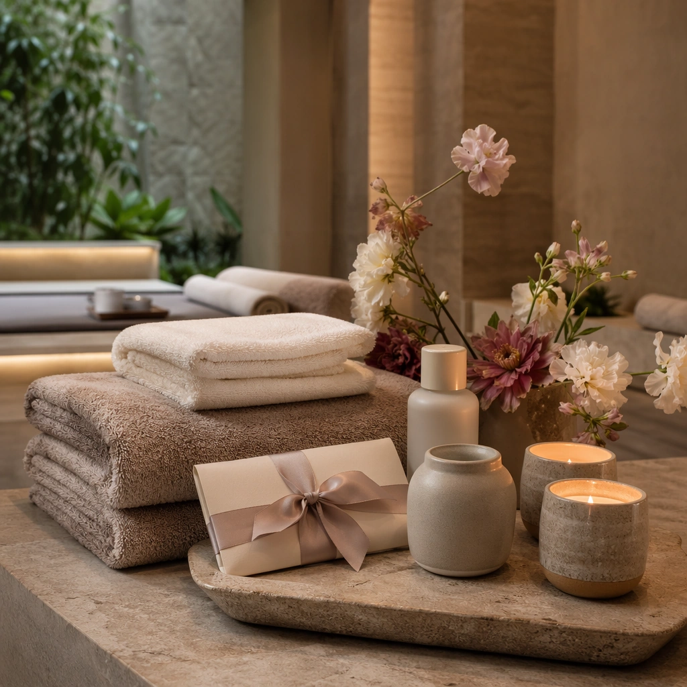

```text
Scene:
Create a square premium spa-arrival scene with soft indirect light, stone surfaces, folded towels, and subtle floral accents. The mood should be calm, restorative, and gently romantic rather than overtly sensual. Keep the frame polished and commercial, like a hospitality or wellness campaign visual, with clean geometry and a convincing atmosphere of privacy, care, and high-end service.

Subject:
Feature a composed arrival setup with folded textiles, candle vessels, a tray, a wrapped gift or invitation envelope without readable text, floral stems, and one or two beauty or amenity silhouettes. The objects should suggest a Valentines weekend or shared wellness experience through gesture and arrangement rather than through explicit people or text. The composition must remain clean, premium, and gift-aware.

Important details:
Focus on tactile calm: stone grain, towel softness, candle glow, satin ribbon, and muted florals. Avoid pseudo-luxury clutter. Keep the palette restrained and elevated. The image should be suitable for resorts, spas, or experiential gifting brands that want romance cues without losing trust, serenity, or real-world hospitality polish. It needs to feel like a usable campaign frame rather than a moodboard fragment.

Use case:
Valentines single study 8/9.

Constraints:
No readable text, no watermark, no logos, preserve exact 1:1 aspect ratio, no readable stationery, no human bodies, no bath foam overload, no logo robes, no rose-petal carpet cliché, no crowded vanity, no fantasy palace interior, no pink neon.
```

[Pinned source](https://github.com/ChaosRealmsAI/gpt-image-2-gallery/blob/5296db8c996e38776c83a0bc8c64f848dcd512b3/works/topics/valentines-romance-campaign-system/packages/single-activation-studies/images/spa-weekend-arrival/meta.json) · GPT Image2 · 1024×1024 · No source-declared image dependencies. · ProjectD:individually reviewed; awaiting publication acceptance.

## Confectionery Ribbon Box · valentines-romance-campaign-system/single-activation-studies/confectionery-ribbon-box


```text
Scene:
Create a square premium confectionery campaign image with soft evening light, velvet shadows, and a polished tabletop presentation. Keep the frame close enough to celebrate the sweets and box structure, but wide enough that ribbon, florals, and plating details still build a finished commercial story. The mood should feel celebratory and luxurious without becoming sugary or childlike.

Subject:
Show an elegant confectionery gift box opened to reveal carefully arranged sweets, paired with ribbon, petals, small dessert plating accents, and one or two supporting table elements. The sweets should feel handcrafted and upscale, suitable for gifting. Let the box structure, paper quality, and edible textures work together to communicate romance through craft and generosity rather than through novelty symbols.

Important details:
Surface realism matters: ganache sheen, sugar dust, paperboard edges, ribbon folds, and plate glaze should all feel convincing. Keep color rich but tasteful. The scene should function as a premium seasonal food-and-gifting campaign asset, ready for hospitality, confectionery retail, or experiential gifting communication. Avoid loud candy-shop energy; this is mature, polished Valentines merchandising.

Use case:
Valentines single study 9/9.

Constraints:
No readable text, no watermark, no logos, preserve exact 1:1 aspect ratio, no readable chocolate labels, no cartoon hearts, no visible bite marks, no mass-market candy wrappers, no giant balloon props, no branded packaging, no messy crumbs, no oversaturated pinks.
```

[Pinned source](https://github.com/ChaosRealmsAI/gpt-image-2-gallery/blob/5296db8c996e38776c83a0bc8c64f848dcd512b3/works/topics/valentines-romance-campaign-system/packages/single-activation-studies/images/confectionery-ribbon-box/meta.json) · GPT Image2 · 1024×1024 · No source-declared image dependencies. · ProjectD:individually reviewed; awaiting publication acceptance.

## Rooftop Hook · vertical-drama-poster-system/series-heiress-contract-arc/01-rooftop-hook

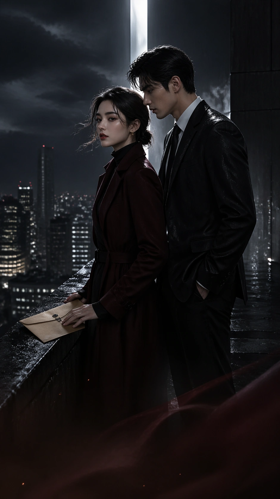

```text
Scene:
A tall 9:16 mobile-first drama poster set on a luxury high-rise rooftop at night, with wet black stone, distant city bokeh, cold wind, and a narrow beam of white light cutting between rooftop structures. The composition must read instantly on a phone screen: strong top hook image, clear center relationship tension, and a calmer lower zone where a platform title block and episode badge could later sit without requiring real readable text. Keep the palette black, silver, burgundy, and muted skin tones.

Subject:
Establish the lead pair for a serialized vertical romance-revenge drama. A sharp-featured heiress in a fitted dark coat stands near the ledge with one hand on a legal envelope; behind her, half protective and half threatening, stands her bodyguard in a rain-marked black suit. Their faces should be close enough to imply contract intimacy yet far enough to preserve distrust. The city below should feel wealthy and dangerous, but the focus stays on their emotional geometry, costume clarity, and the sense that this image can anchor later episode-cover variants.

Important details:
This is the reference image for the series, so identity lock matters. Keep hair shape, height difference, coat silhouettes, and gaze pattern easy to preserve in later posters. The vertical layout should feel like a real app cover: clean upper silhouette, mid-frame emotional collision, subtle lower gradient for interface overlay, and decorative but unreadable label zones. Avoid stuffing the narrow frame. The poster should feel premium and addictive, not loud or trashy.

Use case:
Vertical Drama Poster System series study 1/9, establishing the lead couple and mobile-first poster grammar for a reference-dependent short-drama arc.

Constraints:
No readable text, no watermark, no logos, preserve exact 9:16 aspect ratio, no crowded skyline collage, no action fight pose, no extra side characters, no gaudy neon nightclub mood, no cartoon expressions, no broken anatomy, no platform UI screenshots.
```

[Pinned source](https://github.com/ChaosRealmsAI/gpt-image-2-gallery/blob/5296db8c996e38776c83a0bc8c64f848dcd512b3/works/topics/vertical-drama-poster-system/packages/series-heiress-contract-arc/images/01-rooftop-hook/meta.json) · GPT Image2 · 941×1672 · No source-declared image dependencies. · ProjectD:individually reviewed; awaiting publication acceptance.

## Rain Elevator Standoff · vertical-drama-poster-system/series-heiress-contract-arc/02-rain-elevator-standoff

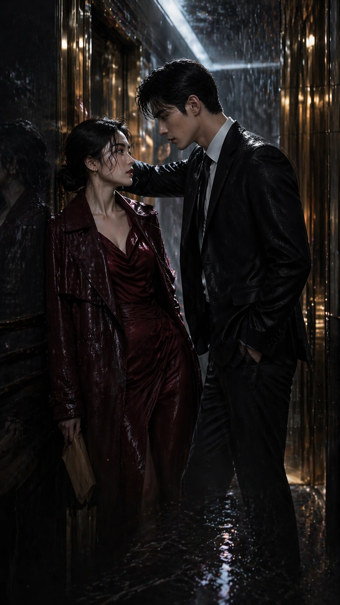

```text
Scene:
A tall 9:16 episode-cover poster inside a mirrored elevator lobby during heavy rain, with gold lift doors, water tracked across marble floor, and cool overhead light reflected in long vertical strips. The composition must remain instantly legible on mobile: a dramatic top third, a tight emotional midsection, and a restrained lower area where platform labels or episode markers could later sit as unreadable graphic blocks. Keep the palette deep charcoal, champagne gold, storm blue, and wine red.

Subject:
Using the referenced lead pair as the primary continuity source, preserve the same heiress and bodyguard identities, their height difference, face structure, hair silhouettes, and distrust-charged attraction. Move them into a rain-soaked elevator standoff: the heiress has just stepped out in a dark red dress under a soaked coat, and the bodyguard blocks the closing doors with one hand while looking directly at her. Their poses should intensify the relationship while clearly remaining the same characters from image 01. Rain droplets, coat texture, and mirrored reflections should add melodrama without cluttering the narrow frame.

Important details:
This image tests whether the poster system can evolve chapter to chapter while staying platform-clean. Keep the visual hierarchy disciplined: top rain atmosphere, center face tension, bottom quiet area for overlay. Preserve character continuity more than styling novelty. The poster should feel like a real vertical-drama app cover that could run as episode two artwork, with room for unreadable hook-badge shapes but no literal text.

Use case:
Vertical Drama Poster System series study 2/9, preserving the reference couple while translating them into a rain-soaked elevator episode cover.

Constraints:
No readable text, no watermark, no logos, preserve exact 9:16 aspect ratio, no cast swap, no extra paparazzi, no broad embrace, no empty white studio backdrop, no comic lightning effects, no overfilled lower frame, no platform UI buttons.
```

[Pinned source](https://github.com/ChaosRealmsAI/gpt-image-2-gallery/blob/5296db8c996e38776c83a0bc8c64f848dcd512b3/works/topics/vertical-drama-poster-system/packages/series-heiress-contract-arc/images/02-rain-elevator-standoff/meta.json) · GPT Image2 · 941×1672 · Reference images required. · ProjectD:individually reviewed; awaiting publication acceptance.

## Wedding Fallout · vertical-drama-poster-system/series-heiress-contract-arc/03-wedding-fallout

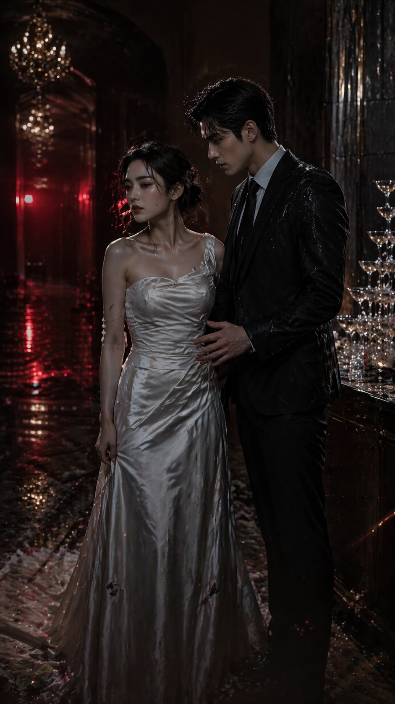

```text
Scene:
A tall 9:16 mobile cover set in the side corridor of a luxury wedding hall after a public scandal, with champagne tower reflections, dropped white petals, warm gold chandeliers fading into darkness, and a slash of red emergency light from a distant exit sign glow that remains unreadable. The poster must be optimized for narrow-screen viewing: a strong high-contrast upper silhouette, a dramatic center interaction, and a lower third clear enough for imagined episode labels.

Subject:
Using the referenced image as the identity anchor, preserve the same heiress and bodyguard from image 01. The heiress now wears a damaged wedding gown with one glove missing; the bodyguard remains in a formal dark suit, one shoulder marked by thrown champagne or rain residue. They stand close in a private corridor moment after a ruined ceremony, with the bodyguard slightly reaching toward her while she turns away in anger and grief. Their height difference, hair silhouette, facial proportions, and mutual tension must still clearly match the reference pair.

Important details:
The poster should feel addictive and serialized without becoming tabloid. Keep the vertical hierarchy clean, the expressions intense but controlled, and the material details believable: satin folds, glass reflections, wilted petals, and marble shine. Suggest hook-driven platform packaging through reserved label zones and a quiet lower gradient, but never use readable text. The image must feel like an episode-cover escalation, not a bridal catalog or generic romance poster.

Use case:
Vertical Drama Poster System series study 3/9, testing whether the same leads can carry a scandal-wedding chapter cover in a narrow vertical frame.

Constraints:
No readable text, no watermark, no logos, preserve exact 9:16 aspect ratio, no wedding crowd, no kiss pose, no slapstick melodrama, no oversized props blocking faces, no glitter explosion, no costume redesign that loses character continuity, no platform interface overlay.
```

[Pinned source](https://github.com/ChaosRealmsAI/gpt-image-2-gallery/blob/5296db8c996e38776c83a0bc8c64f848dcd512b3/works/topics/vertical-drama-poster-system/packages/series-heiress-contract-arc/images/03-wedding-fallout/meta.json) · GPT Image2 · 941×1672 · Reference images required. · ProjectD:individually reviewed; awaiting publication acceptance.

## Hospital Truce · vertical-drama-poster-system/series-heiress-contract-arc/04-hospital-truce

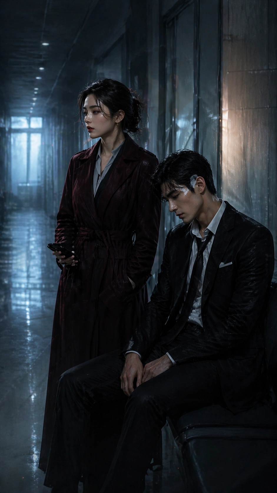

```text
Scene:
A tall 9:16 episode poster in a private hospital corridor before dawn, with sterile overhead lighting softened by blue morning haze, frosted glass panels, muted reflections on pale floor tiles, and one thin warm bedside glow leaking from an unseen room. The layout should feel engineered for mobile conversion: clear headroom for a hook image, central emotional scene, and a lower band quiet enough for future platform badges or titles that remain unreadable here.

Subject:
Using the referenced pair as the continuity source, preserve the same heiress and bodyguard from image 01, now worn down by accumulated conflict. The bodyguard sits injured on a hallway bench with shirt collar loosened and bandage at the temple; the heiress stands beside him in a severe coat over hospital visitor clothes, holding his phone but looking away to hide concern. Their poses should suggest a temporary truce and emotional turning point. Keep their faces, height relationship, hair shapes, and key costume language consistent with the reference poster.

Important details:
This image should prove that serial consistency can survive a quieter chapter. The vertical poster must remain clean, dramatic, and app-cover legible even though the action is minimal. Use corridor depth, glass reflections, bandage detail, and subdued body language instead of noisy plot props. The result should feel like an episode-cover cliffhanger that invites taps while still resembling polished commercial key art.

Use case:
Vertical Drama Poster System series study 4/9, testing a softer hospital-truce chapter while preserving the same reference couple and narrow-screen poster logic.

Constraints:
No readable text, no watermark, no logos, preserve exact 9:16 aspect ratio, no medical-drama clutter, no extra nurses, no comedy warmth, no giant medical monitors, no hand-holding cliché, no washed-out blank corridor, no visible app UI chrome.
```

[Pinned source](https://github.com/ChaosRealmsAI/gpt-image-2-gallery/blob/5296db8c996e38776c83a0bc8c64f848dcd512b3/works/topics/vertical-drama-poster-system/packages/series-heiress-contract-arc/images/04-hospital-truce/meta.json) · GPT Image2 · 941×1672 · Reference images required. · ProjectD:individually reviewed; awaiting publication acceptance.

## Penthouse Revenge Cover · vertical-drama-poster-system/single-genre-poster-studies/penthouse-revenge-cover

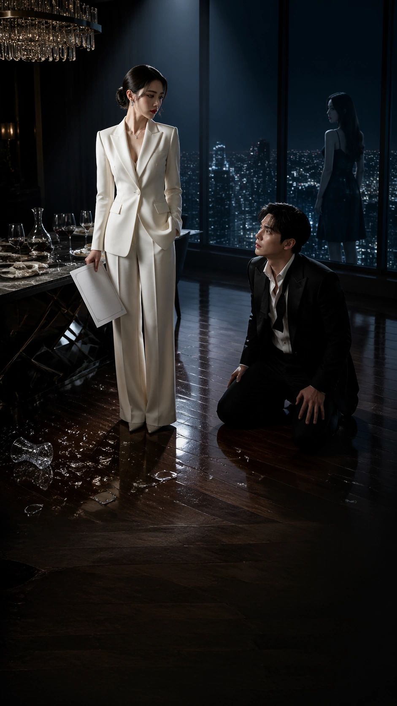

```text
Scene:
A tall 9:16 short-drama cover inside a penthouse dining room at blue-black night, with floor-to-ceiling windows, a city of tiny lights, shattered crystal on polished wood, and a cold spotlight framing the central confrontation. The composition must work like a mobile app cover: a strong silhouette at top, a dominant emotional event in the middle, and a lower area calm enough for future title and badge placement without readable text. Use black, chrome, wine, and ivory as the main palette.

Subject:
Create a revenge-melodrama cover featuring a poised woman in a white suit holding divorce papers beside a half-cleared dinner table, while a wealthy man in a loosened tuxedo kneels slightly lower in frame after realizing he has lost control. A younger half-sister figure should appear only as a distant reflected silhouette in the window, not as a full competing lead. The drama should feel immediate and addictive, but the relationships and visual hierarchy must stay clear in the narrow vertical frame.

Important details:
The poster should feel like premium platform packaging rather than tabloid collage. Reserve structured space for unreadable title blocks, use reflective surfaces to imply wealth, and emphasize body language over prop clutter. The emotional hook must survive thumbnail scale: white suit, broken crystal, kneeling tuxedo, city night. No readable copy, but the layout should strongly suggest where copy would go.

Use case:
Vertical Drama Poster System single study 5/9, testing a revenge-penthouse short-drama hook in a clean mobile-first poster format.

Constraints:
No readable text, no watermark, no logos, preserve exact 9:16 aspect ratio, no cast crowding, no tabloid montage, no action slap, no giant ring-box prop, no cheap neon club palette, no social-media UI, no broken anatomy.
```

[Pinned source](https://github.com/ChaosRealmsAI/gpt-image-2-gallery/blob/5296db8c996e38776c83a0bc8c64f848dcd512b3/works/topics/vertical-drama-poster-system/packages/single-genre-poster-studies/images/penthouse-revenge-cover/meta.json) · GPT Image2 · 941×1672 · No source-declared image dependencies. · ProjectD:individually reviewed; awaiting publication acceptance.

## Night Shift Romance Cover · vertical-drama-poster-system/single-genre-poster-studies/night-shift-romance-cover

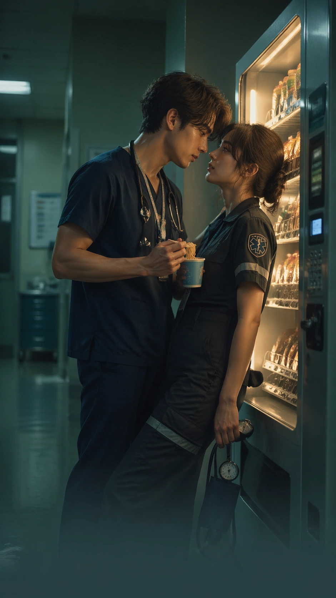

```text
Scene:
A tall 9:16 romance cover inside a hospital vending-machine alcove at 3 a.m., with dim fluorescent spill, stainless steel reflections, soft green walls, and one warm vending-machine glow illuminating tired faces. The poster should be optimized for phone screens: a compelling upper silhouette, a center emotional beat, and a lower quiet gradient for imagined title and episode-chip zones. Keep the palette cool mint, navy, pale skin tones, and one gentle warm amber highlight.

Subject:
Create a night-shift romance short-drama cover featuring an overworked resident doctor holding instant noodles and a sleep-deprived paramedic leaning against the vending machine with a blood-pressure cuff hanging from one wrist. Their bodies angle toward each other in an almost-kiss distance, but the mood is exhaustion and mutual dependence rather than glamour. Use eye lines, fatigue detail, and the narrow space between them to make the hook instantly legible on a mobile device.

Important details:
The image should feel platform-ready and addictive without becoming cheesy. Preserve realistic scrubs, ID-lanyard shapes that stay unreadable, vending-machine light, and hospital textures, but keep the frame uncluttered. The design logic should imply where a title, subtitle, and small platform badge would live while never actually rendering them. Emotional clarity at thumbnail scale matters more than background complexity.

Use case:
Vertical Drama Poster System single study 6/9, testing a night-shift romance hook in a narrow mobile-cover format.

Constraints:
No readable text, no watermark, no logos, preserve exact 9:16 aspect ratio, no medical emergency chaos, no giant heart graphics, no broad comedy, no crowded hallway extras, no app screenshot frame, no candy-colored rom-com palette, no broken hands or faces.
```

[Pinned source](https://github.com/ChaosRealmsAI/gpt-image-2-gallery/blob/5296db8c996e38776c83a0bc8c64f848dcd512b3/works/topics/vertical-drama-poster-system/packages/single-genre-poster-studies/images/night-shift-romance-cover/meta.json) · GPT Image2 · 941×1672 · No source-declared image dependencies. · ProjectD:individually reviewed; awaiting publication acceptance.

## Republic Era Secret Cover · vertical-drama-poster-system/single-genre-poster-studies/republic-era-secret-cover

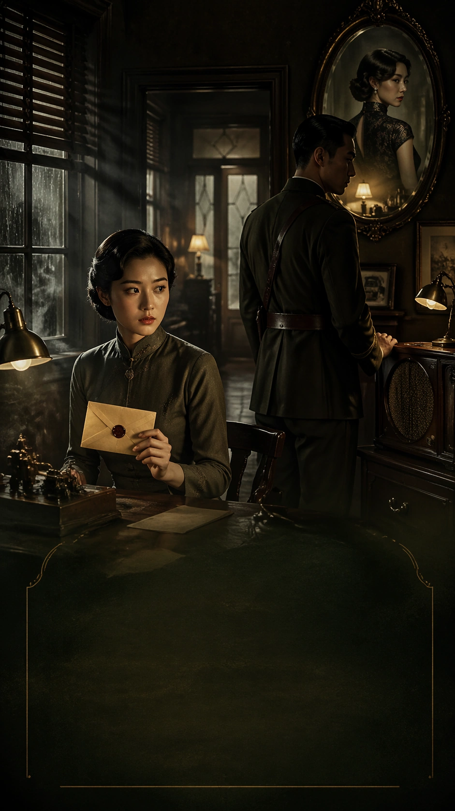

```text
Scene:
A tall 9:16 short-drama poster in a 1930s republic-era study lit by window blinds and amber desk lamps, with lacquer furniture, cigarette haze, rain on the glass, and a refined palette of sepia, forest green, black, and old gold. The composition must feel engineered for a vertical streaming cover, with a strong top silhouette, dense middle intrigue, and a quieter lower register that could support future title blocks or episode tabs without readable text.

Subject:
Create a republican-intrigue cover centered on a female code clerk holding a sealed telegram and a military officer in shadow standing beside a radio cabinet. A third figure, a wealthy young widow in a qipao, appears only through a reflected dressing-table mirror high in frame, hinting at betrayal. The mood should be tense, elegant, and serialized rather than nostalgic costume display. Make the hook legible through glance direction, telegram silhouette, and layered doorways.

Important details:
The visual grammar should mimic premium platform marketing for a period thriller. Preserve tactile wood, silk, brass, and rain textures, but do not overload the narrow frame with props. The poster must imply a space for unreadable title and episode graphics while remaining visually balanced on its own. Suspense should come from pose and composition, not from gunfire or loud action.

Use case:
Vertical Drama Poster System single study 7/9, testing a republic-era conspiracy premise in a disciplined mobile-cover layout.

Constraints:
No readable text, no watermark, no logos, preserve exact 9:16 aspect ratio, no war battlefield, no propaganda posters, no crowded extras, no exaggerated vintage filter, no cosplay stiffness, no comic action pose, no interface chrome.
```

[Pinned source](https://github.com/ChaosRealmsAI/gpt-image-2-gallery/blob/5296db8c996e38776c83a0bc8c64f848dcd512b3/works/topics/vertical-drama-poster-system/packages/single-genre-poster-studies/images/republic-era-secret-cover/meta.json) · GPT Image2 · 941×1672 · No source-declared image dependencies. · ProjectD:individually reviewed; awaiting publication acceptance.

## Desert Exile Cover · vertical-drama-poster-system/single-genre-poster-studies/desert-exile-cover

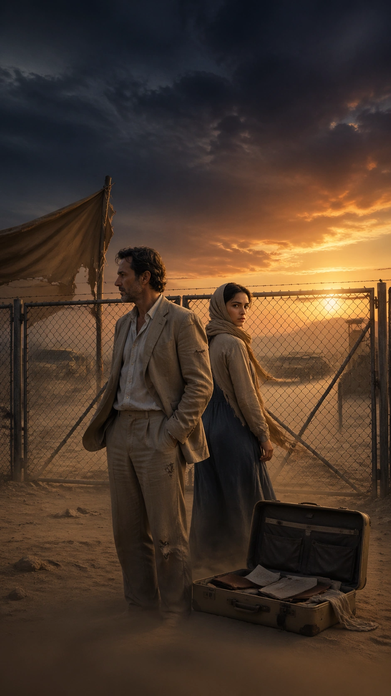

```text
Scene:
A tall 9:16 exile-melodrama poster on the edge of a desert checkpoint at sunset, with windblown canvas, pale dust, military trucks reduced to distant shapes, and a narrow shaft of orange light against a storm-blue sky. The cover must read strongly on mobile: a striking upper sky band, a center human hook, and a lower area that could hold future unreadable title and badge elements. Use ochre, indigo, weathered khaki, and muted skin tones.

Subject:
Create a dramatic cover featuring a disgraced former diplomat in a torn linen suit standing beside a young translator wrapped in a desert scarf. They are separated from a convoy by a chain-link gate and one suitcase lying open in the dust. The relationship should be ambiguous: survival alliance, buried resentment, possible romance. Their silhouettes need to stay simple and legible in the narrow vertical frame, while the checkpoint world suggests political stakes without overpowering the human story.

Important details:
The image must feel like real platform packaging for a serialized exile drama, not a war-film poster. Keep the frame uncluttered, the wind and dust physically believable, and the emotional hook concentrated in posture, gaze, and the open suitcase. Suggest title and episode-chip zones through composition, but never render readable text. The cover should stay elegant even with harsh weather elements.

Use case:
Vertical Drama Poster System single study 8/9, testing an exile-road melodrama hook in a streamlined 9:16 poster system.

Constraints:
No readable text, no watermark, no logos, preserve exact 9:16 aspect ratio, no battlefield explosions, no crowded convoy action, no national flags, no heroic action pose, no documentary photo chaos, no giant desert vista swallowing the leads, no app UI screenshot.
```

[Pinned source](https://github.com/ChaosRealmsAI/gpt-image-2-gallery/blob/5296db8c996e38776c83a0bc8c64f848dcd512b3/works/topics/vertical-drama-poster-system/packages/single-genre-poster-studies/images/desert-exile-cover/meta.json) · GPT Image2 · 941×1672 · No source-declared image dependencies. · ProjectD:individually reviewed; awaiting publication acceptance.

## Chef Rivalry Cover · vertical-drama-poster-system/single-genre-poster-studies/chef-rivalry-cover

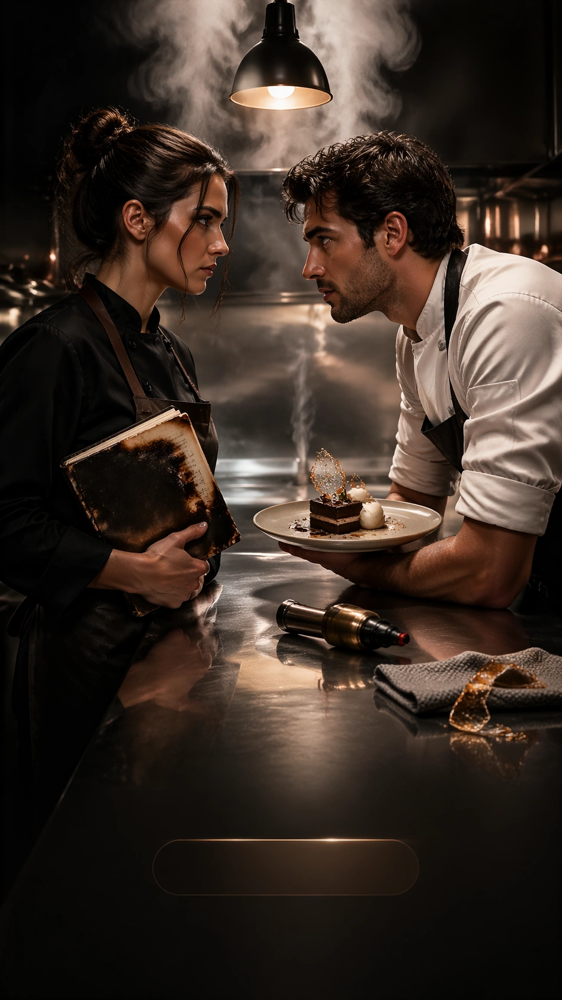

```text
Scene:
A tall 9:16 culinary-rivalry cover in a high-end restaurant prep kitchen after service, with stainless counters, steam haze, one hanging pendant lamp, and a palette of black, copper, cream, and deep basil green. The composition should feel tuned for app discovery surfaces: eye-catching top steam silhouette, center clash between leads, and a calmer lower band for future unreadable title and badge placement. Keep the environment tactile but controlled.

Subject:
Create a short-drama cover featuring two rival chefs. One is a disciplined woman in a dark apron holding a scorched recipe notebook; the other is a celebrated male chef in rolled sleeves, leaning across the counter with a plated dessert he has no right to finish. Their tension should read as rivalry with romantic undertow. A pastry blowtorch, folded kitchen towel, and one cracked sugar sculpture are enough to establish the world. The narrow frame must prioritize faces, hands, and emotional distance over broad kitchen coverage.

Important details:
The poster should sell a serialized food-industry melodrama, not a cooking show. Use steam, metal reflections, notebook texture, and plated dessert detail to create premium realism, but maintain strong vertical negative space so the composition still works as a platform cover. Suggest title and episode-chip zones with layout rhythm only. The hook must be instantly readable at thumbnail size: burnt notebook, stolen plate, eye contact.

Use case:
Vertical Drama Poster System single study 9/9, testing a chef-rivalry romance hook in a polished mobile-cover poster system.

Constraints:
No readable text, no watermark, no logos, preserve exact 9:16 aspect ratio, no cheerful cooking-show mood, no crowded brigade kitchen, no food close-up dominating the frame, no slapstick mess, no obvious TV studio lighting, no interface chrome, no broken hands.
```

[Pinned source](https://github.com/ChaosRealmsAI/gpt-image-2-gallery/blob/5296db8c996e38776c83a0bc8c64f848dcd512b3/works/topics/vertical-drama-poster-system/packages/single-genre-poster-studies/images/chef-rivalry-cover/meta.json) · GPT Image2 · 941×1672 · No source-declared image dependencies. · ProjectD:individually reviewed; awaiting publication acceptance.

## Reference Anchor · vertical-landscape-pillar-composition/series-core-system/01-reference-anchor

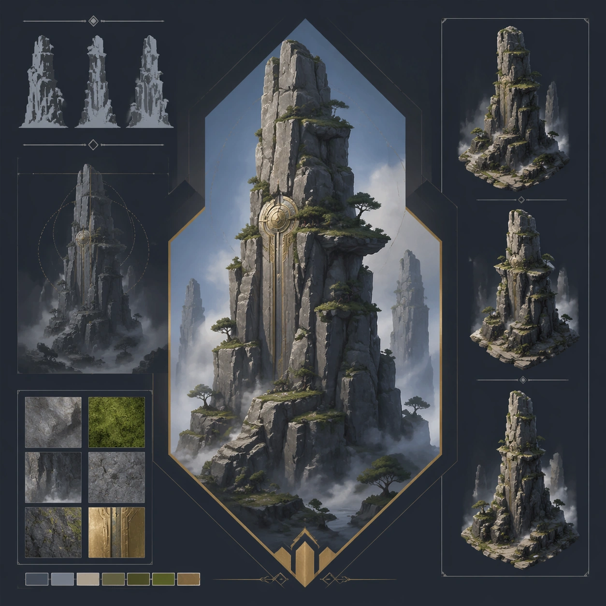

```text
Scene:
Create a square reference image for Vertical Landscape Pillar Composition. Build a reference anchor establishing the core system with a premium, production-ready finish. Use a polished modular board or campaign surface with clean spacing, premium game-UI finish, and clear focal hierarchy. The composition should feel intentional, clean, and reusable for gallery, research, campaign, or internal handoff contexts. Lighting must support readability first, with the main forms clearly separated from the background and enough breathing room for the system to stay legible at both hero scale and thumbnail scale.

Subject:
Center a coherent original game-art system built for premium production and marketing surfaces. For this image, focus on reference anchor. Keep the same system logic stable across screenshots, cards, banners, and overview boards. This image is the canonical anchor that later series images must follow. The viewer should immediately understand what role this surface plays inside a cohesive game-production asset pack.

Important details:
Lock framing, icon grammar, palette blocking, and surface hierarchy so the kit feels production-ready and consistent. Preserve the core silhouette, framing language, and material logic from the reference image while each variation changes function. Keep materials believable, edge hierarchy disciplined, and the visual language consistent with Vertical Scenery. Use abstract interface blocks or diagram accents when helpful, but avoid any readable language. The final result should feel like a deliberate production asset rather than a random illustration.

Use case:
Vertical Landscape Pillar Composition series study 1/9, designed as reference anchor within a cohesive asset pack.

Constraints:
No readable text, no watermark, no logos, preserve exact 1:1 aspect ratio, no unrelated objects, no broken visual hierarchy, no malformed anatomy or broken perspective, no random decorative clutter.
```

[Pinned source](https://github.com/ChaosRealmsAI/gpt-image-2-gallery/blob/5296db8c996e38776c83a0bc8c64f848dcd512b3/works/topics/vertical-landscape-pillar-composition/packages/series-core-system/images/01-reference-anchor/meta.json) · GPT Image2 · 1254×1254 · No source-declared image dependencies. · ProjectD:individually reviewed; awaiting publication acceptance.

## Variant One · vertical-landscape-pillar-composition/series-core-system/02-variant-one

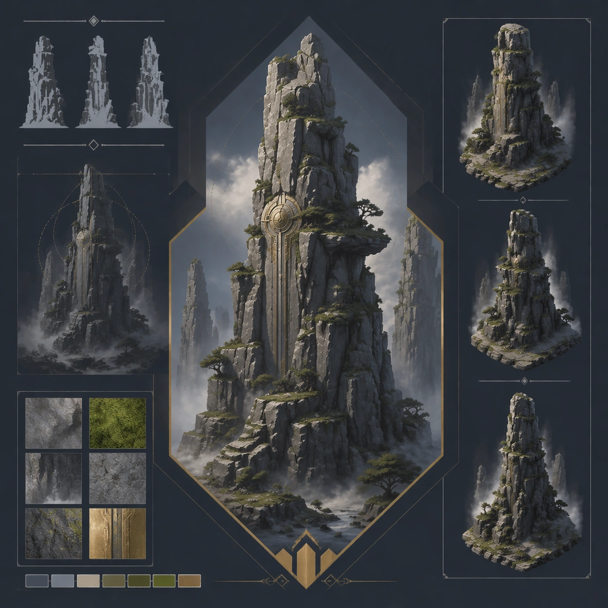

```text
Scene:
Create a square dependent image for Vertical Landscape Pillar Composition. Build a first controlled variation in the same system with a premium, production-ready finish. Use a polished modular board or campaign surface with clean spacing, premium game-UI finish, and clear focal hierarchy. The composition should feel intentional, clean, and reusable for gallery, research, campaign, or internal handoff contexts. Lighting must support readability first, with the main forms clearly separated from the background and enough breathing room for the system to stay legible at both hero scale and thumbnail scale.

Subject:
Center a coherent original game-art system built for premium production and marketing surfaces. For this image, focus on the intended support surface. Keep the same system logic stable across screenshots, cards, banners, and overview boards. Preserve exact identity or system logic from the reference image while changing only the intended variation axis. The viewer should immediately understand what role this surface plays inside a cohesive game-production asset pack.

Important details:
Lock framing, icon grammar, palette blocking, and surface hierarchy so the kit feels production-ready and consistent. Preserve the core silhouette, framing language, and material logic from the reference image while each variation changes function. Keep materials believable, edge hierarchy disciplined, and the visual language consistent with Vertical Scenery. Use abstract interface blocks or diagram accents when helpful, but avoid any readable language. The final result should feel like a deliberate production asset rather than a random illustration.

Use case:
Vertical Landscape Pillar Composition series study 2/9, designed as variant one within a cohesive asset pack.

Constraints:
No readable text, no watermark, no logos, preserve exact 1:1 aspect ratio, no unrelated objects, no broken visual hierarchy, no malformed anatomy or broken perspective, no random decorative clutter.
```

[Pinned source](https://github.com/ChaosRealmsAI/gpt-image-2-gallery/blob/5296db8c996e38776c83a0bc8c64f848dcd512b3/works/topics/vertical-landscape-pillar-composition/packages/series-core-system/images/02-variant-one/meta.json) · GPT Image2 · 1254×1254 · Reference images required. · ProjectD:individually reviewed; awaiting publication acceptance.

## Variant Two · vertical-landscape-pillar-composition/series-core-system/03-variant-two

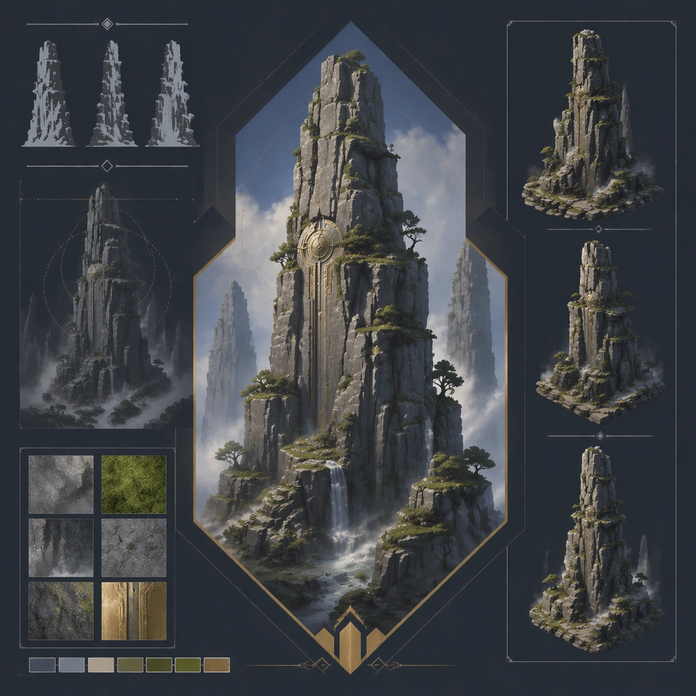

```text
Scene:
Create a square dependent image for Vertical Landscape Pillar Composition. Build a second controlled variation in the same system with a premium, production-ready finish. Use a polished modular board or campaign surface with clean spacing, premium game-UI finish, and clear focal hierarchy. The composition should feel intentional, clean, and reusable for gallery, research, campaign, or internal handoff contexts. Lighting must support readability first, with the main forms clearly separated from the background and enough breathing room for the system to stay legible at both hero scale and thumbnail scale.

Subject:
Center a coherent original game-art system built for premium production and marketing surfaces. For this image, focus on the intended support surface. Keep the same system logic stable across screenshots, cards, banners, and overview boards. Preserve exact identity or system logic from the reference image while changing only the intended variation axis. The viewer should immediately understand what role this surface plays inside a cohesive game-production asset pack.

Important details:
Lock framing, icon grammar, palette blocking, and surface hierarchy so the kit feels production-ready and consistent. Preserve the core silhouette, framing language, and material logic from the reference image while each variation changes function. Keep materials believable, edge hierarchy disciplined, and the visual language consistent with Vertical Scenery. Use abstract interface blocks or diagram accents when helpful, but avoid any readable language. The final result should feel like a deliberate production asset rather than a random illustration.

Use case:
Vertical Landscape Pillar Composition series study 3/9, designed as variant two within a cohesive asset pack.

Constraints:
No readable text, no watermark, no logos, preserve exact 1:1 aspect ratio, no unrelated objects, no broken visual hierarchy, no malformed anatomy or broken perspective, no random decorative clutter.
```

[Pinned source](https://github.com/ChaosRealmsAI/gpt-image-2-gallery/blob/5296db8c996e38776c83a0bc8c64f848dcd512b3/works/topics/vertical-landscape-pillar-composition/packages/series-core-system/images/03-variant-two/meta.json) · GPT Image2 · 1254×1254 · Reference images required. · ProjectD:individually reviewed; awaiting publication acceptance.

## Variant Three · vertical-landscape-pillar-composition/series-core-system/04-variant-three

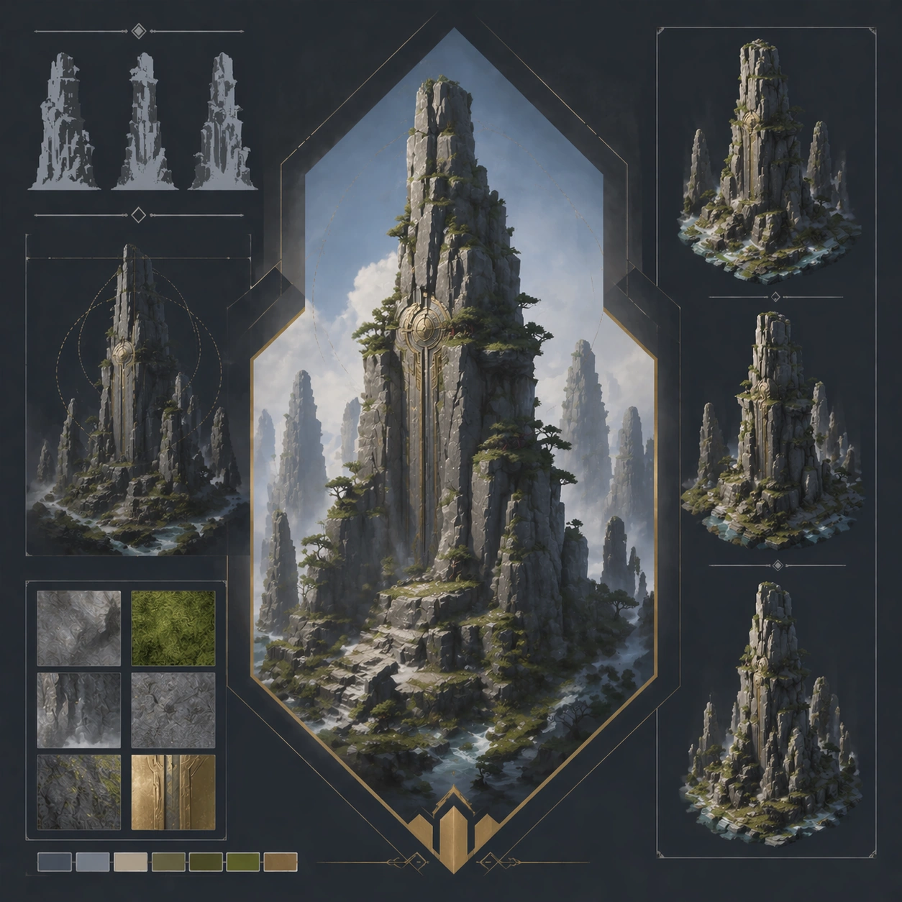

```text
Scene:
Create a square dependent image for Vertical Landscape Pillar Composition. Build a third controlled variation in the same system with a premium, production-ready finish. Use a polished modular board or campaign surface with clean spacing, premium game-UI finish, and clear focal hierarchy. The composition should feel intentional, clean, and reusable for gallery, research, campaign, or internal handoff contexts. Lighting must support readability first, with the main forms clearly separated from the background and enough breathing room for the system to stay legible at both hero scale and thumbnail scale.

Subject:
Center a coherent original game-art system built for premium production and marketing surfaces. For this image, focus on the intended support surface. Keep the same system logic stable across screenshots, cards, banners, and overview boards. Preserve exact identity or system logic from the reference image while changing only the intended variation axis. The viewer should immediately understand what role this surface plays inside a cohesive game-production asset pack.

Important details:
Lock framing, icon grammar, palette blocking, and surface hierarchy so the kit feels production-ready and consistent. Preserve the core silhouette, framing language, and material logic from the reference image while each variation changes function. Keep materials believable, edge hierarchy disciplined, and the visual language consistent with Vertical Scenery. Use abstract interface blocks or diagram accents when helpful, but avoid any readable language. The final result should feel like a deliberate production asset rather than a random illustration.

Use case:
Vertical Landscape Pillar Composition series study 4/9, designed as variant three within a cohesive asset pack.

Constraints:
No readable text, no watermark, no logos, preserve exact 1:1 aspect ratio, no unrelated objects, no broken visual hierarchy, no malformed anatomy or broken perspective, no random decorative clutter.
```

[Pinned source](https://github.com/ChaosRealmsAI/gpt-image-2-gallery/blob/5296db8c996e38776c83a0bc8c64f848dcd512b3/works/topics/vertical-landscape-pillar-composition/packages/series-core-system/images/04-variant-three/meta.json) · GPT Image2 · 1254×1254 · Reference images required. · ProjectD:individually reviewed; awaiting publication acceptance.

## Support One · vertical-landscape-pillar-composition/single-support-studies/support-one

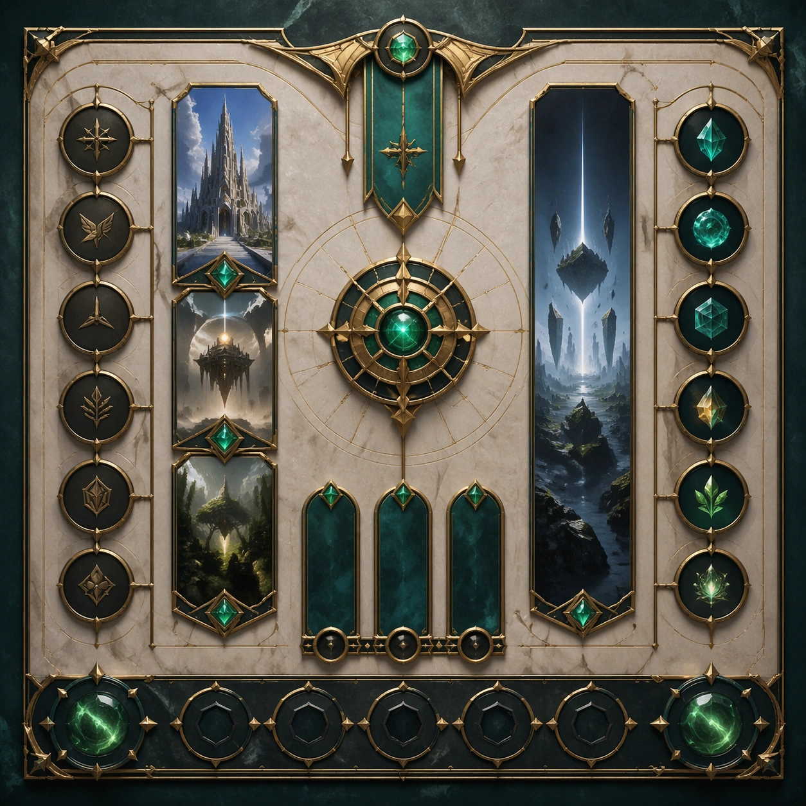

```text
Scene:
Create a square standalone support image for Vertical Landscape Pillar Composition. Build a support-surface study with a clear focal hierarchy and a finished professional surface. Use a polished modular board or campaign surface with clean spacing, premium game-UI finish, and clear focal hierarchy. The frame should feel self-contained and polished, with enough structure to explain the system even without the reference series, yet still obviously belonging to the same theme and production world.

Subject:
Show a coherent original game-art system built for premium production and marketing surfaces in a way that emphasizes the intended support surface. Keep the same system logic stable across screenshots, cards, banners, and overview boards. Even though this image is independent, the viewer should still recognize the same universe, same commercial logic, and same production intent as the core package.

Important details:
Lock framing, icon grammar, palette blocking, and surface hierarchy so the kit feels production-ready and consistent. Preserve the broader theme language through color, framing, material choices, and modular composition. Use clean panel rhythm, premium asset presentation, and believable detail density. The image should work equally well as a gallery study, research reference, and mock production deliverable.

Use case:
Vertical Landscape Pillar Composition single study 5/9, exploring support one as a support surface.

Constraints:
No readable text, no watermark, no logos, preserve exact 1:1 aspect ratio, no unrelated objects, no broken visual hierarchy, no visual noise that obscures the main surface, no accidental brand resemblance.
```

[Pinned source](https://github.com/ChaosRealmsAI/gpt-image-2-gallery/blob/5296db8c996e38776c83a0bc8c64f848dcd512b3/works/topics/vertical-landscape-pillar-composition/packages/single-support-studies/images/support-one/meta.json) · GPT Image2 · 1254×1254 · No source-declared image dependencies. · ProjectD:individually reviewed; awaiting publication acceptance.

## Support Two · vertical-landscape-pillar-composition/single-support-studies/support-two

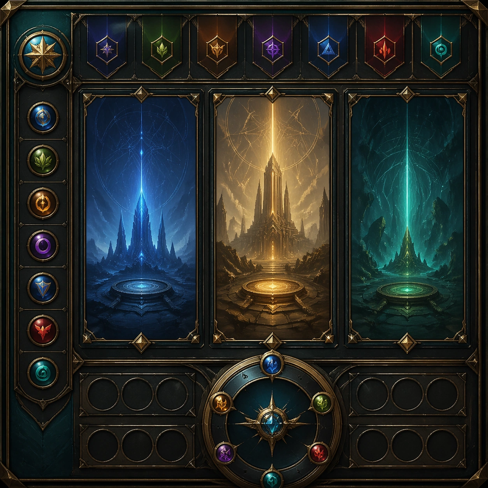

```text
Scene:
Create a square standalone support image for Vertical Landscape Pillar Composition. Build a second support-surface study with a clear focal hierarchy and a finished professional surface. Use a polished modular board or campaign surface with clean spacing, premium game-UI finish, and clear focal hierarchy. The frame should feel self-contained and polished, with enough structure to explain the system even without the reference series, yet still obviously belonging to the same theme and production world.

Subject:
Show a coherent original game-art system built for premium production and marketing surfaces in a way that emphasizes the intended support surface. Keep the same system logic stable across screenshots, cards, banners, and overview boards. Even though this image is independent, the viewer should still recognize the same universe, same commercial logic, and same production intent as the core package.

Important details:
Lock framing, icon grammar, palette blocking, and surface hierarchy so the kit feels production-ready and consistent. Preserve the broader theme language through color, framing, material choices, and modular composition. Use clean panel rhythm, premium asset presentation, and believable detail density. The image should work equally well as a gallery study, research reference, and mock production deliverable.

Use case:
Vertical Landscape Pillar Composition single study 6/9, exploring support two as a support surface.

Constraints:
No readable text, no watermark, no logos, preserve exact 1:1 aspect ratio, no unrelated objects, no broken visual hierarchy, no visual noise that obscures the main surface, no accidental brand resemblance.
```

[Pinned source](https://github.com/ChaosRealmsAI/gpt-image-2-gallery/blob/5296db8c996e38776c83a0bc8c64f848dcd512b3/works/topics/vertical-landscape-pillar-composition/packages/single-support-studies/images/support-two/meta.json) · GPT Image2 · 1254×1254 · No source-declared image dependencies. · ProjectD:individually reviewed; awaiting publication acceptance.

## Support Three · vertical-landscape-pillar-composition/single-support-studies/support-three

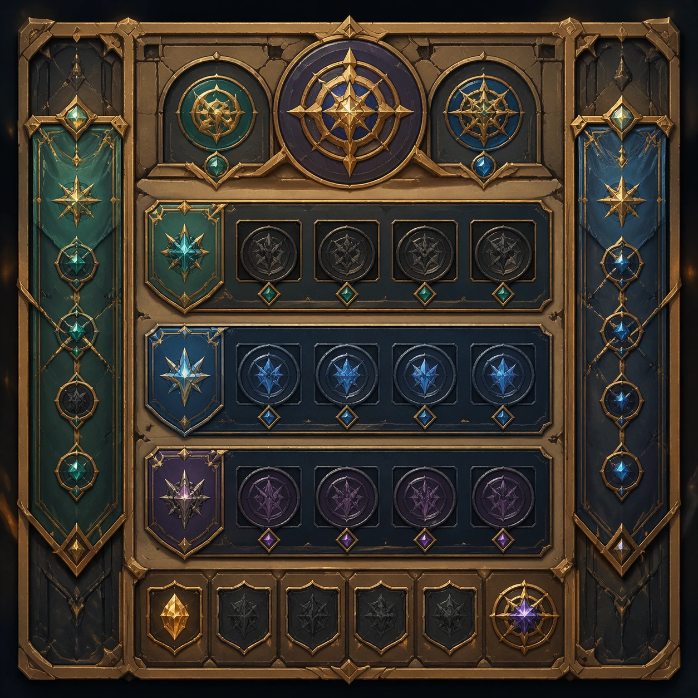

```text
Scene:
Create a square standalone support image for Vertical Landscape Pillar Composition. Build a third support-surface study with a clear focal hierarchy and a finished professional surface. Use a polished modular board or campaign surface with clean spacing, premium game-UI finish, and clear focal hierarchy. The frame should feel self-contained and polished, with enough structure to explain the system even without the reference series, yet still obviously belonging to the same theme and production world.

Subject:
Show a coherent original game-art system built for premium production and marketing surfaces in a way that emphasizes the intended support surface. Keep the same system logic stable across screenshots, cards, banners, and overview boards. Even though this image is independent, the viewer should still recognize the same universe, same commercial logic, and same production intent as the core package.

Important details:
Lock framing, icon grammar, palette blocking, and surface hierarchy so the kit feels production-ready and consistent. Preserve the broader theme language through color, framing, material choices, and modular composition. Use clean panel rhythm, premium asset presentation, and believable detail density. The image should work equally well as a gallery study, research reference, and mock production deliverable.

Use case:
Vertical Landscape Pillar Composition single study 7/9, exploring support three as a support surface.

Constraints:
No readable text, no watermark, no logos, preserve exact 1:1 aspect ratio, no unrelated objects, no broken visual hierarchy, no visual noise that obscures the main surface, no accidental brand resemblance.
```

[Pinned source](https://github.com/ChaosRealmsAI/gpt-image-2-gallery/blob/5296db8c996e38776c83a0bc8c64f848dcd512b3/works/topics/vertical-landscape-pillar-composition/packages/single-support-studies/images/support-three/meta.json) · GPT Image2 · 1254×1254 · No source-declared image dependencies. · ProjectD:individually reviewed; awaiting publication acceptance.

## Support Four · vertical-landscape-pillar-composition/single-support-studies/support-four

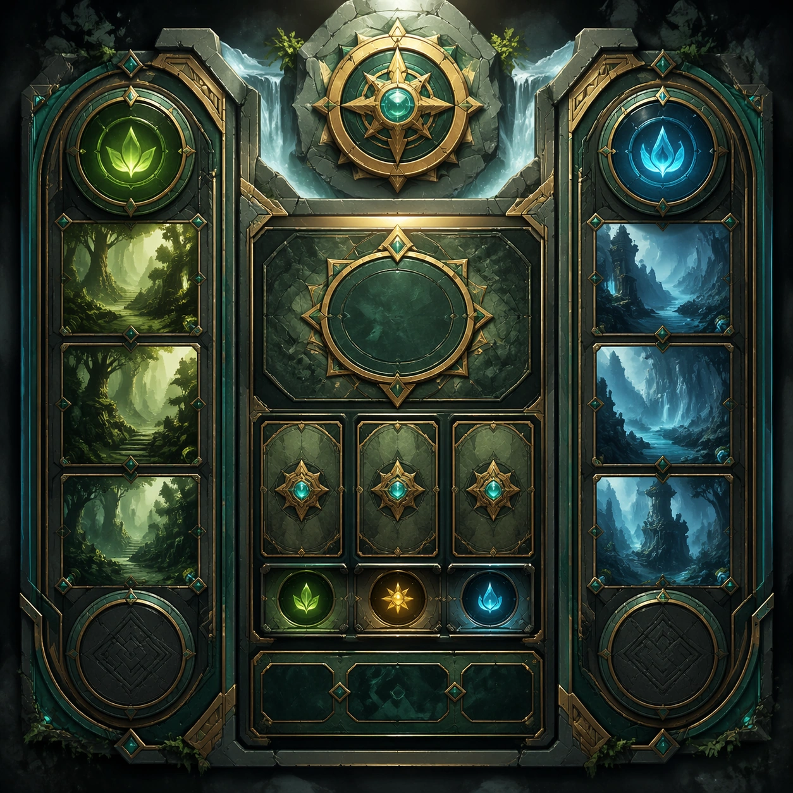

```text
Scene:
Create a square standalone support image for Vertical Landscape Pillar Composition. Build a fourth support-surface study with a clear focal hierarchy and a finished professional surface. Use a polished modular board or campaign surface with clean spacing, premium game-UI finish, and clear focal hierarchy. The frame should feel self-contained and polished, with enough structure to explain the system even without the reference series, yet still obviously belonging to the same theme and production world.

Subject:
Show a coherent original game-art system built for premium production and marketing surfaces in a way that emphasizes the intended support surface. Keep the same system logic stable across screenshots, cards, banners, and overview boards. Even though this image is independent, the viewer should still recognize the same universe, same commercial logic, and same production intent as the core package.

Important details:
Lock framing, icon grammar, palette blocking, and surface hierarchy so the kit feels production-ready and consistent. Preserve the broader theme language through color, framing, material choices, and modular composition. Use clean panel rhythm, premium asset presentation, and believable detail density. The image should work equally well as a gallery study, research reference, and mock production deliverable.

Use case:
Vertical Landscape Pillar Composition single study 8/9, exploring support four as a support surface.

Constraints:
No readable text, no watermark, no logos, preserve exact 1:1 aspect ratio, no unrelated objects, no broken visual hierarchy, no visual noise that obscures the main surface, no accidental brand resemblance.
```

[Pinned source](https://github.com/ChaosRealmsAI/gpt-image-2-gallery/blob/5296db8c996e38776c83a0bc8c64f848dcd512b3/works/topics/vertical-landscape-pillar-composition/packages/single-support-studies/images/support-four/meta.json) · GPT Image2 · 1254×1254 · No source-declared image dependencies. · ProjectD:individually reviewed; awaiting publication acceptance.

## Support Five · vertical-landscape-pillar-composition/single-support-studies/support-five

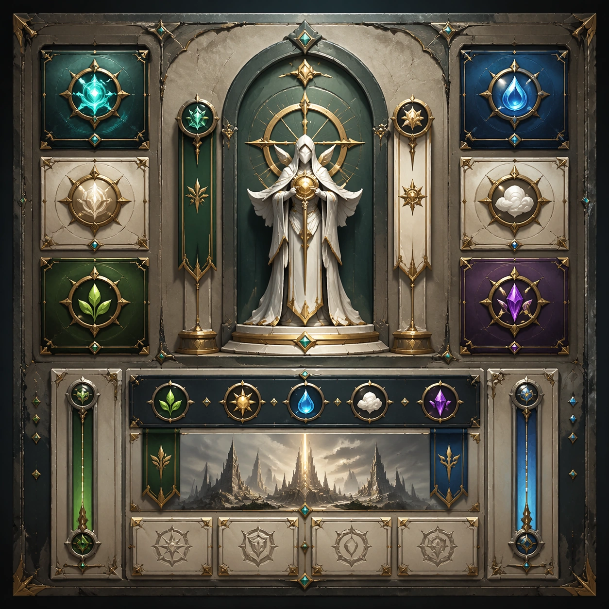

```text
Scene:
Create a square standalone support image for Vertical Landscape Pillar Composition. Build a fifth support-surface study with a clear focal hierarchy and a finished professional surface. Use a polished modular board or campaign surface with clean spacing, premium game-UI finish, and clear focal hierarchy. The frame should feel self-contained and polished, with enough structure to explain the system even without the reference series, yet still obviously belonging to the same theme and production world.

Subject:
Show a coherent original game-art system built for premium production and marketing surfaces in a way that emphasizes the intended support surface. Keep the same system logic stable across screenshots, cards, banners, and overview boards. Even though this image is independent, the viewer should still recognize the same universe, same commercial logic, and same production intent as the core package.

Important details:
Lock framing, icon grammar, palette blocking, and surface hierarchy so the kit feels production-ready and consistent. Preserve the broader theme language through color, framing, material choices, and modular composition. Use clean panel rhythm, premium asset presentation, and believable detail density. The image should work equally well as a gallery study, research reference, and mock production deliverable.

Use case:
Vertical Landscape Pillar Composition single study 9/9, exploring support five as a support surface.

Constraints:
No readable text, no watermark, no logos, preserve exact 1:1 aspect ratio, no unrelated objects, no broken visual hierarchy, no visual noise that obscures the main surface, no accidental brand resemblance.
```

[Pinned source](https://github.com/ChaosRealmsAI/gpt-image-2-gallery/blob/5296db8c996e38776c83a0bc8c64f848dcd512b3/works/topics/vertical-landscape-pillar-composition/packages/single-support-studies/images/support-five/meta.json) · GPT Image2 · 1254×1254 · No source-declared image dependencies. · ProjectD:individually reviewed; awaiting publication acceptance.

## Reference Anchor · vertical-webtoon-hook-chapter/series-core-system/01-reference-anchor

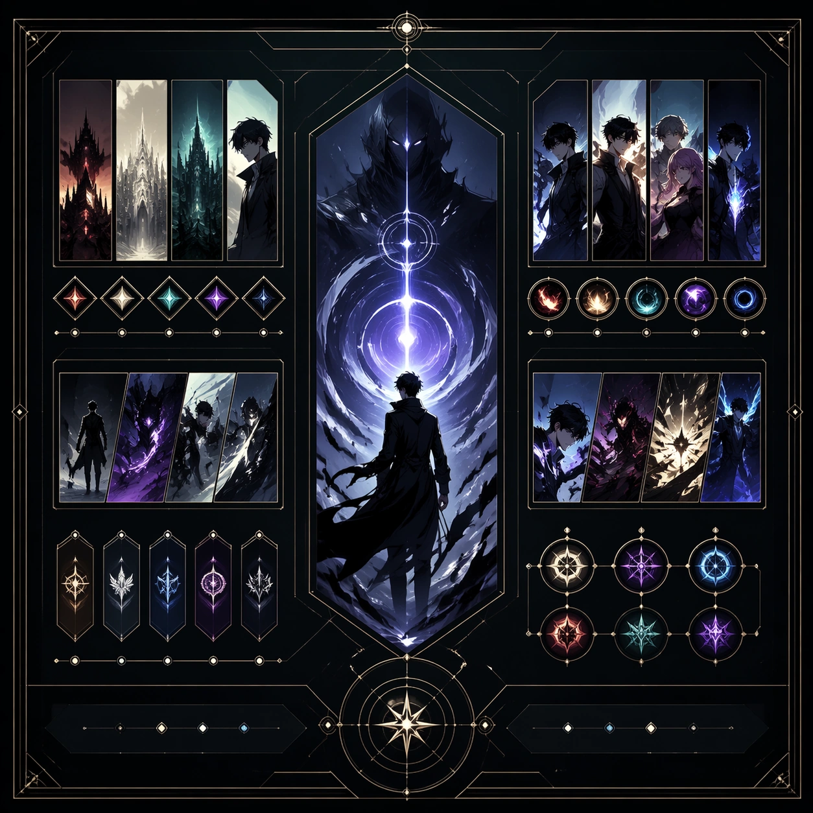

```text
Scene:
Create a square reference image for Vertical Webtoon Hook Chapter. Build a reference anchor establishing the core system with a premium, production-ready finish. Use a polished modular board or campaign surface with clean spacing, premium game-UI finish, and clear focal hierarchy. The composition should feel intentional, clean, and reusable for gallery, research, campaign, or internal handoff contexts. Lighting must support readability first, with the main forms clearly separated from the background and enough breathing room for the system to stay legible at both hero scale and thumbnail scale.

Subject:
Center a coherent original game-art system built for premium production and marketing surfaces. For this image, focus on reference anchor. Keep the same system logic stable across screenshots, cards, banners, and overview boards. This image is the canonical anchor that later series images must follow. The viewer should immediately understand what role this surface plays inside a cohesive game-production asset pack.

Important details:
Lock framing, icon grammar, palette blocking, and surface hierarchy so the kit feels production-ready and consistent. Preserve the core silhouette, framing language, and material logic from the reference image while each variation changes function. Keep materials believable, edge hierarchy disciplined, and the visual language consistent with Webtoon Hook. Use abstract interface blocks or diagram accents when helpful, but avoid any readable language. The final result should feel like a deliberate production asset rather than a random illustration.

Use case:
Vertical Webtoon Hook Chapter series study 1/9, designed as reference anchor within a cohesive asset pack.

Constraints:
No readable text, no watermark, no logos, preserve exact 1:1 aspect ratio, no unrelated objects, no broken visual hierarchy, no malformed anatomy or broken perspective, no random decorative clutter.
```

[Pinned source](https://github.com/ChaosRealmsAI/gpt-image-2-gallery/blob/5296db8c996e38776c83a0bc8c64f848dcd512b3/works/topics/vertical-webtoon-hook-chapter/packages/series-core-system/images/01-reference-anchor/meta.json) · GPT Image2 · 1254×1254 · No source-declared image dependencies. · ProjectD:individually reviewed; awaiting publication acceptance.

## Variant One · vertical-webtoon-hook-chapter/series-core-system/02-variant-one

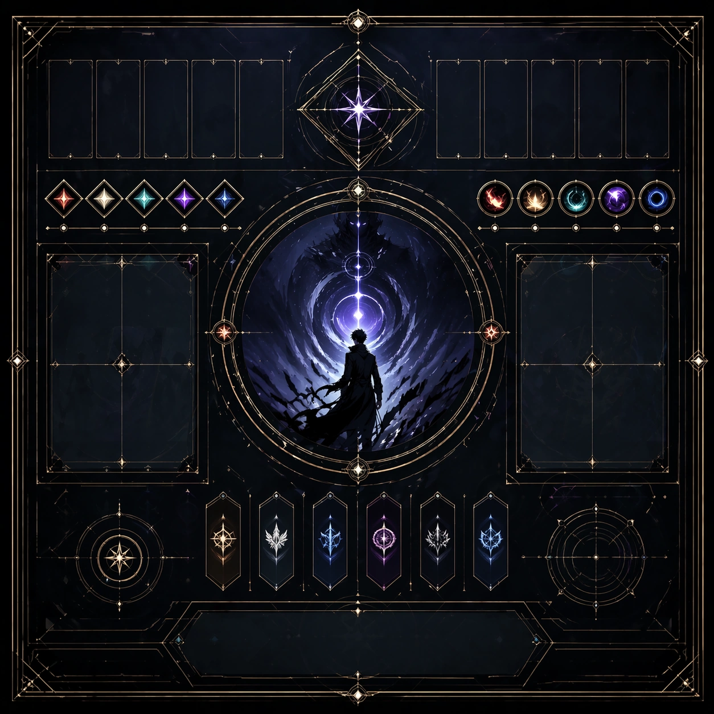

```text
Scene:
Create a square dependent image for Vertical Webtoon Hook Chapter. Build a first controlled variation in the same system with a premium, production-ready finish. Use a polished modular board or campaign surface with clean spacing, premium game-UI finish, and clear focal hierarchy. The composition should feel intentional, clean, and reusable for gallery, research, campaign, or internal handoff contexts. Lighting must support readability first, with the main forms clearly separated from the background and enough breathing room for the system to stay legible at both hero scale and thumbnail scale.

Subject:
Center a coherent original game-art system built for premium production and marketing surfaces. For this image, focus on the intended support surface. Keep the same system logic stable across screenshots, cards, banners, and overview boards. Preserve exact identity or system logic from the reference image while changing only the intended variation axis. The viewer should immediately understand what role this surface plays inside a cohesive game-production asset pack.

Important details:
Lock framing, icon grammar, palette blocking, and surface hierarchy so the kit feels production-ready and consistent. Preserve the core silhouette, framing language, and material logic from the reference image while each variation changes function. Keep materials believable, edge hierarchy disciplined, and the visual language consistent with Webtoon Hook. Use abstract interface blocks or diagram accents when helpful, but avoid any readable language. The final result should feel like a deliberate production asset rather than a random illustration.

Use case:
Vertical Webtoon Hook Chapter series study 2/9, designed as variant one within a cohesive asset pack.

Constraints:
No readable text, no watermark, no logos, preserve exact 1:1 aspect ratio, no unrelated objects, no broken visual hierarchy, no malformed anatomy or broken perspective, no random decorative clutter.
```

[Pinned source](https://github.com/ChaosRealmsAI/gpt-image-2-gallery/blob/5296db8c996e38776c83a0bc8c64f848dcd512b3/works/topics/vertical-webtoon-hook-chapter/packages/series-core-system/images/02-variant-one/meta.json) · GPT Image2 · 1254×1254 · Reference images required. · ProjectD:individually reviewed; awaiting publication acceptance.

## Variant Two · vertical-webtoon-hook-chapter/series-core-system/03-variant-two

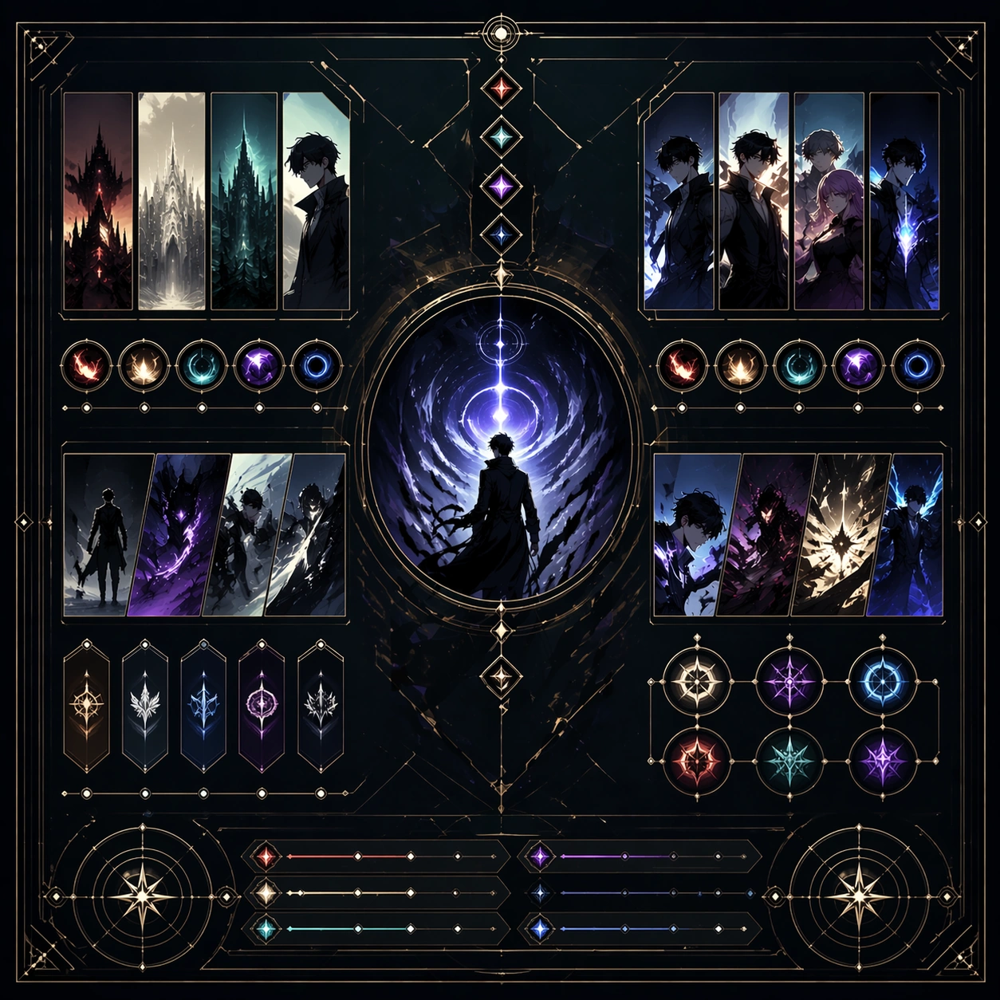

```text
Scene:
Create a square dependent image for Vertical Webtoon Hook Chapter. Build a second controlled variation in the same system with a premium, production-ready finish. Use a polished modular board or campaign surface with clean spacing, premium game-UI finish, and clear focal hierarchy. The composition should feel intentional, clean, and reusable for gallery, research, campaign, or internal handoff contexts. Lighting must support readability first, with the main forms clearly separated from the background and enough breathing room for the system to stay legible at both hero scale and thumbnail scale.

Subject:
Center a coherent original game-art system built for premium production and marketing surfaces. For this image, focus on the intended support surface. Keep the same system logic stable across screenshots, cards, banners, and overview boards. Preserve exact identity or system logic from the reference image while changing only the intended variation axis. The viewer should immediately understand what role this surface plays inside a cohesive game-production asset pack.

Important details:
Lock framing, icon grammar, palette blocking, and surface hierarchy so the kit feels production-ready and consistent. Preserve the core silhouette, framing language, and material logic from the reference image while each variation changes function. Keep materials believable, edge hierarchy disciplined, and the visual language consistent with Webtoon Hook. Use abstract interface blocks or diagram accents when helpful, but avoid any readable language. The final result should feel like a deliberate production asset rather than a random illustration.

Use case:
Vertical Webtoon Hook Chapter series study 3/9, designed as variant two within a cohesive asset pack.

Constraints:
No readable text, no watermark, no logos, preserve exact 1:1 aspect ratio, no unrelated objects, no broken visual hierarchy, no malformed anatomy or broken perspective, no random decorative clutter.
```

[Pinned source](https://github.com/ChaosRealmsAI/gpt-image-2-gallery/blob/5296db8c996e38776c83a0bc8c64f848dcd512b3/works/topics/vertical-webtoon-hook-chapter/packages/series-core-system/images/03-variant-two/meta.json) · GPT Image2 · 1254×1254 · Reference images required. · ProjectD:individually reviewed; awaiting publication acceptance.

## Variant Three · vertical-webtoon-hook-chapter/series-core-system/04-variant-three

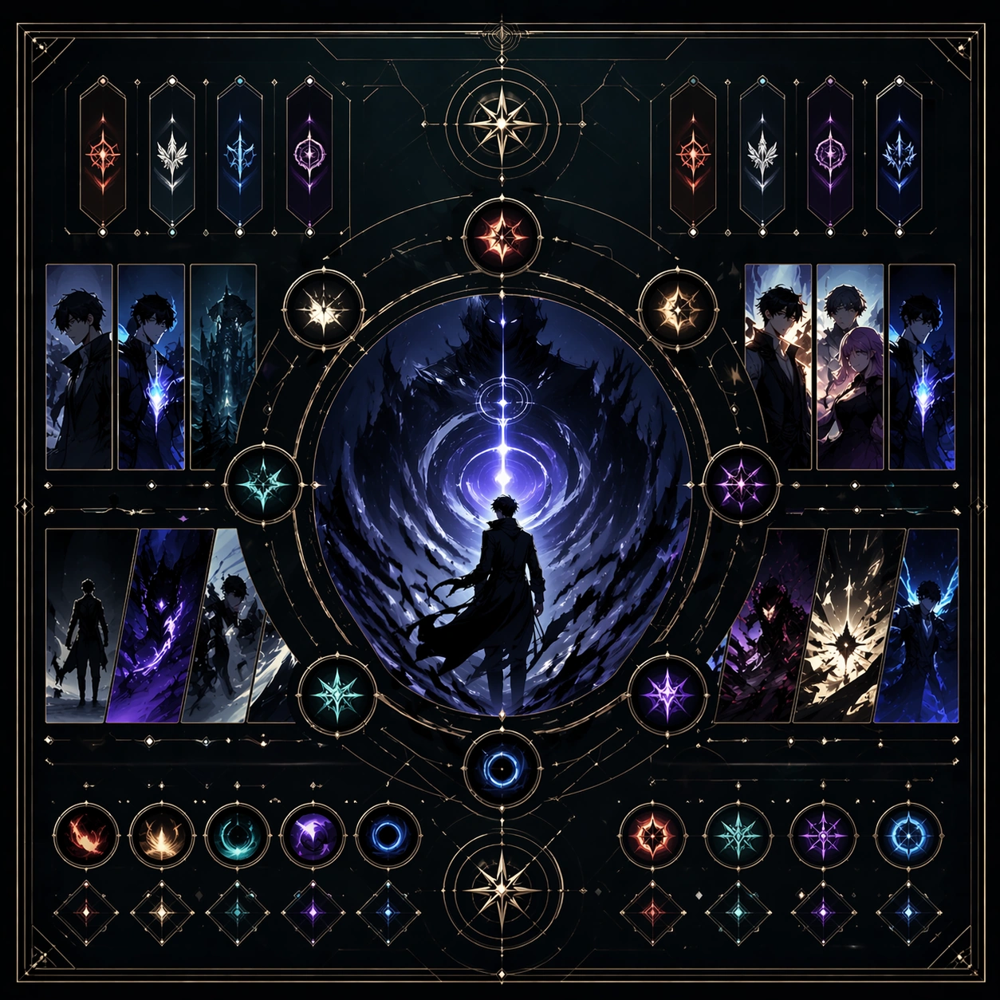

```text
Scene:
Create a square dependent image for Vertical Webtoon Hook Chapter. Build a third controlled variation in the same system with a premium, production-ready finish. Use a polished modular board or campaign surface with clean spacing, premium game-UI finish, and clear focal hierarchy. The composition should feel intentional, clean, and reusable for gallery, research, campaign, or internal handoff contexts. Lighting must support readability first, with the main forms clearly separated from the background and enough breathing room for the system to stay legible at both hero scale and thumbnail scale.

Subject:
Center a coherent original game-art system built for premium production and marketing surfaces. For this image, focus on the intended support surface. Keep the same system logic stable across screenshots, cards, banners, and overview boards. Preserve exact identity or system logic from the reference image while changing only the intended variation axis. The viewer should immediately understand what role this surface plays inside a cohesive game-production asset pack.

Important details:
Lock framing, icon grammar, palette blocking, and surface hierarchy so the kit feels production-ready and consistent. Preserve the core silhouette, framing language, and material logic from the reference image while each variation changes function. Keep materials believable, edge hierarchy disciplined, and the visual language consistent with Webtoon Hook. Use abstract interface blocks or diagram accents when helpful, but avoid any readable language. The final result should feel like a deliberate production asset rather than a random illustration.

Use case:
Vertical Webtoon Hook Chapter series study 4/9, designed as variant three within a cohesive asset pack.

Constraints:
No readable text, no watermark, no logos, preserve exact 1:1 aspect ratio, no unrelated objects, no broken visual hierarchy, no malformed anatomy or broken perspective, no random decorative clutter.
```

[Pinned source](https://github.com/ChaosRealmsAI/gpt-image-2-gallery/blob/5296db8c996e38776c83a0bc8c64f848dcd512b3/works/topics/vertical-webtoon-hook-chapter/packages/series-core-system/images/04-variant-three/meta.json) · GPT Image2 · 1254×1254 · Reference images required. · ProjectD:individually reviewed; awaiting publication acceptance.

## Support One · vertical-webtoon-hook-chapter/single-support-studies/support-one

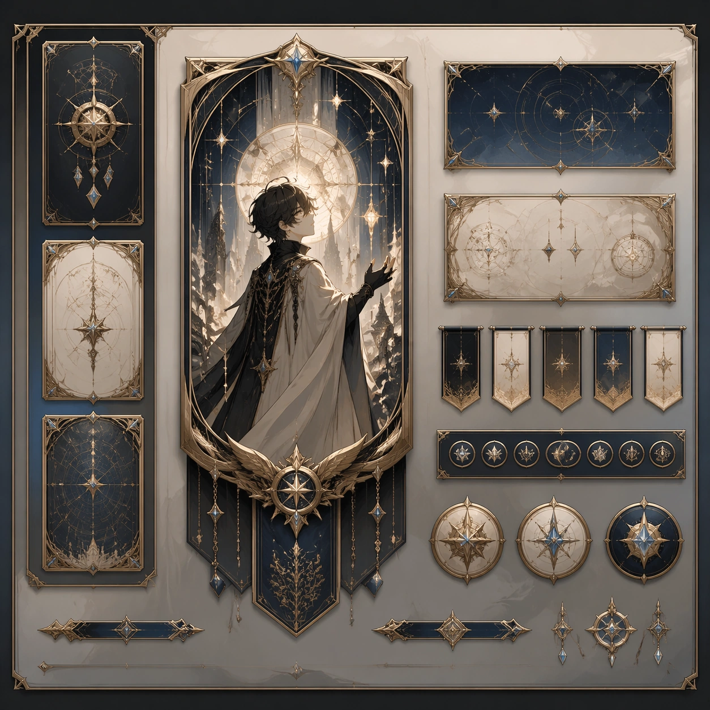

```text
Scene:
Create a square standalone support image for Vertical Webtoon Hook Chapter. Build a support-surface study with a clear focal hierarchy and a finished professional surface. Use a polished modular board or campaign surface with clean spacing, premium game-UI finish, and clear focal hierarchy. The frame should feel self-contained and polished, with enough structure to explain the system even without the reference series, yet still obviously belonging to the same theme and production world.

Subject:
Show a coherent original game-art system built for premium production and marketing surfaces in a way that emphasizes the intended support surface. Keep the same system logic stable across screenshots, cards, banners, and overview boards. Even though this image is independent, the viewer should still recognize the same universe, same commercial logic, and same production intent as the core package.

Important details:
Lock framing, icon grammar, palette blocking, and surface hierarchy so the kit feels production-ready and consistent. Preserve the broader theme language through color, framing, material choices, and modular composition. Use clean panel rhythm, premium asset presentation, and believable detail density. The image should work equally well as a gallery study, research reference, and mock production deliverable.

Use case:
Vertical Webtoon Hook Chapter single study 5/9, exploring support one as a support surface.

Constraints:
No readable text, no watermark, no logos, preserve exact 1:1 aspect ratio, no unrelated objects, no broken visual hierarchy, no visual noise that obscures the main surface, no accidental brand resemblance.
```

[Pinned source](https://github.com/ChaosRealmsAI/gpt-image-2-gallery/blob/5296db8c996e38776c83a0bc8c64f848dcd512b3/works/topics/vertical-webtoon-hook-chapter/packages/single-support-studies/images/support-one/meta.json) · GPT Image2 · 1254×1254 · No source-declared image dependencies. · ProjectD:individually reviewed; awaiting publication acceptance.

## Support Two · vertical-webtoon-hook-chapter/single-support-studies/support-two

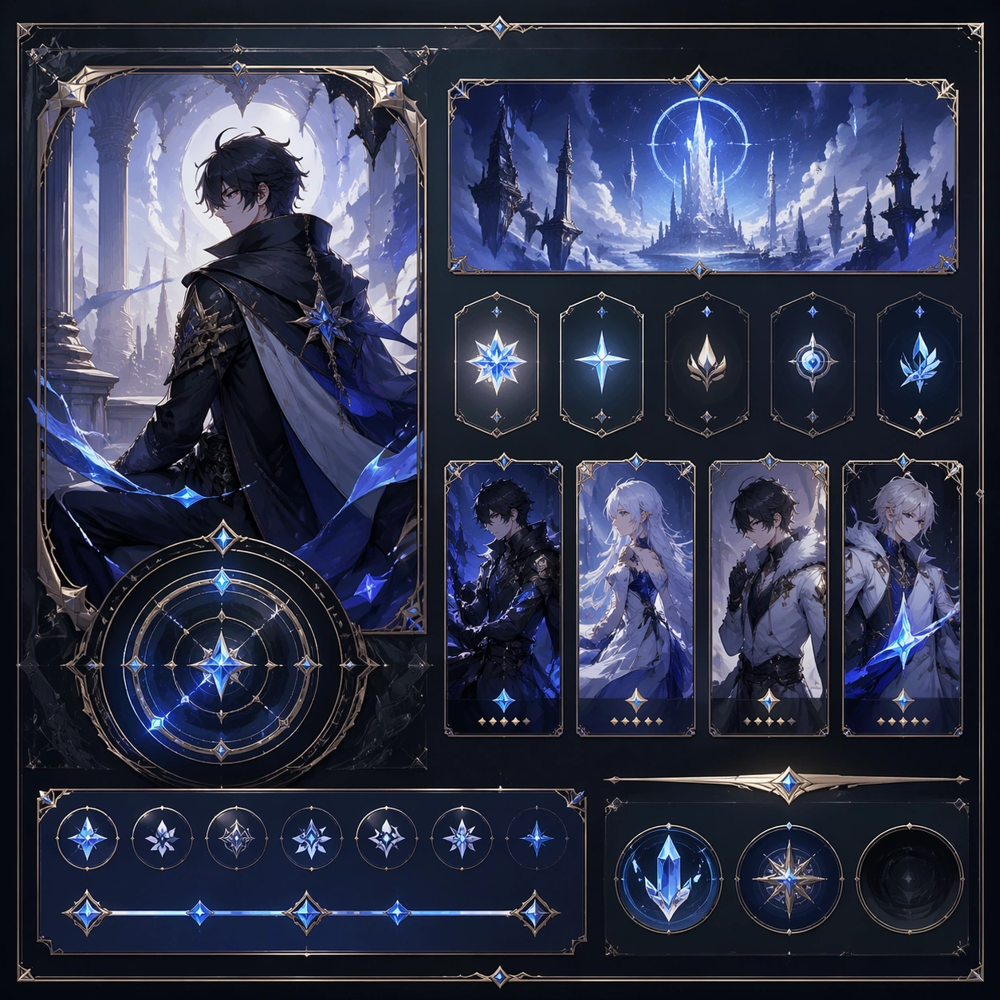

```text
Scene:
Create a square standalone support image for Vertical Webtoon Hook Chapter. Build a second support-surface study with a clear focal hierarchy and a finished professional surface. Use a polished modular board or campaign surface with clean spacing, premium game-UI finish, and clear focal hierarchy. The frame should feel self-contained and polished, with enough structure to explain the system even without the reference series, yet still obviously belonging to the same theme and production world.

Subject:
Show a coherent original game-art system built for premium production and marketing surfaces in a way that emphasizes the intended support surface. Keep the same system logic stable across screenshots, cards, banners, and overview boards. Even though this image is independent, the viewer should still recognize the same universe, same commercial logic, and same production intent as the core package.

Important details:
Lock framing, icon grammar, palette blocking, and surface hierarchy so the kit feels production-ready and consistent. Preserve the broader theme language through color, framing, material choices, and modular composition. Use clean panel rhythm, premium asset presentation, and believable detail density. The image should work equally well as a gallery study, research reference, and mock production deliverable.

Use case:
Vertical Webtoon Hook Chapter single study 6/9, exploring support two as a support surface.

Constraints:
No readable text, no watermark, no logos, preserve exact 1:1 aspect ratio, no unrelated objects, no broken visual hierarchy, no visual noise that obscures the main surface, no accidental brand resemblance.
```

[Pinned source](https://github.com/ChaosRealmsAI/gpt-image-2-gallery/blob/5296db8c996e38776c83a0bc8c64f848dcd512b3/works/topics/vertical-webtoon-hook-chapter/packages/single-support-studies/images/support-two/meta.json) · GPT Image2 · 1254×1254 · No source-declared image dependencies. · ProjectD:individually reviewed; awaiting publication acceptance.

## Support Three · vertical-webtoon-hook-chapter/single-support-studies/support-three

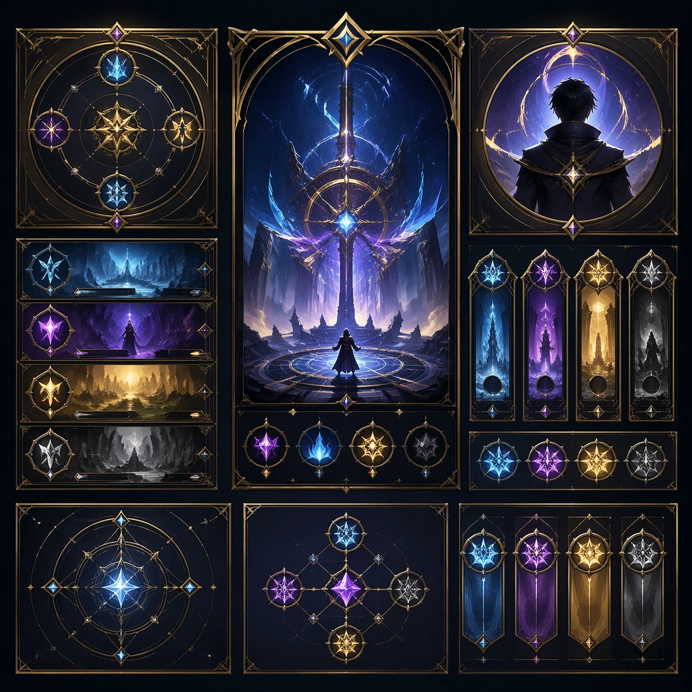

```text
Scene:
Create a square standalone support image for Vertical Webtoon Hook Chapter. Build a third support-surface study with a clear focal hierarchy and a finished professional surface. Use a polished modular board or campaign surface with clean spacing, premium game-UI finish, and clear focal hierarchy. The frame should feel self-contained and polished, with enough structure to explain the system even without the reference series, yet still obviously belonging to the same theme and production world.

Subject:
Show a coherent original game-art system built for premium production and marketing surfaces in a way that emphasizes the intended support surface. Keep the same system logic stable across screenshots, cards, banners, and overview boards. Even though this image is independent, the viewer should still recognize the same universe, same commercial logic, and same production intent as the core package.

Important details:
Lock framing, icon grammar, palette blocking, and surface hierarchy so the kit feels production-ready and consistent. Preserve the broader theme language through color, framing, material choices, and modular composition. Use clean panel rhythm, premium asset presentation, and believable detail density. The image should work equally well as a gallery study, research reference, and mock production deliverable.

Use case:
Vertical Webtoon Hook Chapter single study 7/9, exploring support three as a support surface.

Constraints:
No readable text, no watermark, no logos, preserve exact 1:1 aspect ratio, no unrelated objects, no broken visual hierarchy, no visual noise that obscures the main surface, no accidental brand resemblance.
```

[Pinned source](https://github.com/ChaosRealmsAI/gpt-image-2-gallery/blob/5296db8c996e38776c83a0bc8c64f848dcd512b3/works/topics/vertical-webtoon-hook-chapter/packages/single-support-studies/images/support-three/meta.json) · GPT Image2 · 1254×1254 · No source-declared image dependencies. · ProjectD:individually reviewed; awaiting publication acceptance.

## Support Four · vertical-webtoon-hook-chapter/single-support-studies/support-four

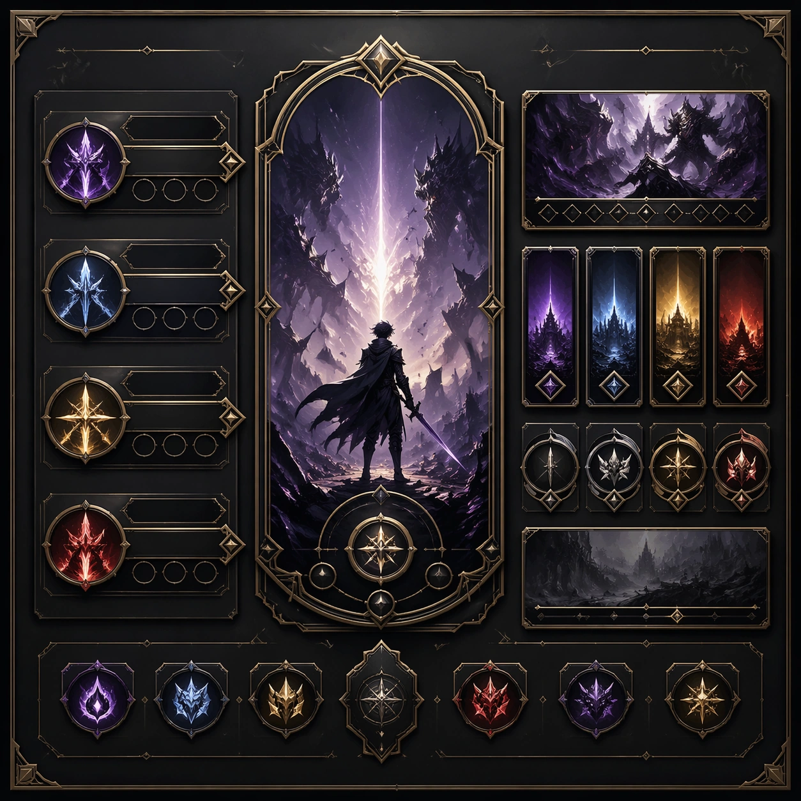

```text
Scene:
Create a square standalone support image for Vertical Webtoon Hook Chapter. Build a fourth support-surface study with a clear focal hierarchy and a finished professional surface. Use a polished modular board or campaign surface with clean spacing, premium game-UI finish, and clear focal hierarchy. The frame should feel self-contained and polished, with enough structure to explain the system even without the reference series, yet still obviously belonging to the same theme and production world.

Subject:
Show a coherent original game-art system built for premium production and marketing surfaces in a way that emphasizes the intended support surface. Keep the same system logic stable across screenshots, cards, banners, and overview boards. Even though this image is independent, the viewer should still recognize the same universe, same commercial logic, and same production intent as the core package.

Important details:
Lock framing, icon grammar, palette blocking, and surface hierarchy so the kit feels production-ready and consistent. Preserve the broader theme language through color, framing, material choices, and modular composition. Use clean panel rhythm, premium asset presentation, and believable detail density. The image should work equally well as a gallery study, research reference, and mock production deliverable.

Use case:
Vertical Webtoon Hook Chapter single study 8/9, exploring support four as a support surface.

Constraints:
No readable text, no watermark, no logos, preserve exact 1:1 aspect ratio, no unrelated objects, no broken visual hierarchy, no visual noise that obscures the main surface, no accidental brand resemblance.
```

[Pinned source](https://github.com/ChaosRealmsAI/gpt-image-2-gallery/blob/5296db8c996e38776c83a0bc8c64f848dcd512b3/works/topics/vertical-webtoon-hook-chapter/packages/single-support-studies/images/support-four/meta.json) · GPT Image2 · 1254×1254 · No source-declared image dependencies. · ProjectD:individually reviewed; awaiting publication acceptance.

## Support Five · vertical-webtoon-hook-chapter/single-support-studies/support-five

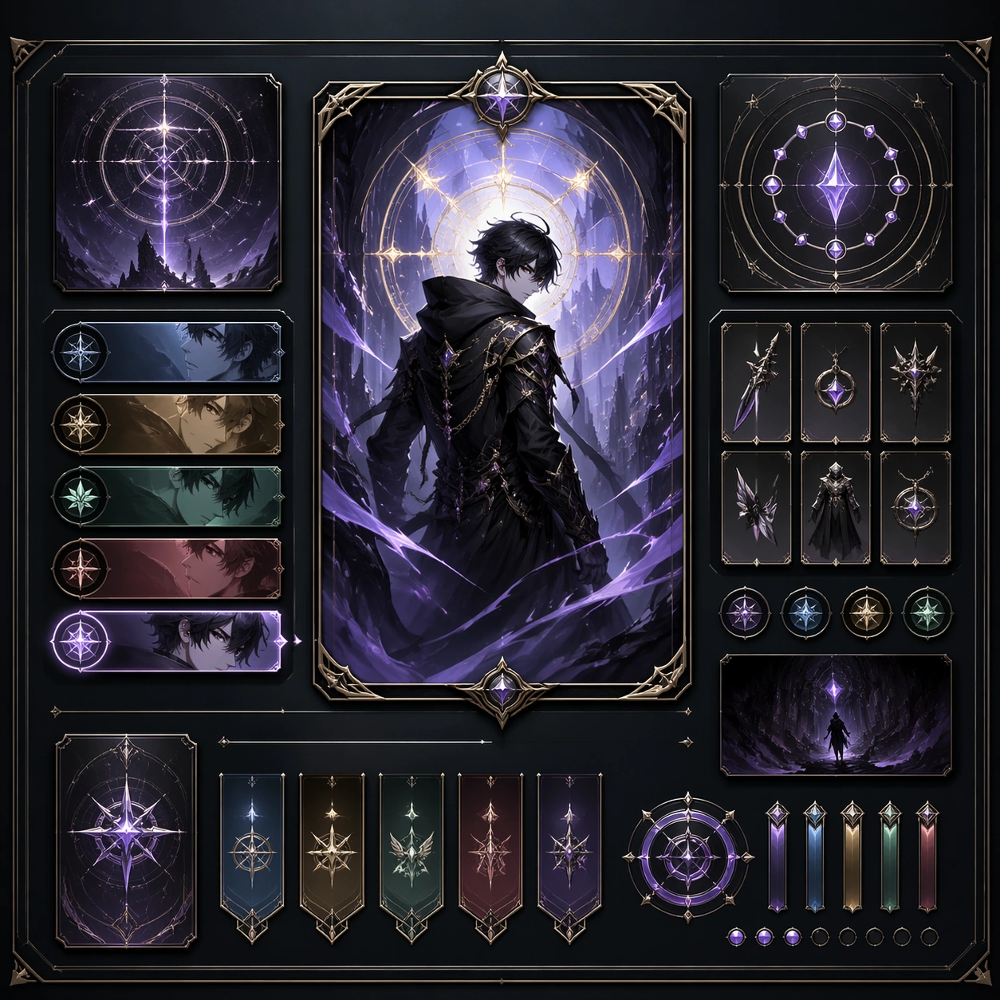

```text
Scene:
Create a square standalone support image for Vertical Webtoon Hook Chapter. Build a fifth support-surface study with a clear focal hierarchy and a finished professional surface. Use a polished modular board or campaign surface with clean spacing, premium game-UI finish, and clear focal hierarchy. The frame should feel self-contained and polished, with enough structure to explain the system even without the reference series, yet still obviously belonging to the same theme and production world.

Subject:
Show a coherent original game-art system built for premium production and marketing surfaces in a way that emphasizes the intended support surface. Keep the same system logic stable across screenshots, cards, banners, and overview boards. Even though this image is independent, the viewer should still recognize the same universe, same commercial logic, and same production intent as the core package.

Important details:
Lock framing, icon grammar, palette blocking, and surface hierarchy so the kit feels production-ready and consistent. Preserve the broader theme language through color, framing, material choices, and modular composition. Use clean panel rhythm, premium asset presentation, and believable detail density. The image should work equally well as a gallery study, research reference, and mock production deliverable.

Use case:
Vertical Webtoon Hook Chapter single study 9/9, exploring support five as a support surface.

Constraints:
No readable text, no watermark, no logos, preserve exact 1:1 aspect ratio, no unrelated objects, no broken visual hierarchy, no visual noise that obscures the main surface, no accidental brand resemblance.
```

[Pinned source](https://github.com/ChaosRealmsAI/gpt-image-2-gallery/blob/5296db8c996e38776c83a0bc8c64f848dcd512b3/works/topics/vertical-webtoon-hook-chapter/packages/single-support-studies/images/support-five/meta.json) · GPT Image2 · 1254×1254 · No source-declared image dependencies. · ProjectD:individually reviewed; awaiting publication acceptance.

## Runway Season Lock · virtual-try-on-identity-lock/single-identity-lock-studies/runway-season-lock

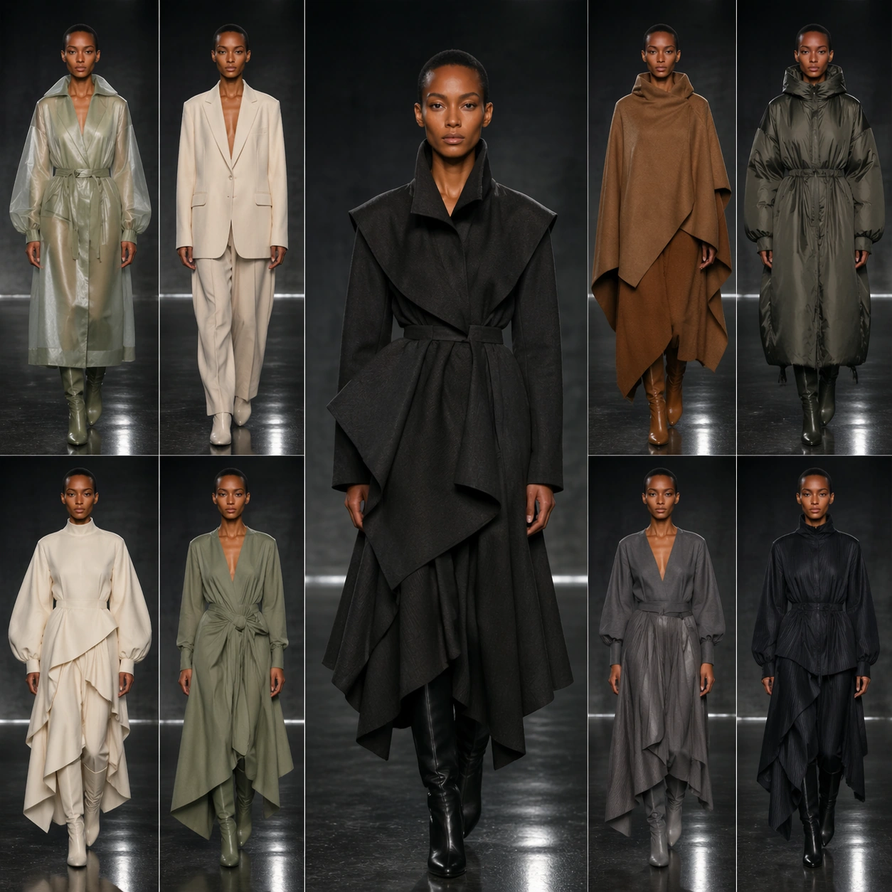

```text
Scene:
A square runway-season comparison board with a dark graphite backstage floor, soft rim light, and a subtle reflective runway strip running horizontally through the composition. Eight evenly spaced full-body panels show the same model under consistent fashion-show lighting, with a larger central pose and smaller surrounding seasonal looks. The image should feel like a polished designer fitting review, not a catalog with labels.

Subject:
A synthetic adult model with copper-brown skin, close-cropped natural hair, high cheekbones, almond eyes, long neck, narrow shoulders, and an elegant upright stance. The identity is identical across all looks. Outfits move through four seasons: sheer spring organza coat, summer linen suit, autumn wool cape, winter quilted parka, plus four runway variations with sculptural sleeves, layered skirts, tailored trousers, and monochrome boots. The garments may be bold, but the person must remain the same.

Important details:
Lock the model identity harder than the clothing. Preserve facial structure, skin undertone, hairline, ear shape, neck, collarbone, limb length, and hand pose across every panel. Clothing may alter silhouette around the body through fabric volume, but the underlying body proportions must stay readable. Avoid creating a different model for dramatic fashion effects. Keep camera angle, head scale, and foot placement consistent.

Use case:
Virtual Try-On Identity Lock single study 2/8, testing seasonal runway garment changes while preserving one stable model identity.

Constraints:
No readable text, no watermark, no logos, preserve exact 1:1 aspect ratio, no brand signage, no face morphing, no skin-lightening, no body resizing, no swapped hairstyle, no crowd, no backstage clutter, no distorted limbs.
```

[Pinned source](https://github.com/ChaosRealmsAI/gpt-image-2-gallery/blob/5296db8c996e38776c83a0bc8c64f848dcd512b3/works/topics/virtual-try-on-identity-lock/packages/single-identity-lock-studies/images/runway-season-lock/meta.json) · GPT Image2 · 1254×1254 · No source-declared image dependencies. · ProjectD:individually reviewed; awaiting publication acceptance.

## Outdoor Light Lock · virtual-try-on-identity-lock/single-identity-lock-studies/outdoor-light-lock

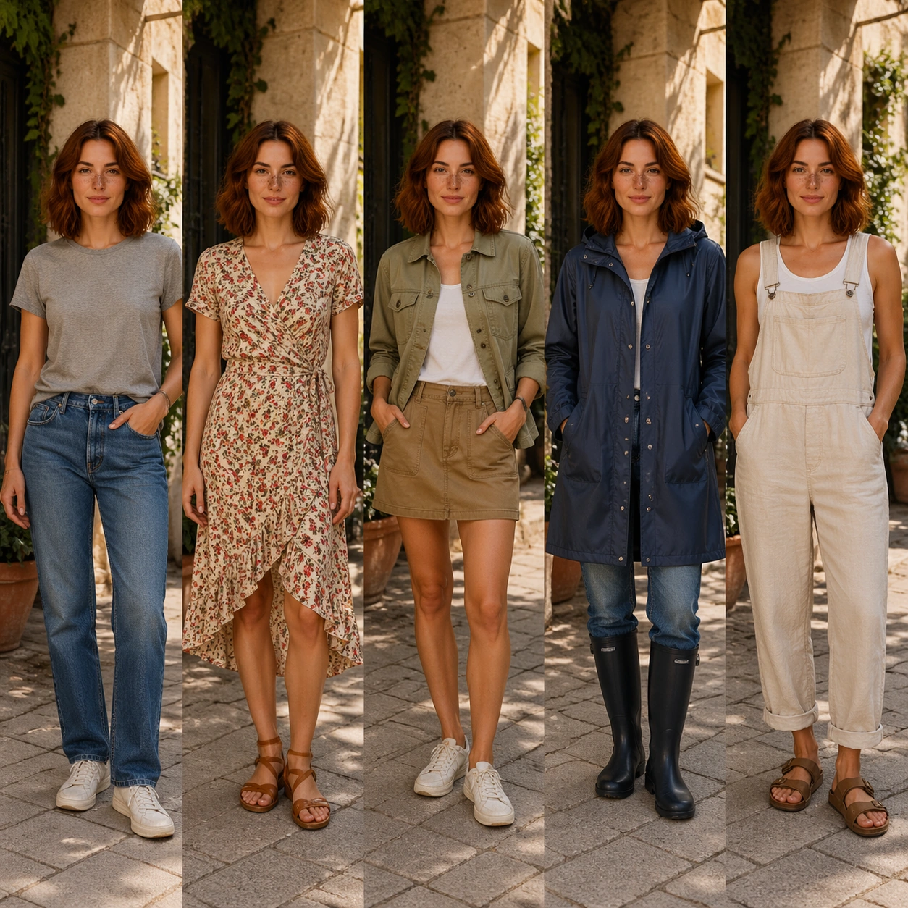

```text
Scene:
A square outdoor virtual try-on sheet set in a sunlit city courtyard with pale stone walls, greenery, and late-afternoon shadows. The composition uses five full-body panels arranged like a clean editorial contact sheet, each panel shot from the same distance with the model standing on the same paving stones. Lighting changes subtly with believable outdoor bounce, but identity must remain stable.

Subject:
A synthetic adult model with fair olive skin, freckles across the nose, shoulder-length wavy auburn hair, soft square jaw, average height, and a relaxed natural stance. The first panel resembles a source look in a simple gray tee and straight jeans. The remaining panels try on a floral wrap dress, lightweight utility jacket with skirt, raincoat with boots, linen two-piece, and relaxed weekend overalls. The face, freckles, hair length, body mass, and posture rhythm must match across all panels.

Important details:
The challenge is preserving identity under environmental light and garment variety. Keep the same eyes, brow shape, nose, mouth, cheek freckles, hair volume, hand size, ankle shape, and shoulder width. Garments should wrap the body realistically, with correct fabric shadows and no pasted-on clothing. Outdoor shadows must not hide the face or alter skin color. Use consistent scale lines on the paving stones to make height drift visible.

Use case:
Virtual Try-On Identity Lock single study 3/8, testing outdoor-light try-on consistency without changing the model.

Constraints:
No readable text, no watermark, no logos, preserve exact 1:1 aspect ratio, no signage, no changed freckles, no altered hair length, no face retouching, no body slimming, no extra people, no harsh backlight, no clothing floating off the body.
```

[Pinned source](https://github.com/ChaosRealmsAI/gpt-image-2-gallery/blob/5296db8c996e38776c83a0bc8c64f848dcd512b3/works/topics/virtual-try-on-identity-lock/packages/single-identity-lock-studies/images/outdoor-light-lock/meta.json) · GPT Image2 · 1254×1254 · No source-declared image dependencies. · ProjectD:individually reviewed; awaiting publication acceptance.

## Office Commute Lock · virtual-try-on-identity-lock/single-identity-lock-studies/office-commute-lock

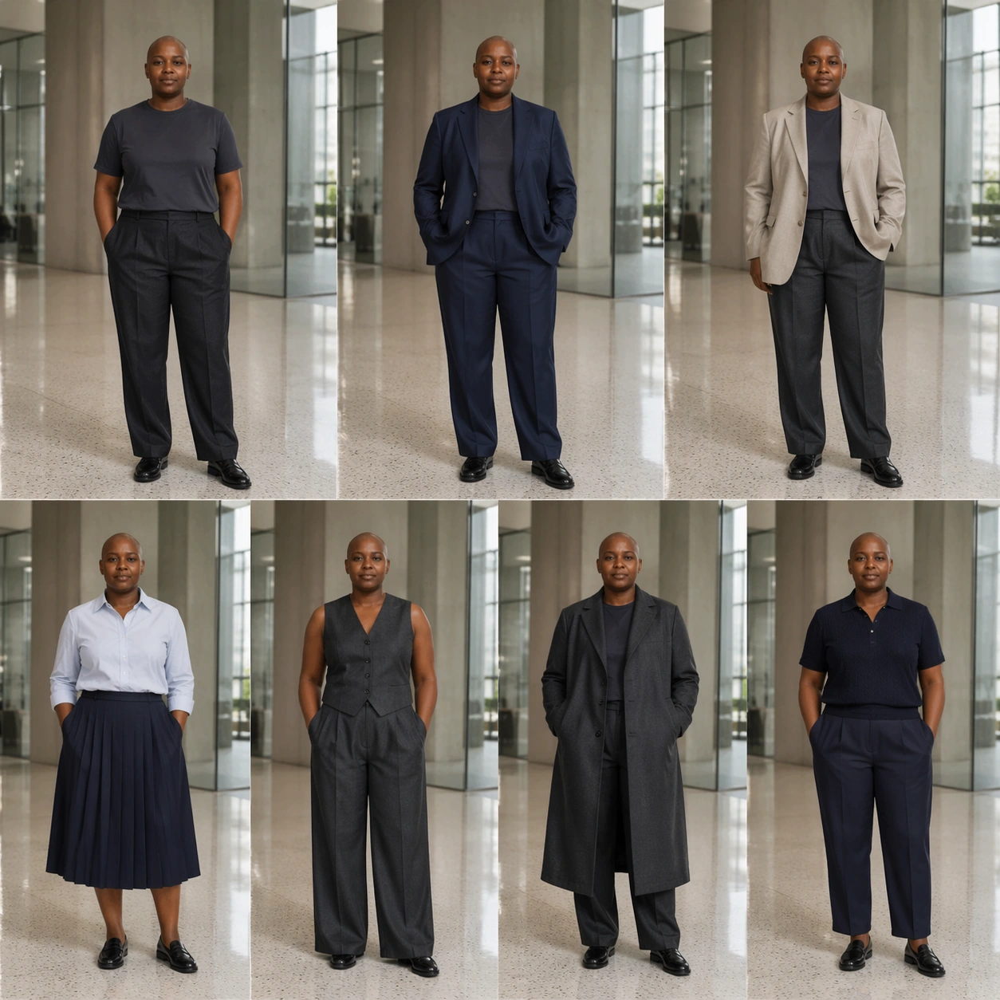

```text
Scene:
A square professional wardrobe try-on board inside a quiet modern office lobby with pale terrazzo flooring, glass reflections, and soft daylight from one side. Six full-body outfit states are arranged in two rows of three, with the same camera angle and a thin visual rhythm from the lobby columns. The composition is precise and useful, like a corporate styling review without written labels.

Subject:
A synthetic adult model with deep brown skin, shaved head, round face, broad nose, full lips, sturdy build, and calm direct gaze. The baseline look is a plain charcoal tee and dark trousers. The try-on variants include a navy suit, relaxed beige blazer, pleated midi skirt with shirt, structured vest and wide-leg pants, long wool coat, and smart-casual knit polo with cropped trousers. The model's face, head shape, skin tone, torso width, arm length, and stance must remain constant.

Important details:
Identity lock is the main visual rule. Keep the same facial geometry, scalp line, smile restraint, shoulder slope, waist position, knee height, hand shape, and shoe size in all panels. Clothing can signal different workplace dress codes, but must not make the model thinner, taller, younger, or more conventionally retouched. Maintain realistic garment seams, natural drape, office-appropriate colors, and consistent shadow direction.

Use case:
Virtual Try-On Identity Lock single study 4/8, testing workplace outfit edits while preserving face, body, and posture.

Constraints:
No readable text, no watermark, no logos, preserve exact 1:1 aspect ratio, no company marks, no changed skin tone, no altered head shape, no body reshaping, no extra models, no mirror duplicate faces, no distorted tailoring, no unreadable labels.
```

[Pinned source](https://github.com/ChaosRealmsAI/gpt-image-2-gallery/blob/5296db8c996e38776c83a0bc8c64f848dcd512b3/works/topics/virtual-try-on-identity-lock/packages/single-identity-lock-studies/images/office-commute-lock/meta.json) · GPT Image2 · 1254×1254 · No source-declared image dependencies. · ProjectD:individually reviewed; awaiting publication acceptance.

## Sportswear Lock · virtual-try-on-identity-lock/single-identity-lock-studies/sportswear-lock

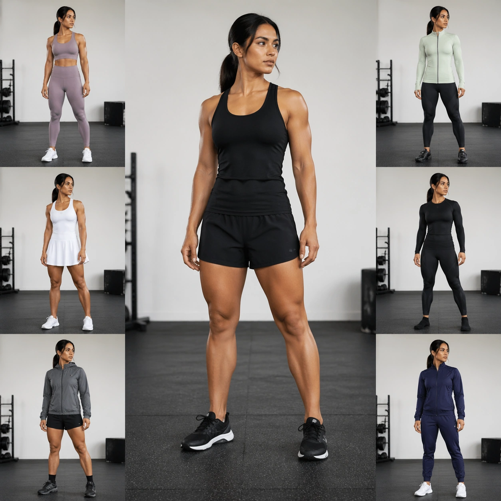

```text
Scene:
A square athletic try-on analysis board in a bright training studio with matte rubber flooring, white walls, and clean overhead light. The layout uses one large center figure and six smaller motion-adjacent outfit poses around it, all kept close to the same body angle so identity comparison is possible. The board feels like a sportswear fit test, not an action poster.

Subject:
A synthetic adult model with tan skin, long black hair tied in a low ponytail, heart-shaped face, strong eyebrows, compact muscular build, and confident neutral expression. The baseline is a plain black fitted tank and shorts. Outfit changes include running kit, yoga set, cycling jacket and leggings, tennis dress, hiking shell, compression recovery layer, and warm-up tracksuit. The same face, ponytail placement, muscle definition, shoulder width, hip width, and limb length must appear in every variant.

Important details:
Preserve identity during fitted garment changes, where body drift is easy to see. Keep the same jawline, brow, eye shape, nose, mouth, neck tendons, collarbones, hand structure, thigh shape, and calf proportion. Sportswear should show believable stretch, compression, seam placement, breathable mesh, and fabric tension without painting new anatomy. Do not let dynamic clothing or pose changes create a different athlete.

Use case:
Virtual Try-On Identity Lock single study 5/8, testing activewear edits while preserving one athletic model.

Constraints:
No readable text, no watermark, no logos, preserve exact 1:1 aspect ratio, no brand marks, no changed muscles, no face swap, no skin tone shift, no ponytail change, no extra athlete, no impossible joints, no oversexualized styling, no floating garments.
```

[Pinned source](https://github.com/ChaosRealmsAI/gpt-image-2-gallery/blob/5296db8c996e38776c83a0bc8c64f848dcd512b3/works/topics/virtual-try-on-identity-lock/packages/single-identity-lock-studies/images/sportswear-lock/meta.json) · GPT Image2 · 1254×1254 · No source-declared image dependencies. · ProjectD:individually reviewed; awaiting publication acceptance.

## Eveningwear Lock · virtual-try-on-identity-lock/single-identity-lock-studies/eveningwear-lock

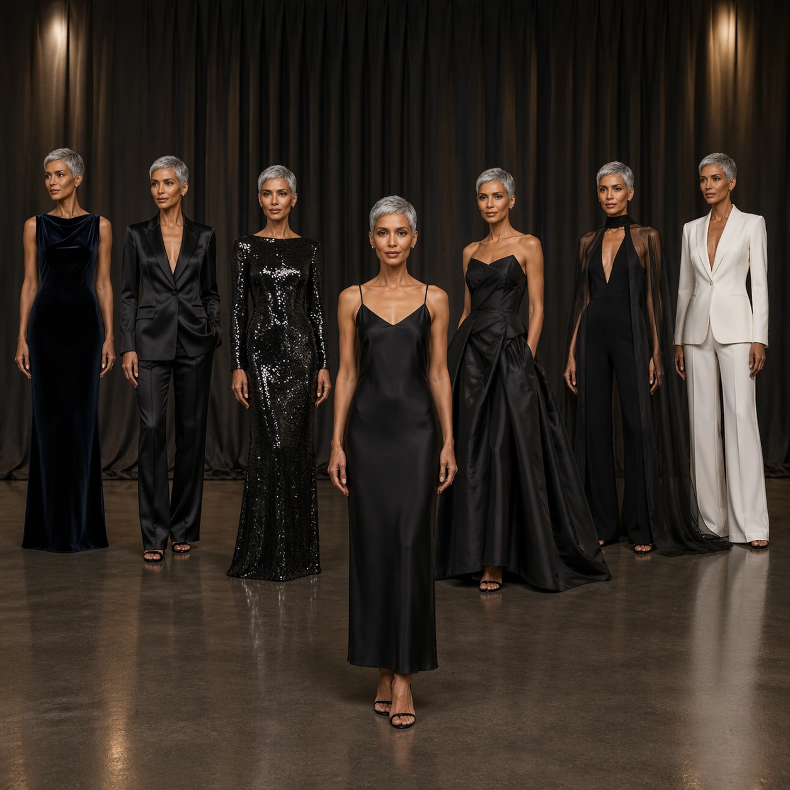

```text
Scene:
A square eveningwear virtual fitting board in a softly lit atelier with charcoal drapes, a polished concrete floor, and warm pin lights catching fabric surfaces. Seven full-body garment states are arranged in a graceful arc around a central baseline figure. The image is elegant and controlled, with enough negative space to compare silhouette and identity.

Subject:
A synthetic adult model with light brown skin, silver-gray pixie haircut, angular cheekbones, narrow nose, fine mouth, tall lean body, and poised hands. The baseline outfit is a simple black slip dress. Try-on looks include velvet column gown, satin tuxedo, sequined long-sleeve dress, sculptural taffeta skirt, sheer cape over tailored jumpsuit, beadwork cocktail dress, and minimalist white evening suit. The same mature face, hair shape, skin tone, height, arm length, hand pose, and composed expression must carry through all looks.

Important details:
Eveningwear often changes the perceived body; prevent that drift. Preserve cheekbone angle, eye spacing, hairline, ear visibility, neck length, clavicle placement, wrist scale, waist height, and foot stance. Let garments create volume through fabric only, not by resizing the person. Show realistic reflective materials: velvet absorbs light, satin glows, sequins sparkle, taffeta holds crisp folds. Avoid glamour retouching that makes the model younger or changes identity.

Use case:
Virtual Try-On Identity Lock single study 6/8, testing formalwear transformation with stable age, face, and body.

Constraints:
No readable text, no watermark, no logos, preserve exact 1:1 aspect ratio, no brand marks, no age change, no face smoothing, no body elongation, no changed haircut, no extra guests, no stage signage, no impossible fabric clipping.
```

[Pinned source](https://github.com/ChaosRealmsAI/gpt-image-2-gallery/blob/5296db8c996e38776c83a0bc8c64f848dcd512b3/works/topics/virtual-try-on-identity-lock/packages/single-identity-lock-studies/images/eveningwear-lock/meta.json) · GPT Image2 · 1254×1254 · No source-declared image dependencies. · ProjectD:individually reviewed; awaiting publication acceptance.

## Heritage Textile Lock · virtual-try-on-identity-lock/single-identity-lock-studies/heritage-textile-lock

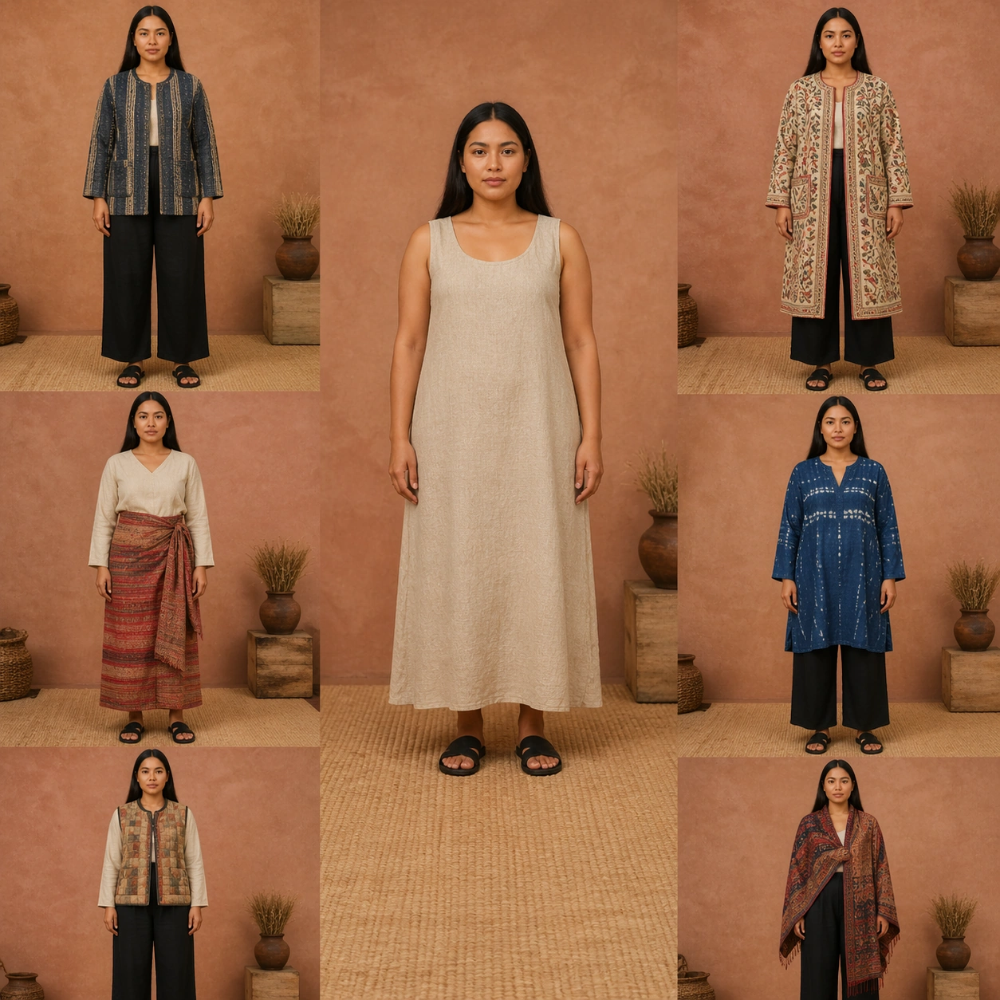

```text
Scene:
A square textile-focused try-on board photographed like a museum fashion archive, with soft daylight, muted clay background, woven floor mat, and close enough detail to inspect fabric without losing full-body identity. The layout has one central source-like standing figure and six surrounding garment variations, each in the same calm pose and scale.

Subject:
A synthetic adult model with golden-brown skin, long straight dark hair parted in the center, round cheeks, straight brows, medium height, soft body, and gentle neutral expression. Clothing changes explore heritage-inspired textiles without copying any specific sacred or ceremonial dress: handwoven jacket, embroidered long coat, pleated wrap skirt, indigo resist-dye tunic, quilted vest, patterned shawl over simple trousers, and textured wool dress. The model's face, hair part, skin tone, body softness, hand shape, and stance must stay identical.

Important details:
Keep cultural textile cues respectful and generalized: craft detail, weave, embroidery, dye, quilting, fringe, and layered cloth, with no readable symbols or official insignia. Identity lock must survive dense patterning. Preserve eye shape, nose, lips, chin, cheek volume, shoulder curve, waist location, leg length, and hair length. Patterns may change garment surfaces but must not crawl onto skin or alter facial features.

Use case:
Virtual Try-On Identity Lock single study 7/8, testing ornate textile replacement while preserving one model identity.

Constraints:
No readable text, no watermark, no logos, preserve exact 1:1 aspect ratio, no sacred symbols, no national flags, no costume caricature, no changed face, no changed body, no altered hair part, no extra people, no pattern bleeding onto skin.
```

[Pinned source](https://github.com/ChaosRealmsAI/gpt-image-2-gallery/blob/5296db8c996e38776c83a0bc8c64f848dcd512b3/works/topics/virtual-try-on-identity-lock/packages/single-identity-lock-studies/images/heritage-textile-lock/meta.json) · GPT Image2 · 1254×1254 · No source-declared image dependencies. · ProjectD:individually reviewed; awaiting publication acceptance.

## Streetwear Layer Lock · virtual-try-on-identity-lock/single-identity-lock-studies/streetwear-layer-lock

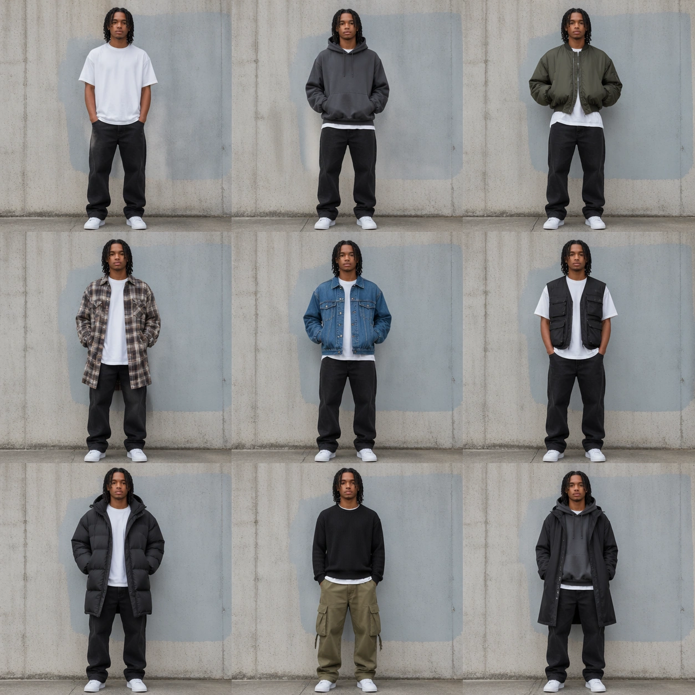

```text
Scene:
A square urban streetwear try-on board set against a clean concrete wall with soft overcast light and a faint painted color field that contains no letters. The composition uses a 3 by 3 contact-sheet rhythm: one baseline outfit and eight layered variations, all full-body and aligned to the same floor line. The visual style is sharp, photoreal, and youth-fashion editorial.

Subject:
A synthetic adult model with medium-dark skin, shoulder-length twists, rectangular face, wide-set eyes, small nose ring, average build, and easy relaxed posture. The baseline is a blank white tee, black jeans, and plain sneakers. Layered variations include oversized hoodie, cropped bomber, long plaid overshirt, denim jacket, technical vest, puffer coat, cargo trousers with knit, and monochrome layered streetwear. The same face, twists, nose ring, skin tone, shoulder width, torso length, and sneaker scale must remain fixed.

Important details:
Streetwear layering creates strong silhouette changes, but identity cannot drift. Preserve facial landmarks, hair texture and length, nose ring position, ear visibility, neck, hand size, body mass, hip height, and leg proportions. Garments may be oversized, stacked, or cropped, but should drape over the same underlying person. Keep fabric edges, hoods, sleeves, cuffs, pockets, and hems crisp without covering the face in a way that hides identity.

Use case:
Virtual Try-On Identity Lock single study 8/8, testing layered streetwear variation while maintaining one locked identity.

Constraints:
No readable text, no watermark, no logos, preserve exact 1:1 aspect ratio, no graffiti letters, no brand marks, no changed face, no changed hair, no removed nose ring, no body resizing, no extra people, no masked face, no distorted pockets or shoes.
```

[Pinned source](https://github.com/ChaosRealmsAI/gpt-image-2-gallery/blob/5296db8c996e38776c83a0bc8c64f848dcd512b3/works/topics/virtual-try-on-identity-lock/packages/single-identity-lock-studies/images/streetwear-layer-lock/meta.json) · GPT Image2 · 1254×1254 · No source-declared image dependencies. · ProjectD:individually reviewed; awaiting publication acceptance.

## Main Panorama · volcanic-iceland-black-beach/single-landscape-studies/01-main-panorama

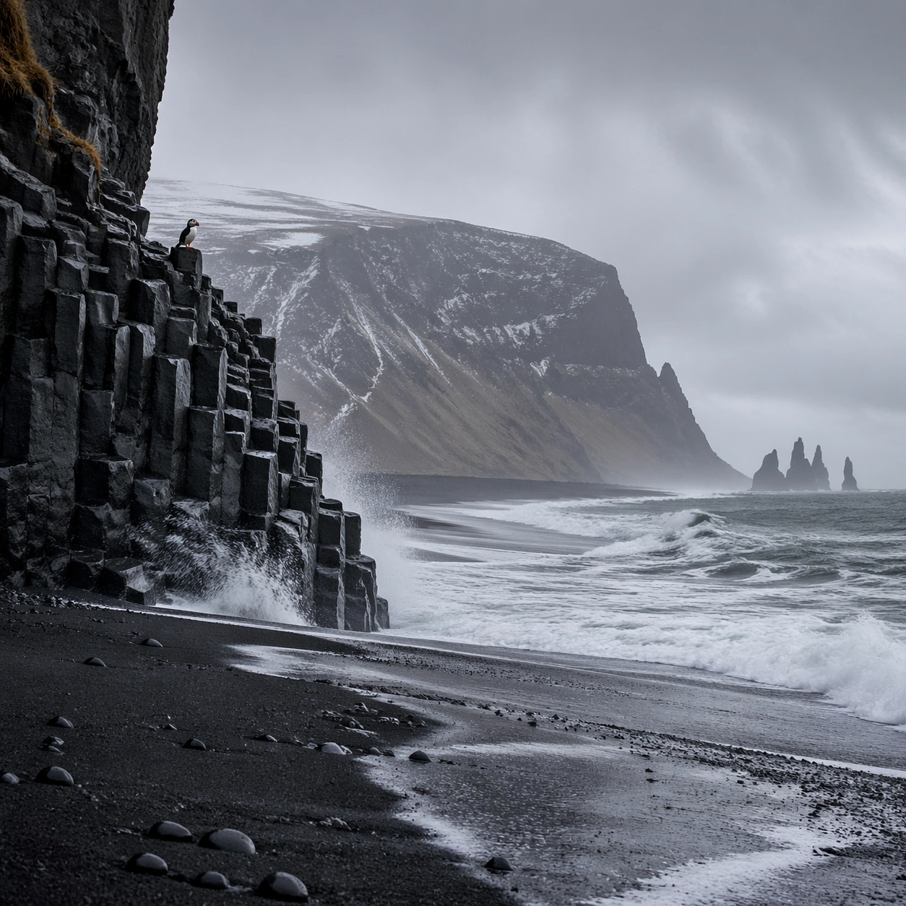

```text
Scene:
Create a square, photoreal landscape study of icelandic black beach basalt. Compose it as the clearest monument-scale establishing view, using a wide, level camera position with deep atmospheric recession and a calm, authoritative horizon. Let broad, sculpting natural light describe the major masses before it picks out the smaller details Keep the frame cinematic but disciplined, with a clear foreground, middle distance, and far mass so the viewer can measure real depth. The image should feel like a field photograph made with patience, precision, and sublime restraint rather than a fantasy matte painting.

Subject:
Show an Icelandic black sand beach with hexagonal basalt column cliffs, white Atlantic surf breaking against the columns, wet volcanic sand, and a single puffin perched on a ledge. This variation should emphasize hero panorama. The main landform must dominate the composition, but secondary elements should quietly explain how the place works: water paths, sediment lines, snow bands, surf, ash, wind streaks, stars, or human traces where appropriate. Everything in the image should support the same idea of scale and climate, so the scene reads as one coherent environment rather than a stack of spectacular details.

Important details:
Preserve basalt hexagon rhythm, wet black mineral surfaces, cold gray weather, convincing surf impact, and the precise natural geometry that makes the coast feel both severe and elegant. Keep one dominant landform, one secondary supporting rhythm, and a restrained scale witness so the scene reads immediately. Keep geology, weather, and atmosphere physically believable. Use subtle micro-texture, tonal separation, and air perspective to reinforce distance. If a human, vehicle, tent, caravan, bird, or boat appears, it must remain tiny and subordinate to the landscape, functioning only as a scale witness. The composition should feel original, severe, and elegant, with no decorative filler and no imitation of any copyrighted visual property.

Use case:
Icelandic Black Beach Basalt single study 1/9, exploring the hero panorama variation.

Constraints:
No readable text, no watermark, no logos, preserve exact 1:1 aspect ratio, no tourists, no colorful umbrellas, no seaside town, no tropical blue water, no split-screen layout, no collage fragments, no exaggerated fisheye distortion, no kitsch color grading, no artificial border, no split-panel treatment.
```

[Pinned source](https://github.com/ChaosRealmsAI/gpt-image-2-gallery/blob/5296db8c996e38776c83a0bc8c64f848dcd512b3/works/topics/volcanic-iceland-black-beach/packages/single-landscape-studies/images/01-main-panorama/meta.json) · GPT Image2 · 1254×1254 · No source-declared image dependencies. · ProjectD:individually reviewed; awaiting publication acceptance.

## Foreground Path · volcanic-iceland-black-beach/single-landscape-studies/02-foreground-path

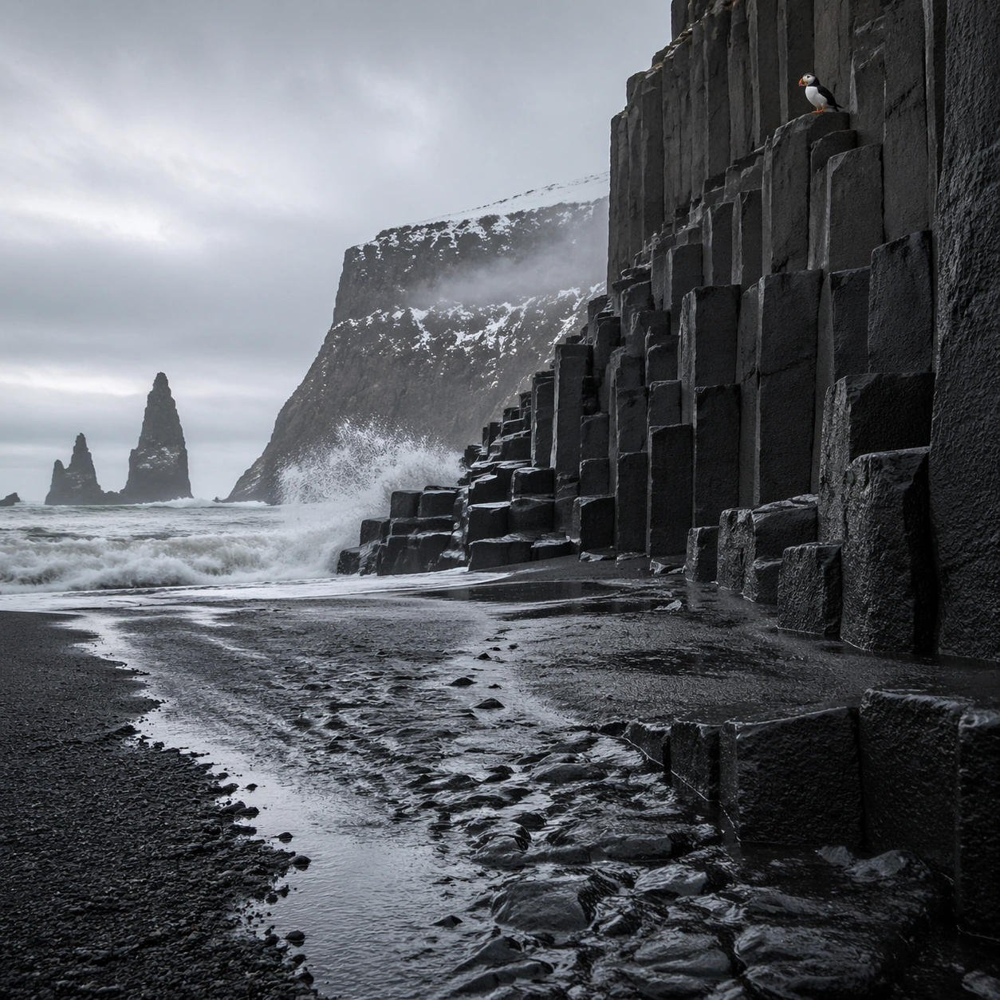

```text
Scene:
Create a square, photoreal landscape study of icelandic black beach basalt. Compose it as a ground-level entry path that pulls the viewer into the terrain, using a lower vantage with a strong foreground element such as a ridge line, shoreline, stream, boot track, or wet surface leading inward. Let the foreground remain tactile and detailed while the distance opens gradually Keep the frame cinematic but disciplined, with a clear foreground, middle distance, and far mass so the viewer can measure real depth. The image should feel like a field photograph made with patience, precision, and sublime restraint rather than a fantasy matte painting.

Subject:
Show an Icelandic black sand beach with hexagonal basalt column cliffs, white Atlantic surf breaking against the columns, wet volcanic sand, and a single puffin perched on a ledge. This variation should emphasize foreground-led composition. The main landform must dominate the composition, but secondary elements should quietly explain how the place works: water paths, sediment lines, snow bands, surf, ash, wind streaks, stars, or human traces where appropriate. Everything in the image should support the same idea of scale and climate, so the scene reads as one coherent environment rather than a stack of spectacular details.

Important details:
Preserve basalt hexagon rhythm, wet black mineral surfaces, cold gray weather, convincing surf impact, and the precise natural geometry that makes the coast feel both severe and elegant. The image should reward close looking through layered depth cues rather than pure spectacle alone. Keep geology, weather, and atmosphere physically believable. Use subtle micro-texture, tonal separation, and air perspective to reinforce distance. If a human, vehicle, tent, caravan, bird, or boat appears, it must remain tiny and subordinate to the landscape, functioning only as a scale witness. The composition should feel original, severe, and elegant, with no decorative filler and no imitation of any copyrighted visual property.

Use case:
Icelandic Black Beach Basalt single study 2/9, exploring the foreground-led composition variation.

Constraints:
No readable text, no watermark, no logos, preserve exact 1:1 aspect ratio, no tourists, no colorful umbrellas, no seaside town, no tropical blue water, no blocked foreground, no random props, no awkward dead zone in the lower third, no kitsch color grading, no artificial border, no split-panel treatment.
```

[Pinned source](https://github.com/ChaosRealmsAI/gpt-image-2-gallery/blob/5296db8c996e38776c83a0bc8c64f848dcd512b3/works/topics/volcanic-iceland-black-beach/packages/single-landscape-studies/images/02-foreground-path/meta.json) · GPT Image2 · 1254×1254 · No source-declared image dependencies. · ProjectD:individually reviewed; awaiting publication acceptance.

## Aerial Geometry · volcanic-iceland-black-beach/single-landscape-studies/03-aerial-geometry

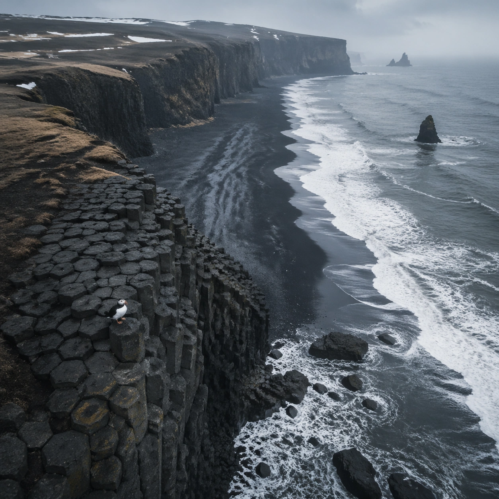

```text
Scene:
Create a square, photoreal landscape study of icelandic black beach basalt. Compose it as the planform geometry and overall shape logic of the landscape, using an elevated oblique aerial view that still preserves believable scale and natural topography. Let light reveal contour, fracture, and pattern instead of flattening the terrain Keep the frame cinematic but disciplined, with a clear foreground, middle distance, and far mass so the viewer can measure real depth. The image should feel like a field photograph made with patience, precision, and sublime restraint rather than a fantasy matte painting.

Subject:
Show an Icelandic black sand beach with hexagonal basalt column cliffs, white Atlantic surf breaking against the columns, wet volcanic sand, and a single puffin perched on a ledge. This variation should emphasize aerial scale read. The main landform must dominate the composition, but secondary elements should quietly explain how the place works: water paths, sediment lines, snow bands, surf, ash, wind streaks, stars, or human traces where appropriate. Everything in the image should support the same idea of scale and climate, so the scene reads as one coherent environment rather than a stack of spectacular details.

Important details:
Preserve basalt hexagon rhythm, wet black mineral surfaces, cold gray weather, convincing surf impact, and the precise natural geometry that makes the coast feel both severe and elegant. Emphasize rhythm, repetition, and large-form geometry without losing physical realism. Keep geology, weather, and atmosphere physically believable. Use subtle micro-texture, tonal separation, and air perspective to reinforce distance. If a human, vehicle, tent, caravan, bird, or boat appears, it must remain tiny and subordinate to the landscape, functioning only as a scale witness. The composition should feel original, severe, and elegant, with no decorative filler and no imitation of any copyrighted visual property.

Use case:
Icelandic Black Beach Basalt single study 3/9, exploring the aerial scale read variation.

Constraints:
No readable text, no watermark, no logos, preserve exact 1:1 aspect ratio, no tourists, no colorful umbrellas, no seaside town, no tropical blue water, no map labels, no diagram arrows, no satellite-interface graphics, no kitsch color grading, no artificial border, no split-panel treatment.
```

[Pinned source](https://github.com/ChaosRealmsAI/gpt-image-2-gallery/blob/5296db8c996e38776c83a0bc8c64f848dcd512b3/works/topics/volcanic-iceland-black-beach/packages/single-landscape-studies/images/03-aerial-geometry/meta.json) · GPT Image2 · 1254×1254 · No source-declared image dependencies. · ProjectD:individually reviewed; awaiting publication acceptance.

## Atmosphere Event · volcanic-iceland-black-beach/single-landscape-studies/04-atmosphere-event

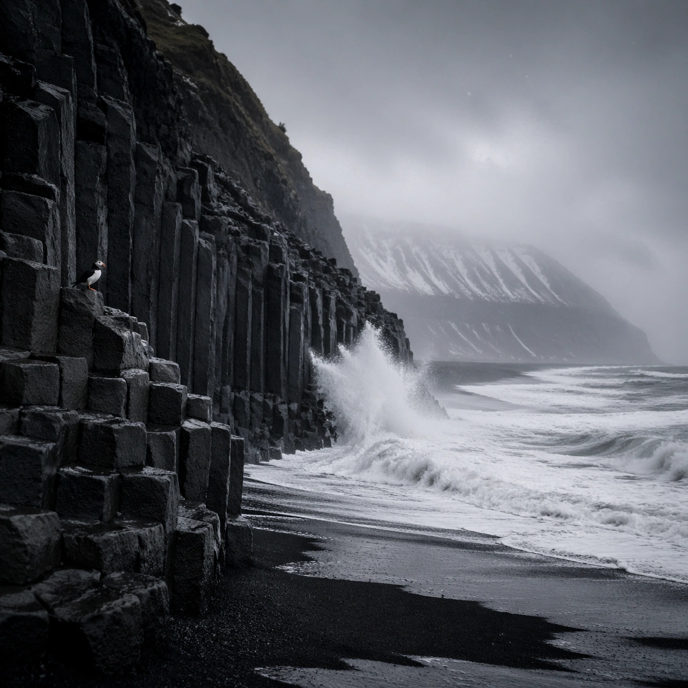

```text
Scene:
Create a square, photoreal landscape study of icelandic black beach basalt. Compose it as the moment when weather, particles, or moving air become the main dramatic agent, using a stable documentary framing that lets the environmental event stay legible. Let the air itself carry visible density through haze, spray, ash, dust, snow, or storm structure Keep the frame cinematic but disciplined, with a clear foreground, middle distance, and far mass so the viewer can measure real depth. The image should feel like a field photograph made with patience, precision, and sublime restraint rather than a fantasy matte painting.

Subject:
Show an Icelandic black sand beach with hexagonal basalt column cliffs, white Atlantic surf breaking against the columns, wet volcanic sand, and a single puffin perched on a ledge. This variation should emphasize weather-driven study. The main landform must dominate the composition, but secondary elements should quietly explain how the place works: water paths, sediment lines, snow bands, surf, ash, wind streaks, stars, or human traces where appropriate. Everything in the image should support the same idea of scale and climate, so the scene reads as one coherent environment rather than a stack of spectacular details.

Important details:
Preserve basalt hexagon rhythm, wet black mineral surfaces, cold gray weather, convincing surf impact, and the precise natural geometry that makes the coast feel both severe and elegant. The atmosphere must feel physically plausible and tied to terrain, wind direction, temperature, and moisture. Keep geology, weather, and atmosphere physically believable. Use subtle micro-texture, tonal separation, and air perspective to reinforce distance. If a human, vehicle, tent, caravan, bird, or boat appears, it must remain tiny and subordinate to the landscape, functioning only as a scale witness. The composition should feel original, severe, and elegant, with no decorative filler and no imitation of any copyrighted visual property.

Use case:
Icelandic Black Beach Basalt single study 4/9, exploring the weather-driven study variation.

Constraints:
No readable text, no watermark, no logos, preserve exact 1:1 aspect ratio, no tourists, no colorful umbrellas, no seaside town, no tropical blue water, no disaster-movie excess, no impossible lightning clutter, no synthetic smoke plumes, no kitsch color grading, no artificial border, no split-panel treatment.
```

[Pinned source](https://github.com/ChaosRealmsAI/gpt-image-2-gallery/blob/5296db8c996e38776c83a0bc8c64f848dcd512b3/works/topics/volcanic-iceland-black-beach/packages/single-landscape-studies/images/04-atmosphere-event/meta.json) · GPT Image2 · 1254×1254 · No source-declared image dependencies. · ProjectD:individually reviewed; awaiting publication acceptance.

## Light Contrast · volcanic-iceland-black-beach/single-landscape-studies/05-light-contrast

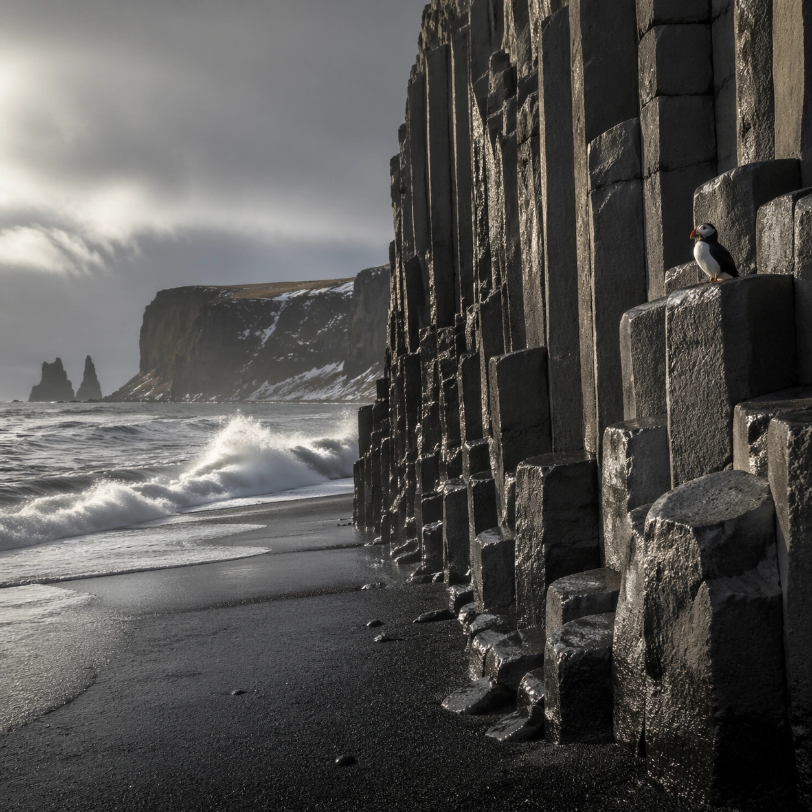

```text
Scene:
Create a square, photoreal landscape study of icelandic black beach basalt. Compose it as directional light carving sharp separation between illuminated and shadowed forms, using a composition built around light falloff, shadow shape, and reflective control rather than camera gimmicks. Let one strong light source create crisp hierarchy and believable color temperature shifts Keep the frame cinematic but disciplined, with a clear foreground, middle distance, and far mass so the viewer can measure real depth. The image should feel like a field photograph made with patience, precision, and sublime restraint rather than a fantasy matte painting.

Subject:
Show an Icelandic black sand beach with hexagonal basalt column cliffs, white Atlantic surf breaking against the columns, wet volcanic sand, and a single puffin perched on a ledge. This variation should emphasize light-structure study. The main landform must dominate the composition, but secondary elements should quietly explain how the place works: water paths, sediment lines, snow bands, surf, ash, wind streaks, stars, or human traces where appropriate. Everything in the image should support the same idea of scale and climate, so the scene reads as one coherent environment rather than a stack of spectacular details.

Important details:
Preserve basalt hexagon rhythm, wet black mineral surfaces, cold gray weather, convincing surf impact, and the precise natural geometry that makes the coast feel both severe and elegant. Surface brightness, shadow depth, and reflected light should all agree with the material and weather conditions. Keep geology, weather, and atmosphere physically believable. Use subtle micro-texture, tonal separation, and air perspective to reinforce distance. If a human, vehicle, tent, caravan, bird, or boat appears, it must remain tiny and subordinate to the landscape, functioning only as a scale witness. The composition should feel original, severe, and elegant, with no decorative filler and no imitation of any copyrighted visual property.

Use case:
Icelandic Black Beach Basalt single study 5/9, exploring the light-structure study variation.

Constraints:
No readable text, no watermark, no logos, preserve exact 1:1 aspect ratio, no tourists, no colorful umbrellas, no seaside town, no tropical blue water, no blown highlights, no muddy blacks, no theatrical stage lighting, no kitsch color grading, no artificial border, no split-panel treatment.
```

[Pinned source](https://github.com/ChaosRealmsAI/gpt-image-2-gallery/blob/5296db8c996e38776c83a0bc8c64f848dcd512b3/works/topics/volcanic-iceland-black-beach/packages/single-landscape-studies/images/05-light-contrast/meta.json) · GPT Image2 · 1254×1254 · No source-declared image dependencies. · ProjectD:individually reviewed; awaiting publication acceptance.

## Material Close · volcanic-iceland-black-beach/single-landscape-studies/06-material-close

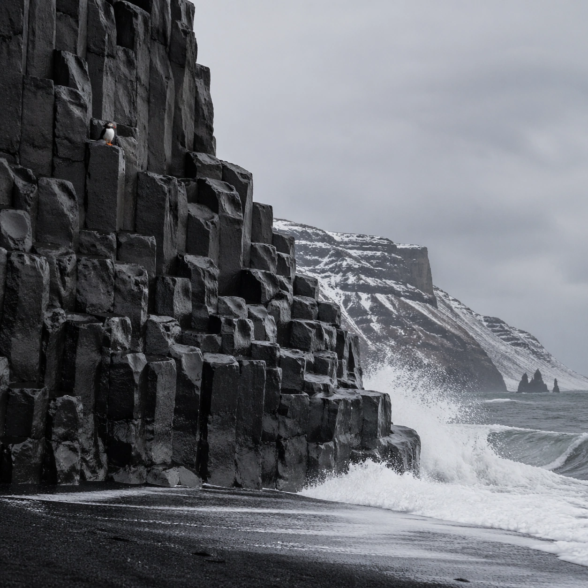

```text
Scene:
Create a square, photoreal landscape study of icelandic black beach basalt. Compose it as surface texture and material transitions while still keeping the full environment recognizable, using a tighter medium-wide crop that gives more area to texture, fracture, grain, water, ice, lava, salt, or stone. Let texture remain readable without making the scene feel like a macro shot Keep the frame cinematic but disciplined, with a clear foreground, middle distance, and far mass so the viewer can measure real depth. The image should feel like a field photograph made with patience, precision, and sublime restraint rather than a fantasy matte painting.

Subject:
Show an Icelandic black sand beach with hexagonal basalt column cliffs, white Atlantic surf breaking against the columns, wet volcanic sand, and a single puffin perched on a ledge. This variation should emphasize material realism check. The main landform must dominate the composition, but secondary elements should quietly explain how the place works: water paths, sediment lines, snow bands, surf, ash, wind streaks, stars, or human traces where appropriate. Everything in the image should support the same idea of scale and climate, so the scene reads as one coherent environment rather than a stack of spectacular details.

Important details:
Preserve basalt hexagon rhythm, wet black mineral surfaces, cold gray weather, convincing surf impact, and the precise natural geometry that makes the coast feel both severe and elegant. Micro-texture, edge wear, wetness, frost, dust, foam, or sediment should deepen realism rather than distract from scale. Keep geology, weather, and atmosphere physically believable. Use subtle micro-texture, tonal separation, and air perspective to reinforce distance. If a human, vehicle, tent, caravan, bird, or boat appears, it must remain tiny and subordinate to the landscape, functioning only as a scale witness. The composition should feel original, severe, and elegant, with no decorative filler and no imitation of any copyrighted visual property.

Use case:
Icelandic Black Beach Basalt single study 6/9, exploring the material realism check variation.

Constraints:
No readable text, no watermark, no logos, preserve exact 1:1 aspect ratio, no tourists, no colorful umbrellas, no seaside town, no tropical blue water, no extreme macro abstraction, no plastic-looking surfaces, no shallow depth-of-field blur, no kitsch color grading, no artificial border, no split-panel treatment.
```

[Pinned source](https://github.com/ChaosRealmsAI/gpt-image-2-gallery/blob/5296db8c996e38776c83a0bc8c64f848dcd512b3/works/topics/volcanic-iceland-black-beach/packages/single-landscape-studies/images/06-material-close/meta.json) · GPT Image2 · 1254×1254 · No source-declared image dependencies. · ProjectD:individually reviewed; awaiting publication acceptance.

## Scale Witness · volcanic-iceland-black-beach/single-landscape-studies/07-scale-witness

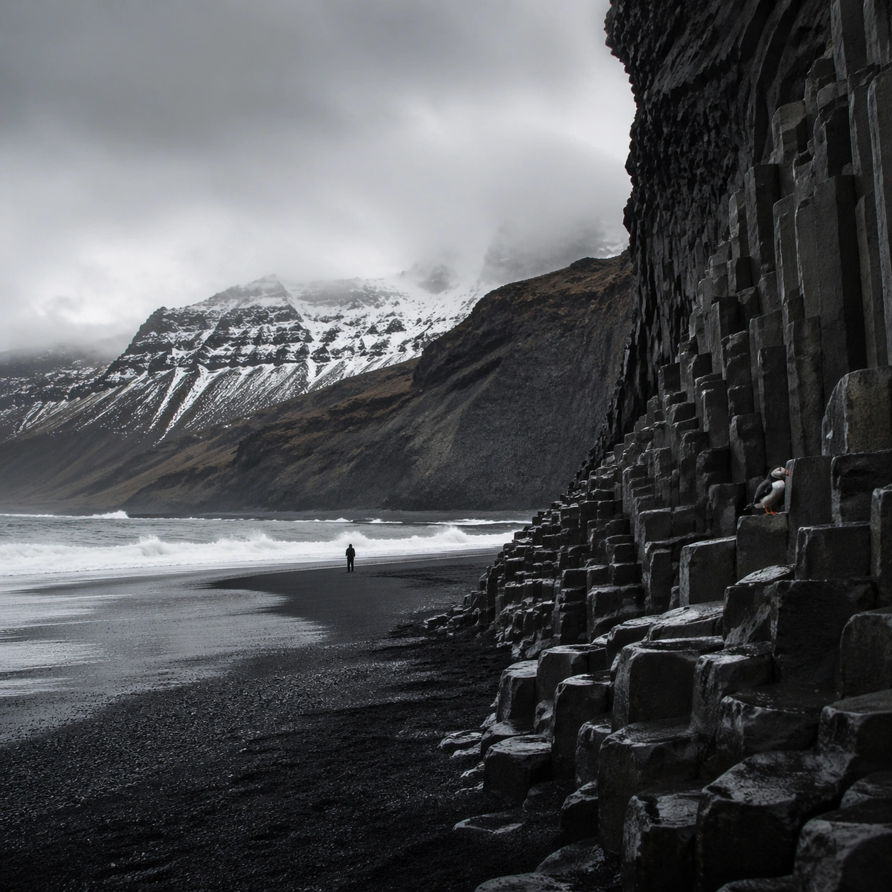

```text
Scene:
Create a square, photoreal landscape study of icelandic black beach basalt. Compose it as a tiny human, animal, tent, vehicle, or craft that reveals the vastness of the environment, using a balanced frame where the witness remains small but unmistakable. Let the scale marker stay visible without becoming the true subject Keep the frame cinematic but disciplined, with a clear foreground, middle distance, and far mass so the viewer can measure real depth. The image should feel like a field photograph made with patience, precision, and sublime restraint rather than a fantasy matte painting.

Subject:
Show an Icelandic black sand beach with hexagonal basalt column cliffs, white Atlantic surf breaking against the columns, wet volcanic sand, and a single puffin perched on a ledge. This variation should emphasize scale comparison. The main landform must dominate the composition, but secondary elements should quietly explain how the place works: water paths, sediment lines, snow bands, surf, ash, wind streaks, stars, or human traces where appropriate. Everything in the image should support the same idea of scale and climate, so the scene reads as one coherent environment rather than a stack of spectacular details.

Important details:
Preserve basalt hexagon rhythm, wet black mineral surfaces, cold gray weather, convincing surf impact, and the precise natural geometry that makes the coast feel both severe and elegant. The viewer should understand the environment first and the witness second, with clean spatial separation between them. Keep geology, weather, and atmosphere physically believable. Use subtle micro-texture, tonal separation, and air perspective to reinforce distance. If a human, vehicle, tent, caravan, bird, or boat appears, it must remain tiny and subordinate to the landscape, functioning only as a scale witness. The composition should feel original, severe, and elegant, with no decorative filler and no imitation of any copyrighted visual property.

Use case:
Icelandic Black Beach Basalt single study 7/9, exploring the scale comparison variation.

Constraints:
No readable text, no watermark, no logos, preserve exact 1:1 aspect ratio, no tourists, no colorful umbrellas, no seaside town, no tropical blue water, no crowd scenes, no heroic close-up character framing, no busy gear pile, no kitsch color grading, no artificial border, no split-panel treatment.
```

[Pinned source](https://github.com/ChaosRealmsAI/gpt-image-2-gallery/blob/5296db8c996e38776c83a0bc8c64f848dcd512b3/works/topics/volcanic-iceland-black-beach/packages/single-landscape-studies/images/07-scale-witness/meta.json) · GPT Image2 · 1254×1254 · No source-declared image dependencies. · ProjectD:individually reviewed; awaiting publication acceptance.

## Abstract Rhythm · volcanic-iceland-black-beach/single-landscape-studies/08-abstract-rhythm

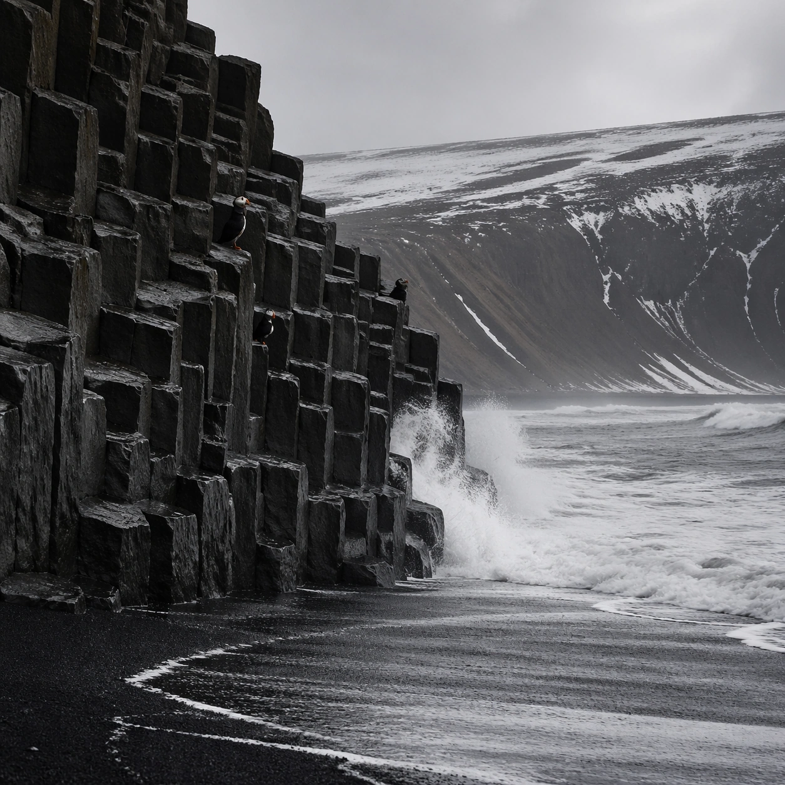

```text
Scene:
Create a square, photoreal landscape study of icelandic black beach basalt. Compose it as the near-abstract rhythm of repeated natural forms, lines, and tonal bands, using a disciplined crop that approaches abstraction while remaining unmistakably a real place. Let shape and tonal cadence dominate before small narrative details Keep the frame cinematic but disciplined, with a clear foreground, middle distance, and far mass so the viewer can measure real depth. The image should feel like a field photograph made with patience, precision, and sublime restraint rather than a fantasy matte painting.

Subject:
Show an Icelandic black sand beach with hexagonal basalt column cliffs, white Atlantic surf breaking against the columns, wet volcanic sand, and a single puffin perched on a ledge. This variation should emphasize formal composition study. The main landform must dominate the composition, but secondary elements should quietly explain how the place works: water paths, sediment lines, snow bands, surf, ash, wind streaks, stars, or human traces where appropriate. Everything in the image should support the same idea of scale and climate, so the scene reads as one coherent environment rather than a stack of spectacular details.

Important details:
Preserve basalt hexagon rhythm, wet black mineral surfaces, cold gray weather, convincing surf impact, and the precise natural geometry that makes the coast feel both severe and elegant. Pattern, repetition, and negative space should feel discovered in nature, not graphically imposed. Keep geology, weather, and atmosphere physically believable. Use subtle micro-texture, tonal separation, and air perspective to reinforce distance. If a human, vehicle, tent, caravan, bird, or boat appears, it must remain tiny and subordinate to the landscape, functioning only as a scale witness. The composition should feel original, severe, and elegant, with no decorative filler and no imitation of any copyrighted visual property.

Use case:
Icelandic Black Beach Basalt single study 8/9, exploring the formal composition study variation.

Constraints:
No readable text, no watermark, no logos, preserve exact 1:1 aspect ratio, no tourists, no colorful umbrellas, no seaside town, no tropical blue water, no graphic overlays, no surreal floating elements, no ornamental symmetry cheats, no kitsch color grading, no artificial border, no split-panel treatment.
```

[Pinned source](https://github.com/ChaosRealmsAI/gpt-image-2-gallery/blob/5296db8c996e38776c83a0bc8c64f848dcd512b3/works/topics/volcanic-iceland-black-beach/packages/single-landscape-studies/images/08-abstract-rhythm/meta.json) · GPT Image2 · 1254×1254 · No source-declared image dependencies. · ProjectD:individually reviewed; awaiting publication acceptance.

## Final Iconic · volcanic-iceland-black-beach/single-landscape-studies/09-final-iconic

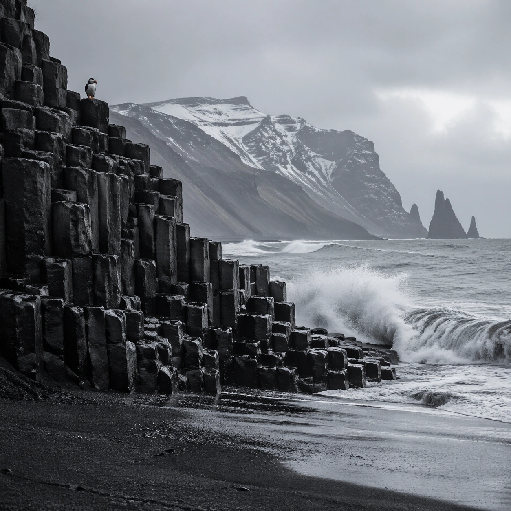

```text
Scene:
Create a square, photoreal landscape study of icelandic black beach basalt. Compose it as the cleanest, most iconic summary of the whole landscape idea, using a distilled composition with one unforgettable silhouette or mass relationship and generous breathing room. Let the scene resolve into a memorable final image with strong legibility at thumbnail size Keep the frame cinematic but disciplined, with a clear foreground, middle distance, and far mass so the viewer can measure real depth. The image should feel like a field photograph made with patience, precision, and sublime restraint rather than a fantasy matte painting.

Subject:
Show an Icelandic black sand beach with hexagonal basalt column cliffs, white Atlantic surf breaking against the columns, wet volcanic sand, and a single puffin perched on a ledge. This variation should emphasize iconic final plate. The main landform must dominate the composition, but secondary elements should quietly explain how the place works: water paths, sediment lines, snow bands, surf, ash, wind streaks, stars, or human traces where appropriate. Everything in the image should support the same idea of scale and climate, so the scene reads as one coherent environment rather than a stack of spectacular details.

Important details:
Preserve basalt hexagon rhythm, wet black mineral surfaces, cold gray weather, convincing surf impact, and the precise natural geometry that makes the coast feel both severe and elegant. Keep the frame spare, confident, and monumental, with every element earning its place. Keep geology, weather, and atmosphere physically believable. Use subtle micro-texture, tonal separation, and air perspective to reinforce distance. If a human, vehicle, tent, caravan, bird, or boat appears, it must remain tiny and subordinate to the landscape, functioning only as a scale witness. The composition should feel original, severe, and elegant, with no decorative filler and no imitation of any copyrighted visual property.

Use case:
Icelandic Black Beach Basalt single study 9/9, exploring the iconic final plate variation.

Constraints:
No readable text, no watermark, no logos, preserve exact 1:1 aspect ratio, no tourists, no colorful umbrellas, no seaside town, no tropical blue water, no cluttered edges, no competing focal points, no visual noise in empty space, no kitsch color grading, no artificial border, no split-panel treatment.
```

[Pinned source](https://github.com/ChaosRealmsAI/gpt-image-2-gallery/blob/5296db8c996e38776c83a0bc8c64f848dcd512b3/works/topics/volcanic-iceland-black-beach/packages/single-landscape-studies/images/09-final-iconic/meta.json) · GPT Image2 · 1254×1254 · No source-declared image dependencies. · ProjectD:individually reviewed; awaiting publication acceptance.

## Main Panorama · volcanic-lava-cathedral-night/single-landscape-studies/01-main-panorama

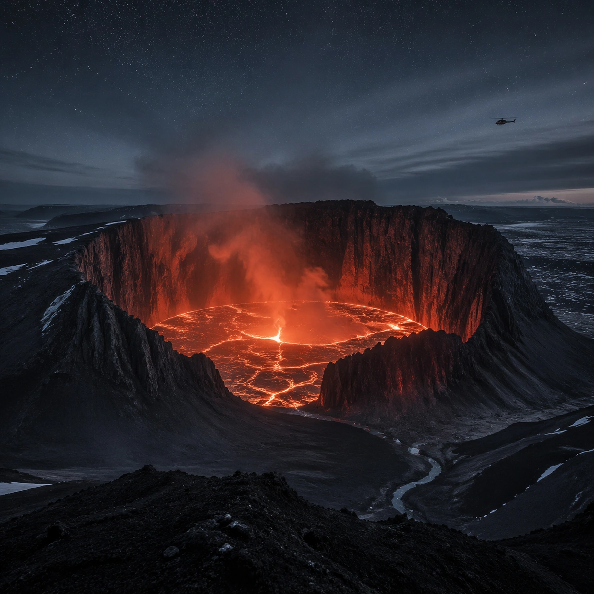

```text
Scene:
Create a square, photoreal landscape study of volcanic lava cathedral at night. Compose it as the clearest monument-scale establishing view, using a wide, level camera position with deep atmospheric recession and a calm, authoritative horizon. Let broad, sculpting natural light describe the major masses before it picks out the smaller details Keep the frame cinematic but disciplined, with a clear foreground, middle distance, and far mass so the viewer can measure real depth. The image should feel like a field photograph made with patience, precision, and sublime restraint rather than a fantasy matte painting.

Subject:
Show an active volcanic crater at night with an orange-red lava lake, towering black basalt walls that rise like natural buttresses, heat shimmer, ash haze, and a distant helicopter silhouette for scale. This variation should emphasize hero panorama. The main landform must dominate the composition, but secondary elements should quietly explain how the place works: water paths, sediment lines, snow bands, surf, ash, wind streaks, stars, or human traces where appropriate. Everything in the image should support the same idea of scale and climate, so the scene reads as one coherent environment rather than a stack of spectacular details.

Important details:
Preserve believable lava viscosity, thermal glow on adjacent rock, soot-dark basalt structure, deep night atmosphere, and the violent temperature contrast between incandescent liquid rock and cold surrounding darkness. Keep one dominant landform, one secondary supporting rhythm, and a restrained scale witness so the scene reads immediately. Keep geology, weather, and atmosphere physically believable. Use subtle micro-texture, tonal separation, and air perspective to reinforce distance. If a human, vehicle, tent, caravan, bird, or boat appears, it must remain tiny and subordinate to the landscape, functioning only as a scale witness. The composition should feel original, severe, and elegant, with no decorative filler and no imitation of any copyrighted visual property.

Use case:
Volcanic Lava Cathedral at Night single study 1/9, exploring the hero panorama variation.

Constraints:
No readable text, no watermark, no logos, preserve exact 1:1 aspect ratio, no fantasy fire monsters, no city lights, no sci-fi machinery, no fireworks, no split-screen layout, no collage fragments, no exaggerated fisheye distortion, no kitsch color grading, no artificial border, no split-panel treatment.
```

[Pinned source](https://github.com/ChaosRealmsAI/gpt-image-2-gallery/blob/5296db8c996e38776c83a0bc8c64f848dcd512b3/works/topics/volcanic-lava-cathedral-night/packages/single-landscape-studies/images/01-main-panorama/meta.json) · GPT Image2 · 1254×1254 · No source-declared image dependencies. · ProjectD:individually reviewed; awaiting publication acceptance.

## Foreground Path · volcanic-lava-cathedral-night/single-landscape-studies/02-foreground-path

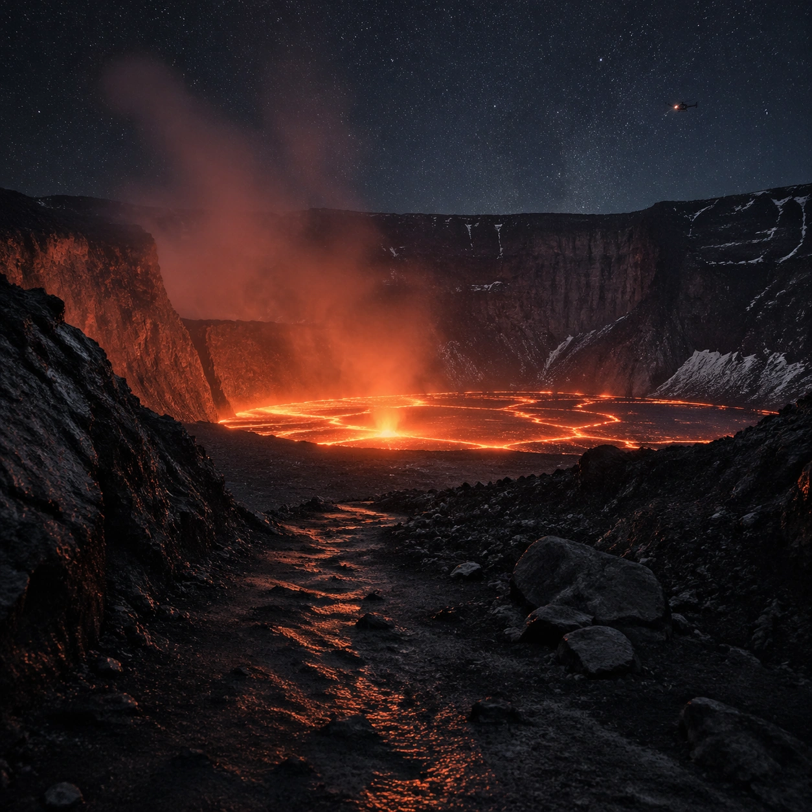

```text
Scene:
Create a square, photoreal landscape study of volcanic lava cathedral at night. Compose it as a ground-level entry path that pulls the viewer into the terrain, using a lower vantage with a strong foreground element such as a ridge line, shoreline, stream, boot track, or wet surface leading inward. Let the foreground remain tactile and detailed while the distance opens gradually Keep the frame cinematic but disciplined, with a clear foreground, middle distance, and far mass so the viewer can measure real depth. The image should feel like a field photograph made with patience, precision, and sublime restraint rather than a fantasy matte painting.

Subject:
Show an active volcanic crater at night with an orange-red lava lake, towering black basalt walls that rise like natural buttresses, heat shimmer, ash haze, and a distant helicopter silhouette for scale. This variation should emphasize foreground-led composition. The main landform must dominate the composition, but secondary elements should quietly explain how the place works: water paths, sediment lines, snow bands, surf, ash, wind streaks, stars, or human traces where appropriate. Everything in the image should support the same idea of scale and climate, so the scene reads as one coherent environment rather than a stack of spectacular details.

Important details:
Preserve believable lava viscosity, thermal glow on adjacent rock, soot-dark basalt structure, deep night atmosphere, and the violent temperature contrast between incandescent liquid rock and cold surrounding darkness. The image should reward close looking through layered depth cues rather than pure spectacle alone. Keep geology, weather, and atmosphere physically believable. Use subtle micro-texture, tonal separation, and air perspective to reinforce distance. If a human, vehicle, tent, caravan, bird, or boat appears, it must remain tiny and subordinate to the landscape, functioning only as a scale witness. The composition should feel original, severe, and elegant, with no decorative filler and no imitation of any copyrighted visual property.

Use case:
Volcanic Lava Cathedral at Night single study 2/9, exploring the foreground-led composition variation.

Constraints:
No readable text, no watermark, no logos, preserve exact 1:1 aspect ratio, no fantasy fire monsters, no city lights, no sci-fi machinery, no fireworks, no blocked foreground, no random props, no awkward dead zone in the lower third, no kitsch color grading, no artificial border, no split-panel treatment.
```

[Pinned source](https://github.com/ChaosRealmsAI/gpt-image-2-gallery/blob/5296db8c996e38776c83a0bc8c64f848dcd512b3/works/topics/volcanic-lava-cathedral-night/packages/single-landscape-studies/images/02-foreground-path/meta.json) · GPT Image2 · 1254×1254 · No source-declared image dependencies. · ProjectD:individually reviewed; awaiting publication acceptance.

## Aerial Geometry · volcanic-lava-cathedral-night/single-landscape-studies/03-aerial-geometry

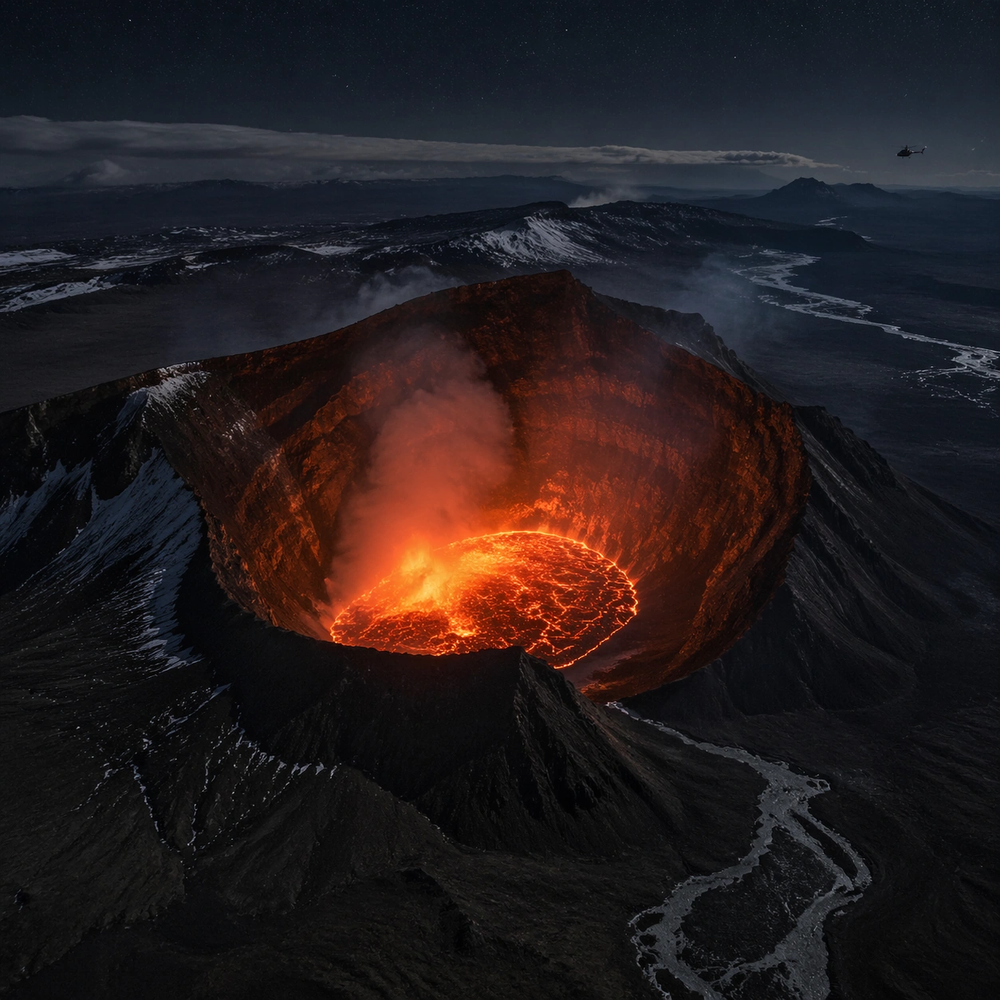

```text
Scene:
Create a square, photoreal landscape study of volcanic lava cathedral at night. Compose it as the planform geometry and overall shape logic of the landscape, using an elevated oblique aerial view that still preserves believable scale and natural topography. Let light reveal contour, fracture, and pattern instead of flattening the terrain Keep the frame cinematic but disciplined, with a clear foreground, middle distance, and far mass so the viewer can measure real depth. The image should feel like a field photograph made with patience, precision, and sublime restraint rather than a fantasy matte painting.

Subject:
Show an active volcanic crater at night with an orange-red lava lake, towering black basalt walls that rise like natural buttresses, heat shimmer, ash haze, and a distant helicopter silhouette for scale. This variation should emphasize aerial scale read. The main landform must dominate the composition, but secondary elements should quietly explain how the place works: water paths, sediment lines, snow bands, surf, ash, wind streaks, stars, or human traces where appropriate. Everything in the image should support the same idea of scale and climate, so the scene reads as one coherent environment rather than a stack of spectacular details.

Important details:
Preserve believable lava viscosity, thermal glow on adjacent rock, soot-dark basalt structure, deep night atmosphere, and the violent temperature contrast between incandescent liquid rock and cold surrounding darkness. Emphasize rhythm, repetition, and large-form geometry without losing physical realism. Keep geology, weather, and atmosphere physically believable. Use subtle micro-texture, tonal separation, and air perspective to reinforce distance. If a human, vehicle, tent, caravan, bird, or boat appears, it must remain tiny and subordinate to the landscape, functioning only as a scale witness. The composition should feel original, severe, and elegant, with no decorative filler and no imitation of any copyrighted visual property.

Use case:
Volcanic Lava Cathedral at Night single study 3/9, exploring the aerial scale read variation.

Constraints:
No readable text, no watermark, no logos, preserve exact 1:1 aspect ratio, no fantasy fire monsters, no city lights, no sci-fi machinery, no fireworks, no map labels, no diagram arrows, no satellite-interface graphics, no kitsch color grading, no artificial border, no split-panel treatment.
```

[Pinned source](https://github.com/ChaosRealmsAI/gpt-image-2-gallery/blob/5296db8c996e38776c83a0bc8c64f848dcd512b3/works/topics/volcanic-lava-cathedral-night/packages/single-landscape-studies/images/03-aerial-geometry/meta.json) · GPT Image2 · 1254×1254 · No source-declared image dependencies. · ProjectD:individually reviewed; awaiting publication acceptance.

## Atmosphere Event · volcanic-lava-cathedral-night/single-landscape-studies/04-atmosphere-event

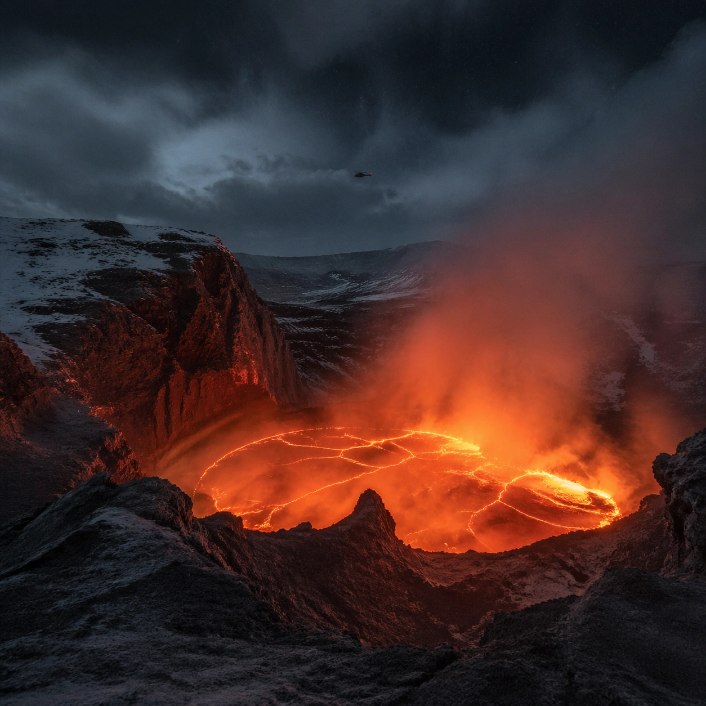

```text
Scene:
Create a square, photoreal landscape study of volcanic lava cathedral at night. Compose it as the moment when weather, particles, or moving air become the main dramatic agent, using a stable documentary framing that lets the environmental event stay legible. Let the air itself carry visible density through haze, spray, ash, dust, snow, or storm structure Keep the frame cinematic but disciplined, with a clear foreground, middle distance, and far mass so the viewer can measure real depth. The image should feel like a field photograph made with patience, precision, and sublime restraint rather than a fantasy matte painting.

Subject:
Show an active volcanic crater at night with an orange-red lava lake, towering black basalt walls that rise like natural buttresses, heat shimmer, ash haze, and a distant helicopter silhouette for scale. This variation should emphasize weather-driven study. The main landform must dominate the composition, but secondary elements should quietly explain how the place works: water paths, sediment lines, snow bands, surf, ash, wind streaks, stars, or human traces where appropriate. Everything in the image should support the same idea of scale and climate, so the scene reads as one coherent environment rather than a stack of spectacular details.

Important details:
Preserve believable lava viscosity, thermal glow on adjacent rock, soot-dark basalt structure, deep night atmosphere, and the violent temperature contrast between incandescent liquid rock and cold surrounding darkness. The atmosphere must feel physically plausible and tied to terrain, wind direction, temperature, and moisture. Keep geology, weather, and atmosphere physically believable. Use subtle micro-texture, tonal separation, and air perspective to reinforce distance. If a human, vehicle, tent, caravan, bird, or boat appears, it must remain tiny and subordinate to the landscape, functioning only as a scale witness. The composition should feel original, severe, and elegant, with no decorative filler and no imitation of any copyrighted visual property.

Use case:
Volcanic Lava Cathedral at Night single study 4/9, exploring the weather-driven study variation.

Constraints:
No readable text, no watermark, no logos, preserve exact 1:1 aspect ratio, no fantasy fire monsters, no city lights, no sci-fi machinery, no fireworks, no disaster-movie excess, no impossible lightning clutter, no synthetic smoke plumes, no kitsch color grading, no artificial border, no split-panel treatment.
```

[Pinned source](https://github.com/ChaosRealmsAI/gpt-image-2-gallery/blob/5296db8c996e38776c83a0bc8c64f848dcd512b3/works/topics/volcanic-lava-cathedral-night/packages/single-landscape-studies/images/04-atmosphere-event/meta.json) · GPT Image2 · 1254×1254 · No source-declared image dependencies. · ProjectD:individually reviewed; awaiting publication acceptance.

## Light Contrast · volcanic-lava-cathedral-night/single-landscape-studies/05-light-contrast

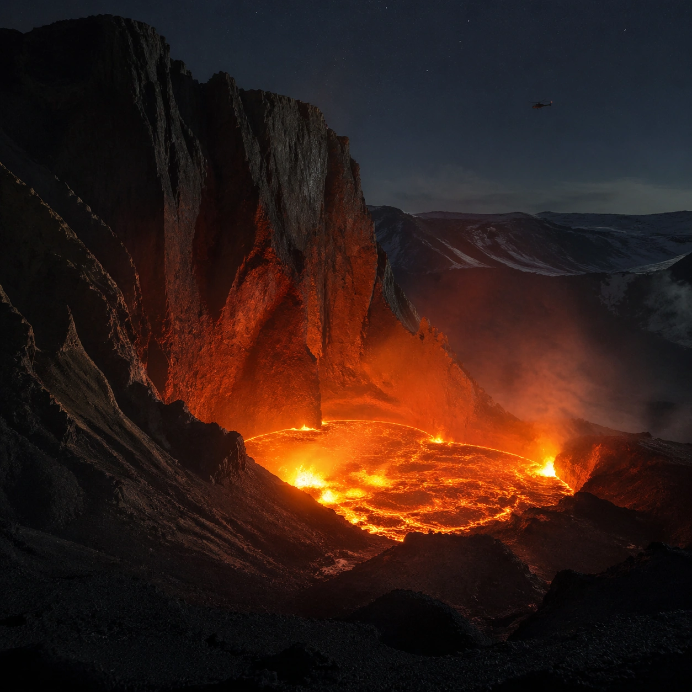

```text
Scene:
Create a square, photoreal landscape study of volcanic lava cathedral at night. Compose it as directional light carving sharp separation between illuminated and shadowed forms, using a composition built around light falloff, shadow shape, and reflective control rather than camera gimmicks. Let one strong light source create crisp hierarchy and believable color temperature shifts Keep the frame cinematic but disciplined, with a clear foreground, middle distance, and far mass so the viewer can measure real depth. The image should feel like a field photograph made with patience, precision, and sublime restraint rather than a fantasy matte painting.

Subject:
Show an active volcanic crater at night with an orange-red lava lake, towering black basalt walls that rise like natural buttresses, heat shimmer, ash haze, and a distant helicopter silhouette for scale. This variation should emphasize light-structure study. The main landform must dominate the composition, but secondary elements should quietly explain how the place works: water paths, sediment lines, snow bands, surf, ash, wind streaks, stars, or human traces where appropriate. Everything in the image should support the same idea of scale and climate, so the scene reads as one coherent environment rather than a stack of spectacular details.

Important details:
Preserve believable lava viscosity, thermal glow on adjacent rock, soot-dark basalt structure, deep night atmosphere, and the violent temperature contrast between incandescent liquid rock and cold surrounding darkness. Surface brightness, shadow depth, and reflected light should all agree with the material and weather conditions. Keep geology, weather, and atmosphere physically believable. Use subtle micro-texture, tonal separation, and air perspective to reinforce distance. If a human, vehicle, tent, caravan, bird, or boat appears, it must remain tiny and subordinate to the landscape, functioning only as a scale witness. The composition should feel original, severe, and elegant, with no decorative filler and no imitation of any copyrighted visual property.

Use case:
Volcanic Lava Cathedral at Night single study 5/9, exploring the light-structure study variation.

Constraints:
No readable text, no watermark, no logos, preserve exact 1:1 aspect ratio, no fantasy fire monsters, no city lights, no sci-fi machinery, no fireworks, no blown highlights, no muddy blacks, no theatrical stage lighting, no kitsch color grading, no artificial border, no split-panel treatment.
```

[Pinned source](https://github.com/ChaosRealmsAI/gpt-image-2-gallery/blob/5296db8c996e38776c83a0bc8c64f848dcd512b3/works/topics/volcanic-lava-cathedral-night/packages/single-landscape-studies/images/05-light-contrast/meta.json) · GPT Image2 · 1254×1254 · No source-declared image dependencies. · ProjectD:individually reviewed; awaiting publication acceptance.

## Material Close · volcanic-lava-cathedral-night/single-landscape-studies/06-material-close

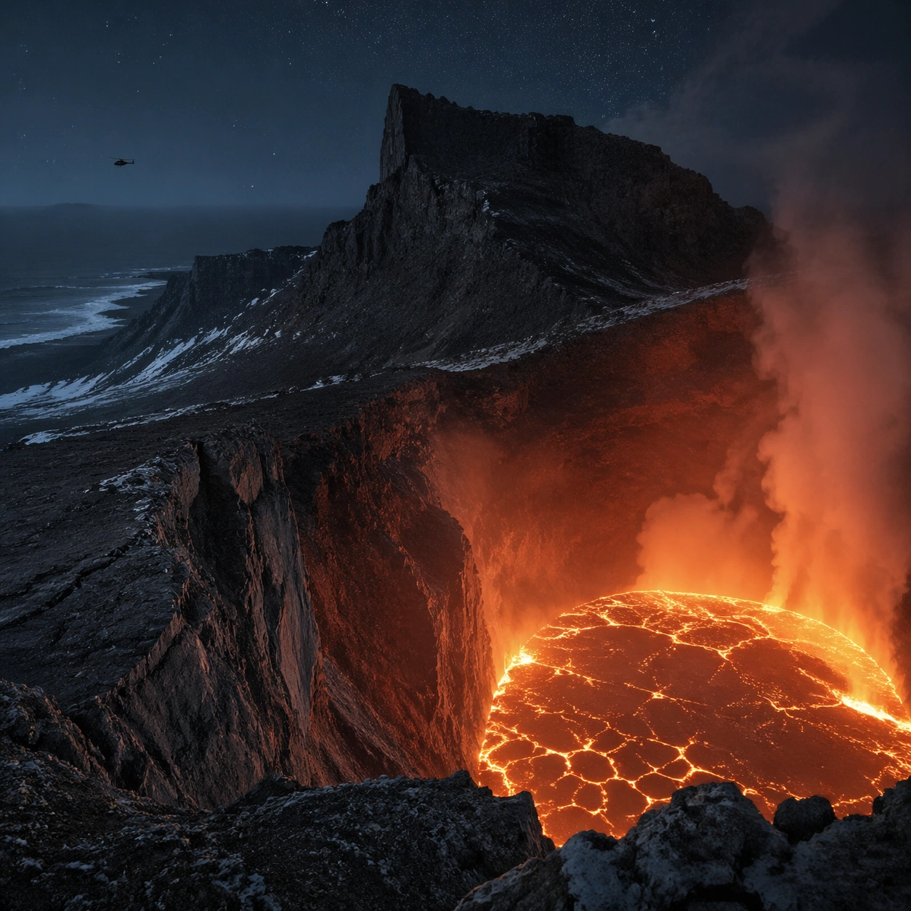

```text
Scene:
Create a square, photoreal landscape study of volcanic lava cathedral at night. Compose it as surface texture and material transitions while still keeping the full environment recognizable, using a tighter medium-wide crop that gives more area to texture, fracture, grain, water, ice, lava, salt, or stone. Let texture remain readable without making the scene feel like a macro shot Keep the frame cinematic but disciplined, with a clear foreground, middle distance, and far mass so the viewer can measure real depth. The image should feel like a field photograph made with patience, precision, and sublime restraint rather than a fantasy matte painting.

Subject:
Show an active volcanic crater at night with an orange-red lava lake, towering black basalt walls that rise like natural buttresses, heat shimmer, ash haze, and a distant helicopter silhouette for scale. This variation should emphasize material realism check. The main landform must dominate the composition, but secondary elements should quietly explain how the place works: water paths, sediment lines, snow bands, surf, ash, wind streaks, stars, or human traces where appropriate. Everything in the image should support the same idea of scale and climate, so the scene reads as one coherent environment rather than a stack of spectacular details.

Important details:
Preserve believable lava viscosity, thermal glow on adjacent rock, soot-dark basalt structure, deep night atmosphere, and the violent temperature contrast between incandescent liquid rock and cold surrounding darkness. Micro-texture, edge wear, wetness, frost, dust, foam, or sediment should deepen realism rather than distract from scale. Keep geology, weather, and atmosphere physically believable. Use subtle micro-texture, tonal separation, and air perspective to reinforce distance. If a human, vehicle, tent, caravan, bird, or boat appears, it must remain tiny and subordinate to the landscape, functioning only as a scale witness. The composition should feel original, severe, and elegant, with no decorative filler and no imitation of any copyrighted visual property.

Use case:
Volcanic Lava Cathedral at Night single study 6/9, exploring the material realism check variation.

Constraints:
No readable text, no watermark, no logos, preserve exact 1:1 aspect ratio, no fantasy fire monsters, no city lights, no sci-fi machinery, no fireworks, no extreme macro abstraction, no plastic-looking surfaces, no shallow depth-of-field blur, no kitsch color grading, no artificial border, no split-panel treatment.
```

[Pinned source](https://github.com/ChaosRealmsAI/gpt-image-2-gallery/blob/5296db8c996e38776c83a0bc8c64f848dcd512b3/works/topics/volcanic-lava-cathedral-night/packages/single-landscape-studies/images/06-material-close/meta.json) · GPT Image2 · 1254×1254 · No source-declared image dependencies. · ProjectD:individually reviewed; awaiting publication acceptance.

## Scale Witness · volcanic-lava-cathedral-night/single-landscape-studies/07-scale-witness


```text
Scene:
Create a square, photoreal landscape study of volcanic lava cathedral at night. Compose it as a tiny human, animal, tent, vehicle, or craft that reveals the vastness of the environment, using a balanced frame where the witness remains small but unmistakable. Let the scale marker stay visible without becoming the true subject Keep the frame cinematic but disciplined, with a clear foreground, middle distance, and far mass so the viewer can measure real depth. The image should feel like a field photograph made with patience, precision, and sublime restraint rather than a fantasy matte painting.

Subject:
Show an active volcanic crater at night with an orange-red lava lake, towering black basalt walls that rise like natural buttresses, heat shimmer, ash haze, and a distant helicopter silhouette for scale. This variation should emphasize scale comparison. The main landform must dominate the composition, but secondary elements should quietly explain how the place works: water paths, sediment lines, snow bands, surf, ash, wind streaks, stars, or human traces where appropriate. Everything in the image should support the same idea of scale and climate, so the scene reads as one coherent environment rather than a stack of spectacular details.

Important details:
Preserve believable lava viscosity, thermal glow on adjacent rock, soot-dark basalt structure, deep night atmosphere, and the violent temperature contrast between incandescent liquid rock and cold surrounding darkness. The viewer should understand the environment first and the witness second, with clean spatial separation between them. Keep geology, weather, and atmosphere physically believable. Use subtle micro-texture, tonal separation, and air perspective to reinforce distance. If a human, vehicle, tent, caravan, bird, or boat appears, it must remain tiny and subordinate to the landscape, functioning only as a scale witness. The composition should feel original, severe, and elegant, with no decorative filler and no imitation of any copyrighted visual property.

Use case:
Volcanic Lava Cathedral at Night single study 7/9, exploring the scale comparison variation.

Constraints:
No readable text, no watermark, no logos, preserve exact 1:1 aspect ratio, no fantasy fire monsters, no city lights, no sci-fi machinery, no fireworks, no crowd scenes, no heroic close-up character framing, no busy gear pile, no kitsch color grading, no artificial border, no split-panel treatment.
```

[Pinned source](https://github.com/ChaosRealmsAI/gpt-image-2-gallery/blob/5296db8c996e38776c83a0bc8c64f848dcd512b3/works/topics/volcanic-lava-cathedral-night/packages/single-landscape-studies/images/07-scale-witness/meta.json) · GPT Image2 · 1254×1254 · No source-declared image dependencies. · ProjectD:individually reviewed; awaiting publication acceptance.

## Abstract Rhythm · volcanic-lava-cathedral-night/single-landscape-studies/08-abstract-rhythm


```text
Scene:
Create a square, photoreal landscape study of volcanic lava cathedral at night. Compose it as the near-abstract rhythm of repeated natural forms, lines, and tonal bands, using a disciplined crop that approaches abstraction while remaining unmistakably a real place. Let shape and tonal cadence dominate before small narrative details Keep the frame cinematic but disciplined, with a clear foreground, middle distance, and far mass so the viewer can measure real depth. The image should feel like a field photograph made with patience, precision, and sublime restraint rather than a fantasy matte painting.

Subject:
Show an active volcanic crater at night with an orange-red lava lake, towering black basalt walls that rise like natural buttresses, heat shimmer, ash haze, and a distant helicopter silhouette for scale. This variation should emphasize formal composition study. The main landform must dominate the composition, but secondary elements should quietly explain how the place works: water paths, sediment lines, snow bands, surf, ash, wind streaks, stars, or human traces where appropriate. Everything in the image should support the same idea of scale and climate, so the scene reads as one coherent environment rather than a stack of spectacular details.

Important details:
Preserve believable lava viscosity, thermal glow on adjacent rock, soot-dark basalt structure, deep night atmosphere, and the violent temperature contrast between incandescent liquid rock and cold surrounding darkness. Pattern, repetition, and negative space should feel discovered in nature, not graphically imposed. Keep geology, weather, and atmosphere physically believable. Use subtle micro-texture, tonal separation, and air perspective to reinforce distance. If a human, vehicle, tent, caravan, bird, or boat appears, it must remain tiny and subordinate to the landscape, functioning only as a scale witness. The composition should feel original, severe, and elegant, with no decorative filler and no imitation of any copyrighted visual property.

Use case:
Volcanic Lava Cathedral at Night single study 8/9, exploring the formal composition study variation.

Constraints:
No readable text, no watermark, no logos, preserve exact 1:1 aspect ratio, no fantasy fire monsters, no city lights, no sci-fi machinery, no fireworks, no graphic overlays, no surreal floating elements, no ornamental symmetry cheats, no kitsch color grading, no artificial border, no split-panel treatment.
```

[Pinned source](https://github.com/ChaosRealmsAI/gpt-image-2-gallery/blob/5296db8c996e38776c83a0bc8c64f848dcd512b3/works/topics/volcanic-lava-cathedral-night/packages/single-landscape-studies/images/08-abstract-rhythm/meta.json) · GPT Image2 · 1254×1254 · No source-declared image dependencies. · ProjectD:individually reviewed; awaiting publication acceptance.

## Final Iconic · volcanic-lava-cathedral-night/single-landscape-studies/09-final-iconic


```text
Scene:
Create a square, photoreal landscape study of volcanic lava cathedral at night. Compose it as the cleanest, most iconic summary of the whole landscape idea, using a distilled composition with one unforgettable silhouette or mass relationship and generous breathing room. Let the scene resolve into a memorable final image with strong legibility at thumbnail size Keep the frame cinematic but disciplined, with a clear foreground, middle distance, and far mass so the viewer can measure real depth. The image should feel like a field photograph made with patience, precision, and sublime restraint rather than a fantasy matte painting.

Subject:
Show an active volcanic crater at night with an orange-red lava lake, towering black basalt walls that rise like natural buttresses, heat shimmer, ash haze, and a distant helicopter silhouette for scale. This variation should emphasize iconic final plate. The main landform must dominate the composition, but secondary elements should quietly explain how the place works: water paths, sediment lines, snow bands, surf, ash, wind streaks, stars, or human traces where appropriate. Everything in the image should support the same idea of scale and climate, so the scene reads as one coherent environment rather than a stack of spectacular details.

Important details:
Preserve believable lava viscosity, thermal glow on adjacent rock, soot-dark basalt structure, deep night atmosphere, and the violent temperature contrast between incandescent liquid rock and cold surrounding darkness. Keep the frame spare, confident, and monumental, with every element earning its place. Keep geology, weather, and atmosphere physically believable. Use subtle micro-texture, tonal separation, and air perspective to reinforce distance. If a human, vehicle, tent, caravan, bird, or boat appears, it must remain tiny and subordinate to the landscape, functioning only as a scale witness. The composition should feel original, severe, and elegant, with no decorative filler and no imitation of any copyrighted visual property.

Use case:
Volcanic Lava Cathedral at Night single study 9/9, exploring the iconic final plate variation.

Constraints:
No readable text, no watermark, no logos, preserve exact 1:1 aspect ratio, no fantasy fire monsters, no city lights, no sci-fi machinery, no fireworks, no cluttered edges, no competing focal points, no visual noise in empty space, no kitsch color grading, no artificial border, no split-panel treatment.
```

[Pinned source](https://github.com/ChaosRealmsAI/gpt-image-2-gallery/blob/5296db8c996e38776c83a0bc8c64f848dcd512b3/works/topics/volcanic-lava-cathedral-night/packages/single-landscape-studies/images/09-final-iconic/meta.json) · GPT Image2 · 1254×1254 · No source-declared image dependencies. · ProjectD:individually reviewed; awaiting publication acceptance.

## Welcome Screen Loop · waiting-room-screen-and-patient-info-loop/single-waiting-room-loop-studies/welcome-screen-loop


```text
Scene:
A square welcome screen loop board for Waiting Room Screen and Patient Info Loop. Compose it as a square monitor mockup embedded within a believable waiting-room scene. Use a palette of cool white, muted blue, soft green, warm gray, and occasional coral guidance accents, bright public-space lighting with clean screen glow, and a mood of useful, calm, and brand-consistent. The frame should feel like a real healthcare communication asset art-directed for professional delivery, not a stock photo, speculative concept render, or generic corporate template. Keep the camera distance, negative space, and depth cues disciplined so the image reads immediately even at thumbnail size.

Subject:
Center on a branded welcome screen with queue-free ambience, seating, subtle service icons, and high-level orientation modules visible from a distance. Show enough surrounding context that the viewer understands the intended service surface, user situation, and institutional setting. Every object, person, diagram, device crop, or spatial cue should support clarity, trust, and practical use. If people appear, keep them anonymous, natural, privacy-safe, and grounded in believable body language rather than promotional posing.

Important details:
Maintain waiting-room communication built from screen-safe hierarchy, ambient public display design, and reassuring information architecture that works from a distance. The visual hierarchy should prioritize calm entry, ambient trust, and immediate orientation for new visitors. Use abstract icon shapes, color blocks, chart bars, interface modules, or non-legible placeholder microcopy whenever information structure is needed, but never readable text. Materials, spacing, lighting, and hierarchy should feel production-ready and healthcare-specific. Avoid generic lifestyle filler, decorative noise, or design gestures that do not reinforce the communication goal.

Use case:
Waiting Room Loop single study 1/9 for a waiting-room welcome screen.

Constraints:
No readable text, no watermark, no logos, preserve exact 1:1 aspect ratio, no TV-news chaos, no overbright advertising palette, no crowded ticker aesthetics, no unreadable micro-detail, no flashy motion-graphic vibes, no loud promotional messaging.
```

[Pinned source](https://github.com/ChaosRealmsAI/gpt-image-2-gallery/blob/5296db8c996e38776c83a0bc8c64f848dcd512b3/works/topics/waiting-room-screen-and-patient-info-loop/packages/single-waiting-room-loop-studies/images/welcome-screen-loop/meta.json) · GPT Image2 · 1024×1024 · No source-declared image dependencies. · ProjectD:individually reviewed; awaiting publication acceptance.

## Queue and Prep Panel · waiting-room-screen-and-patient-info-loop/single-waiting-room-loop-studies/queue-and-prep-panel


```text
Scene:
A square queue and appointment-prep panel for Waiting Room Screen and Patient Info Loop. Compose it as a public display board with large blocks, icon cues, and one environmental support image. Use a palette of cool white, muted blue, soft green, warm gray, and occasional coral guidance accents, bright public-space lighting with clean screen glow, and a mood of useful, calm, and brand-consistent. The frame should feel like a real healthcare communication asset art-directed for professional delivery, not a stock photo, speculative concept render, or generic corporate template. Keep the camera distance, negative space, and depth cues disciplined so the image reads immediately even at thumbnail size.

Subject:
Center on a display concept showing check-in flow, prep reminders, seating guidance, and next-step indicators for patients in a queue environment. Show enough surrounding context that the viewer understands the intended service surface, user situation, and institutional setting. Every object, person, diagram, device crop, or spatial cue should support clarity, trust, and practical use. If people appear, keep them anonymous, natural, privacy-safe, and grounded in believable body language rather than promotional posing.

Important details:
Maintain waiting-room communication built from screen-safe hierarchy, ambient public display design, and reassuring information architecture that works from a distance. Make it readable from afar through proportion and contrast while keeping the tone gentle and operational. Use abstract icon shapes, color blocks, chart bars, interface modules, or non-legible placeholder microcopy whenever information structure is needed, but never readable text. Materials, spacing, lighting, and hierarchy should feel production-ready and healthcare-specific. Avoid generic lifestyle filler, decorative noise, or design gestures that do not reinforce the communication goal.

Use case:
Waiting Room Loop single study 2/9 for a queue management and prep screen.

Constraints:
No readable text, no watermark, no logos, preserve exact 1:1 aspect ratio, no TV-news chaos, no overbright advertising palette, no crowded ticker aesthetics, no unreadable micro-detail, no airport-departure-board complexity, no urgent alarm colors.
```

[Pinned source](https://github.com/ChaosRealmsAI/gpt-image-2-gallery/blob/5296db8c996e38776c83a0bc8c64f848dcd512b3/works/topics/waiting-room-screen-and-patient-info-loop/packages/single-waiting-room-loop-studies/images/queue-and-prep-panel/meta.json) · GPT Image2 · 1024×1024 · No source-declared image dependencies. · ProjectD:individually reviewed; awaiting publication acceptance.

## Prevention Tip Rotation · waiting-room-screen-and-patient-info-loop/single-waiting-room-loop-studies/prevention-tip-rotation


```text
Scene:
A square preventive-education loop tile for Waiting Room Screen and Patient Info Loop. Compose it as a public-screen card with a central health tip, supporting icons, and environmental lifestyle cues. Use a palette of cool white, muted blue, soft green, warm gray, and occasional coral guidance accents, bright public-space lighting with clean screen glow, and a mood of useful, calm, and brand-consistent. The frame should feel like a real healthcare communication asset art-directed for professional delivery, not a stock photo, speculative concept render, or generic corporate template. Keep the camera distance, negative space, and depth cues disciplined so the image reads immediately even at thumbnail size.

Subject:
Center on a waiting-room rotation slide teaching simple prevention habits such as hydration, hand care, posture, or seasonal care. Show enough surrounding context that the viewer understands the intended service surface, user situation, and institutional setting. Every object, person, diagram, device crop, or spatial cue should support clarity, trust, and practical use. If people appear, keep them anonymous, natural, privacy-safe, and grounded in believable body language rather than promotional posing.

Important details:
Maintain waiting-room communication built from screen-safe hierarchy, ambient public display design, and reassuring information architecture that works from a distance. Treat it as ambient education that rewards attention without demanding it, using distance-friendly design. Use abstract icon shapes, color blocks, chart bars, interface modules, or non-legible placeholder microcopy whenever information structure is needed, but never readable text. Materials, spacing, lighting, and hierarchy should feel production-ready and healthcare-specific. Avoid generic lifestyle filler, decorative noise, or design gestures that do not reinforce the communication goal.

Use case:
Waiting Room Loop single study 3/9 for a rotating prevention tip screen.

Constraints:
No readable text, no watermark, no logos, preserve exact 1:1 aspect ratio, no TV-news chaos, no overbright advertising palette, no crowded ticker aesthetics, no unreadable micro-detail, no social-media clutter, no tiny card carousel overload.
```

[Pinned source](https://github.com/ChaosRealmsAI/gpt-image-2-gallery/blob/5296db8c996e38776c83a0bc8c64f848dcd512b3/works/topics/waiting-room-screen-and-patient-info-loop/packages/single-waiting-room-loop-studies/images/prevention-tip-rotation/meta.json) · GPT Image2 · 1024×1024 · No source-declared image dependencies. · ProjectD:individually reviewed; awaiting publication acceptance.

## Pediatric Calm Screen · waiting-room-screen-and-patient-info-loop/single-waiting-room-loop-studies/pediatric-calm-screen


```text
Scene:
A square pediatric waiting-room display for Waiting Room Screen and Patient Info Loop. Compose it with rounded geometry, family-friendly imagery, and quiet reassurance modules arranged in a soft rhythm. Use a palette of cool white, muted blue, soft green, warm gray, and occasional coral guidance accents, bright public-space lighting with clean screen glow, and a mood of useful, calm, and brand-consistent. The frame should feel like a real healthcare communication asset art-directed for professional delivery, not a stock photo, speculative concept render, or generic corporate template. Keep the camera distance, negative space, and depth cues disciplined so the image reads immediately even at thumbnail size.

Subject:
Center on a child-oriented waiting-room screen with preparation cues, comfort objects, room visuals, and low-anxiety directional information. Show enough surrounding context that the viewer understands the intended service surface, user situation, and institutional setting. Every object, person, diagram, device crop, or spatial cue should support clarity, trust, and practical use. If people appear, keep them anonymous, natural, privacy-safe, and grounded in believable body language rather than promotional posing.

Important details:
Maintain waiting-room communication built from screen-safe hierarchy, ambient public display design, and reassuring information architecture that works from a distance. Keep the screen warm and child-friendly without becoming cartoonish or entertainment-first. Use abstract icon shapes, color blocks, chart bars, interface modules, or non-legible placeholder microcopy whenever information structure is needed, but never readable text. Materials, spacing, lighting, and hierarchy should feel production-ready and healthcare-specific. Avoid generic lifestyle filler, decorative noise, or design gestures that do not reinforce the communication goal.

Use case:
Waiting Room Loop single study 4/9 for a pediatric waiting-room loop screen.

Constraints:
No readable text, no watermark, no logos, preserve exact 1:1 aspect ratio, no TV-news chaos, no overbright advertising palette, no crowded ticker aesthetics, no unreadable micro-detail, no mascots, no amusement-screen energy.
```

[Pinned source](https://github.com/ChaosRealmsAI/gpt-image-2-gallery/blob/5296db8c996e38776c83a0bc8c64f848dcd512b3/works/topics/waiting-room-screen-and-patient-info-loop/packages/single-waiting-room-loop-studies/images/pediatric-calm-screen/meta.json) · GPT Image2 · 1024×1024 · No source-declared image dependencies. · ProjectD:individually reviewed; awaiting publication acceptance.

## Procedure Day Reminder · waiting-room-screen-and-patient-info-loop/single-waiting-room-loop-studies/procedure-day-reminder


```text
Scene:
A square procedure-day reminder screen for Waiting Room Screen and Patient Info Loop. Compose it as a concise instruction board with large object cues, staging photos, and sequential modules. Use a palette of cool white, muted blue, soft green, warm gray, and occasional coral guidance accents, bright public-space lighting with clean screen glow, and a mood of useful, calm, and brand-consistent. The frame should feel like a real healthcare communication asset art-directed for professional delivery, not a stock photo, speculative concept render, or generic corporate template. Keep the camera distance, negative space, and depth cues disciplined so the image reads immediately even at thumbnail size.

Subject:
Center on a public-facing reminder slide for procedure-day logistics such as fasting, transport, belongings, and recovery pickup planning. Show enough surrounding context that the viewer understands the intended service surface, user situation, and institutional setting. Every object, person, diagram, device crop, or spatial cue should support clarity, trust, and practical use. If people appear, keep them anonymous, natural, privacy-safe, and grounded in believable body language rather than promotional posing.

Important details:
Maintain waiting-room communication built from screen-safe hierarchy, ambient public display design, and reassuring information architecture that works from a distance. The design should calm uncertainty through structured essentials rather than through dense warnings. Use abstract icon shapes, color blocks, chart bars, interface modules, or non-legible placeholder microcopy whenever information structure is needed, but never readable text. Materials, spacing, lighting, and hierarchy should feel production-ready and healthcare-specific. Avoid generic lifestyle filler, decorative noise, or design gestures that do not reinforce the communication goal.

Use case:
Waiting Room Loop single study 5/9 for a day-of-procedure waiting-room screen.

Constraints:
No readable text, no watermark, no logos, preserve exact 1:1 aspect ratio, no TV-news chaos, no overbright advertising palette, no crowded ticker aesthetics, no unreadable micro-detail, no stern warning-board tone, no dense policy blocks.
```

[Pinned source](https://github.com/ChaosRealmsAI/gpt-image-2-gallery/blob/5296db8c996e38776c83a0bc8c64f848dcd512b3/works/topics/waiting-room-screen-and-patient-info-loop/packages/single-waiting-room-loop-studies/images/procedure-day-reminder/meta.json) · GPT Image2 · 1024×1024 · No source-declared image dependencies. · ProjectD:individually reviewed; awaiting publication acceptance.

## Billing and Insurance Board · waiting-room-screen-and-patient-info-loop/single-waiting-room-loop-studies/billing-and-insurance-board


```text
Scene:
A square financial guidance display board for Waiting Room Screen and Patient Info Loop. Compose it as a clear administrative information surface with icon-led grouping and one service-desk photo. Use a palette of cool white, muted blue, soft green, warm gray, and occasional coral guidance accents, bright public-space lighting with clean screen glow, and a mood of useful, calm, and brand-consistent. The frame should feel like a real healthcare communication asset art-directed for professional delivery, not a stock photo, speculative concept render, or generic corporate template. Keep the camera distance, negative space, and depth cues disciplined so the image reads immediately even at thumbnail size.

Subject:
Center on a patient-info display for payment preparation, insurance documents, receipts, and assistance channels translated into distance-friendly modules. Show enough surrounding context that the viewer understands the intended service surface, user situation, and institutional setting. Every object, person, diagram, device crop, or spatial cue should support clarity, trust, and practical use. If people appear, keep them anonymous, natural, privacy-safe, and grounded in believable body language rather than promotional posing.

Important details:
Maintain waiting-room communication built from screen-safe hierarchy, ambient public display design, and reassuring information architecture that works from a distance. Administrative content should feel navigable and humane, not bureaucratic or intimidating. Use abstract icon shapes, color blocks, chart bars, interface modules, or non-legible placeholder microcopy whenever information structure is needed, but never readable text. Materials, spacing, lighting, and hierarchy should feel production-ready and healthcare-specific. Avoid generic lifestyle filler, decorative noise, or design gestures that do not reinforce the communication goal.

Use case:
Waiting Room Loop single study 6/9 for a billing and insurance waiting-room display.

Constraints:
No readable text, no watermark, no logos, preserve exact 1:1 aspect ratio, no TV-news chaos, no overbright advertising palette, no crowded ticker aesthetics, no unreadable micro-detail, no bank-lobby aesthetic, no cold bureaucratic severity.
```

[Pinned source](https://github.com/ChaosRealmsAI/gpt-image-2-gallery/blob/5296db8c996e38776c83a0bc8c64f848dcd512b3/works/topics/waiting-room-screen-and-patient-info-loop/packages/single-waiting-room-loop-studies/images/billing-and-insurance-board/meta.json) · GPT Image2 · 1024×1024 · No source-declared image dependencies. · ProjectD:individually reviewed; awaiting publication acceptance.

## Doctor Schedule Board · waiting-room-screen-and-patient-info-loop/single-waiting-room-loop-studies/doctor-schedule-board


```text
Scene:
A square doctor availability and service board for Waiting Room Screen and Patient Info Loop. Compose it as a monitored display with portrait chips, abstract timetable blocks, and service-category color coding. Use a palette of cool white, muted blue, soft green, warm gray, and occasional coral guidance accents, bright public-space lighting with clean screen glow, and a mood of useful, calm, and brand-consistent. The frame should feel like a real healthcare communication asset art-directed for professional delivery, not a stock photo, speculative concept render, or generic corporate template. Keep the camera distance, negative space, and depth cues disciplined so the image reads immediately even at thumbnail size.

Subject:
Center on a public-facing schedule concept that hints at doctor availability, room assignments, and specialty groupings without readable names. Show enough surrounding context that the viewer understands the intended service surface, user situation, and institutional setting. Every object, person, diagram, device crop, or spatial cue should support clarity, trust, and practical use. If people appear, keep them anonymous, natural, privacy-safe, and grounded in believable body language rather than promotional posing.

Important details:
Maintain waiting-room communication built from screen-safe hierarchy, ambient public display design, and reassuring information architecture that works from a distance. Use hierarchy, portrait placeholders, and color logic to signal operational order at a glance. Use abstract icon shapes, color blocks, chart bars, interface modules, or non-legible placeholder microcopy whenever information structure is needed, but never readable text. Materials, spacing, lighting, and hierarchy should feel production-ready and healthcare-specific. Avoid generic lifestyle filler, decorative noise, or design gestures that do not reinforce the communication goal.

Use case:
Waiting Room Loop single study 7/9 for a schedule and service information screen.

Constraints:
No readable text, no watermark, no logos, preserve exact 1:1 aspect ratio, no TV-news chaos, no overbright advertising palette, no crowded ticker aesthetics, no unreadable micro-detail, no crowded spreadsheet look, no tiny unreadable columns.
```

[Pinned source](https://github.com/ChaosRealmsAI/gpt-image-2-gallery/blob/5296db8c996e38776c83a0bc8c64f848dcd512b3/works/topics/waiting-room-screen-and-patient-info-loop/packages/single-waiting-room-loop-studies/images/doctor-schedule-board/meta.json) · GPT Image2 · 1024×1024 · No source-declared image dependencies. · ProjectD:individually reviewed; awaiting publication acceptance.

## Facility Services Loop · waiting-room-screen-and-patient-info-loop/single-waiting-room-loop-studies/facility-services-loop


```text
Scene:
A square facility services loop board for Waiting Room Screen and Patient Info Loop. Compose it as a square presentation showing multiple slides or loop frames within one branded system. Use a palette of cool white, muted blue, soft green, warm gray, and occasional coral guidance accents, bright public-space lighting with clean screen glow, and a mood of useful, calm, and brand-consistent. The frame should feel like a real healthcare communication asset art-directed for professional delivery, not a stock photo, speculative concept render, or generic corporate template. Keep the camera distance, negative space, and depth cues disciplined so the image reads immediately even at thumbnail size.

Subject:
Center on a waiting-room display family for facilities, amenities, accessibility, hydration stations, family rooms, and pharmacy directions. Show enough surrounding context that the viewer understands the intended service surface, user situation, and institutional setting. Every object, person, diagram, device crop, or spatial cue should support clarity, trust, and practical use. If people appear, keep them anonymous, natural, privacy-safe, and grounded in believable body language rather than promotional posing.

Important details:
Maintain waiting-room communication built from screen-safe hierarchy, ambient public display design, and reassuring information architecture that works from a distance. The system should show that ambient information can support comfort and navigation without overpowering the room. Use abstract icon shapes, color blocks, chart bars, interface modules, or non-legible placeholder microcopy whenever information structure is needed, but never readable text. Materials, spacing, lighting, and hierarchy should feel production-ready and healthcare-specific. Avoid generic lifestyle filler, decorative noise, or design gestures that do not reinforce the communication goal.

Use case:
Waiting Room Loop single study 8/9 for a facility services screen loop.

Constraints:
No readable text, no watermark, no logos, preserve exact 1:1 aspect ratio, no TV-news chaos, no overbright advertising palette, no crowded ticker aesthetics, no unreadable micro-detail, no shopping-mall digital signage style, no brand-advertisement confusion.
```

[Pinned source](https://github.com/ChaosRealmsAI/gpt-image-2-gallery/blob/5296db8c996e38776c83a0bc8c64f848dcd512b3/works/topics/waiting-room-screen-and-patient-info-loop/packages/single-waiting-room-loop-studies/images/facility-services-loop/meta.json) · GPT Image2 · 1024×1024 · No source-declared image dependencies. · ProjectD:individually reviewed; awaiting publication acceptance.

## Full Screen Loop System · waiting-room-screen-and-patient-info-loop/single-waiting-room-loop-studies/full-screen-loop-system


```text
Scene:
A square complete loop system summary board for Waiting Room Screen and Patient Info Loop. Compose it as a final toolkit board showing welcome, queue, prevention, schedule, and admin screens together. Use a palette of cool white, muted blue, soft green, warm gray, and occasional coral guidance accents, bright public-space lighting with clean screen glow, and a mood of useful, calm, and brand-consistent. The frame should feel like a real healthcare communication asset art-directed for professional delivery, not a stock photo, speculative concept render, or generic corporate template. Keep the camera distance, negative space, and depth cues disciplined so the image reads immediately even at thumbnail size.

Subject:
Center on a coherent waiting-room information loop translated across several message types but unified by one clinic visual language. Show enough surrounding context that the viewer understands the intended service surface, user situation, and institutional setting. Every object, person, diagram, device crop, or spatial cue should support clarity, trust, and practical use. If people appear, keep them anonymous, natural, privacy-safe, and grounded in believable body language rather than promotional posing.

Important details:
Maintain waiting-room communication built from screen-safe hierarchy, ambient public display design, and reassuring information architecture that works from a distance. The board should prove that patient screens can be calm, useful, and spatially integrated rather than generic TV slides. Use abstract icon shapes, color blocks, chart bars, interface modules, or non-legible placeholder microcopy whenever information structure is needed, but never readable text. Materials, spacing, lighting, and hierarchy should feel production-ready and healthcare-specific. Avoid generic lifestyle filler, decorative noise, or design gestures that do not reinforce the communication goal.

Use case:
Waiting Room Loop single study 9/9 for a full waiting-room screen system summary.

Constraints:
No readable text, no watermark, no logos, preserve exact 1:1 aspect ratio, no TV-news chaos, no overbright advertising palette, no crowded ticker aesthetics, no unreadable micro-detail, no disconnected template collage, no mismatched screen aesthetics.
```

[Pinned source](https://github.com/ChaosRealmsAI/gpt-image-2-gallery/blob/5296db8c996e38776c83a0bc8c64f848dcd512b3/works/topics/waiting-room-screen-and-patient-info-loop/packages/single-waiting-room-loop-studies/images/full-screen-loop-system/meta.json) · GPT Image2 · 1024×1024 · No source-declared image dependencies. · ProjectD:individually reviewed; awaiting publication acceptance.

## Reference Anchor · waterfall-cliff-and-mist-monuments/series-core-system/01-reference-anchor


```text
Scene:
Create a square reference image for Waterfall Cliff and Mist Monuments. Build a reference anchor establishing the core system with a premium, production-ready finish. Use a polished modular board or campaign surface with clean spacing, premium game-UI finish, and clear focal hierarchy. The composition should feel intentional, clean, and reusable for gallery, research, campaign, or internal handoff contexts. Lighting must support readability first, with the main forms clearly separated from the background and enough breathing room for the system to stay legible at both hero scale and thumbnail scale.

Subject:
Center a coherent original game-art system built for premium production and marketing surfaces. For this image, focus on reference anchor. Keep the same system logic stable across screenshots, cards, banners, and overview boards. This image is the canonical anchor that later series images must follow. The viewer should immediately understand what role this surface plays inside a cohesive game-production asset pack.

Important details:
Lock framing, icon grammar, palette blocking, and surface hierarchy so the kit feels production-ready and consistent. Preserve the core silhouette, framing language, and material logic from the reference image while each variation changes function. Keep materials believable, edge hierarchy disciplined, and the visual language consistent with Waterfall Monuments. Use abstract interface blocks or diagram accents when helpful, but avoid any readable language. The final result should feel like a deliberate production asset rather than a random illustration.

Use case:
Waterfall Cliff and Mist Monuments series study 1/9, designed as reference anchor within a cohesive asset pack.

Constraints:
No readable text, no watermark, no logos, preserve exact 1:1 aspect ratio, no unrelated objects, no broken visual hierarchy, no malformed anatomy or broken perspective, no random decorative clutter.
```

[Pinned source](https://github.com/ChaosRealmsAI/gpt-image-2-gallery/blob/5296db8c996e38776c83a0bc8c64f848dcd512b3/works/topics/waterfall-cliff-and-mist-monuments/packages/series-core-system/images/01-reference-anchor/meta.json) · GPT Image2 · 1254×1254 · No source-declared image dependencies. · ProjectD:individually reviewed; awaiting publication acceptance.

## Variant One · waterfall-cliff-and-mist-monuments/series-core-system/02-variant-one


```text
Scene:
Create a square dependent image for Waterfall Cliff and Mist Monuments. Build a first controlled variation in the same system with a premium, production-ready finish. Use a polished modular board or campaign surface with clean spacing, premium game-UI finish, and clear focal hierarchy. The composition should feel intentional, clean, and reusable for gallery, research, campaign, or internal handoff contexts. Lighting must support readability first, with the main forms clearly separated from the background and enough breathing room for the system to stay legible at both hero scale and thumbnail scale.

Subject:
Center a coherent original game-art system built for premium production and marketing surfaces. For this image, focus on the intended support surface. Keep the same system logic stable across screenshots, cards, banners, and overview boards. Preserve exact identity or system logic from the reference image while changing only the intended variation axis. The viewer should immediately understand what role this surface plays inside a cohesive game-production asset pack.

Important details:
Lock framing, icon grammar, palette blocking, and surface hierarchy so the kit feels production-ready and consistent. Preserve the core silhouette, framing language, and material logic from the reference image while each variation changes function. Keep materials believable, edge hierarchy disciplined, and the visual language consistent with Waterfall Monuments. Use abstract interface blocks or diagram accents when helpful, but avoid any readable language. The final result should feel like a deliberate production asset rather than a random illustration.

Use case:
Waterfall Cliff and Mist Monuments series study 2/9, designed as variant one within a cohesive asset pack.

Constraints:
No readable text, no watermark, no logos, preserve exact 1:1 aspect ratio, no unrelated objects, no broken visual hierarchy, no malformed anatomy or broken perspective, no random decorative clutter.
```

[Pinned source](https://github.com/ChaosRealmsAI/gpt-image-2-gallery/blob/5296db8c996e38776c83a0bc8c64f848dcd512b3/works/topics/waterfall-cliff-and-mist-monuments/packages/series-core-system/images/02-variant-one/meta.json) · GPT Image2 · 1254×1254 · Reference images required. · ProjectD:individually reviewed; awaiting publication acceptance.

## Variant Two · waterfall-cliff-and-mist-monuments/series-core-system/03-variant-two


```text
Scene:
Create a square dependent image for Waterfall Cliff and Mist Monuments. Build a second controlled variation in the same system with a premium, production-ready finish. Use a polished modular board or campaign surface with clean spacing, premium game-UI finish, and clear focal hierarchy. The composition should feel intentional, clean, and reusable for gallery, research, campaign, or internal handoff contexts. Lighting must support readability first, with the main forms clearly separated from the background and enough breathing room for the system to stay legible at both hero scale and thumbnail scale.

Subject:
Center a coherent original game-art system built for premium production and marketing surfaces. For this image, focus on the intended support surface. Keep the same system logic stable across screenshots, cards, banners, and overview boards. Preserve exact identity or system logic from the reference image while changing only the intended variation axis. The viewer should immediately understand what role this surface plays inside a cohesive game-production asset pack.

Important details:
Lock framing, icon grammar, palette blocking, and surface hierarchy so the kit feels production-ready and consistent. Preserve the core silhouette, framing language, and material logic from the reference image while each variation changes function. Keep materials believable, edge hierarchy disciplined, and the visual language consistent with Waterfall Monuments. Use abstract interface blocks or diagram accents when helpful, but avoid any readable language. The final result should feel like a deliberate production asset rather than a random illustration.

Use case:
Waterfall Cliff and Mist Monuments series study 3/9, designed as variant two within a cohesive asset pack.

Constraints:
No readable text, no watermark, no logos, preserve exact 1:1 aspect ratio, no unrelated objects, no broken visual hierarchy, no malformed anatomy or broken perspective, no random decorative clutter.
```

[Pinned source](https://github.com/ChaosRealmsAI/gpt-image-2-gallery/blob/5296db8c996e38776c83a0bc8c64f848dcd512b3/works/topics/waterfall-cliff-and-mist-monuments/packages/series-core-system/images/03-variant-two/meta.json) · GPT Image2 · 1254×1254 · Reference images required. · ProjectD:individually reviewed; awaiting publication acceptance.

## Variant Three · waterfall-cliff-and-mist-monuments/series-core-system/04-variant-three


```text
Scene:
Create a square dependent image for Waterfall Cliff and Mist Monuments. Build a third controlled variation in the same system with a premium, production-ready finish. Use a polished modular board or campaign surface with clean spacing, premium game-UI finish, and clear focal hierarchy. The composition should feel intentional, clean, and reusable for gallery, research, campaign, or internal handoff contexts. Lighting must support readability first, with the main forms clearly separated from the background and enough breathing room for the system to stay legible at both hero scale and thumbnail scale.

Subject:
Center a coherent original game-art system built for premium production and marketing surfaces. For this image, focus on the intended support surface. Keep the same system logic stable across screenshots, cards, banners, and overview boards. Preserve exact identity or system logic from the reference image while changing only the intended variation axis. The viewer should immediately understand what role this surface plays inside a cohesive game-production asset pack.

Important details:
Lock framing, icon grammar, palette blocking, and surface hierarchy so the kit feels production-ready and consistent. Preserve the core silhouette, framing language, and material logic from the reference image while each variation changes function. Keep materials believable, edge hierarchy disciplined, and the visual language consistent with Waterfall Monuments. Use abstract interface blocks or diagram accents when helpful, but avoid any readable language. The final result should feel like a deliberate production asset rather than a random illustration.

Use case:
Waterfall Cliff and Mist Monuments series study 4/9, designed as variant three within a cohesive asset pack.

Constraints:
No readable text, no watermark, no logos, preserve exact 1:1 aspect ratio, no unrelated objects, no broken visual hierarchy, no malformed anatomy or broken perspective, no random decorative clutter.
```

[Pinned source](https://github.com/ChaosRealmsAI/gpt-image-2-gallery/blob/5296db8c996e38776c83a0bc8c64f848dcd512b3/works/topics/waterfall-cliff-and-mist-monuments/packages/series-core-system/images/04-variant-three/meta.json) · GPT Image2 · 1254×1254 · Reference images required. · ProjectD:individually reviewed; awaiting publication acceptance.

## Support One · waterfall-cliff-and-mist-monuments/single-support-studies/support-one


```text
Scene:
Create a square standalone support image for Waterfall Cliff and Mist Monuments. Build a support-surface study with a clear focal hierarchy and a finished professional surface. Use a polished modular board or campaign surface with clean spacing, premium game-UI finish, and clear focal hierarchy. The frame should feel self-contained and polished, with enough structure to explain the system even without the reference series, yet still obviously belonging to the same theme and production world.

Subject:
Show a coherent original game-art system built for premium production and marketing surfaces in a way that emphasizes the intended support surface. Keep the same system logic stable across screenshots, cards, banners, and overview boards. Even though this image is independent, the viewer should still recognize the same universe, same commercial logic, and same production intent as the core package.

Important details:
Lock framing, icon grammar, palette blocking, and surface hierarchy so the kit feels production-ready and consistent. Preserve the broader theme language through color, framing, material choices, and modular composition. Use clean panel rhythm, premium asset presentation, and believable detail density. The image should work equally well as a gallery study, research reference, and mock production deliverable.

Use case:
Waterfall Cliff and Mist Monuments single study 5/9, exploring support one as a support surface.

Constraints:
No readable text, no watermark, no logos, preserve exact 1:1 aspect ratio, no unrelated objects, no broken visual hierarchy, no visual noise that obscures the main surface, no accidental brand resemblance.
```

[Pinned source](https://github.com/ChaosRealmsAI/gpt-image-2-gallery/blob/5296db8c996e38776c83a0bc8c64f848dcd512b3/works/topics/waterfall-cliff-and-mist-monuments/packages/single-support-studies/images/support-one/meta.json) · GPT Image2 · 1254×1254 · No source-declared image dependencies. · ProjectD:individually reviewed; awaiting publication acceptance.

## Support Two · waterfall-cliff-and-mist-monuments/single-support-studies/support-two


```text
Scene:
Create a square standalone support image for Waterfall Cliff and Mist Monuments. Build a second support-surface study with a clear focal hierarchy and a finished professional surface. Use a polished modular board or campaign surface with clean spacing, premium game-UI finish, and clear focal hierarchy. The frame should feel self-contained and polished, with enough structure to explain the system even without the reference series, yet still obviously belonging to the same theme and production world.

Subject:
Show a coherent original game-art system built for premium production and marketing surfaces in a way that emphasizes the intended support surface. Keep the same system logic stable across screenshots, cards, banners, and overview boards. Even though this image is independent, the viewer should still recognize the same universe, same commercial logic, and same production intent as the core package.

Important details:
Lock framing, icon grammar, palette blocking, and surface hierarchy so the kit feels production-ready and consistent. Preserve the broader theme language through color, framing, material choices, and modular composition. Use clean panel rhythm, premium asset presentation, and believable detail density. The image should work equally well as a gallery study, research reference, and mock production deliverable.

Use case:
Waterfall Cliff and Mist Monuments single study 6/9, exploring support two as a support surface.

Constraints:
No readable text, no watermark, no logos, preserve exact 1:1 aspect ratio, no unrelated objects, no broken visual hierarchy, no visual noise that obscures the main surface, no accidental brand resemblance.
```

[Pinned source](https://github.com/ChaosRealmsAI/gpt-image-2-gallery/blob/5296db8c996e38776c83a0bc8c64f848dcd512b3/works/topics/waterfall-cliff-and-mist-monuments/packages/single-support-studies/images/support-two/meta.json) · GPT Image2 · 1254×1254 · No source-declared image dependencies. · ProjectD:individually reviewed; awaiting publication acceptance.

## Support Three · waterfall-cliff-and-mist-monuments/single-support-studies/support-three


```text
Scene:
Create a square standalone support image for Waterfall Cliff and Mist Monuments. Build a third support-surface study with a clear focal hierarchy and a finished professional surface. Use a polished modular board or campaign surface with clean spacing, premium game-UI finish, and clear focal hierarchy. The frame should feel self-contained and polished, with enough structure to explain the system even without the reference series, yet still obviously belonging to the same theme and production world.

Subject:
Show a coherent original game-art system built for premium production and marketing surfaces in a way that emphasizes the intended support surface. Keep the same system logic stable across screenshots, cards, banners, and overview boards. Even though this image is independent, the viewer should still recognize the same universe, same commercial logic, and same production intent as the core package.

Important details:
Lock framing, icon grammar, palette blocking, and surface hierarchy so the kit feels production-ready and consistent. Preserve the broader theme language through color, framing, material choices, and modular composition. Use clean panel rhythm, premium asset presentation, and believable detail density. The image should work equally well as a gallery study, research reference, and mock production deliverable.

Use case:
Waterfall Cliff and Mist Monuments single study 7/9, exploring support three as a support surface.

Constraints:
No readable text, no watermark, no logos, preserve exact 1:1 aspect ratio, no unrelated objects, no broken visual hierarchy, no visual noise that obscures the main surface, no accidental brand resemblance.
```

[Pinned source](https://github.com/ChaosRealmsAI/gpt-image-2-gallery/blob/5296db8c996e38776c83a0bc8c64f848dcd512b3/works/topics/waterfall-cliff-and-mist-monuments/packages/single-support-studies/images/support-three/meta.json) · GPT Image2 · 1254×1254 · No source-declared image dependencies. · ProjectD:individually reviewed; awaiting publication acceptance.

## Support Four · waterfall-cliff-and-mist-monuments/single-support-studies/support-four


```text
Scene:
Create a square standalone support image for Waterfall Cliff and Mist Monuments. Build a fourth support-surface study with a clear focal hierarchy and a finished professional surface. Use a polished modular board or campaign surface with clean spacing, premium game-UI finish, and clear focal hierarchy. The frame should feel self-contained and polished, with enough structure to explain the system even without the reference series, yet still obviously belonging to the same theme and production world.

Subject:
Show a coherent original game-art system built for premium production and marketing surfaces in a way that emphasizes the intended support surface. Keep the same system logic stable across screenshots, cards, banners, and overview boards. Even though this image is independent, the viewer should still recognize the same universe, same commercial logic, and same production intent as the core package.

Important details:
Lock framing, icon grammar, palette blocking, and surface hierarchy so the kit feels production-ready and consistent. Preserve the broader theme language through color, framing, material choices, and modular composition. Use clean panel rhythm, premium asset presentation, and believable detail density. The image should work equally well as a gallery study, research reference, and mock production deliverable.

Use case:
Waterfall Cliff and Mist Monuments single study 8/9, exploring support four as a support surface.

Constraints:
No readable text, no watermark, no logos, preserve exact 1:1 aspect ratio, no unrelated objects, no broken visual hierarchy, no visual noise that obscures the main surface, no accidental brand resemblance.
```

[Pinned source](https://github.com/ChaosRealmsAI/gpt-image-2-gallery/blob/5296db8c996e38776c83a0bc8c64f848dcd512b3/works/topics/waterfall-cliff-and-mist-monuments/packages/single-support-studies/images/support-four/meta.json) · GPT Image2 · 1254×1254 · No source-declared image dependencies. · ProjectD:individually reviewed; awaiting publication acceptance.

## Support Five · waterfall-cliff-and-mist-monuments/single-support-studies/support-five


```text
Scene:
Create a square standalone support image for Waterfall Cliff and Mist Monuments. Build a fifth support-surface study with a clear focal hierarchy and a finished professional surface. Use a polished modular board or campaign surface with clean spacing, premium game-UI finish, and clear focal hierarchy. The frame should feel self-contained and polished, with enough structure to explain the system even without the reference series, yet still obviously belonging to the same theme and production world.

Subject:
Show a coherent original game-art system built for premium production and marketing surfaces in a way that emphasizes the intended support surface. Keep the same system logic stable across screenshots, cards, banners, and overview boards. Even though this image is independent, the viewer should still recognize the same universe, same commercial logic, and same production intent as the core package.

Important details:
Lock framing, icon grammar, palette blocking, and surface hierarchy so the kit feels production-ready and consistent. Preserve the broader theme language through color, framing, material choices, and modular composition. Use clean panel rhythm, premium asset presentation, and believable detail density. The image should work equally well as a gallery study, research reference, and mock production deliverable.

Use case:
Waterfall Cliff and Mist Monuments single study 9/9, exploring support five as a support surface.

Constraints:
No readable text, no watermark, no logos, preserve exact 1:1 aspect ratio, no unrelated objects, no broken visual hierarchy, no visual noise that obscures the main surface, no accidental brand resemblance.
```

[Pinned source](https://github.com/ChaosRealmsAI/gpt-image-2-gallery/blob/5296db8c996e38776c83a0bc8c64f848dcd512b3/works/topics/waterfall-cliff-and-mist-monuments/packages/single-support-studies/images/support-five/meta.json) · GPT Image2 · 1254×1254 · No source-declared image dependencies. · ProjectD:individually reviewed; awaiting publication acceptance.

## Reference Platform · weapon-blueprint-rarity-ladder/series-rarity-ladder/01-reference-platform


```text
Scene:
A square armory showcase rendered like a premium game weapon inspect screen, with the rifle floating in a neutral graphite bay under cool rim lights and one clean overhead key light. The camera is a crisp three-quarter hero angle that shows stock, receiver, barrel shroud, magazine well, and optic mount without perspective exaggeration. The palette is muted steel, charcoal polymer, soft tungsten reflections, and tiny amber diagnostic glints, with enough negative space around the weapon to feel ready for UI framing.

Subject:
A fictional compact modular assault rifle designed for a fast extraction-shooter world. It has a bullpup-informed silhouette, a vented barrel jacket, a skeletal stock, a low-profile reflex optic, and a restrained industrial finish that feels mass-produced yet high quality. The proportions must feel believable for a handheld weapon: grip, trigger guard, magazine well, charging handle, and rail segments should all align as if they could function mechanically. Show only the weapon, centered and fully visible.

Important details:
This image is the canonical reference for later rarity variants. Lock the exact outline of the receiver, stock geometry, grip angle, barrel length, optic footprint, muzzle profile, and rail placement. Surface treatment should emphasize honest hard-surface materials: bead-blasted steel, matte polymer, rubberized grip inserts, faint machining marks, small fasteners, and subtle wear on edges. No dramatic fantasy effects yet; desirability must come from precision, believable construction, and a readable base silhouette.

Use case:
Weapon Blueprint Rarity Ladder series study 1/9, establishing the reference weapon for later rarity escalation.

Constraints:
No readable text, no watermark, no logos, preserve exact 1:1 aspect ratio, no hands, no character, no firing effects, no exploded parts, no cross-section, no unreadable clutter, no oversized decorative ornaments
```

[Pinned source](https://github.com/ChaosRealmsAI/gpt-image-2-gallery/blob/5296db8c996e38776c83a0bc8c64f848dcd512b3/works/topics/weapon-blueprint-rarity-ladder/packages/series-rarity-ladder/images/01-reference-platform/meta.json) · GPT Image2 · 1254×1254 · No source-declared image dependencies. · ProjectD:individually reviewed; awaiting publication acceptance.

## Rare Tactical Upfit · weapon-blueprint-rarity-ladder/series-rarity-ladder/02-rare-tactical-upfit


```text
Scene:
A square cosmetic reveal frame in the same armory bay and camera position as the reference weapon, lit with slightly brighter side strips and a cool electric accent wash that makes the upgraded finish feel aspirational but still grounded. The rifle should occupy the same scale and placement as the reference, with a premium product-shot calmness rather than a chaotic action poster.

Subject:
The same fictional modular rifle from the reference image, shown as a rare-tier upgrade. Preserve exact silhouette, attachment placement, receiver proportions, stock shape, grip, optic footprint, and barrel geometry from the reference model. The weapon now carries a refined midnight-blue ceramic coating, brushed titanium fastener caps, a cleaner muzzle device, and a slightly more advanced optic hood, while remaining clearly the same platform.

Important details:
Rarity should read through controlled surface hierarchy, not by redesigning the gun. Add a few luminous seam accents, slightly richer material contrast, cleaner machining transitions, and one tasteful geometric pattern on the side panels. Keep hard-surface logic plausible, with no floating pieces and no magic aura clouds. The upgrade must feel like a higher-tier production skin sold in an armory page, not a different weapon family.

Use case:
Weapon Blueprint Rarity Ladder series study 2/9, showing the rare-tier cosmetic step while preserving platform continuity.

Constraints:
No readable text, no watermark, no logos, preserve exact 1:1 aspect ratio, preserve exact silhouette from the reference model, no character, no muzzle flash, no detached parts, no fantasy runes, no soft toy proportions, no readable labels
```

[Pinned source](https://github.com/ChaosRealmsAI/gpt-image-2-gallery/blob/5296db8c996e38776c83a0bc8c64f848dcd512b3/works/topics/weapon-blueprint-rarity-ladder/packages/series-rarity-ladder/images/02-rare-tactical-upfit/meta.json) · GPT Image2 · 1254×1254 · Reference images required. · ProjectD:individually reviewed; awaiting publication acceptance.

## Epic Energy Upfit · weapon-blueprint-rarity-ladder/series-rarity-ladder/03-epic-energy-upfit


```text
Scene:
A square premium weapon-card render using the same viewpoint and armory bay as image 01, but with deeper shadows, hotter cyan edge lighting, and a restrained bloom that hints at advanced power systems. The background remains neutral and minimal so the viewer can compare silhouette continuity directly against the earlier tiers.

Subject:
The exact same modular rifle platform from the reference image, now interpreted as an epic-tier upgrade. Preserve exact silhouette, stock length, receiver profile, grip angle, optic placement, barrel shroud, rail spacing, and overall body proportions from the reference model. Add internal energy conduits visible through thin translucent slots, a denser layered finish of graphite ceramic and oil-slick alloy, and a more engineered high-tier optic without changing the outline.

Important details:
Epic rarity should feel like the weapon has moved from tactical issue to elite prototype. Introduce brighter reactive seams, higher precision vent cuts, subtle translucent inserts, and richer specular separation between metals, polymers, and coated composite panels. The effect energy must remain disciplined and built into the hardware, never floating around it. Mechanical readability stays primary: screws, panel lines, and assembly logic should still make sense at a glance.

Use case:
Weapon Blueprint Rarity Ladder series study 3/9, escalating the same rifle into an epic-tier prototype treatment.

Constraints:
No readable text, no watermark, no logos, preserve exact 1:1 aspect ratio, preserve exact silhouette from the reference model, no character, no environmental debris, no loose sparks cloud, no overgrown ornament, no impossible floating geometry, no readable text
```

[Pinned source](https://github.com/ChaosRealmsAI/gpt-image-2-gallery/blob/5296db8c996e38776c83a0bc8c64f848dcd512b3/works/topics/weapon-blueprint-rarity-ladder/packages/series-rarity-ladder/images/03-epic-energy-upfit/meta.json) · GPT Image2 · 1254×1254 · Reference images required. · ProjectD:individually reviewed; awaiting publication acceptance.

## Legendary Relic Upfit · weapon-blueprint-rarity-ladder/series-rarity-ladder/04-legendary-relic-upfit


```text
Scene:
A square top-tier store hero render in the same controlled armory set, with a more dramatic gold-and-cobalt lighting scheme, crisp backlight halos hugging the weapon contour, and a faint atmospheric haze kept far behind the subject. The composition should still function as a clean product shot rather than an explosion scene.

Subject:
The same modular rifle platform from the reference image presented as a legendary-tier finish. Preserve exact silhouette, receiver shape, grip, stock frame, optic mount, muzzle length, and hard-surface proportions from the reference model. Elevate the materials into dark obsidian ceramic, pale brushed alloy, embedded cobalt energy veins, and a ceremonial but still industrial muzzle crown that feels manufactured for a prestige season reward.

Important details:
Legendary status must read immediately through controlled luxury and engineering confidence. Use brighter emissive channels locked inside the shell, more deliberate contrast between matte and mirror finishes, finer edge trims, and a few inset crystalline modules that remain flush with the weapon body. The gun must still belong to the same family as images 01 to 03, with no silhouette drift, no fantasy sword behavior, and no ornamental clutter hiding the functional parts.

Use case:
Weapon Blueprint Rarity Ladder series study 4/9, completing the rarity ladder with a prestige legendary treatment.

Constraints:
No readable text, no watermark, no logos, preserve exact 1:1 aspect ratio, preserve exact silhouette from the reference model, no character, no action scene, no detached attachments, no smoke plumes, no creature motifs, no readable badges
```

[Pinned source](https://github.com/ChaosRealmsAI/gpt-image-2-gallery/blob/5296db8c996e38776c83a0bc8c64f848dcd512b3/works/topics/weapon-blueprint-rarity-ladder/packages/series-rarity-ladder/images/04-legendary-relic-upfit/meta.json) · GPT Image2 · 1254×1254 · Reference images required. · ProjectD:individually reviewed; awaiting publication acceptance.

## Materials Wear Board · weapon-blueprint-rarity-ladder/single-armory-support-studies/materials-wear-board


```text
Scene:
A square material study board photographed like a premium industrial design review, with macro close-ups tiled around one small full weapon silhouette in the center. Lighting is cool, controlled, and slightly raking so brushed surfaces, bead blasting, polymer grain, and coated edge wear remain highly legible without becoming glossy noise.

Subject:
A fictional shooter weapon family represented through surface samples: black ceramic shell panel, midnight blue rare coating, oil-slick epic alloy, obsidian legendary finish, translucent energy window insert, rubber grip overmold, and machined titanium fastener cluster. Each sample should feel pulled from the same rifle platform and arranged around the central weapon reference.

Important details:
This image must prioritize tactile credibility. Show micro scratches, edge burnish, fine machining grooves, grip stipple, layered clearcoat depth, and subtle heat discoloration near the muzzle components. The board should read like something used by weapon artists deciding rarity treatments and wear passes. Graphic separators can exist as simple lines and shapes, but no readable annotations.

Use case:
Weapon Blueprint Rarity Ladder single study 7/9, focusing on material hierarchy and believable surface wear.

Constraints:
No readable text, no watermark, no logos, preserve exact 1:1 aspect ratio, no readable labels, no character, no muddy blur, no fantasy gemstones floating loose, no soft plastic toy finish, no random collage clutter, no non-square crop
```

[Pinned source](https://github.com/ChaosRealmsAI/gpt-image-2-gallery/blob/5296db8c996e38776c83a0bc8c64f848dcd512b3/works/topics/weapon-blueprint-rarity-ladder/packages/single-armory-support-studies/images/materials-wear-board/meta.json) · GPT Image2 · 1254×1254 · No source-declared image dependencies. · ProjectD:individually reviewed; awaiting publication acceptance.

## Store Hero Angle · weapon-blueprint-rarity-ladder/single-armory-support-studies/store-hero-angle


```text
Scene:
A square storefront hero composition in a luxury sci-fi armory environment, with the weapon floating above a low pedestal and lit by elegant gold-cobalt spotlights, soft volumetric haze, and a dark architectural backdrop made of blurred industrial panels. The frame should feel like the cover tile for a premium store feature, but still centered on the weapon as product.

Subject:
One legendary-tier modular rifle from a fictional competitive shooter, shown at a flattering three-quarter hero angle with premium attachments, restrained emissive seams, and immaculate surface finish. It should echo the same platform language as the blueprint ladder: compact bullpup-informed massing, vented barrel housing, skeletal stock, and low-profile optic, all rendered with retail-grade polish.

Important details:
Commercial appeal and mechanical truth must coexist. Use elegant color separation, premium reflections, a stable silhouette, and enough negative space for hypothetical UI crops while avoiding actual text or logos. The gun should feel exclusive, season-defining, and immediately desirable, yet still like a believable manufactured object rather than a fantasy prop. Keep the composition uncluttered and high-conversion in tone.

Use case:
Weapon Blueprint Rarity Ladder single study 8/9, providing a premium hero asset for store and reward surfaces.

Constraints:
No readable text, no watermark, no logos, preserve exact 1:1 aspect ratio, no readable text, no character holding the weapon, no muzzle flash, no battle scene, no huge environmental props, no mascot branding, no distorted proportions
```

[Pinned source](https://github.com/ChaosRealmsAI/gpt-image-2-gallery/blob/5296db8c996e38776c83a0bc8c64f848dcd512b3/works/topics/weapon-blueprint-rarity-ladder/packages/single-armory-support-studies/images/store-hero-angle/meta.json) · GPT Image2 · 1254×1254 · No source-declared image dependencies. · ProjectD:individually reviewed; awaiting publication acceptance.

## Attachment Comparison Board · weapon-blueprint-rarity-ladder/single-armory-support-studies/attachment-comparison-board


```text
Scene:
A square comparison layout on a muted industrial background with the base weapon centered and four attachment families arranged in disciplined radial clusters around it. Lighting is clean and analytical, like a polished UI marketing composite that still respects product photography principles.

Subject:
A fictional modular rifle platform accompanied by grouped attachment options: compact reflex optic versus enclosed sight hood, short compensator versus extended muzzle, folded skeletal stock versus reinforced brace, and slim magazine versus high-capacity magazine. The attachments should clearly belong to the same design family and feel ready for a shooter customization menu.

Important details:
Make the comparison logic visually obvious through spacing, alignment, and tonal hierarchy rather than text. Each attachment group needs distinct silhouette differences and believable mounting interfaces. The central weapon should anchor the system, while the surrounding parts show customization breadth without turning the image into random clutter. Materials must stay consistent with a premium near-future armory aesthetic.

Use case:
Weapon Blueprint Rarity Ladder single study 9/9, summarizing modular customization options for armory and patch-note surfaces.

Constraints:
No readable text, no watermark, no logos, preserve exact 1:1 aspect ratio, no readable text, no cluttered sticker sheet feel, no hands, no battle background, no impossible connectors, no soft cartoon rendering, no broken geometry
```

[Pinned source](https://github.com/ChaosRealmsAI/gpt-image-2-gallery/blob/5296db8c996e38776c83a0bc8c64f848dcd512b3/works/topics/weapon-blueprint-rarity-ladder/packages/single-armory-support-studies/images/attachment-comparison-board/meta.json) · GPT Image2 · 1254×1254 · No source-declared image dependencies. · ProjectD:individually reviewed; awaiting publication acceptance.

## Sleep Habit Card · wellness-and-prevention-education-cards/single-wellness-card-studies/sleep-habit-card


```text
Scene:
A square sleep-education card for Wellness and Prevention Education Cards. Compose it as a square card with bedtime objects, circadian icons, and habit sequence blocks. Use a palette of fresh white, sage green, butter yellow, muted coral, and soft denim blue, bright editorial lighting with cheerful softness, and a mood of uplifting, practical, and habit-forming. The frame should feel like a real healthcare communication asset art-directed for professional delivery, not a stock photo, speculative concept render, or generic corporate template. Keep the camera distance, negative space, and depth cues disciplined so the image reads immediately even at thumbnail size.

Subject:
Center on a sleep-health card showing evening routine cues, bedroom environment details, wind-down behaviors, and morning reset markers. Show enough surrounding context that the viewer understands the intended service surface, user situation, and institutional setting. Every object, person, diagram, device crop, or spatial cue should support clarity, trust, and practical use. If people appear, keep them anonymous, natural, privacy-safe, and grounded in believable body language rather than promotional posing.

Important details:
Maintain prevention education expressed through card-based compositions, small daily-life scenes, simple diagrams, and social-friendly rhythm without empty lifestyle fluff. Keep the advice grounded in behavior design through object-led storytelling and calm bedtime tones rather than wellness mysticism. Use abstract icon shapes, color blocks, chart bars, interface modules, or non-legible placeholder microcopy whenever information structure is needed, but never readable text. Materials, spacing, lighting, and hierarchy should feel production-ready and healthcare-specific. Avoid generic lifestyle filler, decorative noise, or design gestures that do not reinforce the communication goal.

Use case:
Wellness Cards single study 1/9 for a sleep hygiene education card.

Constraints:
No readable text, no watermark, no logos, preserve exact 1:1 aspect ratio, no influencer-product placement, no unrealistic body perfection, no childish clip-art tone, no information overload, no luxury bedding advertisement feel, no dreamlike fantasy effects.
```

[Pinned source](https://github.com/ChaosRealmsAI/gpt-image-2-gallery/blob/5296db8c996e38776c83a0bc8c64f848dcd512b3/works/topics/wellness-and-prevention-education-cards/packages/single-wellness-card-studies/images/sleep-habit-card/meta.json) · GPT Image2 · 1024×1024 · No source-declared image dependencies. · ProjectD:individually reviewed; awaiting publication acceptance.

## Posture Reset Card · wellness-and-prevention-education-cards/single-wellness-card-studies/posture-reset-card


```text
Scene:
A square posture and desk-health card for Wellness and Prevention Education Cards. Compose it as a clean educational tile with body silhouettes, desk object arrangements, and movement prompts. Use a palette of fresh white, sage green, butter yellow, muted coral, and soft denim blue, bright editorial lighting with cheerful softness, and a mood of uplifting, practical, and habit-forming. The frame should feel like a real healthcare communication asset art-directed for professional delivery, not a stock photo, speculative concept render, or generic corporate template. Keep the camera distance, negative space, and depth cues disciplined so the image reads immediately even at thumbnail size.

Subject:
Center on a posture-prevention card covering seated alignment, screen height, stretch intervals, and workstation adjustments. Show enough surrounding context that the viewer understands the intended service surface, user situation, and institutional setting. Every object, person, diagram, device crop, or spatial cue should support clarity, trust, and practical use. If people appear, keep them anonymous, natural, privacy-safe, and grounded in believable body language rather than promotional posing.

Important details:
Maintain prevention education expressed through card-based compositions, small daily-life scenes, simple diagrams, and social-friendly rhythm without empty lifestyle fluff. Use clear comparison and rhythm so the card feels actionable at a glance without becoming a dense ergonomic manual. Use abstract icon shapes, color blocks, chart bars, interface modules, or non-legible placeholder microcopy whenever information structure is needed, but never readable text. Materials, spacing, lighting, and hierarchy should feel production-ready and healthcare-specific. Avoid generic lifestyle filler, decorative noise, or design gestures that do not reinforce the communication goal.

Use case:
Wellness Cards single study 2/9 for a posture reset prevention card.

Constraints:
No readable text, no watermark, no logos, preserve exact 1:1 aspect ratio, no influencer-product placement, no unrealistic body perfection, no childish clip-art tone, no information overload, no gym-brand attitude, no medical-textbook rigidity.
```

[Pinned source](https://github.com/ChaosRealmsAI/gpt-image-2-gallery/blob/5296db8c996e38776c83a0bc8c64f848dcd512b3/works/topics/wellness-and-prevention-education-cards/packages/single-wellness-card-studies/images/posture-reset-card/meta.json) · GPT Image2 · 1024×1024 · No source-declared image dependencies. · ProjectD:individually reviewed; awaiting publication acceptance.

## Eye Strain Break Card · wellness-and-prevention-education-cards/single-wellness-card-studies/eye-strain-break-card


```text
Scene:
A square screen-break reminder card for Wellness and Prevention Education Cards. Compose it with monitor glow, soft eye diagrams, and break-timer modules arranged into a friendly square. Use a palette of fresh white, sage green, butter yellow, muted coral, and soft denim blue, bright editorial lighting with cheerful softness, and a mood of uplifting, practical, and habit-forming. The frame should feel like a real healthcare communication asset art-directed for professional delivery, not a stock photo, speculative concept render, or generic corporate template. Keep the camera distance, negative space, and depth cues disciplined so the image reads immediately even at thumbnail size.

Subject:
Center on an eye-strain prevention card showing device use, distance cues, blinking, hydration, and daylight balance in one coherent layout. Show enough surrounding context that the viewer understands the intended service surface, user situation, and institutional setting. Every object, person, diagram, device crop, or spatial cue should support clarity, trust, and practical use. If people appear, keep them anonymous, natural, privacy-safe, and grounded in believable body language rather than promotional posing.

Important details:
Maintain prevention education expressed through card-based compositions, small daily-life scenes, simple diagrams, and social-friendly rhythm without empty lifestyle fluff. Make the piece feel digital-age relevant while preserving healthcare credibility and calm. Use abstract icon shapes, color blocks, chart bars, interface modules, or non-legible placeholder microcopy whenever information structure is needed, but never readable text. Materials, spacing, lighting, and hierarchy should feel production-ready and healthcare-specific. Avoid generic lifestyle filler, decorative noise, or design gestures that do not reinforce the communication goal.

Use case:
Wellness Cards single study 3/9 for an eye-health social or waiting-room card.

Constraints:
No readable text, no watermark, no logos, preserve exact 1:1 aspect ratio, no influencer-product placement, no unrealistic body perfection, no childish clip-art tone, no information overload, no app-startup aesthetic, no neon tech palette.
```

[Pinned source](https://github.com/ChaosRealmsAI/gpt-image-2-gallery/blob/5296db8c996e38776c83a0bc8c64f848dcd512b3/works/topics/wellness-and-prevention-education-cards/packages/single-wellness-card-studies/images/eye-strain-break-card/meta.json) · GPT Image2 · 1024×1024 · No source-declared image dependencies. · ProjectD:individually reviewed; awaiting publication acceptance.

## Seasonal Immunity Card · wellness-and-prevention-education-cards/single-wellness-card-studies/seasonal-immunity-card


```text
Scene:
A square seasonal prevention card for Wellness and Prevention Education Cards. Compose it as a card family preview with one hero tile and several supporting habit modules. Use a palette of fresh white, sage green, butter yellow, muted coral, and soft denim blue, bright editorial lighting with cheerful softness, and a mood of uplifting, practical, and habit-forming. The frame should feel like a real healthcare communication asset art-directed for professional delivery, not a stock photo, speculative concept render, or generic corporate template. Keep the camera distance, negative space, and depth cues disciplined so the image reads immediately even at thumbnail size.

Subject:
Center on a seasonal wellness card featuring layered clothing, hand hygiene, hydration, ventilation, and sleep support objects. Show enough surrounding context that the viewer understands the intended service surface, user situation, and institutional setting. Every object, person, diagram, device crop, or spatial cue should support clarity, trust, and practical use. If people appear, keep them anonymous, natural, privacy-safe, and grounded in believable body language rather than promotional posing.

Important details:
Maintain prevention education expressed through card-based compositions, small daily-life scenes, simple diagrams, and social-friendly rhythm without empty lifestyle fluff. Treat immunity as habit education rather than miracle-product promotion, using grounded household imagery. Use abstract icon shapes, color blocks, chart bars, interface modules, or non-legible placeholder microcopy whenever information structure is needed, but never readable text. Materials, spacing, lighting, and hierarchy should feel production-ready and healthcare-specific. Avoid generic lifestyle filler, decorative noise, or design gestures that do not reinforce the communication goal.

Use case:
Wellness Cards single study 4/9 for a seasonal prevention card for clinics.

Constraints:
No readable text, no watermark, no logos, preserve exact 1:1 aspect ratio, no influencer-product placement, no unrealistic body perfection, no childish clip-art tone, no information overload, no supplement-ad look, no fear-based virus imagery.
```

[Pinned source](https://github.com/ChaosRealmsAI/gpt-image-2-gallery/blob/5296db8c996e38776c83a0bc8c64f848dcd512b3/works/topics/wellness-and-prevention-education-cards/packages/single-wellness-card-studies/images/seasonal-immunity-card/meta.json) · GPT Image2 · 1024×1024 · No source-declared image dependencies. · ProjectD:individually reviewed; awaiting publication acceptance.

## Hydration Reminder Board · wellness-and-prevention-education-cards/single-wellness-card-studies/hydration-reminder-board


```text
Scene:
A square hydration support board for Wellness and Prevention Education Cards. Compose it as a crisp card board with bottle shapes, schedule rings, and activity context scenes. Use a palette of fresh white, sage green, butter yellow, muted coral, and soft denim blue, bright editorial lighting with cheerful softness, and a mood of uplifting, practical, and habit-forming. The frame should feel like a real healthcare communication asset art-directed for professional delivery, not a stock photo, speculative concept render, or generic corporate template. Keep the camera distance, negative space, and depth cues disciplined so the image reads immediately even at thumbnail size.

Subject:
Center on a hydration education asset linking fluid intake, weather, activity, and gentle reminder systems across the day. Show enough surrounding context that the viewer understands the intended service surface, user situation, and institutional setting. Every object, person, diagram, device crop, or spatial cue should support clarity, trust, and practical use. If people appear, keep them anonymous, natural, privacy-safe, and grounded in believable body language rather than promotional posing.

Important details:
Maintain prevention education expressed through card-based compositions, small daily-life scenes, simple diagrams, and social-friendly rhythm without empty lifestyle fluff. The visual story should feel friendly and everyday, with measured pacing rather than sports-drink marketing energy. Use abstract icon shapes, color blocks, chart bars, interface modules, or non-legible placeholder microcopy whenever information structure is needed, but never readable text. Materials, spacing, lighting, and hierarchy should feel production-ready and healthcare-specific. Avoid generic lifestyle filler, decorative noise, or design gestures that do not reinforce the communication goal.

Use case:
Wellness Cards single study 5/9 for a hydration habit support card.

Constraints:
No readable text, no watermark, no logos, preserve exact 1:1 aspect ratio, no influencer-product placement, no unrealistic body perfection, no childish clip-art tone, no information overload, no performance-sports branding, no sugary-drink cues.
```

[Pinned source](https://github.com/ChaosRealmsAI/gpt-image-2-gallery/blob/5296db8c996e38776c83a0bc8c64f848dcd512b3/works/topics/wellness-and-prevention-education-cards/packages/single-wellness-card-studies/images/hydration-reminder-board/meta.json) · GPT Image2 · 1024×1024 · No source-declared image dependencies. · ProjectD:individually reviewed; awaiting publication acceptance.

## Oral Care Step Card · wellness-and-prevention-education-cards/single-wellness-card-studies/oral-care-step-card


```text
Scene:
A square oral-care routine card for Wellness and Prevention Education Cards. Compose it as a clean sequence card with sink objects, tooth diagrams, and timing markers. Use a palette of fresh white, sage green, butter yellow, muted coral, and soft denim blue, bright editorial lighting with cheerful softness, and a mood of uplifting, practical, and habit-forming. The frame should feel like a real healthcare communication asset art-directed for professional delivery, not a stock photo, speculative concept render, or generic corporate template. Keep the camera distance, negative space, and depth cues disciplined so the image reads immediately even at thumbnail size.

Subject:
Center on an oral-care prevention card showing brushing, flossing, rinsing, checkup cadence, and child-to-adult family applicability. Show enough surrounding context that the viewer understands the intended service surface, user situation, and institutional setting. Every object, person, diagram, device crop, or spatial cue should support clarity, trust, and practical use. If people appear, keep them anonymous, natural, privacy-safe, and grounded in believable body language rather than promotional posing.

Important details:
Maintain prevention education expressed through card-based compositions, small daily-life scenes, simple diagrams, and social-friendly rhythm without empty lifestyle fluff. Keep the diagrams simplified and bright, avoiding cartoon dentistry or cosmetic-whitening advertising. Use abstract icon shapes, color blocks, chart bars, interface modules, or non-legible placeholder microcopy whenever information structure is needed, but never readable text. Materials, spacing, lighting, and hierarchy should feel production-ready and healthcare-specific. Avoid generic lifestyle filler, decorative noise, or design gestures that do not reinforce the communication goal.

Use case:
Wellness Cards single study 6/9 for an oral-health education card.

Constraints:
No readable text, no watermark, no logos, preserve exact 1:1 aspect ratio, no influencer-product placement, no unrealistic body perfection, no childish clip-art tone, no information overload, no glossy toothpaste-ad vibe, no exaggerated smiling models.
```

[Pinned source](https://github.com/ChaosRealmsAI/gpt-image-2-gallery/blob/5296db8c996e38776c83a0bc8c64f848dcd512b3/works/topics/wellness-and-prevention-education-cards/packages/single-wellness-card-studies/images/oral-care-step-card/meta.json) · GPT Image2 · 1024×1024 · No source-declared image dependencies. · ProjectD:individually reviewed; awaiting publication acceptance.

## Balanced Meal Plate Card · wellness-and-prevention-education-cards/single-wellness-card-studies/balanced-meal-plate-card


```text
Scene:
A square nutrition guidance card for Wellness and Prevention Education Cards. Compose it as a plate-centered educational tile with food groups, portion hints, and meal-prep objects. Use a palette of fresh white, sage green, butter yellow, muted coral, and soft denim blue, bright editorial lighting with cheerful softness, and a mood of uplifting, practical, and habit-forming. The frame should feel like a real healthcare communication asset art-directed for professional delivery, not a stock photo, speculative concept render, or generic corporate template. Keep the camera distance, negative space, and depth cues disciplined so the image reads immediately even at thumbnail size.

Subject:
Center on a prevention card translating balanced eating into an appealing but realistic home-meal visual system. Show enough surrounding context that the viewer understands the intended service surface, user situation, and institutional setting. Every object, person, diagram, device crop, or spatial cue should support clarity, trust, and practical use. If people appear, keep them anonymous, natural, privacy-safe, and grounded in believable body language rather than promotional posing.

Important details:
Maintain prevention education expressed through card-based compositions, small daily-life scenes, simple diagrams, and social-friendly rhythm without empty lifestyle fluff. Show ordinary foods, reasonable portions, and calm color coding rather than aspirational gourmet styling. Use abstract icon shapes, color blocks, chart bars, interface modules, or non-legible placeholder microcopy whenever information structure is needed, but never readable text. Materials, spacing, lighting, and hierarchy should feel production-ready and healthcare-specific. Avoid generic lifestyle filler, decorative noise, or design gestures that do not reinforce the communication goal.

Use case:
Wellness Cards single study 7/9 for a balanced meal education card.

Constraints:
No readable text, no watermark, no logos, preserve exact 1:1 aspect ratio, no influencer-product placement, no unrealistic body perfection, no childish clip-art tone, no information overload, no diet-culture messaging, no restaurant-ad plating.
```

[Pinned source](https://github.com/ChaosRealmsAI/gpt-image-2-gallery/blob/5296db8c996e38776c83a0bc8c64f848dcd512b3/works/topics/wellness-and-prevention-education-cards/packages/single-wellness-card-studies/images/balanced-meal-plate-card/meta.json) · GPT Image2 · 1024×1024 · No source-declared image dependencies. · ProjectD:individually reviewed; awaiting publication acceptance.

## Walking Routine Card · wellness-and-prevention-education-cards/single-wellness-card-studies/walking-routine-card


```text
Scene:
A square daily walking encouragement card for Wellness and Prevention Education Cards. Compose it as a square social-style card with route icons, footwear objects, and progress blocks. Use a palette of fresh white, sage green, butter yellow, muted coral, and soft denim blue, bright editorial lighting with cheerful softness, and a mood of uplifting, practical, and habit-forming. The frame should feel like a real healthcare communication asset art-directed for professional delivery, not a stock photo, speculative concept render, or generic corporate template. Keep the camera distance, negative space, and depth cues disciplined so the image reads immediately even at thumbnail size.

Subject:
Center on a movement-prevention asset showing short walking routines, warm-up cues, safe urban or park settings, and habit tracking modules. Show enough surrounding context that the viewer understands the intended service surface, user situation, and institutional setting. Every object, person, diagram, device crop, or spatial cue should support clarity, trust, and practical use. If people appear, keep them anonymous, natural, privacy-safe, and grounded in believable body language rather than promotional posing.

Important details:
Maintain prevention education expressed through card-based compositions, small daily-life scenes, simple diagrams, and social-friendly rhythm without empty lifestyle fluff. The tone should encourage sustainable movement for ordinary people, not athletic optimization. Use abstract icon shapes, color blocks, chart bars, interface modules, or non-legible placeholder microcopy whenever information structure is needed, but never readable text. Materials, spacing, lighting, and hierarchy should feel production-ready and healthcare-specific. Avoid generic lifestyle filler, decorative noise, or design gestures that do not reinforce the communication goal.

Use case:
Wellness Cards single study 8/9 for a daily movement prevention card.

Constraints:
No readable text, no watermark, no logos, preserve exact 1:1 aspect ratio, no influencer-product placement, no unrealistic body perfection, no childish clip-art tone, no information overload, no fitness-brand campaign styling, no competitive sport energy.
```

[Pinned source](https://github.com/ChaosRealmsAI/gpt-image-2-gallery/blob/5296db8c996e38776c83a0bc8c64f848dcd512b3/works/topics/wellness-and-prevention-education-cards/packages/single-wellness-card-studies/images/walking-routine-card/meta.json) · GPT Image2 · 1024×1024 · No source-declared image dependencies. · ProjectD:individually reviewed; awaiting publication acceptance.

## Preventive Card Grid · wellness-and-prevention-education-cards/single-wellness-card-studies/preventive-card-grid


```text
Scene:
A square card system summary board for Wellness and Prevention Education Cards. Compose it as a grid of multiple prevention cards displayed together with consistent margins and production realism. Use a palette of fresh white, sage green, butter yellow, muted coral, and soft denim blue, bright editorial lighting with cheerful softness, and a mood of uplifting, practical, and habit-forming. The frame should feel like a real healthcare communication asset art-directed for professional delivery, not a stock photo, speculative concept render, or generic corporate template. Keep the camera distance, negative space, and depth cues disciplined so the image reads immediately even at thumbnail size.

Subject:
Center on a family of prevention education cards covering sleep, posture, hydration, oral care, and seasonal habits under one visual system. Show enough surrounding context that the viewer understands the intended service surface, user situation, and institutional setting. Every object, person, diagram, device crop, or spatial cue should support clarity, trust, and practical use. If people appear, keep them anonymous, natural, privacy-safe, and grounded in believable body language rather than promotional posing.

Important details:
Maintain prevention education expressed through card-based compositions, small daily-life scenes, simple diagrams, and social-friendly rhythm without empty lifestyle fluff. The board should prove the set can scale across many topics while staying warm, medically grounded, and social-friendly. Use abstract icon shapes, color blocks, chart bars, interface modules, or non-legible placeholder microcopy whenever information structure is needed, but never readable text. Materials, spacing, lighting, and hierarchy should feel production-ready and healthcare-specific. Avoid generic lifestyle filler, decorative noise, or design gestures that do not reinforce the communication goal.

Use case:
Wellness Cards single study 9/9 for a complete wellness card system summary.

Constraints:
No readable text, no watermark, no logos, preserve exact 1:1 aspect ratio, no influencer-product placement, no unrealistic body perfection, no childish clip-art tone, no information overload, no random content collage, no inconsistent illustration styles.
```

[Pinned source](https://github.com/ChaosRealmsAI/gpt-image-2-gallery/blob/5296db8c996e38776c83a0bc8c64f848dcd512b3/works/topics/wellness-and-prevention-education-cards/packages/single-wellness-card-studies/images/preventive-card-grid/meta.json) · GPT Image2 · 1024×1024 · No source-declared image dependencies. · ProjectD:individually reviewed; awaiting publication acceptance.

## Reference Anchor · wellness-app-soft-premium-ui-system/series-theme-core/01-reference-anchor


```text
Scene:
A square premium key-art frame built for a reference-dependent production series. Stage a reference anchor for wellness app soft premium ui system wellness app soft premium ui system with one unmistakable core subject and disciplined composition with controlled lighting, clear silhouette separation, and a camera setup that feels deliberate enough for campaign reuse. The composition should carry strong focal hierarchy, believable depth, and polished surface behavior while still staying stable enough to support downstream dependent variations.

Subject:
Center the image on a reference anchor for wellness app soft premium ui system wellness app soft premium ui system with one unmistakable core subject and disciplined composition. The result should feel like a concrete, shippable asset for a wellness app soft premium ui system wellness app soft premium ui system visual system, not a generic fantasy render. Build the subject with layered materials, stable anatomy or engineering logic, and enough specificity that later images can inherit the same underlying identity. This image is the root reference that defines continuity for the rest of the series. The viewer should immediately understand what is being preserved across the sequence and what is changing in this particular beat.

Important details:
establish the base identity, silhouette logic, palette rhythm, and layout system that downstream variations must preserve. Make continuity explicit through repeatable shape language, proportion control, and a coherent palette system. Changes in pose, angle, mood, rarity, weather, or layout should still feel downstream of one stable source. Avoid clutter that would confuse reference use. Any interface-like blocks or graphic surfaces must remain abstract and unreadable. Keep the image polished, original, and suitable for both gallery display and production review.

Use case:
wellness app soft premium ui system wellness app soft premium ui system series study 1/4, focused on reference anchor.

Constraints:
No readable text, no watermark, no logos, preserve exact 1:1 aspect ratio, no extra subject duplication, no noisy background, no broken continuity, no off-model redesign, no accidental franchise resemblance.
```

[Pinned source](https://github.com/ChaosRealmsAI/gpt-image-2-gallery/blob/5296db8c996e38776c83a0bc8c64f848dcd512b3/works/topics/wellness-app-soft-premium-ui-system/packages/series-theme-core/images/01-reference-anchor/meta.json) · GPT Image2 · 1254×1254 · No source-declared image dependencies. · ProjectD:individually reviewed; awaiting publication acceptance.

## Variation One · wellness-app-soft-premium-ui-system/series-theme-core/02-variation-one


```text
Scene:
A square premium key-art frame built for a reference-dependent production series. Stage the same core concept reinterpreted through a first controlled variation for wellness app soft premium ui system wellness app soft premium ui system with controlled lighting, clear silhouette separation, and a camera setup that feels deliberate enough for campaign reuse. The composition should carry strong focal hierarchy, believable depth, and polished surface behavior while still staying stable enough to support downstream dependent variations.

Subject:
Center the image on the same core concept reinterpreted through a first controlled variation for wellness app soft premium ui system wellness app soft premium ui system. The result should feel like a concrete, shippable asset for a wellness app soft premium ui system wellness app soft premium ui system visual system, not a generic fantasy render. Build the subject with layered materials, stable anatomy or engineering logic, and enough specificity that later images can inherit the same underlying identity. Preserve the same core subject identity, silhouette logic, material language, and composition system from the reference image from the reference image while changing only what this variation needs. The viewer should immediately understand what is being preserved across the sequence and what is changing in this particular beat.

Important details:
change mood, framing, or emphasis while preserving the same underlying visual system and subject continuity. Make continuity explicit through repeatable shape language, proportion control, and a coherent palette system. Changes in pose, angle, mood, rarity, weather, or layout should still feel downstream of one stable source. Avoid clutter that would confuse reference use. Any interface-like blocks or graphic surfaces must remain abstract and unreadable. Keep the image polished, original, and suitable for both gallery display and production review.

Use case:
wellness app soft premium ui system wellness app soft premium ui system series study 2/4, focused on variation one.

Constraints:
No readable text, no watermark, no logos, preserve exact 1:1 aspect ratio, no unrelated redesign, no continuity drift, no broken continuity, no off-model redesign, no accidental franchise resemblance.
```

[Pinned source](https://github.com/ChaosRealmsAI/gpt-image-2-gallery/blob/5296db8c996e38776c83a0bc8c64f848dcd512b3/works/topics/wellness-app-soft-premium-ui-system/packages/series-theme-core/images/02-variation-one/meta.json) · GPT Image2 · 1254×1254 · Reference images required. · ProjectD:individually reviewed; awaiting publication acceptance.

## Variation Two · wellness-app-soft-premium-ui-system/series-theme-core/03-variation-two


```text
Scene:
A square premium key-art frame built for a reference-dependent production series. Stage the same core concept pushed into a second variation with different pacing or surface behavior for wellness app soft premium ui system wellness app soft premium ui system with controlled lighting, clear silhouette separation, and a camera setup that feels deliberate enough for campaign reuse. The composition should carry strong focal hierarchy, believable depth, and polished surface behavior while still staying stable enough to support downstream dependent variations.

Subject:
Center the image on the same core concept pushed into a second variation with different pacing or surface behavior for wellness app soft premium ui system wellness app soft premium ui system. The result should feel like a concrete, shippable asset for a wellness app soft premium ui system wellness app soft premium ui system visual system, not a generic fantasy render. Build the subject with layered materials, stable anatomy or engineering logic, and enough specificity that later images can inherit the same underlying identity. Preserve the same core subject identity, silhouette logic, material language, and composition system from the reference image from the reference image while changing only what this variation needs. The viewer should immediately understand what is being preserved across the sequence and what is changing in this particular beat.

Important details:
the viewer should still read one connected family rather than three disconnected ideas. Make continuity explicit through repeatable shape language, proportion control, and a coherent palette system. Changes in pose, angle, mood, rarity, weather, or layout should still feel downstream of one stable source. Avoid clutter that would confuse reference use. Any interface-like blocks or graphic surfaces must remain abstract and unreadable. Keep the image polished, original, and suitable for both gallery display and production review.

Use case:
wellness app soft premium ui system wellness app soft premium ui system series study 3/4, focused on variation two.

Constraints:
No readable text, no watermark, no logos, preserve exact 1:1 aspect ratio, no random props, no off-model shift, no broken continuity, no off-model redesign, no accidental franchise resemblance.
```

[Pinned source](https://github.com/ChaosRealmsAI/gpt-image-2-gallery/blob/5296db8c996e38776c83a0bc8c64f848dcd512b3/works/topics/wellness-app-soft-premium-ui-system/packages/series-theme-core/images/03-variation-two/meta.json) · GPT Image2 · 1254×1254 · Reference images required. · ProjectD:individually reviewed; awaiting publication acceptance.

## Variation Three · wellness-app-soft-premium-ui-system/series-theme-core/04-variation-three


```text
Scene:
A square premium key-art frame built for a reference-dependent production series. Stage the same core concept in a third polished variation that completes the reference-led set for wellness app soft premium ui system wellness app soft premium ui system with controlled lighting, clear silhouette separation, and a camera setup that feels deliberate enough for campaign reuse. The composition should carry strong focal hierarchy, believable depth, and polished surface behavior while still staying stable enough to support downstream dependent variations.

Subject:
Center the image on the same core concept in a third polished variation that completes the reference-led set for wellness app soft premium ui system wellness app soft premium ui system. The result should feel like a concrete, shippable asset for a wellness app soft premium ui system wellness app soft premium ui system visual system, not a generic fantasy render. Build the subject with layered materials, stable anatomy or engineering logic, and enough specificity that later images can inherit the same underlying identity. Preserve the same core subject identity, silhouette logic, material language, and composition system from the reference image from the reference image while changing only what this variation needs. The viewer should immediately understand what is being preserved across the sequence and what is changing in this particular beat.

Important details:
keep continuity obvious while introducing a fresh but coherent downstream use case. Make continuity explicit through repeatable shape language, proportion control, and a coherent palette system. Changes in pose, angle, mood, rarity, weather, or layout should still feel downstream of one stable source. Avoid clutter that would confuse reference use. Any interface-like blocks or graphic surfaces must remain abstract and unreadable. Keep the image polished, original, and suitable for both gallery display and production review.

Use case:
wellness app soft premium ui system wellness app soft premium ui system series study 4/4, focused on variation three.

Constraints:
No readable text, no watermark, no logos, preserve exact 1:1 aspect ratio, no franchise mimicry, no broken hierarchy, no broken continuity, no off-model redesign, no accidental franchise resemblance.
```

[Pinned source](https://github.com/ChaosRealmsAI/gpt-image-2-gallery/blob/5296db8c996e38776c83a0bc8c64f848dcd512b3/works/topics/wellness-app-soft-premium-ui-system/packages/series-theme-core/images/04-variation-three/meta.json) · GPT Image2 · 1254×1254 · Reference images required. · ProjectD:individually reviewed; awaiting publication acceptance.

## Hero Study · wellness-app-soft-premium-ui-system/single-theme-extensions/hero-study


```text
Scene:
A square production-ready image designed for a game-art review wall and a commercial gallery at the same time. Frame a flagship hero study for wellness app soft premium ui system wellness app soft premium ui system presented as a polished, production-ready surface with disciplined lighting, clean edge separation, and enough surrounding context to prove how the asset would behave in a real product surface. The camera, crop, and tonal balance should feel intentional rather than generic, with high readability at first glance and convincing material response under closer inspection.

Subject:
Center the study on a flagship hero study for wellness app soft premium ui system wellness app soft premium ui system presented as a polished, production-ready surface. Translate the topic into a concrete, shippable visual statement instead of a loose mood board. Build layered object relationships, believable surface finish, and strong silhouette grouping so the image reads immediately as part of a wellness app soft premium ui system wellness app soft premium ui system visual system. The subject should feel made for a live game pipeline: useful in store, UI, campaign, or art-review contexts, with visual hierarchy strong enough to survive aggressive cropping.

Important details:
make the core idea immediately legible and premium enough for gallery or campaign use. Keep every supporting element subordinate to the main read, and make category separation obvious through form, color zoning, depth, and material logic rather than words. Where panels, cards, badges, or interface blocks appear, they must look professionally structured but remain unreadable. The visual language should feel premium, original, and coherent across this package, with no filler clutter and no accidental resemblance to a specific shipped game IP.

Use case:
wellness app soft premium ui system wellness app soft premium ui system single study 1/5, focused on hero study.

Constraints:
No readable text, no watermark, no logos, preserve exact 1:1 aspect ratio, no generic stock staging, no readable text, no broken hierarchy, no generic stock-photo staging, no accidental UI gibberish.
```

[Pinned source](https://github.com/ChaosRealmsAI/gpt-image-2-gallery/blob/5296db8c996e38776c83a0bc8c64f848dcd512b3/works/topics/wellness-app-soft-premium-ui-system/packages/single-theme-extensions/images/hero-study/meta.json) · GPT Image2 · 1254×1254 · No source-declared image dependencies. · ProjectD:individually reviewed; awaiting publication acceptance.

## Detail Proof · wellness-app-soft-premium-ui-system/single-theme-extensions/detail-proof


```text
Scene:
A square production-ready image designed for a game-art review wall and a commercial gallery at the same time. Frame a detail-focused proof image for wellness app soft premium ui system wellness app soft premium ui system that zooms into the most important material or structural cue with disciplined lighting, clean edge separation, and enough surrounding context to prove how the asset would behave in a real product surface. The camera, crop, and tonal balance should feel intentional rather than generic, with high readability at first glance and convincing material response under closer inspection.

Subject:
Center the study on a detail-focused proof image for wellness app soft premium ui system wellness app soft premium ui system that zooms into the most important material or structural cue. Translate the topic into a concrete, shippable visual statement instead of a loose mood board. Build layered object relationships, believable surface finish, and strong silhouette grouping so the image reads immediately as part of a wellness app soft premium ui system wellness app soft premium ui system visual system. The subject should feel made for a live game pipeline: useful in store, UI, campaign, or art-review contexts, with visual hierarchy strong enough to survive aggressive cropping.

Important details:
micro detail should reinforce credibility without losing the main idea. Keep every supporting element subordinate to the main read, and make category separation obvious through form, color zoning, depth, and material logic rather than words. Where panels, cards, badges, or interface blocks appear, they must look professionally structured but remain unreadable. The visual language should feel premium, original, and coherent across this package, with no filler clutter and no accidental resemblance to a specific shipped game IP.

Use case:
wellness app soft premium ui system wellness app soft premium ui system single study 2/5, focused on detail proof.

Constraints:
No readable text, no watermark, no logos, preserve exact 1:1 aspect ratio, no unreadable clutter, no measurement text, no broken hierarchy, no generic stock-photo staging, no accidental UI gibberish.
```

[Pinned source](https://github.com/ChaosRealmsAI/gpt-image-2-gallery/blob/5296db8c996e38776c83a0bc8c64f848dcd512b3/works/topics/wellness-app-soft-premium-ui-system/packages/single-theme-extensions/images/detail-proof/meta.json) · GPT Image2 · 1254×1254 · No source-declared image dependencies. · ProjectD:individually reviewed; awaiting publication acceptance.

## System Board · wellness-app-soft-premium-ui-system/single-theme-extensions/system-board


```text
Scene:
A square production-ready image designed for a game-art review wall and a commercial gallery at the same time. Frame a system-board layout for wellness app soft premium ui system wellness app soft premium ui system that organizes multiple related elements into one coherent review surface with disciplined lighting, clean edge separation, and enough surrounding context to prove how the asset would behave in a real product surface. The camera, crop, and tonal balance should feel intentional rather than generic, with high readability at first glance and convincing material response under closer inspection.

Subject:
Center the study on a system-board layout for wellness app soft premium ui system wellness app soft premium ui system that organizes multiple related elements into one coherent review surface. Translate the topic into a concrete, shippable visual statement instead of a loose mood board. Build layered object relationships, believable surface finish, and strong silhouette grouping so the image reads immediately as part of a wellness app soft premium ui system wellness app soft premium ui system visual system. The subject should feel made for a live game pipeline: useful in store, UI, campaign, or art-review contexts, with visual hierarchy strong enough to survive aggressive cropping.

Important details:
the board should feel design-ready and structured even though every label remains abstract. Keep every supporting element subordinate to the main read, and make category separation obvious through form, color zoning, depth, and material logic rather than words. Where panels, cards, badges, or interface blocks appear, they must look professionally structured but remain unreadable. The visual language should feel premium, original, and coherent across this package, with no filler clutter and no accidental resemblance to a specific shipped game IP.

Use case:
wellness app soft premium ui system wellness app soft premium ui system single study 3/5, focused on system board.

Constraints:
No readable text, no watermark, no logos, preserve exact 1:1 aspect ratio, no readable labels, no placeholder lorem ipsum, no broken hierarchy, no generic stock-photo staging, no accidental UI gibberish.
```

[Pinned source](https://github.com/ChaosRealmsAI/gpt-image-2-gallery/blob/5296db8c996e38776c83a0bc8c64f848dcd512b3/works/topics/wellness-app-soft-premium-ui-system/packages/single-theme-extensions/images/system-board/meta.json) · GPT Image2 · 1254×1254 · No source-declared image dependencies. · ProjectD:individually reviewed; awaiting publication acceptance.

## Promo Crop · wellness-app-soft-premium-ui-system/single-theme-extensions/promo-crop


```text
Scene:
A square production-ready image designed for a game-art review wall and a commercial gallery at the same time. Frame a promo-oriented crop for wellness app soft premium ui system wellness app soft premium ui system optimized for social, storefront, or poster reuse with disciplined lighting, clean edge separation, and enough surrounding context to prove how the asset would behave in a real product surface. The camera, crop, and tonal balance should feel intentional rather than generic, with high readability at first glance and convincing material response under closer inspection.

Subject:
Center the study on a promo-oriented crop for wellness app soft premium ui system wellness app soft premium ui system optimized for social, storefront, or poster reuse. Translate the topic into a concrete, shippable visual statement instead of a loose mood board. Build layered object relationships, believable surface finish, and strong silhouette grouping so the image reads immediately as part of a wellness app soft premium ui system wellness app soft premium ui system visual system. The subject should feel made for a live game pipeline: useful in store, UI, campaign, or art-review contexts, with visual hierarchy strong enough to survive aggressive cropping.

Important details:
keep strong hierarchy and conversion energy without relying on explicit copy. Keep every supporting element subordinate to the main read, and make category separation obvious through form, color zoning, depth, and material logic rather than words. Where panels, cards, badges, or interface blocks appear, they must look professionally structured but remain unreadable. The visual language should feel premium, original, and coherent across this package, with no filler clutter and no accidental resemblance to a specific shipped game IP.

Use case:
wellness app soft premium ui system wellness app soft premium ui system single study 4/5, focused on promo crop.

Constraints:
No readable text, no watermark, no logos, preserve exact 1:1 aspect ratio, no slogans, no logos, no broken hierarchy, no generic stock-photo staging, no accidental UI gibberish.
```

[Pinned source](https://github.com/ChaosRealmsAI/gpt-image-2-gallery/blob/5296db8c996e38776c83a0bc8c64f848dcd512b3/works/topics/wellness-app-soft-premium-ui-system/packages/single-theme-extensions/images/promo-crop/meta.json) · GPT Image2 · 1254×1254 · No source-declared image dependencies. · ProjectD:individually reviewed; awaiting publication acceptance.

## Finale Study · wellness-app-soft-premium-ui-system/single-theme-extensions/finale-study


```text
Scene:
A square production-ready image designed for a game-art review wall and a commercial gallery at the same time. Frame a finale study for wellness app soft premium ui system wellness app soft premium ui system that pushes the topic to its most polished and complete expression with disciplined lighting, clean edge separation, and enough surrounding context to prove how the asset would behave in a real product surface. The camera, crop, and tonal balance should feel intentional rather than generic, with high readability at first glance and convincing material response under closer inspection.

Subject:
Center the study on a finale study for wellness app soft premium ui system wellness app soft premium ui system that pushes the topic to its most polished and complete expression. Translate the topic into a concrete, shippable visual statement instead of a loose mood board. Build layered object relationships, believable surface finish, and strong silhouette grouping so the image reads immediately as part of a wellness app soft premium ui system wellness app soft premium ui system visual system. The subject should feel made for a live game pipeline: useful in store, UI, campaign, or art-review contexts, with visual hierarchy strong enough to survive aggressive cropping.

Important details:
the closing image should feel definitive, high-signal, and suitable for feature placement. Keep every supporting element subordinate to the main read, and make category separation obvious through form, color zoning, depth, and material logic rather than words. Where panels, cards, badges, or interface blocks appear, they must look professionally structured but remain unreadable. The visual language should feel premium, original, and coherent across this package, with no filler clutter and no accidental resemblance to a specific shipped game IP.

Use case:
wellness app soft premium ui system wellness app soft premium ui system single study 5/5, focused on finale study.

Constraints:
No readable text, no watermark, no logos, preserve exact 1:1 aspect ratio, no text blocks, no derivative character likeness, no broken hierarchy, no generic stock-photo staging, no accidental UI gibberish.
```

[Pinned source](https://github.com/ChaosRealmsAI/gpt-image-2-gallery/blob/5296db8c996e38776c83a0bc8c64f848dcd512b3/works/topics/wellness-app-soft-premium-ui-system/packages/single-theme-extensions/images/finale-study/meta.json) · GPT Image2 · 1254×1254 · No source-declared image dependencies. · ProjectD:individually reviewed; awaiting publication acceptance.

## Retreat Arrival Hero · wellness-retreat-and-therapy-campaign-kit/single-wellness-retreat-studies/retreat-arrival-hero


```text
Scene:
A square retreat campaign hero image for Wellness Retreat and Therapy Campaign Kit. Compose it as a welcoming approach scene with entry path, architecture, and one calm human figure integrated into the landscape. Use a palette of stone white, eucalyptus green, mist gray, warm sand, and muted clay, soft natural light with restorative atmosphere, and a mood of calm, restorative, and emotionally safe. The frame should feel like a real healthcare communication asset art-directed for professional delivery, not a stock photo, speculative concept render, or generic corporate template. Keep the camera distance, negative space, and depth cues disciplined so the image reads immediately even at thumbnail size.

Subject:
Center on a wellness retreat arrival moment featuring understated architecture, natural materials, soft signage, and a sense of privacy and safety. Show enough surrounding context that the viewer understands the intended service surface, user situation, and institutional setting. Every object, person, diagram, device crop, or spatial cue should support clarity, trust, and practical use. If people appear, keep them anonymous, natural, privacy-safe, and grounded in believable body language rather than promotional posing.

Important details:
Maintain wellness and therapy communication built from serene spaces, grounded human presence, gentle editorial structure, and service clarity instead of vague luxury-spa imagery. The atmosphere should suggest restoration and clear service intent, avoiding hotel marketing or escapist fantasy. Use abstract icon shapes, color blocks, chart bars, interface modules, or non-legible placeholder microcopy whenever information structure is needed, but never readable text. Materials, spacing, lighting, and hierarchy should feel production-ready and healthcare-specific. Avoid generic lifestyle filler, decorative noise, or design gestures that do not reinforce the communication goal.

Use case:
Wellness Retreat single study 1/9 for a wellness retreat landing hero.

Constraints:
No readable text, no watermark, no logos, preserve exact 1:1 aspect ratio, no pseudo-spiritual cliches, no resort-luxury excess, no influencer posing, no mystical healing props, no infinity-pool luxury cues, no vacation-brochure excess.
```

[Pinned source](https://github.com/ChaosRealmsAI/gpt-image-2-gallery/blob/5296db8c996e38776c83a0bc8c64f848dcd512b3/works/topics/wellness-retreat-and-therapy-campaign-kit/packages/single-wellness-retreat-studies/images/retreat-arrival-hero/meta.json) · GPT Image2 · 1024×1024 · No source-declared image dependencies. · ProjectD:individually reviewed; awaiting publication acceptance.

## Therapy Room Service Page · wellness-retreat-and-therapy-campaign-kit/single-wellness-retreat-studies/therapy-room-service-page


```text
Scene:
A square therapy service-page board for Wellness Retreat and Therapy Campaign Kit. Compose it as a square web-like composition combining room photography, service modules, and supportive visual hierarchy. Use a palette of stone white, eucalyptus green, mist gray, warm sand, and muted clay, soft natural light with restorative atmosphere, and a mood of calm, restorative, and emotionally safe. The frame should feel like a real healthcare communication asset art-directed for professional delivery, not a stock photo, speculative concept render, or generic corporate template. Keep the camera distance, negative space, and depth cues disciplined so the image reads immediately even at thumbnail size.

Subject:
Center on a therapy room with neutral furniture, soft textures, acoustic control, note-taking surfaces, and trust-oriented service cards. Show enough surrounding context that the viewer understands the intended service surface, user situation, and institutional setting. Every object, person, diagram, device crop, or spatial cue should support clarity, trust, and practical use. If people appear, keep them anonymous, natural, privacy-safe, and grounded in believable body language rather than promotional posing.

Important details:
Maintain wellness and therapy communication built from serene spaces, grounded human presence, gentle editorial structure, and service clarity instead of vague luxury-spa imagery. The communication must make therapy feel accessible, private, and professionally held rather than overly styled. Use abstract icon shapes, color blocks, chart bars, interface modules, or non-legible placeholder microcopy whenever information structure is needed, but never readable text. Materials, spacing, lighting, and hierarchy should feel production-ready and healthcare-specific. Avoid generic lifestyle filler, decorative noise, or design gestures that do not reinforce the communication goal.

Use case:
Wellness Retreat single study 2/9 for a therapy service page concept.

Constraints:
No readable text, no watermark, no logos, preserve exact 1:1 aspect ratio, no pseudo-spiritual cliches, no resort-luxury excess, no influencer posing, no mystical healing props, no dark moody cinema, no lifestyle-magazine glamour.
```

[Pinned source](https://github.com/ChaosRealmsAI/gpt-image-2-gallery/blob/5296db8c996e38776c83a0bc8c64f848dcd512b3/works/topics/wellness-retreat-and-therapy-campaign-kit/packages/single-wellness-retreat-studies/images/therapy-room-service-page/meta.json) · GPT Image2 · 1024×1024 · No source-declared image dependencies. · ProjectD:individually reviewed; awaiting publication acceptance.

## Breathing Session Poster · wellness-retreat-and-therapy-campaign-kit/single-wellness-retreat-studies/breathing-session-poster


```text
Scene:
A square breathing class poster mockup for Wellness Retreat and Therapy Campaign Kit. Compose it as a print poster board with one group-session image and structured support modules. Use a palette of stone white, eucalyptus green, mist gray, warm sand, and muted clay, soft natural light with restorative atmosphere, and a mood of calm, restorative, and emotionally safe. The frame should feel like a real healthcare communication asset art-directed for professional delivery, not a stock photo, speculative concept render, or generic corporate template. Keep the camera distance, negative space, and depth cues disciplined so the image reads immediately even at thumbnail size.

Subject:
Center on a calm guided-breathing session with mats, stools, daylight, and abstract breath-pattern graphics supporting the composition. Show enough surrounding context that the viewer understands the intended service surface, user situation, and institutional setting. Every object, person, diagram, device crop, or spatial cue should support clarity, trust, and practical use. If people appear, keep them anonymous, natural, privacy-safe, and grounded in believable body language rather than promotional posing.

Important details:
Maintain wellness and therapy communication built from serene spaces, grounded human presence, gentle editorial structure, and service clarity instead of vague luxury-spa imagery. Keep the session believable and grounded in simple facilitation, not spiritual spectacle or fitness branding. Use abstract icon shapes, color blocks, chart bars, interface modules, or non-legible placeholder microcopy whenever information structure is needed, but never readable text. Materials, spacing, lighting, and hierarchy should feel production-ready and healthcare-specific. Avoid generic lifestyle filler, decorative noise, or design gestures that do not reinforce the communication goal.

Use case:
Wellness Retreat single study 3/9 for a guided breathing workshop poster.

Constraints:
No readable text, no watermark, no logos, preserve exact 1:1 aspect ratio, no pseudo-spiritual cliches, no resort-luxury excess, no influencer posing, no mystical healing props, no incense-mysticism imagery, no yoga-brand aesthetic overload.
```

[Pinned source](https://github.com/ChaosRealmsAI/gpt-image-2-gallery/blob/5296db8c996e38776c83a0bc8c64f848dcd512b3/works/topics/wellness-retreat-and-therapy-campaign-kit/packages/single-wellness-retreat-studies/images/breathing-session-poster/meta.json) · GPT Image2 · 1024×1024 · No source-declared image dependencies. · ProjectD:individually reviewed; awaiting publication acceptance.

## Recovery Program Brochure · wellness-retreat-and-therapy-campaign-kit/single-wellness-retreat-studies/recovery-program-brochure


```text
Scene:
A square recovery-program brochure mockup for Wellness Retreat and Therapy Campaign Kit. Compose it as a layered print presentation with cover, inside spread, and environmental supporting images. Use a palette of stone white, eucalyptus green, mist gray, warm sand, and muted clay, soft natural light with restorative atmosphere, and a mood of calm, restorative, and emotionally safe. The frame should feel like a real healthcare communication asset art-directed for professional delivery, not a stock photo, speculative concept render, or generic corporate template. Keep the camera distance, negative space, and depth cues disciplined so the image reads immediately even at thumbnail size.

Subject:
Center on a brochure for a restorative multi-day program combining counseling, gentle movement, sleep support, and quiet environment cues. Show enough surrounding context that the viewer understands the intended service surface, user situation, and institutional setting. Every object, person, diagram, device crop, or spatial cue should support clarity, trust, and practical use. If people appear, keep them anonymous, natural, privacy-safe, and grounded in believable body language rather than promotional posing.

Important details:
Maintain wellness and therapy communication built from serene spaces, grounded human presence, gentle editorial structure, and service clarity instead of vague luxury-spa imagery. Use hospitality-level polish only in service of reassurance and clarity, never indulgent luxury positioning. Use abstract icon shapes, color blocks, chart bars, interface modules, or non-legible placeholder microcopy whenever information structure is needed, but never readable text. Materials, spacing, lighting, and hierarchy should feel production-ready and healthcare-specific. Avoid generic lifestyle filler, decorative noise, or design gestures that do not reinforce the communication goal.

Use case:
Wellness Retreat single study 4/9 for a recovery program brochure concept.

Constraints:
No readable text, no watermark, no logos, preserve exact 1:1 aspect ratio, no pseudo-spiritual cliches, no resort-luxury excess, no influencer posing, no mystical healing props, no five-star resort cues, no medical ward starkness.
```

[Pinned source](https://github.com/ChaosRealmsAI/gpt-image-2-gallery/blob/5296db8c996e38776c83a0bc8c64f848dcd512b3/works/topics/wellness-retreat-and-therapy-campaign-kit/packages/single-wellness-retreat-studies/images/recovery-program-brochure/meta.json) · GPT Image2 · 1024×1024 · No source-declared image dependencies. · ProjectD:individually reviewed; awaiting publication acceptance.

## Group Wellness Calendar Board · wellness-retreat-and-therapy-campaign-kit/single-wellness-retreat-studies/group-wellness-calendar-board


```text
Scene:
A square group-program schedule board for Wellness Retreat and Therapy Campaign Kit. Compose it as a modular board of session tiles, place imagery, and rhythm-oriented time blocks. Use a palette of stone white, eucalyptus green, mist gray, warm sand, and muted clay, soft natural light with restorative atmosphere, and a mood of calm, restorative, and emotionally safe. The frame should feel like a real healthcare communication asset art-directed for professional delivery, not a stock photo, speculative concept render, or generic corporate template. Keep the camera distance, negative space, and depth cues disciplined so the image reads immediately even at thumbnail size.

Subject:
Center on a calm group-wellness offering with recurring classes, therapy circles, journaling sessions, and meal or rest periods represented visually. Show enough surrounding context that the viewer understands the intended service surface, user situation, and institutional setting. Every object, person, diagram, device crop, or spatial cue should support clarity, trust, and practical use. If people appear, keep them anonymous, natural, privacy-safe, and grounded in believable body language rather than promotional posing.

Important details:
Maintain wellness and therapy communication built from serene spaces, grounded human presence, gentle editorial structure, and service clarity instead of vague luxury-spa imagery. The calendar should feel structured enough to be useful while still holding a restorative emotional tone. Use abstract icon shapes, color blocks, chart bars, interface modules, or non-legible placeholder microcopy whenever information structure is needed, but never readable text. Materials, spacing, lighting, and hierarchy should feel production-ready and healthcare-specific. Avoid generic lifestyle filler, decorative noise, or design gestures that do not reinforce the communication goal.

Use case:
Wellness Retreat single study 5/9 for a retreat or therapy schedule overview.

Constraints:
No readable text, no watermark, no logos, preserve exact 1:1 aspect ratio, no pseudo-spiritual cliches, no resort-luxury excess, no influencer posing, no mystical healing props, no readable timetable text, no conference-event vibe.
```

[Pinned source](https://github.com/ChaosRealmsAI/gpt-image-2-gallery/blob/5296db8c996e38776c83a0bc8c64f848dcd512b3/works/topics/wellness-retreat-and-therapy-campaign-kit/packages/single-wellness-retreat-studies/images/group-wellness-calendar-board/meta.json) · GPT Image2 · 1024×1024 · No source-declared image dependencies. · ProjectD:individually reviewed; awaiting publication acceptance.

## Sound Therapy Social Tile · wellness-retreat-and-therapy-campaign-kit/single-wellness-retreat-studies/sound-therapy-social-tile


```text
Scene:
A square social-ready service tile for Wellness Retreat and Therapy Campaign Kit. Compose it as a polished square tile with one immersive room scene and a few supporting service indicators. Use a palette of stone white, eucalyptus green, mist gray, warm sand, and muted clay, soft natural light with restorative atmosphere, and a mood of calm, restorative, and emotionally safe. The frame should feel like a real healthcare communication asset art-directed for professional delivery, not a stock photo, speculative concept render, or generic corporate template. Keep the camera distance, negative space, and depth cues disciplined so the image reads immediately even at thumbnail size.

Subject:
Center on a gentle sound-therapy environment using cushions, acoustic instruments, warm neutrals, and low sensory intensity. Show enough surrounding context that the viewer understands the intended service surface, user situation, and institutional setting. Every object, person, diagram, device crop, or spatial cue should support clarity, trust, and practical use. If people appear, keep them anonymous, natural, privacy-safe, and grounded in believable body language rather than promotional posing.

Important details:
Maintain wellness and therapy communication built from serene spaces, grounded human presence, gentle editorial structure, and service clarity instead of vague luxury-spa imagery. Present the service as quiet professional care, not trend-driven alternative wellness spectacle. Use abstract icon shapes, color blocks, chart bars, interface modules, or non-legible placeholder microcopy whenever information structure is needed, but never readable text. Materials, spacing, lighting, and hierarchy should feel production-ready and healthcare-specific. Avoid generic lifestyle filler, decorative noise, or design gestures that do not reinforce the communication goal.

Use case:
Wellness Retreat single study 6/9 for a social tile for a sound therapy offering.

Constraints:
No readable text, no watermark, no logos, preserve exact 1:1 aspect ratio, no pseudo-spiritual cliches, no resort-luxury excess, no influencer posing, no mystical healing props, no psychedelic effects, no festival visuals.
```

[Pinned source](https://github.com/ChaosRealmsAI/gpt-image-2-gallery/blob/5296db8c996e38776c83a0bc8c64f848dcd512b3/works/topics/wellness-retreat-and-therapy-campaign-kit/packages/single-wellness-retreat-studies/images/sound-therapy-social-tile/meta.json) · GPT Image2 · 1024×1024 · No source-declared image dependencies. · ProjectD:individually reviewed; awaiting publication acceptance.

## Private Counseling Brand Shot · wellness-retreat-and-therapy-campaign-kit/single-wellness-retreat-studies/private-counseling-brand-shot


```text
Scene:
A square private counseling brand photograph for Wellness Retreat and Therapy Campaign Kit. Compose it as a restrained portrait-in-space image where room design and human posture work together. Use a palette of stone white, eucalyptus green, mist gray, warm sand, and muted clay, soft natural light with restorative atmosphere, and a mood of calm, restorative, and emotionally safe. The frame should feel like a real healthcare communication asset art-directed for professional delivery, not a stock photo, speculative concept render, or generic corporate template. Keep the camera distance, negative space, and depth cues disciplined so the image reads immediately even at thumbnail size.

Subject:
Center on a therapist and client implied through body language or partial silhouettes inside a calm counseling room with warm materials and soft daylight. Show enough surrounding context that the viewer understands the intended service surface, user situation, and institutional setting. Every object, person, diagram, device crop, or spatial cue should support clarity, trust, and practical use. If people appear, keep them anonymous, natural, privacy-safe, and grounded in believable body language rather than promotional posing.

Important details:
Maintain wellness and therapy communication built from serene spaces, grounded human presence, gentle editorial structure, and service clarity instead of vague luxury-spa imagery. Keep privacy central by avoiding identifiable faces while still conveying trust, listening, and professional containment. Use abstract icon shapes, color blocks, chart bars, interface modules, or non-legible placeholder microcopy whenever information structure is needed, but never readable text. Materials, spacing, lighting, and hierarchy should feel production-ready and healthcare-specific. Avoid generic lifestyle filler, decorative noise, or design gestures that do not reinforce the communication goal.

Use case:
Wellness Retreat single study 7/9 for a counseling service brand image.

Constraints:
No readable text, no watermark, no logos, preserve exact 1:1 aspect ratio, no pseudo-spiritual cliches, no resort-luxury excess, no influencer posing, no mystical healing props, no melodrama, no exploitative emotional display.
```

[Pinned source](https://github.com/ChaosRealmsAI/gpt-image-2-gallery/blob/5296db8c996e38776c83a0bc8c64f848dcd512b3/works/topics/wellness-retreat-and-therapy-campaign-kit/packages/single-wellness-retreat-studies/images/private-counseling-brand-shot/meta.json) · GPT Image2 · 1024×1024 · No source-declared image dependencies. · ProjectD:individually reviewed; awaiting publication acceptance.

## Nature Walk Campaign Frame · wellness-retreat-and-therapy-campaign-kit/single-wellness-retreat-studies/nature-walk-campaign-frame


```text
Scene:
A square guided nature-walk campaign frame for Wellness Retreat and Therapy Campaign Kit. Compose it as an outdoor wellness image with structured editorial overlays and clear service cues. Use a palette of stone white, eucalyptus green, mist gray, warm sand, and muted clay, soft natural light with restorative atmosphere, and a mood of calm, restorative, and emotionally safe. The frame should feel like a real healthcare communication asset art-directed for professional delivery, not a stock photo, speculative concept render, or generic corporate template. Keep the camera distance, negative space, and depth cues disciplined so the image reads immediately even at thumbnail size.

Subject:
Center on a small guided walking group or single participant in a quiet natural setting connected to a retreat or therapy program. Show enough surrounding context that the viewer understands the intended service surface, user situation, and institutional setting. Every object, person, diagram, device crop, or spatial cue should support clarity, trust, and practical use. If people appear, keep them anonymous, natural, privacy-safe, and grounded in believable body language rather than promotional posing.

Important details:
Maintain wellness and therapy communication built from serene spaces, grounded human presence, gentle editorial structure, and service clarity instead of vague luxury-spa imagery. Nature should support recovery and reflection rather than become adventure tourism or wilderness spectacle. Use abstract icon shapes, color blocks, chart bars, interface modules, or non-legible placeholder microcopy whenever information structure is needed, but never readable text. Materials, spacing, lighting, and hierarchy should feel production-ready and healthcare-specific. Avoid generic lifestyle filler, decorative noise, or design gestures that do not reinforce the communication goal.

Use case:
Wellness Retreat single study 8/9 for a campaign visual for outdoor recovery programming.

Constraints:
No readable text, no watermark, no logos, preserve exact 1:1 aspect ratio, no pseudo-spiritual cliches, no resort-luxury excess, no influencer posing, no mystical healing props, no travel-ad postcard tone, no extreme landscape grandeur.
```

[Pinned source](https://github.com/ChaosRealmsAI/gpt-image-2-gallery/blob/5296db8c996e38776c83a0bc8c64f848dcd512b3/works/topics/wellness-retreat-and-therapy-campaign-kit/packages/single-wellness-retreat-studies/images/nature-walk-campaign-frame/meta.json) · GPT Image2 · 1024×1024 · No source-declared image dependencies. · ProjectD:individually reviewed; awaiting publication acceptance.

## Full Campaign Asset Sheet · wellness-retreat-and-therapy-campaign-kit/single-wellness-retreat-studies/full-campaign-asset-sheet


```text
Scene:
A square campaign system summary board for Wellness Retreat and Therapy Campaign Kit. Compose it as a final toolkit showing hero images, brochure fragments, service tiles, and environmental photography together. Use a palette of stone white, eucalyptus green, mist gray, warm sand, and muted clay, soft natural light with restorative atmosphere, and a mood of calm, restorative, and emotionally safe. The frame should feel like a real healthcare communication asset art-directed for professional delivery, not a stock photo, speculative concept render, or generic corporate template. Keep the camera distance, negative space, and depth cues disciplined so the image reads immediately even at thumbnail size.

Subject:
Center on a coherent visual system for retreat and therapy communication spanning web, print, and social surfaces. Show enough surrounding context that the viewer understands the intended service surface, user situation, and institutional setting. Every object, person, diagram, device crop, or spatial cue should support clarity, trust, and practical use. If people appear, keep them anonymous, natural, privacy-safe, and grounded in believable body language rather than promotional posing.

Important details:
Maintain wellness and therapy communication built from serene spaces, grounded human presence, gentle editorial structure, and service clarity instead of vague luxury-spa imagery. The sheet should demonstrate that calmness, credibility, and commercial usability can coexist across a full campaign kit. Use abstract icon shapes, color blocks, chart bars, interface modules, or non-legible placeholder microcopy whenever information structure is needed, but never readable text. Materials, spacing, lighting, and hierarchy should feel production-ready and healthcare-specific. Avoid generic lifestyle filler, decorative noise, or design gestures that do not reinforce the communication goal.

Use case:
Wellness Retreat single study 9/9 for a complete wellness campaign system summary.

Constraints:
No readable text, no watermark, no logos, preserve exact 1:1 aspect ratio, no pseudo-spiritual cliches, no resort-luxury excess, no influencer posing, no mystical healing props, no disconnected lifestyle collage, no mixed luxury and clinical extremes.
```

[Pinned source](https://github.com/ChaosRealmsAI/gpt-image-2-gallery/blob/5296db8c996e38776c83a0bc8c64f848dcd512b3/works/topics/wellness-retreat-and-therapy-campaign-kit/packages/single-wellness-retreat-studies/images/full-campaign-asset-sheet/meta.json) · GPT Image2 · 1024×1024 · No source-declared image dependencies. · ProjectD:individually reviewed; awaiting publication acceptance.

## Arrival Lounge Anchor · wellness-spa-retreat-interior-language/series-spatial-language-lock/01-arrival-lounge-anchor


```text
Scene:
Create a square architectural reference still for Wellness Spa Retreat Interior Language. Use a wide still of the retreat arrival lounge with water feature and layered seating and treat the frame like a premium interior or architecture editorial photograph with disciplined perspective, readable depth from foreground to background, and enough negative space for the spatial hierarchy to breathe. Light the scene so water, stone, wood, and restorative quiet feel immediate, using pale stone, oat linen, soft oak, warm steam gray, and muted mineral green as the governing tonal range. The composition must read as a high-end commercial image that could sit inside wellness campaigns, resort editorials, treatment-menu visuals, and concept decks.

Subject:
Show a wellness retreat interior with pale oak slats, honed limestone, still water channels, linen drapery, brushed metal details, and a low-stimulation atmosphere. Center the primary wellness arrival composition, tactile materials, and hushed atmosphere. This is the canonical reference image for the package, so the major proportions, material transitions, fixture families, and circulation logic must feel highly specific and internally coherent rather than generic luxury styling. Let the viewer understand how the space is organized within a single glance, with foreground anchors, a clear middle zone, and a resolved background termination.

Important details:
Lock the oak-and-stone material pairing, water reflections, linen softness, hidden lighting, and slow, restorative spatial rhythm. Surfaces should feel tactile and believable: stone veining must stay plausible, metals should have disciplined reflectance, fabrics should show natural weight, and concealed lighting should shape the volume instead of flattening it. Use abstract signage, menu, label, or caption zones only as unreadable graphic hints. The image should feel practical for downstream design reviews and polished enough for public-facing campaign use.

Use case:
Wellness Spa Retreat Interior Language series study 1/9, establishing the canonical retreat identity for the series.

Constraints:
No readable text, no watermark, no logos, preserve exact 1:1 aspect ratio, no crowded resort guests, no tropical cliché overload, no neon wellness signs, no beauty-product branding, no chaotic reflections, no reception desk clutter.
```

[Pinned source](https://github.com/ChaosRealmsAI/gpt-image-2-gallery/blob/5296db8c996e38776c83a0bc8c64f848dcd512b3/works/topics/wellness-spa-retreat-interior-language/packages/series-spatial-language-lock/images/01-arrival-lounge-anchor/meta.json) · GPT Image2 · 1024×1024 · No source-declared image dependencies. · ProjectD:individually reviewed; awaiting publication acceptance.

## Treatment Room Balance · wellness-spa-retreat-interior-language/series-spatial-language-lock/02-treatment-room-balance


```text
Scene:
Create a square reference-dependent architecture still for Wellness Spa Retreat Interior Language. Use a calm angle from the threshold into a treatment room with bed and side alcoves while keeping the same lens discipline, editorial polish, and material believability established by the reference image. The lighting can shift to support the intended mood, but the space must still feel like the same authored project with a stable viewpoint logic, convincing depth separation, and clean commercial-photography finish. Keep pale stone, oat linen, soft oak, warm steam gray, and muted mineral green as the governing tonal range even when the emphasis changes.

Subject:
Show a wellness retreat interior with pale oak slats, honed limestone, still water channels, linen drapery, brushed metal details, and a low-stimulation atmosphere. Focus on the exact same retreat language from the reference image, now emphasizing the treatment environment and sensory restraint. Preserve exact architectural identity, plan logic, material palette, fixture family, and circulation cues from the reference image while changing only the intended emphasis described here. The viewer should immediately recognize the same project, not a loose cousin, with matching silhouette logic, aligned detailing, and consistent brand atmosphere.

Important details:
Preserve the oak-and-stone material pairing, water reflections, linen softness, hidden lighting, and slow, restorative spatial rhythm. Any abstract wayfinding, menu, wall-label, or packaging zones must stay unreadable and subordinate to the spatial image. Joinery, edges, reflections, and lighting should remain realistic enough for an operator or design team to treat the image as a credible reference. The variation should feel deliberate and commercially useful, proving that one locked spatial language can flex across multiple campaign or editorial surfaces.

Use case:
Wellness Spa Retreat Interior Language series study 2/9, extending private therapy calm while preserving the same retreat identity.

Constraints:
No readable text, no watermark, no logos, preserve exact 1:1 aspect ratio, preserve exact architectural identity from the reference image, no crowded resort guests, no tropical cliché overload, no neon wellness signs, no beauty-product branding, no chaotic reflections, no people on the bed.
```

[Pinned source](https://github.com/ChaosRealmsAI/gpt-image-2-gallery/blob/5296db8c996e38776c83a0bc8c64f848dcd512b3/works/topics/wellness-spa-retreat-interior-language/packages/series-spatial-language-lock/images/02-treatment-room-balance/meta.json) · GPT Image2 · 1024×1024 · Reference images required. · ProjectD:individually reviewed; awaiting publication acceptance.

## Resting Alcove Twilight · wellness-spa-retreat-interior-language/series-spatial-language-lock/04-resting-alcove-twilight


```text
Scene:
Create a square reference-dependent architecture still for Wellness Spa Retreat Interior Language. Use a twilight composition focused on a resting alcove beside a soft lantern wall while keeping the same lens discipline, editorial polish, and material believability established by the reference image. The lighting can shift to support the intended mood, but the space must still feel like the same authored project with a stable viewpoint logic, convincing depth separation, and clean commercial-photography finish. Keep pale stone, oat linen, soft oak, warm steam gray, and muted mineral green as the governing tonal range even when the emphasis changes.

Subject:
Show a wellness retreat interior with pale oak slats, honed limestone, still water channels, linen drapery, brushed metal details, and a low-stimulation atmosphere. Focus on the exact same retreat language from the reference image, now emphasizing evening calm, folded robes, and intimate scale. Preserve exact architectural identity, plan logic, material palette, fixture family, and circulation cues from the reference image while changing only the intended emphasis described here. The viewer should immediately recognize the same project, not a loose cousin, with matching silhouette logic, aligned detailing, and consistent brand atmosphere.

Important details:
Preserve the oak-and-stone material pairing, water reflections, linen softness, hidden lighting, and slow, restorative spatial rhythm. Any abstract wayfinding, menu, wall-label, or packaging zones must stay unreadable and subordinate to the spatial image. Joinery, edges, reflections, and lighting should remain realistic enough for an operator or design team to treat the image as a credible reference. The variation should feel deliberate and commercially useful, proving that one locked spatial language can flex across multiple campaign or editorial surfaces.

Use case:
Wellness Spa Retreat Interior Language series study 4/9, extending the post-treatment rest mood within the same identity.

Constraints:
No readable text, no watermark, no logos, preserve exact 1:1 aspect ratio, preserve exact architectural identity from the reference image, no crowded resort guests, no tropical cliché overload, no neon wellness signs, no beauty-product branding, no chaotic reflections, no candles everywhere.
```

[Pinned source](https://github.com/ChaosRealmsAI/gpt-image-2-gallery/blob/5296db8c996e38776c83a0bc8c64f848dcd512b3/works/topics/wellness-spa-retreat-interior-language/packages/series-spatial-language-lock/images/04-resting-alcove-twilight/meta.json) · GPT Image2 · 1024×1024 · Reference images required. · ProjectD:individually reviewed; awaiting publication acceptance.

## Tea Ritual Bar · wellness-spa-retreat-interior-language/single-support-studies/01-tea-ritual-bar


```text
Scene:
Create a square standalone support study for Wellness Spa Retreat Interior Language. Use a square still of a tea ritual bar with stone basin, ceramics, and quiet shelving and frame it like a premium commercial still or design-editorial crop with clear focal hierarchy, disciplined perspective, and enough breathing room for the materials and objects to read at both thumbnail and full size. Keep pale stone, oat linen, soft oak, warm steam gray, and muted mineral green as the tonal guide so the image still belongs to the same theme family, and light the scene in a controlled way that emphasizes texture, edge quality, and authored atmosphere over spectacle.

Subject:
Show a wellness retreat interior with pale oak slats, honed limestone, still water channels, linen drapery, brushed metal details, and a low-stimulation atmosphere. In this support study, focus on crafted tea service, mineral textures, and low-stimulus styling. The image should work independently, yet it must still feel like it belongs to the same broader world of Spa Retreat. Make the space, props, and detailing useful for real campaign, editorial, or design-review contexts rather than moodboard abstraction.

Important details:
Carry forward the broader language of the oak-and-stone material pairing, water reflections, linen softness, hidden lighting, and slow, restorative spatial rhythm, but let this image prove a new support surface or secondary deliverable. Material realism is essential: wood grain, metal sheen, glass edges, textiles, and stone should feel physically plausible and carefully art directed. Any graphic panels, labels, menus, packaging, or captions must stay abstract and unreadable. The overall result should feel reusable for wellness campaigns, resort editorials, treatment-menu visuals, and concept decks, with enough structure that a creative or operations team could build on it.

Use case:
Wellness Spa Retreat Interior Language single study 5/9, exploring support imagery for wellness hospitality storytelling.

Constraints:
No readable text, no watermark, no logos, preserve exact 1:1 aspect ratio, no crowded resort guests, no tropical cliché overload, no neon wellness signs, no beauty-product branding, no chaotic reflections, no readable tea packaging.
```

[Pinned source](https://github.com/ChaosRealmsAI/gpt-image-2-gallery/blob/5296db8c996e38776c83a0bc8c64f848dcd512b3/works/topics/wellness-spa-retreat-interior-language/packages/single-support-studies/images/01-tea-ritual-bar/meta.json) · GPT Image2 · 1024×1024 · No source-declared image dependencies. · ProjectD:individually reviewed; awaiting publication acceptance.

## Robe Storage Niche · wellness-spa-retreat-interior-language/single-support-studies/02-robe-storage-niche


```text
Scene:
Create a square standalone support study for Wellness Spa Retreat Interior Language. Use a robe-storage niche with folded textiles, bench, and concealed lighting and frame it like a premium commercial still or design-editorial crop with clear focal hierarchy, disciplined perspective, and enough breathing room for the materials and objects to read at both thumbnail and full size. Keep pale stone, oat linen, soft oak, warm steam gray, and muted mineral green as the tonal guide so the image still belongs to the same theme family, and light the scene in a controlled way that emphasizes texture, edge quality, and authored atmosphere over spectacle.

Subject:
Show a wellness retreat interior with pale oak slats, honed limestone, still water channels, linen drapery, brushed metal details, and a low-stimulation atmosphere. In this support study, focus on linen tactility, joinery calm, and spa utility with luxury restraint. The image should work independently, yet it must still feel like it belongs to the same broader world of Spa Retreat. Make the space, props, and detailing useful for real campaign, editorial, or design-review contexts rather than moodboard abstraction.

Important details:
Carry forward the broader language of the oak-and-stone material pairing, water reflections, linen softness, hidden lighting, and slow, restorative spatial rhythm, but let this image prove a new support surface or secondary deliverable. Material realism is essential: wood grain, metal sheen, glass edges, textiles, and stone should feel physically plausible and carefully art directed. Any graphic panels, labels, menus, packaging, or captions must stay abstract and unreadable. The overall result should feel reusable for wellness campaigns, resort editorials, treatment-menu visuals, and concept decks, with enough structure that a creative or operations team could build on it.

Use case:
Wellness Spa Retreat Interior Language single study 6/9, exploring support study for retreat amenity planning.

Constraints:
No readable text, no watermark, no logos, preserve exact 1:1 aspect ratio, no crowded resort guests, no tropical cliché overload, no neon wellness signs, no beauty-product branding, no chaotic reflections, no labeled lockers.
```

[Pinned source](https://github.com/ChaosRealmsAI/gpt-image-2-gallery/blob/5296db8c996e38776c83a0bc8c64f848dcd512b3/works/topics/wellness-spa-retreat-interior-language/packages/single-support-studies/images/02-robe-storage-niche/meta.json) · GPT Image2 · 1024×1024 · No source-declared image dependencies. · ProjectD:individually reviewed; awaiting publication acceptance.

## Vanity Basin Macro · wellness-spa-retreat-interior-language/single-support-studies/03-vanity-basin-macro


```text
Scene:
Create a square standalone support study for Wellness Spa Retreat Interior Language. Use a close macro still of a sculpted stone basin, brushed metal faucet, and mirror edge and frame it like a premium commercial still or design-editorial crop with clear focal hierarchy, disciplined perspective, and enough breathing room for the materials and objects to read at both thumbnail and full size. Keep pale stone, oat linen, soft oak, warm steam gray, and muted mineral green as the tonal guide so the image still belongs to the same theme family, and light the scene in a controlled way that emphasizes texture, edge quality, and authored atmosphere over spectacle.

Subject:
Show a wellness retreat interior with pale oak slats, honed limestone, still water channels, linen drapery, brushed metal details, and a low-stimulation atmosphere. In this support study, focus on surface detail, water softness, and premium finishing accuracy. The image should work independently, yet it must still feel like it belongs to the same broader world of Spa Retreat. Make the space, props, and detailing useful for real campaign, editorial, or design-review contexts rather than moodboard abstraction.

Important details:
Carry forward the broader language of the oak-and-stone material pairing, water reflections, linen softness, hidden lighting, and slow, restorative spatial rhythm, but let this image prove a new support surface or secondary deliverable. Material realism is essential: wood grain, metal sheen, glass edges, textiles, and stone should feel physically plausible and carefully art directed. Any graphic panels, labels, menus, packaging, or captions must stay abstract and unreadable. The overall result should feel reusable for wellness campaigns, resort editorials, treatment-menu visuals, and concept decks, with enough structure that a creative or operations team could build on it.

Use case:
Wellness Spa Retreat Interior Language single study 7/9, exploring detail photography for spa design presentations.

Constraints:
No readable text, no watermark, no logos, preserve exact 1:1 aspect ratio, no crowded resort guests, no tropical cliché overload, no neon wellness signs, no beauty-product branding, no chaotic reflections, no cosmetic brand labels.
```

[Pinned source](https://github.com/ChaosRealmsAI/gpt-image-2-gallery/blob/5296db8c996e38776c83a0bc8c64f848dcd512b3/works/topics/wellness-spa-retreat-interior-language/packages/single-support-studies/images/03-vanity-basin-macro/meta.json) · GPT Image2 · 1024×1024 · No source-declared image dependencies. · ProjectD:individually reviewed; awaiting publication acceptance.

## Sunken Bath Suite · wellness-spa-retreat-interior-language/single-support-studies/04-sunken-bath-suite


```text
Scene:
Create a square standalone support study for Wellness Spa Retreat Interior Language. Use a composed still of a private bath suite with step-down tub and filtered light and frame it like a premium commercial still or design-editorial crop with clear focal hierarchy, disciplined perspective, and enough breathing room for the materials and objects to read at both thumbnail and full size. Keep pale stone, oat linen, soft oak, warm steam gray, and muted mineral green as the tonal guide so the image still belongs to the same theme family, and light the scene in a controlled way that emphasizes texture, edge quality, and authored atmosphere over spectacle.

Subject:
Show a wellness retreat interior with pale oak slats, honed limestone, still water channels, linen drapery, brushed metal details, and a low-stimulation atmosphere. In this support study, focus on stone edges, mist, towels, and retreat-like intimacy. The image should work independently, yet it must still feel like it belongs to the same broader world of Spa Retreat. Make the space, props, and detailing useful for real campaign, editorial, or design-review contexts rather than moodboard abstraction.

Important details:
Carry forward the broader language of the oak-and-stone material pairing, water reflections, linen softness, hidden lighting, and slow, restorative spatial rhythm, but let this image prove a new support surface or secondary deliverable. Material realism is essential: wood grain, metal sheen, glass edges, textiles, and stone should feel physically plausible and carefully art directed. Any graphic panels, labels, menus, packaging, or captions must stay abstract and unreadable. The overall result should feel reusable for wellness campaigns, resort editorials, treatment-menu visuals, and concept decks, with enough structure that a creative or operations team could build on it.

Use case:
Wellness Spa Retreat Interior Language single study 8/9, exploring support image for private wellness accommodations.

Constraints:
No readable text, no watermark, no logos, preserve exact 1:1 aspect ratio, no crowded resort guests, no tropical cliché overload, no neon wellness signs, no beauty-product branding, no chaotic reflections, no petals or cliché romance props.
```

[Pinned source](https://github.com/ChaosRealmsAI/gpt-image-2-gallery/blob/5296db8c996e38776c83a0bc8c64f848dcd512b3/works/topics/wellness-spa-retreat-interior-language/packages/single-support-studies/images/04-sunken-bath-suite/meta.json) · GPT Image2 · 1024×1024 · No source-declared image dependencies. · ProjectD:individually reviewed; awaiting publication acceptance.

## Material and Scent Board · wellness-spa-retreat-interior-language/single-support-studies/05-material-scent-board


```text
Scene:
Create a square standalone support study for Wellness Spa Retreat Interior Language. Use a tabletop board of limestone, oak, woven linen, ceramic vessels, and abstract scent objects and frame it like a premium commercial still or design-editorial crop with clear focal hierarchy, disciplined perspective, and enough breathing room for the materials and objects to read at both thumbnail and full size. Keep pale stone, oat linen, soft oak, warm steam gray, and muted mineral green as the tonal guide so the image still belongs to the same theme family, and light the scene in a controlled way that emphasizes texture, edge quality, and authored atmosphere over spectacle.

Subject:
Show a wellness retreat interior with pale oak slats, honed limestone, still water channels, linen drapery, brushed metal details, and a low-stimulation atmosphere. In this support study, focus on wellness-brand sensory language arranged like a material review board. The image should work independently, yet it must still feel like it belongs to the same broader world of Spa Retreat. Make the space, props, and detailing useful for real campaign, editorial, or design-review contexts rather than moodboard abstraction.

Important details:
Carry forward the broader language of the oak-and-stone material pairing, water reflections, linen softness, hidden lighting, and slow, restorative spatial rhythm, but let this image prove a new support surface or secondary deliverable. Material realism is essential: wood grain, metal sheen, glass edges, textiles, and stone should feel physically plausible and carefully art directed. Any graphic panels, labels, menus, packaging, or captions must stay abstract and unreadable. The overall result should feel reusable for wellness campaigns, resort editorials, treatment-menu visuals, and concept decks, with enough structure that a creative or operations team could build on it.

Use case:
Wellness Spa Retreat Interior Language single study 9/9, exploring support surface for spa concept approvals and brand workshops.

Constraints:
No readable text, no watermark, no logos, preserve exact 1:1 aspect ratio, no crowded resort guests, no tropical cliché overload, no neon wellness signs, no beauty-product branding, no chaotic reflections, no readable fragrance labels.
```

[Pinned source](https://github.com/ChaosRealmsAI/gpt-image-2-gallery/blob/5296db8c996e38776c83a0bc8c64f848dcd512b3/works/topics/wellness-spa-retreat-interior-language/packages/single-support-studies/images/05-material-scent-board/meta.json) · GPT Image2 · 1024×1024 · No source-declared image dependencies. · ProjectD:individually reviewed; awaiting publication acceptance.

## Lobby Clerk · wes-anderson-language/series-axis-institutions/01-lobby-clerk


```text
Scene:
A square film-poster composition inside a fictional municipal capsule hotel lobby, photographed straight-on with a perfectly centered vanishing point and no camera tilt. The room is built like a miniature stage set: flat even lighting, powder pink walls, mint green floor tiles, mustard trim, and shallow theatrical depth. The central desk divides the image horizontally, with identical key cubbies, lamps, potted plants, and elevator doors mirrored on both sides.

Subject:
One young lobby clerk stands exactly on the center axis behind the counter, facing the camera with a calm deadpan expression. The clerk wears a neatly pressed coral uniform, a tiny round cap, white gloves, and polished shoes visible below the counter gap. Around the clerk are symmetrical props: brass bell, stacked envelopes, room keys, a ledger with blank pages, two rotary phones, and two matching suitcases placed like punctuation marks.

Important details:
This is the reference image for the series visual language. Preserve centered-axis geometry, bilateral symmetry, pastel candy color, flat frontal staging, precise prop alignment, handcrafted set texture, and a quiet cinematic mood. All signs, ledgers, key tags, and wall labels must be blank or abstract blocks, never readable words. The image should feel like a complete fictional movie poster without typography.

Use case:
Wes Anderson Language series study 1/8, establishing the reference grammar for the institutional fanout.

Constraints:
No readable text, no watermark, no logos, preserve exact 1:1 aspect ratio, no celebrity likeness, no named film references, no messy asymmetry, no modern glossy corporate lobby, no dramatic shadows, no extra characters.
```

[Pinned source](https://github.com/ChaosRealmsAI/gpt-image-2-gallery/blob/5296db8c996e38776c83a0bc8c64f848dcd512b3/works/topics/wes-anderson-language/packages/series-axis-institutions/images/01-lobby-clerk/meta.json) · GPT Image2 · 1254×1254 · No source-declared image dependencies. · ProjectD:individually reviewed; awaiting publication acceptance.

## Clinic Reception · wes-anderson-language/series-axis-institutions/02-clinic-reception


```text
Scene:
A square frontal view of a tiny neighborhood clinic reception room, built with the same central-axis stage logic as the reference lobby. The camera is locked straight ahead at chest height. Lighting is soft, dry, and even, with no realistic hospital glare. The color palette shifts to seafoam green walls, peach privacy curtains, butter yellow chairs, red-brown linoleum, and cream medical cabinets arranged in mirrored pairs.

Subject:
The same central clerk from the reference image now works as a clinic receptionist, still standing exactly on the vertical centerline and facing the camera with the same calm deadpan posture. Keep the coral uniform silhouette recognizable but adapt it with a pale clinic apron, small cap, gloves, and a simple name badge shape with no text. Around the clerk are symmetrical clinic props: two identical waiting chairs, twin wall clocks with blank faces, clipboards with empty forms, glass medicine jars, a balanced pair of houseplants, and two closed examination doors.

Important details:
Use the reference image as the primary guide for identity, posture, composition, prop spacing, flat miniature-set texture, pastel color discipline, and quiet comic timing. The room must clearly read as a clinic without gore, medical distress, or real branding. All charts, forms, labels, clock faces, and badges must be blank graphic shapes. Maintain exact bilateral symmetry except for tiny natural surface imperfections.

Use case:
Wes Anderson Language series study 2/8, transferring the reference grammar from lobby to clinic reception.

Constraints:
No readable text, no watermark, no logos, preserve exact 1:1 aspect ratio, no celebrity likeness, no named film references, no real hospital brand, no blood, no emergency scene, no crowded waiting room, no tilted camera.
```

[Pinned source](https://github.com/ChaosRealmsAI/gpt-image-2-gallery/blob/5296db8c996e38776c83a0bc8c64f848dcd512b3/works/topics/wes-anderson-language/packages/series-axis-institutions/images/02-clinic-reception/meta.json) · GPT Image2 · 1254×1254 · Reference images required. · ProjectD:individually reviewed; awaiting publication acceptance.

## Rail Ticket Hall · wes-anderson-language/series-axis-institutions/03-rail-ticket-hall


```text
Scene:
A square, straight-on ticket hall for an imaginary winter rail station during a peak travel season, staged like a handcrafted miniature set. The camera faces the counter head-on, with the centerline running through the clerk, ticket window, ceiling lamp, floor tile seam, and distant platform doorway. Use warm ivory lighting, dusty rose walls, celadon ticket counters, burgundy benches, brass railings, and neat rows of small luggage arranged as mirrored color blocks.

Subject:
The same central clerk from the reference image stands behind the ticket window, facing the viewer with the same neutral expression and compact posture. The coral uniform remains recognizable, now with a wool scarf and square cap suitable for a rail station. On both sides are paired travelers seen only as simplified seated silhouettes or partial shoulders, symmetrical stacks of parcels tied with string, matching thermos bottles, blank departure boards, and two arched platform doors framing a small train nose in the background.

Important details:
Use the reference image to preserve the central character identity, flat frontal staging, miniature prop rhythm, pastel discipline, and exact bilateral layout. The scene must evoke mass holiday travel through luggage density, queues, winter coats, and rail architecture, while remaining orderly and graphic rather than chaotic. Departure boards, tickets, parcel labels, and platform signs must contain only abstract bars or blank panels, not readable text.

Use case:
Wes Anderson Language series study 3/8, transferring the reference grammar into a spring travel rail station scene.

Constraints:
No readable text, no watermark, no logos, preserve exact 1:1 aspect ratio, no celebrity likeness, no named film references, no real railway branding, no overcrowded chaos, no photoreal news style, no diagonal perspective, no illegible extra signage.
```

[Pinned source](https://github.com/ChaosRealmsAI/gpt-image-2-gallery/blob/5296db8c996e38776c83a0bc8c64f848dcd512b3/works/topics/wes-anderson-language/packages/series-axis-institutions/images/03-rail-ticket-hall/meta.json) · GPT Image2 · 1254×1254 · Reference images required. · ProjectD:individually reviewed; awaiting publication acceptance.

## Launch Control · wes-anderson-language/series-axis-institutions/04-launch-control


```text
Scene:
A square frontal launch-control room for a fictional small orbital mission, composed with the same centered-axis grammar as the reference. The camera is perfectly level, facing a central console beneath a circular observation window. The palette is unusual and controlled: pale apricot walls, mint instrument panels, cream consoles, red toggle caps, powder blue window glow, and matte brass handrails. Everything feels like a practical miniature set rather than a glossy science-fiction render.

Subject:
The same central clerk from the reference image stands at the main console, facing the viewer with the same quiet deadpan expression. Keep the coral uniform identity, now adapted with a short utility jacket, headset shape, and white gloves. Behind the clerk, the observation window frames a tiny rocket on a distant pad, centered exactly above the character's head. On both sides are mirrored analog dials, blank status panels, paired technicians seen as simplified seated figures, two coffee cups, two clipboards, and matching cable loops.

Important details:
Use the reference image to preserve identity continuity, symmetrical prop choreography, flat frontal lighting, pastel production design, and miniature-world tactility. The scene must read as launch control without using real aerospace logos, readable mission text, or generic blue-black sci-fi atmosphere. All screens and panels should show abstract color blocks, dots, lines, and gauges only. The rocket view must remain centered and small, not explosive or dramatic.

Use case:
Wes Anderson Language series study 4/8, transferring the reference grammar into a fictional orbital launch room.

Constraints:
No readable text, no watermark, no logos, preserve exact 1:1 aspect ratio, no celebrity likeness, no named film references, no real space-company branding, no explosion, no dark futuristic interface, no tilted camera, no cluttered unreadable screens.
```

[Pinned source](https://github.com/ChaosRealmsAI/gpt-image-2-gallery/blob/5296db8c996e38776c83a0bc8c64f848dcd512b3/works/topics/wes-anderson-language/packages/series-axis-institutions/images/04-launch-control/meta.json) · GPT Image2 · 1254×1254 · Reference images required. · ProjectD:individually reviewed; awaiting publication acceptance.

## Hospital Waiting Room · wes-anderson-language/single-pastel-transfer-studies/01-hospital-waiting-room


```text
Scene:
A square frontal poster-like view of a municipal hospital waiting room, composed with severe bilateral symmetry and a centered vertical axis. The camera is level and static, looking directly at a row of pastel chairs and a reception window. Use soft high-key lighting, pale pistachio walls, peach chair cushions, cream floor tiles, oxblood trim, and small brass fixtures. The whole scene should feel like a carefully built miniature interior photographed as a movie still.

Subject:
At the center sits a single patient in a neat robe, facing the camera with a calm deadpan expression and hands folded over a numbered paper slip that has no readable marks. Around the patient, identical empty chairs extend left and right. Two potted plants, two wall clocks with blank faces, two doors, two coat hooks, and two stacks of magazines create a precise mirrored rhythm. The reception window behind the patient contains an absent nurse station with blank forms and abstract colored tabs.

Important details:
The challenge is to transfer a recognizable director-like visual language using concrete traits: strict central axis, flat frontal staging, pastel candy palette, miniature-set texture, dry comic stillness, and exact prop choreography. The waiting room must remain believable as a hospital but not grim, chaotic, or clinical-white. Every chart, sign, ticket, magazine, and form must be blank or abstract, with no readable letters or numbers.

Use case:
Wes Anderson Language single study 5/8, independent transfer into a hospital waiting room.

Constraints:
No readable text, no watermark, no logos, preserve exact 1:1 aspect ratio, no celebrity likeness, no named film references, no gore, no emergency scene, no real hospital brand, no crowded composition, no dramatic angled perspective.
```

[Pinned source](https://github.com/ChaosRealmsAI/gpt-image-2-gallery/blob/5296db8c996e38776c83a0bc8c64f848dcd512b3/works/topics/wes-anderson-language/packages/single-pastel-transfer-studies/images/01-hospital-waiting-room/meta.json) · GPT Image2 · 1254×1254 · No source-declared image dependencies. · ProjectD:individually reviewed; awaiting publication acceptance.

## Spring Travel Platform · wes-anderson-language/single-pastel-transfer-studies/02-spring-travel-platform


```text
Scene:
A square, straight-on view of a crowded but orderly railway platform during a fictional spring travel rush. The image is composed like a centered stage set: the platform roof, tile grid, bench rows, luggage stacks, and train doors all align to a strict middle axis. Use clear winter daylight, faded teal beams, peach walls, maroon luggage, cream tiles, butter yellow ticket barriers, and soft red lantern shapes with no text.

Subject:
A family of three stands exactly in the center facing the camera: grandparent, parent, and child arranged in a compact vertical triangle, each holding simple parcels tied with string. On both sides, travelers become balanced repeating groups rather than chaos: matching thermos bottles, checked bags, quilted coats, paper snack boxes, folded blankets, and two train doors behind them. The train is present as a pastel green carriage with blank destination panels and rounded windows.

Important details:
The visual language must be controlled through geometry and production design: central frontal gaze, bilateral symmetry, deadpan stillness, miniature-like props, pastel color blocking, and carefully repeated luggage motifs. The travel-rush idea should be readable from density, winter clothing, family grouping, platform architecture, and parcels, but the composition must not become documentary clutter. All signage, tickets, train panels, package labels, and lanterns must remain blank or abstract shapes.

Use case:
Wes Anderson Language single study 6/8, independent transfer into a spring travel railway platform.

Constraints:
No readable text, no watermark, no logos, preserve exact 1:1 aspect ratio, no celebrity likeness, no named film references, no real railway branding, no unsafe crowd crush, no photojournalistic chaos, no diagonal station perspective, no extra typography.
```

[Pinned source](https://github.com/ChaosRealmsAI/gpt-image-2-gallery/blob/5296db8c996e38776c83a0bc8c64f848dcd512b3/works/topics/wes-anderson-language/packages/single-pastel-transfer-studies/images/02-spring-travel-platform/meta.json) · GPT Image2 · 1254×1254 · No source-declared image dependencies. · ProjectD:individually reviewed; awaiting publication acceptance.

## Orbital Launch Breakfast · wes-anderson-language/single-pastel-transfer-studies/03-orbital-launch-breakfast


```text
Scene:
A square frontal breakfast room overlooking a fictional orbital launch pad, staged with strict central symmetry. The camera looks across a long cafeteria table toward one round window where a small rocket stands on the horizon, centered like a tabletop ornament. The room is softly lit before dawn, using powder blue shadows, apricot walls, mint tableware, cream uniforms, cherry red switch caps, and warm yellow pastry tones.

Subject:
At the center of the table sits a mission director eating breakfast alone, facing the camera with a calm, unreadable expression. The director wears a simple cream jumpsuit with a blank patch and a neat headset. On the table, mirrored objects form a ceremonial still life: two boiled eggs, two coffee cups, two folded napkins, two analog countdown clocks with blank faces, two stacks of toast, and two small control panels showing only dots and colored bars. The rocket beyond the window is tiny, vertical, and quiet.

Important details:
This image should merge launch-control world knowledge with a deadpan pastel film-poster language: central axis, frontal gaze, miniature set design, carefully balanced props, analog equipment, and dry humor from the breakfast ritual before a huge event. The rocket launch must be understood through architecture, consoles, window view, headset, and mission-room details, not through readable labels or corporate branding. Keep the mood gentle, precise, and strangely domestic.

Use case:
Wes Anderson Language single study 7/8, independent transfer into a fictional orbital launch breakfast scene.

Constraints:
No readable text, no watermark, no logos, preserve exact 1:1 aspect ratio, no celebrity likeness, no named film references, no real space-company branding, no explosion, no dramatic smoke plume, no dark futuristic control room, no busy unreadable screens.
```

[Pinned source](https://github.com/ChaosRealmsAI/gpt-image-2-gallery/blob/5296db8c996e38776c83a0bc8c64f848dcd512b3/works/topics/wes-anderson-language/packages/single-pastel-transfer-studies/images/03-orbital-launch-breakfast/meta.json) · GPT Image2 · 1254×1254 · No source-declared image dependencies. · ProjectD:individually reviewed; awaiting publication acceptance.

## Archive Product Shelf · wes-anderson-language/single-pastel-transfer-studies/04-archive-product-shelf


```text
Scene:
A square commercial archive shelf photographed straight-on like a miniature museum display, with perfect bilateral symmetry and flat catalog lighting. The shelf is divided into tidy cubbies painted dusty pink, mint, cream, and mustard. Each cubby contains a product-like object, but the display behaves more like a fictional film prop department than a real store: precise spacing, matte paper textures, tiny shadows, and a centered vertical axis.

Subject:
At the center stands a small uniformed shop archivist facing the camera from behind a waist-high display counter. Around the archivist are mirrored rows of fictional product packages: sardine tins, perfume boxes, seed packets, biscuit cartons, medicine bottles, matchboxes, and folded hotel towels. Every package has decorative color fields, stripes, borders, stamps, and blank label panels, but no readable text. Two brass desk lamps, two receipt spikes, two small ladders, and two potted plants complete the symmetrical product tableau.

Important details:
This is a commercial-mockup stress test for visual language transfer without typography: the image must look like a finished branded product shelf while avoiding actual words, logos, or real brands. Preserve central-axis staging, pastel palette, deadpan archivist portrait, handcrafted prop design, tidy grid layout, and subtle paper and tin material differences. The result should feel usable as a campaign visual or gallery poster, not a chaotic collection of packages.

Use case:
Wes Anderson Language single study 8/8, independent transfer into a commercial archive shelf mockup.

Constraints:
No readable text, no watermark, no logos, preserve exact 1:1 aspect ratio, no celebrity likeness, no named film references, no real brand packaging, no barcode, no price tag, no cluttered retail aisle, no distorted product grid.
```

[Pinned source](https://github.com/ChaosRealmsAI/gpt-image-2-gallery/blob/5296db8c996e38776c83a0bc8c64f848dcd512b3/works/topics/wes-anderson-language/packages/single-pastel-transfer-studies/images/04-archive-product-shelf/meta.json) · GPT Image2 · 1254×1254 · No source-declared image dependencies. · ProjectD:individually reviewed; awaiting publication acceptance.

## Reference Anchor · west-african-wax-print-fashion-system/series-core-system/01-reference-anchor


```text
Scene:
Create a square reference image for West African Wax Print Fashion System. Build a reference anchor establishing the core system with a premium, production-ready finish. Use a polished modular board or campaign surface with clean spacing, premium game-UI finish, and clear focal hierarchy. The composition should feel intentional, clean, and reusable for gallery, research, campaign, or internal handoff contexts. Lighting must support readability first, with the main forms clearly separated from the background and enough breathing room for the system to stay legible at both hero scale and thumbnail scale.

Subject:
Center a coherent original game-art system built for premium production and marketing surfaces. For this image, focus on reference anchor. Keep the same system logic stable across screenshots, cards, banners, and overview boards. This image is the canonical anchor that later series images must follow. The viewer should immediately understand what role this surface plays inside a cohesive game-production asset pack.

Important details:
Lock framing, icon grammar, palette blocking, and surface hierarchy so the kit feels production-ready and consistent. Preserve the core silhouette, framing language, and material logic from the reference image while each variation changes function. Keep materials believable, edge hierarchy disciplined, and the visual language consistent with Wax Print. Use abstract interface blocks or diagram accents when helpful, but avoid any readable language. The final result should feel like a deliberate production asset rather than a random illustration.

Use case:
West African Wax Print Fashion System series study 1/9, designed as reference anchor within a cohesive asset pack.

Constraints:
No readable text, no watermark, no logos, preserve exact 1:1 aspect ratio, no unrelated objects, no broken visual hierarchy, no malformed anatomy or broken perspective, no random decorative clutter.
```

[Pinned source](https://github.com/ChaosRealmsAI/gpt-image-2-gallery/blob/5296db8c996e38776c83a0bc8c64f848dcd512b3/works/topics/west-african-wax-print-fashion-system/packages/series-core-system/images/01-reference-anchor/meta.json) · GPT Image2 · 1254×1254 · No source-declared image dependencies. · ProjectD:individually reviewed; awaiting publication acceptance.

## Variant One · west-african-wax-print-fashion-system/series-core-system/02-variant-one


```text
Scene:
Create a square dependent image for West African Wax Print Fashion System. Build a first controlled variation in the same system with a premium, production-ready finish. Use a polished modular board or campaign surface with clean spacing, premium game-UI finish, and clear focal hierarchy. The composition should feel intentional, clean, and reusable for gallery, research, campaign, or internal handoff contexts. Lighting must support readability first, with the main forms clearly separated from the background and enough breathing room for the system to stay legible at both hero scale and thumbnail scale.

Subject:
Center a coherent original game-art system built for premium production and marketing surfaces. For this image, focus on the intended support surface. Keep the same system logic stable across screenshots, cards, banners, and overview boards. Preserve exact identity or system logic from the reference image while changing only the intended variation axis. The viewer should immediately understand what role this surface plays inside a cohesive game-production asset pack.

Important details:
Lock framing, icon grammar, palette blocking, and surface hierarchy so the kit feels production-ready and consistent. Preserve the core silhouette, framing language, and material logic from the reference image while each variation changes function. Keep materials believable, edge hierarchy disciplined, and the visual language consistent with Wax Print. Use abstract interface blocks or diagram accents when helpful, but avoid any readable language. The final result should feel like a deliberate production asset rather than a random illustration.

Use case:
West African Wax Print Fashion System series study 2/9, designed as variant one within a cohesive asset pack.

Constraints:
No readable text, no watermark, no logos, preserve exact 1:1 aspect ratio, no unrelated objects, no broken visual hierarchy, no malformed anatomy or broken perspective, no random decorative clutter.
```

[Pinned source](https://github.com/ChaosRealmsAI/gpt-image-2-gallery/blob/5296db8c996e38776c83a0bc8c64f848dcd512b3/works/topics/west-african-wax-print-fashion-system/packages/series-core-system/images/02-variant-one/meta.json) · GPT Image2 · 1254×1254 · Reference images required. · ProjectD:individually reviewed; awaiting publication acceptance.

## Variant Two · west-african-wax-print-fashion-system/series-core-system/03-variant-two


```text
Scene:
Create a square dependent image for West African Wax Print Fashion System. Build a second controlled variation in the same system with a premium, production-ready finish. Use a polished modular board or campaign surface with clean spacing, premium game-UI finish, and clear focal hierarchy. The composition should feel intentional, clean, and reusable for gallery, research, campaign, or internal handoff contexts. Lighting must support readability first, with the main forms clearly separated from the background and enough breathing room for the system to stay legible at both hero scale and thumbnail scale.

Subject:
Center a coherent original game-art system built for premium production and marketing surfaces. For this image, focus on the intended support surface. Keep the same system logic stable across screenshots, cards, banners, and overview boards. Preserve exact identity or system logic from the reference image while changing only the intended variation axis. The viewer should immediately understand what role this surface plays inside a cohesive game-production asset pack.

Important details:
Lock framing, icon grammar, palette blocking, and surface hierarchy so the kit feels production-ready and consistent. Preserve the core silhouette, framing language, and material logic from the reference image while each variation changes function. Keep materials believable, edge hierarchy disciplined, and the visual language consistent with Wax Print. Use abstract interface blocks or diagram accents when helpful, but avoid any readable language. The final result should feel like a deliberate production asset rather than a random illustration.

Use case:
West African Wax Print Fashion System series study 3/9, designed as variant two within a cohesive asset pack.

Constraints:
No readable text, no watermark, no logos, preserve exact 1:1 aspect ratio, no unrelated objects, no broken visual hierarchy, no malformed anatomy or broken perspective, no random decorative clutter.
```

[Pinned source](https://github.com/ChaosRealmsAI/gpt-image-2-gallery/blob/5296db8c996e38776c83a0bc8c64f848dcd512b3/works/topics/west-african-wax-print-fashion-system/packages/series-core-system/images/03-variant-two/meta.json) · GPT Image2 · 1254×1254 · Reference images required. · ProjectD:individually reviewed; awaiting publication acceptance.

## Variant Three · west-african-wax-print-fashion-system/series-core-system/04-variant-three


```text
Scene:
Create a square dependent image for West African Wax Print Fashion System. Build a third controlled variation in the same system with a premium, production-ready finish. Use a polished modular board or campaign surface with clean spacing, premium game-UI finish, and clear focal hierarchy. The composition should feel intentional, clean, and reusable for gallery, research, campaign, or internal handoff contexts. Lighting must support readability first, with the main forms clearly separated from the background and enough breathing room for the system to stay legible at both hero scale and thumbnail scale.

Subject:
Center a coherent original game-art system built for premium production and marketing surfaces. For this image, focus on the intended support surface. Keep the same system logic stable across screenshots, cards, banners, and overview boards. Preserve exact identity or system logic from the reference image while changing only the intended variation axis. The viewer should immediately understand what role this surface plays inside a cohesive game-production asset pack.

Important details:
Lock framing, icon grammar, palette blocking, and surface hierarchy so the kit feels production-ready and consistent. Preserve the core silhouette, framing language, and material logic from the reference image while each variation changes function. Keep materials believable, edge hierarchy disciplined, and the visual language consistent with Wax Print. Use abstract interface blocks or diagram accents when helpful, but avoid any readable language. The final result should feel like a deliberate production asset rather than a random illustration.

Use case:
West African Wax Print Fashion System series study 4/9, designed as variant three within a cohesive asset pack.

Constraints:
No readable text, no watermark, no logos, preserve exact 1:1 aspect ratio, no unrelated objects, no broken visual hierarchy, no malformed anatomy or broken perspective, no random decorative clutter.
```

[Pinned source](https://github.com/ChaosRealmsAI/gpt-image-2-gallery/blob/5296db8c996e38776c83a0bc8c64f848dcd512b3/works/topics/west-african-wax-print-fashion-system/packages/series-core-system/images/04-variant-three/meta.json) · GPT Image2 · 1254×1254 · Reference images required. · ProjectD:individually reviewed; awaiting publication acceptance.

## Support One · west-african-wax-print-fashion-system/single-support-studies/support-one


```text
Scene:
Create a square standalone support image for West African Wax Print Fashion System. Build a support-surface study with a clear focal hierarchy and a finished professional surface. Use a polished modular board or campaign surface with clean spacing, premium game-UI finish, and clear focal hierarchy. The frame should feel self-contained and polished, with enough structure to explain the system even without the reference series, yet still obviously belonging to the same theme and production world.

Subject:
Show a coherent original game-art system built for premium production and marketing surfaces in a way that emphasizes the intended support surface. Keep the same system logic stable across screenshots, cards, banners, and overview boards. Even though this image is independent, the viewer should still recognize the same universe, same commercial logic, and same production intent as the core package.

Important details:
Lock framing, icon grammar, palette blocking, and surface hierarchy so the kit feels production-ready and consistent. Preserve the broader theme language through color, framing, material choices, and modular composition. Use clean panel rhythm, premium asset presentation, and believable detail density. The image should work equally well as a gallery study, research reference, and mock production deliverable.

Use case:
West African Wax Print Fashion System single study 5/9, exploring support one as a support surface.

Constraints:
No readable text, no watermark, no logos, preserve exact 1:1 aspect ratio, no unrelated objects, no broken visual hierarchy, no visual noise that obscures the main surface, no accidental brand resemblance.
```

[Pinned source](https://github.com/ChaosRealmsAI/gpt-image-2-gallery/blob/5296db8c996e38776c83a0bc8c64f848dcd512b3/works/topics/west-african-wax-print-fashion-system/packages/single-support-studies/images/support-one/meta.json) · GPT Image2 · 1254×1254 · No source-declared image dependencies. · ProjectD:individually reviewed; awaiting publication acceptance.

## Support Two · west-african-wax-print-fashion-system/single-support-studies/support-two


```text
Scene:
Create a square standalone support image for West African Wax Print Fashion System. Build a second support-surface study with a clear focal hierarchy and a finished professional surface. Use a polished modular board or campaign surface with clean spacing, premium game-UI finish, and clear focal hierarchy. The frame should feel self-contained and polished, with enough structure to explain the system even without the reference series, yet still obviously belonging to the same theme and production world.

Subject:
Show a coherent original game-art system built for premium production and marketing surfaces in a way that emphasizes the intended support surface. Keep the same system logic stable across screenshots, cards, banners, and overview boards. Even though this image is independent, the viewer should still recognize the same universe, same commercial logic, and same production intent as the core package.

Important details:
Lock framing, icon grammar, palette blocking, and surface hierarchy so the kit feels production-ready and consistent. Preserve the broader theme language through color, framing, material choices, and modular composition. Use clean panel rhythm, premium asset presentation, and believable detail density. The image should work equally well as a gallery study, research reference, and mock production deliverable.

Use case:
West African Wax Print Fashion System single study 6/9, exploring support two as a support surface.

Constraints:
No readable text, no watermark, no logos, preserve exact 1:1 aspect ratio, no unrelated objects, no broken visual hierarchy, no visual noise that obscures the main surface, no accidental brand resemblance.
```

[Pinned source](https://github.com/ChaosRealmsAI/gpt-image-2-gallery/blob/5296db8c996e38776c83a0bc8c64f848dcd512b3/works/topics/west-african-wax-print-fashion-system/packages/single-support-studies/images/support-two/meta.json) · GPT Image2 · 1254×1254 · No source-declared image dependencies. · ProjectD:individually reviewed; awaiting publication acceptance.

## Support Three · west-african-wax-print-fashion-system/single-support-studies/support-three


```text
Scene:
Create a square standalone support image for West African Wax Print Fashion System. Build a third support-surface study with a clear focal hierarchy and a finished professional surface. Use a polished modular board or campaign surface with clean spacing, premium game-UI finish, and clear focal hierarchy. The frame should feel self-contained and polished, with enough structure to explain the system even without the reference series, yet still obviously belonging to the same theme and production world.

Subject:
Show a coherent original game-art system built for premium production and marketing surfaces in a way that emphasizes the intended support surface. Keep the same system logic stable across screenshots, cards, banners, and overview boards. Even though this image is independent, the viewer should still recognize the same universe, same commercial logic, and same production intent as the core package.

Important details:
Lock framing, icon grammar, palette blocking, and surface hierarchy so the kit feels production-ready and consistent. Preserve the broader theme language through color, framing, material choices, and modular composition. Use clean panel rhythm, premium asset presentation, and believable detail density. The image should work equally well as a gallery study, research reference, and mock production deliverable.

Use case:
West African Wax Print Fashion System single study 7/9, exploring support three as a support surface.

Constraints:
No readable text, no watermark, no logos, preserve exact 1:1 aspect ratio, no unrelated objects, no broken visual hierarchy, no visual noise that obscures the main surface, no accidental brand resemblance.
```

[Pinned source](https://github.com/ChaosRealmsAI/gpt-image-2-gallery/blob/5296db8c996e38776c83a0bc8c64f848dcd512b3/works/topics/west-african-wax-print-fashion-system/packages/single-support-studies/images/support-three/meta.json) · GPT Image2 · 1254×1254 · No source-declared image dependencies. · ProjectD:individually reviewed; awaiting publication acceptance.

## Support Four · west-african-wax-print-fashion-system/single-support-studies/support-four


```text
Scene:
Create a square standalone support image for West African Wax Print Fashion System. Build a fourth support-surface study with a clear focal hierarchy and a finished professional surface. Use a polished modular board or campaign surface with clean spacing, premium game-UI finish, and clear focal hierarchy. The frame should feel self-contained and polished, with enough structure to explain the system even without the reference series, yet still obviously belonging to the same theme and production world.

Subject:
Show a coherent original game-art system built for premium production and marketing surfaces in a way that emphasizes the intended support surface. Keep the same system logic stable across screenshots, cards, banners, and overview boards. Even though this image is independent, the viewer should still recognize the same universe, same commercial logic, and same production intent as the core package.

Important details:
Lock framing, icon grammar, palette blocking, and surface hierarchy so the kit feels production-ready and consistent. Preserve the broader theme language through color, framing, material choices, and modular composition. Use clean panel rhythm, premium asset presentation, and believable detail density. The image should work equally well as a gallery study, research reference, and mock production deliverable.

Use case:
West African Wax Print Fashion System single study 8/9, exploring support four as a support surface.

Constraints:
No readable text, no watermark, no logos, preserve exact 1:1 aspect ratio, no unrelated objects, no broken visual hierarchy, no visual noise that obscures the main surface, no accidental brand resemblance.
```

[Pinned source](https://github.com/ChaosRealmsAI/gpt-image-2-gallery/blob/5296db8c996e38776c83a0bc8c64f848dcd512b3/works/topics/west-african-wax-print-fashion-system/packages/single-support-studies/images/support-four/meta.json) · GPT Image2 · 1254×1254 · No source-declared image dependencies. · ProjectD:individually reviewed; awaiting publication acceptance.

## Support Five · west-african-wax-print-fashion-system/single-support-studies/support-five


```text
Scene:
Create a square standalone support image for West African Wax Print Fashion System. Build a fifth support-surface study with a clear focal hierarchy and a finished professional surface. Use a polished modular board or campaign surface with clean spacing, premium game-UI finish, and clear focal hierarchy. The frame should feel self-contained and polished, with enough structure to explain the system even without the reference series, yet still obviously belonging to the same theme and production world.

Subject:
Show a coherent original game-art system built for premium production and marketing surfaces in a way that emphasizes the intended support surface. Keep the same system logic stable across screenshots, cards, banners, and overview boards. Even though this image is independent, the viewer should still recognize the same universe, same commercial logic, and same production intent as the core package.

Important details:
Lock framing, icon grammar, palette blocking, and surface hierarchy so the kit feels production-ready and consistent. Preserve the broader theme language through color, framing, material choices, and modular composition. Use clean panel rhythm, premium asset presentation, and believable detail density. The image should work equally well as a gallery study, research reference, and mock production deliverable.

Use case:
West African Wax Print Fashion System single study 9/9, exploring support five as a support surface.

Constraints:
No readable text, no watermark, no logos, preserve exact 1:1 aspect ratio, no unrelated objects, no broken visual hierarchy, no visual noise that obscures the main surface, no accidental brand resemblance.
```

[Pinned source](https://github.com/ChaosRealmsAI/gpt-image-2-gallery/blob/5296db8c996e38776c83a0bc8c64f848dcd512b3/works/topics/west-african-wax-print-fashion-system/packages/single-support-studies/images/support-five/meta.json) · GPT Image2 · 1254×1254 · No source-declared image dependencies. · ProjectD:individually reviewed; awaiting publication acceptance.

## Sea Turtle Reef Poster · wildlife-conservation-poster-family/single-conservation-poster-studies/01-sea-turtle-reef-poster


```text
Scene:
A square wildlife conservation poster or public education board that combines a compelling animal image with clean infographic zones, awareness framing, and campaign-ready hierarchy. The scene should feel useful for museums, nonprofits, school outreach, social campaigns, or public-service posters. Lead with real animal beauty and habitat credibility, then support it with disciplined layout space for future messaging outside the generated image. Show a turtle gliding through a real coral reef environment with clear water, layered depth, and clean poster modules along one side.

Subject:
Focus on one species and one conservation pressure such as habitat loss, migration disruption, reef decline, clean water, pollinator collapse, canopy protection, or coastal restoration. The animal must remain real and ecologically grounded, with species-appropriate environment, body language, and scale. Avoid sensational wildlife photography tricks that overshadow the educational purpose. The turtle should feel graceful and healthy while the reef shows both richness and subtle vulnerability through broken or pale sections kept realistic.

Important details:
Use structured public communication cues like chart bars, map shapes, data windows, species badges, or campaign modules, but keep all text abstract and unreadable. The image should feel urgent yet credible, emotional yet educational. Make the layout clean enough for actual advocacy use and the habitat specific enough that the poster teaches through composition alone. Balance wonder with concern so the poster feels educational, not purely touristic or decorative.

Use case:
Wildlife Conservation Poster Family single study 1/9, sea turtle reef poster for a commercially reusable prompt atlas example.

Constraints:
No readable text, no watermark, no logos, preserve exact 1:1 aspect ratio, no readable slogans, no brand logos, no disaster movie spectacle, no species mixing errors, no fantasy habitat mashups, no anthropomorphic activism props, no diver selfie vibe, no fantasy neon reef colors, no underwater text.
```

[Pinned source](https://github.com/ChaosRealmsAI/gpt-image-2-gallery/blob/5296db8c996e38776c83a0bc8c64f848dcd512b3/works/topics/wildlife-conservation-poster-family/packages/single-conservation-poster-studies/images/01-sea-turtle-reef-poster/meta.json) · GPT Image2 · 1024×1024 · No source-declared image dependencies. · ProjectD:individually reviewed; awaiting publication acceptance.

## Elephant Corridor Awareness Board · wildlife-conservation-poster-family/single-conservation-poster-studies/02-elephant-corridor-awareness-board


```text
Scene:
A square wildlife conservation poster or public education board that combines a compelling animal image with clean infographic zones, awareness framing, and campaign-ready hierarchy. The scene should feel useful for museums, nonprofits, school outreach, social campaigns, or public-service posters. Lead with real animal beauty and habitat credibility, then support it with disciplined layout space for future messaging outside the generated image. Use a broad forest edge or savanna corridor scene with one elephant family line and structured map-like poster panels.

Subject:
Focus on one species and one conservation pressure such as habitat loss, migration disruption, reef decline, clean water, pollinator collapse, canopy protection, or coastal restoration. The animal must remain real and ecologically grounded, with species-appropriate environment, body language, and scale. Avoid sensational wildlife photography tricks that overshadow the educational purpose. Show the elephants walking with calm intent through a plausible habitat edge, emphasizing movement and space rather than dramatic confrontation.

Important details:
Use structured public communication cues like chart bars, map shapes, data windows, species badges, or campaign modules, but keep all text abstract and unreadable. The image should feel urgent yet credible, emotional yet educational. Make the layout clean enough for actual advocacy use and the habitat specific enough that the poster teaches through composition alone. The board should teach habitat connectivity through composition, with scale and direction doing most of the work.

Use case:
Wildlife Conservation Poster Family single study 2/9, elephant corridor awareness board for a commercially reusable prompt atlas example.

Constraints:
No readable text, no watermark, no logos, preserve exact 1:1 aspect ratio, no readable slogans, no brand logos, no disaster movie spectacle, no species mixing errors, no fantasy habitat mashups, no anthropomorphic activism props, no poaching violence cues, no safari vehicle tourism framing, no theatrical sunset overload.
```

[Pinned source](https://github.com/ChaosRealmsAI/gpt-image-2-gallery/blob/5296db8c996e38776c83a0bc8c64f848dcd512b3/works/topics/wildlife-conservation-poster-family/packages/single-conservation-poster-studies/images/02-elephant-corridor-awareness-board/meta.json) · GPT Image2 · 1024×1024 · No source-declared image dependencies. · ProjectD:individually reviewed; awaiting publication acceptance.

## Migratory Bird Wetland Poster · wildlife-conservation-poster-family/single-conservation-poster-studies/03-migratory-bird-wetland-poster


```text
Scene:
A square wildlife conservation poster or public education board that combines a compelling animal image with clean infographic zones, awareness framing, and campaign-ready hierarchy. The scene should feel useful for museums, nonprofits, school outreach, social campaigns, or public-service posters. Lead with real animal beauty and habitat credibility, then support it with disciplined layout space for future messaging outside the generated image. Create a marsh or wetland scene with layered grasses, calm water, and clear poster geometry integrated into the sky or side margins.

Subject:
Focus on one species and one conservation pressure such as habitat loss, migration disruption, reef decline, clean water, pollinator collapse, canopy protection, or coastal restoration. The animal must remain real and ecologically grounded, with species-appropriate environment, body language, and scale. Avoid sensational wildlife photography tricks that overshadow the educational purpose. Feature one or several migratory birds landing or wading, with accurate posture and habitat cues that clearly distinguish a migration stopover.

Important details:
Use structured public communication cues like chart bars, map shapes, data windows, species badges, or campaign modules, but keep all text abstract and unreadable. The image should feel urgent yet credible, emotional yet educational. Make the layout clean enough for actual advocacy use and the habitat specific enough that the poster teaches through composition alone. The poster should feel ecological and public-facing, suitable for seasonal awareness campaigns and school outreach.

Use case:
Wildlife Conservation Poster Family single study 3/9, migratory bird wetland poster for a commercially reusable prompt atlas example.

Constraints:
No readable text, no watermark, no logos, preserve exact 1:1 aspect ratio, no readable slogans, no brand logos, no disaster movie spectacle, no species mixing errors, no fantasy habitat mashups, no anthropomorphic activism props, no hunting motif, no decorative fantasy flock pattern, no generic lake postcard look.
```

[Pinned source](https://github.com/ChaosRealmsAI/gpt-image-2-gallery/blob/5296db8c996e38776c83a0bc8c64f848dcd512b3/works/topics/wildlife-conservation-poster-family/packages/single-conservation-poster-studies/images/03-migratory-bird-wetland-poster/meta.json) · GPT Image2 · 1024×1024 · No source-declared image dependencies. · ProjectD:individually reviewed; awaiting publication acceptance.

## Snow Leopard Mountain Survival · wildlife-conservation-poster-family/single-conservation-poster-studies/04-snow-leopard-mountain-survival


```text
Scene:
A square wildlife conservation poster or public education board that combines a compelling animal image with clean infographic zones, awareness framing, and campaign-ready hierarchy. The scene should feel useful for museums, nonprofits, school outreach, social campaigns, or public-service posters. Lead with real animal beauty and habitat credibility, then support it with disciplined layout space for future messaging outside the generated image. Use a cold high-altitude rocky slope with restrained snowfall, distant mountain layers, and disciplined infographic framing.

Subject:
Focus on one species and one conservation pressure such as habitat loss, migration disruption, reef decline, clean water, pollinator collapse, canopy protection, or coastal restoration. The animal must remain real and ecologically grounded, with species-appropriate environment, body language, and scale. Avoid sensational wildlife photography tricks that overshadow the educational purpose. Show one snow leopard alert on a ledge, physically plausible and integrated into the terrain rather than oversized for spectacle.

Important details:
Use structured public communication cues like chart bars, map shapes, data windows, species badges, or campaign modules, but keep all text abstract and unreadable. The image should feel urgent yet credible, emotional yet educational. Make the layout clean enough for actual advocacy use and the habitat specific enough that the poster teaches through composition alone. The image should communicate rarity, range pressure, and mountain ecosystem fragility without relying on melodrama.

Use case:
Wildlife Conservation Poster Family single study 4/9, snow leopard mountain survival for a commercially reusable prompt atlas example.

Constraints:
No readable text, no watermark, no logos, preserve exact 1:1 aspect ratio, no readable slogans, no brand logos, no disaster movie spectacle, no species mixing errors, no fantasy habitat mashups, no anthropomorphic activism props, no roaring action pose, no fantasy blue glow, no action movie cliff leap.
```

[Pinned source](https://github.com/ChaosRealmsAI/gpt-image-2-gallery/blob/5296db8c996e38776c83a0bc8c64f848dcd512b3/works/topics/wildlife-conservation-poster-family/packages/single-conservation-poster-studies/images/04-snow-leopard-mountain-survival/meta.json) · GPT Image2 · 1024×1024 · No source-declared image dependencies. · ProjectD:individually reviewed; awaiting publication acceptance.

## Pollinator Meadow Awareness · wildlife-conservation-poster-family/single-conservation-poster-studies/05-pollinator-meadow-awareness


```text
Scene:
A square wildlife conservation poster or public education board that combines a compelling animal image with clean infographic zones, awareness framing, and campaign-ready hierarchy. The scene should feel useful for museums, nonprofits, school outreach, social campaigns, or public-service posters. Lead with real animal beauty and habitat credibility, then support it with disciplined layout space for future messaging outside the generated image. Build a close-to-mid range meadow scene with layered flowers, soft sunlight, and structured diagram zones around the composition.

Subject:
Focus on one species and one conservation pressure such as habitat loss, migration disruption, reef decline, clean water, pollinator collapse, canopy protection, or coastal restoration. The animal must remain real and ecologically grounded, with species-appropriate environment, body language, and scale. Avoid sensational wildlife photography tricks that overshadow the educational purpose. Feature bees, butterflies, or other pollinators interacting with the habitat in a real ecological relationship rather than isolated specimen form.

Important details:
Use structured public communication cues like chart bars, map shapes, data windows, species badges, or campaign modules, but keep all text abstract and unreadable. The image should feel urgent yet credible, emotional yet educational. Make the layout clean enough for actual advocacy use and the habitat specific enough that the poster teaches through composition alone. This poster should feel hopeful, system-driven, and clear enough for community education or school campaigns.

Use case:
Wildlife Conservation Poster Family single study 5/9, pollinator meadow awareness for a commercially reusable prompt atlas example.

Constraints:
No readable text, no watermark, no logos, preserve exact 1:1 aspect ratio, no readable slogans, no brand logos, no disaster movie spectacle, no species mixing errors, no fantasy habitat mashups, no anthropomorphic activism props, no decorative flower wallpaper effect, no giant insect macro distortion, no fantasy sparkle.
```

[Pinned source](https://github.com/ChaosRealmsAI/gpt-image-2-gallery/blob/5296db8c996e38776c83a0bc8c64f848dcd512b3/works/topics/wildlife-conservation-poster-family/packages/single-conservation-poster-studies/images/05-pollinator-meadow-awareness/meta.json) · GPT Image2 · 1024×1024 · No source-declared image dependencies. · ProjectD:individually reviewed; awaiting publication acceptance.

## Mangrove Coast Restoration Board · wildlife-conservation-poster-family/single-conservation-poster-studies/06-mangrove-coast-restoration-board


```text
Scene:
A square wildlife conservation poster or public education board that combines a compelling animal image with clean infographic zones, awareness framing, and campaign-ready hierarchy. The scene should feel useful for museums, nonprofits, school outreach, social campaigns, or public-service posters. Lead with real animal beauty and habitat credibility, then support it with disciplined layout space for future messaging outside the generated image. Show a mangrove shoreline with water roots, bird or fish life hints, and square poster framing that suggests restoration planning.

Subject:
Focus on one species and one conservation pressure such as habitat loss, migration disruption, reef decline, clean water, pollinator collapse, canopy protection, or coastal restoration. The animal must remain real and ecologically grounded, with species-appropriate environment, body language, and scale. Avoid sensational wildlife photography tricks that overshadow the educational purpose. The habitat should be the star as much as any single species, making ecological function visually legible through root structure and layered life.

Important details:
Use structured public communication cues like chart bars, map shapes, data windows, species badges, or campaign modules, but keep all text abstract and unreadable. The image should feel urgent yet credible, emotional yet educational. Make the layout clean enough for actual advocacy use and the habitat specific enough that the poster teaches through composition alone. The board should feel educational and practical, connecting habitat restoration to living biodiversity without text dependence.

Use case:
Wildlife Conservation Poster Family single study 6/9, mangrove coast restoration board for a commercially reusable prompt atlas example.

Constraints:
No readable text, no watermark, no logos, preserve exact 1:1 aspect ratio, no readable slogans, no brand logos, no disaster movie spectacle, no species mixing errors, no fantasy habitat mashups, no anthropomorphic activism props, no tropical resort vibe, no speedboat tourism, no generic beach sunset postcard.
```

[Pinned source](https://github.com/ChaosRealmsAI/gpt-image-2-gallery/blob/5296db8c996e38776c83a0bc8c64f848dcd512b3/works/topics/wildlife-conservation-poster-family/packages/single-conservation-poster-studies/images/06-mangrove-coast-restoration-board/meta.json) · GPT Image2 · 1024×1024 · No source-declared image dependencies. · ProjectD:individually reviewed; awaiting publication acceptance.

## Orangutan Canopy Protection Poster · wildlife-conservation-poster-family/single-conservation-poster-studies/07-orangutan-canopy-protection-poster


```text
Scene:
A square wildlife conservation poster or public education board that combines a compelling animal image with clean infographic zones, awareness framing, and campaign-ready hierarchy. The scene should feel useful for museums, nonprofits, school outreach, social campaigns, or public-service posters. Lead with real animal beauty and habitat credibility, then support it with disciplined layout space for future messaging outside the generated image. Use layered rainforest canopy depth with filtered humidity light and poster modules placed in clear negative space around the foliage.

Subject:
Focus on one species and one conservation pressure such as habitat loss, migration disruption, reef decline, clean water, pollinator collapse, canopy protection, or coastal restoration. The animal must remain real and ecologically grounded, with species-appropriate environment, body language, and scale. Avoid sensational wildlife photography tricks that overshadow the educational purpose. Show the orangutan calmly within the trees, emphasizing body weight, grasp, and arboreal life rather than staged eye-contact theatrics.

Important details:
Use structured public communication cues like chart bars, map shapes, data windows, species badges, or campaign modules, but keep all text abstract and unreadable. The image should feel urgent yet credible, emotional yet educational. Make the layout clean enough for actual advocacy use and the habitat specific enough that the poster teaches through composition alone. The habitat relationship is the message. Let branch structure and vertical depth teach why canopy protection matters.

Use case:
Wildlife Conservation Poster Family single study 7/9, orangutan canopy protection poster for a commercially reusable prompt atlas example.

Constraints:
No readable text, no watermark, no logos, preserve exact 1:1 aspect ratio, no readable slogans, no brand logos, no disaster movie spectacle, no species mixing errors, no fantasy habitat mashups, no anthropomorphic activism props, no human tourist scene, no cartoon expression, no fantasy jungle saturation.
```

[Pinned source](https://github.com/ChaosRealmsAI/gpt-image-2-gallery/blob/5296db8c996e38776c83a0bc8c64f848dcd512b3/works/topics/wildlife-conservation-poster-family/packages/single-conservation-poster-studies/images/07-orangutan-canopy-protection-poster/meta.json) · GPT Image2 · 1024×1024 · No source-declared image dependencies. · ProjectD:individually reviewed; awaiting publication acceptance.

## River Otter Clean Water Board · wildlife-conservation-poster-family/single-conservation-poster-studies/08-river-otter-clean-water-board


```text
Scene:
A square wildlife conservation poster or public education board that combines a compelling animal image with clean infographic zones, awareness framing, and campaign-ready hierarchy. The scene should feel useful for museums, nonprofits, school outreach, social campaigns, or public-service posters. Lead with real animal beauty and habitat credibility, then support it with disciplined layout space for future messaging outside the generated image. Show a real riverbank or shallow stream with stones, ripples, and organized poster framing that suggests an educational public campaign.

Subject:
Focus on one species and one conservation pressure such as habitat loss, migration disruption, reef decline, clean water, pollinator collapse, canopy protection, or coastal restoration. The animal must remain real and ecologically grounded, with species-appropriate environment, body language, and scale. Avoid sensational wildlife photography tricks that overshadow the educational purpose. Feature one or more river otters behaving naturally in clean moving water, with alert posture and slick coat realism.

Important details:
Use structured public communication cues like chart bars, map shapes, data windows, species badges, or campaign modules, but keep all text abstract and unreadable. The image should feel urgent yet credible, emotional yet educational. Make the layout clean enough for actual advocacy use and the habitat specific enough that the poster teaches through composition alone. The board should make freshwater quality emotionally intuitive and visually organized without becoming a generic cute animal poster.

Use case:
Wildlife Conservation Poster Family single study 8/9, river otter clean water board for a commercially reusable prompt atlas example.

Constraints:
No readable text, no watermark, no logos, preserve exact 1:1 aspect ratio, no readable slogans, no brand logos, no disaster movie spectacle, no species mixing errors, no fantasy habitat mashups, no anthropomorphic activism props, no aquarium look, no urban trash pile shock tactics, no cartoon play pose.
```

[Pinned source](https://github.com/ChaosRealmsAI/gpt-image-2-gallery/blob/5296db8c996e38776c83a0bc8c64f848dcd512b3/works/topics/wildlife-conservation-poster-family/packages/single-conservation-poster-studies/images/08-river-otter-clean-water-board/meta.json) · GPT Image2 · 1024×1024 · No source-declared image dependencies. · ProjectD:individually reviewed; awaiting publication acceptance.

## Whale Migration Education Board · wildlife-conservation-poster-family/single-conservation-poster-studies/09-whale-migration-education-board


```text
Scene:
A square wildlife conservation poster or public education board that combines a compelling animal image with clean infographic zones, awareness framing, and campaign-ready hierarchy. The scene should feel useful for museums, nonprofits, school outreach, social campaigns, or public-service posters. Lead with real animal beauty and habitat credibility, then support it with disciplined layout space for future messaging outside the generated image. Use a broad ocean composition with surface and underwater depth layers, migration-path-like graphic bands, and clean civic poster structure.

Subject:
Focus on one species and one conservation pressure such as habitat loss, migration disruption, reef decline, clean water, pollinator collapse, canopy protection, or coastal restoration. The animal must remain real and ecologically grounded, with species-appropriate environment, body language, and scale. Avoid sensational wildlife photography tricks that overshadow the educational purpose. Show a whale or whale pair moving through open water with accurate scale, body form, and serene directional motion.

Important details:
Use structured public communication cues like chart bars, map shapes, data windows, species badges, or campaign modules, but keep all text abstract and unreadable. The image should feel urgent yet credible, emotional yet educational. Make the layout clean enough for actual advocacy use and the habitat specific enough that the poster teaches through composition alone. The image should feel majestic yet educational, suitable for museum panels, NGO campaigns, or public awareness media.

Use case:
Wildlife Conservation Poster Family single study 9/9, whale migration education board for a commercially reusable prompt atlas example.

Constraints:
No readable text, no watermark, no logos, preserve exact 1:1 aspect ratio, no readable slogans, no brand logos, no disaster movie spectacle, no species mixing errors, no fantasy habitat mashups, no anthropomorphic activism props, no dramatic breaching spectacle, no cruise ship tourism, no fantasy bioluminescent ocean.
```

[Pinned source](https://github.com/ChaosRealmsAI/gpt-image-2-gallery/blob/5296db8c996e38776c83a0bc8c64f848dcd512b3/works/topics/wildlife-conservation-poster-family/packages/single-conservation-poster-studies/images/09-whale-migration-education-board/meta.json) · GPT Image2 · 1024×1024 · No source-declared image dependencies. · ProjectD:individually reviewed; awaiting publication acceptance.

## Reference Anchor · workflow-explainer-poster/series-core-system/01-reference-anchor


```text
Scene:
Create a square reference image for Workflow Explainer Poster. Build a reference anchor establishing the core system with a premium, production-ready finish. Use a polished modular board or campaign surface with clean spacing, premium game-UI finish, and clear focal hierarchy. The composition should feel intentional, clean, and reusable for gallery, research, campaign, or internal handoff contexts. Lighting must support readability first, with the main forms clearly separated from the background and enough breathing room for the system to stay legible at both hero scale and thumbnail scale.

Subject:
Center a coherent original game-art system built for premium production and marketing surfaces. For this image, focus on reference anchor. Keep the same system logic stable across screenshots, cards, banners, and overview boards. This image is the canonical anchor that later series images must follow. The viewer should immediately understand what role this surface plays inside a cohesive game-production asset pack.

Important details:
Lock framing, icon grammar, palette blocking, and surface hierarchy so the kit feels production-ready and consistent. Preserve the core silhouette, framing language, and material logic from the reference image while each variation changes function. Keep materials believable, edge hierarchy disciplined, and the visual language consistent with Workflow Poster. Use abstract interface blocks or diagram accents when helpful, but avoid any readable language. The final result should feel like a deliberate production asset rather than a random illustration.

Use case:
Workflow Explainer Poster series study 1/9, designed as reference anchor within a cohesive asset pack.

Constraints:
No readable text, no watermark, no logos, preserve exact 1:1 aspect ratio, no unrelated objects, no broken visual hierarchy, no malformed anatomy or broken perspective, no random decorative clutter.
```

[Pinned source](https://github.com/ChaosRealmsAI/gpt-image-2-gallery/blob/5296db8c996e38776c83a0bc8c64f848dcd512b3/works/topics/workflow-explainer-poster/packages/series-core-system/images/01-reference-anchor/meta.json) · GPT Image2 · 1254×1254 · No source-declared image dependencies. · ProjectD:individually reviewed; awaiting publication acceptance.

## Variant One · workflow-explainer-poster/series-core-system/02-variant-one


```text
Scene:
Create a square dependent image for Workflow Explainer Poster. Build a first controlled variation in the same system with a premium, production-ready finish. Use a polished modular board or campaign surface with clean spacing, premium game-UI finish, and clear focal hierarchy. The composition should feel intentional, clean, and reusable for gallery, research, campaign, or internal handoff contexts. Lighting must support readability first, with the main forms clearly separated from the background and enough breathing room for the system to stay legible at both hero scale and thumbnail scale.

Subject:
Center a coherent original game-art system built for premium production and marketing surfaces. For this image, focus on the intended support surface. Keep the same system logic stable across screenshots, cards, banners, and overview boards. Preserve exact identity or system logic from the reference image while changing only the intended variation axis. The viewer should immediately understand what role this surface plays inside a cohesive game-production asset pack.

Important details:
Lock framing, icon grammar, palette blocking, and surface hierarchy so the kit feels production-ready and consistent. Preserve the core silhouette, framing language, and material logic from the reference image while each variation changes function. Keep materials believable, edge hierarchy disciplined, and the visual language consistent with Workflow Poster. Use abstract interface blocks or diagram accents when helpful, but avoid any readable language. The final result should feel like a deliberate production asset rather than a random illustration.

Use case:
Workflow Explainer Poster series study 2/9, designed as variant one within a cohesive asset pack.

Constraints:
No readable text, no watermark, no logos, preserve exact 1:1 aspect ratio, no unrelated objects, no broken visual hierarchy, no malformed anatomy or broken perspective, no random decorative clutter.
```

[Pinned source](https://github.com/ChaosRealmsAI/gpt-image-2-gallery/blob/5296db8c996e38776c83a0bc8c64f848dcd512b3/works/topics/workflow-explainer-poster/packages/series-core-system/images/02-variant-one/meta.json) · GPT Image2 · 1254×1254 · Reference images required. · ProjectD:individually reviewed; awaiting publication acceptance.

## Variant Two · workflow-explainer-poster/series-core-system/03-variant-two


```text
Scene:
Create a square dependent image for Workflow Explainer Poster. Build a second controlled variation in the same system with a premium, production-ready finish. Use a polished modular board or campaign surface with clean spacing, premium game-UI finish, and clear focal hierarchy. The composition should feel intentional, clean, and reusable for gallery, research, campaign, or internal handoff contexts. Lighting must support readability first, with the main forms clearly separated from the background and enough breathing room for the system to stay legible at both hero scale and thumbnail scale.

Subject:
Center a coherent original game-art system built for premium production and marketing surfaces. For this image, focus on the intended support surface. Keep the same system logic stable across screenshots, cards, banners, and overview boards. Preserve exact identity or system logic from the reference image while changing only the intended variation axis. The viewer should immediately understand what role this surface plays inside a cohesive game-production asset pack.

Important details:
Lock framing, icon grammar, palette blocking, and surface hierarchy so the kit feels production-ready and consistent. Preserve the core silhouette, framing language, and material logic from the reference image while each variation changes function. Keep materials believable, edge hierarchy disciplined, and the visual language consistent with Workflow Poster. Use abstract interface blocks or diagram accents when helpful, but avoid any readable language. The final result should feel like a deliberate production asset rather than a random illustration.

Use case:
Workflow Explainer Poster series study 3/9, designed as variant two within a cohesive asset pack.

Constraints:
No readable text, no watermark, no logos, preserve exact 1:1 aspect ratio, no unrelated objects, no broken visual hierarchy, no malformed anatomy or broken perspective, no random decorative clutter.
```

[Pinned source](https://github.com/ChaosRealmsAI/gpt-image-2-gallery/blob/5296db8c996e38776c83a0bc8c64f848dcd512b3/works/topics/workflow-explainer-poster/packages/series-core-system/images/03-variant-two/meta.json) · GPT Image2 · 1254×1254 · Reference images required. · ProjectD:individually reviewed; awaiting publication acceptance.

## Variant Three · workflow-explainer-poster/series-core-system/04-variant-three


```text
Scene:
Create a square dependent image for Workflow Explainer Poster. Build a third controlled variation in the same system with a premium, production-ready finish. Use a polished modular board or campaign surface with clean spacing, premium game-UI finish, and clear focal hierarchy. The composition should feel intentional, clean, and reusable for gallery, research, campaign, or internal handoff contexts. Lighting must support readability first, with the main forms clearly separated from the background and enough breathing room for the system to stay legible at both hero scale and thumbnail scale.

Subject:
Center a coherent original game-art system built for premium production and marketing surfaces. For this image, focus on the intended support surface. Keep the same system logic stable across screenshots, cards, banners, and overview boards. Preserve exact identity or system logic from the reference image while changing only the intended variation axis. The viewer should immediately understand what role this surface plays inside a cohesive game-production asset pack.

Important details:
Lock framing, icon grammar, palette blocking, and surface hierarchy so the kit feels production-ready and consistent. Preserve the core silhouette, framing language, and material logic from the reference image while each variation changes function. Keep materials believable, edge hierarchy disciplined, and the visual language consistent with Workflow Poster. Use abstract interface blocks or diagram accents when helpful, but avoid any readable language. The final result should feel like a deliberate production asset rather than a random illustration.

Use case:
Workflow Explainer Poster series study 4/9, designed as variant three within a cohesive asset pack.

Constraints:
No readable text, no watermark, no logos, preserve exact 1:1 aspect ratio, no unrelated objects, no broken visual hierarchy, no malformed anatomy or broken perspective, no random decorative clutter.
```

[Pinned source](https://github.com/ChaosRealmsAI/gpt-image-2-gallery/blob/5296db8c996e38776c83a0bc8c64f848dcd512b3/works/topics/workflow-explainer-poster/packages/series-core-system/images/04-variant-three/meta.json) · GPT Image2 · 1254×1254 · Reference images required. · ProjectD:individually reviewed; awaiting publication acceptance.

## Support One · workflow-explainer-poster/single-support-studies/support-one


```text
Scene:
Create a square standalone support image for Workflow Explainer Poster. Build a support-surface study with a clear focal hierarchy and a finished professional surface. Use a polished modular board or campaign surface with clean spacing, premium game-UI finish, and clear focal hierarchy. The frame should feel self-contained and polished, with enough structure to explain the system even without the reference series, yet still obviously belonging to the same theme and production world.

Subject:
Show a coherent original game-art system built for premium production and marketing surfaces in a way that emphasizes the intended support surface. Keep the same system logic stable across screenshots, cards, banners, and overview boards. Even though this image is independent, the viewer should still recognize the same universe, same commercial logic, and same production intent as the core package.

Important details:
Lock framing, icon grammar, palette blocking, and surface hierarchy so the kit feels production-ready and consistent. Preserve the broader theme language through color, framing, material choices, and modular composition. Use clean panel rhythm, premium asset presentation, and believable detail density. The image should work equally well as a gallery study, research reference, and mock production deliverable.

Use case:
Workflow Explainer Poster single study 5/9, exploring support one as a support surface.

Constraints:
No readable text, no watermark, no logos, preserve exact 1:1 aspect ratio, no unrelated objects, no broken visual hierarchy, no visual noise that obscures the main surface, no accidental brand resemblance.
```

[Pinned source](https://github.com/ChaosRealmsAI/gpt-image-2-gallery/blob/5296db8c996e38776c83a0bc8c64f848dcd512b3/works/topics/workflow-explainer-poster/packages/single-support-studies/images/support-one/meta.json) · GPT Image2 · 1254×1254 · No source-declared image dependencies. · ProjectD:individually reviewed; awaiting publication acceptance.

## Support Two · workflow-explainer-poster/single-support-studies/support-two


```text
Scene:
Create a square standalone support image for Workflow Explainer Poster. Build a second support-surface study with a clear focal hierarchy and a finished professional surface. Use a polished modular board or campaign surface with clean spacing, premium game-UI finish, and clear focal hierarchy. The frame should feel self-contained and polished, with enough structure to explain the system even without the reference series, yet still obviously belonging to the same theme and production world.

Subject:
Show a coherent original game-art system built for premium production and marketing surfaces in a way that emphasizes the intended support surface. Keep the same system logic stable across screenshots, cards, banners, and overview boards. Even though this image is independent, the viewer should still recognize the same universe, same commercial logic, and same production intent as the core package.

Important details:
Lock framing, icon grammar, palette blocking, and surface hierarchy so the kit feels production-ready and consistent. Preserve the broader theme language through color, framing, material choices, and modular composition. Use clean panel rhythm, premium asset presentation, and believable detail density. The image should work equally well as a gallery study, research reference, and mock production deliverable.

Use case:
Workflow Explainer Poster single study 6/9, exploring support two as a support surface.

Constraints:
No readable text, no watermark, no logos, preserve exact 1:1 aspect ratio, no unrelated objects, no broken visual hierarchy, no visual noise that obscures the main surface, no accidental brand resemblance.
```

[Pinned source](https://github.com/ChaosRealmsAI/gpt-image-2-gallery/blob/5296db8c996e38776c83a0bc8c64f848dcd512b3/works/topics/workflow-explainer-poster/packages/single-support-studies/images/support-two/meta.json) · GPT Image2 · 1254×1254 · No source-declared image dependencies. · ProjectD:individually reviewed; awaiting publication acceptance.

## Support Three · workflow-explainer-poster/single-support-studies/support-three


```text
Scene:
Create a square standalone support image for Workflow Explainer Poster. Build a third support-surface study with a clear focal hierarchy and a finished professional surface. Use a polished modular board or campaign surface with clean spacing, premium game-UI finish, and clear focal hierarchy. The frame should feel self-contained and polished, with enough structure to explain the system even without the reference series, yet still obviously belonging to the same theme and production world.

Subject:
Show a coherent original game-art system built for premium production and marketing surfaces in a way that emphasizes the intended support surface. Keep the same system logic stable across screenshots, cards, banners, and overview boards. Even though this image is independent, the viewer should still recognize the same universe, same commercial logic, and same production intent as the core package.

Important details:
Lock framing, icon grammar, palette blocking, and surface hierarchy so the kit feels production-ready and consistent. Preserve the broader theme language through color, framing, material choices, and modular composition. Use clean panel rhythm, premium asset presentation, and believable detail density. The image should work equally well as a gallery study, research reference, and mock production deliverable.

Use case:
Workflow Explainer Poster single study 7/9, exploring support three as a support surface.

Constraints:
No readable text, no watermark, no logos, preserve exact 1:1 aspect ratio, no unrelated objects, no broken visual hierarchy, no visual noise that obscures the main surface, no accidental brand resemblance.
```

[Pinned source](https://github.com/ChaosRealmsAI/gpt-image-2-gallery/blob/5296db8c996e38776c83a0bc8c64f848dcd512b3/works/topics/workflow-explainer-poster/packages/single-support-studies/images/support-three/meta.json) · GPT Image2 · 1254×1254 · No source-declared image dependencies. · ProjectD:individually reviewed; awaiting publication acceptance.

## Support Four · workflow-explainer-poster/single-support-studies/support-four


```text
Scene:
Create a square standalone support image for Workflow Explainer Poster. Build a fourth support-surface study with a clear focal hierarchy and a finished professional surface. Use a polished modular board or campaign surface with clean spacing, premium game-UI finish, and clear focal hierarchy. The frame should feel self-contained and polished, with enough structure to explain the system even without the reference series, yet still obviously belonging to the same theme and production world.

Subject:
Show a coherent original game-art system built for premium production and marketing surfaces in a way that emphasizes the intended support surface. Keep the same system logic stable across screenshots, cards, banners, and overview boards. Even though this image is independent, the viewer should still recognize the same universe, same commercial logic, and same production intent as the core package.

Important details:
Lock framing, icon grammar, palette blocking, and surface hierarchy so the kit feels production-ready and consistent. Preserve the broader theme language through color, framing, material choices, and modular composition. Use clean panel rhythm, premium asset presentation, and believable detail density. The image should work equally well as a gallery study, research reference, and mock production deliverable.

Use case:
Workflow Explainer Poster single study 8/9, exploring support four as a support surface.

Constraints:
No readable text, no watermark, no logos, preserve exact 1:1 aspect ratio, no unrelated objects, no broken visual hierarchy, no visual noise that obscures the main surface, no accidental brand resemblance.
```

[Pinned source](https://github.com/ChaosRealmsAI/gpt-image-2-gallery/blob/5296db8c996e38776c83a0bc8c64f848dcd512b3/works/topics/workflow-explainer-poster/packages/single-support-studies/images/support-four/meta.json) · GPT Image2 · 1254×1254 · No source-declared image dependencies. · ProjectD:individually reviewed; awaiting publication acceptance.

## Support Five · workflow-explainer-poster/single-support-studies/support-five


```text
Scene:
Create a square standalone support image for Workflow Explainer Poster. Build a fifth support-surface study with a clear focal hierarchy and a finished professional surface. Use a polished modular board or campaign surface with clean spacing, premium game-UI finish, and clear focal hierarchy. The frame should feel self-contained and polished, with enough structure to explain the system even without the reference series, yet still obviously belonging to the same theme and production world.

Subject:
Show a coherent original game-art system built for premium production and marketing surfaces in a way that emphasizes the intended support surface. Keep the same system logic stable across screenshots, cards, banners, and overview boards. Even though this image is independent, the viewer should still recognize the same universe, same commercial logic, and same production intent as the core package.

Important details:
Lock framing, icon grammar, palette blocking, and surface hierarchy so the kit feels production-ready and consistent. Preserve the broader theme language through color, framing, material choices, and modular composition. Use clean panel rhythm, premium asset presentation, and believable detail density. The image should work equally well as a gallery study, research reference, and mock production deliverable.

Use case:
Workflow Explainer Poster single study 9/9, exploring support five as a support surface.

Constraints:
No readable text, no watermark, no logos, preserve exact 1:1 aspect ratio, no unrelated objects, no broken visual hierarchy, no visual noise that obscures the main surface, no accidental brand resemblance.
```

[Pinned source](https://github.com/ChaosRealmsAI/gpt-image-2-gallery/blob/5296db8c996e38776c83a0bc8c64f848dcd512b3/works/topics/workflow-explainer-poster/packages/single-support-studies/images/support-five/meta.json) · GPT Image2 · 1254×1254 · No source-declared image dependencies. · ProjectD:individually reviewed; awaiting publication acceptance.

## Reference Achievement Card · workout-progress-share-card-system/series-progress-card-system/01-reference-achievement-card


```text
Scene:
Create a square achievement share card for Progress Cards, using a polished mobile-share fitness world with clean gradients, progress rings, bright accents, and premium app-like framing. The frame should feel commercial, polished, and immediately useful for a real client deliverable rather than a one-off art experiment. Keep the composition readable at thumbnail scale while still rewarding a closer look with layered depth, clean negative space, and strong directional light. Build the image so it clearly supports sports communication, with enough modular structure to imply information architecture without relying on literal words.

Subject:
Center the image on one original fitness user or athlete shown in a credible post-workout portrait with approachable confidence, arranged as single user portrait with badges. Treat the subject as original and brandless, with believable apparel construction, realistic body proportions, and strong emotional legibility. Surround the subject with supporting environmental cues that reinforce the category but never overpower the main figure. All secondary objects, props, and background elements should strengthen the same professional sports or fitness context.

Important details:
This first image must establish the full reference system for later derivatives: reward-card geometry, non-readable metric modules, and badge-driven social sharing structure. The emotional tone should read as rewarding optimism. Make the visual language reusable, disciplined, and commercially credible, with clean edges, coherent light behavior, and obvious hierarchy. Abstract panels, diagram bands, or stat-like modules are welcome, but they must remain non-readable and subordinate to the main visual message. The result should feel original, specific, and ready to anchor a larger package.

Use case:
Progress Cards series study 1/9, the reference image for the package.

Constraints:
No readable text, no watermark, no logos, preserve exact 1:1 aspect ratio, no brand marks, no copied famous team or product identity, no generic stock-photo stiffness, no cluttered background noise, no celebrity likenesses.
```

[Pinned source](https://github.com/ChaosRealmsAI/gpt-image-2-gallery/blob/5296db8c996e38776c83a0bc8c64f848dcd512b3/works/topics/workout-progress-share-card-system/packages/series-progress-card-system/images/01-reference-achievement-card/meta.json) · GPT Image2 · 1024×1024 · No source-declared image dependencies. · ProjectD:individually reviewed; awaiting publication acceptance.

## Streak Celebration Card · workout-progress-share-card-system/series-progress-card-system/02-streak-celebration-card


```text
Scene:
Build a square streak celebration card derived from the reference image for Progress Cards. Preserve the exact world established by the reference image, including the same palette family, lighting direction, environmental logic, and surface finish. The new frame should feel like a deliberate extension of one campaign system, not a separate concept. Shift the hierarchy to suit this use case, but keep the overall composition commercial, polished, and ready for real rollout.

Subject:
Use the same original subject identity and anchor cues introduced by the reference image, now organized as same user with rhythm motifs. Keep faces, hair logic, body proportions, apparel or product construction, and major supporting forms consistent with the reference. Allow only the layout emphasis, pose, crop, and contextual energy to change so the result clearly belongs to the same package.

Important details:
Continuity is the main challenge. Preserve the exact reference language for color, materials, framing rhythm, and overall brandless campaign grammar while steering the tone toward repeated momentum. Keep any stat blocks, schedule modules, arrows, badges, or callout panels non-readable. The derivative should prove that the same art direction can handle a different communication task without losing identity or utility. Make it credible for production use, with clean edges, intentional spacing, and no random decorative elements.

Use case:
Progress Cards series study 2/9, a derivative surface linked to 01-reference-achievement-card.

Constraints:
No readable text, no watermark, no logos, preserve exact 1:1 aspect ratio, no new subject identity, no brand marks, no palette drift, no unrelated props, no collage chaos, no copied public-figure styling.
```

[Pinned source](https://github.com/ChaosRealmsAI/gpt-image-2-gallery/blob/5296db8c996e38776c83a0bc8c64f848dcd512b3/works/topics/workout-progress-share-card-system/packages/series-progress-card-system/images/02-streak-celebration-card/meta.json) · GPT Image2 · 1024×1024 · Reference images required. · ProjectD:individually reviewed; awaiting publication acceptance.

## Personal Best Card · workout-progress-share-card-system/series-progress-card-system/03-personal-best-card


```text
Scene:
Build a square personal-best milestone card derived from the reference image for Progress Cards. Preserve the exact world established by the reference image, including the same palette family, lighting direction, environmental logic, and surface finish. The new frame should feel like a deliberate extension of one campaign system, not a separate concept. Shift the hierarchy to suit this use case, but keep the overall composition commercial, polished, and ready for real rollout.

Subject:
Use the same original subject identity and anchor cues introduced by the reference image, now organized as same user with dominant metric block. Keep faces, hair logic, body proportions, apparel or product construction, and major supporting forms consistent with the reference. Allow only the layout emphasis, pose, crop, and contextual energy to change so the result clearly belongs to the same package.

Important details:
Continuity is the main challenge. Preserve the exact reference language for color, materials, framing rhythm, and overall brandless campaign grammar while steering the tone toward focused pride. Keep any stat blocks, schedule modules, arrows, badges, or callout panels non-readable. The derivative should prove that the same art direction can handle a different communication task without losing identity or utility. Make it credible for production use, with clean edges, intentional spacing, and no random decorative elements.

Use case:
Progress Cards series study 3/9, a derivative surface linked to 01-reference-achievement-card.

Constraints:
No readable text, no watermark, no logos, preserve exact 1:1 aspect ratio, no new subject identity, no brand marks, no palette drift, no unrelated props, no collage chaos, no copied public-figure styling.
```

[Pinned source](https://github.com/ChaosRealmsAI/gpt-image-2-gallery/blob/5296db8c996e38776c83a0bc8c64f848dcd512b3/works/topics/workout-progress-share-card-system/packages/series-progress-card-system/images/03-personal-best-card/meta.json) · GPT Image2 · 1024×1024 · Reference images required. · ProjectD:individually reviewed; awaiting publication acceptance.

## Community Challenge Card · workout-progress-share-card-system/series-progress-card-system/04-community-challenge-card


```text
Scene:
Build a square community challenge card derived from the reference image for Progress Cards. Preserve the exact world established by the reference image, including the same palette family, lighting direction, environmental logic, and surface finish. The new frame should feel like a deliberate extension of one campaign system, not a separate concept. Shift the hierarchy to suit this use case, but keep the overall composition commercial, polished, and ready for real rollout.

Subject:
Use the same original subject identity and anchor cues introduced by the reference image, now organized as same user plus abstract participant signals. Keep faces, hair logic, body proportions, apparel or product construction, and major supporting forms consistent with the reference. Allow only the layout emphasis, pose, crop, and contextual energy to change so the result clearly belongs to the same package.

Important details:
Continuity is the main challenge. Preserve the exact reference language for color, materials, framing rhythm, and overall brandless campaign grammar while steering the tone toward social motivation. Keep any stat blocks, schedule modules, arrows, badges, or callout panels non-readable. The derivative should prove that the same art direction can handle a different communication task without losing identity or utility. Make it credible for production use, with clean edges, intentional spacing, and no random decorative elements.

Use case:
Progress Cards series study 4/9, a derivative surface linked to 01-reference-achievement-card.

Constraints:
No readable text, no watermark, no logos, preserve exact 1:1 aspect ratio, no new subject identity, no brand marks, no palette drift, no unrelated props, no collage chaos, no copied public-figure styling.
```

[Pinned source](https://github.com/ChaosRealmsAI/gpt-image-2-gallery/blob/5296db8c996e38776c83a0bc8c64f848dcd512b3/works/topics/workout-progress-share-card-system/packages/series-progress-card-system/images/04-community-challenge-card/meta.json) · GPT Image2 · 1024×1024 · Reference images required. · ProjectD:individually reviewed; awaiting publication acceptance.

## Weekly Ring Summary · workout-progress-share-card-system/single-support-studies/weekly-ring-summary


```text
Scene:
Create a square weekly ring summary card for Progress Cards, using fitness-app and community progress sharing with visualized momentum, clear mobile hierarchy, and emotionally positive polish. The composition should read as a practical, production-ready sports or fitness surface with a clear hierarchy, premium lighting, and obvious commercial intent. Keep the environment specific enough to feel real, but leave enough control in the layout for non-readable information modules, campaign blocks, or visualized metrics. Aim for a finish that works for a brand, club, app, academy, or event operator.

Subject:
Build the image around user with weekly visualization layers. The subject should be original, believable, and free of any real-brand or celebrity cues. Use realistic apparel, safe body mechanics when movement is visible, and environmental props that support the category without clutter. The subject must stay visually dominant so the design still works as a communication asset rather than a pure scene study.

Important details:
The mood should read as reflective reward. Treat layout, light, and supporting graphic structure as part of one polished delivery surface. Any schedule blocks, metric panels, quote zones, badges, or path diagrams must stay abstract and non-readable. Prioritize usefulness, clarity, and category truth over spectacle. The image should feel distinct from the series package while still belonging naturally to the same topic and business use case.

Use case:
Progress Cards single study 5/9, an independent rollout surface for the topic.

Constraints:
No readable text, no watermark, no logos, preserve exact 1:1 aspect ratio, no brand marks, no public-figure resemblance, no generic stock layout, no cluttered UI imitation, no accidental copyrighted insignia.
```

[Pinned source](https://github.com/ChaosRealmsAI/gpt-image-2-gallery/blob/5296db8c996e38776c83a0bc8c64f848dcd512b3/works/topics/workout-progress-share-card-system/packages/single-support-studies/images/weekly-ring-summary/meta.json) · GPT Image2 · 1024×1024 · No source-declared image dependencies. · ProjectD:individually reviewed; awaiting publication acceptance.

## Heart-rate Recovery Share · workout-progress-share-card-system/single-support-studies/heart-rate-recovery-share


```text
Scene:
Create a square recovery insight share card for Progress Cards, using fitness-app and community progress sharing with visualized momentum, clear mobile hierarchy, and emotionally positive polish. The composition should read as a practical, production-ready sports or fitness surface with a clear hierarchy, premium lighting, and obvious commercial intent. Keep the environment specific enough to feel real, but leave enough control in the layout for non-readable information modules, campaign blocks, or visualized metrics. Aim for a finish that works for a brand, club, app, academy, or event operator.

Subject:
Build the image around user after cooldown. The subject should be original, believable, and free of any real-brand or celebrity cues. Use realistic apparel, safe body mechanics when movement is visible, and environmental props that support the category without clutter. The subject must stay visually dominant so the design still works as a communication asset rather than a pure scene study.

Important details:
The mood should read as cool composed clarity. Treat layout, light, and supporting graphic structure as part of one polished delivery surface. Any schedule blocks, metric panels, quote zones, badges, or path diagrams must stay abstract and non-readable. Prioritize usefulness, clarity, and category truth over spectacle. The image should feel distinct from the series package while still belonging naturally to the same topic and business use case.

Use case:
Progress Cards single study 6/9, an independent rollout surface for the topic.

Constraints:
No readable text, no watermark, no logos, preserve exact 1:1 aspect ratio, no brand marks, no public-figure resemblance, no generic stock layout, no cluttered UI imitation, no accidental copyrighted insignia.
```

[Pinned source](https://github.com/ChaosRealmsAI/gpt-image-2-gallery/blob/5296db8c996e38776c83a0bc8c64f848dcd512b3/works/topics/workout-progress-share-card-system/packages/single-support-studies/images/heart-rate-recovery-share/meta.json) · GPT Image2 · 1024×1024 · No source-declared image dependencies. · ProjectD:individually reviewed; awaiting publication acceptance.

## Before and After Training Grid · workout-progress-share-card-system/single-support-studies/before-after-training-grid


```text
Scene:
Create a square training-state comparison card for Progress Cards, using fitness-app and community progress sharing with visualized momentum, clear mobile hierarchy, and emotionally positive polish. The composition should read as a practical, production-ready sports or fitness surface with a clear hierarchy, premium lighting, and obvious commercial intent. Keep the environment specific enough to feel real, but leave enough control in the layout for non-readable information modules, campaign blocks, or visualized metrics. Aim for a finish that works for a brand, club, app, academy, or event operator.

Subject:
Build the image around same user in two session states. The subject should be original, believable, and free of any real-brand or celebrity cues. Use realistic apparel, safe body mechanics when movement is visible, and environmental props that support the category without clutter. The subject must stay visually dominant so the design still works as a communication asset rather than a pure scene study.

Important details:
The mood should read as respectful contrast. Treat layout, light, and supporting graphic structure as part of one polished delivery surface. Any schedule blocks, metric panels, quote zones, badges, or path diagrams must stay abstract and non-readable. Prioritize usefulness, clarity, and category truth over spectacle. The image should feel distinct from the series package while still belonging naturally to the same topic and business use case.

Use case:
Progress Cards single study 7/9, an independent rollout surface for the topic.

Constraints:
No readable text, no watermark, no logos, preserve exact 1:1 aspect ratio, no brand marks, no public-figure resemblance, no generic stock layout, no cluttered UI imitation, no accidental copyrighted insignia.
```

[Pinned source](https://github.com/ChaosRealmsAI/gpt-image-2-gallery/blob/5296db8c996e38776c83a0bc8c64f848dcd512b3/works/topics/workout-progress-share-card-system/packages/single-support-studies/images/before-after-training-grid/meta.json) · GPT Image2 · 1024×1024 · No source-declared image dependencies. · ProjectD:individually reviewed; awaiting publication acceptance.

## Marathon Build Phase Card · workout-progress-share-card-system/single-support-studies/marathon-build-phase-card


```text
Scene:
Create a square endurance build-phase card for Progress Cards, using fitness-app and community progress sharing with visualized momentum, clear mobile hierarchy, and emotionally positive polish. The composition should read as a practical, production-ready sports or fitness surface with a clear hierarchy, premium lighting, and obvious commercial intent. Keep the environment specific enough to feel real, but leave enough control in the layout for non-readable information modules, campaign blocks, or visualized metrics. Aim for a finish that works for a brand, club, app, academy, or event operator.

Subject:
Build the image around runner with phase modules. The subject should be original, believable, and free of any real-brand or celebrity cues. Use realistic apparel, safe body mechanics when movement is visible, and environmental props that support the category without clutter. The subject must stay visually dominant so the design still works as a communication asset rather than a pure scene study.

Important details:
The mood should read as long-horizon ambition. Treat layout, light, and supporting graphic structure as part of one polished delivery surface. Any schedule blocks, metric panels, quote zones, badges, or path diagrams must stay abstract and non-readable. Prioritize usefulness, clarity, and category truth over spectacle. The image should feel distinct from the series package while still belonging naturally to the same topic and business use case.

Use case:
Progress Cards single study 8/9, an independent rollout surface for the topic.

Constraints:
No readable text, no watermark, no logos, preserve exact 1:1 aspect ratio, no brand marks, no public-figure resemblance, no generic stock layout, no cluttered UI imitation, no accidental copyrighted insignia.
```

[Pinned source](https://github.com/ChaosRealmsAI/gpt-image-2-gallery/blob/5296db8c996e38776c83a0bc8c64f848dcd512b3/works/topics/workout-progress-share-card-system/packages/single-support-studies/images/marathon-build-phase-card/meta.json) · GPT Image2 · 1024×1024 · No source-declared image dependencies. · ProjectD:individually reviewed; awaiting publication acceptance.

## Habit Consistency Badge Board · workout-progress-share-card-system/single-support-studies/habit-consistency-badge-board


```text
Scene:
Create a square habit-consistency badge board for Progress Cards, using fitness-app and community progress sharing with visualized momentum, clear mobile hierarchy, and emotionally positive polish. The composition should read as a practical, production-ready sports or fitness surface with a clear hierarchy, premium lighting, and obvious commercial intent. Keep the environment specific enough to feel real, but leave enough control in the layout for non-readable information modules, campaign blocks, or visualized metrics. Aim for a finish that works for a brand, club, app, academy, or event operator.

Subject:
Build the image around smiling user with clustered badge modules. The subject should be original, believable, and free of any real-brand or celebrity cues. Use realistic apparel, safe body mechanics when movement is visible, and environmental props that support the category without clutter. The subject must stay visually dominant so the design still works as a communication asset rather than a pure scene study.

Important details:
The mood should read as steady satisfaction. Treat layout, light, and supporting graphic structure as part of one polished delivery surface. Any schedule blocks, metric panels, quote zones, badges, or path diagrams must stay abstract and non-readable. Prioritize usefulness, clarity, and category truth over spectacle. The image should feel distinct from the series package while still belonging naturally to the same topic and business use case.

Use case:
Progress Cards single study 9/9, an independent rollout surface for the topic.

Constraints:
No readable text, no watermark, no logos, preserve exact 1:1 aspect ratio, no brand marks, no public-figure resemblance, no generic stock layout, no cluttered UI imitation, no accidental copyrighted insignia.
```

[Pinned source](https://github.com/ChaosRealmsAI/gpt-image-2-gallery/blob/5296db8c996e38776c83a0bc8c64f848dcd512b3/works/topics/workout-progress-share-card-system/packages/single-support-studies/images/habit-consistency-badge-board/meta.json) · GPT Image2 · 1024×1024 · No source-declared image dependencies. · ProjectD:individually reviewed; awaiting publication acceptance.

## Flatpack Nightclub · world-knowledge-reconstruction/single-knowledge-reconstructions/flatpack-nightclub


```text
Scene:
A square photorealistic architectural interior at night, viewed from a slightly elevated corner like a polished design-magazine photograph. The space is a vast Scandinavian flat-pack furniture warehouse converted into a temporary nightclub, with cool blue ceiling structure, warm yellow wayfinding bands, polished concrete floors, and theatrical beams of light cutting through haze. The camera should reveal both the original retail circulation logic and the new event atmosphere.

Subject:
The main subject is a recognizable big-box furniture store interior transformed after hours: staged living-room islands become lounge booths, modular kitchen displays become cocktail counters, warehouse pallet racks become balcony-like DJ platforms, and the original one-way showroom path becomes a dance route. Keep the architecture disciplined: high grid ceiling, exposed ducts, sample room vignettes, flat-pack shelf bays, carts, lighting rails, and simple Nordic furniture silhouettes.

Important details:
World-knowledge reconstruction is the test. The scene must feel like a real flat-pack furniture megastore, not a generic club. Preserve the scale, aisle widths, maze-like showroom sequence, product staging, cafeteria-like practicality, and blue-yellow commercial color logic while avoiding any actual brand marks. Crowd silhouettes may be present but secondary; furniture, signage shapes, warehouse structure, and retail navigation must remain readable.

Use case:
World Knowledge Reconstruction single study 1/8, testing retail architecture, commercial mockup logic, and photoreal after-hours transformation.

Constraints:
No readable text, no watermark, no logos, preserve exact 1:1 aspect ratio, no actual brand name, no luxury nightclub cliche replacing the store architecture, no chaotic crowd hiding the retail layout, no fantasy props.
```

[Pinned source](https://github.com/ChaosRealmsAI/gpt-image-2-gallery/blob/5296db8c996e38776c83a0bc8c64f848dcd512b3/works/topics/world-knowledge-reconstruction/packages/single-knowledge-reconstructions/images/flatpack-nightclub/meta.json) · GPT Image2 · 1254×1254 · No source-declared image dependencies. · ProjectD:individually reviewed; awaiting publication acceptance.

## Desktop UI Archive · world-knowledge-reconstruction/single-knowledge-reconstructions/desktop-ui-archive


```text
Scene:
A square close-up of a late-1990s desktop computer screen photographed in a quiet archive room, straight-on with mild CRT glow, tiny scanline softness, and neutral gray ambient light. The image should feel like a carefully preserved operating-system interface study, not a fantasy screen. Keep the composition clean enough to inspect window chrome, taskbar structure, icon grid spacing, and desktop hierarchy.

Subject:
The subject is a Windows-like classic desktop environment reconstructed from world knowledge without using protected logos or readable brand text. Show a teal-blue desktop field, a bottom taskbar with a left start-style button shape, small quick-launch icons, rectangular program buttons, and a right-side clock area rendered as unreadable marks. Several overlapping windows demonstrate old UI conventions: gray title bars, bevelled borders, minimize and close buttons, scrollbars, folder panes, small pixel icons, and a control-panel-like grid.

Important details:
The challenge is pixel-level layout memory: consistent bevels, 3D button shadows, square icon cadence, default gray panels, nested dialog boxes, menu bars as pseudo-text lines, and careful hierarchy between desktop, windows, and taskbar. The screen should look operational and historically plausible, but all text must be unreadable symbolic strokes. Avoid modern flat UI, glassmorphism, phone-app aesthetics, and generic cyberpunk screens.

Use case:
World Knowledge Reconstruction single study 2/8, testing operating-system interface memory, structured layout, and historic desktop visual logic.

Constraints:
No readable text, no watermark, no logos, preserve exact 1:1 aspect ratio, no real operating system logo, no modern rounded app dashboard, no browser webpage, no neon hacker terminal, no distorted taskbar.
```

[Pinned source](https://github.com/ChaosRealmsAI/gpt-image-2-gallery/blob/5296db8c996e38776c83a0bc8c64f848dcd512b3/works/topics/world-knowledge-reconstruction/packages/single-knowledge-reconstructions/images/desktop-ui-archive/meta.json) · GPT Image2 · 1254×1254 · No source-declared image dependencies. · ProjectD:**Held:** Source explicitly excludes operating-system logo; native image includes a recognizable multicolor Windows-style Start logo and readable Start label.

## Konbini Aisle · world-knowledge-reconstruction/single-knowledge-reconstructions/konbini-aisle


```text
Scene:
A square photorealistic interior view inside a Japanese convenience store at late evening, camera at standing eye level looking diagonally down a narrow aisle. The lighting is bright, cool, and fluorescent, with glossy floor reflections, dense shelf rhythm, and a glass storefront glow visible in the background. The image should feel ordinary, specific, and operational rather than staged.

Subject:
The subject is a meticulously reconstructed konbini aisle: bento and onigiri refrigerators along one side, hot snack warmer near the counter, magazine rack, drink coolers, umbrella stand by the entrance, small trash and recycling station, compact checkout counter, payment terminal, tiny baskets, and seasonal promotional shelf islands. Include product rows as colored packages and price-card shapes, but keep all writing as unreadable blocks and strokes.

Important details:
Real-world knowledge matters more than decoration. Maintain Japanese convenience-store density, clean modular shelving, vertical cooler doors, small aisle widths, careful product category grouping, bright ceiling panels, tiled or polished floor, and the sense that every object has a practical retail purpose. Avoid generic supermarket scale, American gas-station clutter, luxury boutique styling, or fantasy signage. The scene should be culturally legible through layout and objects without relying on readable labels.

Use case:
World Knowledge Reconstruction single study 3/8, testing cultural retail detail, photoreal interior layout, and dense merchandise organization.

Constraints:
No readable text, no watermark, no logos, preserve exact 1:1 aspect ratio, no real store brand, no manga illustration style, no oversized supermarket aisles, no random Asian stereotypes, no empty shelves, no distorted product rows.
```

[Pinned source](https://github.com/ChaosRealmsAI/gpt-image-2-gallery/blob/5296db8c996e38776c83a0bc8c64f848dcd512b3/works/topics/world-knowledge-reconstruction/packages/single-knowledge-reconstructions/images/konbini-aisle/meta.json) · GPT Image2 · 1254×1254 · No source-declared image dependencies. · ProjectD:individually reviewed; awaiting publication acceptance.

## Voxel Port Town · world-knowledge-reconstruction/single-knowledge-reconstructions/minecraft-port-town


```text
Scene:
A square isometric game-world view at golden hour, high enough to read a whole voxel coastal settlement while still showing individual block materials. The mood is adventurous and crisp, with warm sunlight, square shadows, blue water, and a clean horizon. The image should resemble a familiar block-building sandbox world but must avoid any official branding or UI overlays.

Subject:
The subject is a reconstructed voxel port town built from world knowledge of block logic: stepped wooden docks, cube-plank houses, cobblestone paths, lantern posts, farm plots with grid crops, blocky cliffs, simple boats, a small watchtower, mine entrance, glass-paned greenhouse, and terraced roofs. Water should be composed of square reflective surfaces, trees should use cubic leaves and trunk blocks, and terrain should reveal layered dirt, grass, sand, and stone.

Important details:
The test is style-transfer plus spatial reasoning. Everything must obey block scale and axis-aligned construction: no smooth curved architecture, no photoreal materials, no triangular roofs unless made from stair-like blocks, and no arbitrary fantasy shapes. The town needs believable game-play logic: paths connect houses to docks, farms sit on flat terraces, storage chests and crafting-like work areas are implied as block objects, and the mine entrance aligns with exposed stone.

Use case:
World Knowledge Reconstruction single study 4/8, testing voxel world knowledge, style-transfer, and navigable settlement layout.

Constraints:
No readable text, no watermark, no logos, preserve exact 1:1 aspect ratio, no official game title, no UI inventory bar, no round realistic objects, no non-block architecture, no chaotic floating islands, no extra branded characters.
```

[Pinned source](https://github.com/ChaosRealmsAI/gpt-image-2-gallery/blob/5296db8c996e38776c83a0bc8c64f848dcd512b3/works/topics/world-knowledge-reconstruction/packages/single-knowledge-reconstructions/images/minecraft-port-town/meta.json) · GPT Image2 · 1254×1254 · No source-declared image dependencies. · ProjectD:individually reviewed; awaiting publication acceptance.

## Subway Transfer Hall · world-knowledge-reconstruction/single-knowledge-reconstructions/subway-transfer-hall


```text
Scene:
A square photorealistic urban transit interior, viewed from a wide concourse corner with strong one-point perspective. The lighting is bright but slightly metallic, with tiled floors, ceiling panels, stainless railings, and colored line bands guiding passengers through a large underground transfer hall. The composition should be dense, legible, and architecturally plausible.

Subject:
The subject is a major East Asian subway transfer station reconstructed from real-world transit logic without showing any real operator marks. Include platform stairs, escalators, tactile paving strips, fare-gate banks, overhead sign boxes with unreadable symbols, route color bands, wall-mounted map panels as abstract diagrams, emergency equipment boxes, vending machines, and commuters moving through separated flows. The image should capture how a transfer space works, not just how it looks.

Important details:
Preserve circulation hierarchy: gates lead to paid area, escalators align with directional signage, tactile paving follows walk paths, colored route bands remain consistent, and crowd movement leaves clear lanes. Surfaces should feel like public infrastructure: durable tile, metal, glass, fluorescent panels, and modular maintenance access doors. Avoid airport terminals, shopping malls, fantasy train halls, or generic tunnels. All textual information must be pseudo-text; legibility comes from layout, icons, and color coding.

Use case:
World Knowledge Reconstruction single study 5/8, testing transit architecture, wayfinding structure, and culturally specific public-infrastructure knowledge.

Constraints:
No readable text, no watermark, no logos, preserve exact 1:1 aspect ratio, no real subway brand, no impossible stairs, no disconnected escalators, no overcrowding that hides wayfinding, no luxury mall styling, no outdoor train tracks.
```

[Pinned source](https://github.com/ChaosRealmsAI/gpt-image-2-gallery/blob/5296db8c996e38776c83a0bc8c64f848dcd512b3/works/topics/world-knowledge-reconstruction/packages/single-knowledge-reconstructions/images/subway-transfer-hall/meta.json) · GPT Image2 · 1254×1254 · No source-declared image dependencies. · ProjectD:individually reviewed; awaiting publication acceptance.

## Flagship Electronics Store · world-knowledge-reconstruction/single-knowledge-reconstructions/flagship-electronics-store


```text
Scene:
A square photorealistic commercial interior in soft morning light, viewed from just inside a glass-front flagship electronics store. The space is calm, minimalist, and precisely organized: pale stone floor, large glass facade, thin metal frames, warm wood tables, hidden lighting, and a few customers spaced naturally through the room. The visual tone should be premium but not branded.

Subject:
The subject is a reconstructed contemporary flagship consumer-electronics retail store without any actual logos. Show long wooden display tables arranged in a strict grid, tablets and laptops as slim dark rectangles, phone stands with charging tethers, wall display niches, accessory shelving, a support counter at the back, ceiling tracks, product demo stools, and a transparent staircase or mezzanine hinted in the background. Staff may be visible as understated figures in plain shirts, secondary to the space.

Important details:
This is a commercial world-knowledge test: the store should feel like a real global flagship, with disciplined product spacing, museum-like table placement, clean glass envelope, hidden service logic, and high-end material restraint. Avoid mall kiosk clutter, visible brand marks, bargain retail signage, futuristic holograms, or generic furniture showroom. Devices must be plausible in scale and layout; the interior should work as a functioning store with customer circulation and service zones.

Use case:
World Knowledge Reconstruction single study 6/8, testing premium retail memory, commercial mockup discipline, and photoreal spatial organization.

Constraints:
No readable text, no watermark, no logos, preserve exact 1:1 aspect ratio, no actual technology brand, no giant glowing product names, no cluttered sale signs, no sci-fi interface projections, no impossible glass reflections.
```

[Pinned source](https://github.com/ChaosRealmsAI/gpt-image-2-gallery/blob/5296db8c996e38776c83a0bc8c64f848dcd512b3/works/topics/world-knowledge-reconstruction/packages/single-knowledge-reconstructions/images/flagship-electronics-store/meta.json) · GPT Image2 · 1254×1254 · No source-declared image dependencies. · ProjectD:individually reviewed; awaiting publication acceptance.

## Paris Apartment Cutaway · world-knowledge-reconstruction/single-knowledge-reconstructions/paris-apartment-cutaway


```text
Scene:
A square editorial architectural cutaway of a Parisian Haussmann apartment building, shown in refined semi-photoreal illustration with soft daylight and precise construction detail. The facade is opened like a section model so the viewer can see multiple floors at once, but the exterior street frontage, mansard roof, wrought-iron balconies, cream limestone, and tall windows remain recognizable.

Subject:
The subject is a reconstructed classic Paris apartment block: ground-floor shopfront rhythm rendered without readable signs, piano nobile with taller ceilings, stacked apartments with fireplaces and parquet floors, narrow service stair, inner courtyard glimpse, attic chambres under the mansard roof, zinc roof planes, dormer windows, chimneys, balcony railings, and street-level stone base. Each room should contain plausible furniture and daily-life traces without becoming cluttered.

Important details:
The challenge is architectural and cultural knowledge, not fantasy dollhouse decoration. Preserve vertical hierarchy, facade proportions, French window spacing, wrought iron, herringbone parquet, marble fireplaces, ceiling moldings, and service-core logic. The section should be spatially coherent: floors align, walls have thickness, stairs connect levels, and the roof geometry matches the facade. Avoid generic European castle elements, modern glass towers, suburban house layouts, or impossible room stacking.

Use case:
World Knowledge Reconstruction single study 7/8, testing historic architecture memory, structured cutaway reasoning, and culturally specific interior detail.

Constraints:
No readable text, no watermark, no logos, preserve exact 1:1 aspect ratio, no fantasy palace decor, no disconnected rooms, no impossible staircases, no modern luxury penthouse replacing the historic building, no oversized people.
```

[Pinned source](https://github.com/ChaosRealmsAI/gpt-image-2-gallery/blob/5296db8c996e38776c83a0bc8c64f848dcd512b3/works/topics/world-knowledge-reconstruction/packages/single-knowledge-reconstructions/images/paris-apartment-cutaway/meta.json) · GPT Image2 · 1254×1254 · No source-declared image dependencies. · ProjectD:individually reviewed; awaiting publication acceptance.

## Museum Egypt Gallery · world-knowledge-reconstruction/single-knowledge-reconstructions/museum-egypt-gallery


```text
Scene:
A square photorealistic museum gallery interior, viewed from the center of a dim but carefully lit ancient Egypt exhibition hall. The atmosphere is quiet, scholarly, and realistic: dark neutral walls, warm spotlights, glass vitrines, polished floor reflections, wide visitor paths, and clear object groupings. The camera should show the entire display system, not just one artifact.

Subject:
The subject is a reconstructed major-museum Egypt gallery without any real museum branding. Include a central stone sarcophagus case, wall relief fragments, small ushabti-like figures in vitrines, pottery, canopic-jar-like silhouettes, a seated statue, papyrus-colored panels rendered as unreadable texture, conservation mounts, label rails as blank blocks, low barriers, and controlled lighting. Visitors are sparse and small so the artifact layout remains dominant.

Important details:
World knowledge must appear through curatorial logic: objects grouped by type and scale, fragile pieces behind glass, large stone items on plinths, neutral conservation lighting, accessible circulation, and restrained museum architecture. The gallery should avoid theme-park spectacle, treasure-room fantasy, glowing curses, incorrect pyramid interiors, or random gold overload. Text panels may exist as design blocks but cannot contain readable words; the image must communicate museum organization through display placement and material accuracy.

Use case:
World Knowledge Reconstruction single study 8/8, testing museum display systems, archaeological object knowledge, and photoreal cultural-space reconstruction.

Constraints:
No readable text, no watermark, no logos, preserve exact 1:1 aspect ratio, no real museum name, no fantasy magic effects, no tomb tunnel, no piles of gold, no crowded tourists blocking cases, no distorted artifact scale.
```

[Pinned source](https://github.com/ChaosRealmsAI/gpt-image-2-gallery/blob/5296db8c996e38776c83a0bc8c64f848dcd512b3/works/topics/world-knowledge-reconstruction/packages/single-knowledge-reconstructions/images/museum-egypt-gallery/meta.json) · GPT Image2 · 1254×1254 · No source-declared image dependencies. · ProjectD:individually reviewed; awaiting publication acceptance.

## Overworld Poster · world-region-map-poster-system/single-world-map-poster-studies/overworld-poster


```text
Scene:
A square production-ready image designed for a game-art review wall and a commercial gallery at the same time. Frame a square poster treatment of the full overworld with continent shape, travel rhythm, and iconic landmark hierarchy with disciplined lighting, clean edge separation, and enough surrounding context to prove how the asset would behave in a real product surface. The camera, crop, and tonal balance should feel intentional rather than generic, with high readability at first glance and convincing material response under closer inspection.

Subject:
Center the study on a square poster treatment of the full overworld with continent shape, travel rhythm, and iconic landmark hierarchy. Translate the topic into a concrete, shippable visual statement instead of a loose mood board. Build layered object relationships, believable surface finish, and strong silhouette grouping so the image reads immediately as part of World Region Map Poster System. The subject should feel made for a live game pipeline: useful in store, UI, campaign, or art-review contexts, with visual hierarchy strong enough to survive aggressive cropping.

Important details:
the map should feel navigable and aspirational rather than decorative wallpaper. Keep every supporting element subordinate to the main read, and make category separation obvious through form, color zoning, depth, and material logic rather than words. Where panels, cards, badges, or interface blocks appear, they must look professionally structured but remain unreadable. The visual language should feel premium, original, and coherent across this package, with no filler clutter and no accidental resemblance to a specific shipped game IP.

Use case:
World Region Map Poster System single study 1/9, focused on overworld poster.

Constraints:
No readable text, no watermark, no logos, preserve exact 1:1 aspect ratio, no readable place names, no compass labels, no broken hierarchy, no generic stock-photo staging, no accidental UI gibberish.
```

[Pinned source](https://github.com/ChaosRealmsAI/gpt-image-2-gallery/blob/5296db8c996e38776c83a0bc8c64f848dcd512b3/works/topics/world-region-map-poster-system/packages/single-world-map-poster-studies/images/overworld-poster/meta.json) · GPT Image2 · 1254×1254 · No source-declared image dependencies. · ProjectD:individually reviewed; awaiting publication acceptance.

## Single Region Annotated Map · world-region-map-poster-system/single-world-map-poster-studies/single-region-annotated-map


```text
Scene:
A square production-ready image designed for a game-art review wall and a commercial gallery at the same time. Frame a focused map of one region with inset logic, routes, and landmark emphasis with disciplined lighting, clean edge separation, and enough surrounding context to prove how the asset would behave in a real product surface. The camera, crop, and tonal balance should feel intentional rather than generic, with high readability at first glance and convincing material response under closer inspection.

Subject:
Center the study on a focused map of one region with inset logic, routes, and landmark emphasis. Translate the topic into a concrete, shippable visual statement instead of a loose mood board. Build layered object relationships, believable surface finish, and strong silhouette grouping so the image reads immediately as part of World Region Map Poster System. The subject should feel made for a live game pipeline: useful in store, UI, campaign, or art-review contexts, with visual hierarchy strong enough to survive aggressive cropping.

Important details:
annotation structure should feel convincing even though all marks remain abstract and unreadable. Keep every supporting element subordinate to the main read, and make category separation obvious through form, color zoning, depth, and material logic rather than words. Where panels, cards, badges, or interface blocks appear, they must look professionally structured but remain unreadable. The visual language should feel premium, original, and coherent across this package, with no filler clutter and no accidental resemblance to a specific shipped game IP.

Use case:
World Region Map Poster System single study 2/9, focused on single region annotated map.

Constraints:
No readable text, no watermark, no logos, preserve exact 1:1 aspect ratio, no legible labels, no number keys, no broken hierarchy, no generic stock-photo staging, no accidental UI gibberish.
```

[Pinned source](https://github.com/ChaosRealmsAI/gpt-image-2-gallery/blob/5296db8c996e38776c83a0bc8c64f848dcd512b3/works/topics/world-region-map-poster-system/packages/single-world-map-poster-studies/images/single-region-annotated-map/meta.json) · GPT Image2 · 1254×1254 · No source-declared image dependencies. · ProjectD:individually reviewed; awaiting publication acceptance.

## Faction Travel Poster · world-region-map-poster-system/single-world-map-poster-studies/faction-travel-poster


```text
Scene:
A square production-ready image designed for a game-art review wall and a commercial gallery at the same time. Frame a travel-poster style region map filtered through one faction’s cultural aesthetic with disciplined lighting, clean edge separation, and enough surrounding context to prove how the asset would behave in a real product surface. The camera, crop, and tonal balance should feel intentional rather than generic, with high readability at first glance and convincing material response under closer inspection.

Subject:
Center the study on a travel-poster style region map filtered through one faction’s cultural aesthetic. Translate the topic into a concrete, shippable visual statement instead of a loose mood board. Build layered object relationships, believable surface finish, and strong silhouette grouping so the image reads immediately as part of World Region Map Poster System. The subject should feel made for a live game pipeline: useful in store, UI, campaign, or art-review contexts, with visual hierarchy strong enough to survive aggressive cropping.

Important details:
blend propaganda mood with usable geography and strong point-of-interest cues. Keep every supporting element subordinate to the main read, and make category separation obvious through form, color zoning, depth, and material logic rather than words. Where panels, cards, badges, or interface blocks appear, they must look professionally structured but remain unreadable. The visual language should feel premium, original, and coherent across this package, with no filler clutter and no accidental resemblance to a specific shipped game IP.

Use case:
World Region Map Poster System single study 3/9, focused on faction travel poster.

Constraints:
No readable text, no watermark, no logos, preserve exact 1:1 aspect ratio, no slogans, no logos, no broken hierarchy, no generic stock-photo staging, no accidental UI gibberish.
```

[Pinned source](https://github.com/ChaosRealmsAI/gpt-image-2-gallery/blob/5296db8c996e38776c83a0bc8c64f848dcd512b3/works/topics/world-region-map-poster-system/packages/single-world-map-poster-studies/images/faction-travel-poster/meta.json) · GPT Image2 · 1254×1254 · No source-declared image dependencies. · ProjectD:individually reviewed; awaiting publication acceptance.

## Dungeon Inset Map · world-region-map-poster-system/single-world-map-poster-studies/dungeon-inset-map


```text
Scene:
A square production-ready image designed for a game-art review wall and a commercial gallery at the same time. Frame a dungeon inset map that nests inside a larger regional presentation with disciplined lighting, clean edge separation, and enough surrounding context to prove how the asset would behave in a real product surface. The camera, crop, and tonal balance should feel intentional rather than generic, with high readability at first glance and convincing material response under closer inspection.

Subject:
Center the study on a dungeon inset map that nests inside a larger regional presentation. Translate the topic into a concrete, shippable visual statement instead of a loose mood board. Build layered object relationships, believable surface finish, and strong silhouette grouping so the image reads immediately as part of World Region Map Poster System. The subject should feel made for a live game pipeline: useful in store, UI, campaign, or art-review contexts, with visual hierarchy strong enough to survive aggressive cropping.

Important details:
depth hierarchy should make the inset feel connected to the world instead of floating arbitrarily. Keep every supporting element subordinate to the main read, and make category separation obvious through form, color zoning, depth, and material logic rather than words. Where panels, cards, badges, or interface blocks appear, they must look professionally structured but remain unreadable. The visual language should feel premium, original, and coherent across this package, with no filler clutter and no accidental resemblance to a specific shipped game IP.

Use case:
World Region Map Poster System single study 4/9, focused on dungeon inset map.

Constraints:
No readable text, no watermark, no logos, preserve exact 1:1 aspect ratio, no readable room names, no arrows, no broken hierarchy, no generic stock-photo staging, no accidental UI gibberish.
```

[Pinned source](https://github.com/ChaosRealmsAI/gpt-image-2-gallery/blob/5296db8c996e38776c83a0bc8c64f848dcd512b3/works/topics/world-region-map-poster-system/packages/single-world-map-poster-studies/images/dungeon-inset-map/meta.json) · GPT Image2 · 1254×1254 · No source-declared image dependencies. · ProjectD:individually reviewed; awaiting publication acceptance.

## Terrain Relief Study · world-region-map-poster-system/single-world-map-poster-studies/terrain-relief-study


```text
Scene:
A square production-ready image designed for a game-art review wall and a commercial gallery at the same time. Frame a terrain-relief map study emphasizing elevation, cliffs, river systems, and route pressure with disciplined lighting, clean edge separation, and enough surrounding context to prove how the asset would behave in a real product surface. The camera, crop, and tonal balance should feel intentional rather than generic, with high readability at first glance and convincing material response under closer inspection.

Subject:
Center the study on a terrain-relief map study emphasizing elevation, cliffs, river systems, and route pressure. Translate the topic into a concrete, shippable visual statement instead of a loose mood board. Build layered object relationships, believable surface finish, and strong silhouette grouping so the image reads immediately as part of World Region Map Poster System. The subject should feel made for a live game pipeline: useful in store, UI, campaign, or art-review contexts, with visual hierarchy strong enough to survive aggressive cropping.

Important details:
surface treatment should make navigation logic and environmental character easy to read. Keep every supporting element subordinate to the main read, and make category separation obvious through form, color zoning, depth, and material logic rather than words. Where panels, cards, badges, or interface blocks appear, they must look professionally structured but remain unreadable. The visual language should feel premium, original, and coherent across this package, with no filler clutter and no accidental resemblance to a specific shipped game IP.

Use case:
World Region Map Poster System single study 5/9, focused on terrain relief study.

Constraints:
No readable text, no watermark, no logos, preserve exact 1:1 aspect ratio, no topo numbers, no text legend, no broken hierarchy, no generic stock-photo staging, no accidental UI gibberish.
```

[Pinned source](https://github.com/ChaosRealmsAI/gpt-image-2-gallery/blob/5296db8c996e38776c83a0bc8c64f848dcd512b3/works/topics/world-region-map-poster-system/packages/single-world-map-poster-studies/images/terrain-relief-study/meta.json) · GPT Image2 · 1254×1254 · No source-declared image dependencies. · ProjectD:individually reviewed; awaiting publication acceptance.

## Landmark Icon System · world-region-map-poster-system/single-world-map-poster-studies/landmark-icon-system


```text
Scene:
A square production-ready image designed for a game-art review wall and a commercial gallery at the same time. Frame an icon system board for region landmarks, settlements, and traversal gates with disciplined lighting, clean edge separation, and enough surrounding context to prove how the asset would behave in a real product surface. The camera, crop, and tonal balance should feel intentional rather than generic, with high readability at first glance and convincing material response under closer inspection.

Subject:
Center the study on an icon system board for region landmarks, settlements, and traversal gates. Translate the topic into a concrete, shippable visual statement instead of a loose mood board. Build layered object relationships, believable surface finish, and strong silhouette grouping so the image reads immediately as part of World Region Map Poster System. The subject should feel made for a live game pipeline: useful in store, UI, campaign, or art-review contexts, with visual hierarchy strong enough to survive aggressive cropping.

Important details:
icons should feel like a coherent map language rather than random symbols. Keep every supporting element subordinate to the main read, and make category separation obvious through form, color zoning, depth, and material logic rather than words. Where panels, cards, badges, or interface blocks appear, they must look professionally structured but remain unreadable. The visual language should feel premium, original, and coherent across this package, with no filler clutter and no accidental resemblance to a specific shipped game IP.

Use case:
World Region Map Poster System single study 6/9, focused on landmark icon system.

Constraints:
No readable text, no watermark, no logos, preserve exact 1:1 aspect ratio, no labels, no UI copy, no broken hierarchy, no generic stock-photo staging, no accidental UI gibberish.
```

[Pinned source](https://github.com/ChaosRealmsAI/gpt-image-2-gallery/blob/5296db8c996e38776c83a0bc8c64f848dcd512b3/works/topics/world-region-map-poster-system/packages/single-world-map-poster-studies/images/landmark-icon-system/meta.json) · GPT Image2 · 1254×1254 · No source-declared image dependencies. · ProjectD:individually reviewed; awaiting publication acceptance.

## Merchant Route Board · world-region-map-poster-system/single-world-map-poster-studies/merchant-route-board


```text
Scene:
A square production-ready image designed for a game-art review wall and a commercial gallery at the same time. Frame a logistics-focused route board showing trade flow, chokepoints, and safe passages across the map with disciplined lighting, clean edge separation, and enough surrounding context to prove how the asset would behave in a real product surface. The camera, crop, and tonal balance should feel intentional rather than generic, with high readability at first glance and convincing material response under closer inspection.

Subject:
Center the study on a logistics-focused route board showing trade flow, chokepoints, and safe passages across the map. Translate the topic into a concrete, shippable visual statement instead of a loose mood board. Build layered object relationships, believable surface finish, and strong silhouette grouping so the image reads immediately as part of World Region Map Poster System. The subject should feel made for a live game pipeline: useful in store, UI, campaign, or art-review contexts, with visual hierarchy strong enough to survive aggressive cropping.

Important details:
the structure should imply world economy and risk without readable annotations. Keep every supporting element subordinate to the main read, and make category separation obvious through form, color zoning, depth, and material logic rather than words. Where panels, cards, badges, or interface blocks appear, they must look professionally structured but remain unreadable. The visual language should feel premium, original, and coherent across this package, with no filler clutter and no accidental resemblance to a specific shipped game IP.

Use case:
World Region Map Poster System single study 7/9, focused on merchant route board.

Constraints:
No readable text, no watermark, no logos, preserve exact 1:1 aspect ratio, no currency text, no arrows with labels, no broken hierarchy, no generic stock-photo staging, no accidental UI gibberish.
```

[Pinned source](https://github.com/ChaosRealmsAI/gpt-image-2-gallery/blob/5296db8c996e38776c83a0bc8c64f848dcd512b3/works/topics/world-region-map-poster-system/packages/single-world-map-poster-studies/images/merchant-route-board/meta.json) · GPT Image2 · 1254×1254 · No source-declared image dependencies. · ProjectD:individually reviewed; awaiting publication acceptance.

## Weather Front Map · world-region-map-poster-system/single-world-map-poster-studies/weather-front-map


```text
Scene:
A square production-ready image designed for a game-art review wall and a commercial gallery at the same time. Frame a weather-variant regional map showing storm belts, snow lines, ash zones, or seasonal shifts with disciplined lighting, clean edge separation, and enough surrounding context to prove how the asset would behave in a real product surface. The camera, crop, and tonal balance should feel intentional rather than generic, with high readability at first glance and convincing material response under closer inspection.

Subject:
Center the study on a weather-variant regional map showing storm belts, snow lines, ash zones, or seasonal shifts. Translate the topic into a concrete, shippable visual statement instead of a loose mood board. Build layered object relationships, believable surface finish, and strong silhouette grouping so the image reads immediately as part of World Region Map Poster System. The subject should feel made for a live game pipeline: useful in store, UI, campaign, or art-review contexts, with visual hierarchy strong enough to survive aggressive cropping.

Important details:
visual overlays should clarify climatic pressure while keeping the base map readable. Keep every supporting element subordinate to the main read, and make category separation obvious through form, color zoning, depth, and material logic rather than words. Where panels, cards, badges, or interface blocks appear, they must look professionally structured but remain unreadable. The visual language should feel premium, original, and coherent across this package, with no filler clutter and no accidental resemblance to a specific shipped game IP.

Use case:
World Region Map Poster System single study 8/9, focused on weather front map.

Constraints:
No readable text, no watermark, no logos, preserve exact 1:1 aspect ratio, no text forecast, no numerals, no broken hierarchy, no generic stock-photo staging, no accidental UI gibberish.
```

[Pinned source](https://github.com/ChaosRealmsAI/gpt-image-2-gallery/blob/5296db8c996e38776c83a0bc8c64f848dcd512b3/works/topics/world-region-map-poster-system/packages/single-world-map-poster-studies/images/weather-front-map/meta.json) · GPT Image2 · 1254×1254 · No source-declared image dependencies. · ProjectD:individually reviewed; awaiting publication acceptance.

## Tourism Poster Crop · world-region-map-poster-system/single-world-map-poster-studies/tourism-poster-crop


```text
Scene:
A square production-ready image designed for a game-art review wall and a commercial gallery at the same time. Frame a poster crop that packages one map region as a destination image for sharing or promotion with disciplined lighting, clean edge separation, and enough surrounding context to prove how the asset would behave in a real product surface. The camera, crop, and tonal balance should feel intentional rather than generic, with high readability at first glance and convincing material response under closer inspection.

Subject:
Center the study on a poster crop that packages one map region as a destination image for sharing or promotion. Translate the topic into a concrete, shippable visual statement instead of a loose mood board. Build layered object relationships, believable surface finish, and strong silhouette grouping so the image reads immediately as part of World Region Map Poster System. The subject should feel made for a live game pipeline: useful in store, UI, campaign, or art-review contexts, with visual hierarchy strong enough to survive aggressive cropping.

Important details:
make it seductive and atmospheric while preserving map logic and geography. Keep every supporting element subordinate to the main read, and make category separation obvious through form, color zoning, depth, and material logic rather than words. Where panels, cards, badges, or interface blocks appear, they must look professionally structured but remain unreadable. The visual language should feel premium, original, and coherent across this package, with no filler clutter and no accidental resemblance to a specific shipped game IP.

Use case:
World Region Map Poster System single study 9/9, focused on tourism poster crop.

Constraints:
No readable text, no watermark, no logos, preserve exact 1:1 aspect ratio, no tagline text, no stamps, no broken hierarchy, no generic stock-photo staging, no accidental UI gibberish.
```

[Pinned source](https://github.com/ChaosRealmsAI/gpt-image-2-gallery/blob/5296db8c996e38776c83a0bc8c64f848dcd512b3/works/topics/world-region-map-poster-system/packages/single-world-map-poster-studies/images/tourism-poster-crop/meta.json) · GPT Image2 · 1254×1254 · No source-declared image dependencies. · ProjectD:individually reviewed; awaiting publication acceptance.

## Capital District Inset · worldbuilding-atlas-map-and-legend-set/single-support-studies/01-capital-district-inset


```text
Scene:
Design a square atlas or legend sheet that stands alone as a worldbuilding artifact. The layout should feel publishable, with clear map priority, supporting insets, and believable information density. Compose an inset-style district atlas where radial roads, civic precincts, water systems, and neighborhood fabrics are mapped within one square board.

Subject:
Show a map-driven system such as district boundaries, migration routes, underground rails, climate zones, pilgrimage paths, or maritime networks. The cartography should imply social, political, or environmental logic beyond pure decoration. The map should read as a functioning capital region, revealing hierarchy between ceremonial center, service zones, and dense urban edges.

Important details:
Favor disciplined line work, restrained palette coding, and coherent terrain abstraction. The board should communicate world structure even though no readable labels are present. Let line discipline and inset logic do the storytelling instead of decorative icon overload. Preserve cartographic causality so routes, borders, resources, and environmental features all make sense together.

Use case:
Atlas Set single study 1/5, designed as a self-contained support image for this topic.

Constraints:
No readable text, no watermark, no logos, preserve exact 1:1 aspect ratio, no readable labels, no game-minimap UI, no random decorative monsters, no travel-brochure icons, no fantasy castle postcard framing.
```

[Pinned source](https://github.com/ChaosRealmsAI/gpt-image-2-gallery/blob/5296db8c996e38776c83a0bc8c64f848dcd512b3/works/topics/worldbuilding-atlas-map-and-legend-set/packages/single-support-studies/images/01-capital-district-inset/meta.json) · GPT Image2 · 1024×1024 · No source-declared image dependencies. · ProjectD:individually reviewed; awaiting publication acceptance.

## Underground Rail Atlas · worldbuilding-atlas-map-and-legend-set/single-support-studies/02-underground-rail-atlas


```text
Scene:
Design a square atlas or legend sheet that stands alone as a worldbuilding artifact. The layout should feel publishable, with clear map priority, supporting insets, and believable information density. Build a map that cuts beneath the surface world, showing tunnel layers, junction nodes, shaft access, and underground districts in a structured plate.

Subject:
Show a map-driven system such as district boundaries, migration routes, underground rails, climate zones, pilgrimage paths, or maritime networks. The cartography should imply social, political, or environmental logic beyond pure decoration. The main protagonist is route logic, with surface insets only supporting the subsurface transport story.

Important details:
Favor disciplined line work, restrained palette coding, and coherent terrain abstraction. The board should communicate world structure even though no readable labels are present. The sheet should feel infrastructural and world-rich, balancing abstraction with believable access patterns. Preserve cartographic causality so routes, borders, resources, and environmental features all make sense together.

Use case:
Atlas Set single study 2/5, designed as a self-contained support image for this topic.

Constraints:
No readable text, no watermark, no logos, preserve exact 1:1 aspect ratio, no readable labels, no game-minimap UI, no random decorative monsters, no travel-brochure icons, no modern metro logo design.
```

[Pinned source](https://github.com/ChaosRealmsAI/gpt-image-2-gallery/blob/5296db8c996e38776c83a0bc8c64f848dcd512b3/works/topics/worldbuilding-atlas-map-and-legend-set/packages/single-support-studies/images/02-underground-rail-atlas/meta.json) · GPT Image2 · 1024×1024 · No source-declared image dependencies. · ProjectD:individually reviewed; awaiting publication acceptance.

## Storm Belt Navigation Chart · worldbuilding-atlas-map-and-legend-set/single-support-studies/03-storm-belt-navigation-chart


```text
Scene:
Design a square atlas or legend sheet that stands alone as a worldbuilding artifact. The layout should feel publishable, with clear map priority, supporting insets, and believable information density. Design a square chart where sea routes, wind belts, storm spirals, and safe harbors are composed into a disciplined navigation board.

Subject:
Show a map-driven system such as district boundaries, migration routes, underground rails, climate zones, pilgrimage paths, or maritime networks. The cartography should imply social, political, or environmental logic beyond pure decoration. The map should explain how travel adapts to weather cycles and hazardous zones across one region.

Important details:
Favor disciplined line work, restrained palette coding, and coherent terrain abstraction. The board should communicate world structure even though no readable labels are present. Make atmospheric risk legible through pattern and route behavior, not through decorative weather painting. Preserve cartographic causality so routes, borders, resources, and environmental features all make sense together.

Use case:
Atlas Set single study 3/5, designed as a self-contained support image for this topic.

Constraints:
No readable text, no watermark, no logos, preserve exact 1:1 aspect ratio, no readable labels, no game-minimap UI, no random decorative monsters, no travel-brochure icons, no pirate fantasy motifs.
```

[Pinned source](https://github.com/ChaosRealmsAI/gpt-image-2-gallery/blob/5296db8c996e38776c83a0bc8c64f848dcd512b3/works/topics/worldbuilding-atlas-map-and-legend-set/packages/single-support-studies/images/03-storm-belt-navigation-chart/meta.json) · GPT Image2 · 1024×1024 · No source-declared image dependencies. · ProjectD:individually reviewed; awaiting publication acceptance.

## Pilgrimage Route Sheet · worldbuilding-atlas-map-and-legend-set/single-support-studies/04-pilgrimage-route-sheet


```text
Scene:
Design a square atlas or legend sheet that stands alone as a worldbuilding artifact. The layout should feel publishable, with clear map priority, supporting insets, and believable information density. Compose a route-focused board where one pilgrimage path crosses mountains, water, settlements, and symbolic waystations inside a quiet cartographic frame.

Subject:
Show a map-driven system such as district boundaries, migration routes, underground rails, climate zones, pilgrimage paths, or maritime networks. The cartography should imply social, political, or environmental logic beyond pure decoration. The sheet should reveal social and geographic structure through the route itself, not through text or figures.

Important details:
Favor disciplined line work, restrained palette coding, and coherent terrain abstraction. The board should communicate world structure even though no readable labels are present. Use rhythm, inset details, and terrain abstraction to make the journey read clearly across the square. Preserve cartographic causality so routes, borders, resources, and environmental features all make sense together.

Use case:
Atlas Set single study 4/5, designed as a self-contained support image for this topic.

Constraints:
No readable text, no watermark, no logos, preserve exact 1:1 aspect ratio, no readable labels, no game-minimap UI, no random decorative monsters, no travel-brochure icons, no religious icon illustration overload.
```

[Pinned source](https://github.com/ChaosRealmsAI/gpt-image-2-gallery/blob/5296db8c996e38776c83a0bc8c64f848dcd512b3/works/topics/worldbuilding-atlas-map-and-legend-set/packages/single-support-studies/images/04-pilgrimage-route-sheet/meta.json) · GPT Image2 · 1024×1024 · No source-declared image dependencies. · ProjectD:individually reviewed; awaiting publication acceptance.

## Reference Anchor · xiaohongshu-list-note-carousel/series-core-system/01-reference-anchor


```text
Scene:
Create a square reference image for lifestyle note carousel. Build a reference anchor establishing the core system with a premium, production-ready finish. Use a polished modular board or campaign surface with clean spacing, premium game-UI finish, and clear focal hierarchy. The composition should feel intentional, clean, and reusable for gallery, research, campaign, or internal handoff contexts. Lighting must support readability first, with the main forms clearly separated from the background and enough breathing room for the system to stay legible at both hero scale and thumbnail scale.

Subject:
Center a coherent original game-art system built for premium production and marketing surfaces. For this image, focus on reference anchor. Keep the same system logic stable across screenshots, cards, banners, and overview boards. This image is the canonical anchor that later series images must follow. The viewer should immediately understand what role this surface plays inside a cohesive game-production asset pack.

Important details:
Lock framing, icon grammar, palette blocking, and surface hierarchy so the kit feels production-ready and consistent. Preserve the core silhouette, framing language, and material logic from the reference image while each variation changes function. Keep materials believable, edge hierarchy disciplined, and the visual language consistent with lifestyle-note Lists. Use abstract interface blocks or diagram accents when helpful, but avoid any readable language. The final result should feel like a deliberate production asset rather than a random illustration.

Use case:
lifestyle note carousel series study 1/9, designed as reference anchor within a cohesive asset pack.

Constraints:
No readable text, no watermark, no logos, preserve exact 1:1 aspect ratio, no unrelated objects, no broken visual hierarchy, no malformed anatomy or broken perspective, no random decorative clutter.
```

[Pinned source](https://github.com/ChaosRealmsAI/gpt-image-2-gallery/blob/5296db8c996e38776c83a0bc8c64f848dcd512b3/works/topics/xiaohongshu-list-note-carousel/packages/series-core-system/images/01-reference-anchor/meta.json) · GPT Image2 · 1254×1254 · No source-declared image dependencies. · ProjectD:individually reviewed; awaiting publication acceptance.

## Variant One · xiaohongshu-list-note-carousel/series-core-system/02-variant-one


```text
Scene:
Create a square dependent image for lifestyle note carousel. Build a first controlled variation in the same system with a premium, production-ready finish. Use a polished modular board or campaign surface with clean spacing, premium game-UI finish, and clear focal hierarchy. The composition should feel intentional, clean, and reusable for gallery, research, campaign, or internal handoff contexts. Lighting must support readability first, with the main forms clearly separated from the background and enough breathing room for the system to stay legible at both hero scale and thumbnail scale.

Subject:
Center a coherent original game-art system built for premium production and marketing surfaces. For this image, focus on the intended support surface. Keep the same system logic stable across screenshots, cards, banners, and overview boards. Preserve exact identity or system logic from the reference image while changing only the intended variation axis. The viewer should immediately understand what role this surface plays inside a cohesive game-production asset pack.

Important details:
Lock framing, icon grammar, palette blocking, and surface hierarchy so the kit feels production-ready and consistent. Preserve the core silhouette, framing language, and material logic from the reference image while each variation changes function. Keep materials believable, edge hierarchy disciplined, and the visual language consistent with lifestyle-note Lists. Use abstract interface blocks or diagram accents when helpful, but avoid any readable language. The final result should feel like a deliberate production asset rather than a random illustration.

Use case:
lifestyle note carousel series study 2/9, designed as variant one within a cohesive asset pack.

Constraints:
No readable text, no watermark, no logos, preserve exact 1:1 aspect ratio, no unrelated objects, no broken visual hierarchy, no malformed anatomy or broken perspective, no random decorative clutter.
```

[Pinned source](https://github.com/ChaosRealmsAI/gpt-image-2-gallery/blob/5296db8c996e38776c83a0bc8c64f848dcd512b3/works/topics/xiaohongshu-list-note-carousel/packages/series-core-system/images/02-variant-one/meta.json) · GPT Image2 · 1254×1254 · Reference images required. · ProjectD:individually reviewed; awaiting publication acceptance.

## Variant Two · xiaohongshu-list-note-carousel/series-core-system/03-variant-two


```text
Scene:
Create a square dependent image for lifestyle note carousel. Build a second controlled variation in the same system with a premium, production-ready finish. Use a polished modular board or campaign surface with clean spacing, premium game-UI finish, and clear focal hierarchy. The composition should feel intentional, clean, and reusable for gallery, research, campaign, or internal handoff contexts. Lighting must support readability first, with the main forms clearly separated from the background and enough breathing room for the system to stay legible at both hero scale and thumbnail scale.

Subject:
Center a coherent original game-art system built for premium production and marketing surfaces. For this image, focus on the intended support surface. Keep the same system logic stable across screenshots, cards, banners, and overview boards. Preserve exact identity or system logic from the reference image while changing only the intended variation axis. The viewer should immediately understand what role this surface plays inside a cohesive game-production asset pack.

Important details:
Lock framing, icon grammar, palette blocking, and surface hierarchy so the kit feels production-ready and consistent. Preserve the core silhouette, framing language, and material logic from the reference image while each variation changes function. Keep materials believable, edge hierarchy disciplined, and the visual language consistent with lifestyle-note Lists. Use abstract interface blocks or diagram accents when helpful, but avoid any readable language. The final result should feel like a deliberate production asset rather than a random illustration.

Use case:
lifestyle note carousel series study 3/9, designed as variant two within a cohesive asset pack.

Constraints:
No readable text, no watermark, no logos, preserve exact 1:1 aspect ratio, no unrelated objects, no broken visual hierarchy, no malformed anatomy or broken perspective, no random decorative clutter.
```

[Pinned source](https://github.com/ChaosRealmsAI/gpt-image-2-gallery/blob/5296db8c996e38776c83a0bc8c64f848dcd512b3/works/topics/xiaohongshu-list-note-carousel/packages/series-core-system/images/03-variant-two/meta.json) · GPT Image2 · 1254×1254 · Reference images required. · ProjectD:individually reviewed; awaiting publication acceptance.

## Variant Three · xiaohongshu-list-note-carousel/series-core-system/04-variant-three


```text
Scene:
Create a square dependent image for lifestyle note carousel. Build a third controlled variation in the same system with a premium, production-ready finish. Use a polished modular board or campaign surface with clean spacing, premium game-UI finish, and clear focal hierarchy. The composition should feel intentional, clean, and reusable for gallery, research, campaign, or internal handoff contexts. Lighting must support readability first, with the main forms clearly separated from the background and enough breathing room for the system to stay legible at both hero scale and thumbnail scale.

Subject:
Center a coherent original game-art system built for premium production and marketing surfaces. For this image, focus on the intended support surface. Keep the same system logic stable across screenshots, cards, banners, and overview boards. Preserve exact identity or system logic from the reference image while changing only the intended variation axis. The viewer should immediately understand what role this surface plays inside a cohesive game-production asset pack.

Important details:
Lock framing, icon grammar, palette blocking, and surface hierarchy so the kit feels production-ready and consistent. Preserve the core silhouette, framing language, and material logic from the reference image while each variation changes function. Keep materials believable, edge hierarchy disciplined, and the visual language consistent with lifestyle-note Lists. Use abstract interface blocks or diagram accents when helpful, but avoid any readable language. The final result should feel like a deliberate production asset rather than a random illustration.

Use case:
lifestyle note carousel series study 4/9, designed as variant three within a cohesive asset pack.

Constraints:
No readable text, no watermark, no logos, preserve exact 1:1 aspect ratio, no unrelated objects, no broken visual hierarchy, no malformed anatomy or broken perspective, no random decorative clutter.
```

[Pinned source](https://github.com/ChaosRealmsAI/gpt-image-2-gallery/blob/5296db8c996e38776c83a0bc8c64f848dcd512b3/works/topics/xiaohongshu-list-note-carousel/packages/series-core-system/images/04-variant-three/meta.json) · GPT Image2 · 1254×1254 · Reference images required. · ProjectD:individually reviewed; awaiting publication acceptance.

## Support One · xiaohongshu-list-note-carousel/single-support-studies/support-one


```text
Scene:
Create a square standalone support image for lifestyle note carousel. Build a support-surface study with a clear focal hierarchy and a finished professional surface. Use a polished modular board or campaign surface with clean spacing, premium game-UI finish, and clear focal hierarchy. The frame should feel self-contained and polished, with enough structure to explain the system even without the reference series, yet still obviously belonging to the same theme and production world.

Subject:
Show a coherent original game-art system built for premium production and marketing surfaces in a way that emphasizes the intended support surface. Keep the same system logic stable across screenshots, cards, banners, and overview boards. Even though this image is independent, the viewer should still recognize the same universe, same commercial logic, and same production intent as the core package.

Important details:
Lock framing, icon grammar, palette blocking, and surface hierarchy so the kit feels production-ready and consistent. Preserve the broader theme language through color, framing, material choices, and modular composition. Use clean panel rhythm, premium asset presentation, and believable detail density. The image should work equally well as a gallery study, research reference, and mock production deliverable.

Use case:
lifestyle note carousel single study 5/9, exploring support one as a support surface.

Constraints:
No readable text, no watermark, no logos, preserve exact 1:1 aspect ratio, no unrelated objects, no broken visual hierarchy, no visual noise that obscures the main surface, no accidental brand resemblance.
```

[Pinned source](https://github.com/ChaosRealmsAI/gpt-image-2-gallery/blob/5296db8c996e38776c83a0bc8c64f848dcd512b3/works/topics/xiaohongshu-list-note-carousel/packages/single-support-studies/images/support-one/meta.json) · GPT Image2 · 1254×1254 · No source-declared image dependencies. · ProjectD:individually reviewed; awaiting publication acceptance.

## Support Two · xiaohongshu-list-note-carousel/single-support-studies/support-two


```text
Scene:
Create a square standalone support image for lifestyle note carousel. Build a second support-surface study with a clear focal hierarchy and a finished professional surface. Use a polished modular board or campaign surface with clean spacing, premium game-UI finish, and clear focal hierarchy. The frame should feel self-contained and polished, with enough structure to explain the system even without the reference series, yet still obviously belonging to the same theme and production world.

Subject:
Show a coherent original game-art system built for premium production and marketing surfaces in a way that emphasizes the intended support surface. Keep the same system logic stable across screenshots, cards, banners, and overview boards. Even though this image is independent, the viewer should still recognize the same universe, same commercial logic, and same production intent as the core package.

Important details:
Lock framing, icon grammar, palette blocking, and surface hierarchy so the kit feels production-ready and consistent. Preserve the broader theme language through color, framing, material choices, and modular composition. Use clean panel rhythm, premium asset presentation, and believable detail density. The image should work equally well as a gallery study, research reference, and mock production deliverable.

Use case:
lifestyle note carousel single study 6/9, exploring support two as a support surface.

Constraints:
No readable text, no watermark, no logos, preserve exact 1:1 aspect ratio, no unrelated objects, no broken visual hierarchy, no visual noise that obscures the main surface, no accidental brand resemblance.
```

[Pinned source](https://github.com/ChaosRealmsAI/gpt-image-2-gallery/blob/5296db8c996e38776c83a0bc8c64f848dcd512b3/works/topics/xiaohongshu-list-note-carousel/packages/single-support-studies/images/support-two/meta.json) · GPT Image2 · 1254×1254 · No source-declared image dependencies. · ProjectD:individually reviewed; awaiting publication acceptance.

## Support Three · xiaohongshu-list-note-carousel/single-support-studies/support-three


```text
Scene:
Create a square standalone support image for lifestyle note carousel. Build a third support-surface study with a clear focal hierarchy and a finished professional surface. Use a polished modular board or campaign surface with clean spacing, premium game-UI finish, and clear focal hierarchy. The frame should feel self-contained and polished, with enough structure to explain the system even without the reference series, yet still obviously belonging to the same theme and production world.

Subject:
Show a coherent original game-art system built for premium production and marketing surfaces in a way that emphasizes the intended support surface. Keep the same system logic stable across screenshots, cards, banners, and overview boards. Even though this image is independent, the viewer should still recognize the same universe, same commercial logic, and same production intent as the core package.

Important details:
Lock framing, icon grammar, palette blocking, and surface hierarchy so the kit feels production-ready and consistent. Preserve the broader theme language through color, framing, material choices, and modular composition. Use clean panel rhythm, premium asset presentation, and believable detail density. The image should work equally well as a gallery study, research reference, and mock production deliverable.

Use case:
lifestyle note carousel single study 7/9, exploring support three as a support surface.

Constraints:
No readable text, no watermark, no logos, preserve exact 1:1 aspect ratio, no unrelated objects, no broken visual hierarchy, no visual noise that obscures the main surface, no accidental brand resemblance.
```

[Pinned source](https://github.com/ChaosRealmsAI/gpt-image-2-gallery/blob/5296db8c996e38776c83a0bc8c64f848dcd512b3/works/topics/xiaohongshu-list-note-carousel/packages/single-support-studies/images/support-three/meta.json) · GPT Image2 · 1254×1254 · No source-declared image dependencies. · ProjectD:individually reviewed; awaiting publication acceptance.

## Support Four · xiaohongshu-list-note-carousel/single-support-studies/support-four


```text
Scene:
Create a square standalone support image for lifestyle note carousel. Build a fourth support-surface study with a clear focal hierarchy and a finished professional surface. Use a polished modular board or campaign surface with clean spacing, premium game-UI finish, and clear focal hierarchy. The frame should feel self-contained and polished, with enough structure to explain the system even without the reference series, yet still obviously belonging to the same theme and production world.

Subject:
Show a coherent original game-art system built for premium production and marketing surfaces in a way that emphasizes the intended support surface. Keep the same system logic stable across screenshots, cards, banners, and overview boards. Even though this image is independent, the viewer should still recognize the same universe, same commercial logic, and same production intent as the core package.

Important details:
Lock framing, icon grammar, palette blocking, and surface hierarchy so the kit feels production-ready and consistent. Preserve the broader theme language through color, framing, material choices, and modular composition. Use clean panel rhythm, premium asset presentation, and believable detail density. The image should work equally well as a gallery study, research reference, and mock production deliverable.

Use case:
lifestyle note carousel single study 8/9, exploring support four as a support surface.

Constraints:
No readable text, no watermark, no logos, preserve exact 1:1 aspect ratio, no unrelated objects, no broken visual hierarchy, no visual noise that obscures the main surface, no accidental brand resemblance.
```

[Pinned source](https://github.com/ChaosRealmsAI/gpt-image-2-gallery/blob/5296db8c996e38776c83a0bc8c64f848dcd512b3/works/topics/xiaohongshu-list-note-carousel/packages/single-support-studies/images/support-four/meta.json) · GPT Image2 · 1254×1254 · No source-declared image dependencies. · ProjectD:individually reviewed; awaiting publication acceptance.

## Support Five · xiaohongshu-list-note-carousel/single-support-studies/support-five


```text
Scene:
Create a square standalone support image for lifestyle note carousel. Build a fifth support-surface study with a clear focal hierarchy and a finished professional surface. Use a polished modular board or campaign surface with clean spacing, premium game-UI finish, and clear focal hierarchy. The frame should feel self-contained and polished, with enough structure to explain the system even without the reference series, yet still obviously belonging to the same theme and production world.

Subject:
Show a coherent original game-art system built for premium production and marketing surfaces in a way that emphasizes the intended support surface. Keep the same system logic stable across screenshots, cards, banners, and overview boards. Even though this image is independent, the viewer should still recognize the same universe, same commercial logic, and same production intent as the core package.

Important details:
Lock framing, icon grammar, palette blocking, and surface hierarchy so the kit feels production-ready and consistent. Preserve the broader theme language through color, framing, material choices, and modular composition. Use clean panel rhythm, premium asset presentation, and believable detail density. The image should work equally well as a gallery study, research reference, and mock production deliverable.

Use case:
lifestyle note carousel single study 9/9, exploring support five as a support surface.

Constraints:
No readable text, no watermark, no logos, preserve exact 1:1 aspect ratio, no unrelated objects, no broken visual hierarchy, no visual noise that obscures the main surface, no accidental brand resemblance.
```

[Pinned source](https://github.com/ChaosRealmsAI/gpt-image-2-gallery/blob/5296db8c996e38776c83a0bc8c64f848dcd512b3/works/topics/xiaohongshu-list-note-carousel/packages/single-support-studies/images/support-five/meta.json) · GPT Image2 · 1254×1254 · No source-declared image dependencies. · ProjectD:individually reviewed; awaiting publication acceptance.

## Reference Anchor · xiaohongshu-room-and-desk-aesthetic-notes/series-core-system/01-reference-anchor


```text
Scene:
Create a square reference image for room and desk aesthetic note system. Build a reference anchor establishing the core system with a premium, production-ready finish. Use a polished modular board or campaign surface with clean spacing, premium game-UI finish, and clear focal hierarchy. The composition should feel intentional, clean, and reusable for gallery, research, campaign, or internal handoff contexts. Lighting must support readability first, with the main forms clearly separated from the background and enough breathing room for the system to stay legible at both hero scale and thumbnail scale.

Subject:
Center a coherent original game-art system built for premium production and marketing surfaces. For this image, focus on reference anchor. Keep the same system logic stable across screenshots, cards, banners, and overview boards. This image is the canonical anchor that later series images must follow. The viewer should immediately understand what role this surface plays inside a cohesive game-production asset pack.

Important details:
Lock framing, icon grammar, palette blocking, and surface hierarchy so the kit feels production-ready and consistent. Preserve the core silhouette, framing language, and material logic from the reference image while each variation changes function. Keep materials believable, edge hierarchy disciplined, and the visual language consistent with Desk Notes. Use abstract interface blocks or diagram accents when helpful, but avoid any readable language. The final result should feel like a deliberate production asset rather than a random illustration.

Use case:
room and desk aesthetic note system series study 1/9, designed as reference anchor within a cohesive asset pack.

Constraints:
No readable text, no watermark, no logos, preserve exact 1:1 aspect ratio, no unrelated objects, no broken visual hierarchy, no malformed anatomy or broken perspective, no random decorative clutter.
```

[Pinned source](https://github.com/ChaosRealmsAI/gpt-image-2-gallery/blob/5296db8c996e38776c83a0bc8c64f848dcd512b3/works/topics/xiaohongshu-room-and-desk-aesthetic-notes/packages/series-core-system/images/01-reference-anchor/meta.json) · GPT Image2 · 1254×1254 · No source-declared image dependencies. · ProjectD:individually reviewed; awaiting publication acceptance.

## Variant One · xiaohongshu-room-and-desk-aesthetic-notes/series-core-system/02-variant-one


```text
Scene:
Create a square dependent image for room and desk aesthetic note system. Build a first controlled variation in the same system with a premium, production-ready finish. Use a polished modular board or campaign surface with clean spacing, premium game-UI finish, and clear focal hierarchy. The composition should feel intentional, clean, and reusable for gallery, research, campaign, or internal handoff contexts. Lighting must support readability first, with the main forms clearly separated from the background and enough breathing room for the system to stay legible at both hero scale and thumbnail scale.

Subject:
Center a coherent original game-art system built for premium production and marketing surfaces. For this image, focus on the intended support surface. Keep the same system logic stable across screenshots, cards, banners, and overview boards. Preserve exact identity or system logic from the reference image while changing only the intended variation axis. The viewer should immediately understand what role this surface plays inside a cohesive game-production asset pack.

Important details:
Lock framing, icon grammar, palette blocking, and surface hierarchy so the kit feels production-ready and consistent. Preserve the core silhouette, framing language, and material logic from the reference image while each variation changes function. Keep materials believable, edge hierarchy disciplined, and the visual language consistent with Desk Notes. Use abstract interface blocks or diagram accents when helpful, but avoid any readable language. The final result should feel like a deliberate production asset rather than a random illustration.

Use case:
room and desk aesthetic note system series study 2/9, designed as variant one within a cohesive asset pack.

Constraints:
No readable text, no watermark, no logos, preserve exact 1:1 aspect ratio, no unrelated objects, no broken visual hierarchy, no malformed anatomy or broken perspective, no random decorative clutter.
```

[Pinned source](https://github.com/ChaosRealmsAI/gpt-image-2-gallery/blob/5296db8c996e38776c83a0bc8c64f848dcd512b3/works/topics/xiaohongshu-room-and-desk-aesthetic-notes/packages/series-core-system/images/02-variant-one/meta.json) · GPT Image2 · 1024×1024 · Reference images required. · ProjectD:individually reviewed; awaiting publication acceptance.

## Variant Two · xiaohongshu-room-and-desk-aesthetic-notes/series-core-system/03-variant-two


```text
Scene:
Create a square dependent image for room and desk aesthetic note system. Build a second controlled variation in the same system with a premium, production-ready finish. Use a polished modular board or campaign surface with clean spacing, premium game-UI finish, and clear focal hierarchy. The composition should feel intentional, clean, and reusable for gallery, research, campaign, or internal handoff contexts. Lighting must support readability first, with the main forms clearly separated from the background and enough breathing room for the system to stay legible at both hero scale and thumbnail scale.

Subject:
Center a coherent original game-art system built for premium production and marketing surfaces. For this image, focus on the intended support surface. Keep the same system logic stable across screenshots, cards, banners, and overview boards. Preserve exact identity or system logic from the reference image while changing only the intended variation axis. The viewer should immediately understand what role this surface plays inside a cohesive game-production asset pack.

Important details:
Lock framing, icon grammar, palette blocking, and surface hierarchy so the kit feels production-ready and consistent. Preserve the core silhouette, framing language, and material logic from the reference image while each variation changes function. Keep materials believable, edge hierarchy disciplined, and the visual language consistent with Desk Notes. Use abstract interface blocks or diagram accents when helpful, but avoid any readable language. The final result should feel like a deliberate production asset rather than a random illustration.

Use case:
room and desk aesthetic note system series study 3/9, designed as variant two within a cohesive asset pack.

Constraints:
No readable text, no watermark, no logos, preserve exact 1:1 aspect ratio, no unrelated objects, no broken visual hierarchy, no malformed anatomy or broken perspective, no random decorative clutter.
```

[Pinned source](https://github.com/ChaosRealmsAI/gpt-image-2-gallery/blob/5296db8c996e38776c83a0bc8c64f848dcd512b3/works/topics/xiaohongshu-room-and-desk-aesthetic-notes/packages/series-core-system/images/03-variant-two/meta.json) · GPT Image2 · 1254×1254 · Reference images required. · ProjectD:individually reviewed; awaiting publication acceptance.

## Variant Three · xiaohongshu-room-and-desk-aesthetic-notes/series-core-system/04-variant-three


```text
Scene:
Create a square dependent image for room and desk aesthetic note system. Build a third controlled variation in the same system with a premium, production-ready finish. Use a polished modular board or campaign surface with clean spacing, premium game-UI finish, and clear focal hierarchy. The composition should feel intentional, clean, and reusable for gallery, research, campaign, or internal handoff contexts. Lighting must support readability first, with the main forms clearly separated from the background and enough breathing room for the system to stay legible at both hero scale and thumbnail scale.

Subject:
Center a coherent original game-art system built for premium production and marketing surfaces. For this image, focus on the intended support surface. Keep the same system logic stable across screenshots, cards, banners, and overview boards. Preserve exact identity or system logic from the reference image while changing only the intended variation axis. The viewer should immediately understand what role this surface plays inside a cohesive game-production asset pack.

Important details:
Lock framing, icon grammar, palette blocking, and surface hierarchy so the kit feels production-ready and consistent. Preserve the core silhouette, framing language, and material logic from the reference image while each variation changes function. Keep materials believable, edge hierarchy disciplined, and the visual language consistent with Desk Notes. Use abstract interface blocks or diagram accents when helpful, but avoid any readable language. The final result should feel like a deliberate production asset rather than a random illustration.

Use case:
room and desk aesthetic note system series study 4/9, designed as variant three within a cohesive asset pack.

Constraints:
No readable text, no watermark, no logos, preserve exact 1:1 aspect ratio, no unrelated objects, no broken visual hierarchy, no malformed anatomy or broken perspective, no random decorative clutter.
```

[Pinned source](https://github.com/ChaosRealmsAI/gpt-image-2-gallery/blob/5296db8c996e38776c83a0bc8c64f848dcd512b3/works/topics/xiaohongshu-room-and-desk-aesthetic-notes/packages/series-core-system/images/04-variant-three/meta.json) · GPT Image2 · 1254×1254 · Reference images required. · ProjectD:individually reviewed; awaiting publication acceptance.

## Support One · xiaohongshu-room-and-desk-aesthetic-notes/single-support-studies/support-one


```text
Scene:
Create a square standalone support image for room and desk aesthetic note system. Build a support-surface study with a clear focal hierarchy and a finished professional surface. Use a polished modular board or campaign surface with clean spacing, premium game-UI finish, and clear focal hierarchy. The frame should feel self-contained and polished, with enough structure to explain the system even without the reference series, yet still obviously belonging to the same theme and production world.

Subject:
Show a coherent original game-art system built for premium production and marketing surfaces in a way that emphasizes the intended support surface. Keep the same system logic stable across screenshots, cards, banners, and overview boards. Even though this image is independent, the viewer should still recognize the same universe, same commercial logic, and same production intent as the core package.

Important details:
Lock framing, icon grammar, palette blocking, and surface hierarchy so the kit feels production-ready and consistent. Preserve the broader theme language through color, framing, material choices, and modular composition. Use clean panel rhythm, premium asset presentation, and believable detail density. The image should work equally well as a gallery study, research reference, and mock production deliverable.

Use case:
room and desk aesthetic note system single study 5/9, exploring support one as a support surface.

Constraints:
No readable text, no watermark, no logos, preserve exact 1:1 aspect ratio, no unrelated objects, no broken visual hierarchy, no visual noise that obscures the main surface, no accidental brand resemblance.
```

[Pinned source](https://github.com/ChaosRealmsAI/gpt-image-2-gallery/blob/5296db8c996e38776c83a0bc8c64f848dcd512b3/works/topics/xiaohongshu-room-and-desk-aesthetic-notes/packages/single-support-studies/images/support-one/meta.json) · GPT Image2 · 1254×1254 · No source-declared image dependencies. · ProjectD:individually reviewed; awaiting publication acceptance.

## Support Two · xiaohongshu-room-and-desk-aesthetic-notes/single-support-studies/support-two


```text
Scene:
Create a square standalone support image for room and desk aesthetic note system. Build a second support-surface study with a clear focal hierarchy and a finished professional surface. Use a polished modular board or campaign surface with clean spacing, premium game-UI finish, and clear focal hierarchy. The frame should feel self-contained and polished, with enough structure to explain the system even without the reference series, yet still obviously belonging to the same theme and production world.

Subject:
Show a coherent original game-art system built for premium production and marketing surfaces in a way that emphasizes the intended support surface. Keep the same system logic stable across screenshots, cards, banners, and overview boards. Even though this image is independent, the viewer should still recognize the same universe, same commercial logic, and same production intent as the core package.

Important details:
Lock framing, icon grammar, palette blocking, and surface hierarchy so the kit feels production-ready and consistent. Preserve the broader theme language through color, framing, material choices, and modular composition. Use clean panel rhythm, premium asset presentation, and believable detail density. The image should work equally well as a gallery study, research reference, and mock production deliverable.

Use case:
room and desk aesthetic note system single study 6/9, exploring support two as a support surface.

Constraints:
No readable text, no watermark, no logos, preserve exact 1:1 aspect ratio, no unrelated objects, no broken visual hierarchy, no visual noise that obscures the main surface, no accidental brand resemblance.
```

[Pinned source](https://github.com/ChaosRealmsAI/gpt-image-2-gallery/blob/5296db8c996e38776c83a0bc8c64f848dcd512b3/works/topics/xiaohongshu-room-and-desk-aesthetic-notes/packages/single-support-studies/images/support-two/meta.json) · GPT Image2 · 1254×1254 · No source-declared image dependencies. · ProjectD:individually reviewed; awaiting publication acceptance.

## Support Three · xiaohongshu-room-and-desk-aesthetic-notes/single-support-studies/support-three


```text
Scene:
Create a square standalone support image for room and desk aesthetic note system. Build a third support-surface study with a clear focal hierarchy and a finished professional surface. Use a polished modular board or campaign surface with clean spacing, premium game-UI finish, and clear focal hierarchy. The frame should feel self-contained and polished, with enough structure to explain the system even without the reference series, yet still obviously belonging to the same theme and production world.

Subject:
Show a coherent original game-art system built for premium production and marketing surfaces in a way that emphasizes the intended support surface. Keep the same system logic stable across screenshots, cards, banners, and overview boards. Even though this image is independent, the viewer should still recognize the same universe, same commercial logic, and same production intent as the core package.

Important details:
Lock framing, icon grammar, palette blocking, and surface hierarchy so the kit feels production-ready and consistent. Preserve the broader theme language through color, framing, material choices, and modular composition. Use clean panel rhythm, premium asset presentation, and believable detail density. The image should work equally well as a gallery study, research reference, and mock production deliverable.

Use case:
room and desk aesthetic note system single study 7/9, exploring support three as a support surface.

Constraints:
No readable text, no watermark, no logos, preserve exact 1:1 aspect ratio, no unrelated objects, no broken visual hierarchy, no visual noise that obscures the main surface, no accidental brand resemblance.
```

[Pinned source](https://github.com/ChaosRealmsAI/gpt-image-2-gallery/blob/5296db8c996e38776c83a0bc8c64f848dcd512b3/works/topics/xiaohongshu-room-and-desk-aesthetic-notes/packages/single-support-studies/images/support-three/meta.json) · GPT Image2 · 1254×1254 · No source-declared image dependencies. · ProjectD:individually reviewed; awaiting publication acceptance.

## Support Four · xiaohongshu-room-and-desk-aesthetic-notes/single-support-studies/support-four


```text
Scene:
Create a square standalone support image for room and desk aesthetic note system. Build a fourth support-surface study with a clear focal hierarchy and a finished professional surface. Use a polished modular board or campaign surface with clean spacing, premium game-UI finish, and clear focal hierarchy. The frame should feel self-contained and polished, with enough structure to explain the system even without the reference series, yet still obviously belonging to the same theme and production world.

Subject:
Show a coherent original game-art system built for premium production and marketing surfaces in a way that emphasizes the intended support surface. Keep the same system logic stable across screenshots, cards, banners, and overview boards. Even though this image is independent, the viewer should still recognize the same universe, same commercial logic, and same production intent as the core package.

Important details:
Lock framing, icon grammar, palette blocking, and surface hierarchy so the kit feels production-ready and consistent. Preserve the broader theme language through color, framing, material choices, and modular composition. Use clean panel rhythm, premium asset presentation, and believable detail density. The image should work equally well as a gallery study, research reference, and mock production deliverable.

Use case:
room and desk aesthetic note system single study 8/9, exploring support four as a support surface.

Constraints:
No readable text, no watermark, no logos, preserve exact 1:1 aspect ratio, no unrelated objects, no broken visual hierarchy, no visual noise that obscures the main surface, no accidental brand resemblance.
```

[Pinned source](https://github.com/ChaosRealmsAI/gpt-image-2-gallery/blob/5296db8c996e38776c83a0bc8c64f848dcd512b3/works/topics/xiaohongshu-room-and-desk-aesthetic-notes/packages/single-support-studies/images/support-four/meta.json) · GPT Image2 · 1254×1254 · No source-declared image dependencies. · ProjectD:individually reviewed; awaiting publication acceptance.

## Support Five · xiaohongshu-room-and-desk-aesthetic-notes/single-support-studies/support-five


```text
Scene:
Create a square standalone support image for room and desk aesthetic note system. Build a fifth support-surface study with a clear focal hierarchy and a finished professional surface. Use a polished modular board or campaign surface with clean spacing, premium game-UI finish, and clear focal hierarchy. The frame should feel self-contained and polished, with enough structure to explain the system even without the reference series, yet still obviously belonging to the same theme and production world.

Subject:
Show a coherent original game-art system built for premium production and marketing surfaces in a way that emphasizes the intended support surface. Keep the same system logic stable across screenshots, cards, banners, and overview boards. Even though this image is independent, the viewer should still recognize the same universe, same commercial logic, and same production intent as the core package.

Important details:
Lock framing, icon grammar, palette blocking, and surface hierarchy so the kit feels production-ready and consistent. Preserve the broader theme language through color, framing, material choices, and modular composition. Use clean panel rhythm, premium asset presentation, and believable detail density. The image should work equally well as a gallery study, research reference, and mock production deliverable.

Use case:
room and desk aesthetic note system single study 9/9, exploring support five as a support surface.

Constraints:
No readable text, no watermark, no logos, preserve exact 1:1 aspect ratio, no unrelated objects, no broken visual hierarchy, no visual noise that obscures the main surface, no accidental brand resemblance.
```

[Pinned source](https://github.com/ChaosRealmsAI/gpt-image-2-gallery/blob/5296db8c996e38776c83a0bc8c64f848dcd512b3/works/topics/xiaohongshu-room-and-desk-aesthetic-notes/packages/single-support-studies/images/support-five/meta.json) · GPT Image2 · 1254×1254 · No source-declared image dependencies. · ProjectD:individually reviewed; awaiting publication acceptance.

## Reference Anchor · xiaohongshu-skincare-proof-journal-system/series-theme-core/01-reference-anchor


```text
Scene:
A square premium key-art frame built for a reference-dependent production series. Stage a reference anchor for lifestyle social note skincare proof journal system lifestyle social note skincare proof journal system with one unmistakable core subject and disciplined composition with controlled lighting, clear silhouette separation, and a camera setup that feels deliberate enough for campaign reuse. The composition should carry strong focal hierarchy, believable depth, and polished surface behavior while still staying stable enough to support downstream dependent variations.

Subject:
Center the image on a reference anchor for lifestyle social note skincare proof journal system lifestyle social note skincare proof journal system with one unmistakable core subject and disciplined composition. The result should feel like a concrete, shippable asset for a lifestyle social note skincare proof journal system lifestyle social note skincare proof journal system visual system, not a generic fantasy render. Build the subject with layered materials, stable anatomy or engineering logic, and enough specificity that later images can inherit the same underlying identity. This image is the root reference that defines continuity for the rest of the series. The viewer should immediately understand what is being preserved across the sequence and what is changing in this particular beat.

Important details:
establish the base identity, silhouette logic, palette rhythm, and layout system that downstream variations must preserve. Make continuity explicit through repeatable shape language, proportion control, and a coherent palette system. Changes in pose, angle, mood, rarity, weather, or layout should still feel downstream of one stable source. Avoid clutter that would confuse reference use. Any interface-like blocks or graphic surfaces must remain abstract and unreadable. Keep the image polished, original, and suitable for both gallery display and production review.

Use case:
lifestyle social note skincare proof journal system lifestyle social note skincare proof journal system series study 1/4, focused on reference anchor.

Constraints:
No readable text, no watermark, no logos, preserve exact 1:1 aspect ratio, no extra subject duplication, no noisy background, no broken continuity, no off-model redesign, no accidental franchise resemblance.
```

[Pinned source](https://github.com/ChaosRealmsAI/gpt-image-2-gallery/blob/5296db8c996e38776c83a0bc8c64f848dcd512b3/works/topics/xiaohongshu-skincare-proof-journal-system/packages/series-theme-core/images/01-reference-anchor/meta.json) · GPT Image2 · 1254×1254 · No source-declared image dependencies. · ProjectD:individually reviewed; awaiting publication acceptance.

## Variation One · xiaohongshu-skincare-proof-journal-system/series-theme-core/02-variation-one


```text
Scene:
A square premium key-art frame built for a reference-dependent production series. Stage the same core concept reinterpreted through a first controlled variation for lifestyle social note skincare proof journal system lifestyle social note skincare proof journal system with controlled lighting, clear silhouette separation, and a camera setup that feels deliberate enough for campaign reuse. The composition should carry strong focal hierarchy, believable depth, and polished surface behavior while still staying stable enough to support downstream dependent variations.

Subject:
Center the image on the same core concept reinterpreted through a first controlled variation for lifestyle social note skincare proof journal system lifestyle social note skincare proof journal system. The result should feel like a concrete, shippable asset for a lifestyle social note skincare proof journal system lifestyle social note skincare proof journal system visual system, not a generic fantasy render. Build the subject with layered materials, stable anatomy or engineering logic, and enough specificity that later images can inherit the same underlying identity. Preserve the same core subject identity, silhouette logic, material language, and composition system from the reference image from the reference image while changing only what this variation needs. The viewer should immediately understand what is being preserved across the sequence and what is changing in this particular beat.

Important details:
change mood, framing, or emphasis while preserving the same underlying visual system and subject continuity. Make continuity explicit through repeatable shape language, proportion control, and a coherent palette system. Changes in pose, angle, mood, rarity, weather, or layout should still feel downstream of one stable source. Avoid clutter that would confuse reference use. Any interface-like blocks or graphic surfaces must remain abstract and unreadable. Keep the image polished, original, and suitable for both gallery display and production review.

Use case:
lifestyle social note skincare proof journal system lifestyle social note skincare proof journal system series study 2/4, focused on variation one.

Constraints:
No readable text, no watermark, no logos, preserve exact 1:1 aspect ratio, no unrelated redesign, no continuity drift, no broken continuity, no off-model redesign, no accidental franchise resemblance.
```

[Pinned source](https://github.com/ChaosRealmsAI/gpt-image-2-gallery/blob/5296db8c996e38776c83a0bc8c64f848dcd512b3/works/topics/xiaohongshu-skincare-proof-journal-system/packages/series-theme-core/images/02-variation-one/meta.json) · GPT Image2 · 1254×1254 · Reference images required. · ProjectD:individually reviewed; awaiting publication acceptance.
