# ChaosRealmsAI GPT Image2 — source archive 19

**Source-paired archive; all items here await individual ProjectD editorial review.** Full source prompts, model evidence, native dimensions, reference requirements and unchanged author-published2400px renditions are retained. These are GPT Image2, not2.6. Raw generation PNGs are absent from this source tree.

MIT · copyright2026 GPT Image2 Hub / ChaosRealmsAI. [Full source license](sources/chaos-gpt-image-2/LICENSE). Original external rights retained.

## Variation Two · xiaohongshu-skincare-proof-journal-system/series-theme-core/03-variation-two

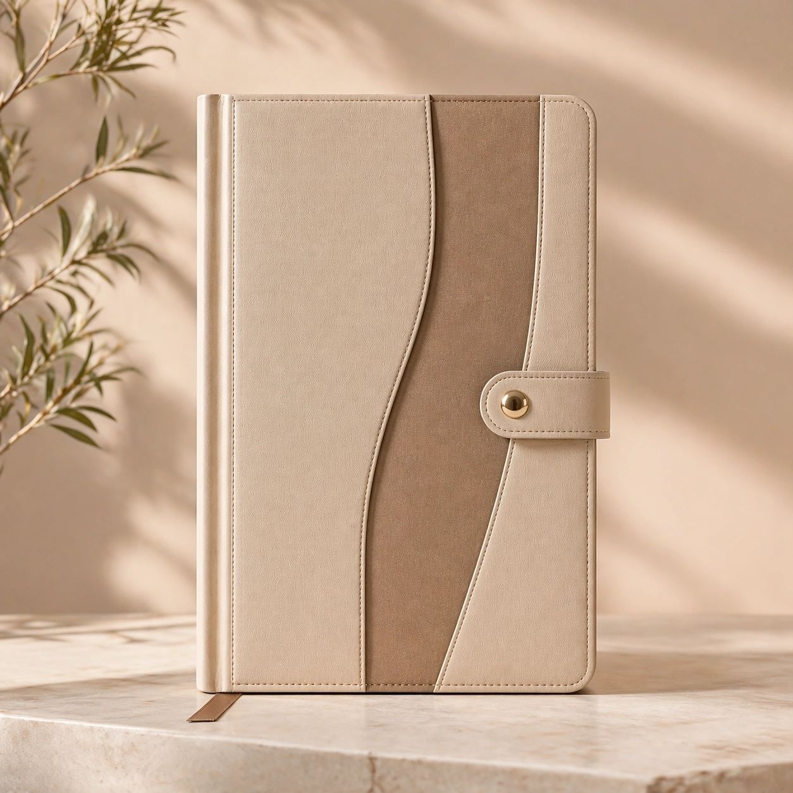

```text
Scene:
A square premium key-art frame built for a reference-dependent production series. Stage the same core concept pushed into a second variation with different pacing or surface behavior for lifestyle social note skincare proof journal system lifestyle social note skincare proof journal system with controlled lighting, clear silhouette separation, and a camera setup that feels deliberate enough for campaign reuse. The composition should carry strong focal hierarchy, believable depth, and polished surface behavior while still staying stable enough to support downstream dependent variations.

Subject:
Center the image on the same core concept pushed into a second variation with different pacing or surface behavior for lifestyle social note skincare proof journal system lifestyle social note skincare proof journal system. The result should feel like a concrete, shippable asset for a lifestyle social note skincare proof journal system lifestyle social note skincare proof journal system visual system, not a generic fantasy render. Build the subject with layered materials, stable anatomy or engineering logic, and enough specificity that later images can inherit the same underlying identity. Preserve the same core subject identity, silhouette logic, material language, and composition system from the reference image from the reference image while changing only what this variation needs. The viewer should immediately understand what is being preserved across the sequence and what is changing in this particular beat.

Important details:
the viewer should still read one connected family rather than three disconnected ideas. Make continuity explicit through repeatable shape language, proportion control, and a coherent palette system. Changes in pose, angle, mood, rarity, weather, or layout should still feel downstream of one stable source. Avoid clutter that would confuse reference use. Any interface-like blocks or graphic surfaces must remain abstract and unreadable. Keep the image polished, original, and suitable for both gallery display and production review.

Use case:
lifestyle social note skincare proof journal system lifestyle social note skincare proof journal system series study 3/4, focused on variation two.

Constraints:
No readable text, no watermark, no logos, preserve exact 1:1 aspect ratio, no random props, no off-model shift, no broken continuity, no off-model redesign, no accidental franchise resemblance.
```

[Pinned source](https://github.com/ChaosRealmsAI/gpt-image-2-gallery/blob/5296db8c996e38776c83a0bc8c64f848dcd512b3/works/topics/xiaohongshu-skincare-proof-journal-system/packages/series-theme-core/images/03-variation-two/meta.json) · GPT Image2 · 1254×1254 · Reference images required. · ProjectD:pending individual review.

## Variation Three · xiaohongshu-skincare-proof-journal-system/series-theme-core/04-variation-three

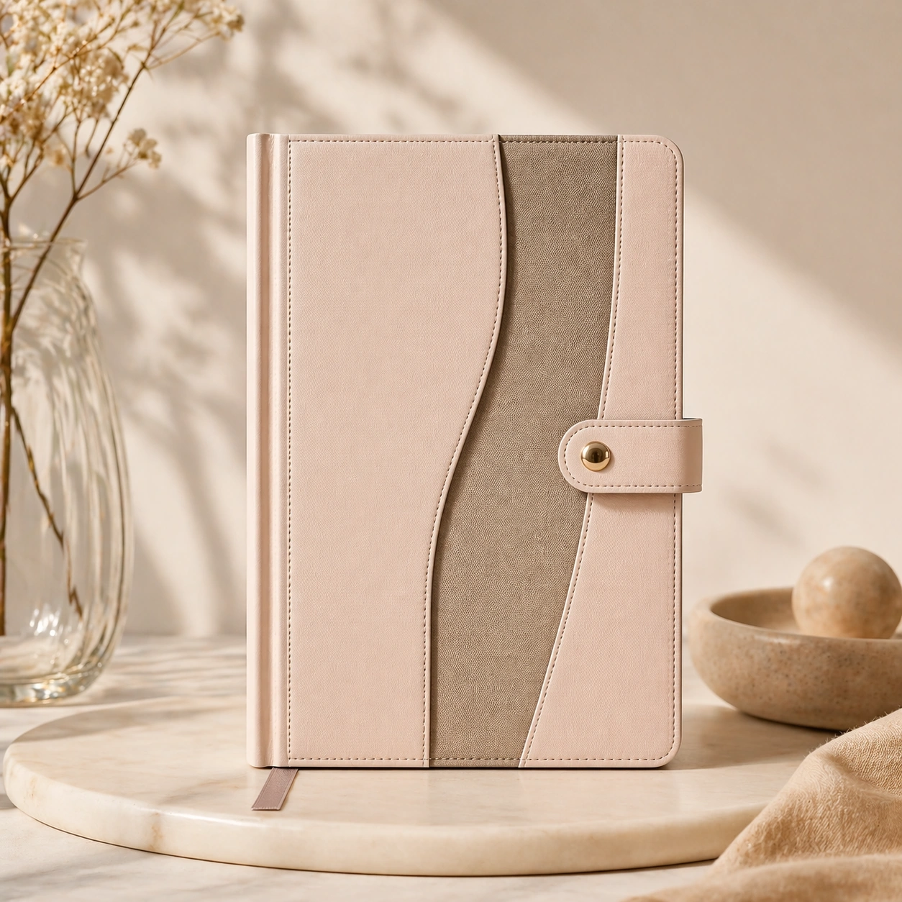

```text
Scene:
A square premium key-art frame built for a reference-dependent production series. Stage the same core concept in a third polished variation that completes the reference-led set for lifestyle social note skincare proof journal system lifestyle social note skincare proof journal system with controlled lighting, clear silhouette separation, and a camera setup that feels deliberate enough for campaign reuse. The composition should carry strong focal hierarchy, believable depth, and polished surface behavior while still staying stable enough to support downstream dependent variations.

Subject:
Center the image on the same core concept in a third polished variation that completes the reference-led set for lifestyle social note skincare proof journal system lifestyle social note skincare proof journal system. The result should feel like a concrete, shippable asset for a lifestyle social note skincare proof journal system lifestyle social note skincare proof journal system visual system, not a generic fantasy render. Build the subject with layered materials, stable anatomy or engineering logic, and enough specificity that later images can inherit the same underlying identity. Preserve the same core subject identity, silhouette logic, material language, and composition system from the reference image from the reference image while changing only what this variation needs. The viewer should immediately understand what is being preserved across the sequence and what is changing in this particular beat.

Important details:
keep continuity obvious while introducing a fresh but coherent downstream use case. Make continuity explicit through repeatable shape language, proportion control, and a coherent palette system. Changes in pose, angle, mood, rarity, weather, or layout should still feel downstream of one stable source. Avoid clutter that would confuse reference use. Any interface-like blocks or graphic surfaces must remain abstract and unreadable. Keep the image polished, original, and suitable for both gallery display and production review.

Use case:
lifestyle social note skincare proof journal system lifestyle social note skincare proof journal system series study 4/4, focused on variation three.

Constraints:
No readable text, no watermark, no logos, preserve exact 1:1 aspect ratio, no franchise mimicry, no broken hierarchy, no broken continuity, no off-model redesign, no accidental franchise resemblance.
```

[Pinned source](https://github.com/ChaosRealmsAI/gpt-image-2-gallery/blob/5296db8c996e38776c83a0bc8c64f848dcd512b3/works/topics/xiaohongshu-skincare-proof-journal-system/packages/series-theme-core/images/04-variation-three/meta.json) · GPT Image2 · 1254×1254 · Reference images required. · ProjectD:pending individual review.

## Hero Study · xiaohongshu-skincare-proof-journal-system/single-theme-extensions/hero-study

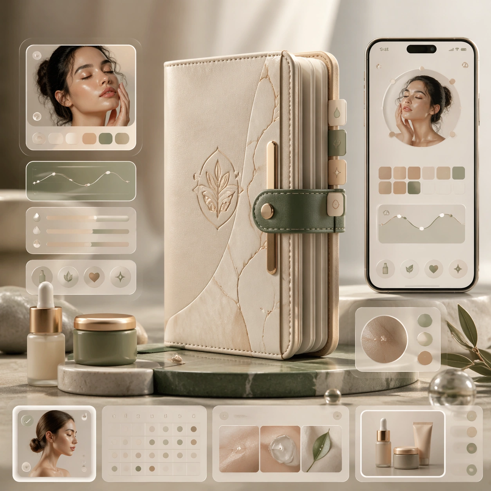

```text
Scene:
A square production-ready image designed for a game-art review wall and a commercial gallery at the same time. Frame a flagship hero study for lifestyle social note skincare proof journal system lifestyle social note skincare proof journal system presented as a polished, production-ready surface with disciplined lighting, clean edge separation, and enough surrounding context to prove how the asset would behave in a real product surface. The camera, crop, and tonal balance should feel intentional rather than generic, with high readability at first glance and convincing material response under closer inspection.

Subject:
Center the study on a flagship hero study for lifestyle social note skincare proof journal system lifestyle social note skincare proof journal system presented as a polished, production-ready surface. Translate the topic into a concrete, shippable visual statement instead of a loose mood board. Build layered object relationships, believable surface finish, and strong silhouette grouping so the image reads immediately as part of a lifestyle social note skincare proof journal system lifestyle social note skincare proof journal system visual system. The subject should feel made for a live game pipeline: useful in store, UI, campaign, or art-review contexts, with visual hierarchy strong enough to survive aggressive cropping.

Important details:
make the core idea immediately legible and premium enough for gallery or campaign use. Keep every supporting element subordinate to the main read, and make category separation obvious through form, color zoning, depth, and material logic rather than words. Where panels, cards, badges, or interface blocks appear, they must look professionally structured but remain unreadable. The visual language should feel premium, original, and coherent across this package, with no filler clutter and no accidental resemblance to a specific shipped game IP.

Use case:
lifestyle social note skincare proof journal system lifestyle social note skincare proof journal system single study 1/5, focused on hero study.

Constraints:
No readable text, no watermark, no logos, preserve exact 1:1 aspect ratio, no generic stock staging, no readable text, no broken hierarchy, no generic stock-photo staging, no accidental UI gibberish.
```

[Pinned source](https://github.com/ChaosRealmsAI/gpt-image-2-gallery/blob/5296db8c996e38776c83a0bc8c64f848dcd512b3/works/topics/xiaohongshu-skincare-proof-journal-system/packages/single-theme-extensions/images/hero-study/meta.json) · GPT Image2 · 1254×1254 · No source-declared image dependencies. · ProjectD:pending individual review.

## Detail Proof · xiaohongshu-skincare-proof-journal-system/single-theme-extensions/detail-proof

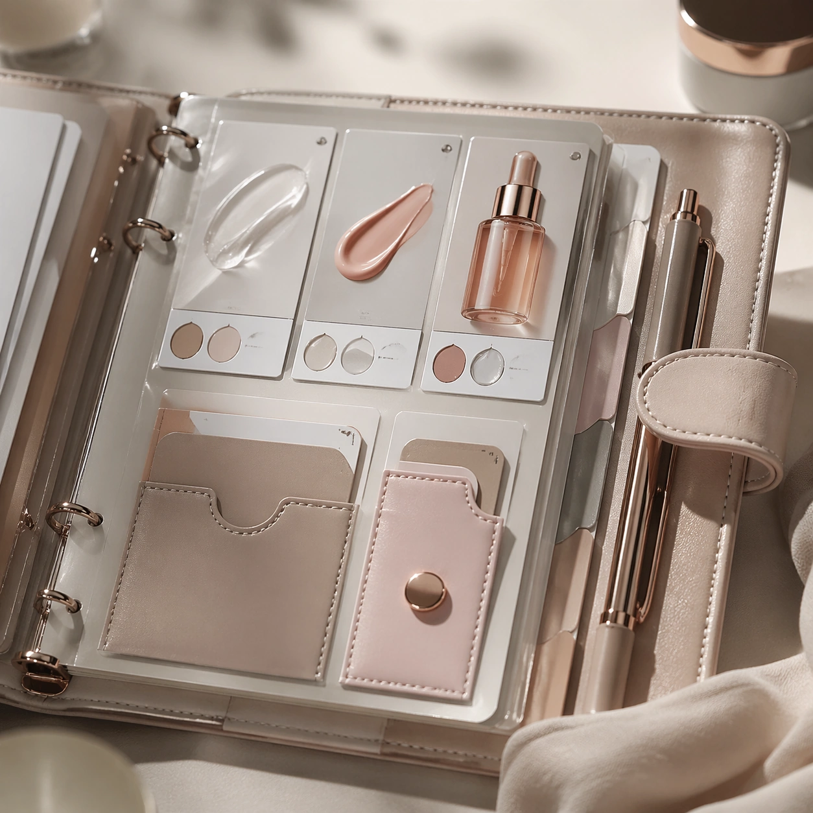

```text
Scene:
A square production-ready image designed for a game-art review wall and a commercial gallery at the same time. Frame a detail-focused proof image for lifestyle social note skincare proof journal system lifestyle social note skincare proof journal system that zooms into the most important material or structural cue with disciplined lighting, clean edge separation, and enough surrounding context to prove how the asset would behave in a real product surface. The camera, crop, and tonal balance should feel intentional rather than generic, with high readability at first glance and convincing material response under closer inspection.

Subject:
Center the study on a detail-focused proof image for lifestyle social note skincare proof journal system lifestyle social note skincare proof journal system that zooms into the most important material or structural cue. Translate the topic into a concrete, shippable visual statement instead of a loose mood board. Build layered object relationships, believable surface finish, and strong silhouette grouping so the image reads immediately as part of a lifestyle social note skincare proof journal system lifestyle social note skincare proof journal system visual system. The subject should feel made for a live game pipeline: useful in store, UI, campaign, or art-review contexts, with visual hierarchy strong enough to survive aggressive cropping.

Important details:
micro detail should reinforce credibility without losing the main idea. Keep every supporting element subordinate to the main read, and make category separation obvious through form, color zoning, depth, and material logic rather than words. Where panels, cards, badges, or interface blocks appear, they must look professionally structured but remain unreadable. The visual language should feel premium, original, and coherent across this package, with no filler clutter and no accidental resemblance to a specific shipped game IP.

Use case:
lifestyle social note skincare proof journal system lifestyle social note skincare proof journal system single study 2/5, focused on detail proof.

Constraints:
No readable text, no watermark, no logos, preserve exact 1:1 aspect ratio, no unreadable clutter, no measurement text, no broken hierarchy, no generic stock-photo staging, no accidental UI gibberish.
```

[Pinned source](https://github.com/ChaosRealmsAI/gpt-image-2-gallery/blob/5296db8c996e38776c83a0bc8c64f848dcd512b3/works/topics/xiaohongshu-skincare-proof-journal-system/packages/single-theme-extensions/images/detail-proof/meta.json) · GPT Image2 · 1254×1254 · No source-declared image dependencies. · ProjectD:pending individual review.

## System Board · xiaohongshu-skincare-proof-journal-system/single-theme-extensions/system-board

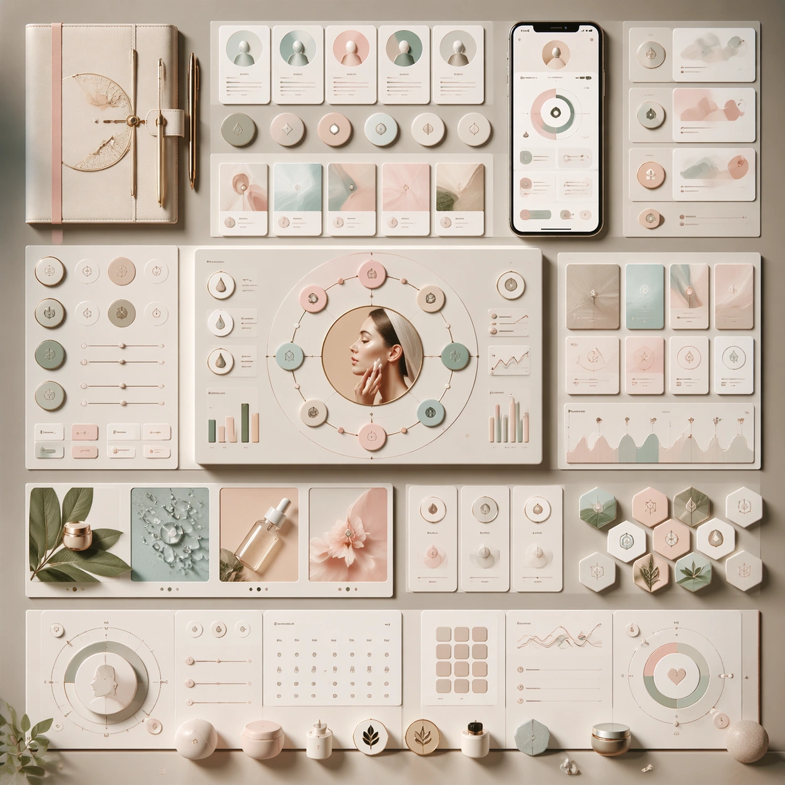

```text
Scene:
A square production-ready image designed for a game-art review wall and a commercial gallery at the same time. Frame a system-board layout for lifestyle social note skincare proof journal system lifestyle social note skincare proof journal system that organizes multiple related elements into one coherent review surface with disciplined lighting, clean edge separation, and enough surrounding context to prove how the asset would behave in a real product surface. The camera, crop, and tonal balance should feel intentional rather than generic, with high readability at first glance and convincing material response under closer inspection.

Subject:
Center the study on a system-board layout for lifestyle social note skincare proof journal system lifestyle social note skincare proof journal system that organizes multiple related elements into one coherent review surface. Translate the topic into a concrete, shippable visual statement instead of a loose mood board. Build layered object relationships, believable surface finish, and strong silhouette grouping so the image reads immediately as part of a lifestyle social note skincare proof journal system lifestyle social note skincare proof journal system visual system. The subject should feel made for a live game pipeline: useful in store, UI, campaign, or art-review contexts, with visual hierarchy strong enough to survive aggressive cropping.

Important details:
the board should feel design-ready and structured even though every label remains abstract. Keep every supporting element subordinate to the main read, and make category separation obvious through form, color zoning, depth, and material logic rather than words. Where panels, cards, badges, or interface blocks appear, they must look professionally structured but remain unreadable. The visual language should feel premium, original, and coherent across this package, with no filler clutter and no accidental resemblance to a specific shipped game IP.

Use case:
lifestyle social note skincare proof journal system lifestyle social note skincare proof journal system single study 3/5, focused on system board.

Constraints:
No readable text, no watermark, no logos, preserve exact 1:1 aspect ratio, no readable labels, no placeholder lorem ipsum, no broken hierarchy, no generic stock-photo staging, no accidental UI gibberish.
```

[Pinned source](https://github.com/ChaosRealmsAI/gpt-image-2-gallery/blob/5296db8c996e38776c83a0bc8c64f848dcd512b3/works/topics/xiaohongshu-skincare-proof-journal-system/packages/single-theme-extensions/images/system-board/meta.json) · GPT Image2 · 1254×1254 · No source-declared image dependencies. · ProjectD:pending individual review.

## Promo Crop · xiaohongshu-skincare-proof-journal-system/single-theme-extensions/promo-crop

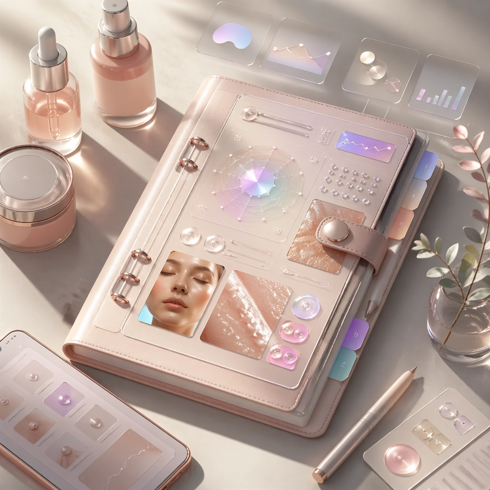

```text
Scene:
A square production-ready image designed for a game-art review wall and a commercial gallery at the same time. Frame a promo-oriented crop for lifestyle social note skincare proof journal system lifestyle social note skincare proof journal system optimized for social, storefront, or poster reuse with disciplined lighting, clean edge separation, and enough surrounding context to prove how the asset would behave in a real product surface. The camera, crop, and tonal balance should feel intentional rather than generic, with high readability at first glance and convincing material response under closer inspection.

Subject:
Center the study on a promo-oriented crop for lifestyle social note skincare proof journal system lifestyle social note skincare proof journal system optimized for social, storefront, or poster reuse. Translate the topic into a concrete, shippable visual statement instead of a loose mood board. Build layered object relationships, believable surface finish, and strong silhouette grouping so the image reads immediately as part of a lifestyle social note skincare proof journal system lifestyle social note skincare proof journal system visual system. The subject should feel made for a live game pipeline: useful in store, UI, campaign, or art-review contexts, with visual hierarchy strong enough to survive aggressive cropping.

Important details:
keep strong hierarchy and conversion energy without relying on explicit copy. Keep every supporting element subordinate to the main read, and make category separation obvious through form, color zoning, depth, and material logic rather than words. Where panels, cards, badges, or interface blocks appear, they must look professionally structured but remain unreadable. The visual language should feel premium, original, and coherent across this package, with no filler clutter and no accidental resemblance to a specific shipped game IP.

Use case:
lifestyle social note skincare proof journal system lifestyle social note skincare proof journal system single study 4/5, focused on promo crop.

Constraints:
No readable text, no watermark, no logos, preserve exact 1:1 aspect ratio, no slogans, no logos, no broken hierarchy, no generic stock-photo staging, no accidental UI gibberish.
```

[Pinned source](https://github.com/ChaosRealmsAI/gpt-image-2-gallery/blob/5296db8c996e38776c83a0bc8c64f848dcd512b3/works/topics/xiaohongshu-skincare-proof-journal-system/packages/single-theme-extensions/images/promo-crop/meta.json) · GPT Image2 · 1254×1254 · No source-declared image dependencies. · ProjectD:pending individual review.

## Finale Study · xiaohongshu-skincare-proof-journal-system/single-theme-extensions/finale-study

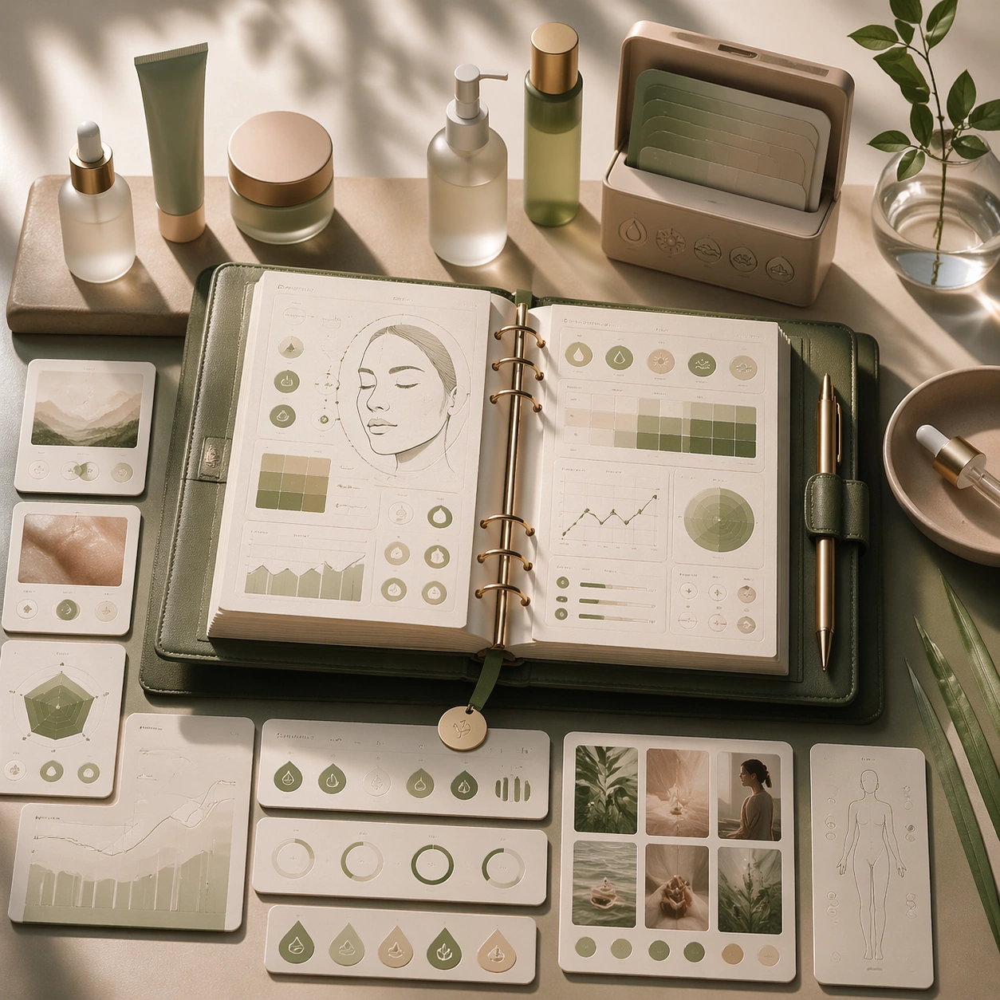

```text
Scene:
A square production-ready image designed for a game-art review wall and a commercial gallery at the same time. Frame a finale study for lifestyle social note skincare proof journal system lifestyle social note skincare proof journal system that pushes the topic to its most polished and complete expression with disciplined lighting, clean edge separation, and enough surrounding context to prove how the asset would behave in a real product surface. The camera, crop, and tonal balance should feel intentional rather than generic, with high readability at first glance and convincing material response under closer inspection.

Subject:
Center the study on a finale study for lifestyle social note skincare proof journal system lifestyle social note skincare proof journal system that pushes the topic to its most polished and complete expression. Translate the topic into a concrete, shippable visual statement instead of a loose mood board. Build layered object relationships, believable surface finish, and strong silhouette grouping so the image reads immediately as part of a lifestyle social note skincare proof journal system lifestyle social note skincare proof journal system visual system. The subject should feel made for a live game pipeline: useful in store, UI, campaign, or art-review contexts, with visual hierarchy strong enough to survive aggressive cropping.

Important details:
the closing image should feel definitive, high-signal, and suitable for feature placement. Keep every supporting element subordinate to the main read, and make category separation obvious through form, color zoning, depth, and material logic rather than words. Where panels, cards, badges, or interface blocks appear, they must look professionally structured but remain unreadable. The visual language should feel premium, original, and coherent across this package, with no filler clutter and no accidental resemblance to a specific shipped game IP.

Use case:
lifestyle social note skincare proof journal system lifestyle social note skincare proof journal system single study 5/5, focused on finale study.

Constraints:
No readable text, no watermark, no logos, preserve exact 1:1 aspect ratio, no text blocks, no derivative character likeness, no broken hierarchy, no generic stock-photo staging, no accidental UI gibberish.
```

[Pinned source](https://github.com/ChaosRealmsAI/gpt-image-2-gallery/blob/5296db8c996e38776c83a0bc8c64f848dcd512b3/works/topics/xiaohongshu-skincare-proof-journal-system/packages/single-theme-extensions/images/finale-study/meta.json) · GPT Image2 · 1254×1254 · No source-declared image dependencies. · ProjectD:pending individual review.

## Macro Study · xray-art-photography/single-xray-art-photography-studies/macro-study

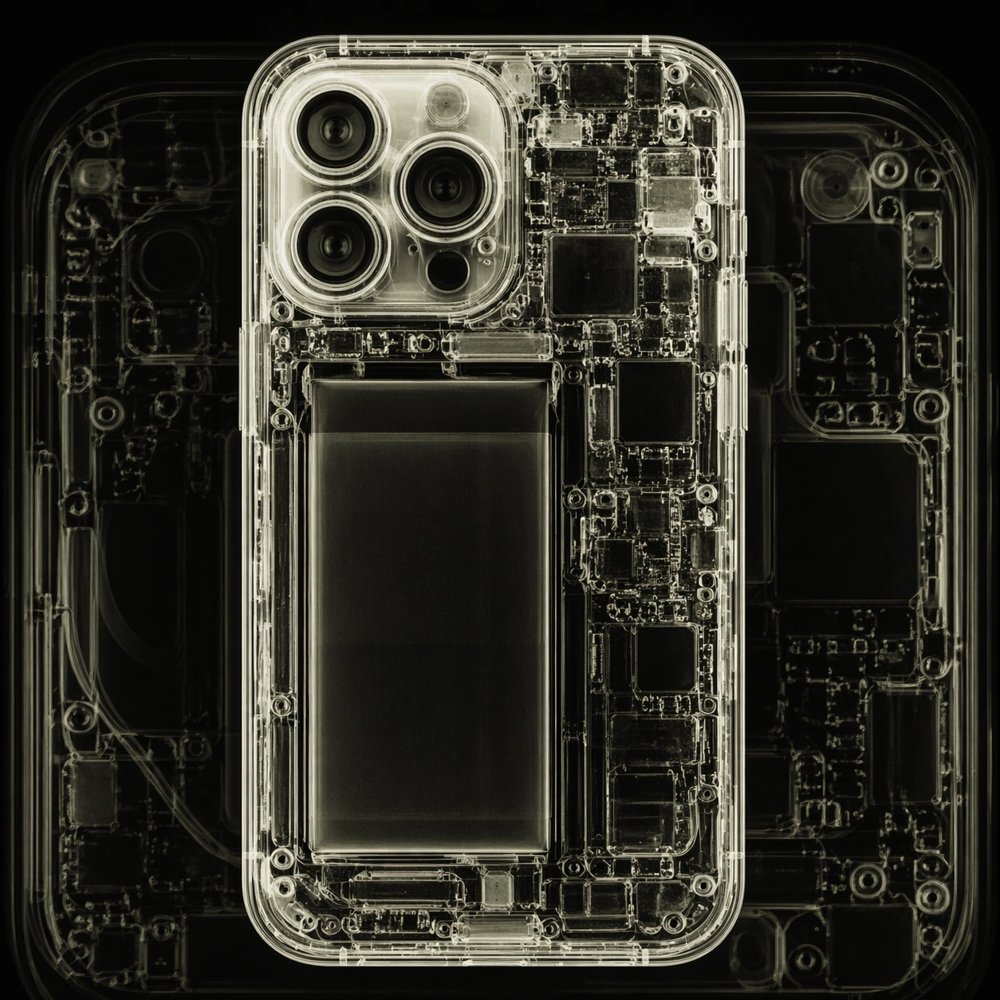

```text
Scene:
A square photographic image with intentional lens choice, coherent light, and a subject that feels observed rather than merely decorated. Build the frame around closer observation that reveals fine structure and optical behavior. Keep the lighting, camera distance, and spatial organization tuned for a high-signal research image rather than a casual snapshot. The image belongs to the X-Ray Art Photography theme and should feel immediately legible as a prompt atlas theme for x-ray art photography, testing photorealism, style-transfer, optical-illusion-geometry with gpt image 2..

Subject:
Center the study on closer observation that reveals fine structure and optical behavior. Translate the theme into a concrete visual statement instead of an abstract mood board: the viewer should understand what kind of image this is, what is being tested, and why the composition is difficult. Use the slug idea of xray art photography as a literal guide for subject matter, materials, and staging. If helpful, borrow the broad visual cues suggested by iPhone, but keep the result original and specific to this study.

Important details:
The realism should come from timing, optics, and material response: atmosphere, contrast, depth, motion, and tiny physical cues all need to agree. Preserve a disciplined square composition, clear focal hierarchy, and enough secondary information to make the image feel complete rather than underspecified. The image should look polished, novel, and exhibition-ready, with topic-specific credibility coming from the way surfaces, structure, and visual language reinforce X-Ray Art Photography. Avoid generic filler elements that do not serve the main concept.

Use case:
X-Ray Art Photography single study 2/8, testing photorealism, style-transfer, optical-illusion-geometry through the macro study variation.

Constraints:
No readable text, no watermark, no logos, preserve exact 1:1 aspect ratio, no watermark, no cheap HDR excess, no unreadable signage, no fake stock-photo posing, no compositing seams, no arbitrary lens flare.
```

[Pinned source](https://github.com/ChaosRealmsAI/gpt-image-2-gallery/blob/5296db8c996e38776c83a0bc8c64f848dcd512b3/works/topics/xray-art-photography/packages/single-xray-art-photography-studies/images/macro-study/meta.json) · GPT Image2 · 1254×1254 · No source-declared image dependencies. · ProjectD:pending individual review.

## Side Light Study · xray-art-photography/single-xray-art-photography-studies/side-light-study

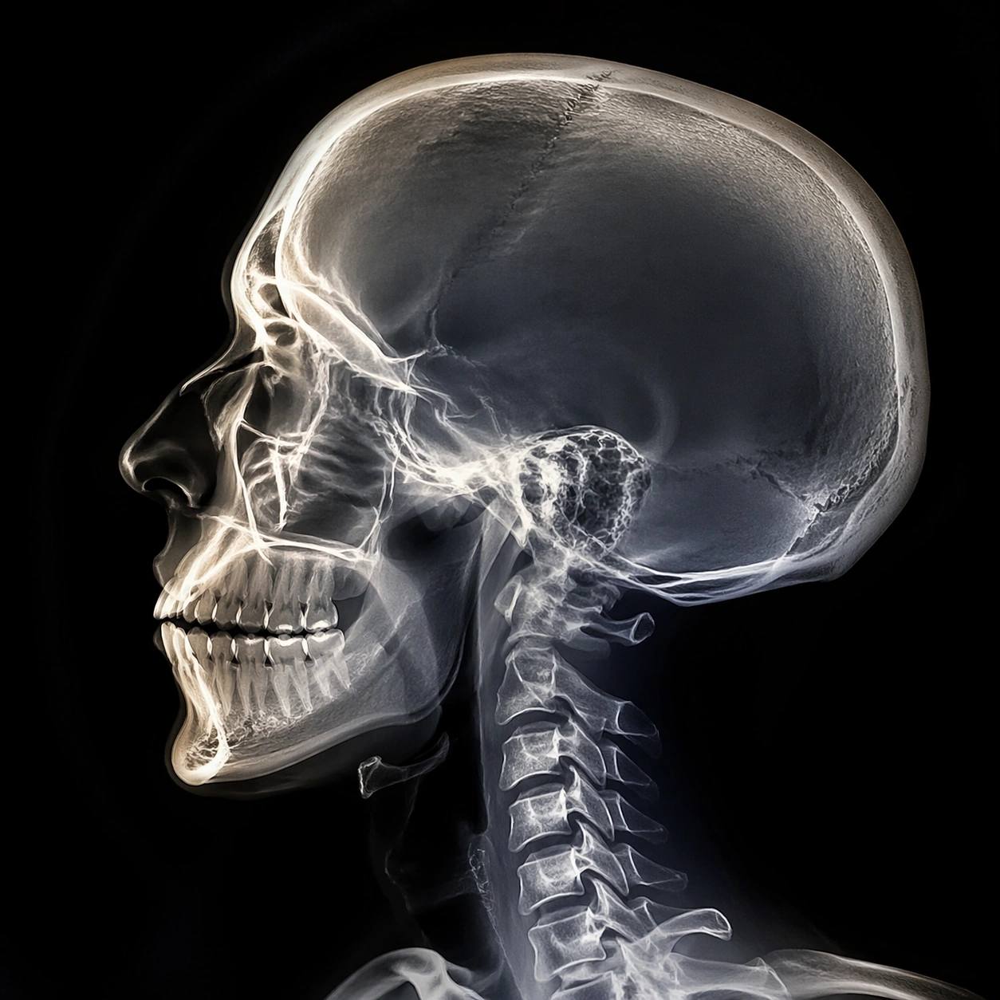

```text
Scene:
A square photographic image with intentional lens choice, coherent light, and a subject that feels observed rather than merely decorated. Build the frame around a directional-light treatment that increases form and drama. Keep the lighting, camera distance, and spatial organization tuned for a high-signal research image rather than a casual snapshot. The image belongs to the X-Ray Art Photography theme and should feel immediately legible as a prompt atlas theme for x-ray art photography, testing photorealism, style-transfer, optical-illusion-geometry with gpt image 2..

Subject:
Center the study on a directional-light treatment that increases form and drama. Translate the theme into a concrete visual statement instead of an abstract mood board: the viewer should understand what kind of image this is, what is being tested, and why the composition is difficult. Use the slug idea of xray art photography as a literal guide for subject matter, materials, and staging. If helpful, borrow the broad visual cues suggested by iPhone, but keep the result original and specific to this study.

Important details:
The realism should come from timing, optics, and material response: atmosphere, contrast, depth, motion, and tiny physical cues all need to agree. Preserve a disciplined square composition, clear focal hierarchy, and enough secondary information to make the image feel complete rather than underspecified. The image should look polished, novel, and exhibition-ready, with topic-specific credibility coming from the way surfaces, structure, and visual language reinforce X-Ray Art Photography. Avoid generic filler elements that do not serve the main concept.

Use case:
X-Ray Art Photography single study 3/8, testing photorealism, style-transfer, optical-illusion-geometry through the side light study variation.

Constraints:
No readable text, no watermark, no logos, preserve exact 1:1 aspect ratio, no watermark, no cheap HDR excess, no unreadable signage, no fake stock-photo posing, no compositing seams, no arbitrary lens flare.
```

[Pinned source](https://github.com/ChaosRealmsAI/gpt-image-2-gallery/blob/5296db8c996e38776c83a0bc8c64f848dcd512b3/works/topics/xray-art-photography/packages/single-xray-art-photography-studies/images/side-light-study/meta.json) · GPT Image2 · 1254×1254 · No source-declared image dependencies. · ProjectD:pending individual review.

## Motion Moment · xray-art-photography/single-xray-art-photography-studies/motion-moment

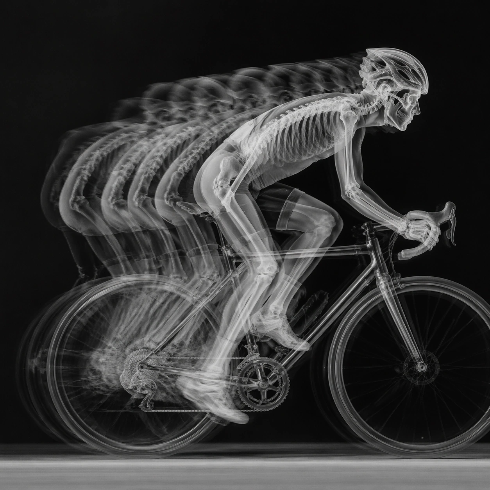

```text
Scene:
A square photographic image with intentional lens choice, coherent light, and a subject that feels observed rather than merely decorated. Build the frame around a time-sensitive or kinetic phenomenon captured at the right instant. Keep the lighting, camera distance, and spatial organization tuned for a high-signal research image rather than a casual snapshot. The image belongs to the X-Ray Art Photography theme and should feel immediately legible as a prompt atlas theme for x-ray art photography, testing photorealism, style-transfer, optical-illusion-geometry with gpt image 2..

Subject:
Center the study on a time-sensitive or kinetic phenomenon captured at the right instant. Translate the theme into a concrete visual statement instead of an abstract mood board: the viewer should understand what kind of image this is, what is being tested, and why the composition is difficult. Use the slug idea of xray art photography as a literal guide for subject matter, materials, and staging. If helpful, borrow the broad visual cues suggested by iPhone, but keep the result original and specific to this study.

Important details:
The realism should come from timing, optics, and material response: atmosphere, contrast, depth, motion, and tiny physical cues all need to agree. Preserve a disciplined square composition, clear focal hierarchy, and enough secondary information to make the image feel complete rather than underspecified. The image should look polished, novel, and exhibition-ready, with topic-specific credibility coming from the way surfaces, structure, and visual language reinforce X-Ray Art Photography. Avoid generic filler elements that do not serve the main concept.

Use case:
X-Ray Art Photography single study 4/8, testing photorealism, style-transfer, optical-illusion-geometry through the motion moment variation.

Constraints:
No readable text, no watermark, no logos, preserve exact 1:1 aspect ratio, no watermark, no cheap HDR excess, no unreadable signage, no fake stock-photo posing, no compositing seams, no arbitrary lens flare.
```

[Pinned source](https://github.com/ChaosRealmsAI/gpt-image-2-gallery/blob/5296db8c996e38776c83a0bc8c64f848dcd512b3/works/topics/xray-art-photography/packages/single-xray-art-photography-studies/images/motion-moment/meta.json) · GPT Image2 · 1254×1254 · No source-declared image dependencies. · ProjectD:pending individual review.

## Low-Light Atlas · xray-art-photography/single-xray-art-photography-studies/low-light-atlas

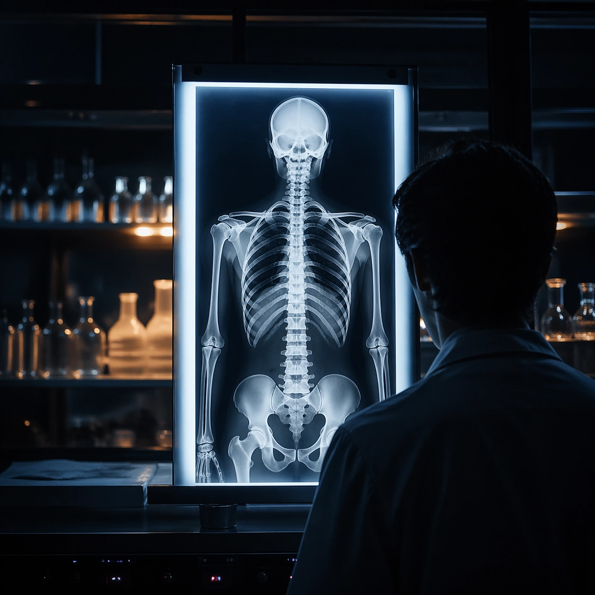

```text
Scene:
A square photographic image with intentional lens choice, coherent light, and a subject that feels observed rather than merely decorated. Build the frame around a dusk, night, or low-light frame with disciplined exposure. Keep the lighting, camera distance, and spatial organization tuned for a high-signal research image rather than a casual snapshot. The image belongs to the X-Ray Art Photography theme and should feel immediately legible as a prompt atlas theme for x-ray art photography, testing photorealism, style-transfer, optical-illusion-geometry with gpt image 2..

Subject:
Center the study on a dusk, night, or low-light frame with disciplined exposure. Translate the theme into a concrete visual statement instead of an abstract mood board: the viewer should understand what kind of image this is, what is being tested, and why the composition is difficult. Use the slug idea of xray art photography as a literal guide for subject matter, materials, and staging. If helpful, borrow the broad visual cues suggested by iPhone, but keep the result original and specific to this study.

Important details:
The realism should come from timing, optics, and material response: atmosphere, contrast, depth, motion, and tiny physical cues all need to agree. Preserve a disciplined square composition, clear focal hierarchy, and enough secondary information to make the image feel complete rather than underspecified. The image should look polished, novel, and exhibition-ready, with topic-specific credibility coming from the way surfaces, structure, and visual language reinforce X-Ray Art Photography. Avoid generic filler elements that do not serve the main concept.

Use case:
X-Ray Art Photography single study 5/8, testing photorealism, style-transfer, optical-illusion-geometry through the low-light atlas variation.

Constraints:
No readable text, no watermark, no logos, preserve exact 1:1 aspect ratio, no watermark, no cheap HDR excess, no unreadable signage, no fake stock-photo posing, no compositing seams, no arbitrary lens flare.
```

[Pinned source](https://github.com/ChaosRealmsAI/gpt-image-2-gallery/blob/5296db8c996e38776c83a0bc8c64f848dcd512b3/works/topics/xray-art-photography/packages/single-xray-art-photography-studies/images/low-light-atlas/meta.json) · GPT Image2 · 1254×1254 · No source-declared image dependencies. · ProjectD:pending individual review.

## Specimen Table · xray-art-photography/single-xray-art-photography-studies/specimen-table

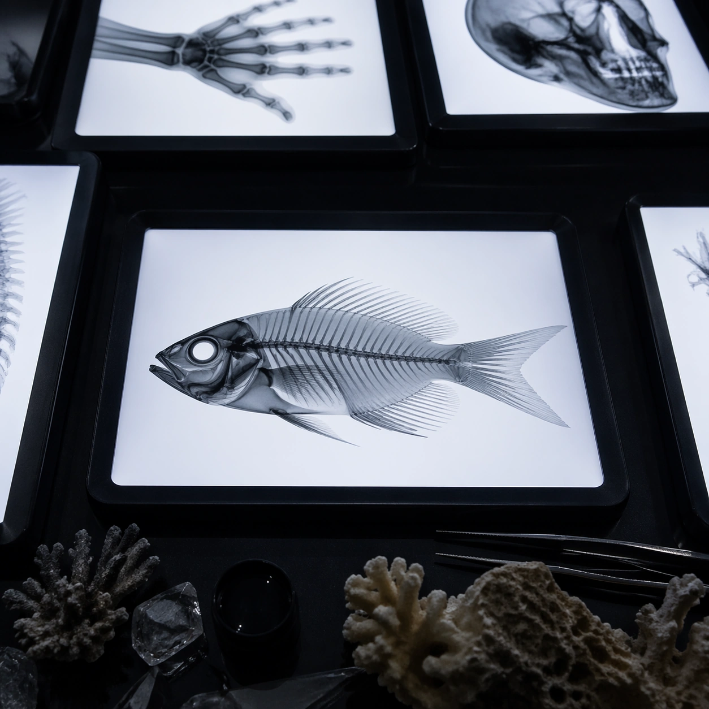

```text
Scene:
A square photographic image with intentional lens choice, coherent light, and a subject that feels observed rather than merely decorated. Build the frame around a carefully arranged or comparative frame that still feels photographic. Keep the lighting, camera distance, and spatial organization tuned for a high-signal research image rather than a casual snapshot. The image belongs to the X-Ray Art Photography theme and should feel immediately legible as a prompt atlas theme for x-ray art photography, testing photorealism, style-transfer, optical-illusion-geometry with gpt image 2..

Subject:
Center the study on a carefully arranged or comparative frame that still feels photographic. Translate the theme into a concrete visual statement instead of an abstract mood board: the viewer should understand what kind of image this is, what is being tested, and why the composition is difficult. Use the slug idea of xray art photography as a literal guide for subject matter, materials, and staging. If helpful, borrow the broad visual cues suggested by iPhone, but keep the result original and specific to this study.

Important details:
The realism should come from timing, optics, and material response: atmosphere, contrast, depth, motion, and tiny physical cues all need to agree. Preserve a disciplined square composition, clear focal hierarchy, and enough secondary information to make the image feel complete rather than underspecified. The image should look polished, novel, and exhibition-ready, with topic-specific credibility coming from the way surfaces, structure, and visual language reinforce X-Ray Art Photography. Avoid generic filler elements that do not serve the main concept.

Use case:
X-Ray Art Photography single study 6/8, testing photorealism, style-transfer, optical-illusion-geometry through the specimen table variation.

Constraints:
No readable text, no watermark, no logos, preserve exact 1:1 aspect ratio, no watermark, no cheap HDR excess, no unreadable signage, no fake stock-photo posing, no compositing seams, no arbitrary lens flare.
```

[Pinned source](https://github.com/ChaosRealmsAI/gpt-image-2-gallery/blob/5296db8c996e38776c83a0bc8c64f848dcd512b3/works/topics/xray-art-photography/packages/single-xray-art-photography-studies/images/specimen-table/meta.json) · GPT Image2 · 1254×1254 · No source-declared image dependencies. · ProjectD:pending individual review.

## Atmospheric View · xray-art-photography/single-xray-art-photography-studies/atmospheric-view

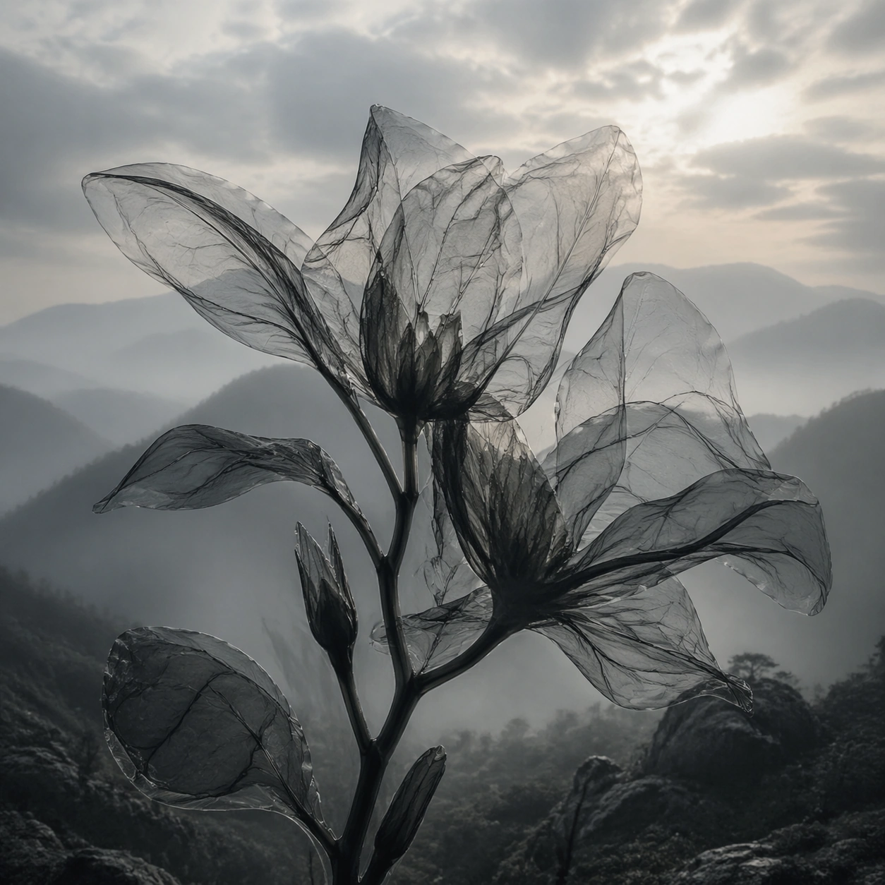

```text
Scene:
A square photographic image with intentional lens choice, coherent light, and a subject that feels observed rather than merely decorated. Build the frame around weather, haze, or volumetric light used to deepen realism. Keep the lighting, camera distance, and spatial organization tuned for a high-signal research image rather than a casual snapshot. The image belongs to the X-Ray Art Photography theme and should feel immediately legible as a prompt atlas theme for x-ray art photography, testing photorealism, style-transfer, optical-illusion-geometry with gpt image 2..

Subject:
Center the study on weather, haze, or volumetric light used to deepen realism. Translate the theme into a concrete visual statement instead of an abstract mood board: the viewer should understand what kind of image this is, what is being tested, and why the composition is difficult. Use the slug idea of xray art photography as a literal guide for subject matter, materials, and staging. If helpful, borrow the broad visual cues suggested by iPhone, but keep the result original and specific to this study.

Important details:
The realism should come from timing, optics, and material response: atmosphere, contrast, depth, motion, and tiny physical cues all need to agree. Preserve a disciplined square composition, clear focal hierarchy, and enough secondary information to make the image feel complete rather than underspecified. The image should look polished, novel, and exhibition-ready, with topic-specific credibility coming from the way surfaces, structure, and visual language reinforce X-Ray Art Photography. Avoid generic filler elements that do not serve the main concept.

Use case:
X-Ray Art Photography single study 7/8, testing photorealism, style-transfer, optical-illusion-geometry through the atmospheric view variation.

Constraints:
No readable text, no watermark, no logos, preserve exact 1:1 aspect ratio, no watermark, no cheap HDR excess, no unreadable signage, no fake stock-photo posing, no compositing seams, no arbitrary lens flare.
```

[Pinned source](https://github.com/ChaosRealmsAI/gpt-image-2-gallery/blob/5296db8c996e38776c83a0bc8c64f848dcd512b3/works/topics/xray-art-photography/packages/single-xray-art-photography-studies/images/atmospheric-view/meta.json) · GPT Image2 · 1254×1254 · No source-declared image dependencies. · ProjectD:pending individual review.

## Signature Frame · xray-art-photography/single-xray-art-photography-studies/signature-frame

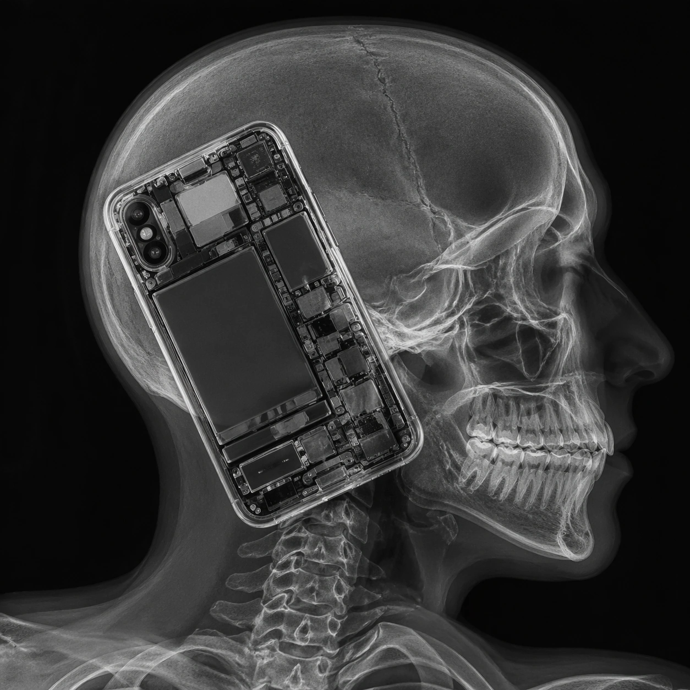

```text
Scene:
A square photographic image with intentional lens choice, coherent light, and a subject that feels observed rather than merely decorated. Build the frame around the most memorable final image for the topic. Keep the lighting, camera distance, and spatial organization tuned for a high-signal research image rather than a casual snapshot. The image belongs to the X-Ray Art Photography theme and should feel immediately legible as a prompt atlas theme for x-ray art photography, testing photorealism, style-transfer, optical-illusion-geometry with gpt image 2..

Subject:
Center the study on the most memorable final image for the topic. Translate the theme into a concrete visual statement instead of an abstract mood board: the viewer should understand what kind of image this is, what is being tested, and why the composition is difficult. Use the slug idea of xray art photography as a literal guide for subject matter, materials, and staging. If helpful, borrow the broad visual cues suggested by iPhone, but keep the result original and specific to this study.

Important details:
The realism should come from timing, optics, and material response: atmosphere, contrast, depth, motion, and tiny physical cues all need to agree. Preserve a disciplined square composition, clear focal hierarchy, and enough secondary information to make the image feel complete rather than underspecified. The image should look polished, novel, and exhibition-ready, with topic-specific credibility coming from the way surfaces, structure, and visual language reinforce X-Ray Art Photography. Avoid generic filler elements that do not serve the main concept.

Use case:
X-Ray Art Photography single study 8/8, testing photorealism, style-transfer, optical-illusion-geometry through the signature frame variation.

Constraints:
No readable text, no watermark, no logos, preserve exact 1:1 aspect ratio, no watermark, no cheap HDR excess, no unreadable signage, no fake stock-photo posing, no compositing seams, no arbitrary lens flare.
```

[Pinned source](https://github.com/ChaosRealmsAI/gpt-image-2-gallery/blob/5296db8c996e38776c83a0bc8c64f848dcd512b3/works/topics/xray-art-photography/packages/single-xray-art-photography-studies/images/signature-frame/meta.json) · GPT Image2 · 1254×1254 · No source-declared image dependencies. · ProjectD:pending individual review.

## Chrome Bubble Desktop · y2k-vaporwave-crt/single-crt-era-studies/chrome-bubble-desktop

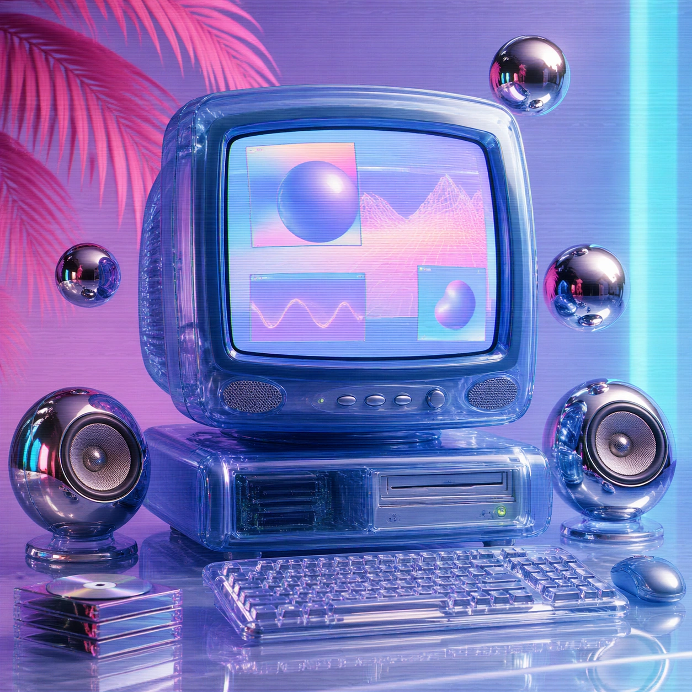

```text
Scene:
A square studio still life photographed like a premium late-1990s computer magazine cover, bright but slightly dreamy, with a lavender-to-aqua background and soft specular studio lights. The camera is straight-on at desk height, using a clean product-shot composition with shallow reflections on a glossy acrylic tabletop. Subtle CRT scanlines and mild RGB fringing should appear as if the image is being viewed through an old monitor, not pasted over randomly.

Subject:
A fictional translucent desktop computer setup made from pearly blue plastic, chrome bubble speakers, a rounded CRT display, a clear keyboard, and a small stack of reflective mini discs. The monitor screen shows only abstract pastel windows, gradients, and waveform shapes with no readable interface text. Chrome spheres float close to the hardware, reflecting pink palms, cyan light bars, and the camera-facing product scene.

Important details:
The hard part is believable material physics: transparent plastic must reveal internal ribs and circuit silhouettes, chrome bubbles must reflect the environment with curved highlights, and the CRT glass must bow slightly with phosphor glow, scanline texture, and edge color separation. Preserve a Y2K optimism palette without making the scene look like a modern flat vector poster.

Use case:
Y2K Vaporwave CRT single study 1/8, testing iridescent hardware materials and nostalgic screen optics.

Constraints:
No readable text, no watermark, no logos, preserve exact 1:1 aspect ratio, no real brand design, no flat icon art, no illegible keyboard letters, no random glitch covering the main object.
```

[Pinned source](https://github.com/ChaosRealmsAI/gpt-image-2-gallery/blob/5296db8c996e38776c83a0bc8c64f848dcd512b3/works/topics/y2k-vaporwave-crt/packages/single-crt-era-studies/images/chrome-bubble-desktop/meta.json) · GPT Image2 · 1254×1254 · No source-declared image dependencies. · ProjectD:pending individual review.

## Marble Bust Scanlines · y2k-vaporwave-crt/single-crt-era-studies/marble-bust-scanlines

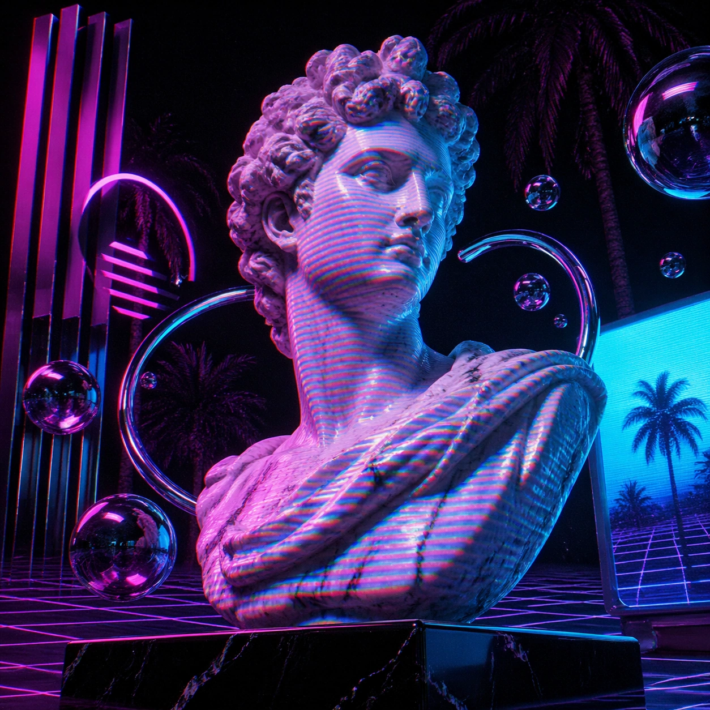

```text
Scene:
A square vaporwave museum diorama at night, lit by magenta neon from the left and cyan monitor glow from the right. The camera looks slightly upward from a low pedestal angle, making the scene feel monumental while still intimate. The background is a black void filled with soft palm silhouettes, gridded horizon lines, and faint analog video noise. Overall brightness should stay medium-high on the subject, with deep purples in the shadows.

Subject:
A classical white marble bust on a glossy black plinth, wrapped in projected CRT scanlines and fragmented RGB color separation. Around the bust are translucent chrome rings, floating reflective bubbles, and abstract glyph-like signage shapes that suggest vaporwave without becoming readable words. The marble surface contains carved pores, chipped edges, and cool veins; the scanline projection should curve across the nose, cheek, neck, and shoulders according to the bust geometry.

Important details:
The image must fuse old sculpture with digital nostalgia through physical light behavior. Scanlines should not be a uniform flat overlay; they must bend around the marble form, fade in shadow, and separate slightly into red, green, and blue fringes near high-contrast edges. Keep the bust dignified and recognizable as stone, not plastic. Use palm reflections and neon ambience as environmental clues.

Use case:
Y2K Vaporwave CRT single study 2/8, testing style transfer from classical sculpture into CRT-era vaporwave optics.

Constraints:
No readable text, no watermark, no logos, preserve exact 1:1 aspect ratio, no real museum labels, no cartoon bust, no random face distortion, no scanlines that ignore the surface geometry.
```

[Pinned source](https://github.com/ChaosRealmsAI/gpt-image-2-gallery/blob/5296db8c996e38776c83a0bc8c64f848dcd512b3/works/topics/y2k-vaporwave-crt/packages/single-crt-era-studies/images/marble-bust-scanlines/meta.json) · GPT Image2 · 1254×1254 · No source-declared image dependencies. · ProjectD:pending individual review.

## Iridescent Disc Tower · y2k-vaporwave-crt/single-crt-era-studies/iridescent-disc-tower

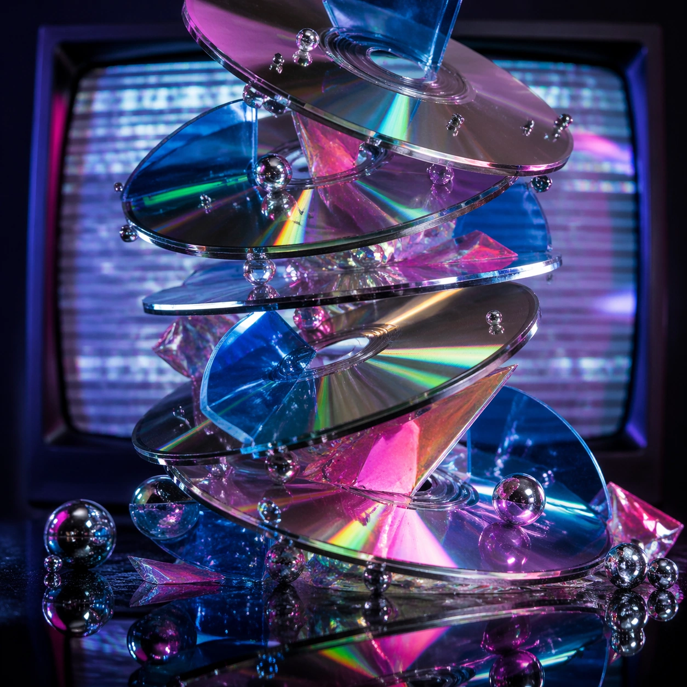

```text
Scene:
A square macro product tableau with a tower of compact discs and iridescent acrylic shards arranged on a mirror-black surface. The lighting is sharp and theatrical, using narrow cyan, hot pink, and white rim lights against a dark violet background. The camera is close enough to show tiny scratches and diffraction rainbows, but the composition remains clean and centered like a luxury material study.

Subject:
A spiraling tower of reflective discs, chrome gel beads, translucent blue plastic fins, and pearlescent foil fragments. Each disc catches a different radial spectrum, and the stack bends into an impossible but stable Y2K architectural column. Behind it, an out-of-focus CRT screen emits curved scanline bands and soft static, visible only as abstract glow and color breakup. Small liquid-metal droplets cling to the discs and reflect the colored lights.

Important details:
Emphasize physically convincing diffraction, reflections, and transparent layering. The discs should show real circular grooves, rainbow interference along the edges, tiny dust specks, and specular scratches. The chrome beads must mirror the tower and lights in distorted miniature. CRT effects belong in the background and edge highlights, not as a destructive overlay. The image should feel like internet-era nostalgia elevated into precise material photography.

Use case:
Y2K Vaporwave CRT single study 3/8, testing iridescence, chrome reflections, and optical interference.

Constraints:
No readable text, no watermark, no logos, preserve exact 1:1 aspect ratio, no album covers, no brand marks, no impossible melted plastic without support, no flat rainbow gradient replacing material detail.
```

[Pinned source](https://github.com/ChaosRealmsAI/gpt-image-2-gallery/blob/5296db8c996e38776c83a0bc8c64f848dcd512b3/works/topics/y2k-vaporwave-crt/packages/single-crt-era-studies/images/iridescent-disc-tower/meta.json) · GPT Image2 · 1254×1254 · No source-declared image dependencies. · ProjectD:pending individual review.

## Palm Grid Arcade · y2k-vaporwave-crt/single-crt-era-studies/palm-grid-arcade

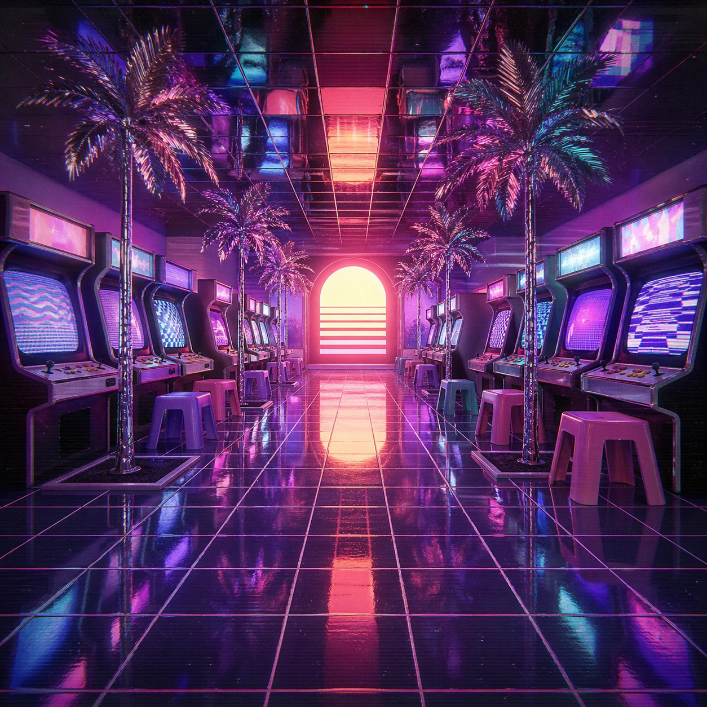

```text
Scene:
A square wide-angle scene inside a fictional after-midnight arcade that has been transformed into a vaporwave dream room. The camera faces a receding perspective grid floor, with glossy tiles reflecting purple, coral, and cyan lights. Brightness is high at the horizon and softer in the foreground, like an analog video still paused on a CRT. The image should feel cinematic but organized, with strong depth lines leading inward.

Subject:
Rows of empty arcade cabinets, chrome palm trees planted in square tile cutouts, pastel plastic stools, and a central glowing sun-disc sculpture at the far end of the room. The cabinet screens show only abstract moving color fields, waveforms, checkerboards, and unreadable symbol blocks. Overhead, mirrored ceiling panels fracture the neon palms and grid floor into repeated reflections. The air contains mild video static, but the architecture remains crisp.

Important details:
The visual language must balance vaporwave nostalgia with plausible physical space. Keep perspective lines coherent, reflections aligned with the glossy floor, and CRT screen curvature visible on each cabinet. Scanlines and RGB edge fringing should be stronger on screens and bright reflections, weaker on matte objects. Avoid any real game branding; all machines are fictional forms with blank controls and abstract displays.

Use case:
Y2K Vaporwave CRT single study 4/8, testing deep vaporwave composition, reflections, and CRT screen styling.

Constraints:
No readable text, no watermark, no logos, preserve exact 1:1 aspect ratio, no real arcade titles, no illegible fake lettering, no people, no random cables cluttering the perspective grid.
```

[Pinned source](https://github.com/ChaosRealmsAI/gpt-image-2-gallery/blob/5296db8c996e38776c83a0bc8c64f848dcd512b3/works/topics/y2k-vaporwave-crt/packages/single-crt-era-studies/images/palm-grid-arcade/meta.json) · GPT Image2 · 1254×1254 · No source-declared image dependencies. · ProjectD:pending individual review.

## Transparent Phone Shell · y2k-vaporwave-crt/single-crt-era-studies/transparent-phone-shell

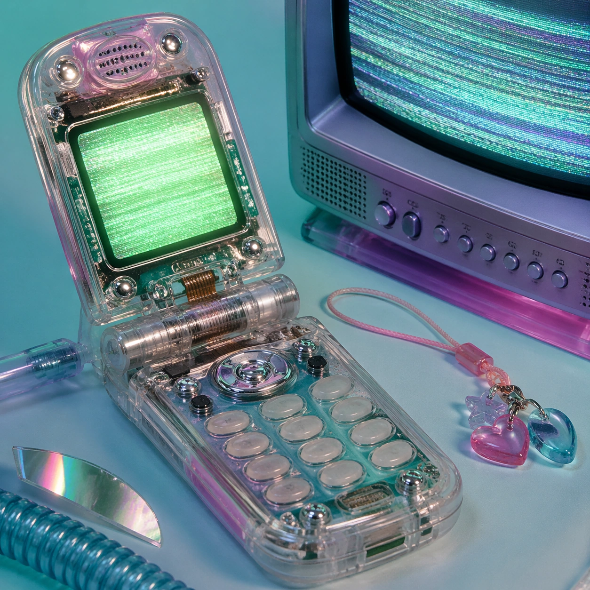

```text
Scene:
A square close-up still life on a pale aqua workbench, photographed with crisp catalog lighting and a slight analog video softness at the edges. The camera looks down at a three-quarter angle, close enough to reveal internal electronics and molded plastic seams. The palette is translucent teal, frosted violet, hot pink highlights, silver screws, and soft CRT phosphor green reflections.

Subject:
A fictional early-2000s transparent flip phone shell opened like a small technological specimen. The case is clear plastic with rounded Y2K contours, visible hinge barrels, tiny speaker mesh, rubber keys without legible symbols, ribbon cables, battery cells, and decorative chrome bubble inserts. Beside it are translucent charms, a small reflective disc fragment, and a tiny CRT monitor in the background showing only abstract static bands. The phone feels usable and physically assembled, not a flat prop.

Important details:
The transparent casing must show layered refraction, internal shadows, screw posts, molded ribs, and slight yellowing at the edges. Avoid real device identity; this is a fictional object inspired by an era. The CRT influence should appear as greenish screen glow, scanline reflections on the plastic, and mild RGB separation along shiny edges. The image tests whether translucent material, tiny mechanisms, and nostalgia styling can coexist without becoming clutter.

Use case:
Y2K Vaporwave CRT single study 5/8, testing transparent consumer electronics and era-specific material realism.

Constraints:
No readable text, no watermark, no logos, preserve exact 1:1 aspect ratio, no real phone brand cues, no readable keypad labels, no broken hinge geometry, no modern smartphone shape.
```

[Pinned source](https://github.com/ChaosRealmsAI/gpt-image-2-gallery/blob/5296db8c996e38776c83a0bc8c64f848dcd512b3/works/topics/y2k-vaporwave-crt/packages/single-crt-era-studies/images/transparent-phone-shell/meta.json) · GPT Image2 · 1254×1254 · No source-declared image dependencies. · ProjectD:pending individual review.

## Liquid Metal Interface · y2k-vaporwave-crt/single-crt-era-studies/liquid-metal-interface

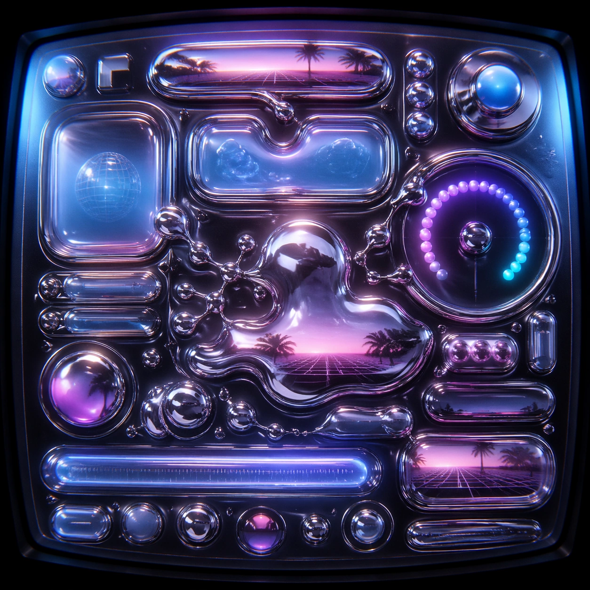

```text
Scene:
A square abstract interface scene viewed straight-on like a frozen frame from a futuristic operating system running on a curved CRT. The image is luminous and dark, with black glass, electric cyan highlights, magenta bloom, and silver reflections. The edges of the frame show slight barrel distortion, phosphor glow, and soft analog noise, while the center remains sharp enough to read as a physical screen surface.

Subject:
A liquid-metal control panel made of chrome puddles, beveled translucent buttons, floating glass tabs, and soft blue interface panels, but with no readable text. The forms resemble early-2000s skeuomorphic UI translated into real objects: raised capsules, glossy sliders, bubble-like icons, and pearlescent loading arcs. Droplets bridge between interface elements as if gravity and surface tension are shaping the UI. Reflections of palm silhouettes and a pink grid horizon appear inside the chrome surfaces.

Important details:
The composition must make the interface feel tactile rather than graphic. Buttons should cast tiny shadows, glass tabs should refract light, chrome puddles should have coherent reflected environments, and CRT artifacts should curve at the screen perimeter. Keep all symbols abstract and nonlinguistic. The Y2K mood comes from material excess, glossy depth, rounded forms, and impossible optimism, not from readable software labels.

Use case:
Y2K Vaporwave CRT single study 6/8, testing Y2K interface style as physical chrome and glass materials.

Constraints:
No readable text, no watermark, no logos, preserve exact 1:1 aspect ratio, no real operating system UI, no flat vector dashboard, no random pseudo letters, no modern minimal app design.
```

[Pinned source](https://github.com/ChaosRealmsAI/gpt-image-2-gallery/blob/5296db8c996e38776c83a0bc8c64f848dcd512b3/works/topics/y2k-vaporwave-crt/packages/single-crt-era-studies/images/liquid-metal-interface/meta.json) · GPT Image2 · 1254×1254 · No source-declared image dependencies. · ProjectD:pending individual review.

## Glitch Fashion Still · y2k-vaporwave-crt/single-crt-era-studies/glitch-fashion-still

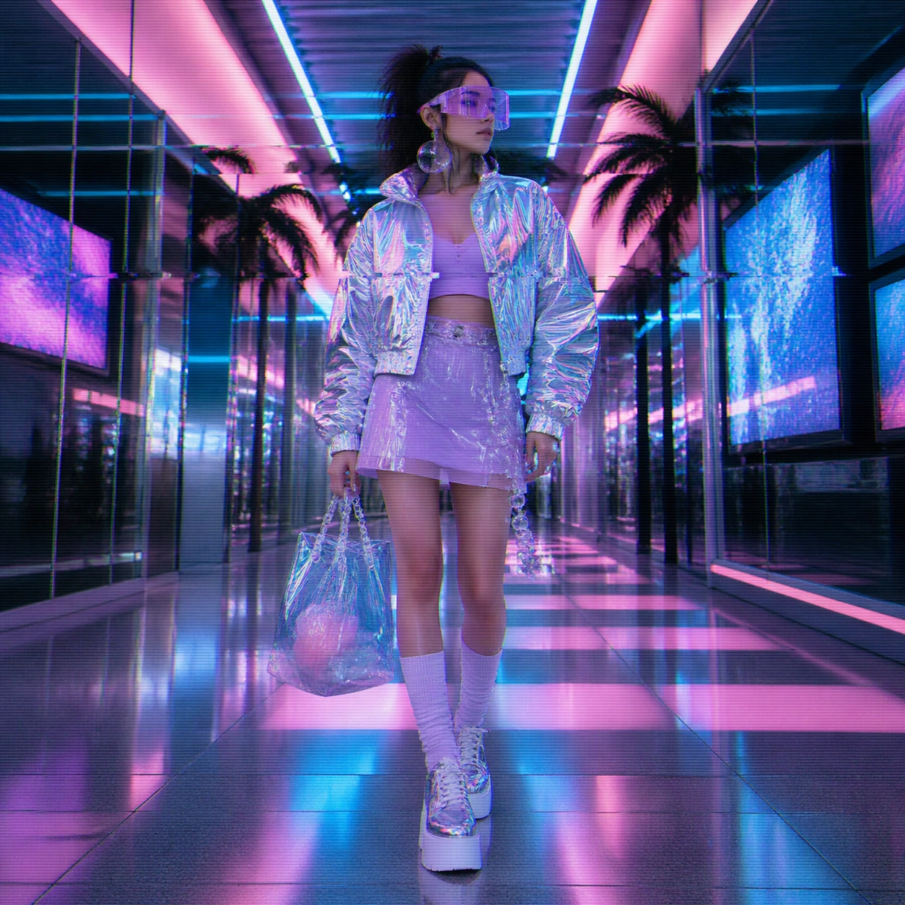

```text
Scene:
A square editorial fashion photograph staged in a glossy cyber mall corridor, lit by alternating cyan and rose neon strips. The camera is slightly below eye level with a clean central composition, as if captured from a paused VHS fashion broadcast. The image is bright on the subject, darker at the corridor edges, with controlled horizontal scanlines, mild chromatic aberration, and a few frozen glitch slices that do not obscure the silhouette.

Subject:
A fictional model wearing a Y2K vaporwave outfit: iridescent silver jacket, translucent lavender visor, chrome bubble accessories, pearly platform shoes, and a semi-transparent vinyl bag containing abstract pastel objects. The person is anonymous and stylized, not resembling any real celebrity. Behind the model, mirrored panels reflect palm shapes, grid lighting, and CRT screens showing only nonreadable abstract colors. The clothing materials should look tactile, layered, and reflective.

Important details:
This image must preserve fashion readability under glitch effects. Keep the pose elegant, the garment construction plausible, and the iridescent fabric physically believable with folds, seams, wrinkles, and sharp rim highlights. Glitch bands should shift small horizontal slices of the image by a few pixels, creating RGB breakup while leaving anatomy intact. Avoid turning the outfit into generic sci-fi armor; it should remain recognizable as Y2K editorial fashion.

Use case:
Y2K Vaporwave CRT single study 7/8, testing fashion material realism under controlled CRT glitch styling.

Constraints:
No readable text, no watermark, no logos, preserve exact 1:1 aspect ratio, no real celebrity likeness, no brand marks, no distorted hands or face focus, no heavy glitch covering garment details.
```

[Pinned source](https://github.com/ChaosRealmsAI/gpt-image-2-gallery/blob/5296db8c996e38776c83a0bc8c64f848dcd512b3/works/topics/y2k-vaporwave-crt/packages/single-crt-era-studies/images/glitch-fashion-still/meta.json) · GPT Image2 · 1254×1254 · No source-declared image dependencies. · ProjectD:pending individual review.

## After Hours Mall Atrium · y2k-vaporwave-crt/single-crt-era-studies/after-hours-mall-atrium

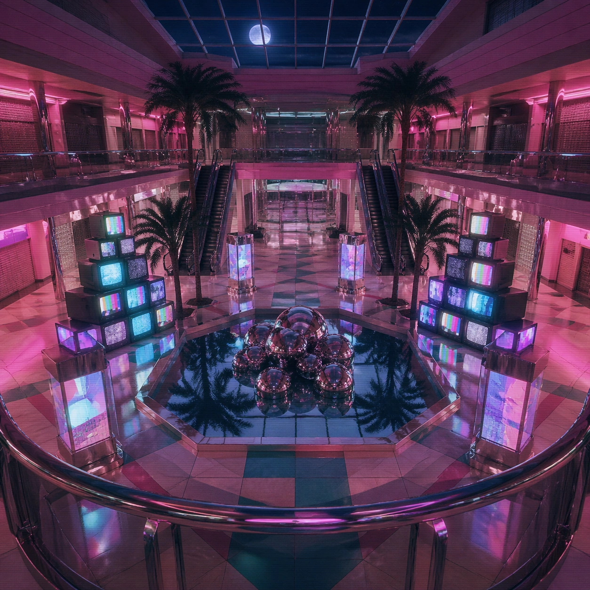

```text
Scene:
A square architectural scene inside an empty after-hours shopping mall atrium, shot from the upper balcony looking down into a symmetrical vaporwave composition. The lighting is moody but clear: pink neon from closed storefronts, cyan reflections from CRT display stacks, and pale moonlight through a skylight. The image should have the faint softness of analog tape, with scanlines most visible in darker gradients.

Subject:
A central fountain has been replaced by a chrome sphere cluster and a shallow pool reflecting artificial palm trees. Around the atrium are rounded glass railings, pastel tile patterns, dead escalators, translucent directory kiosks with abstract unreadable panels, and stacks of small CRT televisions forming a glowing sculpture. The televisions show only static, color bars without labels, palm silhouettes, and geometric gradients. Reflections should connect the water, glass, chrome, and tile surfaces.

Important details:
The scene should feel like digital nostalgia archaeology rather than a normal mall photo. Preserve coherent architecture, believable escalator geometry, and correct reflection directions. CRT artifacts belong on the television screens and reflective edges; they should not erase spatial clarity. Use vaporwave color language carefully: magenta and cyan light, pale peach tiles, black glass, and chrome highlights, with enough physical grit to keep the place credible.

Use case:
Y2K Vaporwave CRT single study 8/8, testing large-scale environment composition with CRT-era atmosphere.

Constraints:
No readable text, no watermark, no logos, preserve exact 1:1 aspect ratio, no real store signs, no people, no collapsed architecture, no excessive fog hiding the atrium structure.
```

[Pinned source](https://github.com/ChaosRealmsAI/gpt-image-2-gallery/blob/5296db8c996e38776c83a0bc8c64f848dcd512b3/works/topics/y2k-vaporwave-crt/packages/single-crt-era-studies/images/after-hours-mall-atrium/meta.json) · GPT Image2 · 1254×1254 · No source-declared image dependencies. · ProjectD:pending individual review.

## Single Breath Balance · zen-enso-golden-ratio/single-enso-ratio-studies/01-single-breath-balance

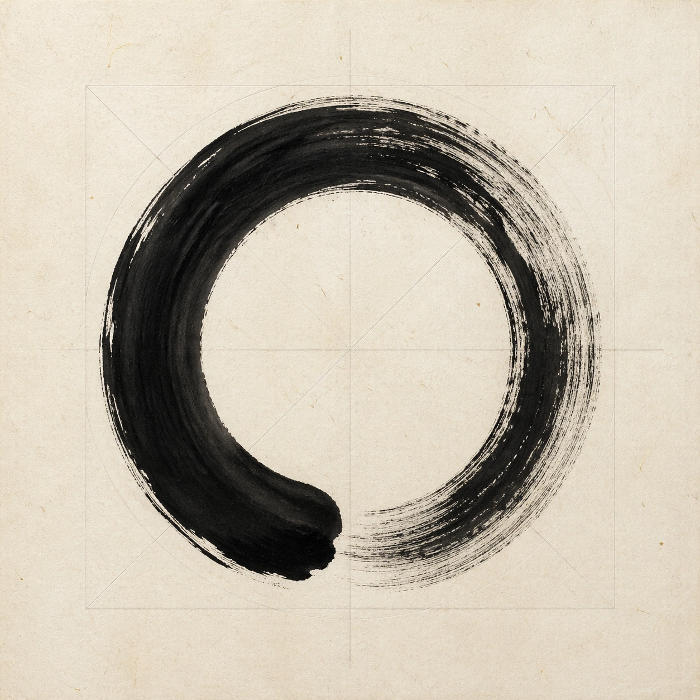

```text
Scene:
Create a square minimal composition that feels deliberate, costly, and exact rather than merely empty. The image should read as a face-on paper, wall, or material study in which negative space has been tuned with the same seriousness as the brushstroke itself. Lighting should be quiet and precise, revealing texture without cluttering the frame. Present it as a pristine paper study under soft daylight, with the full square frame honored and no camera tilt. Keep the square crop exact, the camera flat, and the tonal design disciplined enough that structure stays clear at poster scale and under close inspection.

Subject:
Use one enso brush circle or near-circle as the compositional anchor, positioned according to a disciplined proportional system that implies golden-ratio balance. The mark should feel made in one alive gesture, with real pressure variation, ink pooling, dry-brush edges, and breathing room around it. Surrounding grids or guides may be hinted at, but only as quiet structural support. Focus this variation on a black-ink master enso on warm rice paper with disciplined emptiness and a nearly invisible proportional field. The composition should feel complete and singular, as though one finished artifact has been resolved with full conviction rather than one fragment pulled from a larger sheet.

Important details:
The main challenge is proportion, not decoration. Keep the empty field active, the circle poised, and the material surface believable. Small shifts in fiber, mineral pigment, metallic dust, or wall grain should strengthen the image's meditative authority without turning it into a poster gimmick. Any guide geometry must remain subtle and non-literal. The brushstroke should feel alive yet balanced, and the surrounding empty field must feel intentionally measured rather than accidental blankness. Preserve crisp edge behavior, stable hierarchy, and enough fine information that the image rewards slow viewing without losing the main read from a distance.

Use case:
Zen Enso Ratio single study 1/9, designed as a self-contained sacred-geometry image with a distinct material and compositional emphasis.

Constraints:
No readable text, no watermark, no logos, preserve exact 1:1 aspect ratio, no readable calligraphy, no random bamboo props, no crowded zen cliche decor, no weak center of gravity, no muddy brush texture, no decorative motifs that compete with the circle, no washed-out brush edge, no decorative stamp, no off-center drift.
```

[Pinned source](https://github.com/ChaosRealmsAI/gpt-image-2-gallery/blob/5296db8c996e38776c83a0bc8c64f848dcd512b3/works/topics/zen-enso-golden-ratio/packages/single-enso-ratio-studies/images/01-single-breath-balance/meta.json) · GPT Image2 · 1254×1254 · No source-declared image dependencies. · ProjectD:pending individual review.

## Charcoal Grid Reveal · zen-enso-golden-ratio/single-enso-ratio-studies/02-charcoal-grid-reveal

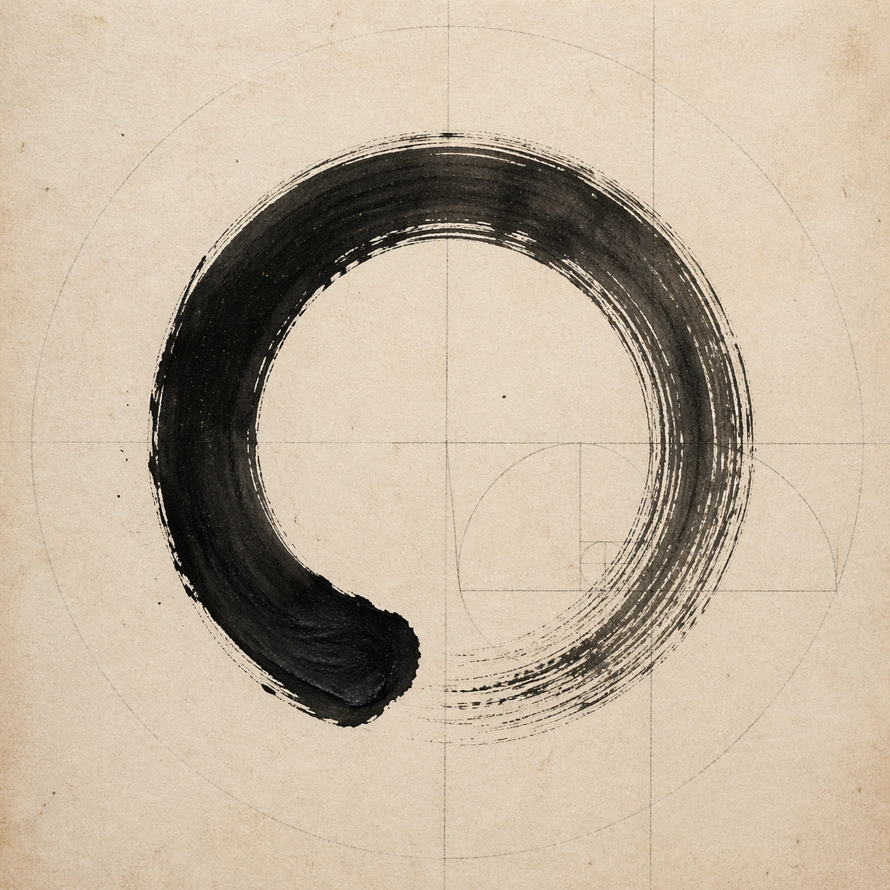

```text
Scene:
Create a square minimal composition that feels deliberate, costly, and exact rather than merely empty. The image should read as a face-on paper, wall, or material study in which negative space has been tuned with the same seriousness as the brushstroke itself. Lighting should be quiet and precise, revealing texture without cluttering the frame. Keep the guide system whisper-soft and subordinate to the ink gesture. Keep the square crop exact, the camera flat, and the tonal design disciplined enough that structure stays clear at poster scale and under close inspection.

Subject:
Use one enso brush circle or near-circle as the compositional anchor, positioned according to a disciplined proportional system that implies golden-ratio balance. The mark should feel made in one alive gesture, with real pressure variation, ink pooling, dry-brush edges, and breathing room around it. Surrounding grids or guides may be hinted at, but only as quiet structural support. Focus this variation on a slightly more analytic study where faint charcoal construction traces quietly support the enso placement. The composition should feel complete and singular, as though one finished artifact has been resolved with full conviction rather than one fragment pulled from a larger sheet.

Important details:
The main challenge is proportion, not decoration. Keep the empty field active, the circle poised, and the material surface believable. Small shifts in fiber, mineral pigment, metallic dust, or wall grain should strengthen the image's meditative authority without turning it into a poster gimmick. Any guide geometry must remain subtle and non-literal. Use charcoal only to imply proportion and spacing, never to turn the image into a classroom diagram or literal grid poster. Preserve crisp edge behavior, stable hierarchy, and enough fine information that the image rewards slow viewing without losing the main read from a distance.

Use case:
Zen Enso Ratio single study 2/9, designed as a self-contained sacred-geometry image with a distinct material and compositional emphasis.

Constraints:
No readable text, no watermark, no logos, preserve exact 1:1 aspect ratio, no readable calligraphy, no random bamboo props, no crowded zen cliche decor, no weak center of gravity, no muddy brush texture, no decorative motifs that compete with the circle, no readable numbers, no drafting board clutter, no heavy graph lines.
```

[Pinned source](https://github.com/ChaosRealmsAI/gpt-image-2-gallery/blob/5296db8c996e38776c83a0bc8c64f848dcd512b3/works/topics/zen-enso-golden-ratio/packages/single-enso-ratio-studies/images/02-charcoal-grid-reveal/meta.json) · GPT Image2 · 1254×1254 · No source-declared image dependencies. · ProjectD:pending individual review.

## Dawn Paper Silence · zen-enso-golden-ratio/single-enso-ratio-studies/03-dawn-paper-silence

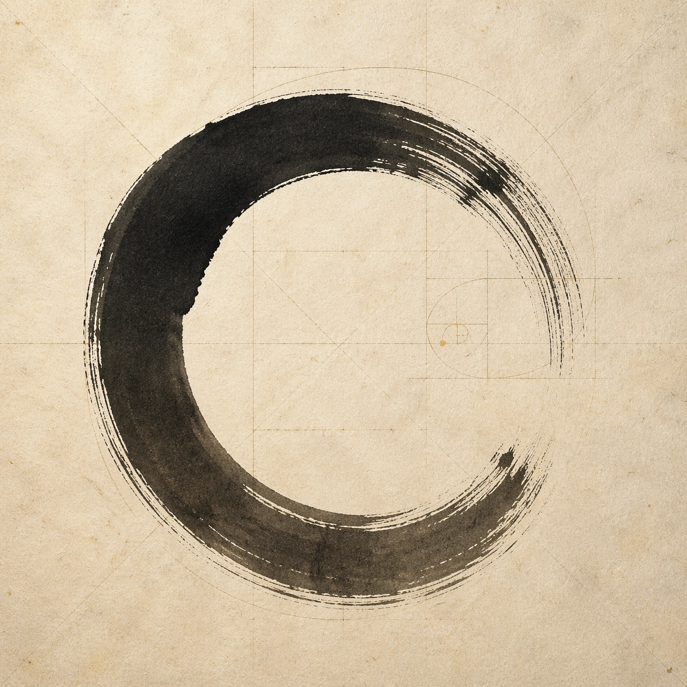

```text
Scene:
Create a square minimal composition that feels deliberate, costly, and exact rather than merely empty. The image should read as a face-on paper, wall, or material study in which negative space has been tuned with the same seriousness as the brushstroke itself. Lighting should be quiet and precise, revealing texture without cluttering the frame. Use barely warm light and a face-on view that celebrates paper tooth and breath-like spacing. Keep the square crop exact, the camera flat, and the tonal design disciplined enough that structure stays clear at poster scale and under close inspection.

Subject:
Use one enso brush circle or near-circle as the compositional anchor, positioned according to a disciplined proportional system that implies golden-ratio balance. The mark should feel made in one alive gesture, with real pressure variation, ink pooling, dry-brush edges, and breathing room around it. Surrounding grids or guides may be hinted at, but only as quiet structural support. Focus this variation on a pale dawn-lit paper study with warm fibers, soft shadow, and a calm enso held near a golden focal zone. The composition should feel complete and singular, as though one finished artifact has been resolved with full conviction rather than one fragment pulled from a larger sheet.

Important details:
The main challenge is proportion, not decoration. Keep the empty field active, the circle poised, and the material surface believable. Small shifts in fiber, mineral pigment, metallic dust, or wall grain should strengthen the image's meditative authority without turning it into a poster gimmick. Any guide geometry must remain subtle and non-literal. The circle can be slightly open, but the composition must still feel complete and anchored by invisible proportion. Preserve crisp edge behavior, stable hierarchy, and enough fine information that the image rewards slow viewing without losing the main read from a distance.

Use case:
Zen Enso Ratio single study 3/9, designed as a self-contained sacred-geometry image with a distinct material and compositional emphasis.

Constraints:
No readable text, no watermark, no logos, preserve exact 1:1 aspect ratio, no readable calligraphy, no random bamboo props, no crowded zen cliche decor, no weak center of gravity, no muddy brush texture, no decorative motifs that compete with the circle, no sunrise landscape, no floral motif, no sentimental postcard mood.
```

[Pinned source](https://github.com/ChaosRealmsAI/gpt-image-2-gallery/blob/5296db8c996e38776c83a0bc8c64f848dcd512b3/works/topics/zen-enso-golden-ratio/packages/single-enso-ratio-studies/images/03-dawn-paper-silence/meta.json) · GPT Image2 · 1254×1254 · No source-declared image dependencies. · ProjectD:pending individual review.

## Mineral Indigo Echo · zen-enso-golden-ratio/single-enso-ratio-studies/04-mineral-indigo-echo

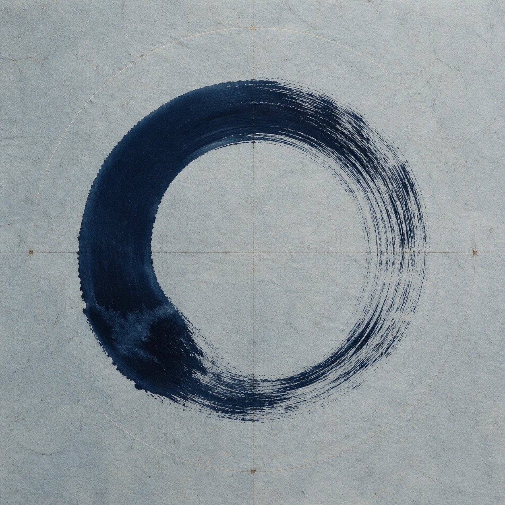

```text
Scene:
Create a square minimal composition that feels deliberate, costly, and exact rather than merely empty. The image should read as a face-on paper, wall, or material study in which negative space has been tuned with the same seriousness as the brushstroke itself. Lighting should be quiet and precise, revealing texture without cluttering the frame. Keep the palette austere and elegant, with the brushstroke carrying nearly all of the drama. Keep the square crop exact, the camera flat, and the tonal design disciplined enough that structure stays clear at poster scale and under close inspection.

Subject:
Use one enso brush circle or near-circle as the compositional anchor, positioned according to a disciplined proportional system that implies golden-ratio balance. The mark should feel made in one alive gesture, with real pressure variation, ink pooling, dry-brush edges, and breathing room around it. Surrounding grids or guides may be hinted at, but only as quiet structural support. Focus this variation on an indigo-toned variation where the enso is brushed in deep blue-black over cool mineral paper. The composition should feel complete and singular, as though one finished artifact has been resolved with full conviction rather than one fragment pulled from a larger sheet.

Important details:
The main challenge is proportion, not decoration. Keep the empty field active, the circle poised, and the material surface believable. Small shifts in fiber, mineral pigment, metallic dust, or wall grain should strengthen the image's meditative authority without turning it into a poster gimmick. Any guide geometry must remain subtle and non-literal. Use cool tonal shifts to activate the empty field while preserving the same disciplined ratio-based calm. Preserve crisp edge behavior, stable hierarchy, and enough fine information that the image rewards slow viewing without losing the main read from a distance.

Use case:
Zen Enso Ratio single study 4/9, designed as a self-contained sacred-geometry image with a distinct material and compositional emphasis.

Constraints:
No readable text, no watermark, no logos, preserve exact 1:1 aspect ratio, no readable calligraphy, no random bamboo props, no crowded zen cliche decor, no weak center of gravity, no muddy brush texture, no decorative motifs that compete with the circle, no decorative wave pattern, no gradient wallpaper, no loose splatter.
```

[Pinned source](https://github.com/ChaosRealmsAI/gpt-image-2-gallery/blob/5296db8c996e38776c83a0bc8c64f848dcd512b3/works/topics/zen-enso-golden-ratio/packages/single-enso-ratio-studies/images/04-mineral-indigo-echo/meta.json) · GPT Image2 · 1254×1254 · No source-declared image dependencies. · ProjectD:pending individual review.

## Sand Gold Spiral · zen-enso-golden-ratio/single-enso-ratio-studies/05-sand-gold-spiral

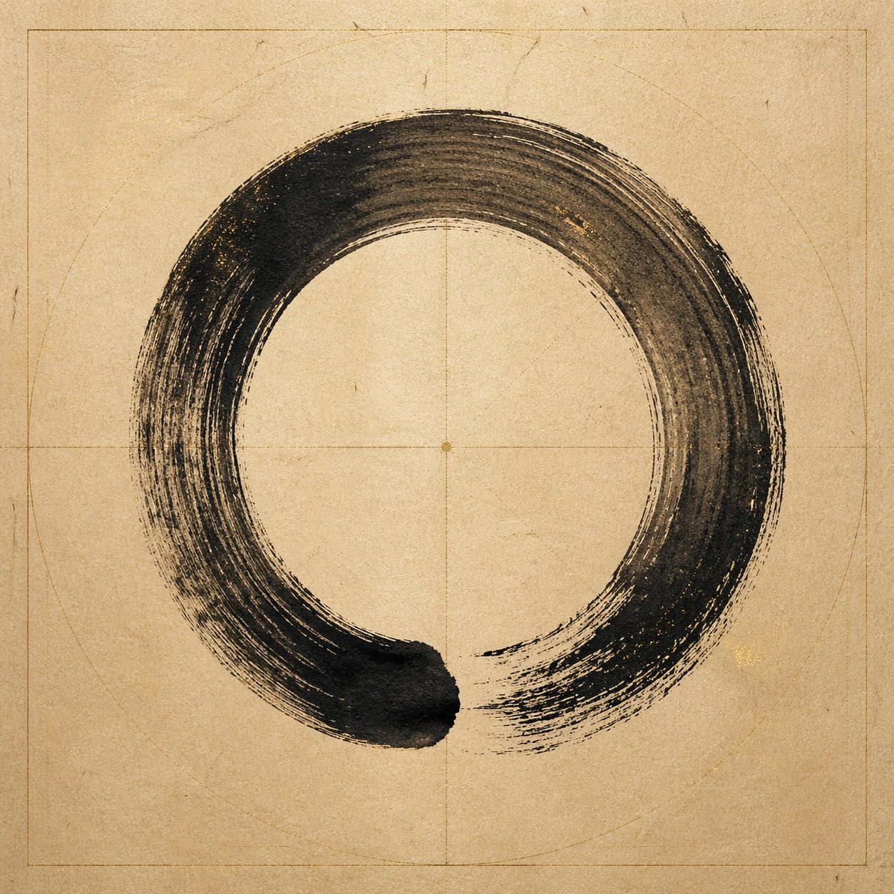

```text
Scene:
Create a square minimal composition that feels deliberate, costly, and exact rather than merely empty. The image should read as a face-on paper, wall, or material study in which negative space has been tuned with the same seriousness as the brushstroke itself. Lighting should be quiet and precise, revealing texture without cluttering the frame. Render it like a luxury paper object, viewed squarely with raking light that reveals only minimal surface sparkle. Keep the square crop exact, the camera flat, and the tonal design disciplined enough that structure stays clear at poster scale and under close inspection.

Subject:
Use one enso brush circle or near-circle as the compositional anchor, positioned according to a disciplined proportional system that implies golden-ratio balance. The mark should feel made in one alive gesture, with real pressure variation, ink pooling, dry-brush edges, and breathing room around it. Surrounding grids or guides may be hinted at, but only as quiet structural support. Focus this variation on a subtle warm study where faint golden-ratio dusting and sandy paper grain support the brush circle. The composition should feel complete and singular, as though one finished artifact has been resolved with full conviction rather than one fragment pulled from a larger sheet.

Important details:
The main challenge is proportion, not decoration. Keep the empty field active, the circle poised, and the material surface believable. Small shifts in fiber, mineral pigment, metallic dust, or wall grain should strengthen the image's meditative authority without turning it into a poster gimmick. Any guide geometry must remain subtle and non-literal. Gold accents must be nearly subliminal and should guide the eye through proportion, not announce themselves as ornament. Preserve crisp edge behavior, stable hierarchy, and enough fine information that the image rewards slow viewing without losing the main read from a distance.

Use case:
Zen Enso Ratio single study 5/9, designed as a self-contained sacred-geometry image with a distinct material and compositional emphasis.

Constraints:
No readable text, no watermark, no logos, preserve exact 1:1 aspect ratio, no readable calligraphy, no random bamboo props, no crowded zen cliche decor, no weak center of gravity, no muddy brush texture, no decorative motifs that compete with the circle, no glitter, no festive metallic confetti, no literal spiral diagram.
```

[Pinned source](https://github.com/ChaosRealmsAI/gpt-image-2-gallery/blob/5296db8c996e38776c83a0bc8c64f848dcd512b3/works/topics/zen-enso-golden-ratio/packages/single-enso-ratio-studies/images/05-sand-gold-spiral/meta.json) · GPT Image2 · 1254×1254 · No source-declared image dependencies. · ProjectD:pending individual review.

## Weathered Wall Mural · zen-enso-golden-ratio/single-enso-ratio-studies/06-weathered-wall-mural

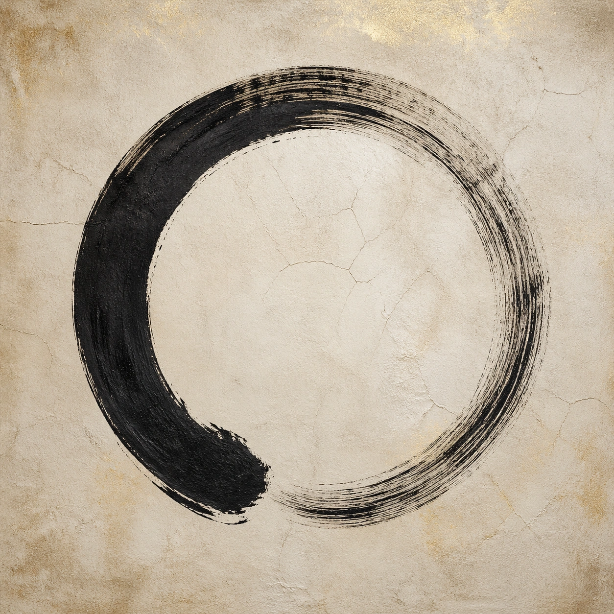

```text
Scene:
Create a square minimal composition that feels deliberate, costly, and exact rather than merely empty. The image should read as a face-on paper, wall, or material study in which negative space has been tuned with the same seriousness as the brushstroke itself. Lighting should be quiet and precise, revealing texture without cluttering the frame. Keep the wall front-facing and calm, like an architectural detail plate rather than a room scene. Keep the square crop exact, the camera flat, and the tonal design disciplined enough that structure stays clear at poster scale and under close inspection.

Subject:
Use one enso brush circle or near-circle as the compositional anchor, positioned according to a disciplined proportional system that implies golden-ratio balance. The mark should feel made in one alive gesture, with real pressure variation, ink pooling, dry-brush edges, and breathing room around it. Surrounding grids or guides may be hinted at, but only as quiet structural support. Focus this variation on a mural-like interpretation where the enso sits on mineral plaster with quiet cracks and measured wall breath. The composition should feel complete and singular, as though one finished artifact has been resolved with full conviction rather than one fragment pulled from a larger sheet.

Important details:
The main challenge is proportion, not decoration. Keep the empty field active, the circle poised, and the material surface believable. Small shifts in fiber, mineral pigment, metallic dust, or wall grain should strengthen the image's meditative authority without turning it into a poster gimmick. Any guide geometry must remain subtle and non-literal. Surface age can add gravity, but the brushstroke must still dominate and the proportion of void to mark must remain exact. Preserve crisp edge behavior, stable hierarchy, and enough fine information that the image rewards slow viewing without losing the main read from a distance.

Use case:
Zen Enso Ratio single study 6/9, designed as a self-contained sacred-geometry image with a distinct material and compositional emphasis.

Constraints:
No readable text, no watermark, no logos, preserve exact 1:1 aspect ratio, no readable calligraphy, no random bamboo props, no crowded zen cliche decor, no weak center of gravity, no muddy brush texture, no decorative motifs that compete with the circle, no room furniture, no graffiti feel, no large broken plaster chunks.
```

[Pinned source](https://github.com/ChaosRealmsAI/gpt-image-2-gallery/blob/5296db8c996e38776c83a0bc8c64f848dcd512b3/works/topics/zen-enso-golden-ratio/packages/single-enso-ratio-studies/images/06-weathered-wall-mural/meta.json) · GPT Image2 · 1254×1254 · No source-declared image dependencies. · ProjectD:pending individual review.

## Ink Pool Close Study · zen-enso-golden-ratio/single-enso-ratio-studies/07-ink-pool-close-study

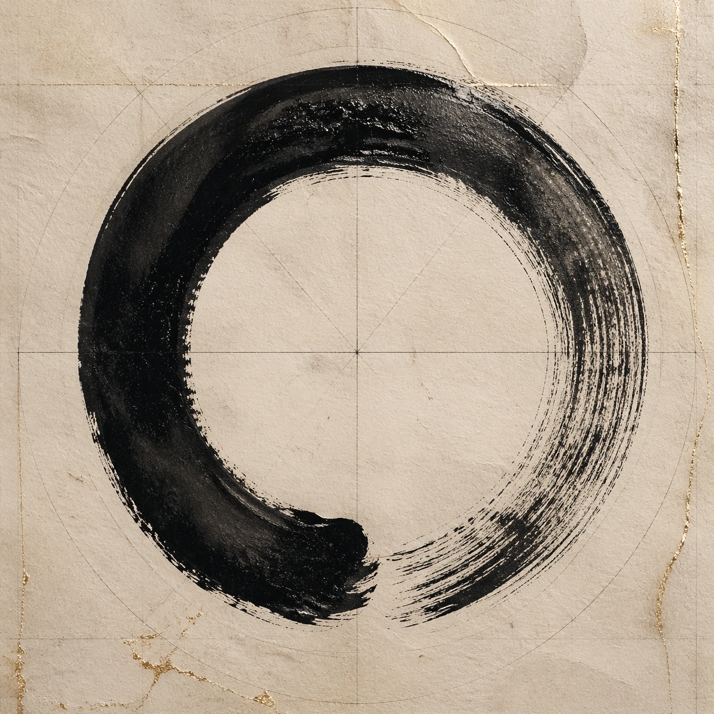

```text
Scene:
Create a square minimal composition that feels deliberate, costly, and exact rather than merely empty. The image should read as a face-on paper, wall, or material study in which negative space has been tuned with the same seriousness as the brushstroke itself. Lighting should be quiet and precise, revealing texture without cluttering the frame. Even as the brush texture becomes more tactile, preserve the full square composition and the integrity of the empty field. Keep the square crop exact, the camera flat, and the tonal design disciplined enough that structure stays clear at poster scale and under close inspection.

Subject:
Use one enso brush circle or near-circle as the compositional anchor, positioned according to a disciplined proportional system that implies golden-ratio balance. The mark should feel made in one alive gesture, with real pressure variation, ink pooling, dry-brush edges, and breathing room around it. Surrounding grids or guides may be hinted at, but only as quiet structural support. Focus this variation on a closer, darker study emphasizing ink pooling, dry edge breakup, and the material intelligence of one gesture. The composition should feel complete and singular, as though one finished artifact has been resolved with full conviction rather than one fragment pulled from a larger sheet.

Important details:
The main challenge is proportion, not decoration. Keep the empty field active, the circle poised, and the material surface believable. Small shifts in fiber, mineral pigment, metallic dust, or wall grain should strengthen the image's meditative authority without turning it into a poster gimmick. Any guide geometry must remain subtle and non-literal. The viewer should feel the pressure changes and paper absorption while still perceiving a disciplined overall ratio. Preserve crisp edge behavior, stable hierarchy, and enough fine information that the image rewards slow viewing without losing the main read from a distance.

Use case:
Zen Enso Ratio single study 7/9, designed as a self-contained sacred-geometry image with a distinct material and compositional emphasis.

Constraints:
No readable text, no watermark, no logos, preserve exact 1:1 aspect ratio, no readable calligraphy, no random bamboo props, no crowded zen cliche decor, no weak center of gravity, no muddy brush texture, no decorative motifs that compete with the circle, no cropped-off circle, no abstract smear, no expressionist chaos.
```

[Pinned source](https://github.com/ChaosRealmsAI/gpt-image-2-gallery/blob/5296db8c996e38776c83a0bc8c64f848dcd512b3/works/topics/zen-enso-golden-ratio/packages/single-enso-ratio-studies/images/07-ink-pool-close-study/meta.json) · GPT Image2 · 1254×1254 · No source-declared image dependencies. · ProjectD:pending individual review.

## Moon White Negative Space · zen-enso-golden-ratio/single-enso-ratio-studies/08-moon-white-negative-space

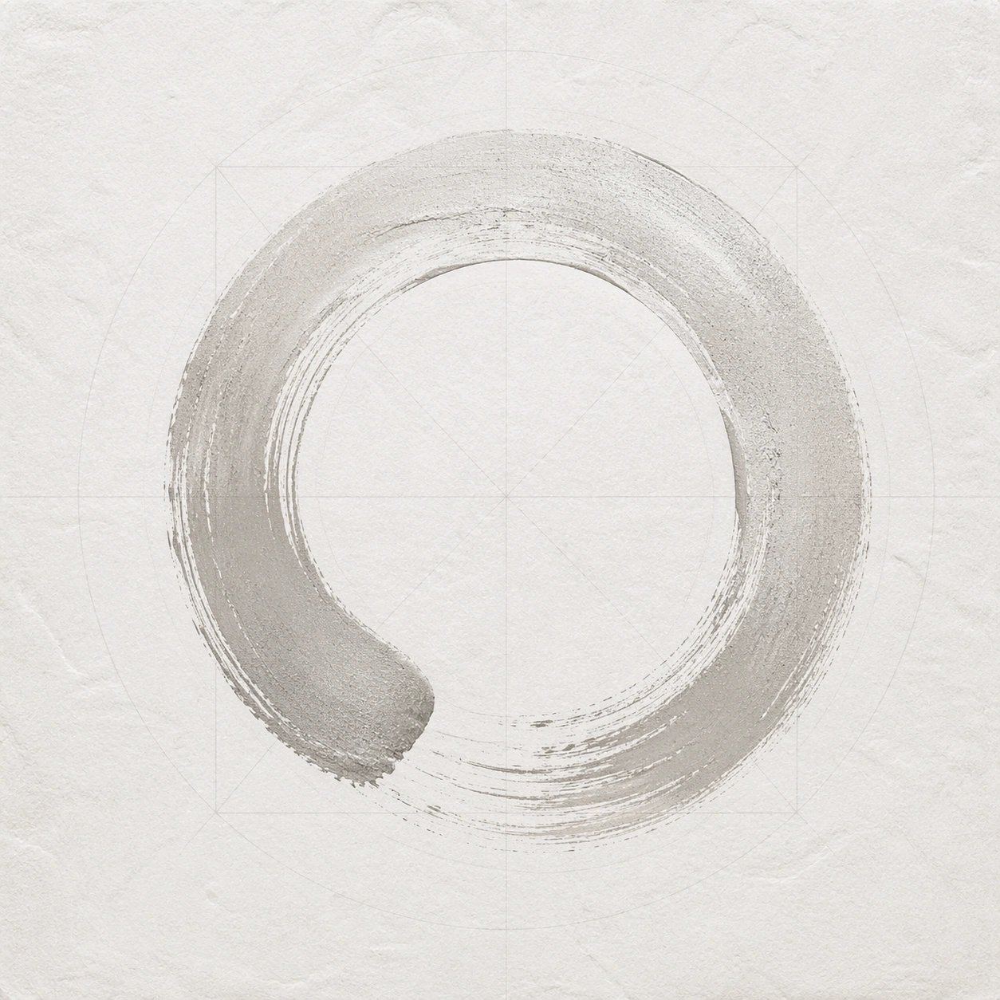

```text
Scene:
Create a square minimal composition that feels deliberate, costly, and exact rather than merely empty. The image should read as a face-on paper, wall, or material study in which negative space has been tuned with the same seriousness as the brushstroke itself. Lighting should be quiet and precise, revealing texture without cluttering the frame. Use whisper-soft contrast and frontal conservation lighting so minute paper relief becomes visible. Keep the square crop exact, the camera flat, and the tonal design disciplined enough that structure stays clear at poster scale and under close inspection.

Subject:
Use one enso brush circle or near-circle as the compositional anchor, positioned according to a disciplined proportional system that implies golden-ratio balance. The mark should feel made in one alive gesture, with real pressure variation, ink pooling, dry-brush edges, and breathing room around it. Surrounding grids or guides may be hinted at, but only as quiet structural support. Focus this variation on a near-monochrome white-on-white study where the enso is built from subtle ash grey and silvered paper depth. The composition should feel complete and singular, as though one finished artifact has been resolved with full conviction rather than one fragment pulled from a larger sheet.

Important details:
The main challenge is proportion, not decoration. Keep the empty field active, the circle poised, and the material surface believable. Small shifts in fiber, mineral pigment, metallic dust, or wall grain should strengthen the image's meditative authority without turning it into a poster gimmick. Any guide geometry must remain subtle and non-literal. The composition should prove that emptiness can carry weight, with the circle held by proportion, texture, and barely-there tonal shifts. Preserve crisp edge behavior, stable hierarchy, and enough fine information that the image rewards slow viewing without losing the main read from a distance.

Use case:
Zen Enso Ratio single study 8/9, designed as a self-contained sacred-geometry image with a distinct material and compositional emphasis.

Constraints:
No readable text, no watermark, no logos, preserve exact 1:1 aspect ratio, no readable calligraphy, no random bamboo props, no crowded zen cliche decor, no weak center of gravity, no muddy brush texture, no decorative motifs that compete with the circle, no invisible subject, no snow-scene metaphor, no decorative emboss pattern.
```

[Pinned source](https://github.com/ChaosRealmsAI/gpt-image-2-gallery/blob/5296db8c996e38776c83a0bc8c64f848dcd512b3/works/topics/zen-enso-golden-ratio/packages/single-enso-ratio-studies/images/08-moon-white-negative-space/meta.json) · GPT Image2 · 1254×1254 · No source-declared image dependencies. · ProjectD:pending individual review.

## Bronze Oxide Circle · zen-enso-golden-ratio/single-enso-ratio-studies/09-bronze-oxide-circle

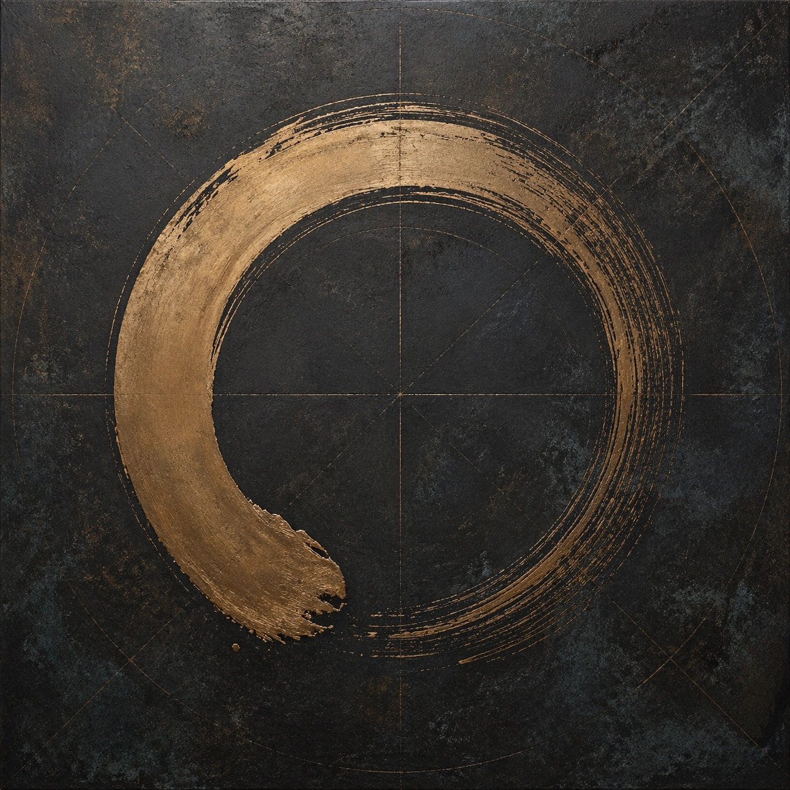

```text
Scene:
Create a square minimal composition that feels deliberate, costly, and exact rather than merely empty. The image should read as a face-on paper, wall, or material study in which negative space has been tuned with the same seriousness as the brushstroke itself. Lighting should be quiet and precise, revealing texture without cluttering the frame. Keep the surface tactile but controlled, using cool bronze and charcoal with no distracting environment. Keep the square crop exact, the camera flat, and the tonal design disciplined enough that structure stays clear at poster scale and under close inspection.

Subject:
Use one enso brush circle or near-circle as the compositional anchor, positioned according to a disciplined proportional system that implies golden-ratio balance. The mark should feel made in one alive gesture, with real pressure variation, ink pooling, dry-brush edges, and breathing room around it. Surrounding grids or guides may be hinted at, but only as quiet structural support. Focus this variation on a darker mineral study where the enso feels brushed over oxidized metal or patinated board with measured stillness. The composition should feel complete and singular, as though one finished artifact has been resolved with full conviction rather than one fragment pulled from a larger sheet.

Important details:
The main challenge is proportion, not decoration. Keep the empty field active, the circle poised, and the material surface believable. Small shifts in fiber, mineral pigment, metallic dust, or wall grain should strengthen the image's meditative authority without turning it into a poster gimmick. Any guide geometry must remain subtle and non-literal. Material richness should intensify the circle's gravity while the empty surrounding square remains spacious and balanced. Preserve crisp edge behavior, stable hierarchy, and enough fine information that the image rewards slow viewing without losing the main read from a distance.

Use case:
Zen Enso Ratio single study 9/9, designed as a self-contained sacred-geometry image with a distinct material and compositional emphasis.

Constraints:
No readable text, no watermark, no logos, preserve exact 1:1 aspect ratio, no readable calligraphy, no random bamboo props, no crowded zen cliche decor, no weak center of gravity, no muddy brush texture, no decorative motifs that compete with the circle, no industrial hardware, no rust damage spectacle, no steampunk mood.
```

[Pinned source](https://github.com/ChaosRealmsAI/gpt-image-2-gallery/blob/5296db8c996e38776c83a0bc8c64f848dcd512b3/works/topics/zen-enso-golden-ratio/packages/single-enso-ratio-studies/images/09-bronze-oxide-circle/meta.json) · GPT Image2 · 1254×1254 · No source-declared image dependencies. · ProjectD:pending individual review.
