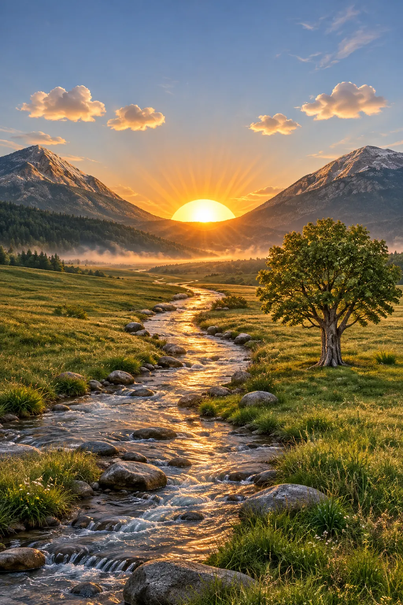
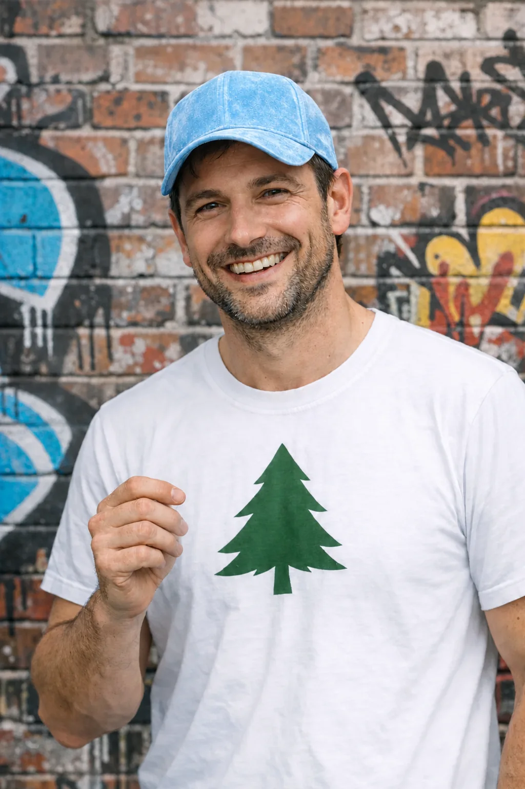
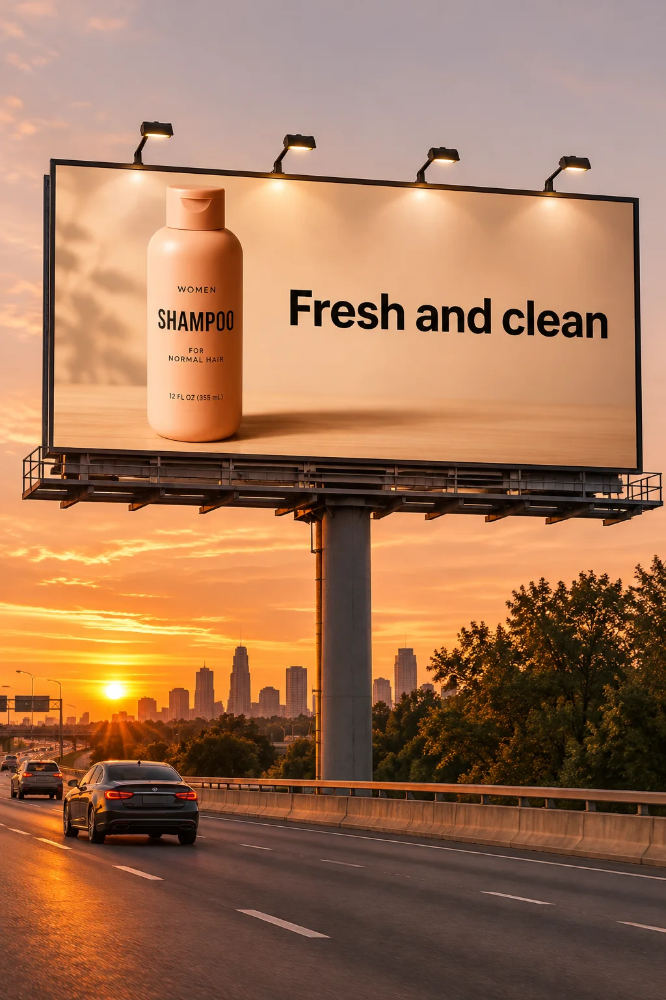

# GPT Image 2.6 — model and complexity comparisons

15 additional official outputs for already archived full prompts: 13 Flare images and 2 Sunburst complexity variants. These do not add distinct recipes. Original image copyright remains OpenAI. MIT prompt-text notices: [OpenAI Cookbook](cases/gpt-image-2.6/OPENAI-COOKBOOK-MIT-LICENSE.txt).

## official-01-complexity-medium


```text
A premium handcrafted layered paper-cut illustration of a football team celebrating a championship victory inside a packed stadium.
```

GPT Image 2.6 Sunburst · medium complexity · [Official example](https://developers.openai.com/api/docs/guides/image-prompting) · [Exact prompt file](cases/gpt-image-2.6/official-01-complexity-medium/prompt.txt)

## official-01-complexity-high


```text
A premium handcrafted layered paper-cut illustration of a football team celebrating a championship victory inside a packed stadium.
```

GPT Image 2.6 Sunburst · high complexity · [Official example](https://developers.openai.com/api/docs/guides/image-prompting) · [Exact prompt file](cases/gpt-image-2.6/official-01-complexity-high/prompt.txt)

## official-03-flare


```text
Create a photorealistic candid photograph of an elderly sailor standing on a small fishing boat.
He has weathered skin with visible wrinkles, pores, and sun texture, and a few faded traditional sailor tattoos on his arms.
He is calmly adjusting a net while his dog sits nearby on the deck. Shot like a 35mm film photograph, medium close-up at eye level, using a 50mm lens.
Soft coastal daylight, shallow depth of field, subtle film grain, natural color balance.
The image should feel honest and unposed, with real skin texture, worn materials, and everyday detail. No glamorization, no heavy retouching.
```

GPT Image 2.6 Flare · Flare comparison · [Official example](https://developers.openai.com/api/docs/guides/image-prompting) · [Exact prompt file](cases/gpt-image-2.6/official-03-flare/prompt.txt)

## official-16-flare


```text
Create a realistic outdoor crowd scene in Bethel, New York on August 16, 1969.
Photorealistic, period-accurate clothing, staging, and environment.
```

GPT Image 2.6 Flare · Flare comparison · [Official example](https://developers.openai.com/api/docs/guides/image-prompting) · [Exact prompt file](cases/gpt-image-2.6/official-16-flare/prompt.txt)

## official-17-flare


```text
Translate the text in the infographic to Spanish. Do not change any other aspect of the image.
```

GPT Image 2.6 Flare · Flare comparison · [Official example](https://developers.openai.com/api/docs/guides/image-prompting) · [Exact prompt file](cases/gpt-image-2.6/official-17-flare/prompt.txt)

## official-18-flare


```text
Use the same style from the input image and generate a man riding a motorcycle on a white background.
```

GPT Image 2.6 Flare · Flare comparison · [Official example](https://developers.openai.com/api/docs/guides/image-prompting) · [Exact prompt file](cases/gpt-image-2.6/official-18-flare/prompt.txt)

## official-19-flare


```text
Edit the image to dress the woman using the provided clothing images. Do not change her face, facial features, skin tone, body shape, pose, or identity in any way. Preserve her exact likeness, expression, hairstyle, and proportions. Replace only the clothing, fitting the garments naturally to her existing pose and body geometry with realistic fabric behavior. Match lighting, shadows, and color temperature to the original photo so the outfit integrates photorealistically, without looking pasted on. Do not change the background, camera angle, framing, or image quality, and do not add accessories, text, logos, or watermarks.
```

GPT Image 2.6 Flare · Flare comparison · [Official example](https://developers.openai.com/api/docs/guides/image-prompting) · [Exact prompt file](cases/gpt-image-2.6/official-19-flare/prompt.txt)

## official-20-flare


```text
Place the dog from the second image into the setting of image 1, right next to the woman, use the same style of lighting, composition and background. Do not change anything else.
```

GPT Image 2.6 Flare · Flare comparison · [Official example](https://developers.openai.com/api/docs/guides/image-prompting) · [Exact prompt file](cases/gpt-image-2.6/official-20-flare/prompt.txt)

## official-21-flare



```text
Turn this drawing into a photorealistic image.
Preserve the exact layout, proportions, and perspective.
Choose realistic materials and lighting consistent with the sketch intent.
Do not add new elements or text.
```

GPT Image 2.6 Flare · Flare comparison · [Official example](https://developers.openai.com/api/docs/guides/image-prompting) · [Exact prompt file](cases/gpt-image-2.6/official-21-flare/prompt.txt)

## official-22-flare



```text
Remove the flower from man's hand. Do not change anything else.
```

GPT Image 2.6 Flare · Flare comparison · [Official example](https://developers.openai.com/api/docs/guides/image-prompting) · [Exact prompt file](cases/gpt-image-2.6/official-22-flare/prompt.txt)

## official-23-flare


```text
Generate a highly realistic action scene where this person is running away from a large, realistic brown bear attacking a campsite. The image should look like a real photograph someone could have taken, not an overly enhanced or cinematic movie-poster image.
She is centered in the image but looking away from the camera, wearing outdoorsy camping attire, with dirt on her face and tears in her clothing. She is clearly afraid but focused on escaping, running away from the bear as it destroys the campsite behind her.
The campsite is in Yosemite National Park, with believable natural details. The time of day is dusk, with natural lighting and realistic colors. Everything should feel grounded, authentic, and unstyled, as if captured in a real moment. Avoid cinematic lighting, dramatic color grading, or stylized composition.
```

GPT Image 2.6 Flare · Flare comparison · [Official example](https://developers.openai.com/api/docs/guides/image-prompting) · [Exact prompt file](cases/gpt-image-2.6/official-23-flare/prompt.txt)

## official-24-flare



```text
Create a realistic billboard mockup of the shampoo on a highway scene during sunset.
Billboard text (EXACT, verbatim, no extra characters):
"Fresh and clean"
Typography: bold sans-serif, high contrast, centered, clean kerning.
Ensure text appears once and is perfectly legible.
No watermarks, no logos.
```

GPT Image 2.6 Flare · Flare comparison · [Official example](https://developers.openai.com/api/docs/guides/image-prompting) · [Exact prompt file](cases/gpt-image-2.6/official-24-flare/prompt.txt)

## official-25-flare


```text
Make it look like a winter evening with snowfall.
```

GPT Image 2.6 Flare · Flare comparison · [Official example](https://developers.openai.com/api/docs/guides/image-prompting) · [Exact prompt file](cases/gpt-image-2.6/official-25-flare/prompt.txt)

## official-26-flare


```text
Create a children’s book illustration introducing a main character.

Character:
A young, storybook-style hero inspired by a little forest outlaw,
wearing a simple green hooded tunic, soft brown boots, and a small belt pouch.
The character has a kind expression, gentle eyes, and a brave but warm demeanor.
Carries a small wooden bow used only for helping, never harming.

Theme:
The character protects and rescues small forest animals like squirrels, birds, and rabbits.

Style:
Children’s book illustration, hand-painted watercolor look,
soft outlines, warm earthy colors, whimsical and friendly.
Proportions suitable for picture books (slightly oversized head, expressive face).

Constraints:
- Original character (no copyrighted characters)
- No text
- No watermarks
- Plain forest background to clearly showcase the character
```

GPT Image 2.6 Flare · Flare comparison · [Official example](https://developers.openai.com/api/docs/guides/image-prompting) · [Exact prompt file](cases/gpt-image-2.6/official-26-flare/prompt.txt)

## official-27-flare


```text
Continue the children’s book story using the same character.

Scene:
The same young forest hero is gently helping a frightened squirrel
out of a fallen tree after a winter storm.
The character kneels beside the squirrel, offering reassurance.

Character Consistency:
- Same green hooded tunic
- Same facial features, proportions, and color palette
- Same gentle, heroic personality

Style:
Children’s book watercolor illustration,
soft lighting, snowy forest environment,
warm and comforting mood.

Constraints:
- Do not redesign the character
- No text
- No watermarks
```

GPT Image 2.6 Flare · Flare comparison · [Official example](https://developers.openai.com/api/docs/guides/image-prompting) · [Exact prompt file](cases/gpt-image-2.6/official-27-flare/prompt.txt)

