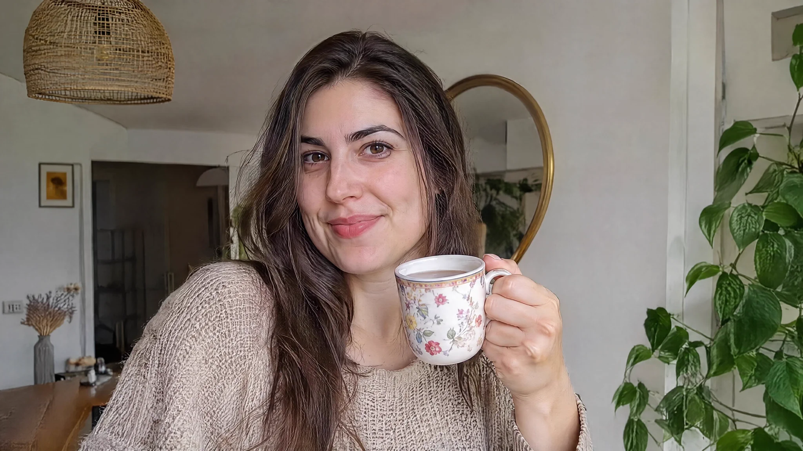

# GPT Image 2.6 — independent creator example



```text
a realistic photo of a woman holding a cup of tea inside her home
```

Model: GPT Image 2.6; variant/settings unspecified. Author: Vert (@v3rt0x_). [Original post](https://x.com/v3rt0x_/status/2118147596891901957).

The creator identifies the first attachment as 2.6 and the second as 2.5; only the first is archived. Complete 14-word prompt quoted with attribution. Original image and author rights retained; no blanket reuse license is claimed. This source-attested example has not been independently regenerated.
