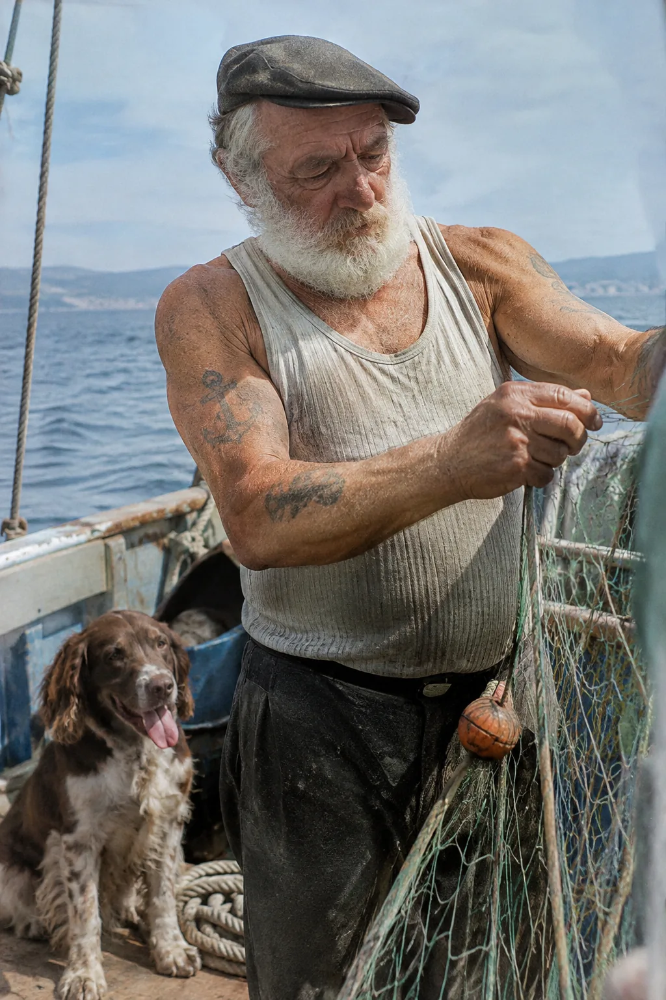
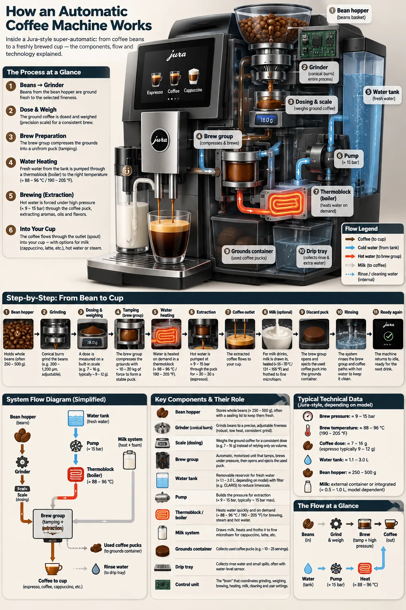
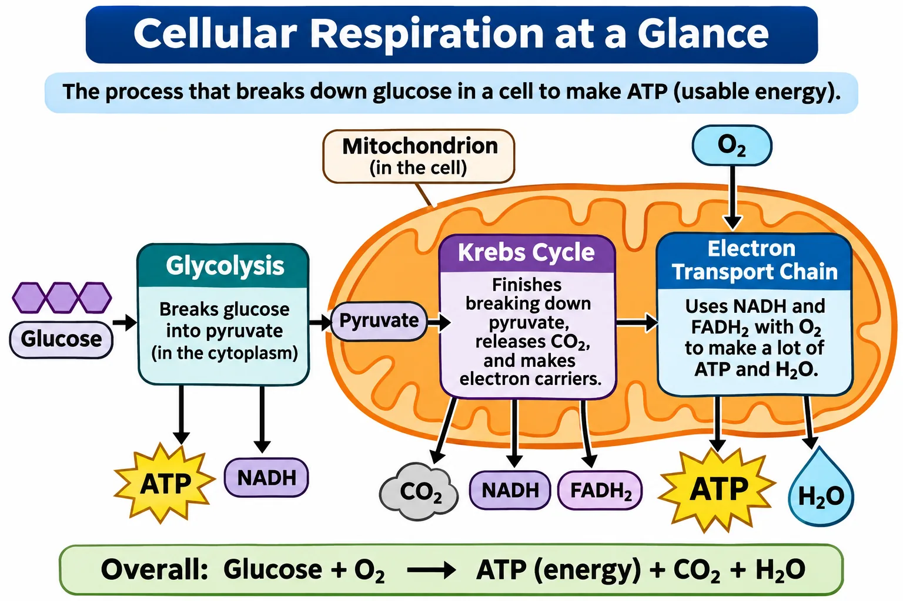
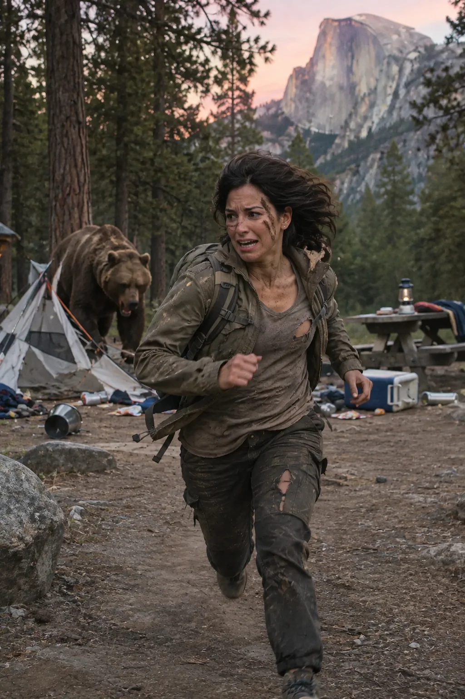
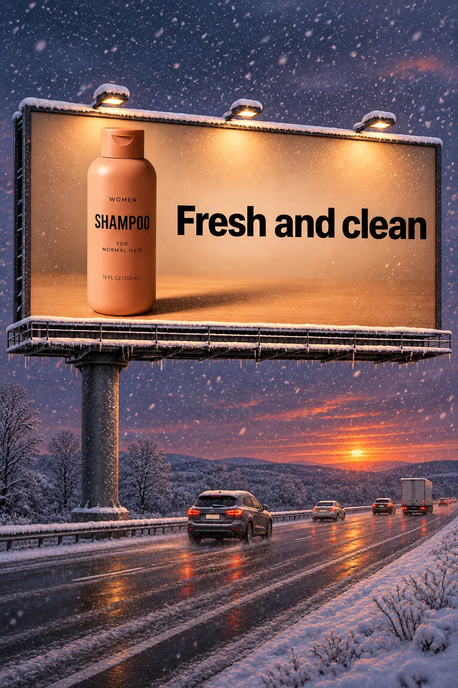

# GPT Image 2.6 — 图片与完整 prompt

已核对 21 组完整图文。图片、完整 prompt 文件和原始来源均保存在本仓库。模型标注以官方 2.6 文档及对应图片为依据。

Prompt 许可和图片版权分别记录，原始署名保留。ProjectD 上线状态单独记录。

## Paper-cut football championship celebration

A premium handcrafted layered paper-cut illustration of a football team celebrating a championship victory inside a packed stadium.

[完整 prompt 文件](cases/gpt-image-2.6/official-01/prompt.txt) · [官方来源](https://developers.openai.com/api/docs/guides/image-prompting) · GPT Image 2.6 Sunburst

## Candid elderly sailor and dog photograph

Create a photorealistic candid photograph of an elderly sailor standing on a small fishing boat.
He has weathered skin with visible wrinkles, pores, and sun texture, and a few faded traditional sailor tattoos on his arms.
He is calmly adjusting a net while his dog sits nearby on the deck. Shot like a 35mm film photograph, medium close-up at eye level, using a 50mm lens.
Soft coastal daylight, shallow depth of field, subtle film grain, natural color balance.
The image should feel honest and unposed, with real skin texture, worn materials, and everyday detail. No glamorization, no heavy retouching.

[完整 prompt 文件](cases/gpt-image-2.6/official-03/prompt.txt) · [官方来源](https://developers.openai.com/api/docs/guides/image-prompting) · GPT Image 2.6 Sunburst

## Automatic coffee machine process infographic

Create a detailed Infographic of the functioning and flow of an automatic coffee machine like a Jura.
From bean basket, to grinding, to scale, water tank, boiler, etc.
I'd like to understand technically and visually the flow.

[完整 prompt 文件](cases/gpt-image-2.6/official-04/prompt.txt) · [官方来源](https://developers.openai.com/api/docs/guides/image-prompting) · GPT Image 2.6 Sunburst

## Thread streetwear campaign with exact tagline

Give me a cool in culture ad / fashion shot for a brand called Thread.
It's a hip young street brand. The ad shows a group of friends hanging out together with the tagline "Yours to Create."
Make it feel like a polished campaign image for a youth streetwear audience: stylish, contemporary, energetic, and tasteful.
Use clean composition, strong color direction, natural poses, and premium fashion photography cues.
Render the tagline exactly once, clearly and legibly, integrated into the ad layout.
No extra text, no watermarks, no unrelated logos.

[完整 prompt 文件](cases/gpt-image-2.6/official-05/prompt.txt) · [官方来源](https://developers.openai.com/api/docs/guides/image-prompting) · GPT Image 2.6 Sunburst

## Field and Flour bakery logo

Create an original, non-infringing logo for a company called Field & Flour, a local bakery.
The logo should feel warm, simple, and timeless. Use clean, vector-like shapes, a strong silhouette, and balanced negative space.
Favor simplicity over detail so it reads clearly at small and large sizes. Flat design, minimal strokes, no gradients unless essential.
Fully transparent background. Deliver a single centered logo with generous padding, clean alpha edges, and no solid backdrop, scenery, checkerboard, or watermark.

[完整 prompt 文件](cases/gpt-image-2.6/official-06/prompt.txt) · [官方来源](https://developers.openai.com/api/docs/guides/image-prompting) · GPT Image 2.6 Sunburst

## Local farmers market app preview

Create a realistic mobile app UI mockup for a local farmers market.
Show today's market with a simple header, a short list of vendors with small photos and categories, a small "Today's specials" section, and basic information for location and hours.
Design it to be practical, and easy to use. White background, subtle natural accent colors, clear typography, and minimal decoration.
It should look like a real, well-designed, beautiful app for a small local market.
Place the UI mockup in an iPhone frame.

[完整 prompt 文件](cases/gpt-image-2.6/official-08/prompt.txt) · [官方来源](https://developers.openai.com/api/docs/guides/image-prompting) · GPT Image 2.6 Sunburst

## Cellular respiration classroom diagram (illustrative)

Create a simple biology diagram titled "Cellular Respiration at a Glance" for high school students.

Show how glucose turns into energy inside a cell. Include glycolysis, the Krebs cycle, and the electron transport chain.
Use arrows to connect the steps, and label the main molecules: glucose, pyruvate, ATP, NADH, FADH2, CO2, O2, and H2O.
Make it look like a clean classroom handout or slide, with a white background, simple icons, clear labels, and easy-to-read text.

Avoid tiny text, extra decoration, or anything that makes the diagram hard to understand.

[完整 prompt 文件](cases/gpt-image-2.6/official-09/prompt.txt) · [官方来源](https://developers.openai.com/api/docs/guides/image-prompting) · GPT Image 2.6 Sunburst

## Market opportunity slide with fictional figures

Create one pitch-deck slide titled **"Market Opportunity"** that feels like a real Series A fundraising slide from a YC-backed startup.

Use a clean white background, modern sans-serif typography like Inter, and a crisp, minimal layout. The slide should include:

* A TAM/SAM/SOM concentric-circle diagram in muted blues and grays
* Specific, believable market sizing numbers:

  * **TAM:** $42B
  * **SAM:** $8.7B
  * **SOM:** $340M
* A clean bar chart below showing market growth from **2021 to 2026**, with a subtle upward trend
* Small footnotes: **"AGI Research, 2024"** and **"Internal analysis"**
* A company logo placeholder in the bottom-right corner

The design should look like it belongs in a deck that actually raised money: highly readable text, clear data hierarchy, polished spacing, and professional startup-style visual language.

Avoid clip art, stock photography, gradients, shadows, decorative elements, or anything that feels generic or overdesigned.

[完整 prompt 文件](cases/gpt-image-2.6/official-10/prompt.txt) · [官方来源](https://developers.openai.com/api/docs/guides/image-prompting) · GPT Image 2.6 Sunburst

## Transparent shampoo product cutout (reference required)

Extract the product from the input image and isolate it on a fully transparent background.
Output: centered product, crisp silhouette, no halos/fringing.
Preserve product geometry and label legibility exactly.
Add only light polishing. Do not add a solid backdrop, checkerboard, scenery, or shadow.
Do not restyle the product; remove the background and preserve clean alpha transparency.

[完整 prompt 文件](cases/gpt-image-2.6/official-12/prompt.txt) · [官方来源](https://developers.openai.com/api/docs/guides/image-prompting) · GPT Image 2.6 Sunburst

## 1969 Bethel crowd reconstruction

Create a realistic outdoor crowd scene in Bethel, New York on August 16, 1969.
Photorealistic, period-accurate clothing, staging, and environment.

[完整 prompt 文件](cases/gpt-image-2.6/official-16/prompt.txt) · [官方来源](https://developers.openai.com/api/docs/guides/image-prompting) · GPT Image 2.6 Sunburst

## Translate a coffee infographic to Spanish (reference required)

Translate the text in the infographic to Spanish. Do not change any other aspect of the image.

[完整 prompt 文件](cases/gpt-image-2.6/official-17/prompt.txt) · [官方来源](https://developers.openai.com/api/docs/guides/image-prompting) · GPT Image 2.6 Sunburst

## Pixel-art motorcycle style transfer (reference required)

Use the same style from the input image and generate a man riding a motorcycle on a white background.

[完整 prompt 文件](cases/gpt-image-2.6/official-18/prompt.txt) · [官方来源](https://developers.openai.com/api/docs/guides/image-prompting) · GPT Image 2.6 Sunburst

## Preserve identity while changing clothing (references required)

Edit the image to dress the woman using the provided clothing images. Do not change her face, facial features, skin tone, body shape, pose, or identity in any way. Preserve her exact likeness, expression, hairstyle, and proportions. Replace only the clothing, fitting the garments naturally to her existing pose and body geometry with realistic fabric behavior. Match lighting, shadows, and color temperature to the original photo so the outfit integrates photorealistically, without looking pasted on. Do not change the background, camera angle, framing, or image quality, and do not add accessories, text, logos, or watermarks.

[完整 prompt 文件](cases/gpt-image-2.6/official-19/prompt.txt) · [官方来源](https://developers.openai.com/api/docs/guides/image-prompting) · GPT Image 2.6 Sunburst

## Combine woman and dog references (references required)

Place the dog from the second image into the setting of image 1, right next to the woman, use the same style of lighting, composition and background. Do not change anything else.

[完整 prompt 文件](cases/gpt-image-2.6/official-20/prompt.txt) · [官方来源](https://developers.openai.com/api/docs/guides/image-prompting) · GPT Image 2.6 Sunburst

## Turn a landscape sketch into a realistic valley (reference required)

Turn this drawing into a photorealistic image.
Preserve the exact layout, proportions, and perspective.
Choose realistic materials and lighting consistent with the sketch intent.
Do not add new elements or text.

[完整 prompt 文件](cases/gpt-image-2.6/official-21/prompt.txt) · [官方来源](https://developers.openai.com/api/docs/guides/image-prompting) · GPT Image 2.6 Sunburst

## Remove a flower from a portrait (reference required)

Remove the flower from man's hand. Do not change anything else.

[完整 prompt 文件](cases/gpt-image-2.6/official-22/prompt.txt) · [官方来源](https://developers.openai.com/api/docs/guides/image-prompting) · GPT Image 2.6 Sunburst

## Place a person in a campsite scene (reference required)

Generate a highly realistic action scene where this person is running away from a large, realistic brown bear attacking a campsite. The image should look like a real photograph someone could have taken, not an overly enhanced or cinematic movie-poster image.
She is centered in the image but looking away from the camera, wearing outdoorsy camping attire, with dirt on her face and tears in her clothing. She is clearly afraid but focused on escaping, running away from the bear as it destroys the campsite behind her.
The campsite is in Yosemite National Park, with believable natural details. The time of day is dusk, with natural lighting and realistic colors. Everything should feel grounded, authentic, and unstyled, as if captured in a real moment. Avoid cinematic lighting, dramatic color grading, or stylized composition.

[完整 prompt 文件](cases/gpt-image-2.6/official-23/prompt.txt) · [官方来源](https://developers.openai.com/api/docs/guides/image-prompting) · GPT Image 2.6 Sunburst

## Shampoo highway billboard (reference required)

Create a realistic billboard mockup of the shampoo on a highway scene during sunset.
Billboard text (EXACT, verbatim, no extra characters):
"Fresh and clean"
Typography: bold sans-serif, high contrast, centered, clean kerning.
Ensure text appears once and is perfectly legible.
No watermarks, no logos.

[完整 prompt 文件](cases/gpt-image-2.6/official-24/prompt.txt) · [官方来源](https://developers.openai.com/api/docs/guides/image-prompting) · GPT Image 2.6 Sunburst

## Change the billboard scene to snowy winter (reference required)

Make it look like a winter evening with snowfall.

[完整 prompt 文件](cases/gpt-image-2.6/official-25/prompt.txt) · [官方来源](https://developers.openai.com/api/docs/guides/image-prompting) · GPT Image 2.6 Sunburst

## Introduce a watercolor forest hero

Create a children’s book illustration introducing a main character.

Character:
A young, storybook-style hero inspired by a little forest outlaw,
wearing a simple green hooded tunic, soft brown boots, and a small belt pouch.
The character has a kind expression, gentle eyes, and a brave but warm demeanor.
Carries a small wooden bow used only for helping, never harming.

Theme:
The character protects and rescues small forest animals like squirrels, birds, and rabbits.

Style:
Children’s book illustration, hand-painted watercolor look,
soft outlines, warm earthy colors, whimsical and friendly.
Proportions suitable for picture books (slightly oversized head, expressive face).

Constraints:
- Original character (no copyrighted characters)
- No text
- No watermarks
- Plain forest background to clearly showcase the character

[完整 prompt 文件](cases/gpt-image-2.6/official-26/prompt.txt) · [官方来源](https://developers.openai.com/api/docs/guides/image-prompting) · GPT Image 2.6 Sunburst

## Continue the forest hero story after snow (reference required)

Continue the children’s book story using the same character.

Scene:
The same young forest hero is gently helping a frightened squirrel
out of a fallen tree after a winter storm.
The character kneels beside the squirrel, offering reassurance.

Character Consistency:
- Same green hooded tunic
- Same facial features, proportions, and color palette
- Same gentle, heroic personality

Style:
Children’s book watercolor illustration,
soft lighting, snowy forest environment,
warm and comforting mood.

Constraints:
- Do not redesign the character
- No text
- No watermarks

[完整 prompt 文件](cases/gpt-image-2.6/official-27/prompt.txt) · [官方来源](https://developers.openai.com/api/docs/guides/image-prompting) · GPT Image 2.6 Sunburst

