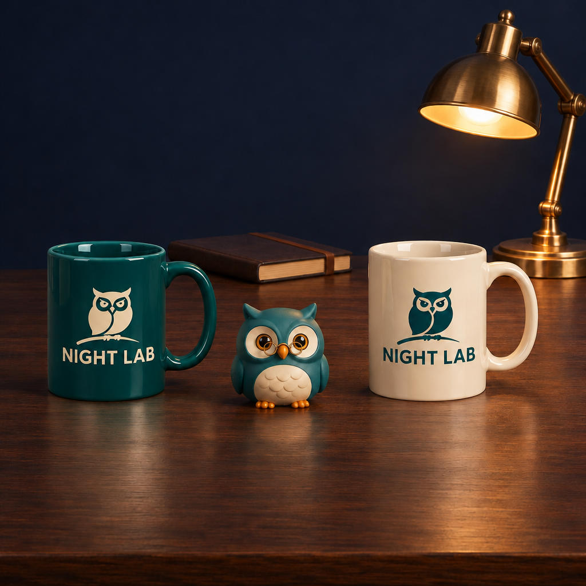
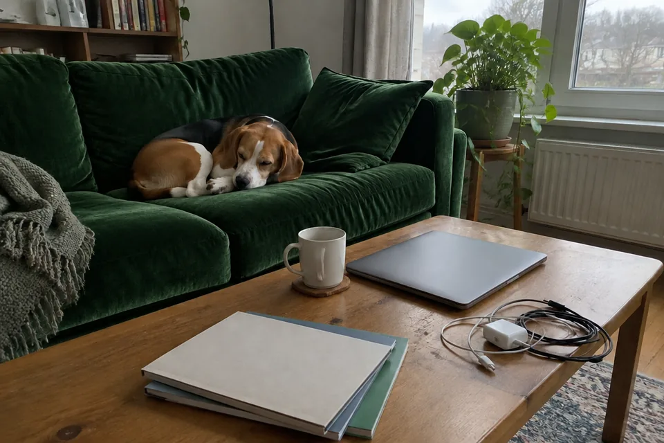
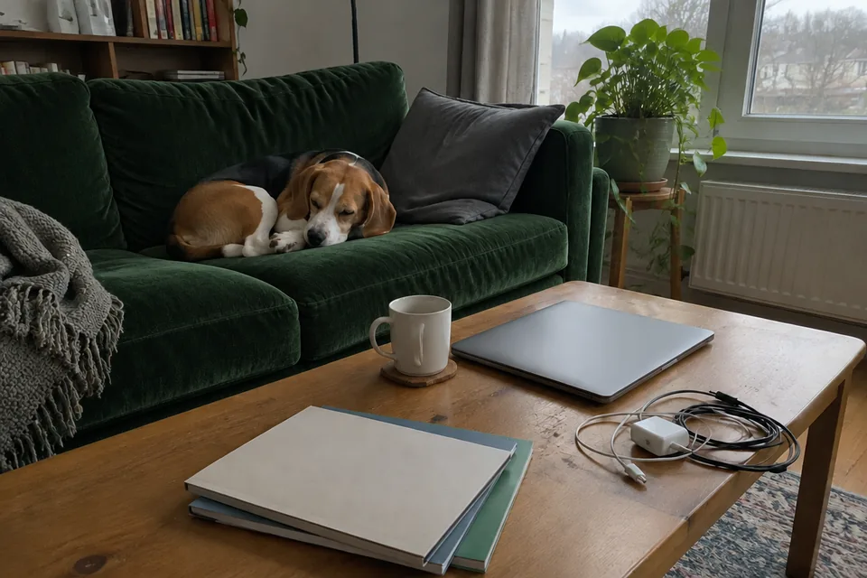

# GPT Image 2.6 — independent short-prompt examples

Three actual source-attested outputs, two distinct complete prompts. Original rights and credits retained. These are attributed short quotations, not general licensing grants.

## Selective mug recoloring in a branded product scene



```text
Change only the left mug ceramic body to deep teal. Preserve both NIGHT LAB logos, the owl, mug shapes, reflections and all scene objects.
```

GPT Image 2.6 Sunburst · az9713 · [Original source](https://github.com/az9713/gpt-image-2.6-demo/blob/98225561192b7333705acc4d57f3b41795a49d5d/image_26_experiment/manifest.json)

Reference image required. PNG to lossless WebP at native 1024x1024. Complete decoded RGBA buffers compare byte-for-byte equal; original PNG retained in archive.

## Dark green sofa edit — Flare



```text
Change only the sofa to dark green velvet. Keep everything else in the photo unchanged.
```

GPT Image 2.6 Flare · Linger / Lightlyn · [Original source](https://image.lightlyn.com/gpt-image-2-6?lang=en)

Reference image required. The author reports changes outside the target sofa. Retained as an actual model result, not a guarantee of perfectly isolated editing.

## Dark green sofa edit — Sunburst



```text
Change only the sofa to dark green velvet. Keep everything else in the photo unchanged.
```

GPT Image 2.6 Sunburst · Linger / Lightlyn · [Original source](https://image.lightlyn.com/gpt-image-2-6?lang=en)

Reference image required. The author reports changes outside the target sofa. Retained as an actual model result, not a guarantee of perfectly isolated editing.

