# GPT Image 2.6 — Prompt Seen original demonstrations

27 author-published original outputs and complete recorded working prompts. 15 PNGs and 12 composed GIFs. Credit Prompt Seen; prompt text and each output image explicitly CC BY 4.0. These are independent adaptations, not the official source images or recovered original social prompts. Variant unspecified; original provider model IDs are null. Reference asset metadata is retained, but no unlicensed reference files are rehosted. ProjectD visual review/publication remains separate.

## x_273 — image26-s01-sailor-and-dog-documentary-portrait
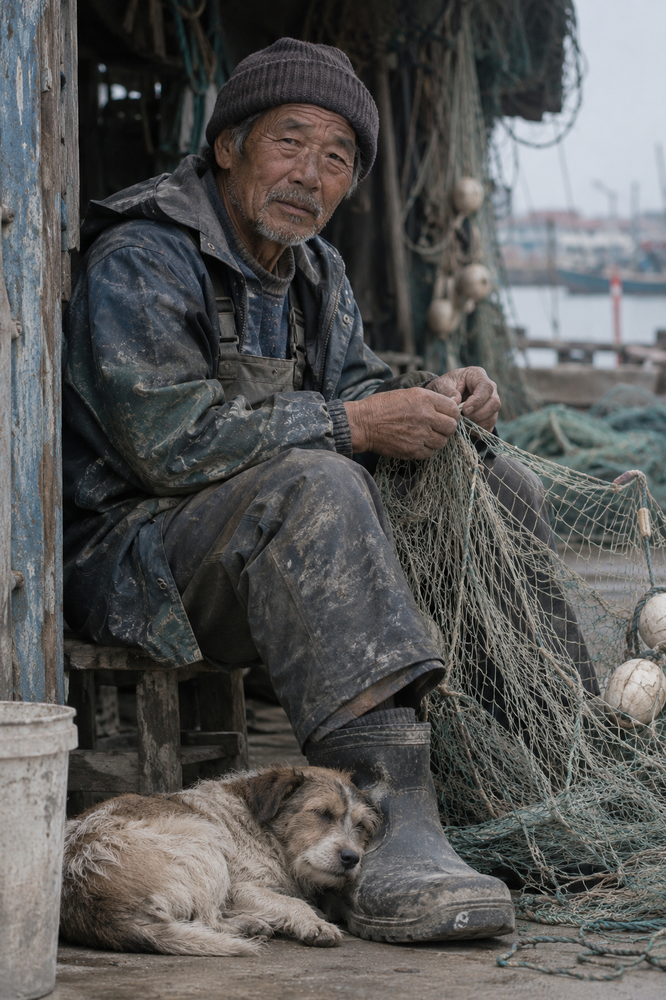
[Original source](https://github.com/picontapLab/prompt-seen/blob/272bd41645f21c4d07c3c06625904932609a613a/content/examples/x_273/run.yaml) · Credit: Prompt Seen · CC BY 4.0

```text
拍摄一张竖幅纪实人像：一位虚构的年长渔民坐在海港修网棚门口，一只小型杂毛犬靠着他的靴子休息。阴天柔光，视线与人物平齐，自然皮肤纹理，衣服有盐渍与使用痕迹，色彩克制，轻微胶片颗粒，背景能看见虚焦的渔网。避免摆拍姿势和过度磨皮。
```

## x_274 — image26-s02-coffee-machine-process-infographic
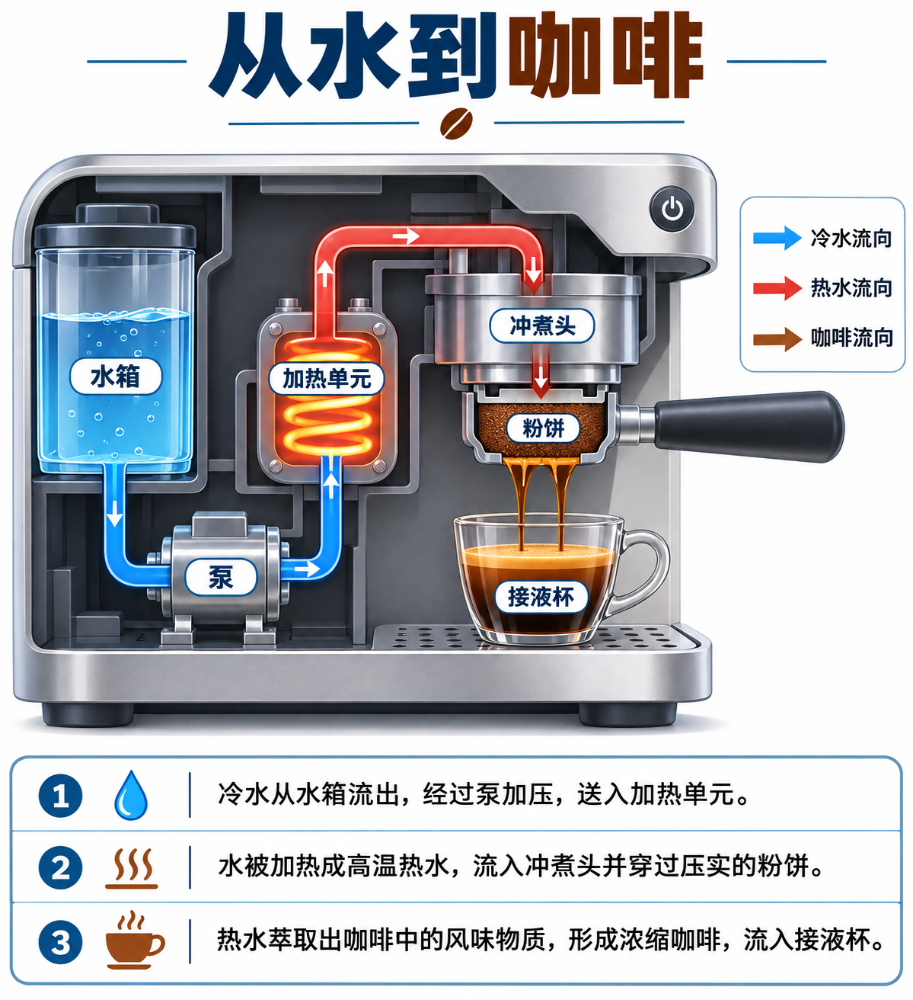
[Original source](https://github.com/picontapLab/prompt-seen/blob/272bd41645f21c4d07c3c06625904932609a613a/content/examples/x_274/run.yaml) · Credit: Prompt Seen · CC BY 4.0

```text
设计一张竖版教育信息图，解释一台虚构家用浓缩咖啡机如何工作。以清楚的剖面结构展示水箱、泵、加热单元、冲煮头、粉饼和接液杯，用连续箭头区分冷水、热水和咖啡流向。每个部件只标一个简短中文名称。顶部标题为“从水到咖啡”，底部用三句话说明过程，网格整齐，白底，蓝色与咖啡棕配色。
```

## x_275 — image26-s03-streetwear-campaign-poster
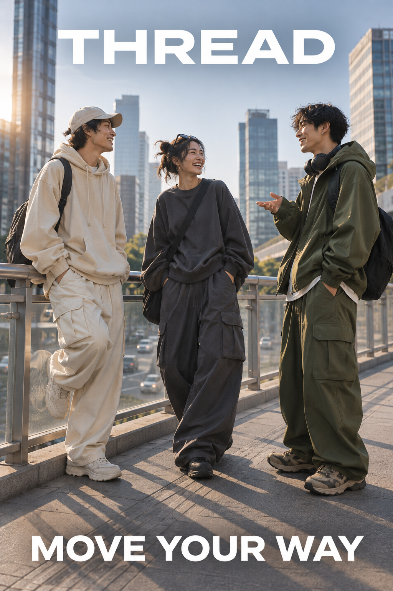
[Original source](https://github.com/picontapLab/prompt-seen/blob/272bd41645f21c4d07c3c06625904932609a613a/content/examples/x_275/run.yaml) · Credit: Prompt Seen · CC BY 4.0

```text
设计一个虚构街头服装品牌的竖版广告。三位成年朋友站在城市天桥上，穿米白、炭灰和橄榄绿的宽松服装，自然互动，清晨侧光，摄影感。顶部准确显示“THREAD”，中间留出清晰的产品轮廓，底部准确显示“MOVE YOUR WAY”。只出现这两组文字，字号清晰，避免文字遮住人脸。
```

## x_276 — image26-s04-bakery-logo

[Original source](https://github.com/picontapLab/prompt-seen/blob/272bd41645f21c4d07c3c06625904932609a613a/content/examples/x_276/run.yaml) · Credit: Prompt Seen · CC BY 4.0

```text
为虚构面包店“Field & Flour”设计一个简洁标志：一只圆面包与一根麦穗组成紧凑图形，搭配清晰的店名字标。采用暖棕单色，平面矢量视觉，适合印在小尺寸纸袋上。图形和字标置于透明背景，输出 PNG，不要店面效果图、纸张纹理或投影。
```

## x_277 — image26-s05-1969-outdoor-music-festival
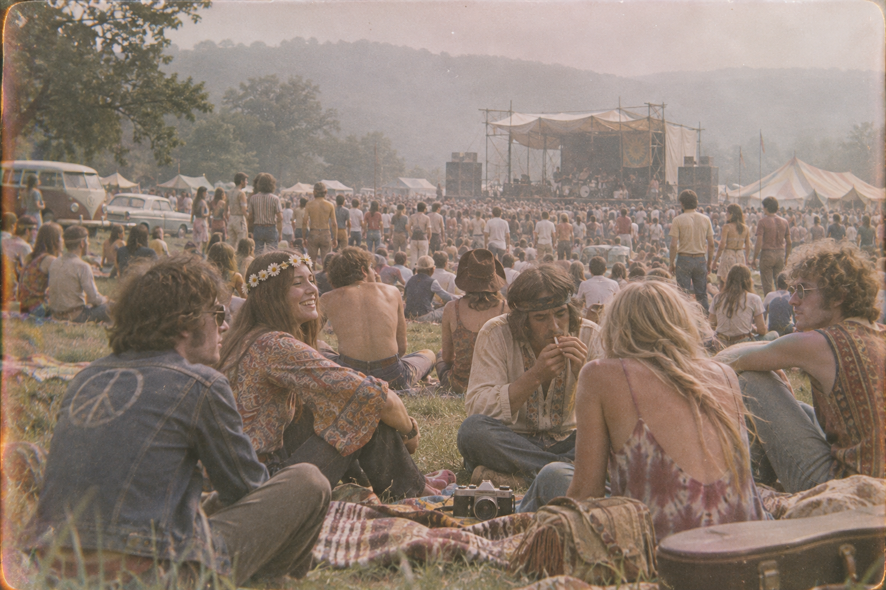
[Original source](https://github.com/picontapLab/prompt-seen/blob/272bd41645f21c4d07c3c06625904932609a613a/content/examples/x_277/run.yaml) · Credit: Prompt Seen · CC BY 4.0

```text
创作一张历史题材的虚构纪实照片，描绘 1969 年夏天美国户外音乐节的观众，广角视角，中景有坐在草地上的年轻成年人，远处是舞台与帐篷。服装、发型、相机和交通工具符合时代，避免智能手机和现代标识。午后薄雾、褪色胶片色彩，人物自然，不复制任何现存历史照片。
```

## x_278 — image26-s06-pet-home-alone-comic-strip
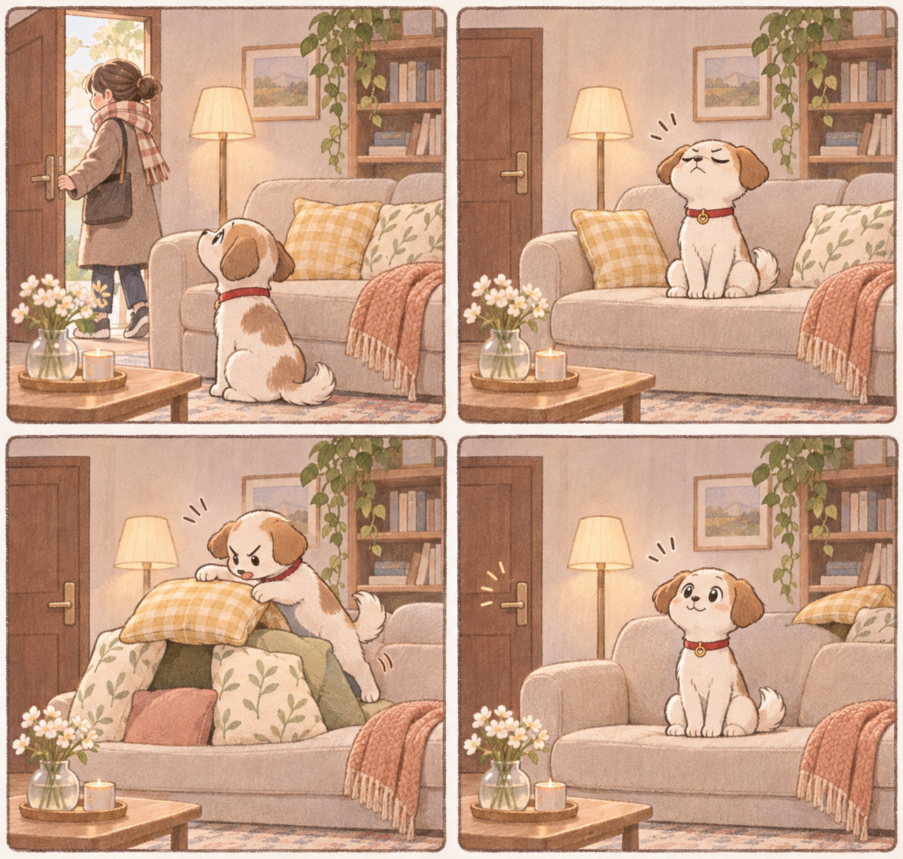
[Original source](https://github.com/picontapLab/prompt-seen/blob/272bd41645f21c4d07c3c06625904932609a613a/content/examples/x_278/run.yaml) · Credit: Prompt Seen · CC BY 4.0

```text
画一张二乘二四格漫画，四格始终是同一只戴红项圈的小狗和同一间客厅。第一格主人穿外套离家；第二格小狗一本正经坐上沙发；第三格它把靠垫垒成堡垒；第四格门锁响起，小狗恢复乖巧坐姿，背后堡垒露出一角。柔和手绘风，每格边距一致，靠表情叙事，不加对白。
```

## x_279 — image26-s07-farmers-market-mobile-interface

[Original source](https://github.com/picontapLab/prompt-seen/blob/272bd41645f21c4d07c3c06625904932609a613a/content/examples/x_279/run.yaml) · Credit: Prompt Seen · CC BY 4.0

```text
设计一张移动应用首页视觉稿，应用名“周末鲜集”。顶部显示日期与地点，主体有搜索栏、蔬果与烘焙分类、两张摊主卡片以及营业时间，底部四个清晰导航入口。中文可读，白色背景，叶绿色重点色，留白充足，真实食材缩略图。只展示平面界面，不放手机外壳，不伪装为已运行的应用。
```

## x_280 — image26-s08-cellular-respiration-learning-diagram

[Original source](https://github.com/picontapLab/prompt-seen/blob/272bd41645f21c4d07c3c06625904932609a613a/content/examples/x_280/run.yaml) · Credit: Prompt Seen · CC BY 4.0

```text
为高中生设计横版细胞呼吸概念图。以细胞轮廓和放大的线粒体作为主体，区分细胞质中的糖酵解、线粒体基质中的后续反应及内膜上的电子传递过程。用不同色带表示物质流与能量流，标注葡萄糖、氧气、二氧化碳、水和 ATP。控制文字密度，中文术语清楚，配色一致，避免装饰遮挡流程。
```

## x_281 — image26-s09-market-opportunity-pitch-slide
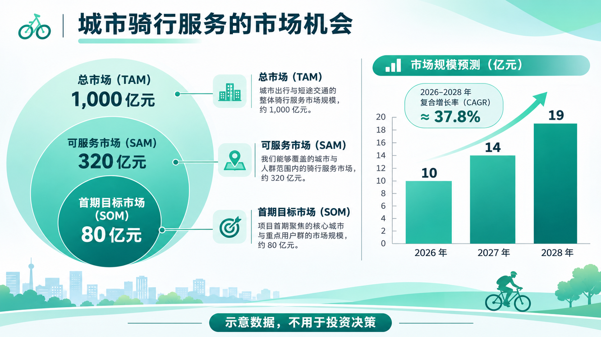
[Original source](https://github.com/picontapLab/prompt-seen/blob/272bd41645f21c4d07c3c06625904932609a613a/content/examples/x_281/run.yaml) · Credit: Prompt Seen · CC BY 4.0

```text
设计一页横向 16:9 的虚构创业融资幻灯片，标题“城市骑行服务的市场机会”。左侧三层同心圆解释总市场、可服务市场与首期目标市场；右侧用三根柱形图展示演示数据 2026 年 10、2027 年 14、2028 年 19。统一蓝绿色，数字对齐，底部清晰注明“示意数据，不用于投资决策”。不要编造真实机构来源。
```

## x_282 — image26-s10-marked-vase-color-edit
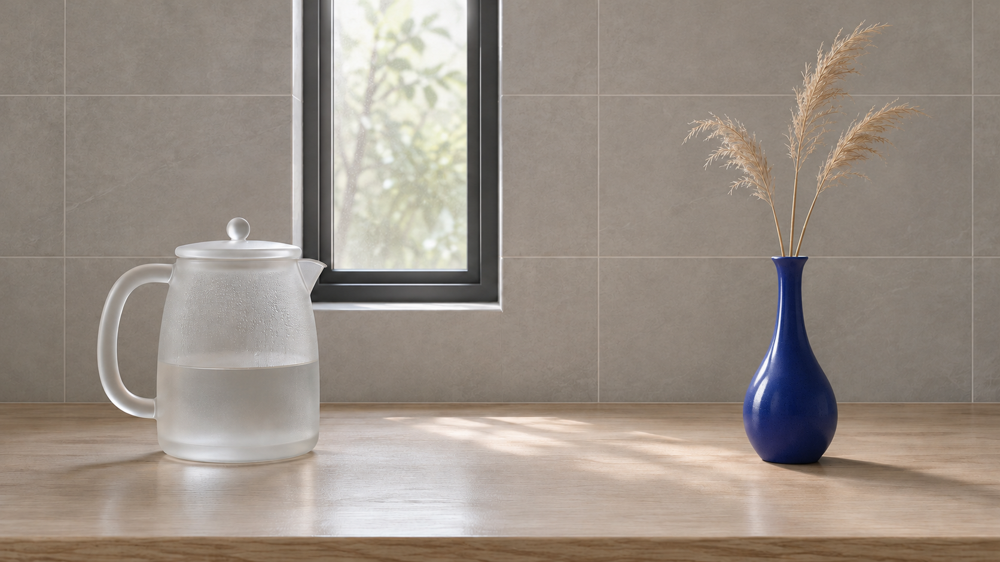
[Original source](https://github.com/picontapLab/prompt-seen/blob/272bd41645f21c4d07c3c06625904932609a613a/content/examples/x_282/run.yaml) · Credit: Prompt Seen · CC BY 4.0

```text
依据输入照片和红色圈选标注，只把圈内陶瓷花瓶的釉色改成钴蓝色。保留花瓶的形状、反光、阴影和插花，不改变桌面、墙面及其他物件。最终成图移除红圈和所有标注，维持自然摄影质感。
```

## x_283 — image26-s11-pixel-art-motorcycle-rider
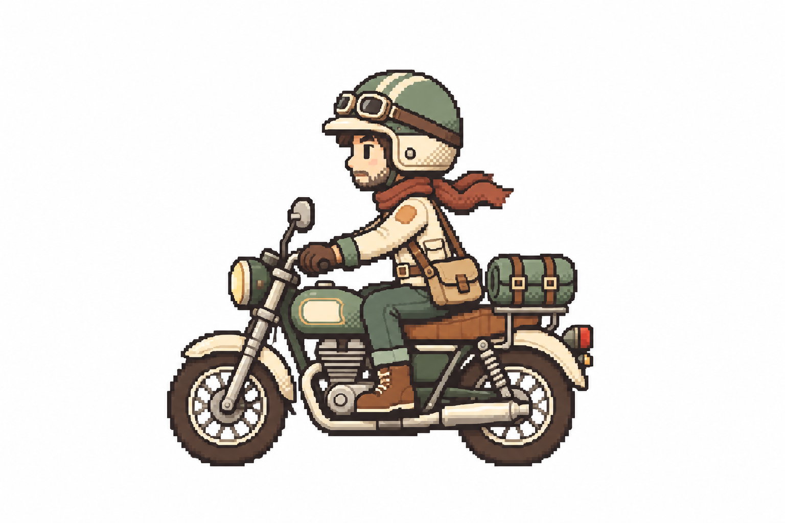
[Original source](https://github.com/picontapLab/prompt-seen/blob/272bd41645f21c4d07c3c06625904932609a613a/content/examples/x_283/run.yaml) · Credit: Prompt Seen · CC BY 4.0

```text
参考输入图的像素颗粒、有限色板、硬边轮廓和阴影方式，创作一位戴头盔的成年骑手驾驶复古摩托车的侧面全身图。主体完整居中，车轮均可见，白色背景，保持像素风，不照搬参考图人物和车辆，不加入文字、商标或渐变光效。
```

## x_284 — image26-s12-river-valley-sketch-to-photograph

[Original source](https://github.com/picontapLab/prompt-seen/blob/272bd41645f21c4d07c3c06625904932609a613a/content/examples/x_284/run.yaml) · Credit: Prompt Seen · CC BY 4.0

```text
把输入河谷线稿转成可信的自然风景照片。严格沿用新线稿中的河道走向、木桥位置、松树数量与山脊比例，补充岩石、草地、河水和树皮的真实材质。采用清晨柔光，阴影方向一致。去除纸张和笔触，但不要重新设计构图或增加建筑。
```

## x_285 — image26-s13-orange-office-cat-sticker-sheet

[Original source](https://github.com/picontapLab/prompt-seen/blob/272bd41645f21c4d07c3c06625904932609a613a/content/examples/x_285/run.yaml) · Credit: Prompt Seen · CC BY 4.0

```text
画一张三列四行的职场表情合集，角色统一为胖橘猫，佩戴深蓝领带，手绘蜡笔风，浅米色背景。十二格依次配短语“早上好”“开工了”“收到”“我想想”“马上来”“辛苦了”“午饭时间”“继续努力”“有点困”“完成了”“下班啦”“明天见”。动作与文字呼应，猫的脸型和颜色保持一致，文字清晰，格子间隔相同。
```

## x_286 — image26-s14-orange-koi-in-pale-blue-water
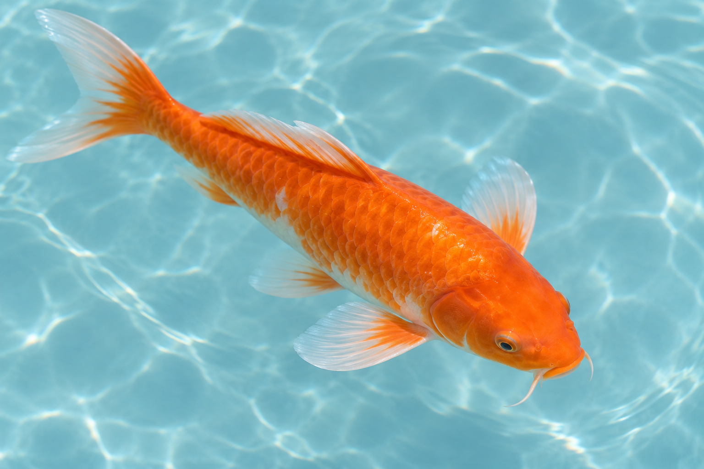
[Original source](https://github.com/picontapLab/prompt-seen/blob/272bd41645f21c4d07c3c06625904932609a613a/content/examples/x_286/run.yaml) · Credit: Prompt Seen · CC BY 4.0

```text
An orange koi swimming in pale blue water
```

## x_287 — image26-s15-pelican-on-a-red-bicycle
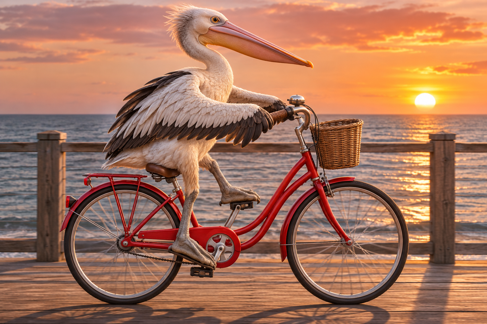
[Original source](https://github.com/picontapLab/prompt-seen/blob/272bd41645f21c4d07c3c06625904932609a613a/content/examples/x_287/run.yaml) · Credit: Prompt Seen · CC BY 4.0

```text
画一只写实又略带幽默感的鹈鹕骑着红色城市自行车，沿海边木栈道前进。侧面全身构图，两只爪子分别踩在踏板上，翅膀自然搭在车把附近，车架和两只车轮结构清楚。日落金光，海面在后方，水平线平直，鹈鹕喙完整可见，没有文字。
```

## x_288 — image26-g01-monkey-raising-a-lantern

[Original source](https://github.com/picontapLab/prompt-seen/blob/272bd41645f21c4d07c3c06625904932609a613a/content/examples/x_288/run.yaml) · Credit: Prompt Seen · CC BY 4.0

```text
制作一张供后期裁帧合成 GIF 的动画精灵图，PNG 静态画布，宽 1536 高 1024 像素，精确三列两行，共六个等大的 512×512 正方形帧。每格是独立完整画面，按从左到右、从上到下依次播放。无外边距、无格线、无分隔条、无编号。角色不要跨越格子边界。所有格子中角色尺寸、脚下基线、镜头、背景与光照必须固定一致，只有动作姿态逐步变化。请把以下动画描述转成六个清晰不同的连续姿态；最后一格回到第一格姿态，以便循环。本次交付的是完整六格精灵图，不要只画一个姿势。使用输入小猴子图片保持角色、衣服、灯笼和环境一致。

动作与主题：
生成一段正方形无缝循环 GIF：一只穿绿色冬装的小猴子站在雪林里，身后远处有亮着暖灯的小木屋。它双手托着纸灯笼，缓慢举到脸旁，眨眼看向灯光，再把灯笼放回胸前。身体位置和镜头固定，灯笼始终握在手中，最后一帧回到起始姿势。动作简洁清晰，避免大幅飘雪和镜头移动。
```

## x_289 — image26-g02-falling-stock-reaction-loop

[Original source](https://github.com/picontapLab/prompt-seen/blob/272bd41645f21c4d07c3c06625904932609a613a/content/examples/x_289/run.yaml) · Credit: Prompt Seen · CC BY 4.0

```text
制作一张供后期裁帧合成 GIF 的动画精灵图，PNG 静态画布，宽 1536 高 1024 像素，精确三列两行，共六个等大的 512×512 正方形帧。每格是独立完整画面，按从左到右、从上到下依次播放。无外边距、无格线、无分隔条、无编号。角色不要跨越格子边界。所有格子中角色尺寸、脚下基线、镜头、背景与光照必须固定一致，只有动作姿态逐步变化。请把以下动画描述转成六个清晰不同的连续姿态；最后一格回到第一格姿态，以便循环。本次交付的是完整六格精灵图，不要只画一个姿势。

动作与主题：
为 GIF 制作一张三列两行、共六格的连续动作分镜图。角色是一位原创成年 Q 版办公室职员，坐在同一张桌子和显示器前。六格动作依次为：期待地看屏幕、注意到向下的折线、瞪大眼睛、低头哭泣、擦泪、恢复起始坐姿。固定正面三分之四镜头，角色外形、服装、场景、光线和每格尺寸一致；不加文字、格号或格线。按从左到右、从上到下顺序排列，首尾姿势衔接。
```

## x_290 — image26-g03-rising-stock-celebration-loop

[Original source](https://github.com/picontapLab/prompt-seen/blob/272bd41645f21c4d07c3c06625904932609a613a/content/examples/x_290/run.yaml) · Credit: Prompt Seen · CC BY 4.0

```text
制作一张供后期裁帧合成 GIF 的动画精灵图，PNG 静态画布，宽 1536 高 1024 像素，精确三列两行，共六个等大的 512×512 正方形帧。每格是独立完整画面，按从左到右、从上到下依次播放。无外边距、无格线、无分隔条、无编号。角色不要跨越格子边界。所有格子中角色尺寸、脚下基线、镜头、背景与光照必须固定一致，只有动作姿态逐步变化。请把以下动画描述转成六个清晰不同的连续姿态；最后一格回到第一格姿态，以便循环。本次交付的是完整六格精灵图，不要只画一个姿势。

动作与主题：
为 GIF 制作一张三列两行、共六格的连续动作分镜图。角色是一位原创成年 Q 版办公室职员，坐在同一张桌子和显示器前。六格动作依次为：平静地看屏幕、注意到向上的折线、露出笑容、站起举手、撒出少量无面额纸片、回到起始坐姿。固定正面三分之四镜头，角色外形、服装、场景、光线和每格尺寸一致；不加文字、格号或格线。按从左到右、从上到下顺序排列，首尾姿势衔接。
```

## x_291 — image26-g04-dancing-white-chicken
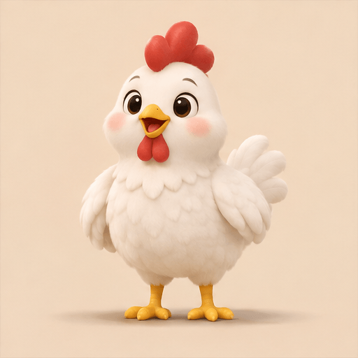
[Original source](https://github.com/picontapLab/prompt-seen/blob/272bd41645f21c4d07c3c06625904932609a613a/content/examples/x_291/run.yaml) · Credit: Prompt Seen · CC BY 4.0

```text
制作一张供后期裁帧合成 GIF 的动画精灵图，PNG 静态画布，宽 1536 高 1024 像素，精确三列两行，共六个等大的 512×512 正方形帧。每格是独立完整画面，按从左到右、从上到下依次播放。无外边距、无格线、无分隔条、无编号。角色不要跨越格子边界。所有格子中角色尺寸、脚下基线、镜头、背景与光照必须固定一致，只有动作姿态逐步变化。请把以下动画描述转成六个清晰不同的连续姿态；最后一格回到第一格姿态，以便循环。本次交付的是完整六格精灵图，不要只画一个姿势。

动作与主题：
生成一段方形循环 GIF：一只白羽鸡站在浅米色无缝背景中央，先向左踏一步、抬左翅，再向右踏一步、抬右翅，最后轻轻点头回到原位。完整身体和双脚始终在画面内，机位固定，红色鸡冠外形稳定，柔和落地阴影。动作俏皮，首尾衔接，不出现文字或镜头推拉。
```

## x_292 — image26-g05-blue-haired-character-eating-rice

[Original source](https://github.com/picontapLab/prompt-seen/blob/272bd41645f21c4d07c3c06625904932609a613a/content/examples/x_292/run.yaml) · Credit: Prompt Seen · CC BY 4.0

```text
制作一张供后期裁帧合成 GIF 的动画精灵图，PNG 静态画布，宽 1536 高 1024 像素，精确三列两行，共六个等大的 512×512 正方形帧。每格是独立完整画面，按从左到右、从上到下依次播放。无外边距、无格线、无分隔条、无编号。角色不要跨越格子边界。所有格子中角色尺寸、脚下基线、镜头、背景与光照必须固定一致，只有动作姿态逐步变化。请把以下动画描述转成六个清晰不同的连续姿态；最后一格回到第一格姿态，以便循环。本次交付的是完整六格精灵图，不要只画一个姿势。

动作与主题：
使用输入角色制作正方形循环动画，保持发型、服装与脸型。角色坐在桌前，端着一碗白米饭，舀起一小勺送入口中，满足地眯眼点头，再回到端碗姿势。画面上方固定显示“真香！”，文字全程不变。机位固定，米饭和餐具形状稳定，首尾可连续播放。
```

## x_293 — image26-g06-chicken-practicing-tai-chi
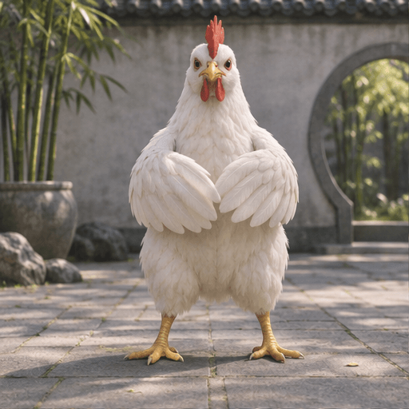
[Original source](https://github.com/picontapLab/prompt-seen/blob/272bd41645f21c4d07c3c06625904932609a613a/content/examples/x_293/run.yaml) · Credit: Prompt Seen · CC BY 4.0

```text
制作一张供后期裁帧合成 GIF 的动画精灵图，PNG 静态画布，宽 1536 高 1024 像素，精确三列两行，共六个等大的 512×512 正方形帧。每格是独立完整画面，按从左到右、从上到下依次播放。无外边距、无格线、无分隔条、无编号。角色不要跨越格子边界。所有格子中角色尺寸、脚下基线、镜头、背景与光照必须固定一致，只有动作姿态逐步变化。请把以下动画描述转成六个清晰不同的连续姿态；最后一格回到第一格姿态，以便循环。本次交付的是完整六格精灵图，不要只画一个姿势。

动作与主题：
生成一段循环 GIF：一只白羽鸡在简洁的庭院石地上缓慢打太极，双翅从胸前向两侧画弧，身体轻轻左右转移重心，然后双翅收回原位。正面全身、固定镜头、背景静止，鸡冠和脚的数量稳定，动作舒展，最后一帧与第一帧衔接。
```

## x_294 — image26-g07-family-dinner-in-china-in-2005
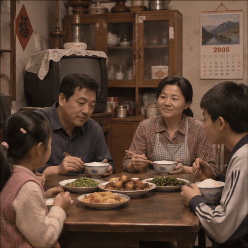
[Original source](https://github.com/picontapLab/prompt-seen/blob/272bd41645f21c4d07c3c06625904932609a613a/content/examples/x_294/run.yaml) · Credit: Prompt Seen · CC BY 4.0

```text
制作一张供后期裁帧合成 GIF 的动画精灵图，PNG 静态画布，宽 1536 高 1024 像素，精确三列两行，共六个等大的 512×512 正方形帧。每格是独立完整画面，按从左到右、从上到下依次播放。无外边距、无格线、无分隔条、无编号。角色不要跨越格子边界。所有格子中角色尺寸、脚下基线、镜头、背景与光照必须固定一致，只有动作姿态逐步变化。请把以下动画描述转成六个清晰不同的连续姿态；最后一格回到第一格姿态，以便循环。本次交付的是完整六格精灵图，不要只画一个姿势。

动作与主题：
生成一段写实循环 GIF，表现 2005 年中国普通家庭的晚饭时刻。四位家庭成员围坐木质方桌，桌上是家常菜、瓷碗和筷子，背景有当时常见的木柜与老式挂历。固定中景，一人轻轻夹菜，另一人点头，其他人只做自然呼吸和小幅动作。保持人数、手指和餐具稳定，暖色室内灯光，没有智能手机，首尾自然衔接。
```

## x_295 — image26-g08-round-fish-reaction-loop
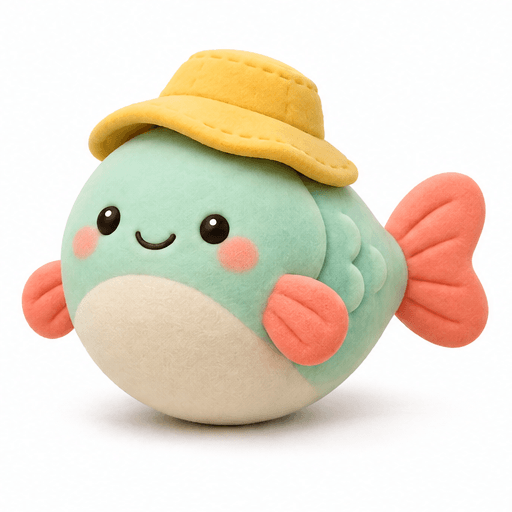
[Original source](https://github.com/picontapLab/prompt-seen/blob/272bd41645f21c4d07c3c06625904932609a613a/content/examples/x_295/run.yaml) · Credit: Prompt Seen · CC BY 4.0

```text
制作一张供后期裁帧合成 GIF 的动画精灵图，PNG 静态画布，宽 1536 高 1024 像素，精确三列两行，共六个等大的 512×512 正方形帧。每格是独立完整画面，按从左到右、从上到下依次播放。无外边距、无格线、无分隔条、无编号。角色不要跨越格子边界。所有格子中角色尺寸、脚下基线、镜头、背景与光照必须固定一致，只有动作姿态逐步变化。请把以下动画描述转成六个清晰不同的连续姿态；最后一格回到第一格姿态，以便循环。本次交付的是完整六格精灵图，不要只画一个姿势。

动作与主题：
使用输入圆鱼角色制作一个“开心点头”的循环 GIF。保持帽子、体型、配色和鱼鳍一致，角色先微笑，轻轻点头两次，再摆一下尾鳍并回到正面起始姿势。白色背景，完整角色居中，固定镜头，不新增手脚或道具，不加文字，首尾动作衔接。
```

## x_296 — image26-g09-standing-backflip-loop
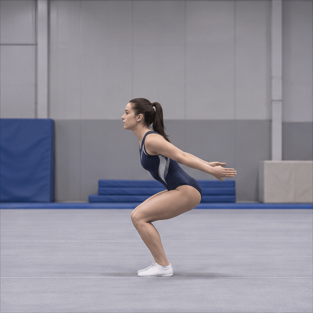
[Original source](https://github.com/picontapLab/prompt-seen/blob/272bd41645f21c4d07c3c06625904932609a613a/content/examples/x_296/run.yaml) · Credit: Prompt Seen · CC BY 4.0

```text
制作一张供后期裁帧合成 GIF 的动画精灵图，PNG 静态画布，宽 1536 高 1024 像素，精确三列两行，共六个等大的 512×512 正方形帧。每格是独立完整画面，按从左到右、从上到下依次播放。无外边距、无格线、无分隔条、无编号。角色不要跨越格子边界。所有格子中角色尺寸、脚下基线、镜头、背景与光照必须固定一致，只有动作姿态逐步变化。请把以下动画描述转成六个清晰不同的连续姿态；最后一格回到第一格姿态，以便循环。本次交付的是完整六格精灵图，不要只画一个姿势。

动作与主题：
生成一段固定侧面机位的循环 GIF：一位虚构的成年体操运动员站在宽阔浅灰训练垫中央，屈膝蓄力，完成一次原地后空翻，双脚落回原来位置，再站直回到起始姿势。全身始终可见，训练服颜色固定，背景无其他人物，动作节奏连贯，落地有短暂停顿，避免肢体重复和身体穿过地面。
```

## x_297 — image26-g10-two-dancing-robots
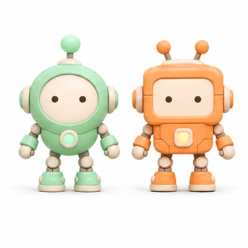
[Original source](https://github.com/picontapLab/prompt-seen/blob/272bd41645f21c4d07c3c06625904932609a613a/content/examples/x_297/run.yaml) · Credit: Prompt Seen · CC BY 4.0

```text
制作一张供后期裁帧合成 GIF 的动画精灵图，PNG 静态画布，宽 1536 高 1024 像素，精确三列两行，共六个等大的 512×512 正方形帧。每格是独立完整画面，按从左到右、从上到下依次播放。无外边距、无格线、无分隔条、无编号。角色不要跨越格子边界。所有格子中角色尺寸、脚下基线、镜头、背景与光照必须固定一致，只有动作姿态逐步变化。请把以下动画描述转成六个清晰不同的连续姿态；最后一格回到第一格姿态，以便循环。本次交付的是完整六格精灵图，不要只画一个姿势。

动作与主题：
让输入图中的两个机器人跳一段同步循环舞。保持左绿右橙、体型与颜色一致，两者先向外侧踏步并挥手，再向内侧踏步拍手，最后回到初始站姿。固定正面镜头，完整身体可见，彼此保持间距，不交换位置，不融合肢体。白色背景，落地阴影稳定，不加文字。
```

## x_298 — image26-g11-cycling-pelican-loop
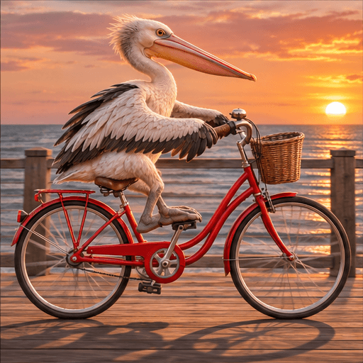
[Original source](https://github.com/picontapLab/prompt-seen/blob/272bd41645f21c4d07c3c06625904932609a613a/content/examples/x_298/run.yaml) · Credit: Prompt Seen · CC BY 4.0

```text
制作一张供后期裁帧合成 GIF 的动画精灵图，PNG 静态画布，宽 1536 高 1024 像素，精确三列两行，共六个等大的 512×512 正方形帧。每格是独立完整画面，按从左到右、从上到下依次播放。无外边距、无格线、无分隔条、无编号。角色不要跨越格子边界。所有格子中角色尺寸、脚下基线、镜头、背景与光照必须固定一致，只有动作姿态逐步变化。请把以下动画描述转成六个清晰不同的连续姿态；最后一格回到第一格姿态，以便循环。本次交付的是完整六格精灵图，不要只画一个姿势。

动作与主题：
使用输入图片中的鹈鹕、红色自行车和海边木栈道，制作一个侧面跟拍循环 GIF。鹈鹕持续平稳踩踏，车轮转动，身体轻微上下起伏，主体保持画面中央。让木板与背景以可循环方式缓慢移动，保持自行车结构和鸟喙长度稳定，机位高度不变，不加入其他角色，结尾接回开头。
```

## x_299 — image26-g12-animated-notebook-owl
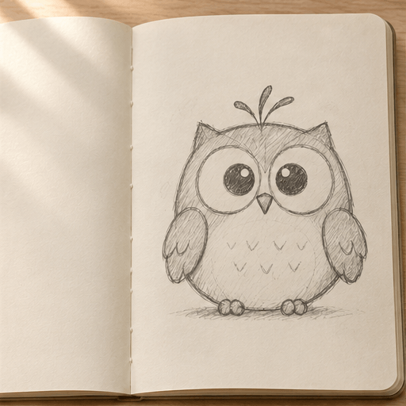
[Original source](https://github.com/picontapLab/prompt-seen/blob/272bd41645f21c4d07c3c06625904932609a613a/content/examples/x_299/run.yaml) · Credit: Prompt Seen · CC BY 4.0

```text
制作一张供后期裁帧合成 GIF 的动画精灵图，PNG 静态画布，宽 1536 高 1024 像素，精确三列两行，共六个等大的 512×512 正方形帧。每格是独立完整画面，按从左到右、从上到下依次播放。无外边距、无格线、无分隔条、无编号。角色不要跨越格子边界。所有格子中角色尺寸、脚下基线、镜头、背景与光照必须固定一致，只有动作姿态逐步变化。请把以下动画描述转成六个清晰不同的连续姿态；最后一格回到第一格姿态，以便循环。本次交付的是完整六格精灵图，不要只画一个姿势。

动作与主题：
使用输入笔记本照片，让纸上的猫头鹰铅笔涂鸦轻轻动起来。先眨眼，再把两侧翅膀各抬起一点，最后恢复起始姿势。只改变涂鸦内部的线条姿态，保持纸张、桌面、笔触风格、光线和机位不变，不变成三维实体，不飞离纸面，不新增文字。输出短循环 GIF。
```

