# Beatra — complete Qwen Image3.0 gallery

All40 source cases archived with the complete original Prompt block and exact native published images. Beatra explicitly licenses prompts and media CC BY4.0.38 are published and accepted on ProjectD (run42069117745); two native images are under its minimum dimensions and remain held. Model/task labels are source-attested; no independently billed generation.

[Source and full license](sources/beatra-qwen-image-3/README.md#license) · [Full per-item provenance/review](data/beatra-qwen-image-3-gallery.json)

## 1. Brightmoss icon and wordmark

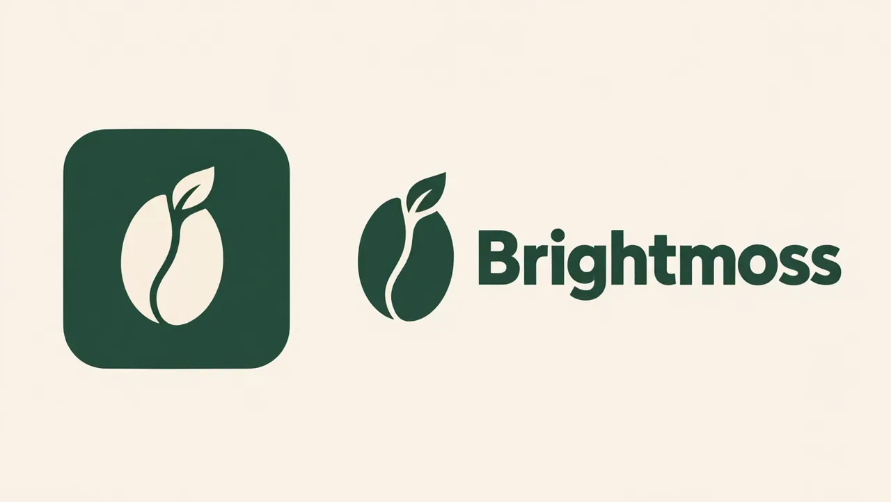

```text
Refine this accepted Brightmoss logo into a two-part brand presentation on one flat warm cream background (#F4EEE2). Left: an app icon, a solid rounded square in deep forest green (#1F4D3A) with the same coffee-bean-and-leaf symbol from the image centered inside in cream, generous padding, no text in the icon. Right: a horizontal lockup, the same green bean-and-leaf symbol placed to the left of the exact word "Brightmoss" in the same bold humanist sans-serif lettering, forest green, vertically centered with the symbol. Keep the symbol shape and the wordmark letterforms identical to the source. Flat vector, maximum two colors, no gradients, no shadows, no mockup, no tagline, no other text.
```

Qwen Image 3.0 Pro · Beatra · [Original source](https://github.com/beatra-ai/awesome-qwen-image-3/blob/7d0e05d23c1bac4dab45a5bcbb1d52607fb73c1c/README.md#L27)

Source says text-to-image but prompt refers to a prior accepted logo; unavailable reference context is required for an exact identity match.

## 2. Northglass ferry poster

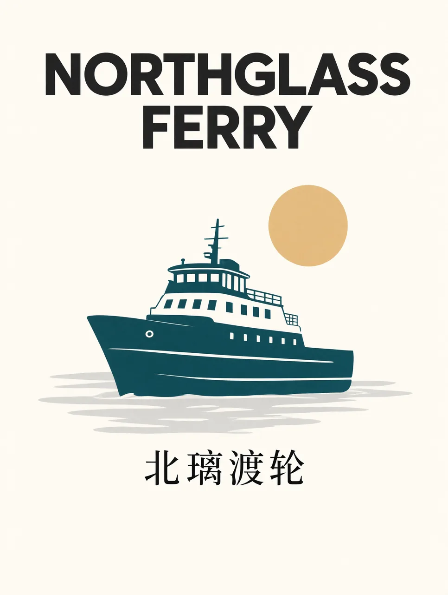

```text
Vertical printed travel poster, cream paper, a simple flat illustration of a dark teal ferry on pale grey water under a wheat-colored sun, generous empty margin. Exact text only, perfectly spelled, no extra letters anywhere: NORTHGLASS in large bold black sans-serif at the top, FERRY directly under it in the same typeface, and the four Chinese characters 北璃渡轮 centered under the boat in a clean black serif. No dates, no logos, no watermark, no people.
```

Qwen Image 3.0 · Beatra · [Original source](https://github.com/beatra-ai/awesome-qwen-image-3/blob/7d0e05d23c1bac4dab45a5bcbb1d52607fb73c1c/README.md#L51)

Full source Prompt block and native output visually correspond; source flaws retained, no independent generation claimed.

## 3. Hearthlane market poster

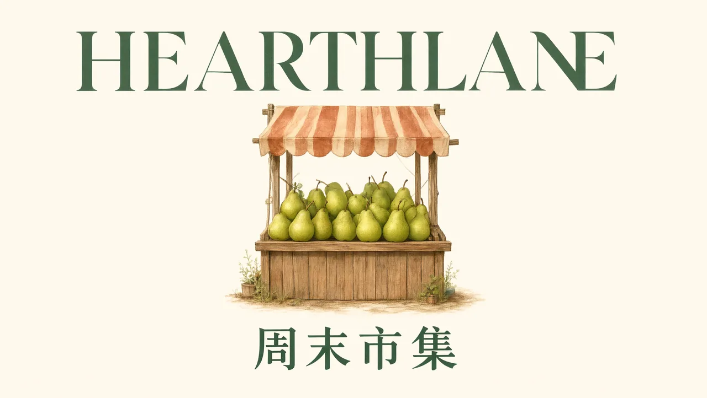

```text
Wide market poster, warm cream background, a small centered illustration of a wooden stall with green pears and a rust-striped awning, lots of empty space. Exact text only, perfectly spelled: HEARTHLANE in large dark-green serif across the top, and the four Chinese characters 周末市集 centered at the bottom in the same dark green. No other words, numbers, logos, or watermarks.
```

Qwen Image 3.0 · Beatra · [Original source](https://github.com/beatra-ai/awesome-qwen-image-3/blob/7d0e05d23c1bac4dab45a5bcbb1d52607fb73c1c/README.md#L75)

Full source Prompt block and native output visually correspond; source flaws retained, no independent generation claimed.

## 4. Lumen Orchard lantern poster

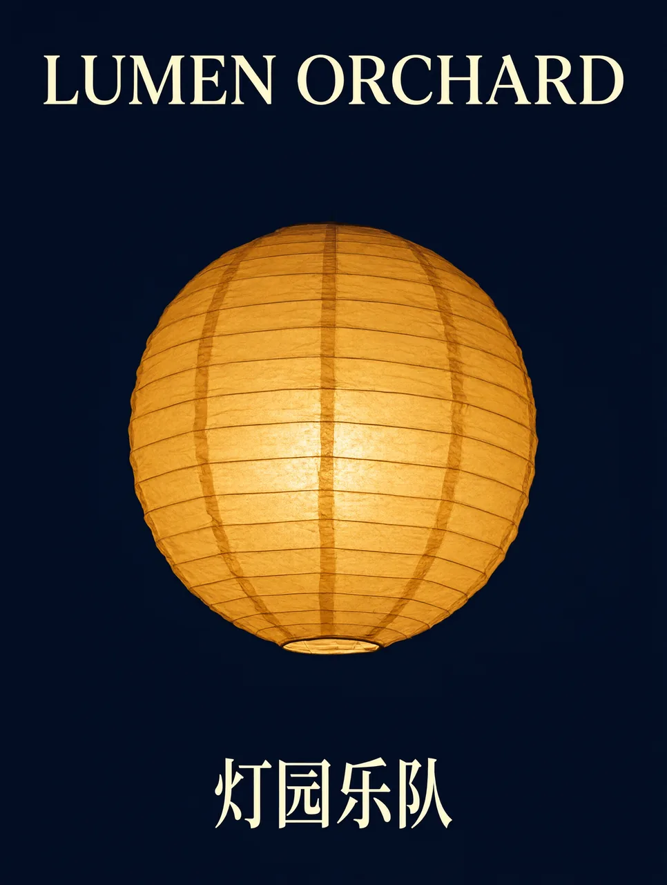

```text
Minimal concert poster, deep navy background, one round paper lantern glowing amber in the center. Exact text only, perfectly spelled: LUMEN ORCHARD in cream serif capitals near the top, and the four Chinese characters 灯园乐队 in cream under the lantern. No dates, no other letters, no logos, no watermark.
```

Qwen Image 3.0 · Beatra · [Original source](https://github.com/beatra-ai/awesome-qwen-image-3/blob/7d0e05d23c1bac4dab45a5bcbb1d52607fb73c1c/README.md#L99)

Full source Prompt block and native output visually correspond; source flaws retained, no independent generation claimed.

## 5. Paper Finch book-fair poster

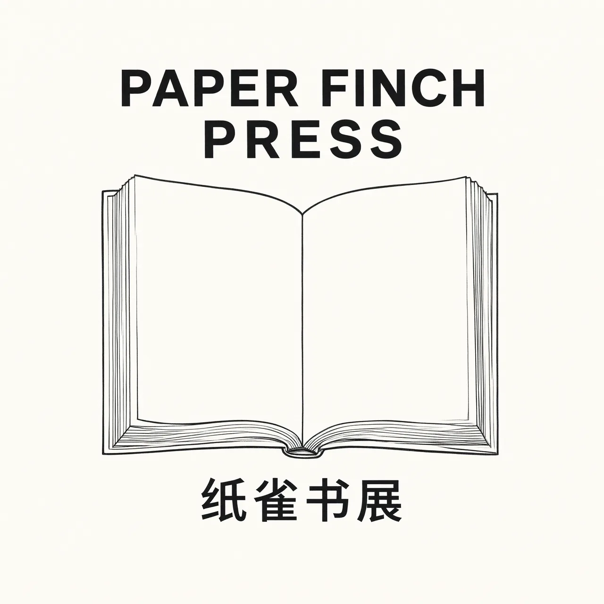

```text
Square book-fair poster, off-white paper, a single black line drawing of an open blank book, lots of margin. Exactly three lines of text, perfectly spelled, and no other letters anywhere. Top line: PAPER FINCH in bold black sans-serif. Middle line, directly under it: PRESS, spelled P-R-E-S-S, the first letter is P. Bottom line: the four Chinese characters 纸雀书展. Do not write DRESS. No logos, no watermark.
```

Qwen Image 3.0 · Beatra · [Original source](https://github.com/beatra-ai/awesome-qwen-image-3/blob/7d0e05d23c1bac4dab45a5bcbb1d52607fb73c1c/README.md#L123)

Full source Prompt block and native output visually correspond; source flaws retained, no independent generation claimed.

## 6. Reedbank cafe menu board

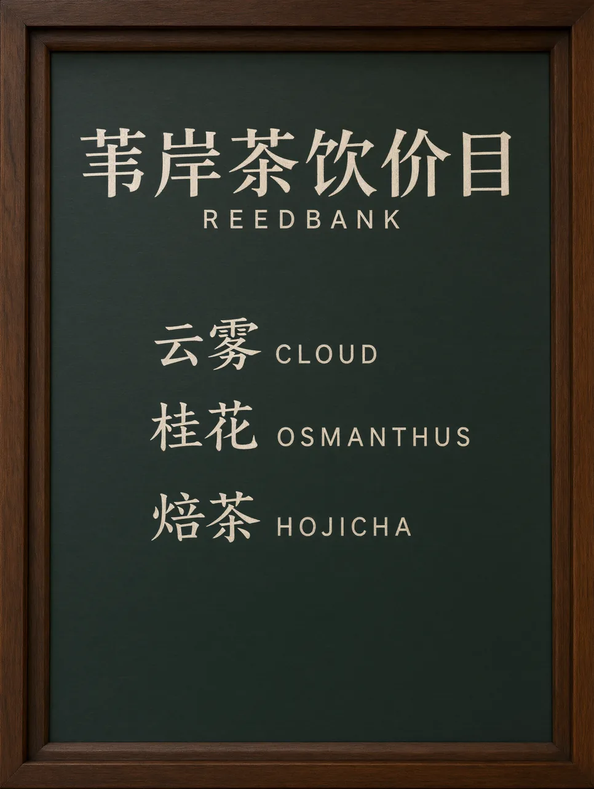

```text
Photoreal wooden cafe menu board, dark walnut frame, cream painted lettering on a slate-green board, photographed straight-on, even shop light. Exact text only, perfectly spelled, no extra letters, no prices, no logos, no watermark: large cream serif at the top 苇岸茶饮价目, directly under it in smaller cream sans-serif capitals REEDBANK, then three drink lines in a smaller size with Chinese then English on the same line, 云雾 CLOUD, 桂花 OSMANTHUS, 焙茶 HOJICHA. No other words or numbers.
```

Qwen Image 3.0 · Beatra · [Original source](https://github.com/beatra-ai/awesome-qwen-image-3/blob/7d0e05d23c1bac4dab45a5bcbb1d52607fb73c1c/README.md#L147)

Full source Prompt block and native output visually correspond; source flaws retained, no independent generation claimed.

## 7. River Lantern ticket stub

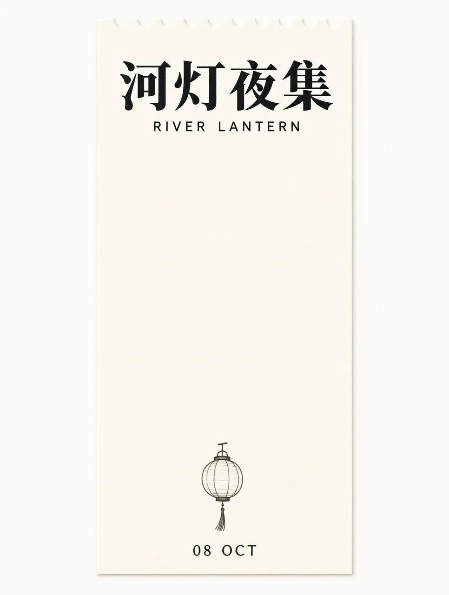

```text
Vertical event ticket stub, cream paper, perforated top edge, a small simple drawing of one paper lantern, lots of empty margin. Exact text only, perfectly spelled, no extra letters: large bold black serif at the top 河灯夜集, subtitle under it in smaller sans-serif RIVER LANTERN, date at the bottom in small tracking 08 OCT. No other words, numbers, logos, or watermarks.
```

Qwen Image 3.0 · Beatra · [Original source](https://github.com/beatra-ai/awesome-qwen-image-3/blob/7d0e05d23c1bac4dab45a5bcbb1d52607fb73c1c/README.md#L171)

Full source Prompt block and native output visually correspond; source flaws retained, no independent generation claimed.

## 8. Winter evening pour-over

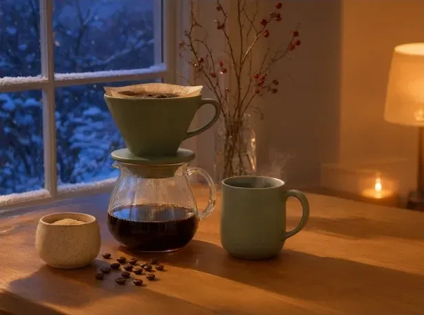

```text
[edit] Change the season and time of day to a cozy winter evening. Keep the ceramic pour-over coffee set exactly as it is: the sage-green dripper with its paper filter and handle on the glass carafe of coffee, the sage-green mug, the speckled cream sugar bowl, the coffee beans, the oak table, and the camera angle and positions of every object. Outside the window it is now dusk with snow falling, snow-covered branches and a deep blue evening sky; a little snow rests on the window frame. Replace the summer sunlight with warm indoor lamplight from the right and soft candlelight, gentle warm glow on the ceramics, a thin wisp of steam rising from the mug, and swap the green leaves in the glass jar for a few bare winter twigs with small red berries. Warm amber and deep blue color contrast, photoreal lifestyle photography. No people, no text, no logos.
```

Qwen Image 3.0 · Beatra · [Original source](https://github.com/beatra-ai/awesome-qwen-image-3/blob/7d0e05d23c1bac4dab45a5bcbb1d52607fb73c1c/README.md#L199)

Source winter edit retained; standalone original input is not supplied.

## 9. Siltjar hot-sauce bottle

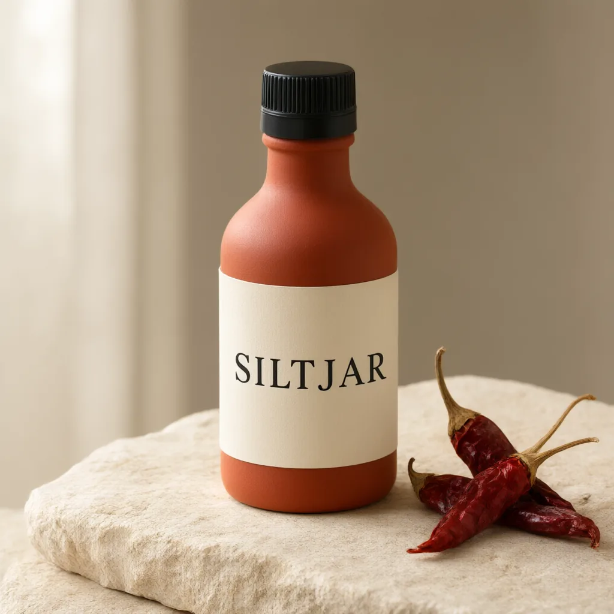

```text
Photoreal studio product photo of one fictional hot-sauce bottle on a pale limestone slab. The bottle is short, matte clay-red ceramic with a black screw cap and a plain cream label. The label carries only the exact word SILTJAR in black serif, perfectly spelled, once. Soft window light from the left, a few dried chili peppers beside the bottle, shallow depth of field, no hands, no other text, no logos, no watermark.
```

Qwen Image 3.0 · Beatra · [Original source](https://github.com/beatra-ai/awesome-qwen-image-3/blob/7d0e05d23c1bac4dab45a5bcbb1d52607fb73c1c/README.md#L223)

Full source Prompt block and native output visually correspond; source flaws retained, no independent generation claimed.

## 10. Oatmeal canvas sneaker

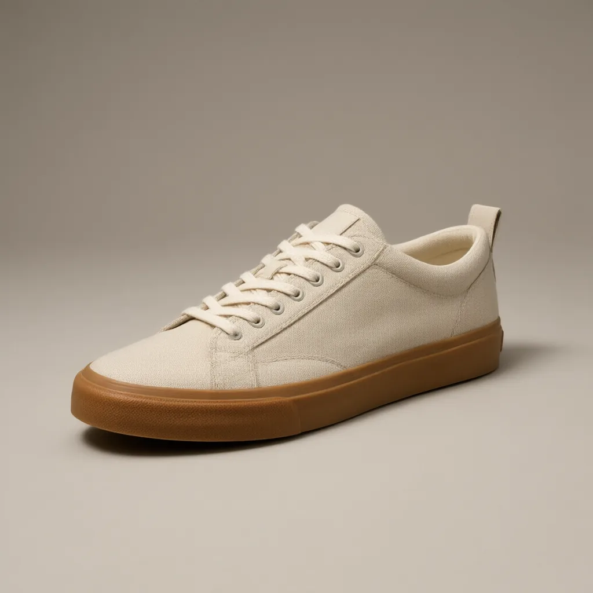

```text
Photoreal product photo of one fictional low-top sneaker, three-quarter view, on a seamless warm-grey cyclorama. The shoe is oatmeal canvas with a gum rubber sole, cream laces, and a small blank heel tab. No wordmark, no logo, no text anywhere. Soft overhead daylight, crisp but gentle shadow, commercial catalog lighting. No people, no hands, no watermark.
```

Qwen Image 3.0 · Beatra · [Original source](https://github.com/beatra-ai/awesome-qwen-image-3/blob/7d0e05d23c1bac4dab45a5bcbb1d52607fb73c1c/README.md#L247)

Full source Prompt block and native output visually correspond; source flaws retained, no independent generation claimed.

## 11. Brass candle tin on oak

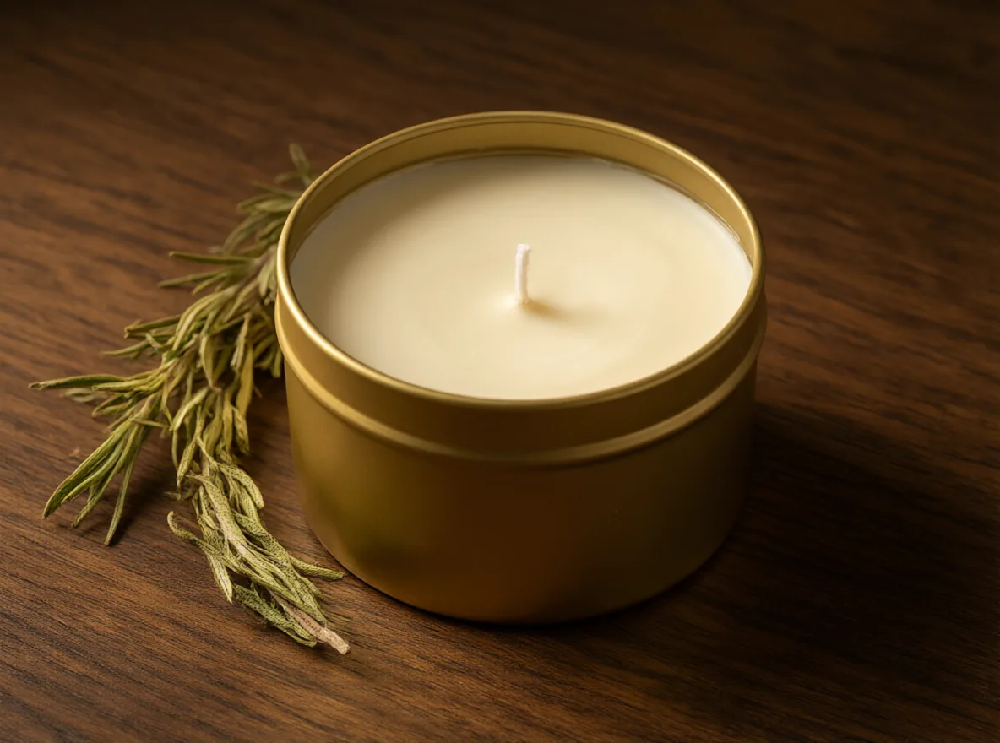

```text
Photoreal tabletop photo of a fictional candle: a low brass tin of cream soy wax with one unlit cotton wick, sitting on dark oak. Beside it, a sprig of dried rosemary. The tin has no label and no letters. Warm side light, shallow depth of field, catalog still life. No people, no hands, no logos, no watermark.
```

Qwen Image 3.0 · Beatra · [Original source](https://github.com/beatra-ai/awesome-qwen-image-3/blob/7d0e05d23c1bac4dab45a5bcbb1d52607fb73c1c/README.md#L271)

Full source Prompt block and native output visually correspond; source flaws retained, no independent generation claimed.

## 12. Oat linen tote and a pear

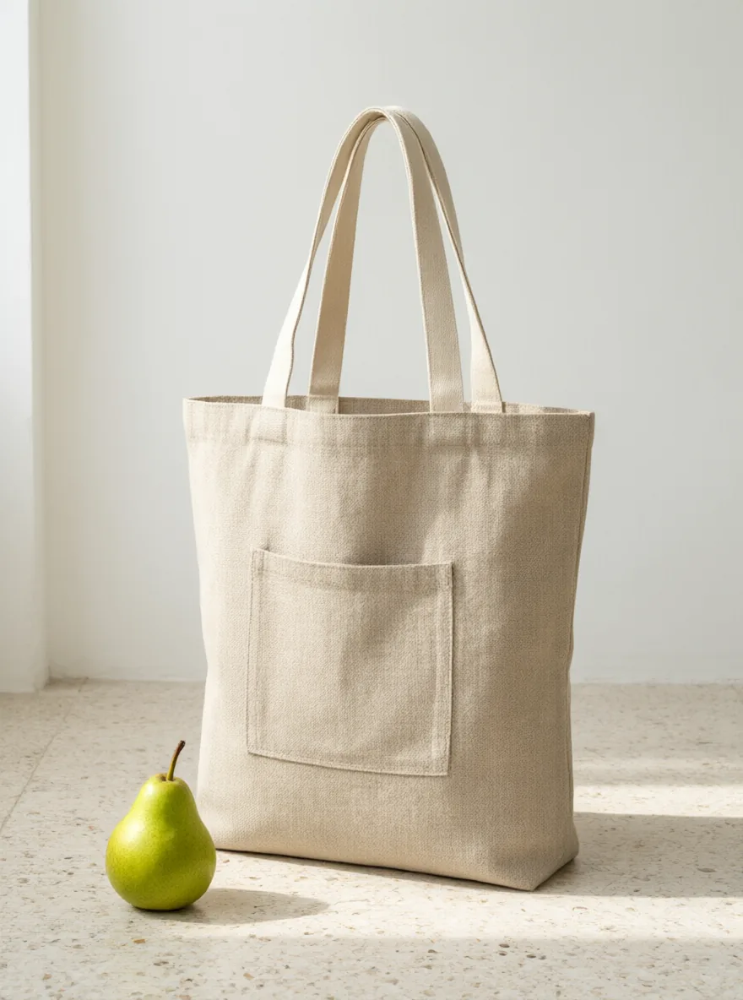

```text
Photoreal lifestyle product photo of a fictional heavy linen tote bag standing upright on a pale terrazzo floor against a white wall. The bag is undyed oat linen with two short cotton handles and a small rectangular patch pocket. No print, no letters, no logo. Morning light from the left, a single green pear on the floor beside the bag. No people, no hands, no watermark.
```

Qwen Image 3.0 · Beatra · [Original source](https://github.com/beatra-ai/awesome-qwen-image-3/blob/7d0e05d23c1bac4dab45a5bcbb1d52607fb73c1c/README.md#L295)

Full source Prompt block and native output visually correspond; source flaws retained, no independent generation claimed.

## 13. SOLUM serum bottle on wet stone

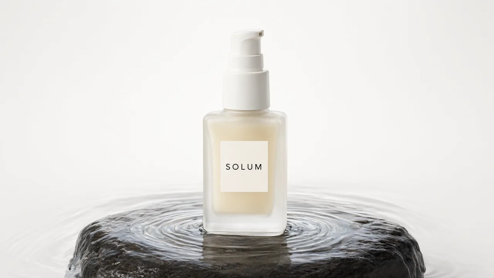

```text
Photoreal commercial studio product photo of one fictional frosted-glass serum bottle, square shoulders, white pump, standing in a shallow pool of clear water on dark wet stone, gentle circular ripples around the base, soft high-key beauty lighting, generous empty margin on all four sides, subject centered. A small cream square label on the bottle shows only the single word SOLUM in black sans-serif capitals as five letters together, no hyphen, no space, no extra marks, and no other letters. No extra bottles, no hands, no logos, no watermark.
```

Qwen Image 3.0 · Beatra · [Original source](https://github.com/beatra-ai/awesome-qwen-image-3/blob/7d0e05d23c1bac4dab45a5bcbb1d52607fb73c1c/README.md#L319)

Full source Prompt block and native output visually correspond; source flaws retained, no independent generation claimed.

## 14. Sage headphones on limestone

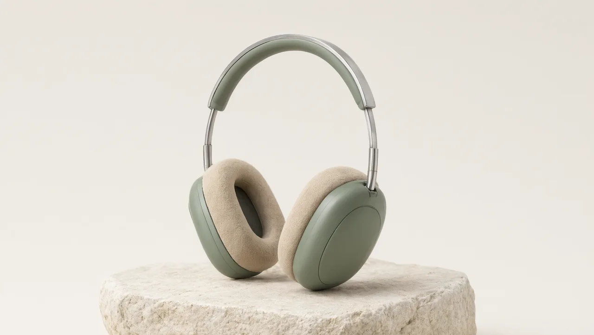

```text
Photoreal catalog photo of one fictional pair of closed-back over-ear headphones, matte sage ear cups, a thin brushed-steel headband, oat suede ear pads, no logo and no text anywhere on the product. Three-quarter view, centered on a pale limestone slab, soft studio light, generous empty margin on all four sides. No people, no hands, no extra objects, no watermark.
```

Qwen Image 3.0 · Beatra · [Original source](https://github.com/beatra-ai/awesome-qwen-image-3/blob/7d0e05d23c1bac4dab45a5bcbb1d52607fb73c1c/README.md#L343)

Full source Prompt block and native output visually correspond; source flaws retained, no independent generation claimed.

## 15. Siltjar bottle, new counter

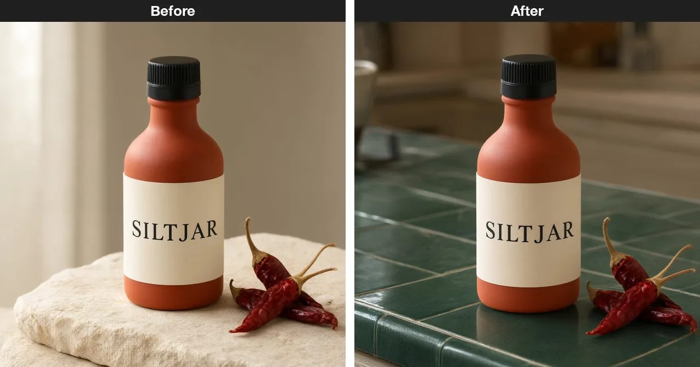

```text
Keep the clay-red ceramic bottle, its black cap, the dried chilies, and the cream label exactly as they are. The label must still read SILTJAR, spelled S-I-L-T-J-A-R, and no other letters. Replace the limestone slab and the beige wall with a dark green glazed-tile counter and a softly blurred kitchen. Do not change the bottle shape. No extra text, no logos, no watermark.
```

Qwen Image 3.0 · Beatra · [Original source](https://github.com/beatra-ai/awesome-qwen-image-3/blob/7d0e05d23c1bac4dab45a5bcbb1d52607fb73c1c/README.md#L371)

Author-published before/after comparison, including input and edited output, retained whole; not a raw single-model frame.

## 16. Sneaker upper turned indigo

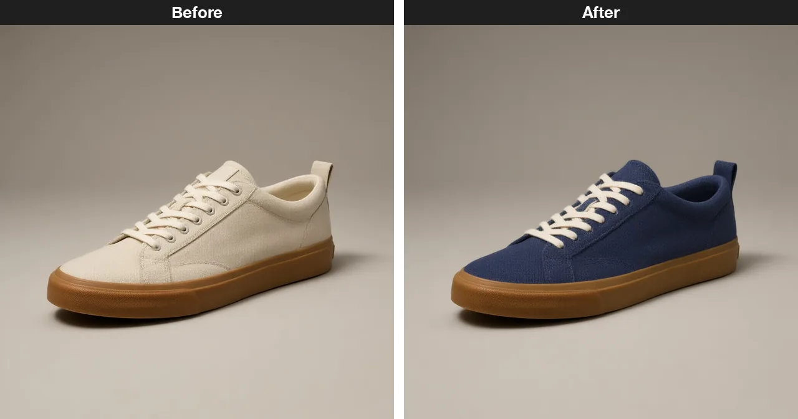

```text
Keep the same low-top sneaker, the same three-quarter angle, the gum rubber sole, the cream laces, and the blank heel tab. Change only the canvas upper from oatmeal to deep indigo. Do not add text, a logo, a wordmark, or a watermark. No people, no hands.
```

Qwen Image 3.0 · Beatra · [Original source](https://github.com/beatra-ai/awesome-qwen-image-3/blob/7d0e05d23c1bac4dab45a5bcbb1d52607fb73c1c/README.md#L395)

Author-published before/after comparison retained whole; original reference task links retained.

## 17. Tote moved to a rainy door

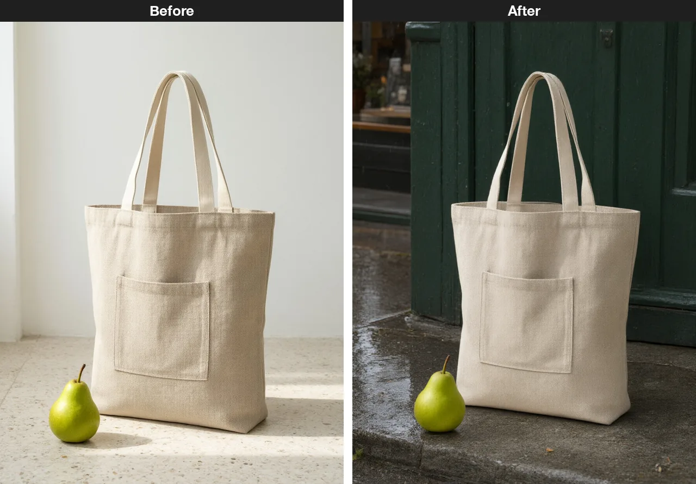

```text
Keep the undyed oat linen tote, its patch pocket, its two short handles, and the green pear. Replace the white wall and the terrazzo floor with a rainy shop doorway: wet grey stone under the bag and a dark green wooden door behind it. Overcast daylight. No text, no logo, no watermark, no people, no hands.
```

Qwen Image 3.0 · Beatra · [Original source](https://github.com/beatra-ai/awesome-qwen-image-3/blob/7d0e05d23c1bac4dab45a5bcbb1d52607fb73c1c/README.md#L419)

Author-published before/after comparison retained whole.

## 18. Desk with the cup and pens removed

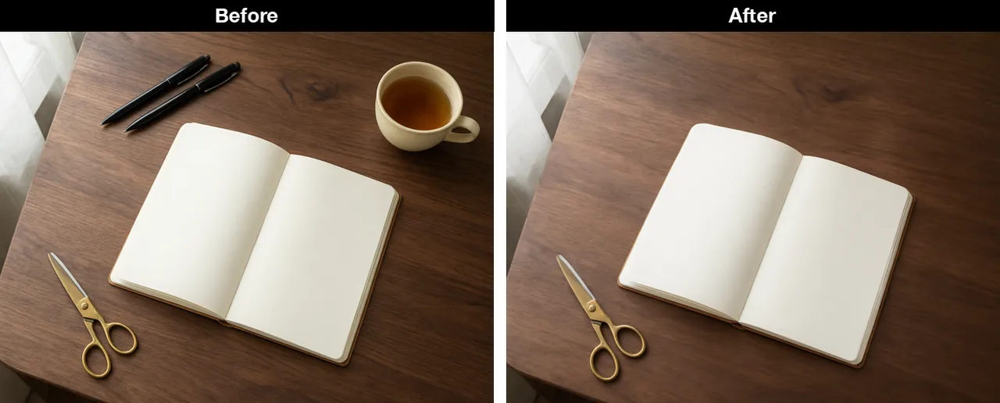

```text
Keep the walnut desk, the open blank notebook, the brass scissors, the window light, and the same camera angle. Remove the cream ceramic cup and both black pens completely. Do not add new objects. No text, no logos, no watermark, no hands.
```

Qwen Image 3.0 · Beatra · [Original source](https://github.com/beatra-ai/awesome-qwen-image-3/blob/7d0e05d23c1bac4dab45a5bcbb1d52607fb73c1c/README.md#L443)

Author-published before/after comparison retained whole; this is not a new single image output.

## 19. Lane from noon to a thin-snow evening

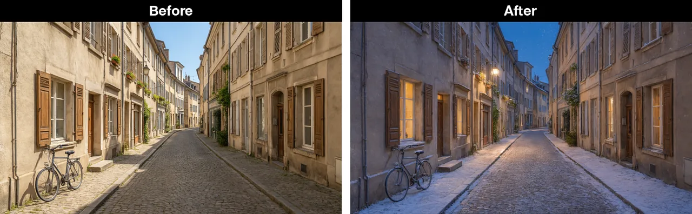

```text
Keep the exact same cobblestone lane, the same plaster buildings, shutters, doors, bicycle, and camera position. Change only the season and time of day to a snowy evening: blue hour, warm window light, a light covering of snow on the street and ledges, falling snow. No people, no cars, no readable signs, no letters, no logos, no watermark.
```

Qwen Image 3.0 · Beatra · [Original source](https://github.com/beatra-ai/awesome-qwen-image-3/blob/7d0e05d23c1bac4dab45a5bcbb1d52607fb73c1c/README.md#L467)

Published comparison is1280x396, below ProjectD minimum native height400; no crop, padding or upscale used.

## 20. Shop sign changes to 南窗纸店

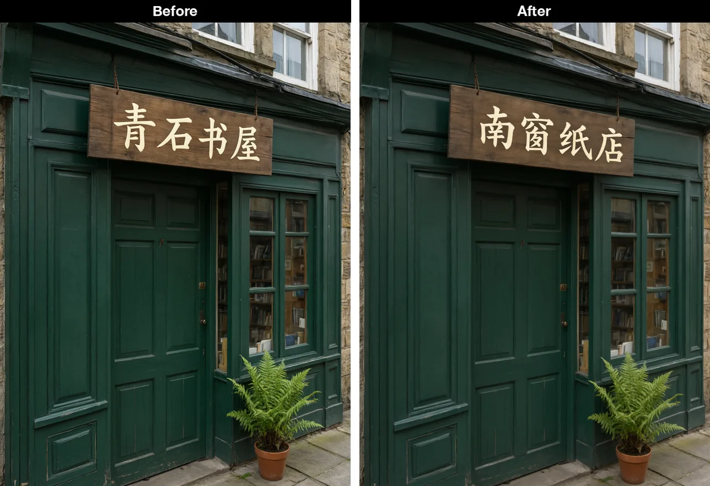

```text
Keep the dark green wooden storefront, the hanging wooden sign shape, the closed door, the potted fern, and the same camera. Change only the four cream characters on the sign from 青石书屋 to exactly 南窗纸店, perfectly spelled, and no other letters. No people, no logos, no watermark, no extra text.
```

Qwen Image 3.0 · Beatra · [Original source](https://github.com/beatra-ai/awesome-qwen-image-3/blob/7d0e05d23c1bac4dab45a5bcbb1d52607fb73c1c/README.md#L491)

Author-published text-edit comparison retained whole.

## 21. Sauce bottle beside the candle

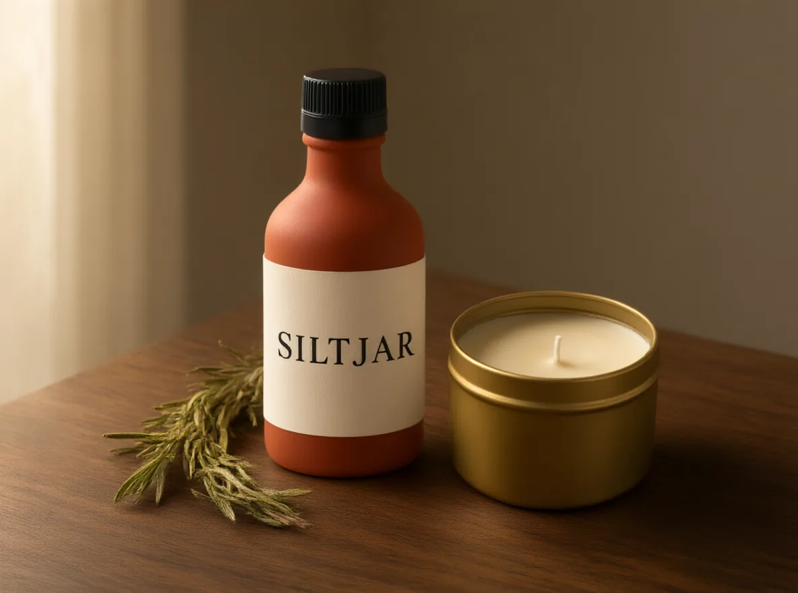

```text
One catalog still life on a dark oak table in warm side light. Place the hot-sauce bottle from the first image beside the brass candle tin from the second image. Keep the bottle's clay-red body, black cap, and the label spelling SILTJAR exactly. Keep the candle's low brass tin and single unlit wick. No other text, no logos, no watermark, no hands.
```

Qwen Image 3.0 · Beatra · [Original source](https://github.com/beatra-ai/awesome-qwen-image-3/blob/7d0e05d23c1bac4dab45a5bcbb1d52607fb73c1c/README.md#L519)

Full source Prompt block and native output visually correspond; source flaws retained, no independent generation claimed.

## 22. Raincoat fox at the bakery

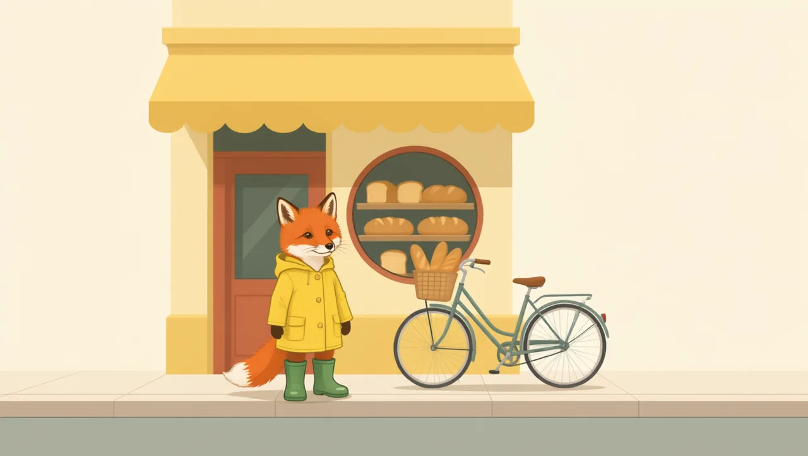

```text
A flat editorial illustration. Place the red fox in the yellow raincoat and green boots from the first image on the sidewalk in front of the bakery from the second image. Keep the fox's coat, boots, and face recognizable. Keep the bakery's butter-yellow awning, round window of loaves, and the bicycle. No text, no letters, no logos, no watermark.
```

Qwen Image 3.0 · Beatra · [Original source](https://github.com/beatra-ai/awesome-qwen-image-3/blob/7d0e05d23c1bac4dab45a5bcbb1d52607fb73c1c/README.md#L543)

Full source Prompt block and native output visually correspond; source flaws retained, no independent generation claimed.

## 23. Sneaker and tote in one room

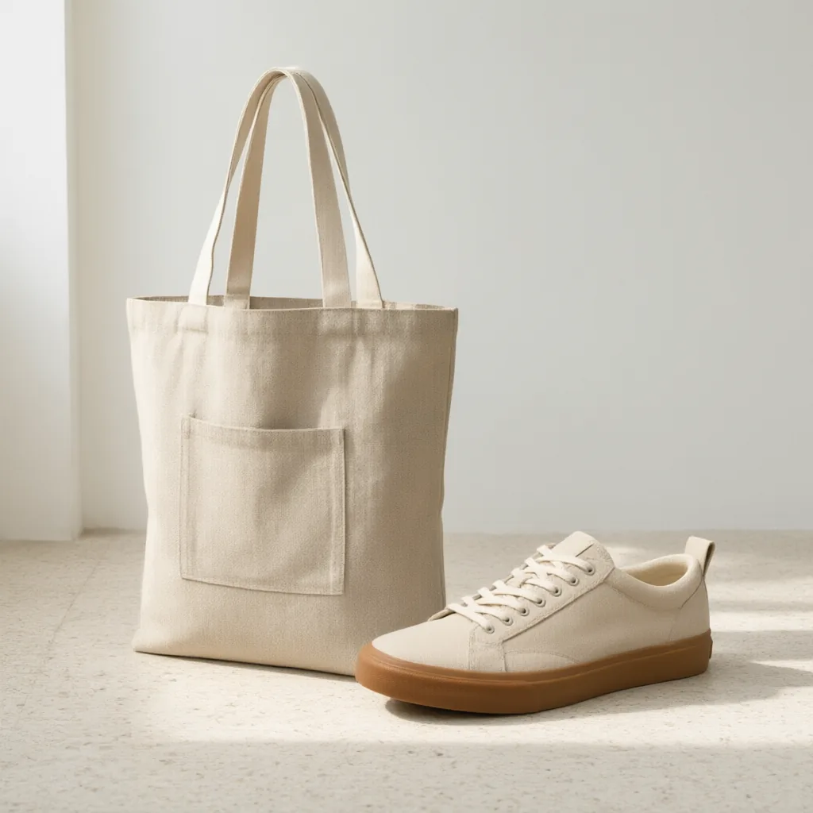

```text
A lifestyle catalog photo on a pale terrazzo floor against a plain white wall, morning light from the left. Place the oatmeal sneaker from the first image next to the oat linen tote from the second image. Keep the shoe's gum sole, cream laces, and blank heel tab. Keep the tote's patch pocket and two handles. No text, no logos, no watermark, no people, no hands.
```

Qwen Image 3.0 · Beatra · [Original source](https://github.com/beatra-ai/awesome-qwen-image-3/blob/7d0e05d23c1bac4dab45a5bcbb1d52607fb73c1c/README.md#L567)

Full source Prompt block and native output visually correspond; source flaws retained, no independent generation claimed.

## 24. Woman in the rust overcoat

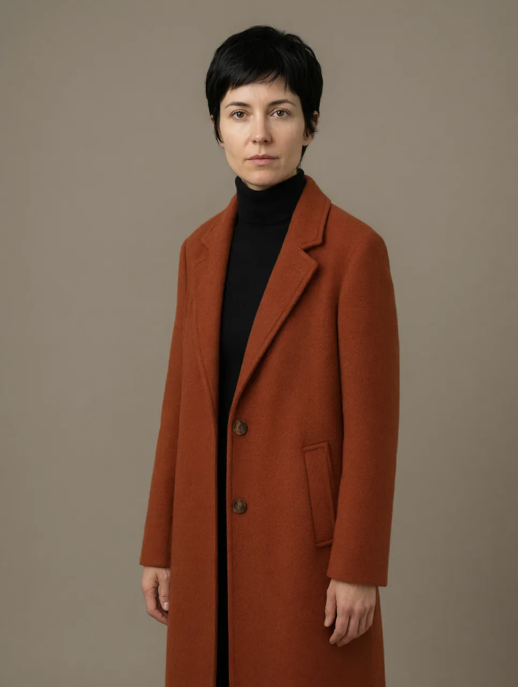

```text
A photoreal studio portrait of the woman from the first image wearing the rust wool overcoat from the second image. Keep her face, short black hair, and black turtleneck recognizable. The coat is on her, unbuttoned, same rust color and lapels. Plain warm-grey studio, even soft light, three-quarter view, hands visible and anatomically correct. No text, no logos, no watermark.
```

Qwen Image 3.0 · Beatra · [Original source](https://github.com/beatra-ai/awesome-qwen-image-3/blob/7d0e05d23c1bac4dab45a5bcbb1d52607fb73c1c/README.md#L591)

Full source Prompt block and native output visually correspond; source flaws retained, no independent generation claimed.

## 25. Black kettle on the kitchen counter

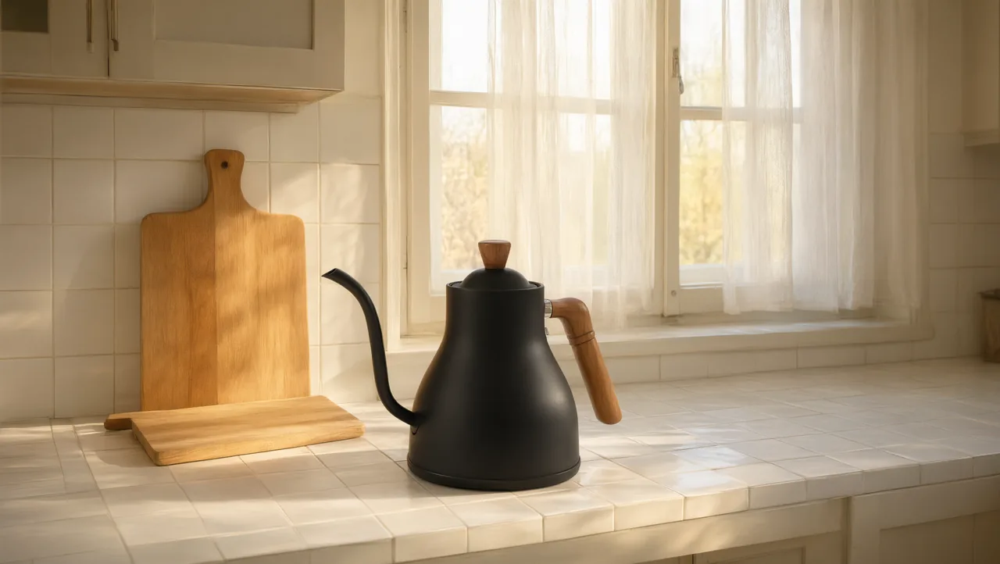

```text
Place the matte-black gooseneck kettle from the first image on the sunlit white-tile kitchen counter from the second image, near the wood cutting board. Keep the kettle's round body, long curved spout, and wood handle. Keep the window, sheer curtains, and morning light. No people, no logos, no readable text, no watermark.
```

Qwen Image 3.0 · Beatra · [Original source](https://github.com/beatra-ai/awesome-qwen-image-3/blob/7d0e05d23c1bac4dab45a5bcbb1d52607fb73c1c/README.md#L615)

Full source Prompt block and native output visually correspond; source flaws retained, no independent generation claimed.

## 26. Flat home-office illustration

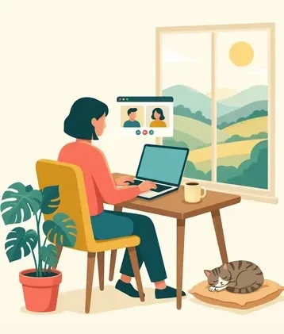

```text
[panel 2] Flat vector illustration for a blog header about remote work. A cozy home workspace seen from a slight side angle: a person with short dark hair sits at a wooden desk by a large window, working on a laptop, a mug of coffee beside it, a leafy potted monstera, a sleeping cat curled on a cushion nearby, and a small video-call window with two simple abstract avatars floating above the laptop. Through the window, soft rolling hills and a morning sun. Clean geometric shapes, flat colors with subtle grain texture, limited palette of warm coral, mustard yellow, teal and cream, no gradients, no outlines on the background, modern editorial illustration style, balanced composition with calm negative space. No text, no letters, no logos.
```

Qwen Image 3.0 Pro · Beatra · [Original source](https://github.com/beatra-ai/awesome-qwen-image-3/blob/7d0e05d23c1bac4dab45a5bcbb1d52607fb73c1c/README.md#L643)

Published native image is358x421, below ProjectD minimum native width400; no upscale used.

## 27. Storm lighthouse, no people

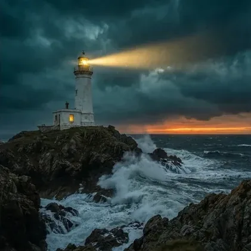

```text
[panel 3] Cinematic concept art film still: a lone white stone lighthouse on a jagged rocky headland at dusk during a violent storm. Huge dark waves crash against the rocks and burst into white spray, the lighthouse beam cuts a bright golden shaft through slanting rain and low churning clouds. Deep teal and slate-blue storm sky with a thin band of burning orange sunset light on the horizon, a single warm lit window at the lighthouse base. Low wide-angle camera, dramatic scale, volumetric light, atmospheric haze, high dynamic range, anamorphic film look, rich contrast, highly detailed. No people, no boats, no text.
```

Qwen Image 3.0 Pro · Beatra · [Original source](https://github.com/beatra-ai/awesome-qwen-image-3/blob/7d0e05d23c1bac4dab45a5bcbb1d52607fb73c1c/README.md#L667)

Native421x421 source rendition retained; literal [panel3] prefix is part of the published complete prompt unit, not a claim to have a complete earlier conversation.

## 28. Flat bakery storefront

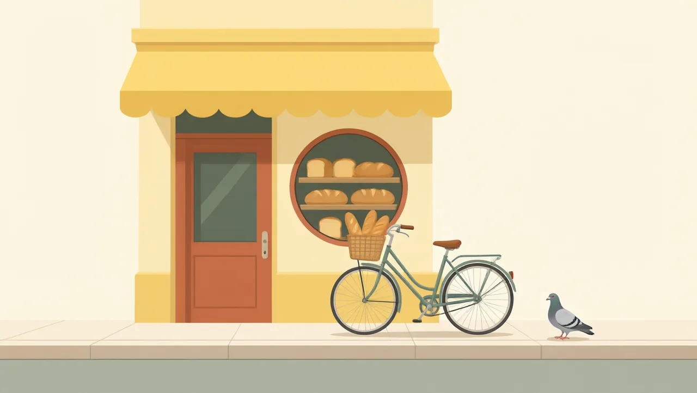

```text
Flat editorial illustration of a tiny fictional bakery storefront on a quiet street at morning. Butter-yellow awning, a round window full of plain loaves, a bicycle with a basket of bread, one pigeon. Limited palette of butter, terracotta, sage, and cream. Clean shapes, no outlines on the sky, no text, no letters, no logos, no watermark.
```

Qwen Image 3.0 · Beatra · [Original source](https://github.com/beatra-ai/awesome-qwen-image-3/blob/7d0e05d23c1bac4dab45a5bcbb1d52607fb73c1c/README.md#L691)

Full source Prompt block and native output visually correspond; source flaws retained, no independent generation claimed.

## 29. Gouache night train

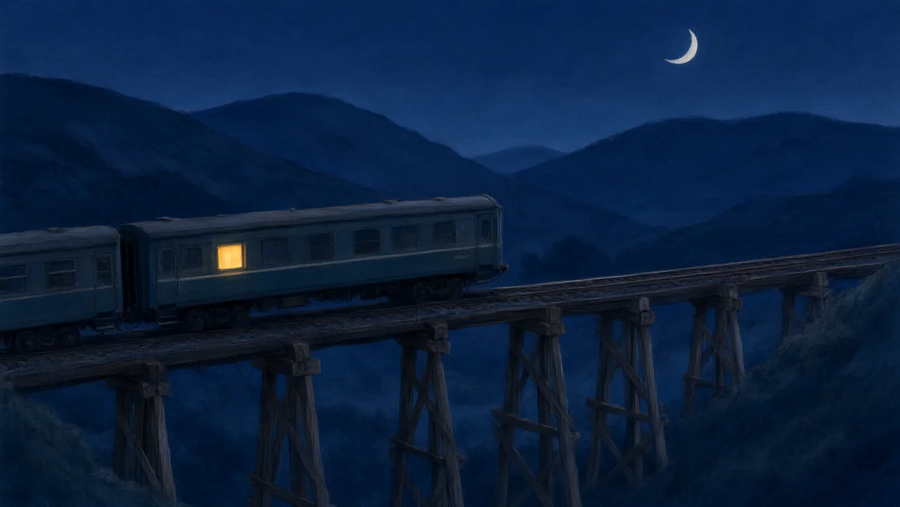

```text
Gouache illustration of a short fictional night train crossing a wooden trestle, one warm square window lit, deep indigo hills and a thin moon. Visible paper texture, soft brush edges, no people visible, no text, no letters, no logos, no watermark.
```

Qwen Image 3.0 · Beatra · [Original source](https://github.com/beatra-ai/awesome-qwen-image-3/blob/7d0e05d23c1bac4dab45a5bcbb1d52607fb73c1c/README.md#L715)

Full source Prompt block and native output visually correspond; source flaws retained, no independent generation claimed.

## 30. Pencil fox in a raincoat

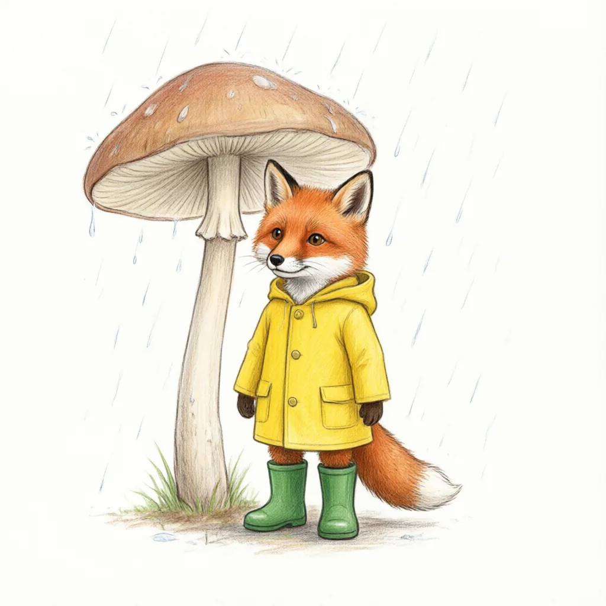

```text
Children's book illustration, soft colored pencil, of an original red fox wearing a plain yellow raincoat and green boots, standing under a single mushroom in light rain. White paper background, no text, no letters, no logos, no watermark. The fox is not a known character.
```

Qwen Image 3.0 · Beatra · [Original source](https://github.com/beatra-ai/awesome-qwen-image-3/blob/7d0e05d23c1bac4dab45a5bcbb1d52607fb73c1c/README.md#L739)

Full source Prompt block and native output visually correspond; source flaws retained, no independent generation claimed.

## 31. Isometric record-shop interior

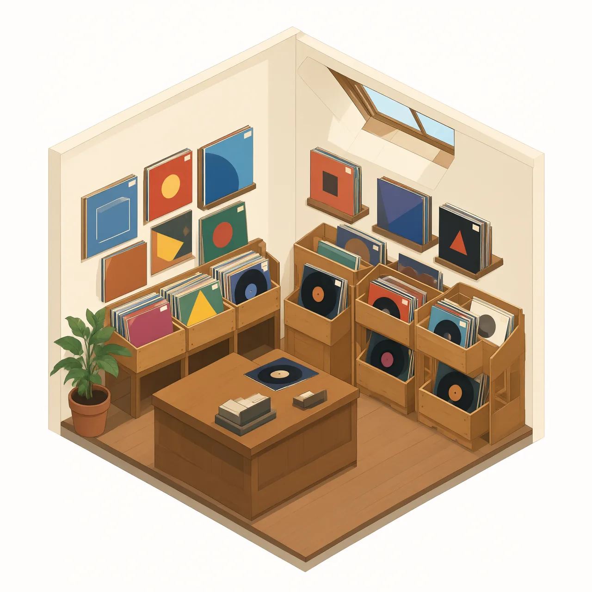

```text
Isometric illustration of a tiny fictional record-shop interior, limited flat colors. One wooden counter, wooden vinyl crates, a potted plant, a skylight, no people. Every album sleeve is a solid color or a simple geometric shape with no letters, no numbers, no logos, and no readable marks of any kind. Clean vector-like isometric, generous margin.
```

Qwen Image 3.0 · Beatra · [Original source](https://github.com/beatra-ai/awesome-qwen-image-3/blob/7d0e05d23c1bac4dab45a5bcbb1d52607fb73c1c/README.md#L763)

Full source Prompt block and native output visually correspond; source flaws retained, no independent generation claimed.

## 32. Fictional presenter, head and shoulders


```text
Photorealistic head-and-shoulders portrait of a friendly product educator, a woman in her mid-30s, looking directly into the camera with a warm, relaxed closed-mouth smile, as if about to start speaking to viewers. Shoulder-length dark brown hair, natural makeup, a simple sage-green crew-neck knit sweater with no logos or text. Centered framing from mid-chest up with comfortable headroom, both shoulders visible, arms and hands out of frame. Plain seamless warm light-grey studio backdrop with a gentle soft falloff. Soft large key light from the front-left, subtle fill, clean catchlights in both eyes, natural skin texture, symmetric well-formed eyes and ears, sharp focus on the face, shallow depth of field. Shot on an 85mm lens, true-to-life color, calm and trustworthy presenter look. No text, no watermark, no jewelry, no microphone.
```

Qwen Image 3.0 Pro · Beatra · [Original source](https://github.com/beatra-ai/awesome-qwen-image-3/blob/7d0e05d23c1bac4dab45a5bcbb1d52607fb73c1c/README.md#L791)

Full source Prompt block and native output visually correspond; source flaws retained, no independent generation claimed.

## 33. Cafe portrait after an edit

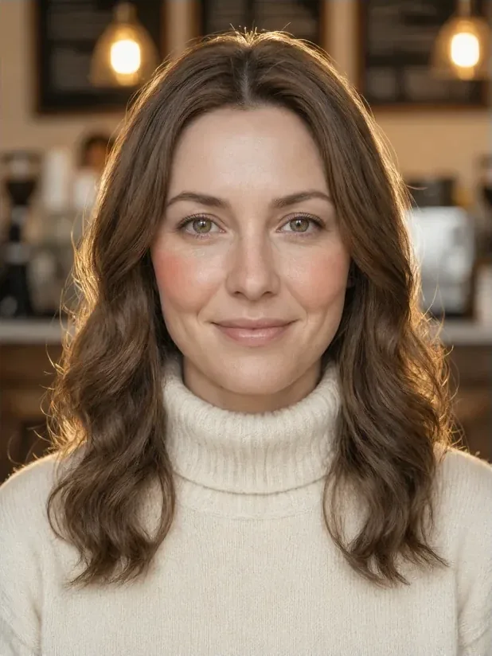

```text
[after] Reduce the plastic, airbrushed AI look across this portrait so it reads like a real camera photograph. Restore natural skin texture with fine visible pores, subtle fine lines and slight natural unevenness in skin tone; replace the two round orange blush patches with a faint natural flush; tone down the over-saturated orange-pink glow, bloom haze and over-bright rim light to realistic warm cafe lighting with natural color; make the catchlights in the eyes small and natural. Preserve the same woman's identity and facial features, expression and closed-mouth smile, eye color, wavy chestnut hairstyle, cream knit turtleneck sweater, pose, framing, crop, cafe background and lighting direction. Do not add makeup, text or logos.
```

Qwen Image 3.0 · Beatra · [Original source](https://github.com/beatra-ai/awesome-qwen-image-3/blob/7d0e05d23c1bac4dab45a5bcbb1d52607fb73c1c/README.md#L815)

Full source Prompt block and native output visually correspond; source flaws retained, no independent generation claimed.

## 34. Fictional baker, head and shoulders


```text
Photoreal head-and-shoulders portrait of a fictional man in his early fifties, short salt-and-pepper hair, a neat grey mustache, warm brown eyes, light crow's feet, wearing a flour-dusted oatmeal linen apron over a faded blue shirt. He looks just off camera with a small closed-mouth smile. Bakery kitchen background softly blurred, morning side light, natural skin texture, both eyes well formed, ears symmetric. Hands out of frame. No text, no logos, no watermark.
```

Qwen Image 3.0 · Beatra · [Original source](https://github.com/beatra-ai/awesome-qwen-image-3/blob/7d0e05d23c1bac4dab45a5bcbb1d52607fb73c1c/README.md#L839)

Full source Prompt block and native output visually correspond; source flaws retained, no independent generation claimed.

## 35. Fictional cyclist on a path

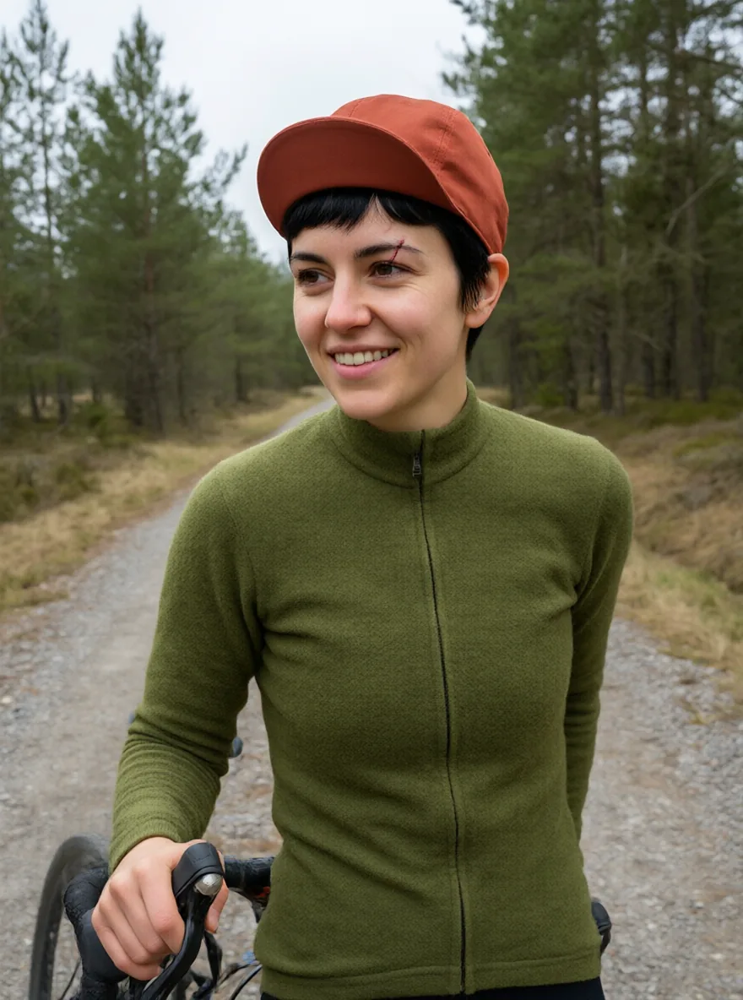

```text
Photoreal three-quarter portrait of a fictional woman in her late twenties with a short black crop, a small scar through the left eyebrow, wearing a rust-colored cycling cap and a moss-green wool jersey with no logos. She holds the bicycle handlebar with one hand, five natural fingers, and smiles with teeth unseen. Overcast daylight on a gravel path, pine trees blurred behind. Natural skin, correct eyes and ears. No text, no logos, no watermark.
```

Qwen Image 3.0 · Beatra · [Original source](https://github.com/beatra-ai/awesome-qwen-image-3/blob/7d0e05d23c1bac4dab45a5bcbb1d52607fb73c1c/README.md#L863)

Full source Prompt block and native output visually correspond; source flaws retained, no independent generation claimed.

## 36. Fictional potter by the window

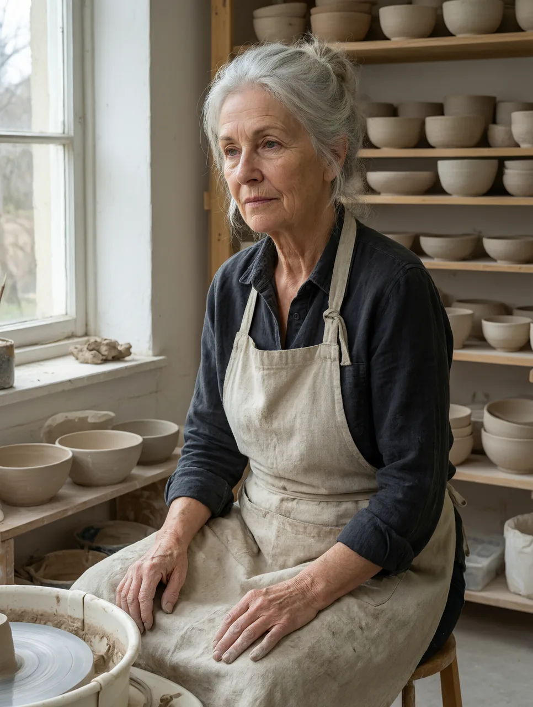

```text
Photoreal three-quarter portrait of a fictional woman in her early seventies, silver hair pinned up, clay-dusted linen apron over a charcoal shirt, sitting beside a pottery wheel near a north-facing studio window, pale daylight, lined natural skin, closed mouth, hands resting on her lap with clay under the nails, anatomically correct. Quiet pottery studio, shelves of unglazed bowls behind her, slightly out of focus. No text, no logos, no watermark.
```

Qwen Image 3.0 · Beatra · [Original source](https://github.com/beatra-ai/awesome-qwen-image-3/blob/7d0e05d23c1bac4dab45a5bcbb1d52607fb73c1c/README.md#L887)

Full source Prompt block and native output visually correspond; source flaws retained, no independent generation claimed.

## 37. Four-step tea card

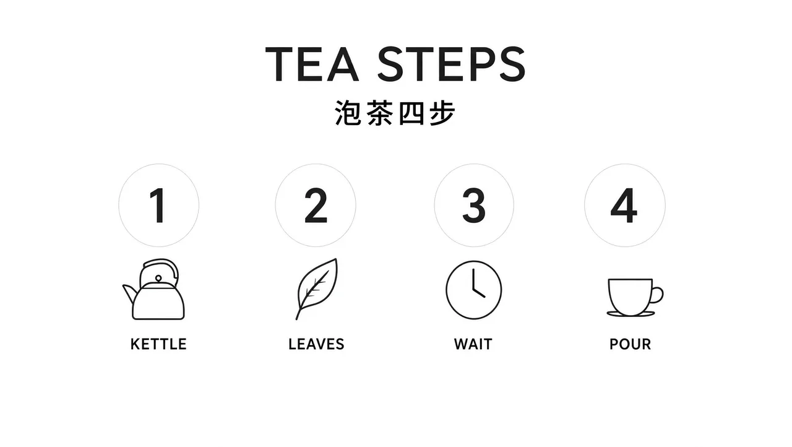

```text
Clean flat infographic on white, wide layout, lots of margin. Title exactly TEA STEPS in black sans-serif. Under it the Chinese line 泡茶四步 exactly. Four circles in a row containing only the digits 1 2 3 4, with the labels KETTLE, LEAVES, WAIT, POUR under them, each label one word, perfectly spelled. Simple line icons of a kettle, a leaf, a clock, and a cup. No other text, no logos, no watermark.
```

Qwen Image 3.0 · Beatra · [Original source](https://github.com/beatra-ai/awesome-qwen-image-3/blob/7d0e05d23c1bac4dab45a5bcbb1d52607fb73c1c/README.md#L915)

Full source Prompt block and native output visually correspond; source flaws retained, no independent generation claimed.

## 38. Weekly cups bar chart

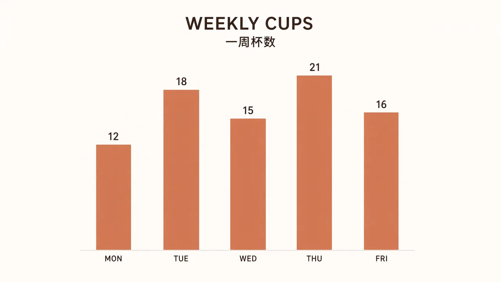

```text
Simple bar chart on warm white. Title exactly WEEKLY CUPS in dark brown sans-serif. Subtitle exactly 一周杯数. Five vertical terracotta bars on a thin baseline, labeled under the axis exactly MON TUE WED THU FRI. Printed above the bars, the exact values 12 18 15 21 16 in that order. No grid, no legend, no other text, no logos, no watermark.
```

Qwen Image 3.0 · Beatra · [Original source](https://github.com/beatra-ai/awesome-qwen-image-3/blob/7d0e05d23c1bac4dab45a5bcbb1d52607fb73c1c/README.md#L939)

Synthetic chart with fictional demonstration values12,18,15,21,16, not measured data.

## 39. Three-column fern care card

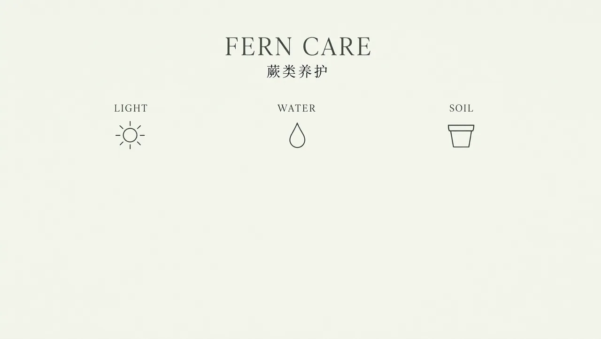

```text
Clean three-column care card on pale sage paper, wide layout, lots of empty margin. The only text in the whole image is these five strings, each perfectly spelled, and nothing else: the title FERN CARE, the Chinese line 蕨类养护 directly under the title, and the three column labels LIGHT, WATER, and SOIL. Under LIGHT draw only a simple sun icon. Under WATER draw only a simple drop icon. Under SOIL draw only a simple pot icon. The area under every icon is blank paper. Do not write sentences, captions, descriptions, small print, or placeholder words. No numbers, no logos, no watermark.
```

Qwen Image 3.0 · Beatra · [Original source](https://github.com/beatra-ai/awesome-qwen-image-3/blob/7d0e05d23c1bac4dab45a5bcbb1d52607fb73c1c/README.md#L963)

Full source Prompt block and native output visually correspond; source flaws retained, no independent generation claimed.

## 40. Pollen Trail schematic map

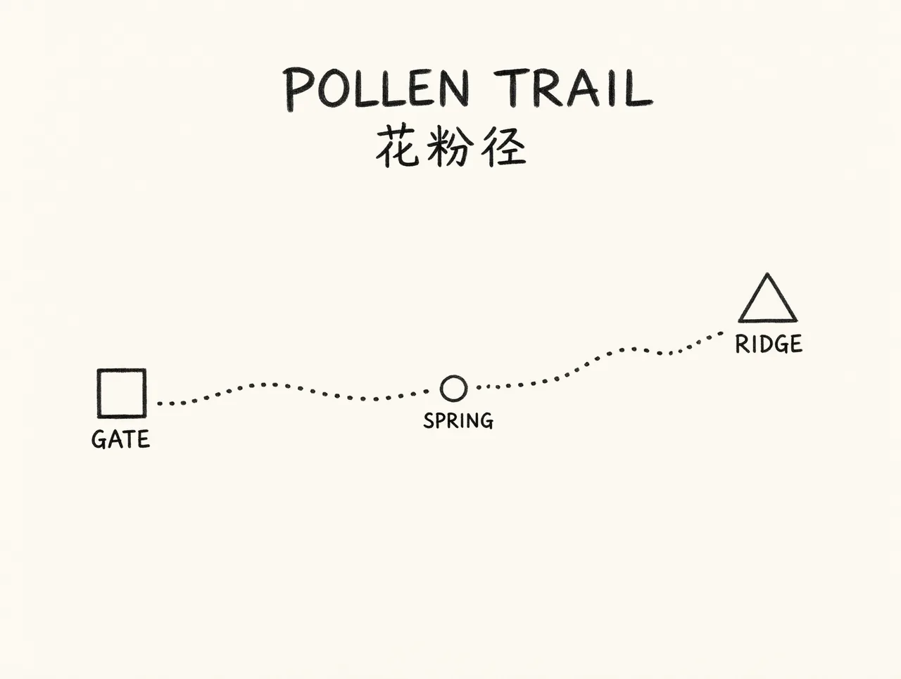

```text
Simple schematic trail map on cream paper, not a real place. A single dotted path from a square labeled GATE to a triangle labeled RIDGE, with a small circle labeled SPRING halfway. Title at the top exactly POLLEN TRAIL and the Chinese line 花粉径 under the title. Those five words and the Chinese line are the only text. Flat ink drawing, no logos, no watermark, no compass rose text.
```

Qwen Image 3.0 · Beatra · [Original source](https://github.com/beatra-ai/awesome-qwen-image-3/blob/7d0e05d23c1bac4dab45a5bcbb1d52607fb73c1c/README.md#L987)

Fictional trail schematic, not a real navigation map.

