# awesome-image-prompt

**5,734 complete source-bound image/prompt pairs archived.** Original attribution, actual generation models, reference requirements and per-item provenance are retained.

[Remote archive verification](data/github-gallery-remote-acceptance-2026-11-06.json) compares1,427 new media/prompt Git blobs against the actual GitHub tree. This archive count is separate from ProjectD publication.

[3,631 additional ChaosRealmsAI GPT Image2 source pairs](GPT-IMAGE-2-CHAOS.md) retain complete prompts, unchanged author-published renditions and source references. Individual ProjectD review is in progress: 2,000 inspected, 1,885 locally approved, 115 held, 1,631 unreviewed. The first 731 completed ProjectD runs42080135905 and42084953684 and passed ordinary public complete-prompt, entire-image and ten-locale checks. A further495 passed local review and tests in PR341 and is publishing in run42090448597; its separate public acceptance is still required. Another487 passed complete local acceptance and merged in ProjectD PR344; their public publication remains pending. Archive totals are separate from public acceptance.

## GPT Image 2.6 — current focus

**40 complete output/prompt pairs, representing 24 distinct prompt texts.** Images and full prompts are stored in this repository with original attribution and per-item rights notes.

- [21 official example pairs](GPT-IMAGE-2.6-FULL.md), already published on ProjectD.
- [15 official comparison outputs](GPT-IMAGE-2.6-COMPARISONS.md): 13 Flare + 2 Sunburst complexity variants; zero additional prompt recipes.
- [3 more independent editing outputs, 2 distinct prompts](GPT-IMAGE-2.6-INDEPENDENT.md): Night Lab mug recoloring and Lightlyn sofa edits.
- [1 independent creator recipe](GPT-IMAGE-2.6-CREATOR.md), with the original 14-word prompt and actual 2.6 attachment. Variant unspecified.
- [50-group original source index](GPT-IMAGE-2.6.md) and [additional research outcomes](data/image26-research-expansion.json). Source-linked candidates are not automatically approved pairs.

All 40 pairs have ProjectD publication receipts. All40 ordinary public details, full clipboard text and entire media hashes pass, along with ten-locale frames/pagination. The final ordinary HTTP/1 model-filter/history/visible-image pass also succeeds; previous failed attempts remain recorded.

## GitHub gallery expansion

[All40 Beatra Qwen Image3.0 cases](QWEN-IMAGE-3-BEATRA.md), with complete prompts and exact local images.38 now published and accepted on ProjectD; two original previews remain below its minimum dimensions. [449 additional APIModels GPT Image 2 pairs](GPT-IMAGE-2-APIMODELS.md) have full prompts and native PNGs: 402 now published and accepted on ProjectD, 47 held with individual reasons. The 955-record source was reconciled against 491 already present and 15 previous holds.

The new440 reviewed GitHub pairs have [completed publication and exact public acceptance](data/github-gallery-public-acceptance-2026-11-06.json). ProjectD now contains7,451 pairs.

## ProjectD historical backfill

**1,574 historical pairs** are now archived across 16 batches with complete prompts and local images. [Browse all batches](PROJECTD-ARCHIVE.md). Their actual generation models remain unchanged; historical outputs are not relabeled as GPT Image 2.6.

The remaining **5,397** legacy records have individual source-evidence holds. [Held records](data/projectd-backfill-held.json) · [Upstream license audit](data/projectd-held-source-audit.json) · [Current inventory](data/projectd-inventory.json).

Third-party prompts and images retain original licenses, attribution and rights notices. No blanket repository license grants rights to third-party content.

## Gallery

### Pure White Marketplace Packshot (reference photo required)

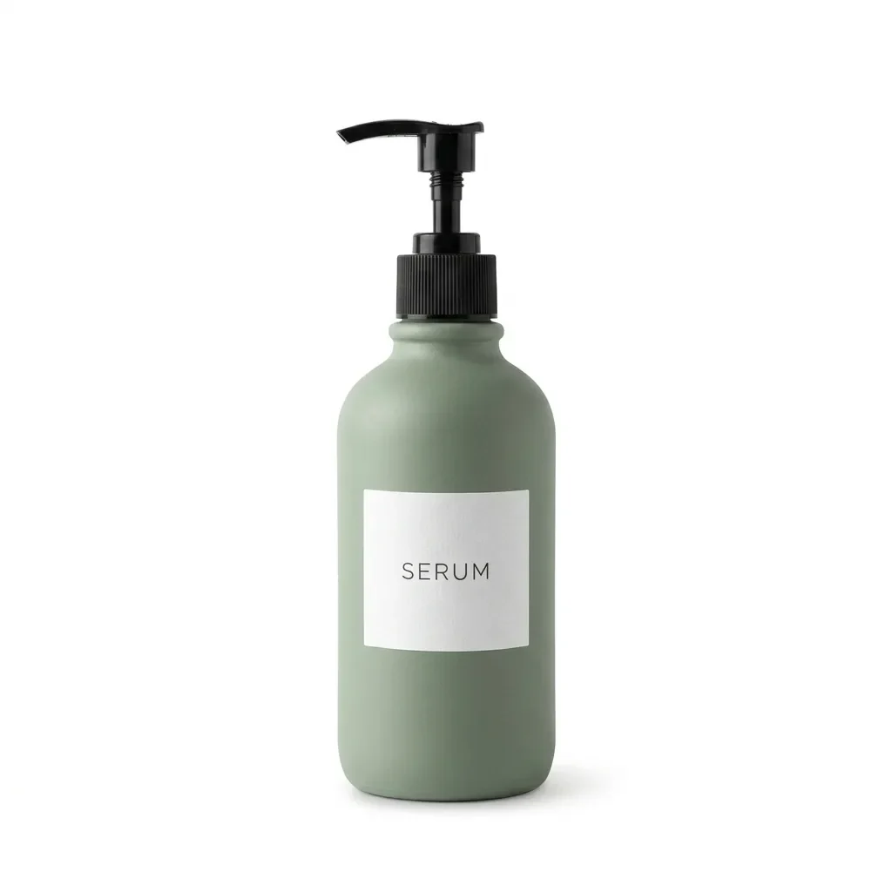

Keep the product exactly as it is, including its shape, label, colors and proportions. Replace the background with pure white (#FFFFFF) and center the product. Light it with soft, even studio light from both sides and add a subtle natural contact shadow under its base. Crisp edges, no color spill, clean e-commerce packshot.

Model: Nano Banana 2.1 · Author: YepShot · https://yepshot.com · [Original source](https://yepshot.com/explore/studio-pure-white-amazon)

CC BY 4.0. Copyright 2026 YepShot. Attribution: YepShot — https://yepshot.com. License: https://creativecommons.org/licenses/by/4.0/

### Black Acrylic Mirror Reflection (reference photo required)

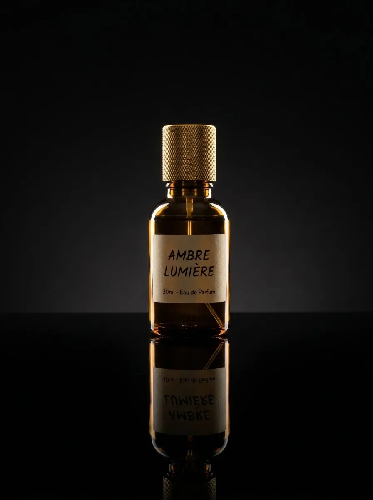

Keep the product unchanged. Place it on glossy black acrylic with a crisp mirror reflection that fades downward. Use a dark, seamless background and a dramatic rim light along both edges of the product. Deep contrast, luxury brand look, ultra-sharp detail.

Model: Nano Banana 2.1 · Author: YepShot · https://yepshot.com · [Original source](https://yepshot.com/explore/studio-acrylic-reflection)

CC BY 4.0. Copyright 2026 YepShot. Attribution: YepShot — https://yepshot.com. License: https://creativecommons.org/licenses/by/4.0/

### Floating Hero Shot (reference photo required)

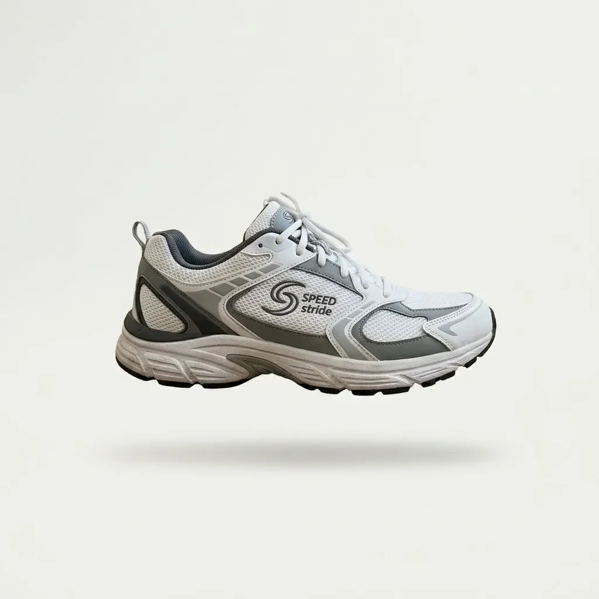

Keep the product unchanged. Make it float about 2 cm above a seamless off-white studio backdrop, with a soft, diffused shadow on the floor directly beneath it. Soft overhead lighting, clean and minimal catalog style.

Model: Nano Banana 2.1 · Author: YepShot · https://yepshot.com · [Original source](https://yepshot.com/explore/studio-floating-ambient-shadow)

CC BY 4.0. Copyright 2026 YepShot. Attribution: YepShot — https://yepshot.com. License: https://creativecommons.org/licenses/by/4.0/

### Overhead Flat Lay on Light Gray (reference photo required)

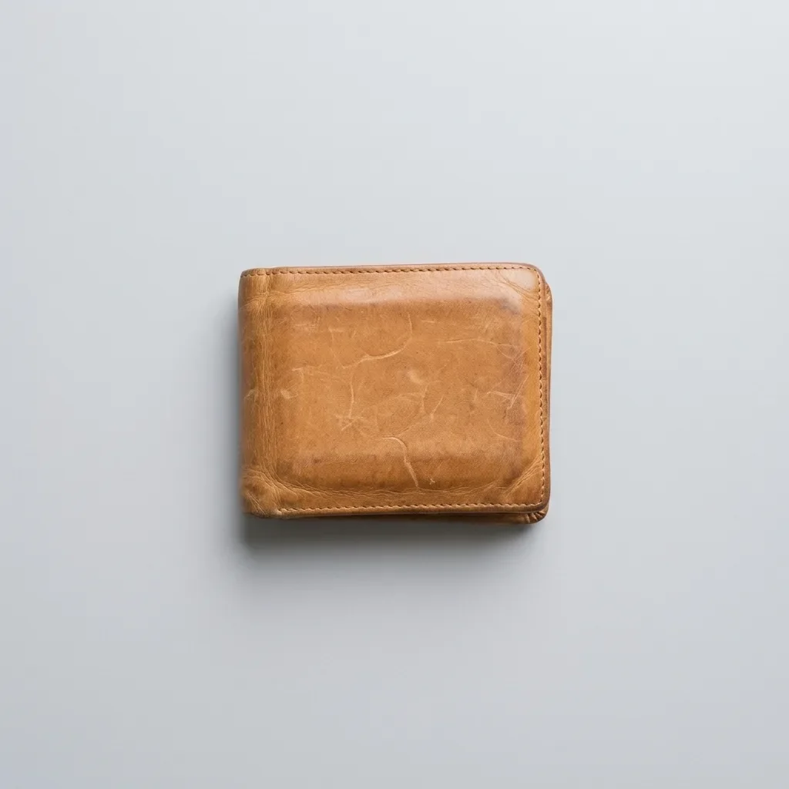

Keep the product exactly as it is, including its shape, stitching, colors and any logo. Show it as an overhead flat lay, photographed straight down and centered on a light gray seamless background. Soft, even lighting with only a faint shadow. Clean, minimal marketplace listing photo.

Model: Nano Banana 2.1 · Author: YepShot · https://yepshot.com · [Original source](https://yepshot.com/explore/studio-overhead-flat-lay)

CC BY 4.0. Copyright 2026 YepShot. Attribution: YepShot — https://yepshot.com. License: https://creativecommons.org/licenses/by/4.0/

### Three-Quarter Catalog Angle (reference photo required)

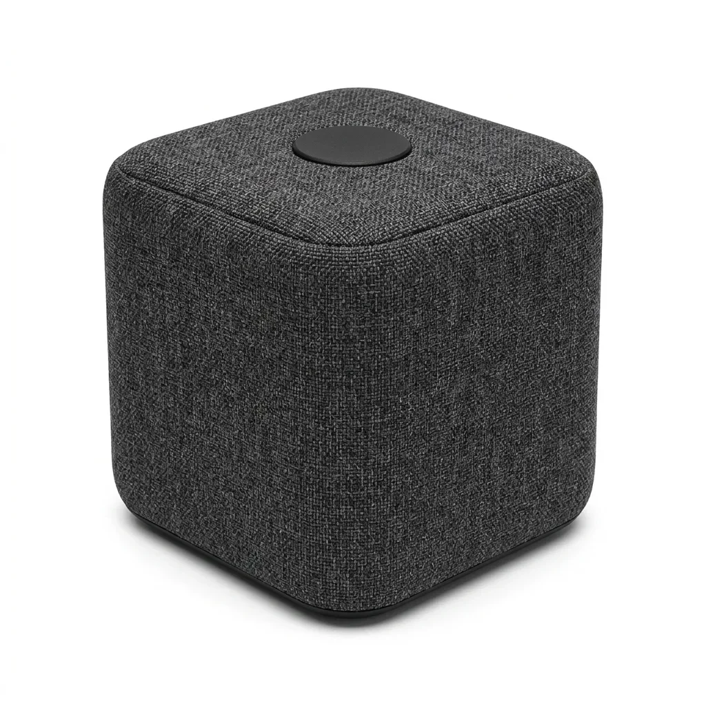

Keep the product's design, colors, materials and logo exactly as they are. Show it at a three-quarter angle, turned about 45 degrees to the left, on a pure white background with a soft contact shadow. Even studio lighting, consistent e-commerce catalog style.

Model: Nano Banana 2.1 · Author: YepShot · https://yepshot.com · [Original source](https://yepshot.com/explore/studio-three-quarter-angle)

CC BY 4.0. Copyright 2026 YepShot. Attribution: YepShot — https://yepshot.com. License: https://creativecommons.org/licenses/by/4.0/

### Material Close-Up for Detail Images (reference photo required)

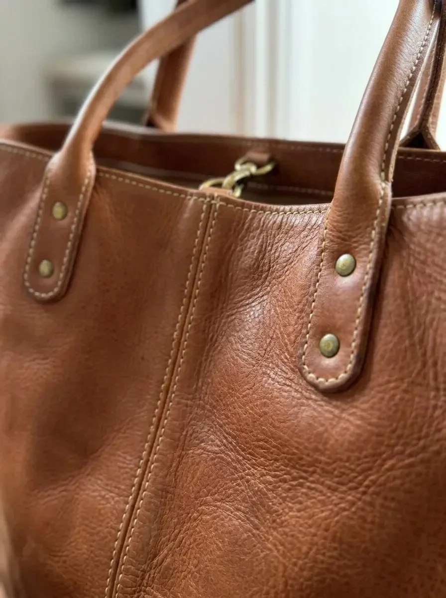

Turn this into a close-up detail shot of the product's material and craftsmanship. Fill the frame with its surface texture, stitching and hardware, using a shallow depth of field and soft side light that brings out the texture. Keep the colors, materials and hardware finish exactly as in the original photo.

Model: Nano Banana 2.1 · Author: YepShot · https://yepshot.com · [Original source](https://yepshot.com/explore/studio-material-detail-closeup)

CC BY 4.0. Copyright 2026 YepShot. Attribution: YepShot — https://yepshot.com. License: https://creativecommons.org/licenses/by/4.0/

### Preview Colorways Side by Side (reference photo required)

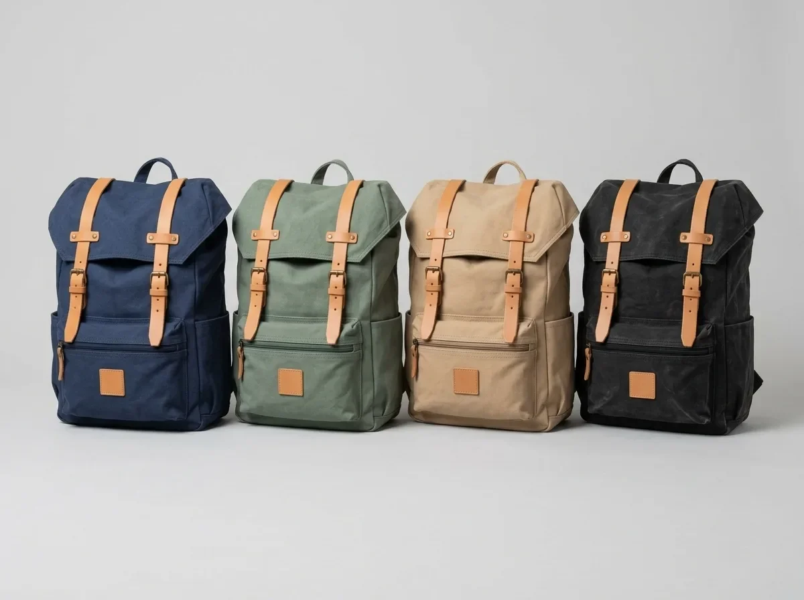

Show this product in four colorways side by side: its original color, sage green, sand beige and charcoal black. Keep the shape, materials, details and logo identical across all four. Space them evenly on a light gray background with the same soft studio light and matching shadows.

Model: Nano Banana 2.1 · Author: YepShot · https://yepshot.com · [Original source](https://yepshot.com/explore/studio-colorway-lineup)

CC BY 4.0. Copyright 2026 YepShot. Attribution: YepShot — https://yepshot.com. License: https://creativecommons.org/licenses/by/4.0/

### Travertine Block in Morning Light (reference photo required)

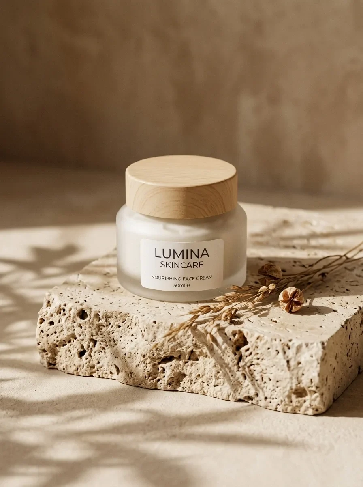

Keep the product exactly as it is, including its shape, label and colors. Place it on a raw-cut beige travertine block with a few dried botanical stems beside it. Soft morning window light casts dappled leaf shadows across the scene. Warm, organic mood, shallow depth of field, editorial lifestyle photo.

Model: Nano Banana 2.1 · Author: YepShot · https://yepshot.com · [Original source](https://yepshot.com/explore/lifestyle-travertine-stone)

CC BY 4.0. Copyright 2026 YepShot. Attribution: YepShot — https://yepshot.com. License: https://creativecommons.org/licenses/by/4.0/

### Marble Vanity with Water Droplets (reference photo required)

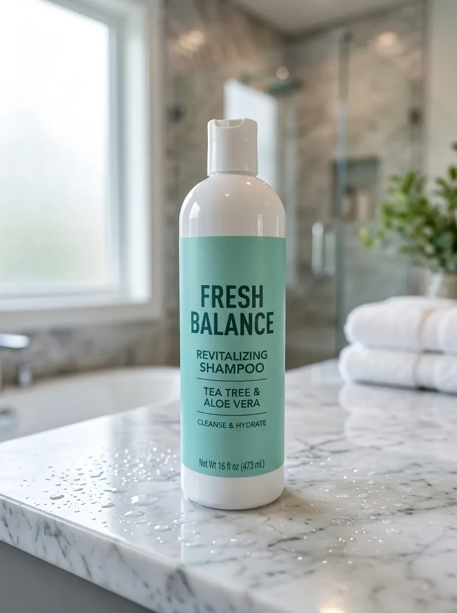

Keep the product unchanged. Place it on a polished white Carrara marble bathroom vanity with fine water droplets on the surface. Soft light through a frosted window, a blurred luxury spa bathroom in the background. Fresh, clean skincare advertising look with crisp focus on the product.

Model: Nano Banana 2.1 · Author: YepShot · https://yepshot.com · [Original source](https://yepshot.com/explore/lifestyle-marble-bathroom-dew)

CC BY 4.0. Copyright 2026 YepShot. Attribution: YepShot — https://yepshot.com. License: https://creativecommons.org/licenses/by/4.0/

### Oak Table with Kitchen Props (reference photo required)

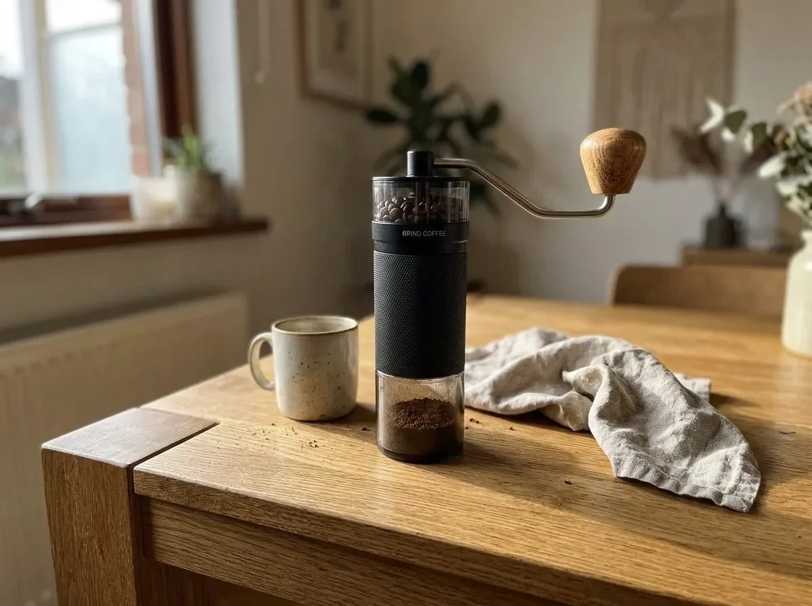

Keep the product unchanged. Place it on a natural oak tabletop with visible wood grain, with a ceramic cup and a linen napkin nearby. Warm daylight from a side window, authentic Scandinavian home atmosphere, f/4 depth of field, product in sharp focus.

Model: Nano Banana 2.1 · Author: YepShot · https://yepshot.com · [Original source](https://yepshot.com/explore/lifestyle-scandinavian-wood-kitchen)

CC BY 4.0. Copyright 2026 YepShot. Attribution: YepShot — https://yepshot.com. License: https://creativecommons.org/licenses/by/4.0/

### Concrete Podium, Tech Style (reference photo required)

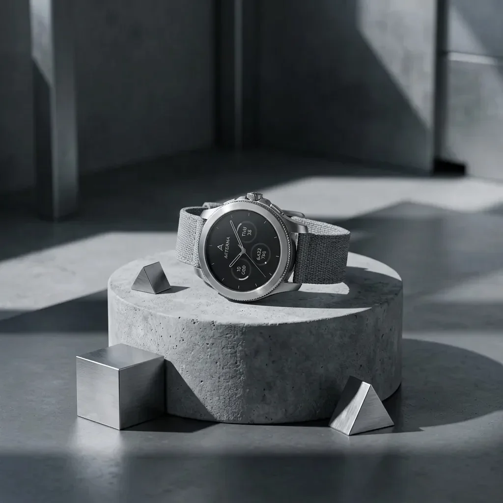

Keep the product unchanged. Place it on a minimalist raw gray concrete cylinder podium with a few brushed-metal geometric shapes around it. Cool architectural light with sharp, angular shadows. Modern industrial look for tech accessories, high detail.

Model: Nano Banana 2.1 · Author: YepShot · https://yepshot.com · [Original source](https://yepshot.com/explore/lifestyle-industrial-concrete-podium)

CC BY 4.0. Copyright 2026 YepShot. Attribution: YepShot — https://yepshot.com. License: https://creativecommons.org/licenses/by/4.0/

### Bright Modern Living Room (reference photo required)

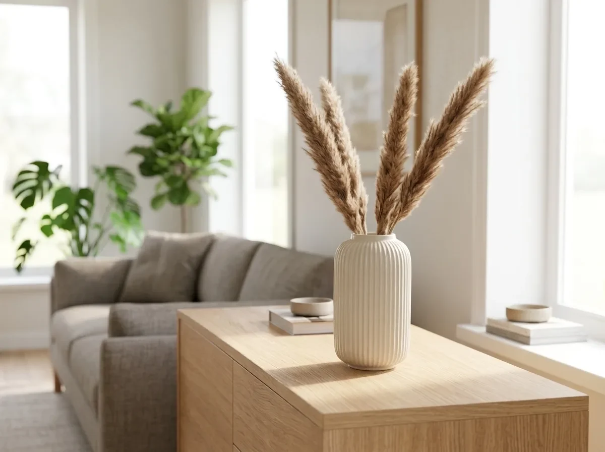

Keep the product exactly as it is, including its shape, finish and colors. Place it on a light oak sideboard in a bright, modern living room, with a sofa and green plants softly blurred behind it. Natural daylight from a large window, shadows that match the light, photorealistic interior catalog photo.

Model: Nano Banana 2.1 · Author: YepShot · https://yepshot.com · [Original source](https://yepshot.com/explore/lifestyle-bright-living-room)

CC BY 4.0. Copyright 2026 YepShot. Attribution: YepShot — https://yepshot.com. License: https://creativecommons.org/licenses/by/4.0/

### Sunny Picnic Blanket (reference photo required)

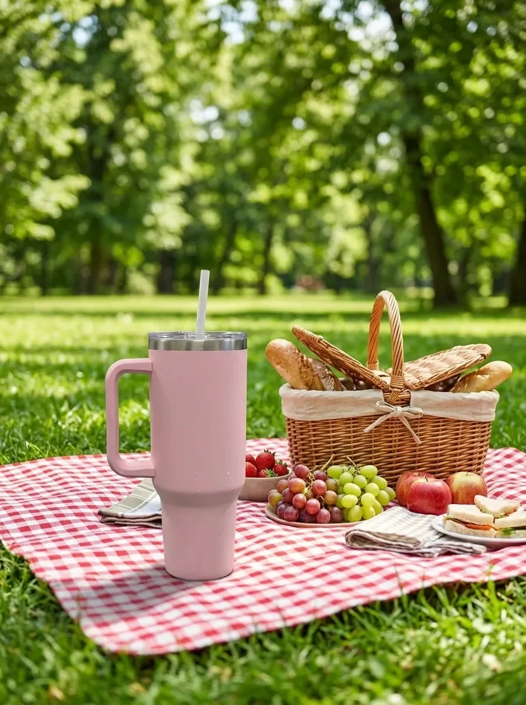

Keep the product unchanged. Place it on a red and white checkered picnic blanket in a sunny park, with a wicker basket and fresh fruit nearby and trees softly blurred in the background. Bright natural daylight with soft shadows, shallow depth of field, cheerful summer lifestyle photo.

Model: Nano Banana 2.1 · Author: YepShot · https://yepshot.com · [Original source](https://yepshot.com/explore/lifestyle-outdoor-picnic)

CC BY 4.0. Copyright 2026 YepShot. Attribution: YepShot — https://yepshot.com. License: https://creativecommons.org/licenses/by/4.0/

### Neon Gaming Desk (reference photo required)

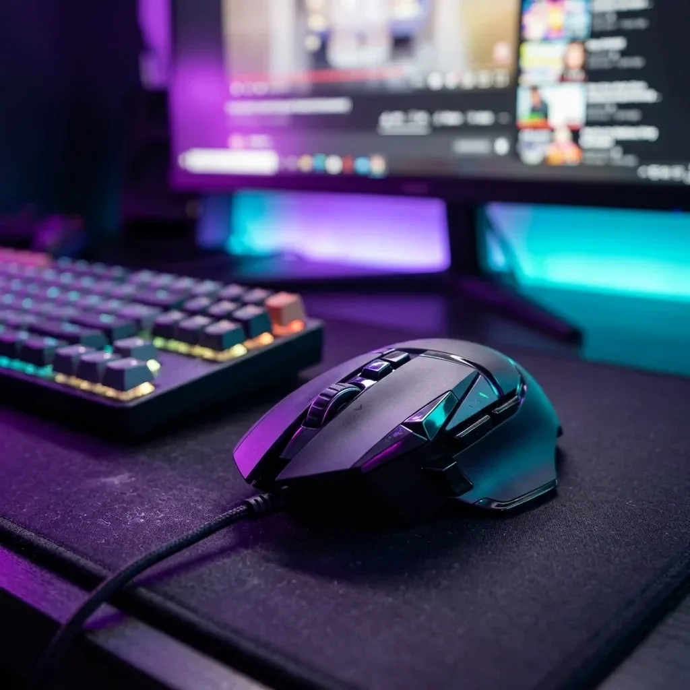

Keep the product unchanged, including its shape, buttons and logo. Place it on a dark desk mat in a gaming setup, with a mechanical keyboard and the glow of a monitor softly blurred behind it. Purple and cyan neon light with subtle RGB reflections along the product's edges. Moody, high-contrast tech product photo.

Model: Nano Banana 2.1 · Author: YepShot · https://yepshot.com · [Original source](https://yepshot.com/explore/lifestyle-neon-gaming-desk)

CC BY 4.0. Copyright 2026 YepShot. Attribution: YepShot — https://yepshot.com. License: https://creativecommons.org/licenses/by/4.0/

### Remove Glare on Shiny Surfaces (mask required)

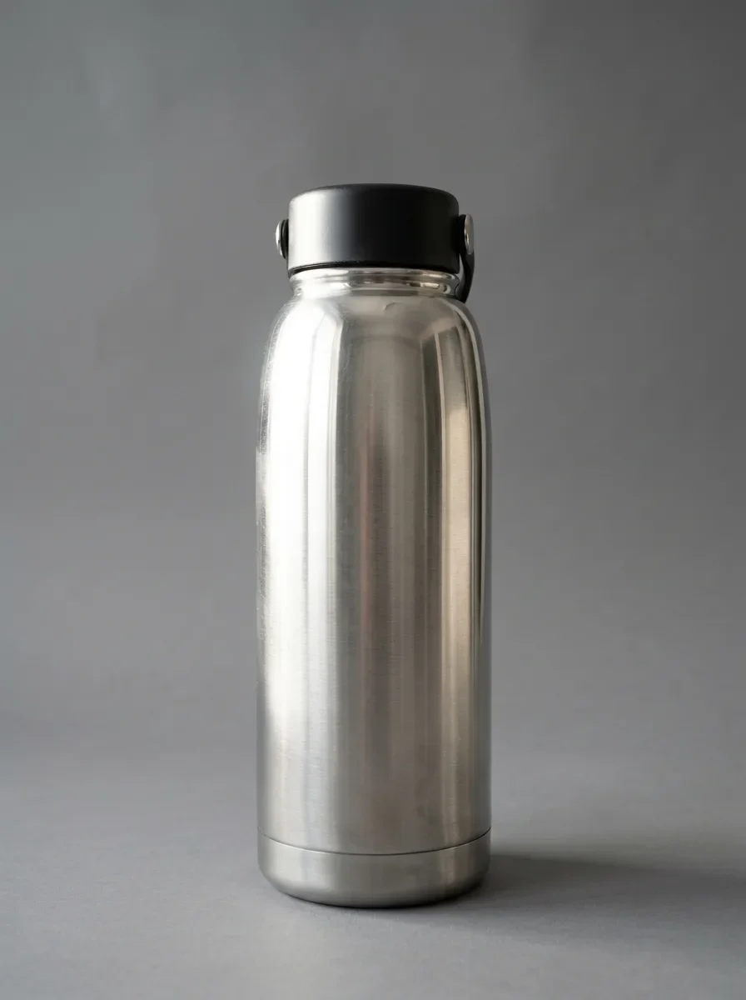

Remove the glare, window reflections and camera reflection in the marked area of the shiny surface. Replace them with a smooth, even highlight that follows the surface's curvature, so it blends seamlessly with the rest of the product. Keep everything outside the marked area unchanged.

Apply the edit only inside the white region of the following mask.

Model: Nano Banana 2.1 · Author: YepShot · https://yepshot.com · [Original source](https://yepshot.com/explore/cleanup-remove-glare-reflections)

CC BY 4.0. Copyright 2026 YepShot. Attribution: YepShot — https://yepshot.com. License: https://creativecommons.org/licenses/by/4.0/

### Erase Barcode and Price Sticker (mask required)

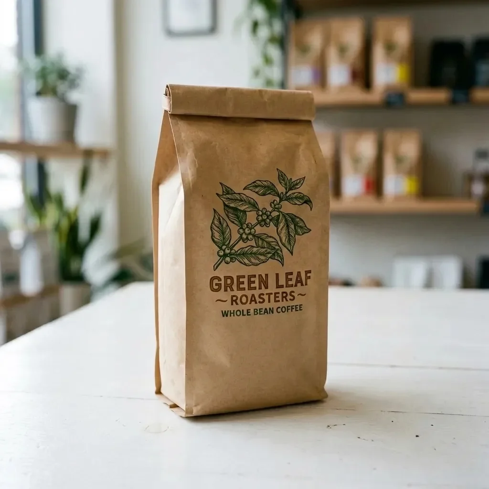

Erase the barcode, price sticker and any text label in the marked area. Rebuild the packaging underneath so its color, texture and printed pattern continue naturally, with no smudges or leftover edges. Keep everything outside the marked area unchanged.

Apply the edit only inside the white region of the following mask.

Model: Nano Banana 2.1 · Author: YepShot · https://yepshot.com · [Original source](https://yepshot.com/explore/cleanup-erase-barcode-watermark)

CC BY 4.0. Copyright 2026 YepShot. Attribution: YepShot — https://yepshot.com. License: https://creativecommons.org/licenses/by/4.0/

### Remove Dust and Fingerprints (reference photo required)

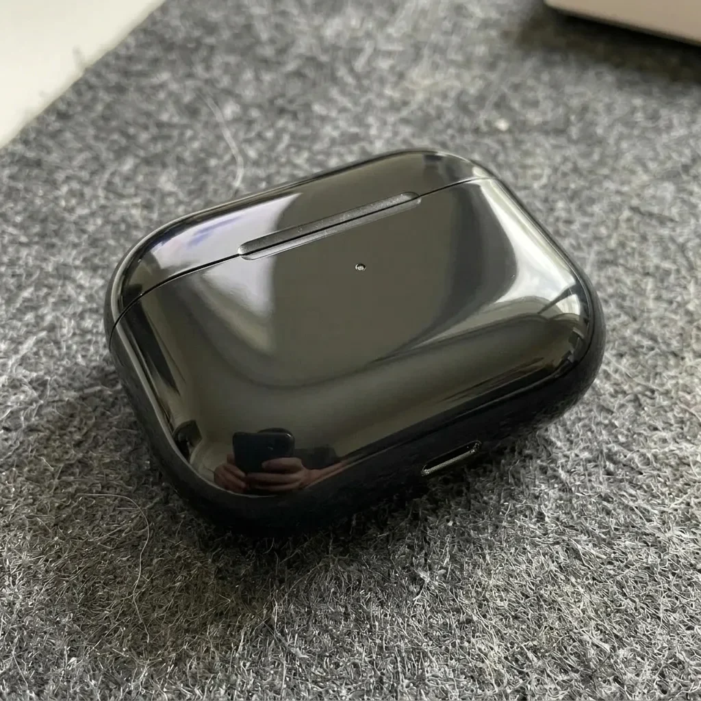

Remove all dust, lint, fingerprints and fine scratches from the product's surface. Keep its shape, color, glossy finish, logo and reflections exactly as they are, and leave the background unchanged. Clean, freshly unboxed look.

Model: Nano Banana 2.1 · Author: YepShot · https://yepshot.com · [Original source](https://yepshot.com/explore/cleanup-dust-fingerprints)

CC BY 4.0. Copyright 2026 YepShot. Attribution: YepShot — https://yepshot.com. License: https://creativecommons.org/licenses/by/4.0/

### Place a Product into Your Scene (two reference images)

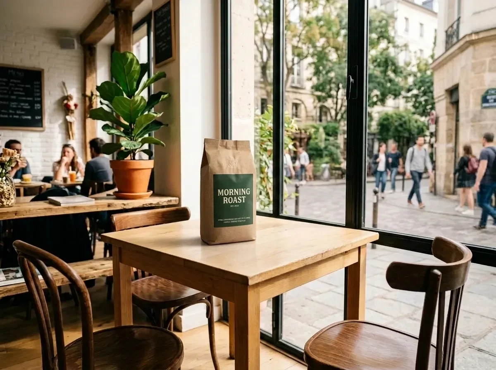

Place the product from IMG_2 on the table in IMG_1. Keep the product's shape, label and colors exactly as in IMG_2. Match IMG_1's perspective, lighting direction and color temperature, and add a natural contact shadow so the product looks photographed in place. Keep the rest of IMG_1 unchanged.

Model: Nano Banana 2.1 · Author: YepShot · https://yepshot.com · [Original source](https://yepshot.com/explore/compose-product-into-scene)

CC BY 4.0. Copyright 2026 YepShot. Attribution: YepShot — https://yepshot.com. License: https://creativecommons.org/licenses/by/4.0/

### Bundle Two Products into One Shot (two reference images)

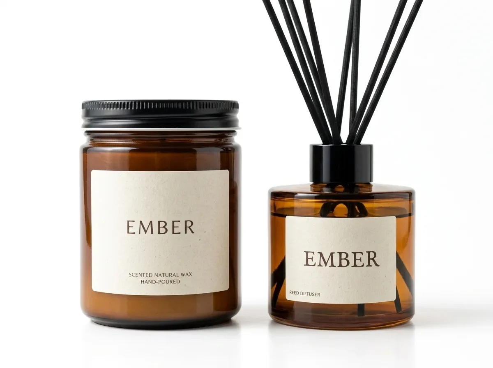

Combine the product in IMG_1 and the product in IMG_2 into one bundle photo. Keep both products exactly as they are, including their shapes, labels and colors. Arrange them side by side on a pure white background with the same soft studio light and natural contact shadows. Clean gift-set listing image.

Model: Nano Banana 2.1 · Author: YepShot · https://yepshot.com · [Original source](https://yepshot.com/explore/compose-bundle-group-shot)

CC BY 4.0. Copyright 2026 YepShot. Attribution: YepShot — https://yepshot.com. License: https://creativecommons.org/licenses/by/4.0/

### Match Your Existing Catalog Look (two reference images)

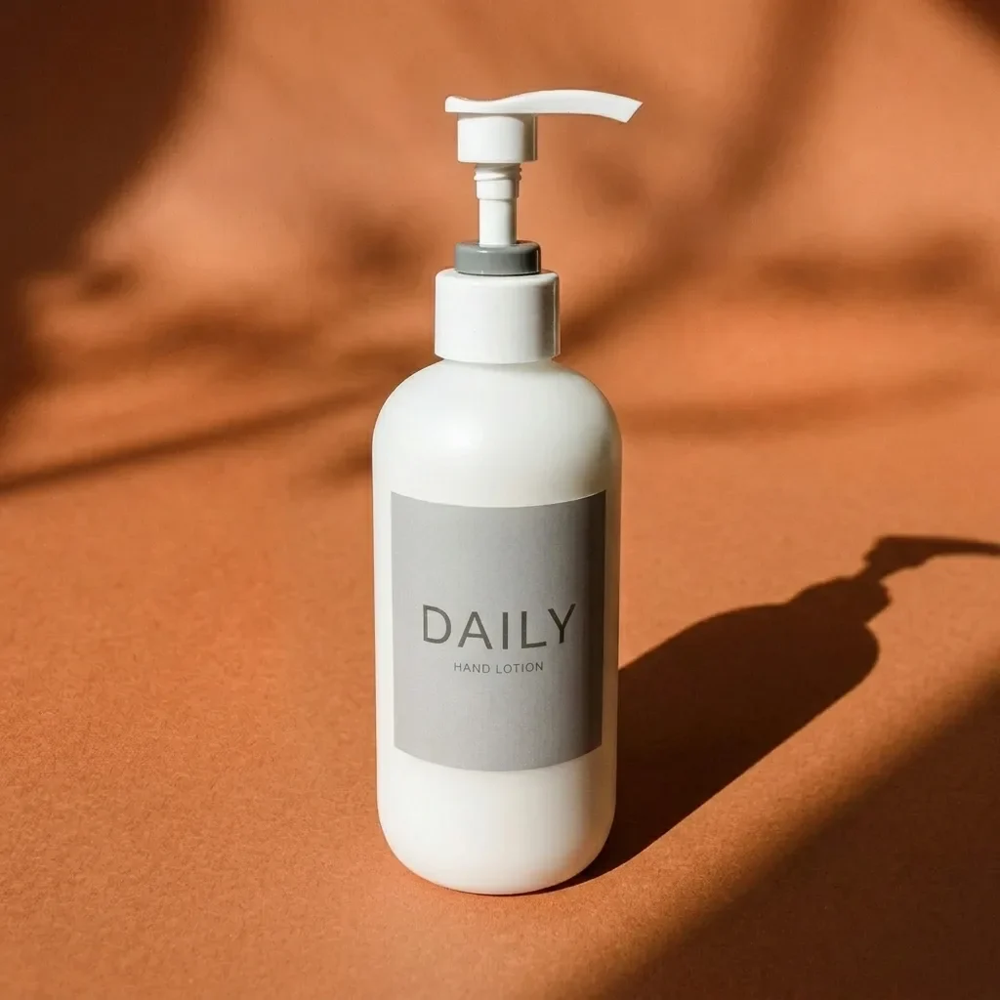

Restyle IMG_1 to match the look of IMG_2: use the same background color, lighting direction, shadow style and color grade. Keep the product in IMG_1 exactly as it is, including its shape, label and colors. Do not copy the product or props from IMG_2.

Model: Nano Banana 2.1 · Author: YepShot · https://yepshot.com · [Original source](https://yepshot.com/explore/compose-match-catalog-style)

CC BY 4.0. Copyright 2026 YepShot. Attribution: YepShot — https://yepshot.com. License: https://creativecommons.org/licenses/by/4.0/

### Ghost Mannequin to Street Model (reference photo required)

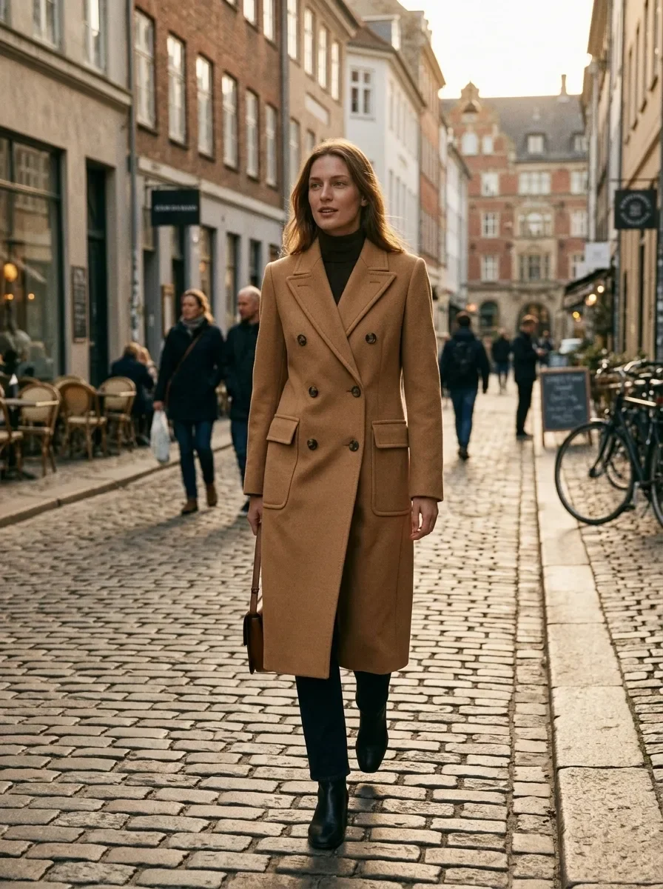

Show the garment in this photo worn by a tall female model walking on a European cobblestone street. Keep the garment exactly as it is: cut, color, pattern, buttons and seams. Natural fabric folds and movement, golden-hour side light, 35mm street fashion photo.

Model: Nano Banana 2.1 · Author: YepShot · https://yepshot.com · [Original source](https://yepshot.com/explore/apparel-ghost-mannequin-to-street-model)

CC BY 4.0. Copyright 2026 YepShot. Attribution: YepShot — https://yepshot.com. License: https://creativecommons.org/licenses/by/4.0/

### Virtual Try-On (two reference images)

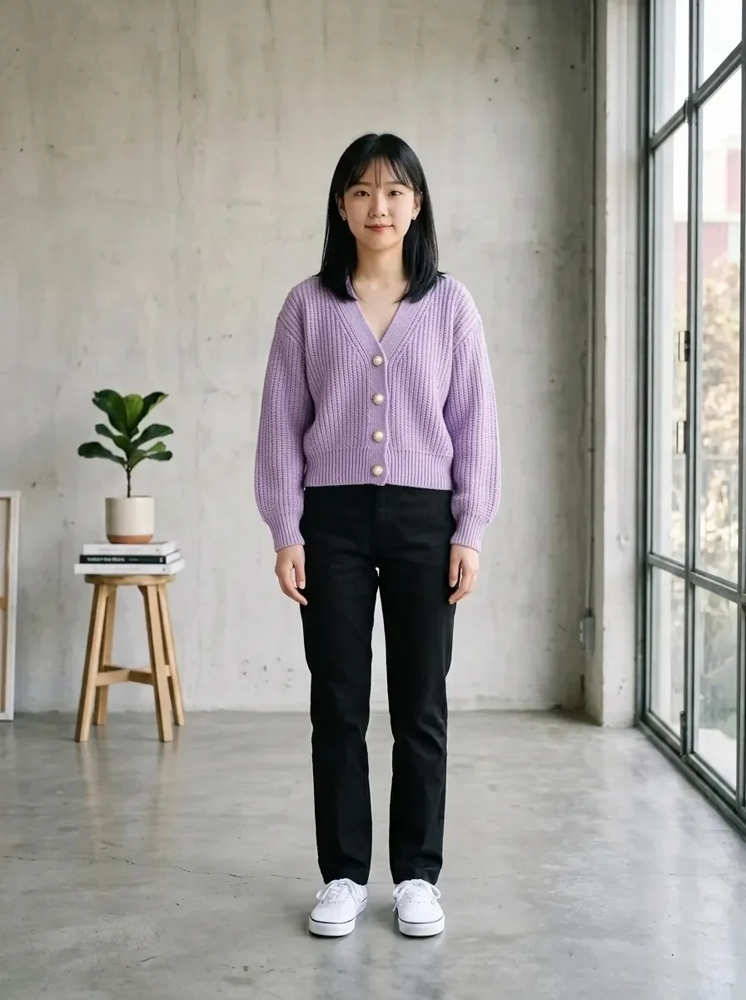

Dress the person in IMG_1 in the garment from IMG_2. Keep the person's face, hairstyle, body shape and pose unchanged. Keep the garment's cut, color, fabric texture and seams exactly as in IMG_2, with natural folds that fit the pose. Keep IMG_1's background and lighting.

Model: Nano Banana 2.1 · Author: YepShot · https://yepshot.com · [Original source](https://yepshot.com/explore/compose-virtual-try-on)

CC BY 4.0. Copyright 2026 YepShot. Attribution: YepShot — https://yepshot.com. License: https://creativecommons.org/licenses/by/4.0/

### Upgrade Fabric to Silk (mask required)

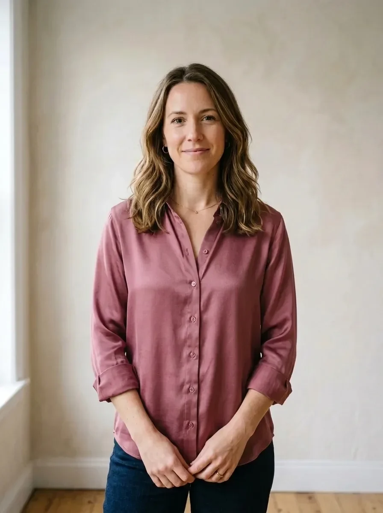

Change the fabric of the garment in the marked area to heavy, lustrous mulberry silk with a fluid drape and soft highlights along the folds. Keep the garment's cut, seams, color and fit unchanged, and keep everything outside the marked area as it is.

Apply the edit only inside the white region of the following mask.

Model: Nano Banana 2.1 · Author: YepShot · https://yepshot.com · [Original source](https://yepshot.com/explore/apparel-silk-texture-upgrade)

CC BY 4.0. Copyright 2026 YepShot. Attribution: YepShot — https://yepshot.com. License: https://creativecommons.org/licenses/by/4.0/

### Smooth Out Fabric Wrinkles (mask required)

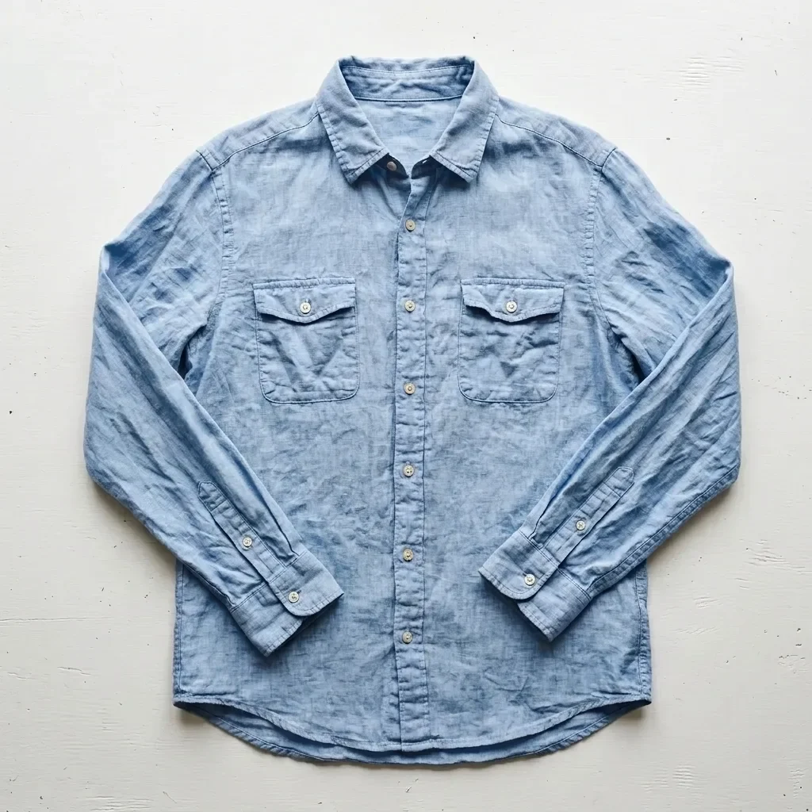

Smooth out the creases and wrinkles in the marked area as if the garment had been professionally steamed. Keep the woven fabric texture, color, seams and the garment's natural shading. Keep everything outside the marked area unchanged.

Apply the edit only inside the white region of the following mask.

Model: Nano Banana 2.1 · Author: YepShot · https://yepshot.com · [Original source](https://yepshot.com/explore/cleanup-smooth-fabric-wrinkles)

CC BY 4.0. Copyright 2026 YepShot. Attribution: YepShot — https://yepshot.com. License: https://creativecommons.org/licenses/by/4.0/

### Recolor a Garment (mask required)

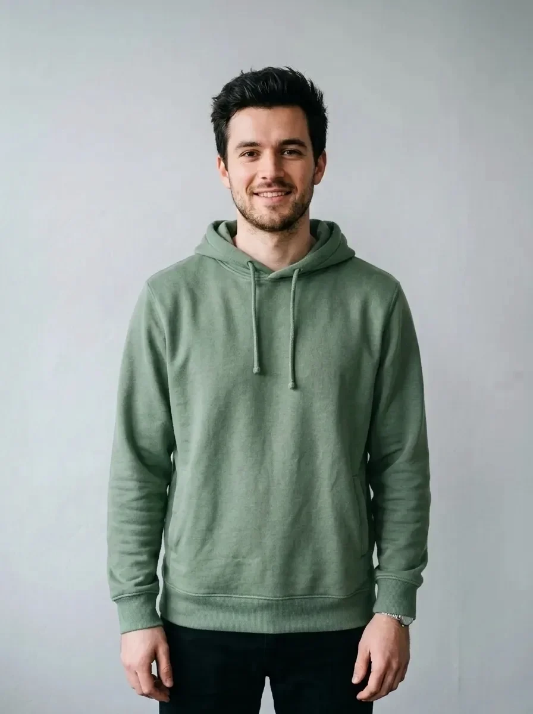

Change the color of the garment in the marked area to sage green. Keep the fabric texture, stitching, folds, shadows and highlights exactly as they are, so it looks like the same garment dyed in a new color. Keep everything outside the marked area unchanged.

Apply the edit only inside the white region of the following mask.

Model: Nano Banana 2.1 · Author: YepShot · https://yepshot.com · [Original source](https://yepshot.com/explore/fashion-garment-recolor)

CC BY 4.0. Copyright 2026 YepShot. Attribution: YepShot — https://yepshot.com. License: https://creativecommons.org/licenses/by/4.0/

### Clean Studio Backdrop for Model Shots (reference photo required)

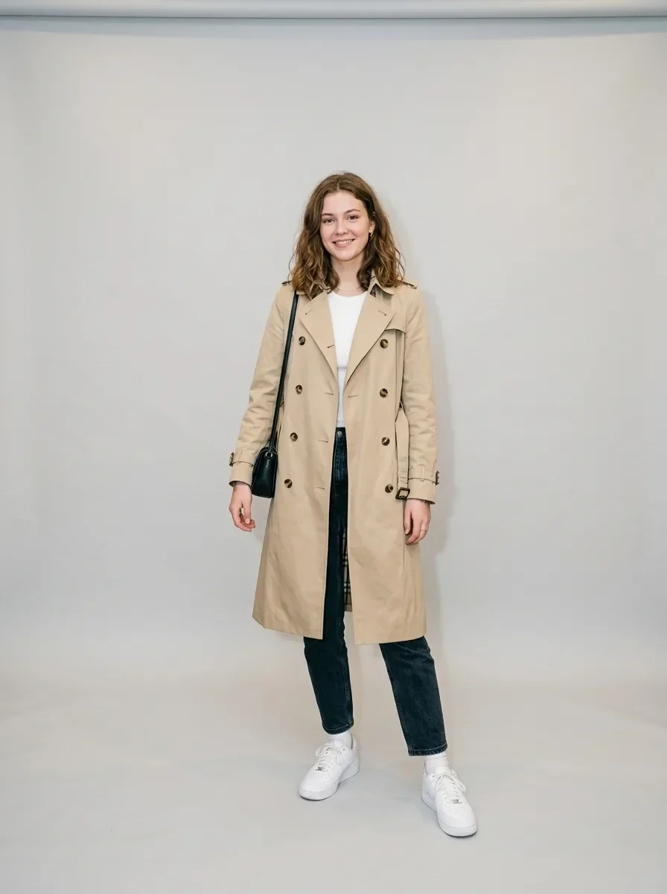

Keep the model, pose, outfit and the lighting on the model exactly as they are. Replace the cluttered background with a seamless light gray studio backdrop and add a soft, natural shadow on the floor behind the feet. Clean fashion e-commerce look.

Model: Nano Banana 2.1 · Author: YepShot · https://yepshot.com · [Original source](https://yepshot.com/explore/fashion-model-studio-backdrop)

CC BY 4.0. Copyright 2026 YepShot. Attribution: YepShot — https://yepshot.com. License: https://creativecommons.org/licenses/by/4.0/

### Change Hair to Platinum Blonde (mask required)

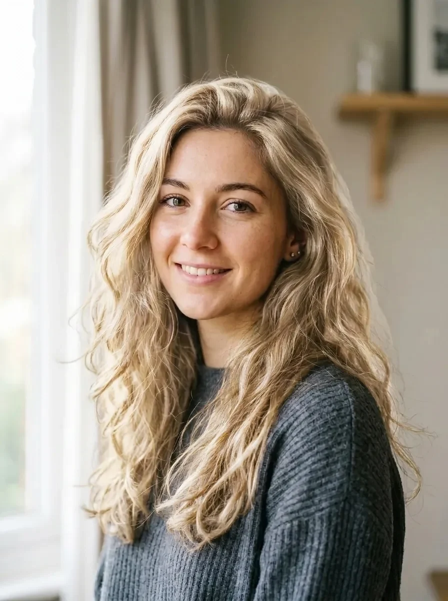

Recolor the hair in the marked area to a bright platinum blonde with soft golden undertones. Keep the hairstyle, individual strands, shine and natural hairline transitions. Keep the face and everything outside the marked area unchanged.

Apply the edit only inside the white region of the following mask.

Model: Nano Banana 2.1 · Author: YepShot · https://yepshot.com · [Original source](https://yepshot.com/explore/portrait-platinum-blonde-hair)

CC BY 4.0. Copyright 2026 YepShot. Attribution: YepShot — https://yepshot.com. License: https://creativecommons.org/licenses/by/4.0/

### Natural Skin Retouch (reference photo required)

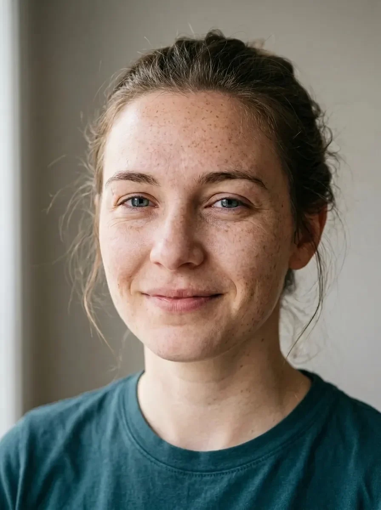

Retouch the skin on the face: reduce temporary redness and small blemishes while keeping the real pore texture, freckles and natural skin tone variation. No plastic smoothing. Keep the face shape, features, expression and lighting exactly as they are.

Model: Nano Banana 2.1 · Author: YepShot · https://yepshot.com · [Original source](https://yepshot.com/explore/portrait-skin-texture-refinement)

CC BY 4.0. Copyright 2026 YepShot. Attribution: YepShot — https://yepshot.com. License: https://creativecommons.org/licenses/by/4.0/

### Casual Photo to Business Headshot (reference photo required)

Turn this into a professional business headshot. Keep the person's face, features, hairstyle and expression exactly the same. Replace the background with a smooth mid-gray studio backdrop, dress the person in a navy blazer over a white shirt, and use soft key light from the front left. Sharp focus on the eyes.

Model: Nano Banana 2.1 · Author: YepShot · https://yepshot.com · [Original source](https://yepshot.com/explore/portrait-business-headshot)

CC BY 4.0. Copyright 2026 YepShot. Attribution: YepShot — https://yepshot.com. License: https://creativecommons.org/licenses/by/4.0/

### ID Photo with White Background (reference photo required)

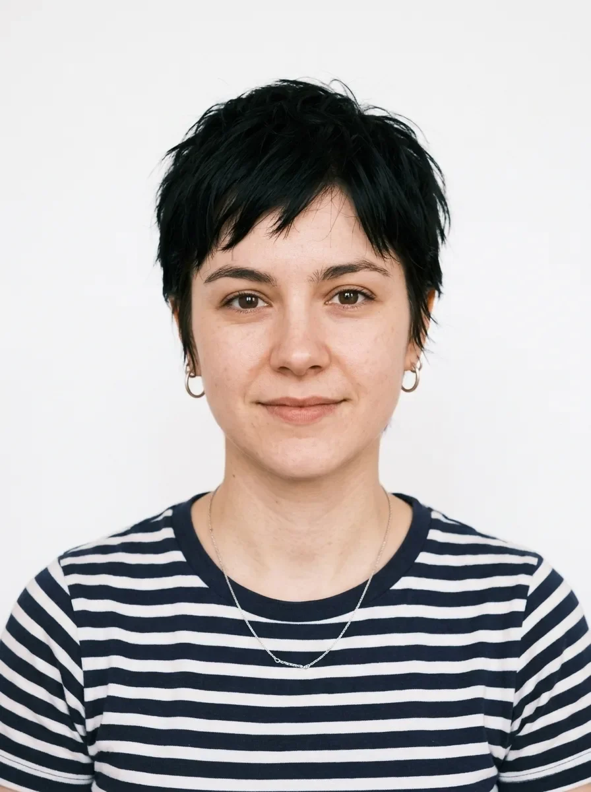

Turn this into a passport-style ID photo: a front-facing head-and-shoulders crop on a plain white background, with even lighting and no shadows on the face or background. Keep the person's face, features, hairstyle and skin tone exactly the same.

Model: Nano Banana 2.1 · Author: YepShot · https://yepshot.com · [Original source](https://yepshot.com/explore/portrait-id-photo)

CC BY 4.0. Copyright 2026 YepShot. Attribution: YepShot — https://yepshot.com. License: https://creativecommons.org/licenses/by/4.0/

### Remove People from the Background (mask required)

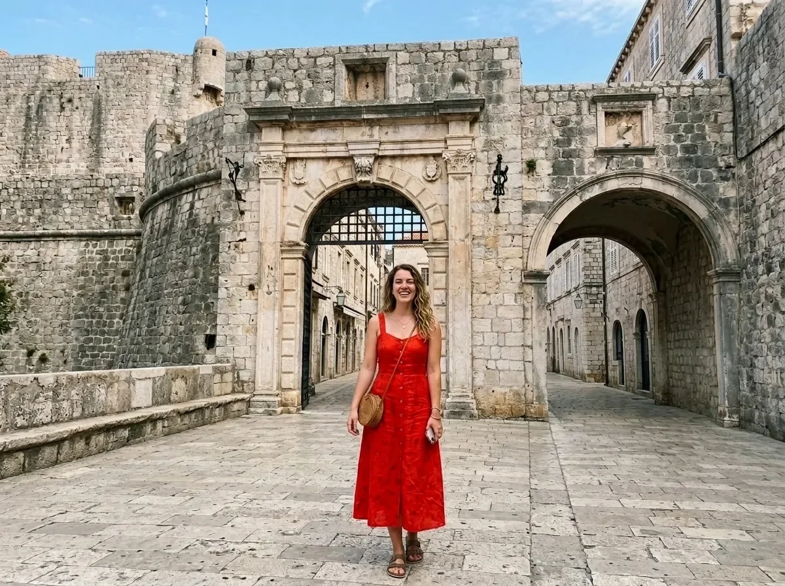

Remove the people in the marked area and rebuild the background behind them so the scenery, lighting and perspective continue naturally, with no blur, smears or leftover shadows. Keep the main subject and everything outside the marked area unchanged.

Apply the edit only inside the white region of the following mask.

Model: Nano Banana 2.1 · Author: YepShot · https://yepshot.com · [Original source](https://yepshot.com/explore/portrait-remove-photobomber)

CC BY 4.0. Copyright 2026 YepShot. Attribution: YepShot — https://yepshot.com. License: https://creativecommons.org/licenses/by/4.0/

### Christmas Pine and Warm Bokeh (reference photo required)

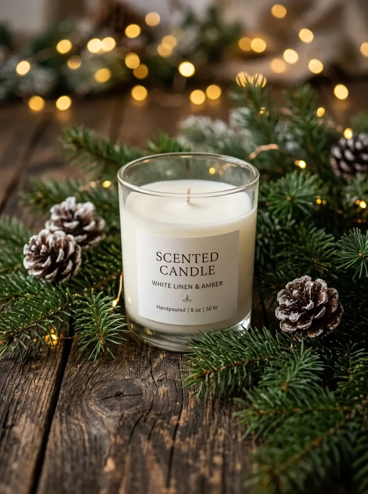

Keep the product unchanged. Place it on dark rustic wood surrounded by fresh pine branches and a few frosted pinecones, with golden fairy lights forming warm, round bokeh in the background. Cozy, premium Christmas campaign look.

Model: Nano Banana 2.1 · Author: YepShot · https://yepshot.com · [Original source](https://yepshot.com/explore/seasonal-christmas-pine-bokeh)

CC BY 4.0. Copyright 2026 YepShot. Attribution: YepShot — https://yepshot.com. License: https://creativecommons.org/licenses/by/4.0/

### Summer Pool Water and Caustics (reference photo required)

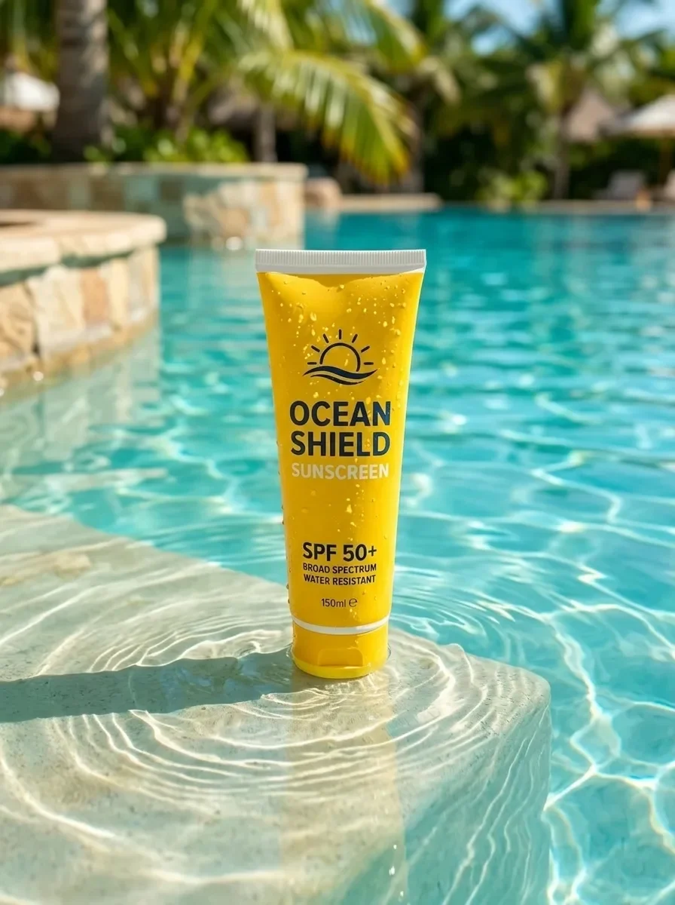

Keep the product unchanged. Place it standing in shallow, crystal-clear turquoise pool water, with dancing sunlight caustics across the product and gentle ripples around its base. Bright tropical sunlight, refreshing summer campaign look.

Model: Nano Banana 2.1 · Author: YepShot · https://yepshot.com · [Original source](https://yepshot.com/explore/seasonal-summer-pool-water-ripples)

CC BY 4.0. Copyright 2026 YepShot. Attribution: YepShot — https://yepshot.com. License: https://creativecommons.org/licenses/by/4.0/

### Black Friday Black-and-Gold Pedestal (reference photo required)

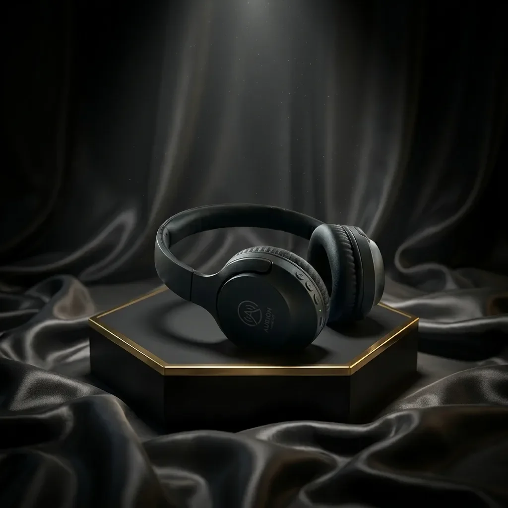

Keep the product unchanged. Place it on a matte black hexagonal pedestal with polished brass edges, with flowing dark satin fabric in the background and a dramatic spotlight from above. Luxurious Black Friday campaign look, premium commercial photography. Do not add any text.

Model: Nano Banana 2.1 · Author: YepShot · https://yepshot.com · [Original source](https://yepshot.com/explore/seasonal-black-friday-gold-geometry)

CC BY 4.0. Copyright 2026 YepShot. Attribution: YepShot — https://yepshot.com. License: https://creativecommons.org/licenses/by/4.0/

### Turn a Product Photo into a Sale Poster (reference photo required)

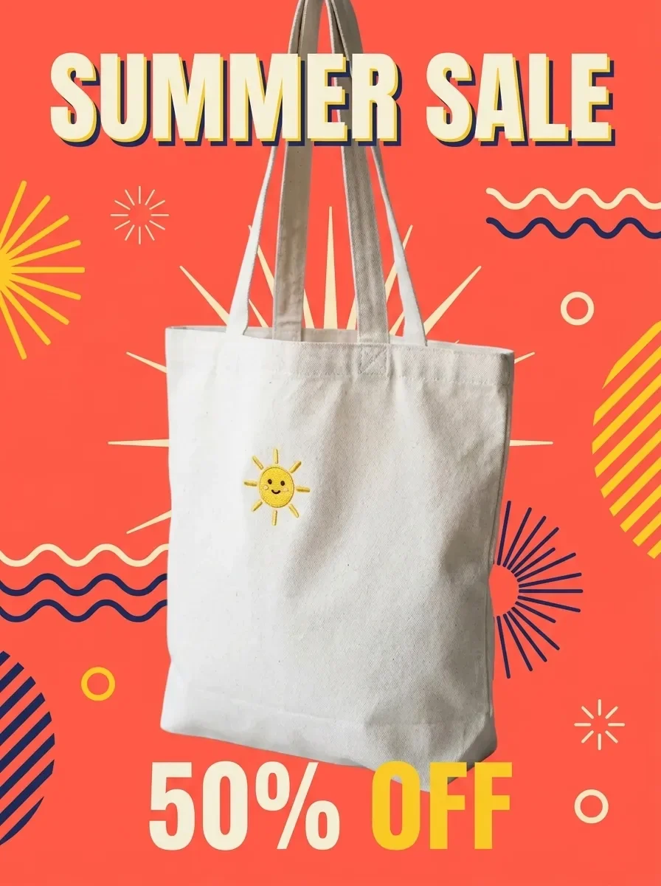

Turn this product photo into a sale poster. Keep the product unchanged and centered. Add the headline "SUMMER SALE" at the top and "50% OFF" below the product in a bold, clean sans-serif, on a bright coral background with simple geometric shapes. Spell the text exactly as given.

Model: Nano Banana 2.1 · Author: YepShot · https://yepshot.com · [Original source](https://yepshot.com/explore/campaign-sale-poster-text)

CC BY 4.0. Copyright 2026 YepShot. Attribution: YepShot — https://yepshot.com. License: https://creativecommons.org/licenses/by/4.0/

### Lunar New Year Red and Gold (reference photo required)

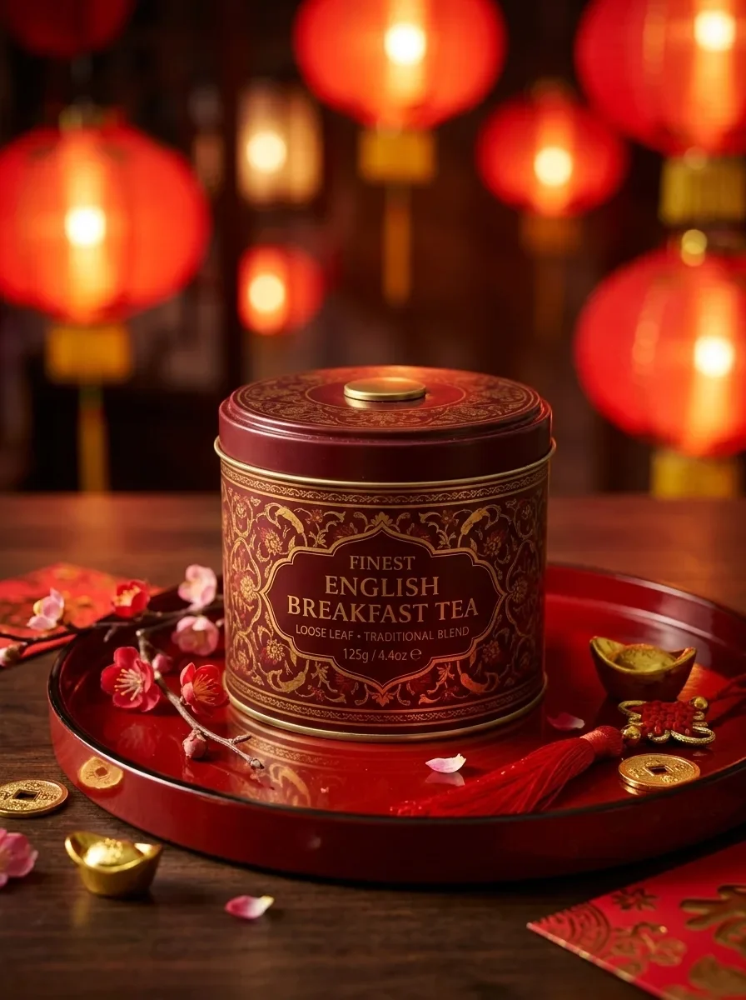

Keep the product unchanged. Place it on a red lacquer tray with plum blossom branches and small gold ornaments around it, and blurred red paper lanterns glowing in the background. Warm, festive Lunar New Year campaign look with rich red and gold tones.

Model: Nano Banana 2.1 · Author: YepShot · https://yepshot.com · [Original source](https://yepshot.com/explore/seasonal-lunar-new-year)

CC BY 4.0. Copyright 2026 YepShot. Attribution: YepShot — https://yepshot.com. License: https://creativecommons.org/licenses/by/4.0/

### Restore a Faded Old Photo (reference photo required)

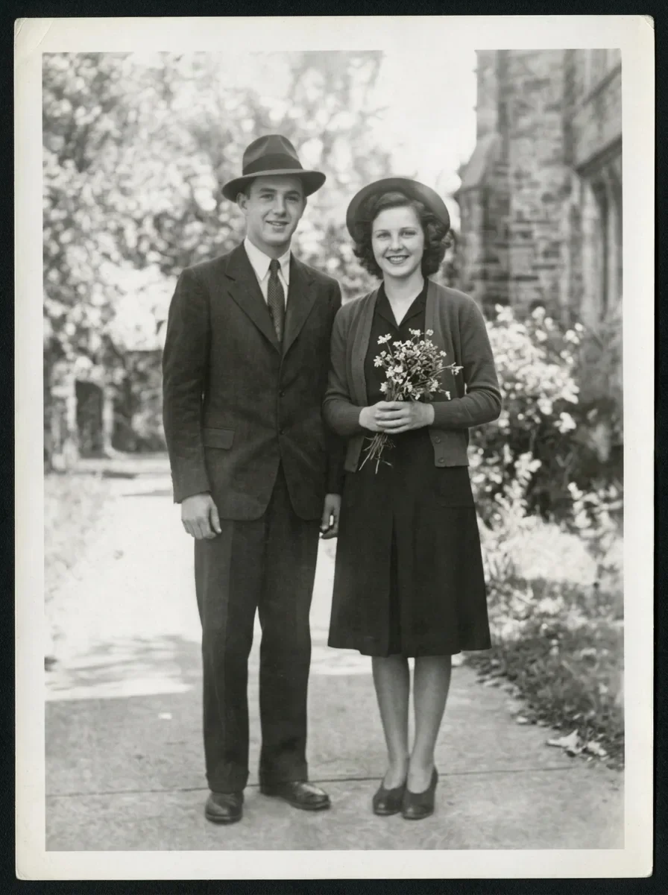

Restore this old photograph: remove the yellow age cast, dust spots, scratches and fold creases, and bring back clear, natural detail in the faces and eyes. Keep the people's features, expressions, clothing and the original composition unchanged. Clean archival quality with natural contrast.

Model: Nano Banana 2.1 · Author: YepShot · https://yepshot.com · [Original source](https://yepshot.com/explore/restore-vintage-photo-reconstruction)

CC BY 4.0. Copyright 2026 YepShot. Attribution: YepShot — https://yepshot.com. License: https://creativecommons.org/licenses/by/4.0/

### Colorize a Black-and-White Photo (reference photo required)

Colorize this black-and-white photo with natural, period-accurate colors: realistic skin tones, clothing and surroundings. Keep every detail, the grain structure and the composition exactly as they are; only add color. Avoid oversaturated or uniform tints.

Model: Nano Banana 2.1 · Author: YepShot · https://yepshot.com · [Original source](https://yepshot.com/explore/restore-colorize-bw)

CC BY 4.0. Copyright 2026 YepShot. Attribution: YepShot — https://yepshot.com. License: https://creativecommons.org/licenses/by/4.0/

### Fix Blur and Noise (reference photo required)

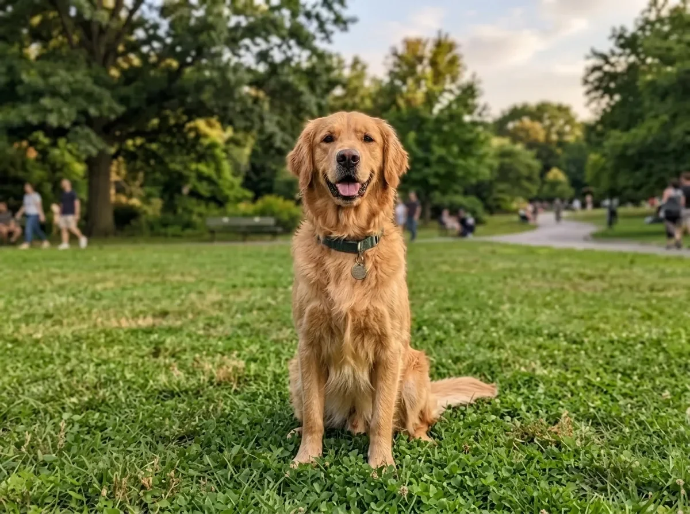

Sharpen this blurry, noisy photo: remove motion blur and grain, and recover crisp edges and fine texture. Keep the subject, colors, lighting and composition exactly the same. Do not add new details or change any shapes.

Model: Nano Banana 2.1 · Author: YepShot · https://yepshot.com · [Original source](https://yepshot.com/explore/restore-deblur-sharpen)

CC BY 4.0. Copyright 2026 YepShot. Attribution: YepShot — https://yepshot.com. License: https://creativecommons.org/licenses/by/4.0/

### Brighten an Underexposed Photo (reference photo required)

Fix this underexposed photo: raise the exposure so the faces and the table are clearly visible, recover detail in the shadows, neutralize the color cast and reduce noise. Keep the scene, people and composition exactly the same, and keep the light looking natural.

Model: Nano Banana 2.1 · Author: YepShot · https://yepshot.com · [Original source](https://yepshot.com/explore/restore-low-light-fix)

CC BY 4.0. Copyright 2026 YepShot. Attribution: YepShot — https://yepshot.com. License: https://creativecommons.org/licenses/by/4.0/

### Turn Your Pet into a Collectible Figure (reference photo required)

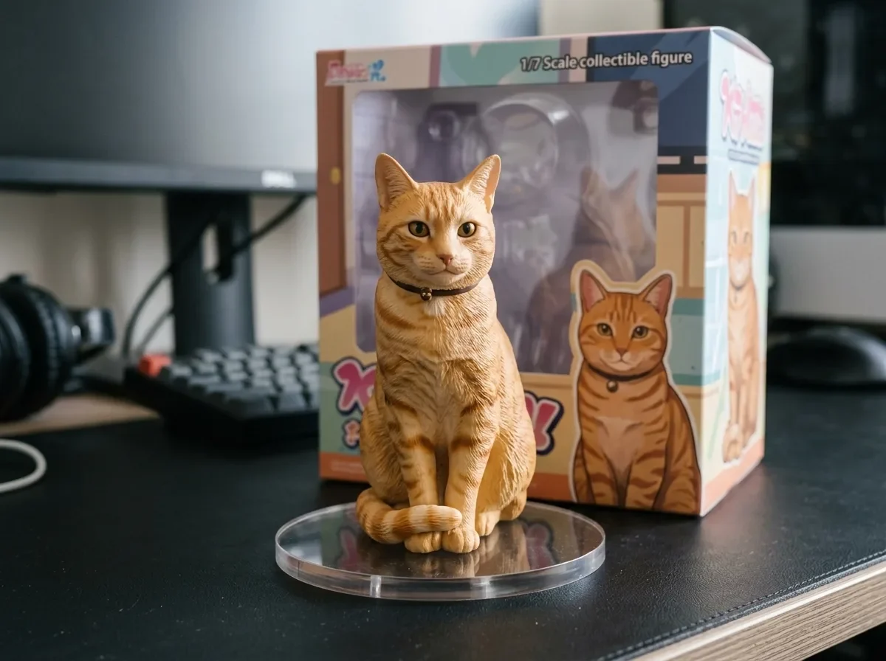

Turn the animal in this photo into a 1/7 scale collectible figure standing on a round clear acrylic base on a computer desk. Behind it, place a toy packaging box printed with the same character. Keep the animal's markings, colors and pose. Realistic studio product photo with soft light.

Model: Nano Banana 2.1 · Author: YepShot · https://yepshot.com · [Original source](https://yepshot.com/explore/creative-collectible-figure)

CC BY 4.0. Copyright 2026 YepShot. Attribution: YepShot — https://yepshot.com. License: https://creativecommons.org/licenses/by/4.0/

### Photo to Watercolor Illustration (reference photo required)

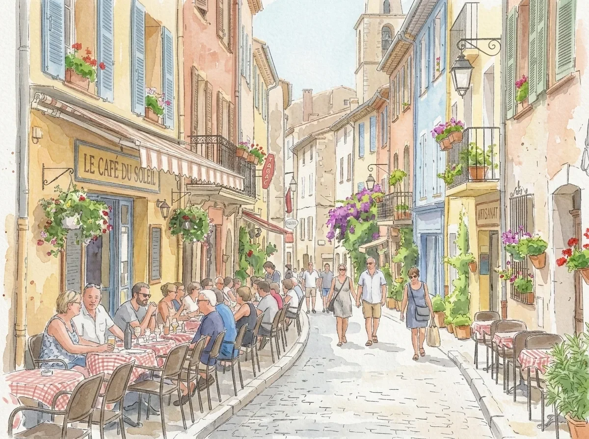

Redraw this photo as a loose watercolor illustration on textured paper, with soft color washes, visible brush strokes and fine ink outlines. Keep the composition, buildings and main shapes recognizable. Light, airy palette with white paper showing through.

Model: Nano Banana 2.1 · Author: YepShot · https://yepshot.com · [Original source](https://yepshot.com/explore/creative-watercolor-illustration)

CC BY 4.0. Copyright 2026 YepShot. Attribution: YepShot — https://yepshot.com. License: https://creativecommons.org/licenses/by/4.0/

### Photo to 3D Clay Character (reference photo required)

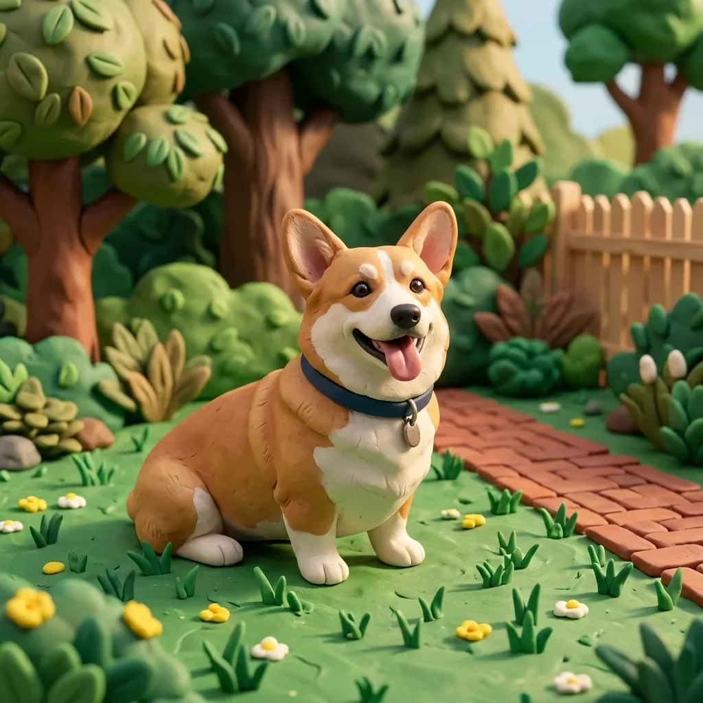

Transform this photo into a handmade 3D clay animation style, with soft rounded shapes, visible fingerprint texture in the clay and a miniature set. Keep the subject's pose, colors and key features recognizable. Warm soft lighting, playful stop-motion look.

Model: Nano Banana 2.1 · Author: YepShot · https://yepshot.com · [Original source](https://yepshot.com/explore/creative-3d-clay)

CC BY 4.0. Copyright 2026 YepShot. Attribution: YepShot — https://yepshot.com. License: https://creativecommons.org/licenses/by/4.0/

### Sketch to Product Render (reference photo required)

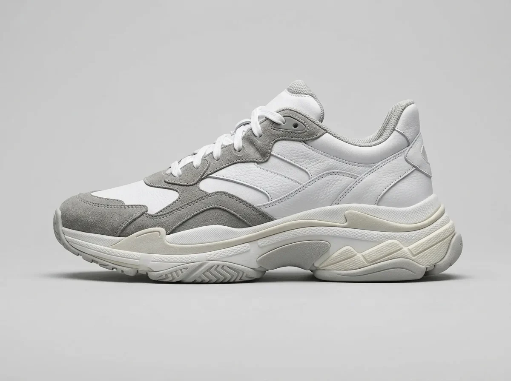

Turn this pencil sketch into a photorealistic product render. Follow the sketch's shape, proportions and details exactly. Use realistic materials: white leather upper, gray suede panels and a rubber sole, on a light gray studio background with soft shadows.

Model: Nano Banana 2.1 · Author: YepShot · https://yepshot.com · [Original source](https://yepshot.com/explore/creative-sketch-to-render)

CC BY 4.0. Copyright 2026 YepShot. Attribution: YepShot — https://yepshot.com. License: https://creativecommons.org/licenses/by/4.0/

### Borrow the Style of a Reference Image (two reference images)

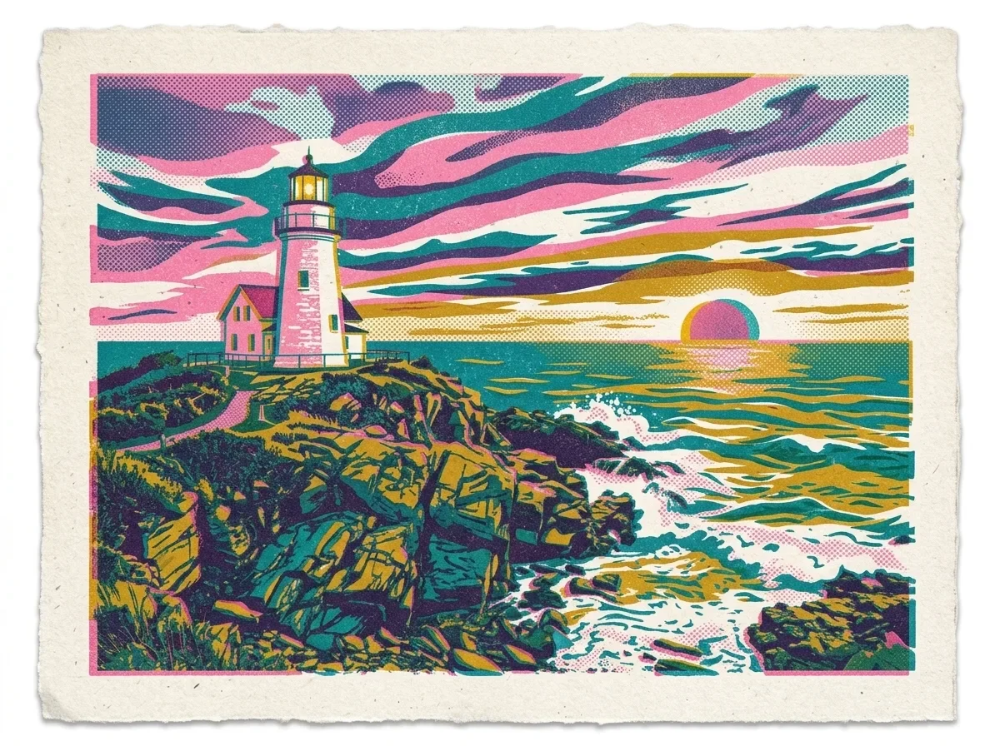

Redraw IMG_1 in the visual style of IMG_2: use its color palette, texture and brushwork. Keep IMG_1's composition, subject and proportions intact. Do not copy any objects from IMG_2.

Model: Nano Banana 2.1 · Author: YepShot · https://yepshot.com · [Original source](https://yepshot.com/explore/compose-style-transfer)

CC BY 4.0. Copyright 2026 YepShot. Attribution: YepShot — https://yepshot.com. License: https://creativecommons.org/licenses/by/4.0/

### Product Hero Perfume

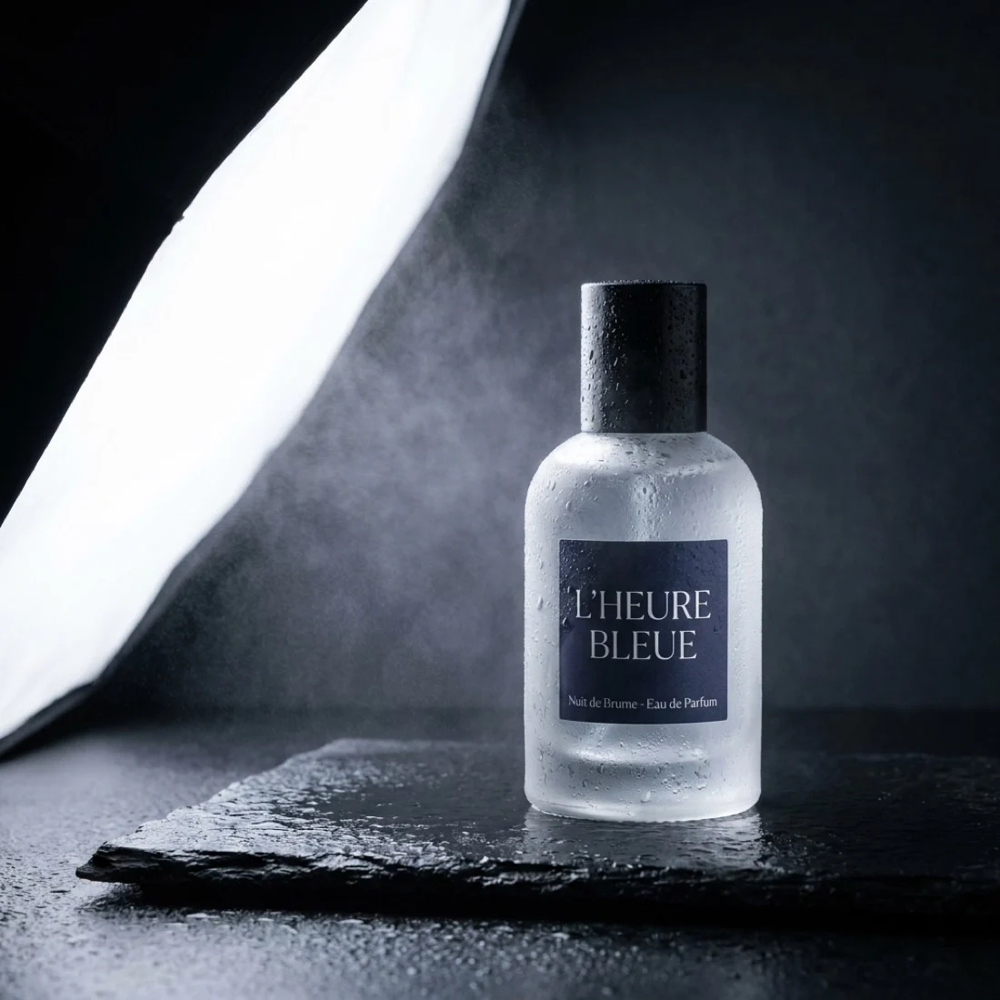

Studio hero shot of a frosted glass perfume bottle on a wet black stone slab, single softbox from the left, faint mist, deep charcoal background, crisp label text, commercial product photography

Model: Nano Banana 2.1 · Author: APIMart prompt contributors · [Original source](https://github.com/apimartyrdf8/nano-banana-2.1-prompts/blob/b3ad0db06be4105e36b86f17274ba9a87e55004e/assets/01-product-hero-perfume.jpg)

MIT License

Copyright (c) 2026 apimart pricing-comparison contributors

Permission is hereby granted, free of charge, to any person obtaining a copy
of this software and associated documentation files (the "Software"), to deal
in the Software without restriction, including without limitation the rights
to use, copy, modify, merge, publish, distribute, sublicense, and/or sell
copies of the Software, and to permit persons to whom the Software is
furnished to do so, subject to the following conditions:

The above copyright notice and this permission notice shall be included in all
copies or substantial portions of the Software.

THE SOFTWARE IS PROVIDED "AS IS", WITHOUT WARRANTY OF ANY KIND, EXPRESS OR
IMPLIED, INCLUDING BUT NOT LIMITED TO THE WARRANTIES OF MERCHANTABILITY,
FITNESS FOR A PARTICULAR PURPOSE AND NONINFRINGEMENT. IN NO EVENT SHALL THE
AUTHORS OR COPYRIGHT HOLDERS BE LIABLE FOR ANY CLAIM, DAMAGES OR OTHER
LIABILITY, WHETHER IN AN ACTION OF CONTRACT, TORT OR OTHERWISE, ARISING FROM,
OUT OF OR IN CONNECTION WITH THE SOFTWARE OR THE USE OR OTHER DEALINGS IN THE
SOFTWARE.

Model names, prices and vendor documentation remain subject to their owners' terms.

### Cinematic Street Rain

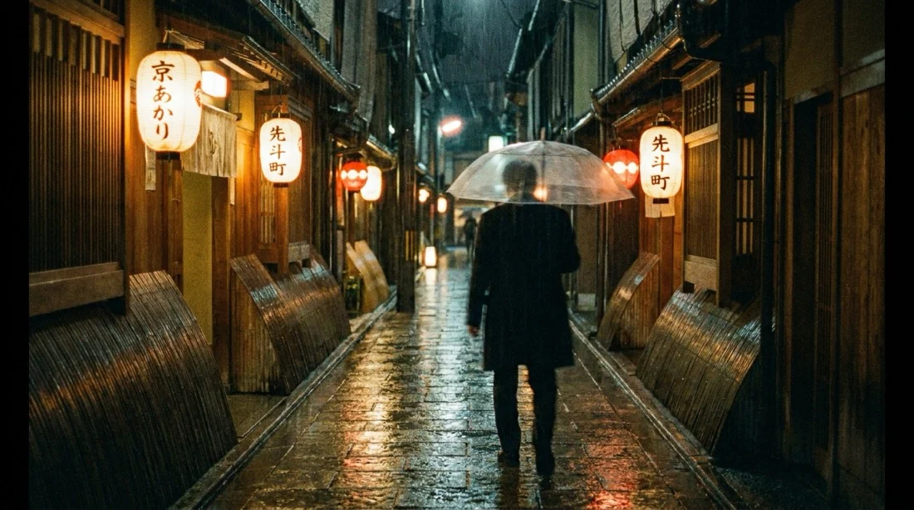

Rain soaked Kyoto alley at night, paper lantern reflections on wet stone, a lone figure with a transparent umbrella walking away, cinematic 35mm still, shallow depth of field, film grain

Model: Nano Banana 2.1 · Author: APIMart prompt contributors · [Original source](https://github.com/apimartyrdf8/nano-banana-2.1-prompts/blob/b3ad0db06be4105e36b86f17274ba9a87e55004e/assets/03-cinematic-street-rain.jpg)

MIT License

Copyright (c) 2026 apimart pricing-comparison contributors

Permission is hereby granted, free of charge, to any person obtaining a copy
of this software and associated documentation files (the "Software"), to deal
in the Software without restriction, including without limitation the rights
to use, copy, modify, merge, publish, distribute, sublicense, and/or sell
copies of the Software, and to permit persons to whom the Software is
furnished to do so, subject to the following conditions:

The above copyright notice and this permission notice shall be included in all
copies or substantial portions of the Software.

THE SOFTWARE IS PROVIDED "AS IS", WITHOUT WARRANTY OF ANY KIND, EXPRESS OR
IMPLIED, INCLUDING BUT NOT LIMITED TO THE WARRANTIES OF MERCHANTABILITY,
FITNESS FOR A PARTICULAR PURPOSE AND NONINFRINGEMENT. IN NO EVENT SHALL THE
AUTHORS OR COPYRIGHT HOLDERS BE LIABLE FOR ANY CLAIM, DAMAGES OR OTHER
LIABILITY, WHETHER IN AN ACTION OF CONTRACT, TORT OR OTHERWISE, ARISING FROM,
OUT OF OR IN CONNECTION WITH THE SOFTWARE OR THE USE OR OTHER DEALINGS IN THE
SOFTWARE.

Model names, prices and vendor documentation remain subject to their owners' terms.

### Food Overhead Ramen

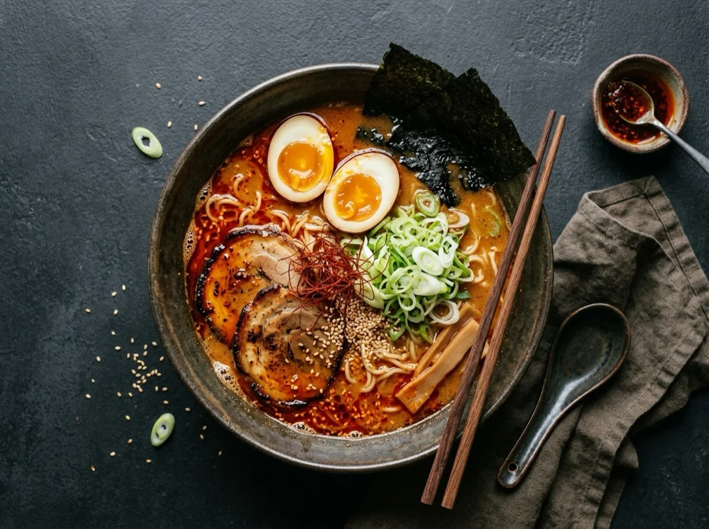

Overhead flat lay of a spicy miso ramen bowl with soft boiled egg, nori and scallions, dark ceramic table, chopsticks resting on the rim, natural window light, editorial food photography

Model: Nano Banana 2.1 · Author: APIMart prompt contributors · [Original source](https://github.com/apimartyrdf8/nano-banana-2.1-prompts/blob/b3ad0db06be4105e36b86f17274ba9a87e55004e/assets/02-food-overhead-ramen.jpg)

MIT License

Copyright (c) 2026 apimart pricing-comparison contributors

Permission is hereby granted, free of charge, to any person obtaining a copy
of this software and associated documentation files (the "Software"), to deal
in the Software without restriction, including without limitation the rights
to use, copy, modify, merge, publish, distribute, sublicense, and/or sell
copies of the Software, and to permit persons to whom the Software is
furnished to do so, subject to the following conditions:

The above copyright notice and this permission notice shall be included in all
copies or substantial portions of the Software.

THE SOFTWARE IS PROVIDED "AS IS", WITHOUT WARRANTY OF ANY KIND, EXPRESS OR
IMPLIED, INCLUDING BUT NOT LIMITED TO THE WARRANTIES OF MERCHANTABILITY,
FITNESS FOR A PARTICULAR PURPOSE AND NONINFRINGEMENT. IN NO EVENT SHALL THE
AUTHORS OR COPYRIGHT HOLDERS BE LIABLE FOR ANY CLAIM, DAMAGES OR OTHER
LIABILITY, WHETHER IN AN ACTION OF CONTRACT, TORT OR OTHERWISE, ARISING FROM,
OUT OF OR IN CONNECTION WITH THE SOFTWARE OR THE USE OR OTHER DEALINGS IN THE
SOFTWARE.

Model names, prices and vendor documentation remain subject to their owners' terms.

### Architectural Dusk

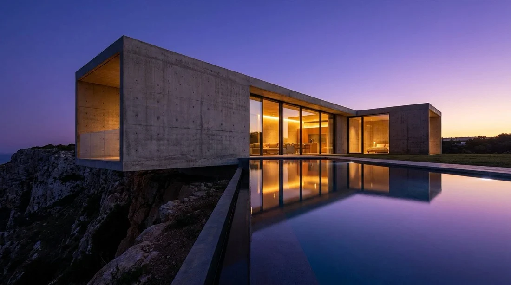

Minimalist concrete villa on a cliff at dusk, warm interior light, infinity pool reflecting a violet sky, architectural photography, 24mm perspective, ultra sharp

Model: Nano Banana 2.1 · Author: APIMart prompt contributors · [Original source](https://github.com/apimartyrdf8/nano-banana-2.1-prompts/blob/b3ad0db06be4105e36b86f17274ba9a87e55004e/assets/04-architectural-dusk.jpg)

MIT License

Copyright (c) 2026 apimart pricing-comparison contributors

Permission is hereby granted, free of charge, to any person obtaining a copy
of this software and associated documentation files (the "Software"), to deal
in the Software without restriction, including without limitation the rights
to use, copy, modify, merge, publish, distribute, sublicense, and/or sell
copies of the Software, and to permit persons to whom the Software is
furnished to do so, subject to the following conditions:

The above copyright notice and this permission notice shall be included in all
copies or substantial portions of the Software.

THE SOFTWARE IS PROVIDED "AS IS", WITHOUT WARRANTY OF ANY KIND, EXPRESS OR
IMPLIED, INCLUDING BUT NOT LIMITED TO THE WARRANTIES OF MERCHANTABILITY,
FITNESS FOR A PARTICULAR PURPOSE AND NONINFRINGEMENT. IN NO EVENT SHALL THE
AUTHORS OR COPYRIGHT HOLDERS BE LIABLE FOR ANY CLAIM, DAMAGES OR OTHER
LIABILITY, WHETHER IN AN ACTION OF CONTRACT, TORT OR OTHERWISE, ARISING FROM,
OUT OF OR IN CONNECTION WITH THE SOFTWARE OR THE USE OR OTHER DEALINGS IN THE
SOFTWARE.

Model names, prices and vendor documentation remain subject to their owners' terms.

### Illustration Layered Paper

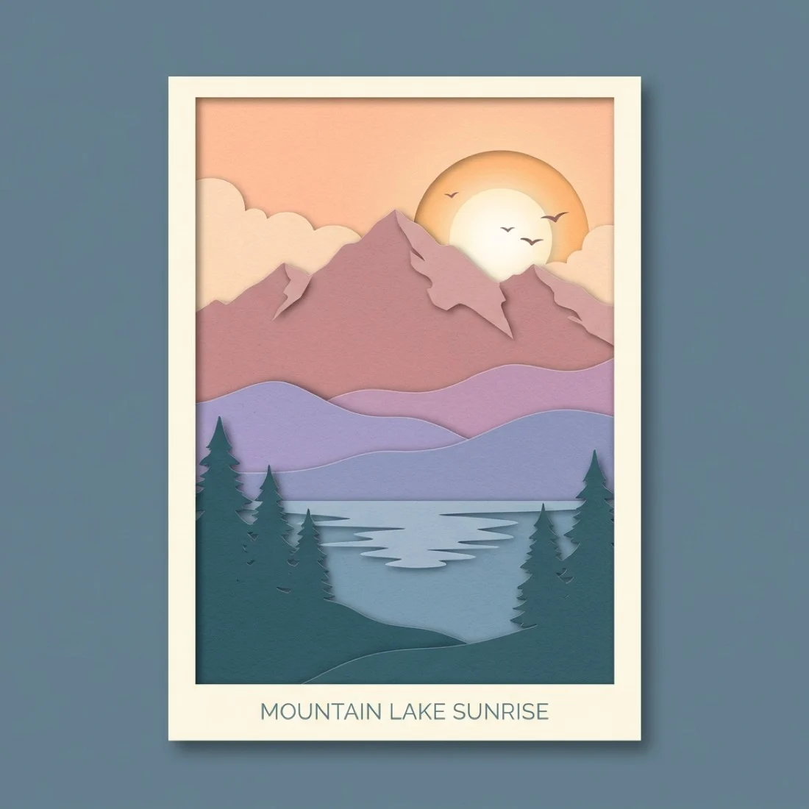

Layered paper cut illustration of a mountain lake at sunrise, five depth layers, soft pastel palette, subtle drop shadows, art print composition, clean vector edges

Model: Nano Banana 2.1 · Author: APIMart prompt contributors · [Original source](https://github.com/apimartyrdf8/nano-banana-2.1-prompts/blob/b3ad0db06be4105e36b86f17274ba9a87e55004e/assets/06-illustration-layered-paper.jpg)

MIT License

Copyright (c) 2026 apimart pricing-comparison contributors

Permission is hereby granted, free of charge, to any person obtaining a copy
of this software and associated documentation files (the "Software"), to deal
in the Software without restriction, including without limitation the rights
to use, copy, modify, merge, publish, distribute, sublicense, and/or sell
copies of the Software, and to permit persons to whom the Software is
furnished to do so, subject to the following conditions:

The above copyright notice and this permission notice shall be included in all
copies or substantial portions of the Software.

THE SOFTWARE IS PROVIDED "AS IS", WITHOUT WARRANTY OF ANY KIND, EXPRESS OR
IMPLIED, INCLUDING BUT NOT LIMITED TO THE WARRANTIES OF MERCHANTABILITY,
FITNESS FOR A PARTICULAR PURPOSE AND NONINFRINGEMENT. IN NO EVENT SHALL THE
AUTHORS OR COPYRIGHT HOLDERS BE LIABLE FOR ANY CLAIM, DAMAGES OR OTHER
LIABILITY, WHETHER IN AN ACTION OF CONTRACT, TORT OR OTHERWISE, ARISING FROM,
OUT OF OR IN CONNECTION WITH THE SOFTWARE OR THE USE OR OTHER DEALINGS IN THE
SOFTWARE.

Model names, prices and vendor documentation remain subject to their owners' terms.

### Fashion Editorial Studio

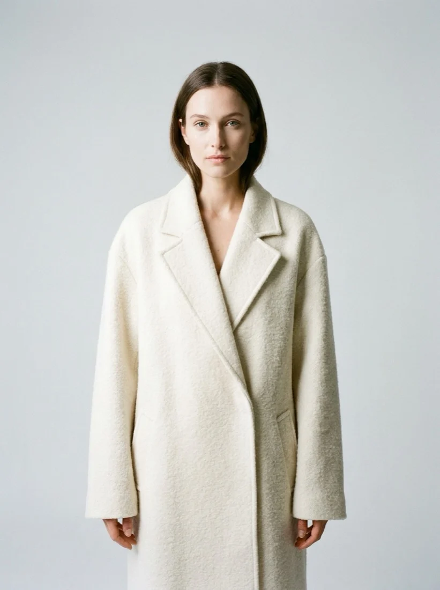

Editorial fashion portrait of a model in an oversized ivory wool coat, seamless light grey studio backdrop, crisp high key lighting, medium format detail, calm expression

Model: Nano Banana 2.1 · Author: APIMart prompt contributors · [Original source](https://github.com/apimartyrdf8/nano-banana-2.1-prompts/blob/b3ad0db06be4105e36b86f17274ba9a87e55004e/assets/05-fashion-editorial-studio.jpg)

MIT License

Copyright (c) 2026 apimart pricing-comparison contributors

Permission is hereby granted, free of charge, to any person obtaining a copy
of this software and associated documentation files (the "Software"), to deal
in the Software without restriction, including without limitation the rights
to use, copy, modify, merge, publish, distribute, sublicense, and/or sell
copies of the Software, and to permit persons to whom the Software is
furnished to do so, subject to the following conditions:

The above copyright notice and this permission notice shall be included in all
copies or substantial portions of the Software.

THE SOFTWARE IS PROVIDED "AS IS", WITHOUT WARRANTY OF ANY KIND, EXPRESS OR
IMPLIED, INCLUDING BUT NOT LIMITED TO THE WARRANTIES OF MERCHANTABILITY,
FITNESS FOR A PARTICULAR PURPOSE AND NONINFRINGEMENT. IN NO EVENT SHALL THE
AUTHORS OR COPYRIGHT HOLDERS BE LIABLE FOR ANY CLAIM, DAMAGES OR OTHER
LIABILITY, WHETHER IN AN ACTION OF CONTRACT, TORT OR OTHERWISE, ARISING FROM,
OUT OF OR IN CONNECTION WITH THE SOFTWARE OR THE USE OR OTHER DEALINGS IN THE
SOFTWARE.

Model names, prices and vendor documentation remain subject to their owners' terms.

### Macro Botanical Detail

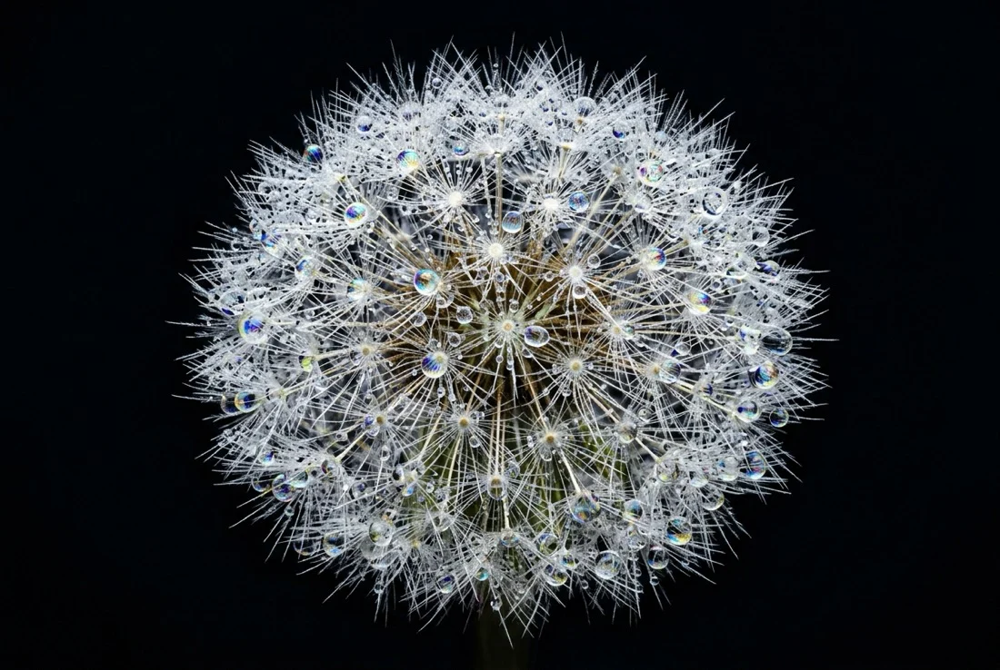

Macro photograph of a dew covered dandelion seed head against deep black background, focus stacked detail, iridescent droplets, studio lighting

Model: Nano Banana 2.1 · Author: APIMart prompt contributors · [Original source](https://github.com/apimartyrdf8/nano-banana-2.1-prompts/blob/b3ad0db06be4105e36b86f17274ba9a87e55004e/assets/08-macro-botanical-detail.jpg)

MIT License

Copyright (c) 2026 apimart pricing-comparison contributors

Permission is hereby granted, free of charge, to any person obtaining a copy
of this software and associated documentation files (the "Software"), to deal
in the Software without restriction, including without limitation the rights
to use, copy, modify, merge, publish, distribute, sublicense, and/or sell
copies of the Software, and to permit persons to whom the Software is
furnished to do so, subject to the following conditions:

The above copyright notice and this permission notice shall be included in all
copies or substantial portions of the Software.

THE SOFTWARE IS PROVIDED "AS IS", WITHOUT WARRANTY OF ANY KIND, EXPRESS OR
IMPLIED, INCLUDING BUT NOT LIMITED TO THE WARRANTIES OF MERCHANTABILITY,
FITNESS FOR A PARTICULAR PURPOSE AND NONINFRINGEMENT. IN NO EVENT SHALL THE
AUTHORS OR COPYRIGHT HOLDERS BE LIABLE FOR ANY CLAIM, DAMAGES OR OTHER
LIABILITY, WHETHER IN AN ACTION OF CONTRACT, TORT OR OTHERWISE, ARISING FROM,
OUT OF OR IN CONNECTION WITH THE SOFTWARE OR THE USE OR OTHER DEALINGS IN THE
SOFTWARE.

Model names, prices and vendor documentation remain subject to their owners' terms.

### Infographic Dashboard

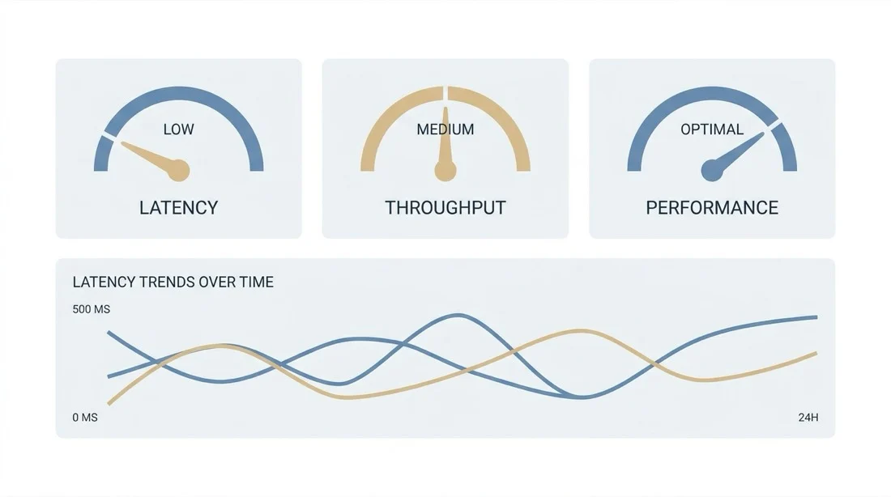

Flat vector dashboard panel showing three gauge dials and abstract latency curves, muted blue and sand palette, generous white space, crisp geometric cards, no placeholder text

Model: Nano Banana 2.1 · Author: APIMart prompt contributors · [Original source](https://github.com/apimartyrdf8/nano-banana-2.1-prompts/blob/b3ad0db06be4105e36b86f17274ba9a87e55004e/assets/07-infographic-dashboard.jpg)

MIT License

Copyright (c) 2026 apimart pricing-comparison contributors

Permission is hereby granted, free of charge, to any person obtaining a copy
of this software and associated documentation files (the "Software"), to deal
in the Software without restriction, including without limitation the rights
to use, copy, modify, merge, publish, distribute, sublicense, and/or sell
copies of the Software, and to permit persons to whom the Software is
furnished to do so, subject to the following conditions:

The above copyright notice and this permission notice shall be included in all
copies or substantial portions of the Software.

THE SOFTWARE IS PROVIDED "AS IS", WITHOUT WARRANTY OF ANY KIND, EXPRESS OR
IMPLIED, INCLUDING BUT NOT LIMITED TO THE WARRANTIES OF MERCHANTABILITY,
FITNESS FOR A PARTICULAR PURPOSE AND NONINFRINGEMENT. IN NO EVENT SHALL THE
AUTHORS OR COPYRIGHT HOLDERS BE LIABLE FOR ANY CLAIM, DAMAGES OR OTHER
LIABILITY, WHETHER IN AN ACTION OF CONTRACT, TORT OR OTHERWISE, ARISING FROM,
OUT OF OR IN CONNECTION WITH THE SOFTWARE OR THE USE OR OTHER DEALINGS IN THE
SOFTWARE.

Model names, prices and vendor documentation remain subject to their owners' terms.

